# AI训练系统

<cite>
**本文引用的文件**
- [train_main.py](file://ai/train_main.py)
- [self_play_cycle.py](file://ai/self_play_cycle.py)
- [create_samples.py](file://ai/create_samples.py)
- [merge_samples.py](file://ai/merge_samples.py)
- [reward_calculator.py](file://ai/reward_calculator.py)
- [line_tracer.py](file://ai/line_tracer.py)
- [base_trainer.py](file://ai/base_trainer.py)
- [move_sampler.py](file://ai/move_sampler.py)
- [sample_generator.py](file://ai/sample_generator.py)
- [lr_range_test.py](file://ai/lr_range_test.py)
- [model.py (cnn_v3)](file://ai/models/cnn_v3/model.py)
- [model.py (fc_v1)](file://ai/models/fc_v1/model.py)
- [game_manager.py](file://ai/game_manager.py)
- [engine.py](file://ai/engine.py)
- [data_recorder.py](file://ai/data_recorder.py)
</cite>

## 目录
1. [简介](#简介)
2. [项目结构](#项目结构)
3. [核心组件](#核心组件)
4. [架构总览](#架构总览)
5. [详细组件分析](#详细组件分析)
6. [依赖分析](#依赖分析)
7. [性能考虑](#性能考虑)
8. [故障排查指南](#故障排查指南)
9. [结论](#结论)
10. [附录](#附录)

## 简介
本文件面向五子棋AI训练系统的开发者与使用者，系统性阐述从自我对弈、样本生成、数据处理到模型训练的完整生命周期。文档重点解释训练算法的核心原理，包括奖励反向传播、五连追溯算法、温度采样策略与学习率调度机制；并提供样本生成、数据增强、样本合并与质量检查的详细说明；最后给出训练周期管理、参数配置与优化建议，辅以流程图与时序图帮助理解。

## 项目结构
本项目采用“按功能域划分”的组织方式，核心训练相关模块集中在 ai 目录，包含训练入口、训练器抽象、样本生成与合并、奖励计算、对弈引擎、数据记录与管理等子模块。模型实现位于 ai/models 下，分别提供 FC v1 与 CNN v3 两类神经网络模型。

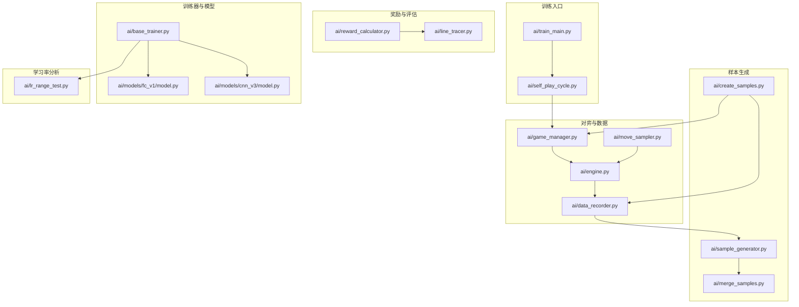

**图表来源**
- [train_main.py:1-234](file://ai/train_main.py#L1-L234)
- [self_play_cycle.py:1-195](file://ai/self_play_cycle.py#L1-L195)
- [create_samples.py:1-197](file://ai/create_samples.py#L1-L197)
- [merge_samples.py:1-155](file://ai/merge_samples.py#L1-L155)
- [reward_calculator.py:1-239](file://ai/reward_calculator.py#L1-L239)
- [line_tracer.py:1-143](file://ai/line_tracer.py#L1-L143)
- [base_trainer.py:1-699](file://ai/base_trainer.py#L1-L699)
- [model.py (fc_v1):1-132](file://ai/models/fc_v1/model.py#L1-L132)
- [model.py (cnn_v3):1-139](file://ai/models/cnn_v3/model.py#L1-L139)
- [game_manager.py:1-339](file://ai/game_manager.py#L1-L339)
- [engine.py:1-194](file://ai/engine.py#L1-L194)
- [data_recorder.py:1-145](file://ai/data_recorder.py#L1-L145)
- [move_sampler.py:1-258](file://ai/move_sampler.py#L1-L258)
- [lr_range_test.py:1-289](file://ai/lr_range_test.py#L1-L289)

**章节来源**
- [train_main.py:1-234](file://ai/train_main.py#L1-L234)
- [base_trainer.py:1-699](file://ai/base_trainer.py#L1-L699)

## 核心组件
- 训练入口与运行器：提供命令行参数解析、训练模式路由与训练周期编排。
- 训练器抽象：统一训练流程、损失计算、学习率调度、GPU加速与日志输出。
- 自我对弈与数据记录：封装引擎、温度采样策略与数据记录，生成对弈样本。
- 样本生成与合并：提供棋型样本生成器与样本合并工具，支持数据增强与质量评估。
- 奖励与评估：实现棋型奖励计算、冲四递归防守模拟与五连追溯奖励反向传播。
- 模型实现：FC v1 与 CNN v3 两种网络结构，适配不同输入格式与训练需求。
- 学习率范围测试：提供 LR Range Test 能力，辅助选择合适的学习率区间。

**章节来源**
- [train_main.py:27-234](file://ai/train_main.py#L27-L234)
- [base_trainer.py:32-699](file://ai/base_trainer.py#L32-L699)
- [game_manager.py:123-339](file://ai/game_manager.py#L123-L339)
- [data_recorder.py:17-145](file://ai/data_recorder.py#L17-L145)
- [sample_generator.py:1-511](file://ai/sample_generator.py#L1-L511)
- [merge_samples.py:1-155](file://ai/merge_samples.py#L1-L155)
- [reward_calculator.py:35-239](file://ai/reward_calculator.py#L35-L239)
- [line_tracer.py:10-143](file://ai/line_tracer.py#L10-L143)
- [model.py (fc_v1):91-132](file://ai/models/fc_v1/model.py#L91-L132)
- [model.py (cnn_v3):96-139](file://ai/models/cnn_v3/model.py#L96-L139)
- [lr_range_test.py:131-289](file://ai/lr_range_test.py#L131-L289)

## 架构总览
训练系统采用“入口-编排-对弈-样本-训练-评估”的流水线式架构。入口脚本解析参数并路由到训练周期或从目录训练；训练周期通过 SelfPlayCycle 编排自我对弈与样本合并训练；对弈阶段由 AIEngine 与 AIGameManager 驱动，结合温度采样策略提升探索能力；样本生成与合并工具负责数据准备与质量控制；BaseTrainer 统一训练流程与日志输出；奖励计算模块提供棋型与五连追溯奖励；模型实现提供 FC v1 与 CNN v3 两种结构；LR Range Test 提供学习率选择支持。

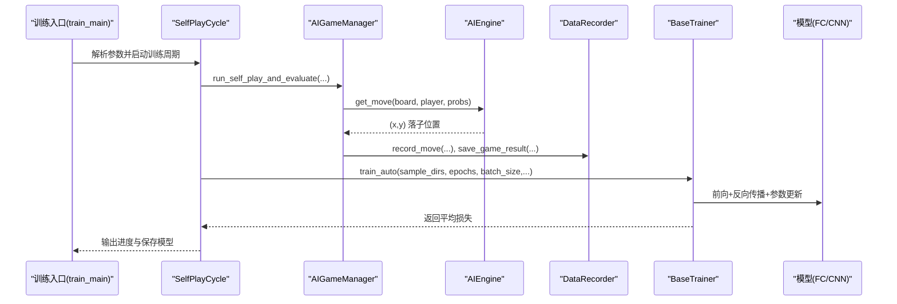

**图表来源**
- [train_main.py:27-234](file://ai/train_main.py#L27-L234)
- [self_play_cycle.py:38-195](file://ai/self_play_cycle.py#L38-L195)
- [game_manager.py:233-339](file://ai/game_manager.py#L233-L339)
- [engine.py:67-194](file://ai/engine.py#L67-L194)
- [data_recorder.py:96-145](file://ai/data_recorder.py#L96-L145)
- [base_trainer.py:575-699](file://ai/base_trainer.py#L575-L699)

## 详细组件分析

### 训练入口与参数解析
- 功能：提供统一的训练入口，支持训练周期与从目录训练两种模式；参数包括模型选择、轮次数、每轮对局数、训练轮数、奖励衰减率、学习率调度、温度采样策略、数据增强开关等。
- 关键点：参数互斥校验（--cycle 与 --train-from-dir 二选一）、学习率调度器类型与参数注入、温度采样配置传递至 SelfPlayCycle。

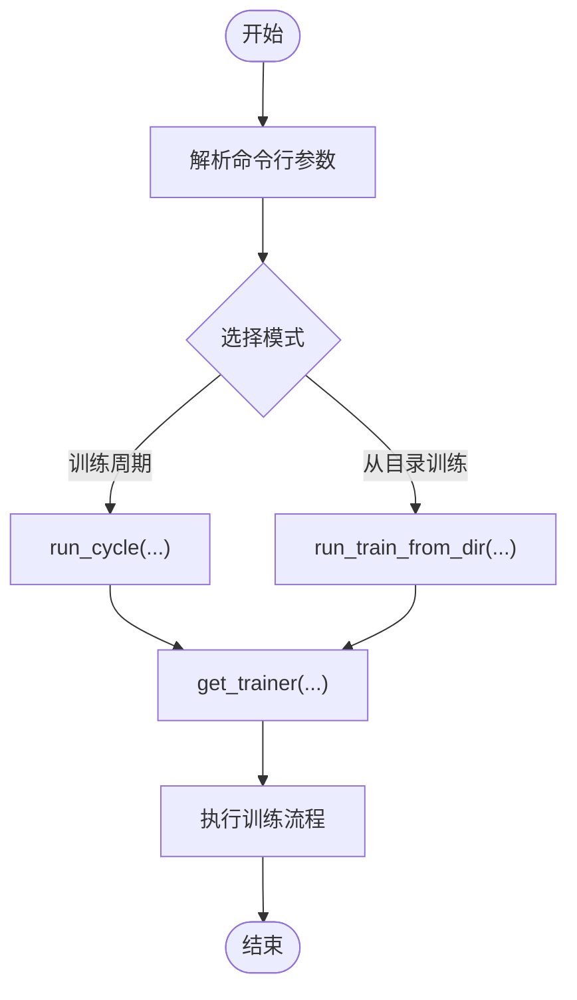

**图表来源**
- [train_main.py:27-234](file://ai/train_main.py#L27-L234)

**章节来源**
- [train_main.py:27-234](file://ai/train_main.py#L27-L234)

### 自我对弈训练周期
- 功能：将 BaseTrainer.train_cycle 抽象为独立类，负责轮次编排、样本目录管理、训练方法选择（全量/mini-batch）、损失日志与模型保存。
- 关键点：每轮结束后合并样本并训练；支持验证集比例；支持温度采样配置；键盘中断时保存模型与图表。

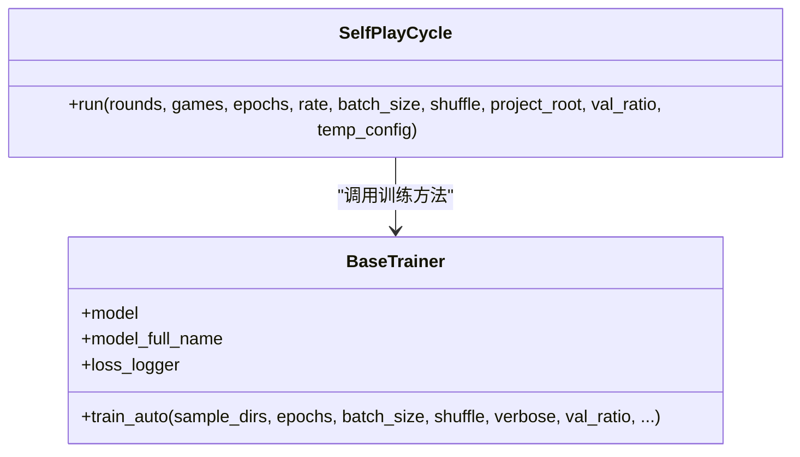

**图表来源**
- [self_play_cycle.py:20-195](file://ai/self_play_cycle.py#L20-L195)
- [base_trainer.py:575-604](file://ai/base_trainer.py#L575-L604)

**章节来源**
- [self_play_cycle.py:20-195](file://ai/self_play_cycle.py#L20-L195)
- [base_trainer.py:621-660](file://ai/base_trainer.py#L621-L660)

### 自我对弈与数据记录
- 功能：AIGameManager 封装单局与多局对弈流程，支持固定执方与随机执方；AIEngine 负责将棋盘转换为向量、调用模型获取概率分布、按策略选择落子；DataRecorder 记录每步输入、输出与落子位置，并在游戏结束时保存完整记录。
- 关键点：温度采样策略在引擎层实现；对弈阶段仅调用一次模型预测以提升性能；记录器按轮次与局数组织数据目录。

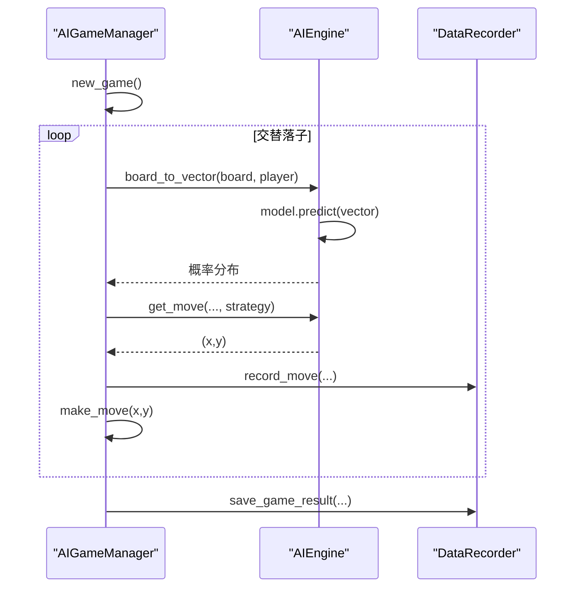

**图表来源**
- [game_manager.py:123-339](file://ai/game_manager.py#L123-L339)
- [engine.py:67-194](file://ai/engine.py#L67-L194)
- [data_recorder.py:66-145](file://ai/data_recorder.py#L66-L145)

**章节来源**
- [game_manager.py:123-339](file://ai/game_manager.py#L123-L339)
- [engine.py:67-194](file://ai/engine.py#L67-L194)
- [data_recorder.py:17-145](file://ai/data_recorder.py#L17-L145)

### 温度采样策略
- 功能：提供温度加权采样与阶梯式温度切换策略，支持按局随机选择一方启用或双方启用；支持 top_k 截断与可复现随机种子。
- 关键点：should_sample 根据 move_count 与 temp_side 判定是否启用采样；resolve_temp_side 在每局解析 temp_side；temperature_sample 实现温度变换与加权采样。

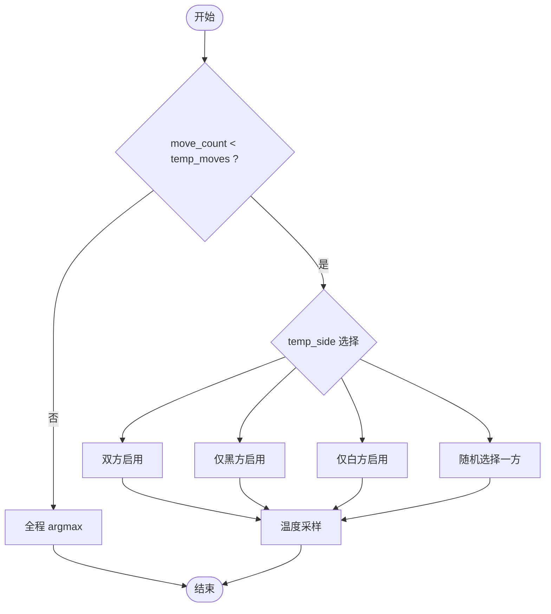

**图表来源**
- [move_sampler.py:192-258](file://ai/move_sampler.py#L192-L258)
- [move_sampler.py:117-186](file://ai/move_sampler.py#L117-L186)

**章节来源**
- [move_sampler.py:1-258](file://ai/move_sampler.py#L1-L258)

### 奖励计算与五连追溯
- 功能：RewardCalculator 将棋型映射为数值 reward，处理冲四递归防守模拟；LineTracer 从终局棋盘找到五连位置，追溯历史步骤，反向传播衰减奖励，并与棋型奖励融合。
- 关键点：冲四递归通过模拟防守后检测后续棋型获取奖励；五连追溯按衰减率逐步降低奖励；融合时进行裁剪以维持数值稳定性。

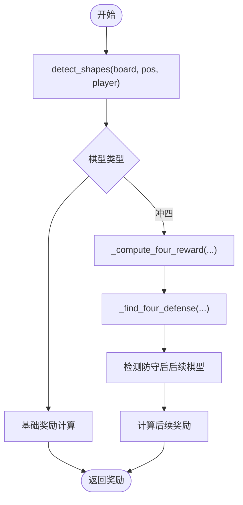

**图表来源**
- [reward_calculator.py:76-191](file://ai/reward_calculator.py#L76-L191)

**章节来源**
- [reward_calculator.py:13-239](file://ai/reward_calculator.py#L13-L239)
- [line_tracer.py:10-143](file://ai/line_tracer.py#L10-L143)

### 样本生成与合并
- 功能：独立 CLI 脚本 create_samples 支持 winning_move 与 winner_path 两种模式；sample_generator 提供棋型样本生成器，支持 chong4、huo4、huo3、huo2、defend_chong4、defend_huo3；merge_samples 将分散的 sample.json 合并为单个大文件。
- 关键点：winner_path 模式强制禁用数据增强；样本验证提供 Hit@N、攻击位概率和、区分度 gap 等指标；合并时去重并按路径排序。

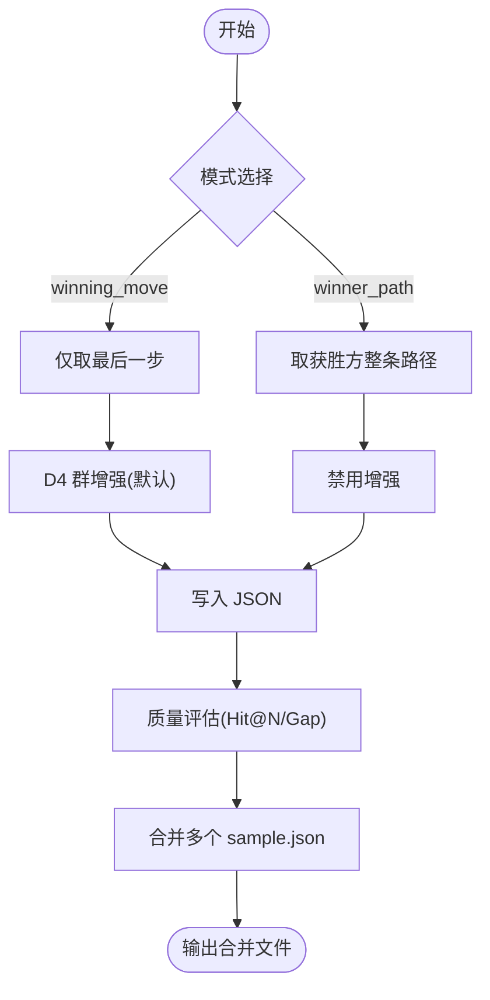

**图表来源**
- [create_samples.py:23-197](file://ai/create_samples.py#L23-L197)
- [sample_generator.py:261-328](file://ai/sample_generator.py#L261-L328)
- [merge_samples.py:13-155](file://ai/merge_samples.py#L13-L155)

**章节来源**
- [create_samples.py:1-197](file://ai/create_samples.py#L1-L197)
- [sample_generator.py:1-511](file://ai/sample_generator.py#L1-L511)
- [merge_samples.py:1-155](file://ai/merge_samples.py#L1-L155)

### 训练器抽象与学习率调度
- 功能：BaseTrainer 统一训练流程，支持 GPU 加速、L1Loss 掩码损失、StepLR 与 ReduceLROnPlateau 两种学习率调度；train_auto 自动选择全量或 mini-batch 训练；train_cycle 编排训练周期。
- 关键点：_masked_loss 使用掩码对无效位置进行屏蔽；学习率调度器按类型分别 step；键盘中断时保存模型与图表。

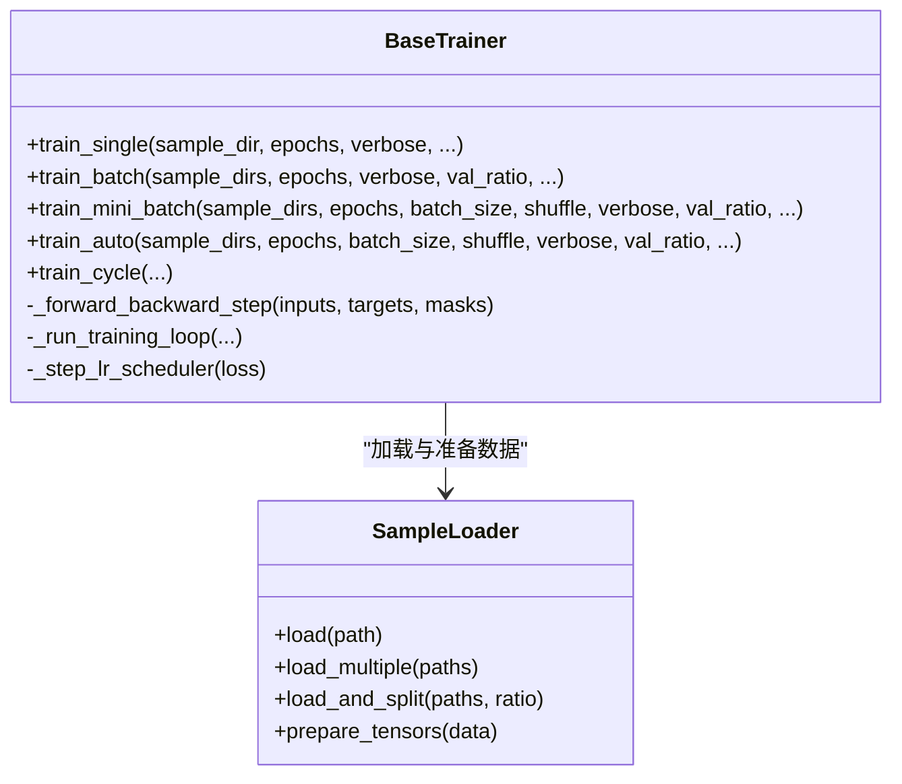

**图表来源**
- [base_trainer.py:32-699](file://ai/base_trainer.py#L32-L699)

**章节来源**
- [base_trainer.py:1-699](file://ai/base_trainer.py#L1-L699)

### 模型实现（FC v1 与 CNN v3）
- 功能：FC v1 提供 5 层隐藏层的全连接网络，输入维度为 226；CNN v3 提供纯卷积网络，输入为 3 通道 15×15 的棋盘状态，输出 225 维概率分布。
- 关键点：两者均继承 NeuralNetworkModel，统一 predict、save、load 等通用逻辑；CNN v3 使用 1×1 卷积替代 FC 层，参数量更少。

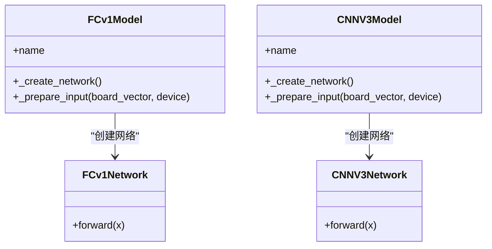

**图表来源**
- [model.py (fc_v1):91-132](file://ai/models/fc_v1/model.py#L91-L132)
- [model.py (cnn_v3):96-139](file://ai/models/cnn_v3/model.py#L96-L139)

**章节来源**
- [model.py (fc_v1):1-132](file://ai/models/fc_v1/model.py#L1-L132)
- [model.py (cnn_v3):1-139](file://ai/models/cnn_v3/model.py#L1-L139)

### 学习率范围测试
- 功能：LR Range Test 对指定模型与数据执行学习率范围扫描，每个 round 使用固定学习率训练固定步数，绘制 lr-loss 曲线，辅助选择合适的学习率区间。
- 关键点：每个 round 重置模型到初始状态，确保 loss 只反映 lr 的影响；支持从文件或目录加载数据。

**章节来源**
- [lr_range_test.py:131-289](file://ai/lr_range_test.py#L131-L289)

## 依赖分析
- 模块耦合：SelfPlayCycle 依赖 BaseTrainer 的训练方法；AIGameManager 依赖 AIEngine 与 DataRecorder；DataRecorder 依赖 constants 中的目录常量；训练器依赖 SampleLoader 进行数据加载与张量准备。
- 外部依赖：PyTorch（神经网络框架）、Matplotlib（绘图）、argparse（命令行解析）。
- 循环依赖规避：move_sampler 与 engine 之间通过本地导入避免循环依赖；game_manager 与 engine 通过策略参数传递实现松耦合。

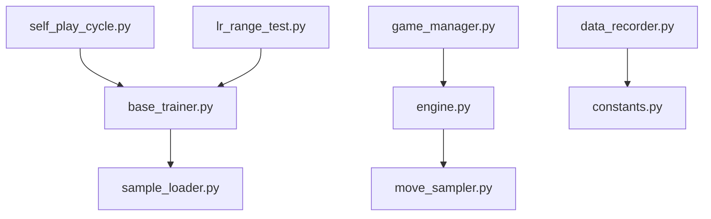

**图表来源**
- [self_play_cycle.py:12-14](file://ai/self_play_cycle.py#L12-L14)
- [game_manager.py:10-13](file://ai/game_manager.py#L10-L13)
- [engine.py:8-9](file://ai/engine.py#L8-L9)
- [data_recorder.py:12](file://ai/data_recorder.py#L12)
- [base_trainer.py:14-18](file://ai/base_trainer.py#L14-L18)
- [lr_range_test.py:29-32](file://ai/lr_range_test.py#L29-L32)

**章节来源**
- [self_play_cycle.py:12-14](file://ai/self_play_cycle.py#L12-L14)
- [game_manager.py:10-13](file://ai/game_manager.py#L10-L13)
- [engine.py:8-9](file://ai/engine.py#L8-L9)
- [data_recorder.py:12](file://ai/data_recorder.py#L12)
- [base_trainer.py:14-18](file://ai/base_trainer.py#L14-L18)
- [lr_range_test.py:29-32](file://ai/lr_range_test.py#L29-L32)

## 性能考虑
- GPU 加速：BaseTrainer 自动检测并使用 CUDA 设备；模型网络与张量均迁移至 GPU。
- mini-batch 训练：train_mini_batch 支持分批训练，提高收敛速度与内存利用率；支持每 epoch 评估验证集损失。
- 数据 I/O 优化：DataRecorder 使用紧凑 JSON 格式减少文件体积；merge_samples 合并多个 sample.json 为单个大文件，降低训练时 I/O 开销。
- 对弈性能：AIEngine 在每步仅调用一次模型预测，避免重复计算；温度采样在引擎层实现，减少不必要的概率重算。
- 学习率调度：StepLR 与 ReduceLROnPlateau 两种策略可按需选择，配合 LR Range Test 选择合适学习率区间。

[本节为通用指导，不直接分析具体文件]

## 故障排查指南
- 训练中断：BaseTrainer 在键盘中断时保存模型与图表，随后抛出异常；SelfPlayCycle 捕获并提示“已保存当前进度，可以安全退出”。
- 模型加载失败：create_engine 对未知模型名称或多代模型未指定代数抛出异常，由上层转换为 ModelLoadError。
- 数据路径错误：merge_samples 校验目录存在性与类型；lr_range_test 对数据路径不存在与数据为空进行报错。
- 温度采样异常：move_sampler 对非法参数（如 temperature ≤ 0、temp_moves < 0 等）抛出 ValueError；resolve_temp_side 对非法 temp_side 抛出异常。

**章节来源**
- [base_trainer.py:314-322](file://ai/base_trainer.py#L314-L322)
- [self_play_cycle.py:157-177](file://ai/self_play_cycle.py#L157-L177)
- [engine.py:38-42](file://ai/engine.py#L38-L42)
- [merge_samples.py:134-142](file://ai/merge_samples.py#L134-L142)
- [lr_range_test.py:115-128](file://ai/lr_range_test.py#L115-L128)
- [move_sampler.py:77-111](file://ai/move_sampler.py#L77-L111)
- [move_sampler.py:250-257](file://ai/move_sampler.py#L250-L257)

## 结论
本训练系统通过清晰的模块划分与统一的训练抽象，实现了从自我对弈到样本生成、数据处理与模型训练的完整闭环。奖励反向传播与五连追溯算法确保训练信号的有效性；温度采样策略提升探索能力；学习率调度与 LR Range Test 提供稳健的超参数选择；FC v1 与 CNN v3 两种模型满足不同场景需求。建议在实际使用中结合任务规模选择合适的 batch_size、学习率与数据增强策略，并定期进行样本质量评估与损失曲线分析。

[本节为总结性内容，不直接分析具体文件]

## 附录
- 训练参数配置建议
  - 训练周期：--cycle 模式下，合理设置 rounds 与 games；epochs 根据收敛情况调整。
  - 温度采样：--temperature、--temp-moves、--temp-side、--temp-seed 控制探索强度与可复现性。
  - 学习率调度：--lr-scheduler 选择 step 或 plateau；--lr-step-size、--lr-gamma、--lr-patience、--lr-factor 调整衰减策略。
  - mini-batch：--batch-size 与 --shuffle 提升训练效率与泛化能力。
  - 验证集：--val-ratio 评估过拟合风险。
- 样本生成与质量评估
  - create_samples 支持 winning_move 与 winner_path 两种模式；merge_samples 合并样本文件。
  - sample_generator 提供 Hit@N、攻击位概率和、区分度 gap 等指标评估样本质量。
- 学习率范围测试
  - lr_range_test 提供学习率扫描与曲线绘制，辅助选择合适的学习率区间。

[本节为通用指导，不直接分析具体文件]