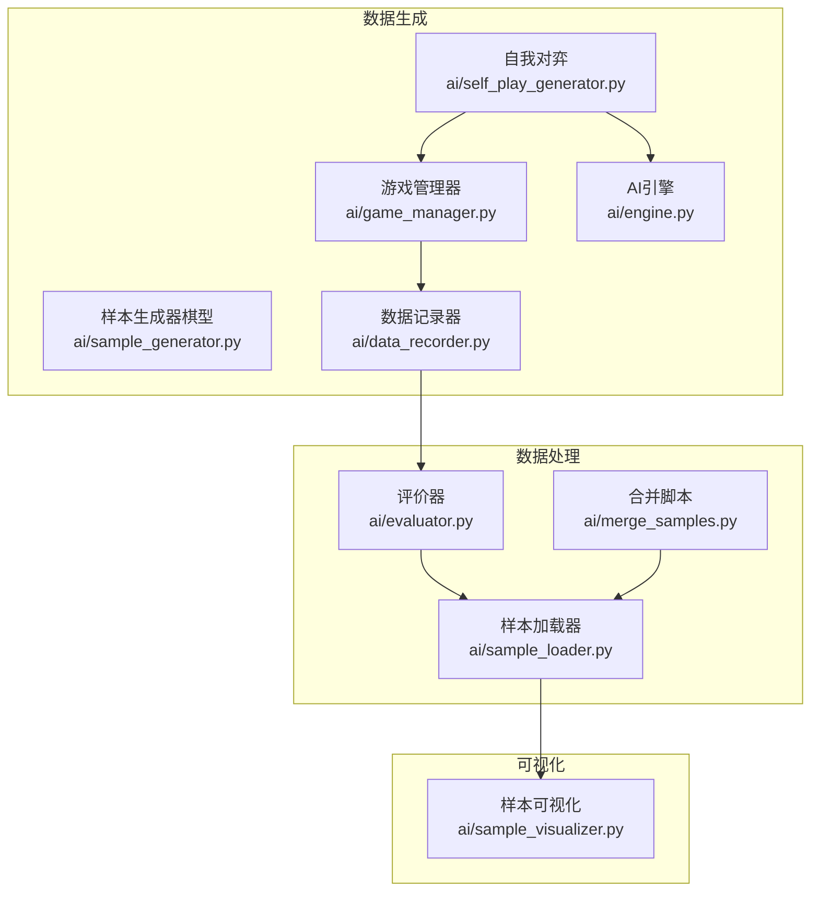
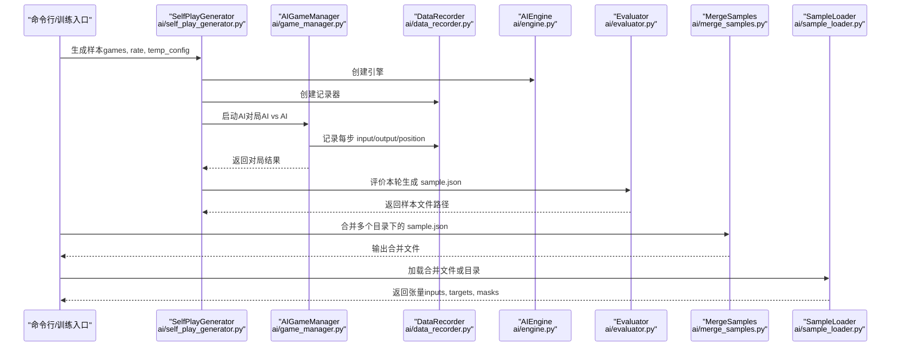
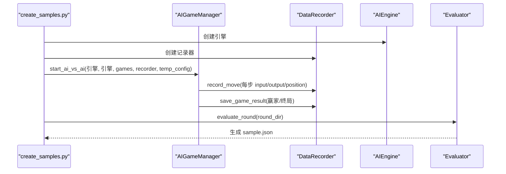
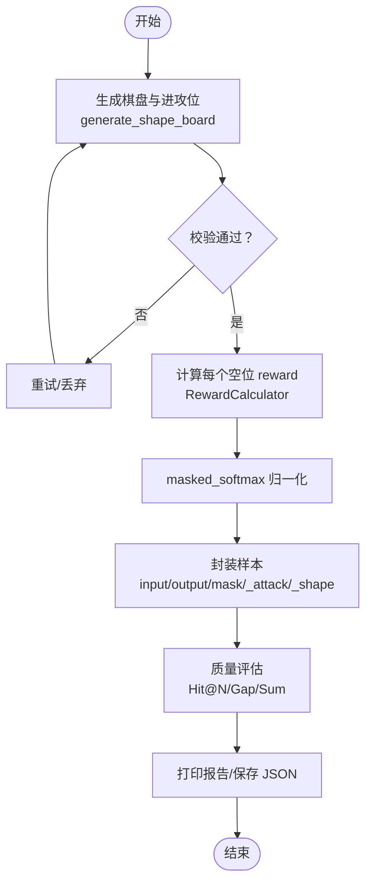
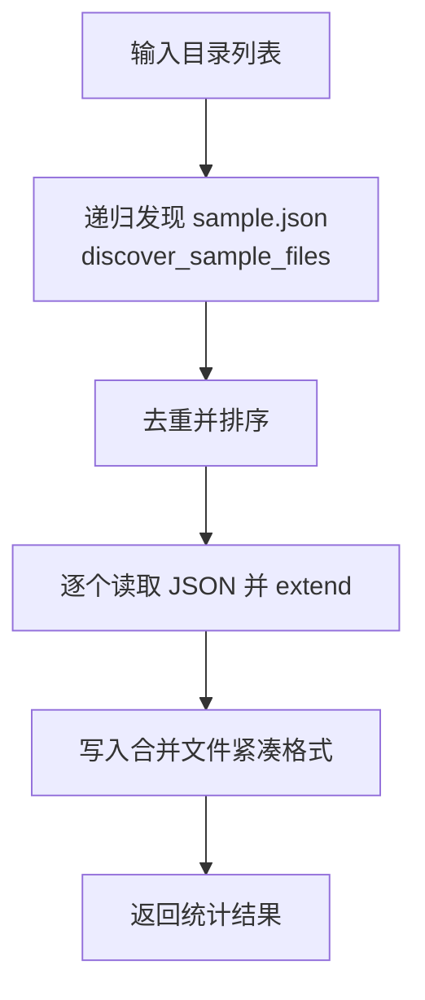
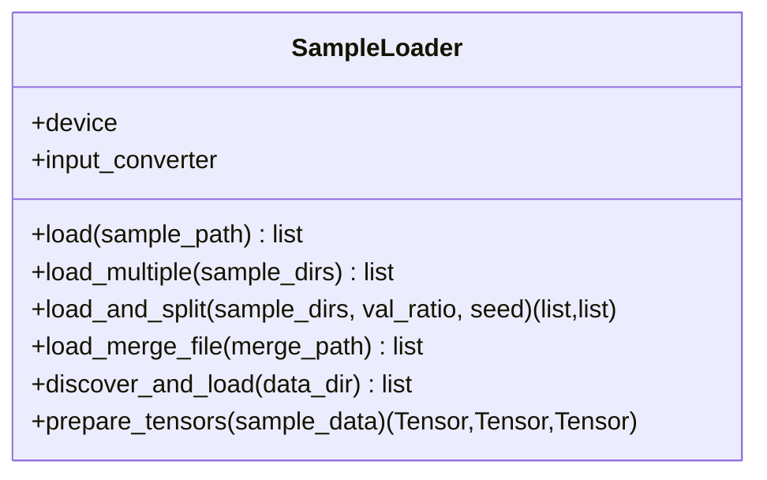
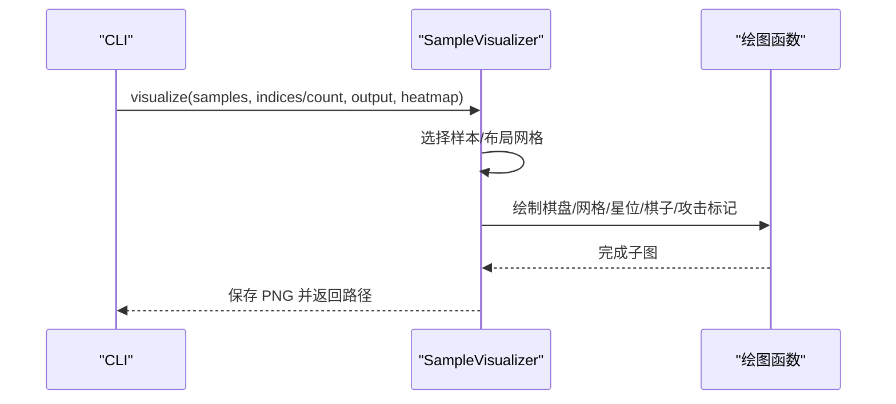
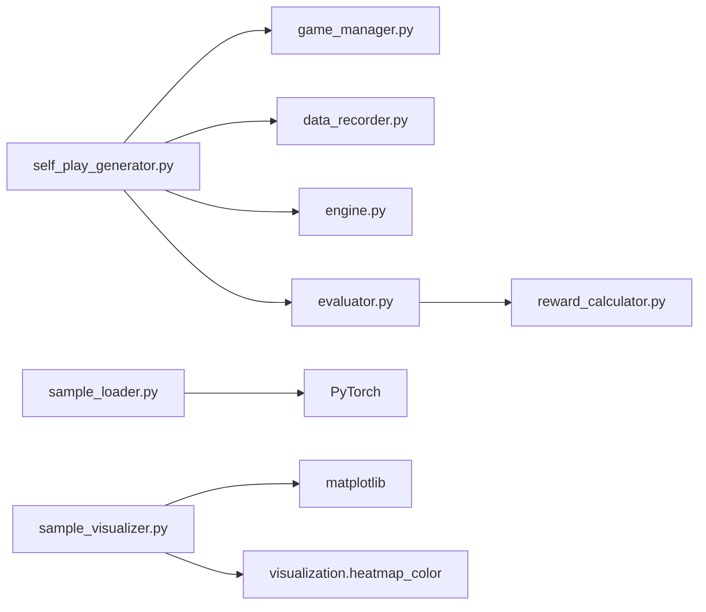

# 数据处理

<cite>
**本文引用的文件**
- [ai/create_samples.py](file://ai/create_samples.py)
- [ai/self_play_generator.py](file://ai/self_play_generator.py)
- [ai/game_manager.py](file://ai/game_manager.py)
- [ai/data_recorder.py](file://ai/data_recorder.py)
- [ai/engine.py](file://ai/engine.py)
- [ai/evaluator.py](file://ai/evaluator.py)
- [ai/sample_generator.py](file://ai/sample_generator.py)
- [ai/merge_samples.py](file://ai/merge_samples.py)
- [ai/sample_loader.py](file://ai/sample_loader.py)
- [ai/sample_visualizer.py](file://ai/sample_visualizer.py)
- [ai/constants.py](file://ai/constants.py)
- [ai/reward_calculator.py](file://ai/reward_calculator.py)
- [design/sample_generator_design.md](file://design/sample_generator_design.md)
- [design/merge_samples_design.md](file://design/merge_samples_design.md)
- [design/sample_visualizer_design.md](file://design/sample_visualizer_design.md)
</cite>

## 目录
1. [简介](#简介)
2. [项目结构](#项目结构)
3. [核心组件](#核心组件)
4. [架构总览](#架构总览)
5. [详细组件分析](#详细组件分析)
6. [依赖分析](#依赖分析)
7. [性能考量](#性能考量)
8. [故障排查指南](#故障排查指南)
9. [结论](#结论)
10. [附录](#附录)

## 简介
本文件面向五子棋AI数据处理系统，围绕“样本生成—样本合并—样本加载—样本可视化—数据预处理”的完整流水线，提供技术文档与最佳实践。内容涵盖：
- 自我对弈样本生成机制与两种模式（最后一步/获胜方整条路径）
- 棋型样本的创建方法与标签质量评估
- 多数据集合并策略、重复样本去重与数据格式统一
- 样本加载器的设计原理与内存管理、批量处理
- 样本可视化工具的功能与使用方法
- 数据预处理指南与性能优化建议

## 项目结构
本系统以“AI包”为核心，围绕数据生成、合并、加载与可视化形成闭环：
- 数据生成：自我对弈（AI vs AI）、棋型合成（样本生成器）
- 数据合并：将分散的 sample.json 合并为单一大文件
- 数据加载：统一从 JSON 到 PyTorch 张量的转换
- 数据可视化：棋盘+棋子+攻击位标记+可选热力图
- 常量与配置：统一数据目录、奖励配置

图表来源
- [ai/self_play_generator.py:1-244](file://ai/self_play_generator.py#L1-L244)
- [ai/game_manager.py:1-339](file://ai/game_manager.py#L1-L339)
- [ai/data_recorder.py:1-145](file://ai/data_recorder.py#L1-L145)
- [ai/engine.py:1-194](file://ai/engine.py#L1-L194)
- [ai/evaluator.py:1-350](file://ai/evaluator.py#L1-L350)
- [ai/sample_generator.py:1-511](file://ai/sample_generator.py#L1-L511)
- [ai/merge_samples.py:1-155](file://ai/merge_samples.py#L1-L155)
- [ai/sample_loader.py:1-240](file://ai/sample_loader.py#L1-L240)
- [ai/sample_visualizer.py:1-496](file://ai/sample_visualizer.py#L1-L496)

章节来源
- [ai/constants.py:1-26](file://ai/constants.py#L1-L26)

## 核心组件
- 自我对弈样本生成：通过 AI 引擎与游戏管理器进行 AI vs AI 对局，记录每步输入、输出与落子位置，随后由评价器生成训练样本。
- 棋型样本生成：按指定棋型（冲四/活四/活三/活二/防守冲四/防守活三）合成棋盘，标注进攻/防守位，计算奖励并归一化为标签。
- 样本合并：递归发现目录下所有 sample.json，去重后合并为单个大文件，减少训练时 I/O。
- 样本加载：统一加载 JSON，按需拆分训练/验证集，转换为 PyTorch 张量并迁移到设备。
- 样本可视化：抽样绘制棋盘、棋子、攻击位标记与可选热力图，支持 CJK 字体与多种归一化模式。

章节来源
- [ai/create_samples.py:1-197](file://ai/create_samples.py#L1-L197)
- [ai/self_play_generator.py:1-244](file://ai/self_play_generator.py#L1-L244)
- [ai/sample_generator.py:1-511](file://ai/sample_generator.py#L1-L511)
- [ai/merge_samples.py:1-155](file://ai/merge_samples.py#L1-L155)
- [ai/sample_loader.py:1-240](file://ai/sample_loader.py#L1-L240)
- [ai/sample_visualizer.py:1-496](file://ai/sample_visualizer.py#L1-L496)

## 架构总览
下面的序列图展示了“自我对弈→评价→样本→合并→加载→训练”的关键流程。

图表来源
- [ai/self_play_generator.py:21-168](file://ai/self_play_generator.py#L21-L168)
- [ai/game_manager.py:233-274](file://ai/game_manager.py#L233-L274)
- [ai/data_recorder.py:17-145](file://ai/data_recorder.py#L17-L145)
- [ai/engine.py:44-194](file://ai/engine.py#L44-L194)
- [ai/evaluator.py:97-131](file://ai/evaluator.py#L97-L131)
- [ai/merge_samples.py:105-155](file://ai/merge_samples.py#L105-L155)
- [ai/sample_loader.py:67-240](file://ai/sample_loader.py#L67-L240)

## 详细组件分析

### 自我对弈样本生成
- 流程概览：创建引擎→创建记录器→AI vs AI 对局→记录每步数据→保存结果→评价生成样本。
- 温度采样：支持在前若干步启用温度采样，之后回归 argmax，提升探索多样性。
- 模式选择：最后一步模式（仅取每局最后一步）与获胜方整条路径模式（强制不做 D4 增强）。

图表来源
- [ai/create_samples.py:23-197](file://ai/create_samples.py#L23-L197)
- [ai/game_manager.py:233-274](file://ai/game_manager.py#L233-L274)
- [ai/data_recorder.py:96-145](file://ai/data_recorder.py#L96-L145)
- [ai/evaluator.py:224-350](file://ai/evaluator.py#L224-L350)

章节来源
- [ai/create_samples.py:23-197](file://ai/create_samples.py#L23-L197)
- [ai/self_play_generator.py:21-168](file://ai/self_play_generator.py#L21-L168)
- [ai/game_manager.py:123-274](file://ai/game_manager.py#L123-L274)
- [ai/data_recorder.py:17-145](file://ai/data_recorder.py#L17-L145)

### 棋型样本生成与质量评估
- 生成策略：按棋型参数（连珠数、开放端数、期望棋型）合成棋盘，标注进攻/防守位，放置少量干扰子并二次校验。
- 标签生成：使用奖励计算器计算每个空位 reward，经掩码 Softmax 归一化为概率分布。
- 质量评估：Hit@N、Hit@N+1、Hit@N+2、进攻位概率和、区分度 gap、失败样例列表。

图表来源
- [ai/sample_generator.py:101-284](file://ai/sample_generator.py#L101-L284)
- [ai/sample_generator.py:287-327](file://ai/sample_generator.py#L287-L327)
- [ai/sample_generator.py:334-401](file://ai/sample_generator.py#L334-L401)
- [ai/reward_calculator.py:46-99](file://ai/reward_calculator.py#L46-L99)

章节来源
- [ai/sample_generator.py:1-511](file://ai/sample_generator.py#L1-L511)
- [design/sample_generator_design.md:1-265](file://design/sample_generator_design.md#L1-L265)
- [ai/reward_calculator.py:1-239](file://ai/reward_calculator.py#L1-L239)

### 样本合并算法
- 发现策略：递归遍历目录，收集所有 sample.json（忽略以 merge_ 开头的文件），去重并排序。
- 合并策略：顺序读取 JSON 列表并拼接，输出为紧凑格式，减少文件体积。
- 合并入口：支持单目录或多目录合并，CLI 提供统计输出。

图表来源
- [ai/merge_samples.py:13-76](file://ai/merge_samples.py#L13-L76)
- [ai/merge_samples.py:79-102](file://ai/merge_samples.py#L79-L102)
- [ai/merge_samples.py:105-155](file://ai/merge_samples.py#L105-L155)

章节来源
- [ai/merge_samples.py:1-155](file://ai/merge_samples.py#L1-L155)
- [design/merge_samples_design.md:1-247](file://design/merge_samples_design.md#L1-L247)

### 样本加载器设计
- 加载能力：支持单文件、多目录合并、递归发现所有 .json 文件、按比例拆分训练/验证集。
- 张量准备：将 input/output/mask 转换为 PyTorch 张量，按需迁移到设备。
- 内存管理：采用列表推导与一次性转换，减少 Python 层开销；按需分片加载避免一次性占用过多内存。

图表来源
- [ai/sample_loader.py:67-240](file://ai/sample_loader.py#L67-L240)

章节来源
- [ai/sample_loader.py:1-240](file://ai/sample_loader.py#L1-L240)

### 样本可视化工具
- 功能：抽样绘制棋盘、棋子、攻击位标记（红色星号），可选叠加热力图（log/max/linear 归一化）。
- 兼容性：支持新旧样本格式，旧格式通过 argmax 兜底。
- 输出：PNG 图像，支持自定义透明度与输出路径。

图表来源
- [ai/sample_visualizer.py:312-404](file://ai/sample_visualizer.py#L312-L404)
- [ai/sample_visualizer.py:463-496](file://ai/sample_visualizer.py#L463-L496)

章节来源
- [ai/sample_visualizer.py:1-496](file://ai/sample_visualizer.py#L1-L496)
- [design/sample_visualizer_design.md:1-115](file://design/sample_visualizer_design.md#L1-L115)

### 数据预处理指南
- 数据清洗
  - 去除无效记录：缺失 history/winner/end_board 的记录将被拒绝。
  - 掩码一致性：mask=1 仅对应空位，已落子位置 mask=0。
- 格式转换
  - input：225 维棋盘 + 1 维当前玩家。
  - output：225 维概率分布（masked_softmax），和为 1。
  - mask：225 维，1=合法空位，0=已落子。
- 特征工程
  - 使用奖励计算器结合双向棋型检测与五连追溯融合，提升标签质量。
  - 防守样本通过视角切换复用进攻生成器，保持语义清晰。

章节来源
- [ai/evaluator.py:97-211](file://ai/evaluator.py#L97-L211)
- [ai/reward_calculator.py:46-99](file://ai/reward_calculator.py#L46-L99)

## 依赖分析
- 模块耦合
  - SelfPlayGenerator 依赖 Engine、GameManager、DataRecorder、Evaluator。
  - Evaluator 依赖 RewardCalculator、LineTracer、probability_utils。
  - SampleLoader 依赖 JSON、PyTorch、随机数。
  - SampleVisualizer 依赖 matplotlib、numpy、visualization.heatmap_color。
- 外部依赖
  - 并行执行使用 ProcessPoolExecutor，Windows 下通过顶层函数工作。
  - Matplotlib 后端设置为 Agg，避免 GUI 初始化问题。

图表来源
- [ai/self_play_generator.py:1-244](file://ai/self_play_generator.py#L1-L244)
- [ai/evaluator.py:1-350](file://ai/evaluator.py#L1-L350)
- [ai/sample_loader.py:1-240](file://ai/sample_loader.py#L1-L240)
- [ai/sample_visualizer.py:1-496](file://ai/sample_visualizer.py#L1-L496)

章节来源
- [ai/evaluator.py:26-49](file://ai/evaluator.py#L26-L49)

## 性能考量
- I/O 优化
  - 合并样本文件：将数百个小文件合并为单个大文件，减少训练时打开/解析次数。
  - 紧凑格式：JSON dump 时不使用缩进，降低文件体积。
- 计算优化
  - masked_softmax：在合法位置计算 reward 并归一化，避免无效位置参与。
  - 并行评价：多进程并行处理 record.json，失败回退到串行。
- 内存管理
  - SampleLoader 使用列表推导与一次性张量转换，减少 Python 解释器开销。
  - 可控的验证集比例与边界保护，避免极端比例导致训练/验证为空。

章节来源
- [ai/merge_samples.py:68-71](file://ai/merge_samples.py#L68-L71)
- [ai/evaluator.py:304-350](file://ai/evaluator.py#L304-L350)
- [ai/sample_loader.py:215-239](file://ai/sample_loader.py#L215-L239)

## 故障排查指南
- 自我对弈无输出或样本数不足
  - 检查温度采样配置与对局数；确认 DataRecorder 是否正确保存 record.json。
- 评价阶段失败
  - 检查 record.json 是否包含有效 history/winner；查看错误列表定位失败文件。
- 样本加载异常
  - 确认 JSON 格式正确；检查 input/output/mask 维度是否符合预期。
- 可视化报错
  - 确认样本文件路径存在且为非空列表；检查 heatmap 模式与透明度参数范围。

章节来源
- [ai/evaluator.py:256-350](file://ai/evaluator.py#L256-L350)
- [ai/sample_loader.py:80-114](file://ai/sample_loader.py#L80-L114)
- [ai/sample_visualizer.py:341-353](file://ai/sample_visualizer.py#L341-L353)

## 结论
本系统通过“自我对弈+棋型合成”的双轨样本生成、“合并+加载+可视化”的数据处理管线，实现了高质量、可复核、可扩展的数据体系。配合严格的标签质量评估与性能优化策略，能够支撑大规模训练与持续迭代。

## 附录
- 常用命令速查
  - 自我对弈样本生成：参考 [ai/create_samples.py:25-40](file://ai/create_samples.py#L25-L40)
  - 棋型样本生成：参考 [ai/sample_generator.py:442-460](file://ai/sample_generator.py#L442-L460)
  - 样本合并：参考 [ai/merge_samples.py:107-118](file://ai/merge_samples.py#L107-L118)
  - 样本加载：参考 [ai/sample_loader.py:185-204](file://ai/sample_loader.py#L185-L204)
  - 样本可视化：参考 [ai/sample_visualizer.py:421-461](file://ai/sample_visualizer.py#L421-L461)