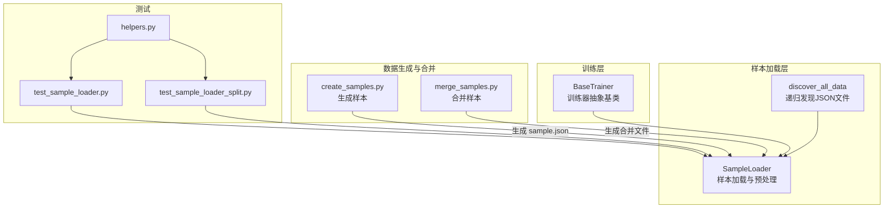
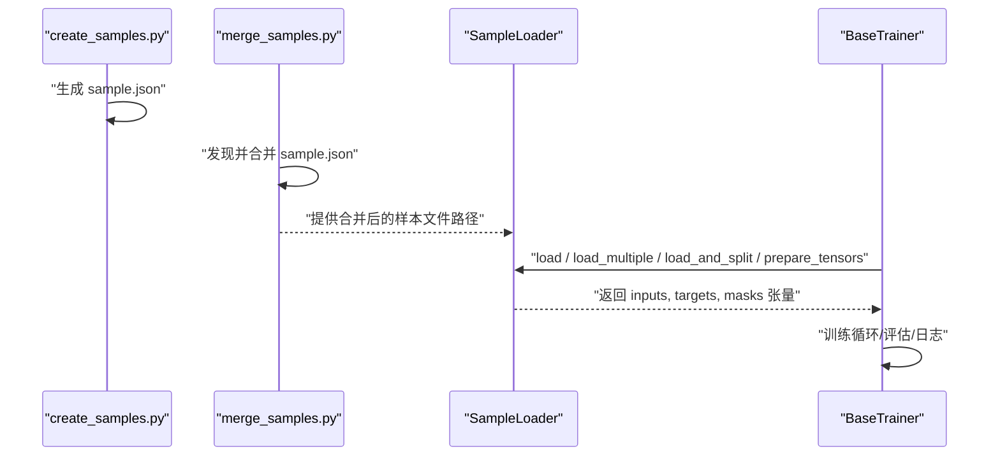
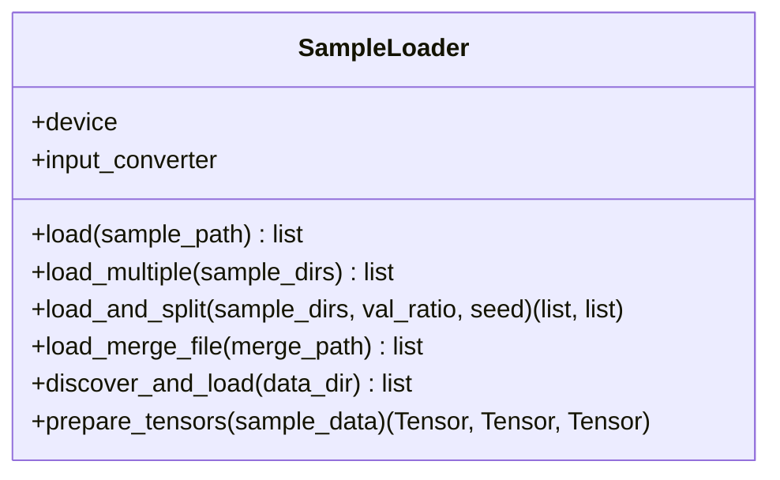
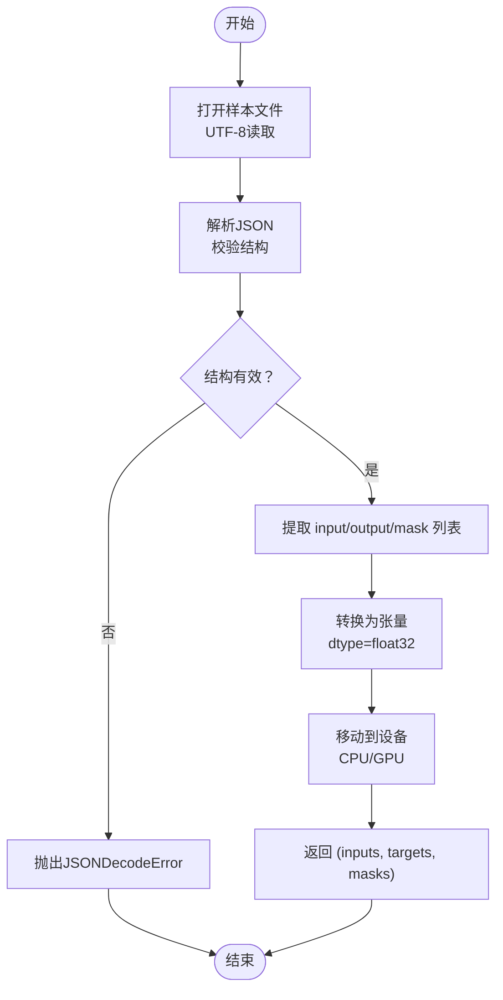
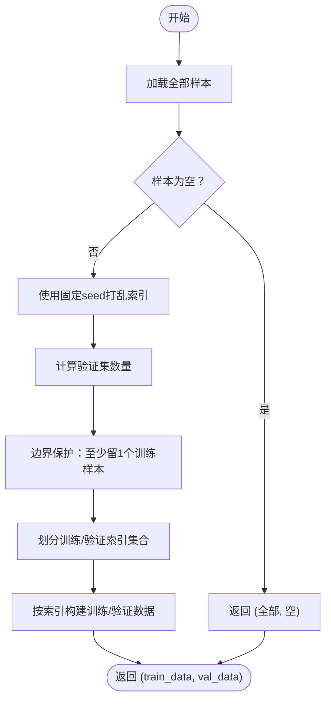
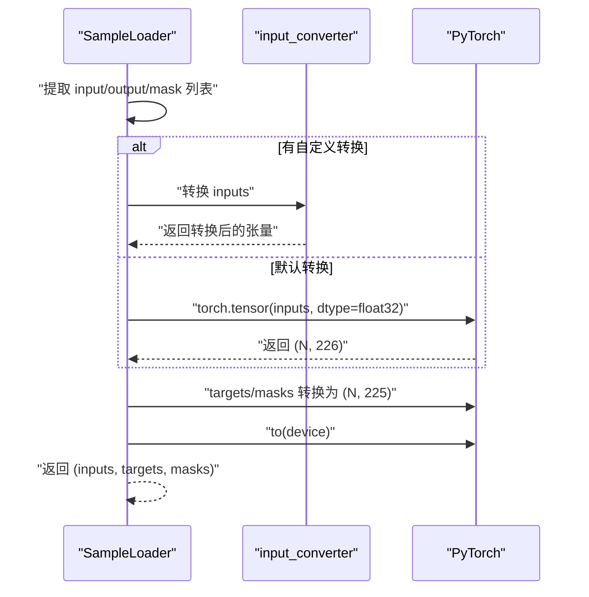
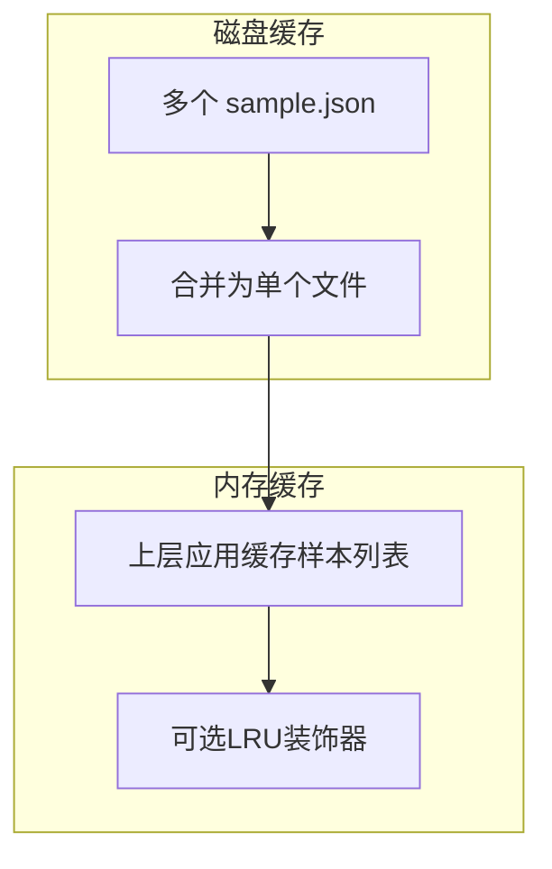
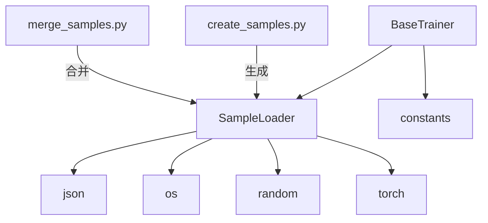

# 样本加载

<cite>
**本文引用的文件**
- [ai/sample_loader.py](file://ai/sample_loader.py)
- [ai/base_trainer.py](file://ai/base_trainer.py)
- [ai/create_samples.py](file://ai/create_samples.py)
- [ai/merge_samples.py](file://ai/merge_samples.py)
- [tests/ai/test_sample_loader.py](file://tests/ai/test_sample_loader.py)
- [tests/ai/unit/test_sample_loader_split.py](file://tests/ai/unit/test_sample_loader_split.py)
- [tests/ai/helpers.py](file://tests/ai/helpers.py)
- [ai/constants.py](file://ai/constants.py)
</cite>

## 目录
1. [简介](#简介)
2. [项目结构](#项目结构)
3. [核心组件](#核心组件)
4. [架构总览](#架构总览)
5. [组件详解](#组件详解)
6. [依赖关系分析](#依赖关系分析)
7. [性能考量](#性能考量)
8. [故障排查指南](#故障排查指南)
9. [结论](#结论)
10. [附录](#附录)

## 简介
本技术文档围绕五子棋AI样本加载系统展开，聚焦于样本加载器的设计与实现，涵盖JSON样本文件读取、数据解析与验证、张量准备、缓存策略、以及性能优化（异步加载、批量读取、数据预取）。文档还提供API接口说明、使用示例与错误处理机制，帮助开发者快速理解与集成。

## 项目结构
样本加载系统主要由以下模块组成：
- 样本加载器：负责从JSON文件读取、解析、拆分与张量转换
- 训练器：封装训练流程，调用样本加载器准备训练数据
- 样本生成与合并：CLI工具用于生成与合并样本文件，降低训练时I/O开销
- 测试：覆盖加载、拆分、张量转换等关键路径

**图表来源**
- [ai/sample_loader.py:36-64](file://ai/sample_loader.py#L36-L64)
- [ai/base_trainer.py:121-125](file://ai/base_trainer.py#L121-L125)
- [ai/create_samples.py:173-184](file://ai/create_samples.py#L173-L184)
- [ai/merge_samples.py:42-76](file://ai/merge_samples.py#L42-L76)
- [tests/ai/test_sample_loader.py:1-294](file://tests/ai/test_sample_loader.py#L1-L294)
- [tests/ai/unit/test_sample_loader_split.py:1-192](file://tests/ai/unit/test_sample_loader_split.py#L1-L192)
- [tests/ai/helpers.py:12-55](file://tests/ai/helpers.py#L12-L55)

**章节来源**
- [ai/sample_loader.py:1-240](file://ai/sample_loader.py#L1-L240)
- [ai/base_trainer.py:1-699](file://ai/base_trainer.py#L1-L699)
- [ai/create_samples.py:1-197](file://ai/create_samples.py#L1-L197)
- [ai/merge_samples.py:1-155](file://ai/merge_samples.py#L1-L155)
- [tests/ai/test_sample_loader.py:1-294](file://tests/ai/test_sample_loader.py#L1-L294)
- [tests/ai/unit/test_sample_loader_split.py:1-192](file://tests/ai/unit/test_sample_loader_split.py#L1-L192)
- [tests/ai/helpers.py:1-73](file://tests/ai/helpers.py#L1-L73)

## 核心组件
- SampleLoader：提供单文件/多文件加载、递归发现、训练/验证集拆分、张量准备等功能
- BaseTrainer：在训练流程中注入SampleLoader，负责调用加载与准备张量
- create_samples.py：生成样本文件，输出为JSON
- merge_samples.py：将多个sample.json合并为单个大文件，减少训练时I/O
- 测试：覆盖加载、拆分、张量转换与边界条件

**章节来源**
- [ai/sample_loader.py:67-240](file://ai/sample_loader.py#L67-L240)
- [ai/base_trainer.py:121-125](file://ai/base_trainer.py#L121-L125)
- [ai/create_samples.py:173-184](file://ai/create_samples.py#L173-L184)
- [ai/merge_samples.py:42-76](file://ai/merge_samples.py#L42-L76)
- [tests/ai/test_sample_loader.py:1-294](file://tests/ai/test_sample_loader.py#L1-L294)
- [tests/ai/unit/test_sample_loader_split.py:1-192](file://tests/ai/unit/test_sample_loader_split.py#L1-L192)

## 架构总览
样本加载器位于“数据生成/合并”与“训练器”之间，承担数据接入与预处理职责。训练器通过SampleLoader统一获取训练数据，支持多种训练模式（全量、mini-batch、带验证集拆分）。

**图表来源**
- [ai/create_samples.py:173-184](file://ai/create_samples.py#L173-L184)
- [ai/merge_samples.py:42-76](file://ai/merge_samples.py#L42-L76)
- [ai/sample_loader.py:80-239](file://ai/sample_loader.py#L80-L239)
- [ai/base_trainer.py:324-407](file://ai/base_trainer.py#L324-L407)

## 组件详解

### SampleLoader 类设计与实现
- 职责
  - 读取单个/多个/递归发现的样本文件
  - 按比例拆分为训练集与验证集（样本级）
  - 将样本数据转换为PyTorch张量并移动到设备
- 关键方法
  - load：读取单个JSON文件
  - load_multiple：合并多个目录下的样本
  - load_and_split：按比例拆分训练/验证集
  - load_merge_file：加载合并文件（语义化别名）
  - discover_and_load：递归发现并加载
  - prepare_tensors：构建inputs、targets、masks张量
- 错误处理
  - 文件不存在、JSON格式错误、val_ratio非法范围、目录遍历异常等

**图表来源**
- [ai/sample_loader.py:67-240](file://ai/sample_loader.py#L67-L240)

**章节来源**
- [ai/sample_loader.py:67-240](file://ai/sample_loader.py#L67-L240)

### JSON样本文件读取与解析
- 读取机制
  - 使用标准库json.load读取UTF-8编码的JSON文件
  - 支持递归发现所有.json文件（不限前缀）
- 样本格式
  - 每条样本包含input、output、mask三部分
  - input维度通常为226，output与mask为225
- 数据类型转换
  - 默认转换为float32张量
  - 可通过input_converter自定义输入转换逻辑

**图表来源**
- [ai/sample_loader.py:80-239](file://ai/sample_loader.py#L80-L239)

**章节来源**
- [ai/sample_loader.py:80-239](file://ai/sample_loader.py#L80-L239)

### 训练/验证集拆分与可复现性
- 拆分策略
  - 在样本级别进行随机拆分，使用独立Random实例确保可复现
  - val_ratio需满足[0,1)，当为0或空数据时验证集为空
- 边界保护
  - 至少保留一个样本给训练集，避免验证集过大导致训练集为空
- 测试覆盖
  - 比例正确性、无重叠、完整性、可复现性、边界条件与异常

**图表来源**
- [ai/sample_loader.py:116-165](file://ai/sample_loader.py#L116-L165)
- [tests/ai/unit/test_sample_loader_split.py:48-188](file://tests/ai/unit/test_sample_loader_split.py#L48-L188)

**章节来源**
- [ai/sample_loader.py:116-165](file://ai/sample_loader.py#L116-L165)
- [tests/ai/unit/test_sample_loader_split.py:1-192](file://tests/ai/unit/test_sample_loader_split.py#L1-L192)

### 张量准备与设备迁移
- 输入转换
  - 默认将inputs转换为(N, 226)的float32张量
  - 可通过input_converter覆盖（如CNN模型需4D张量）
- 目标与掩码
  - targets与masks均为(N, 225)的float32张量
- 设备迁移
  - 将张量移动到训练器指定的设备（CPU/GPU）

**图表来源**
- [ai/sample_loader.py:206-239](file://ai/sample_loader.py#L206-L239)
- [ai/base_trainer.py:662-676](file://ai/base_trainer.py#L662-L676)

**章节来源**
- [ai/sample_loader.py:206-239](file://ai/sample_loader.py#L206-L239)
- [ai/base_trainer.py:662-676](file://ai/base_trainer.py#L662-L676)

### 缓存机制
- 内存缓存策略
  - SampleLoader未内置内存缓存；建议在上层调用处缓存已加载的样本列表
- LRU缓存管理
  - 未实现LRU；可在应用侧引入lru_cache装饰器或外部缓存库
- 磁盘缓存
  - 通过merge_samples.py将多个小文件合并为单个大文件，减少I/O开销
  - 训练前合并可显著提升加载速度与稳定性

**图表来源**
- [ai/merge_samples.py:42-76](file://ai/merge_samples.py#L42-L76)
- [ai/sample_loader.py:167-183](file://ai/sample_loader.py#L167-L183)

**章节来源**
- [ai/merge_samples.py:1-155](file://ai/merge_samples.py#L1-L155)
- [ai/sample_loader.py:167-183](file://ai/sample_loader.py#L167-L183)

### 性能优化方案
- 异步加载
  - 在上层使用多进程/线程池并发加载多个目录的样本文件
- 批量读取
  - 使用merge_samples.py合并文件，减少open/close与解析次数
- 数据预取
  - 在训练前预热加载，或将样本数据持久化为二进制格式（如npz/tar）以加速读取
- I/O优化
  - 选择高性能存储介质，避免频繁小文件访问

[本节为通用性能建议，不直接分析具体文件]

### API接口与使用示例
- SampleLoader.load(sample_path)
  - 功能：读取单个样本文件
  - 返回：样本数据列表
  - 异常：FileNotFoundError、JSONDecodeError
- SampleLoader.load_multiple(sample_dirs)
  - 功能：合并多个目录的样本
  - 返回：样本数据列表
  - 异常：某目录缺失sample.json
- SampleLoader.load_and_split(sample_dirs, val_ratio, seed)
  - 功能：按比例拆分训练/验证集
  - 返回：(train_data, val_data)
  - 异常：val_ratio非法、目录缺失
- SampleLoader.discover_and_load(data_dir)
  - 功能：递归发现并加载所有.json文件
  - 返回：样本数据列表
- SampleLoader.prepare_tensors(sample_data)
  - 功能：构建inputs、targets、masks张量并移动到设备
  - 返回：(inputs, targets, masks)

使用示例（基于测试与CLI工具）
- 生成样本：参考create_samples.py命令行参数与输出
- 合并样本：参考merge_samples.py命令行参数与输出
- 训练调用：BaseTrainer.train_batch/train_mini_batch会自动调用SampleLoader

**章节来源**
- [ai/sample_loader.py:80-239](file://ai/sample_loader.py#L80-L239)
- [ai/create_samples.py:23-196](file://ai/create_samples.py#L23-L196)
- [ai/merge_samples.py:105-154](file://ai/merge_samples.py#L105-L154)
- [ai/base_trainer.py:324-407](file://ai/base_trainer.py#L324-L407)

### 错误处理机制
- 文件系统错误
  - 目录不存在、遍历时OSError：返回空列表或抛出异常
- JSON解析错误
  - JSONDecodeError：由json.load抛出
- 参数校验
  - val_ratio非法范围：抛出ValueError
  - 目录缺失sample.json：抛出FileNotFoundError
- 测试覆盖
  - 单元测试覆盖上述异常路径与边界条件

**章节来源**
- [ai/sample_loader.py:36-64](file://ai/sample_loader.py#L36-L64)
- [ai/sample_loader.py:80-94](file://ai/sample_loader.py#L80-L94)
- [ai/sample_loader.py:96-114](file://ai/sample_loader.py#L96-L114)
- [ai/sample_loader.py:116-165](file://ai/sample_loader.py#L116-L165)
- [tests/ai/test_sample_loader.py:71-97](file://tests/ai/test_sample_loader.py#L71-L97)
- [tests/ai/unit/test_sample_loader_split.py:155-167](file://tests/ai/unit/test_sample_loader_split.py#L155-L167)

## 依赖关系分析
- SampleLoader依赖
  - 标准库：json、os、random、typing
  - 第三方：torch
- BaseTrainer依赖
  - SampleLoader：训练流程中注入并调用
  - constants：训练数据目录常量
- CLI工具
  - create_samples.py：生成样本
  - merge_samples.py：合并样本

**图表来源**
- [ai/sample_loader.py:6-11](file://ai/sample_loader.py#L6-L11)
- [ai/base_trainer.py:15-18](file://ai/base_trainer.py#L15-L18)
- [ai/constants.py:1-26](file://ai/constants.py#L1-L26)
- [ai/create_samples.py:9-21](file://ai/create_samples.py#L9-L21)
- [ai/merge_samples.py:6-10](file://ai/merge_samples.py#L6-L10)

**章节来源**
- [ai/sample_loader.py:6-11](file://ai/sample_loader.py#L6-L11)
- [ai/base_trainer.py:15-18](file://ai/base_trainer.py#L15-L18)
- [ai/constants.py:1-26](file://ai/constants.py#L1-L26)
- [ai/create_samples.py:9-21](file://ai/create_samples.py#L9-L21)
- [ai/merge_samples.py:6-10](file://ai/merge_samples.py#L6-L10)

## 性能考量
- I/O瓶颈
  - 小文件过多会导致频繁open/close与解析，建议使用merge_samples.py合并
- 内存占用
  - 大样本集一次性加载可能占用较多内存；可考虑分批训练或外部数据流
- 设备迁移
  - 张量移动到GPU会带来拷贝开销；尽量减少不必要的设备切换
- 并发与预取
  - 上层可采用多进程/线程池并发加载，或在训练前预热加载
- 数据格式
  - 二进制格式（如npz/tar）可进一步降低解析与I/O成本

[本节提供通用指导，不直接分析具体文件]

## 故障排查指南
- 样本文件缺失
  - 现象：FileNotFoundError
  - 排查：确认sample.json存在，路径正确
- JSON格式错误
  - 现象：JSONDecodeError
  - 排查：检查文件编码（UTF-8）、语法与结构
- 拆分比例异常
  - 现象：ValueError
  - 排查：val_ratio应在[0,1)范围内
- 训练/验证集为空
  - 现象：验证集为空或训练集不足
  - 排查：检查样本数量与val_ratio设置
- 设备不可用
  - 现象：GPU不可用
  - 排查：确认CUDA可用性与驱动版本

**章节来源**
- [ai/sample_loader.py:80-94](file://ai/sample_loader.py#L80-L94)
- [ai/sample_loader.py:96-114](file://ai/sample_loader.py#L96-L114)
- [ai/sample_loader.py:116-165](file://ai/sample_loader.py#L116-L165)
- [tests/ai/test_sample_loader.py:71-97](file://tests/ai/test_sample_loader.py#L71-L97)
- [tests/ai/unit/test_sample_loader_split.py:155-167](file://tests/ai/unit/test_sample_loader_split.py#L155-L167)

## 结论
样本加载系统以SampleLoader为核心，提供从JSON到张量的完整链路，具备良好的可扩展性与可测试性。结合merge_samples.py的磁盘缓存策略与上层的并发与预取优化，可在大规模训练场景下显著提升I/O效率与整体性能。建议在生产环境中配合合并文件与外部缓存策略，以获得最佳体验。

## 附录
- 常量与路径
  - AI数据目录与训练数据目录常量定义
- 测试辅助
  - create_sample_dir等辅助方法用于快速构造测试样本

**章节来源**
- [ai/constants.py:1-26](file://ai/constants.py#L1-L26)
- [tests/ai/helpers.py:12-55](file://tests/ai/helpers.py#L12-L55)