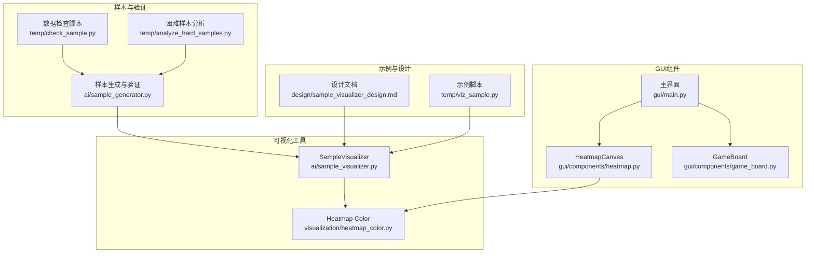
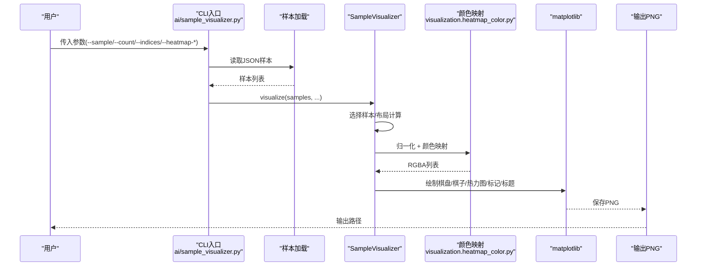
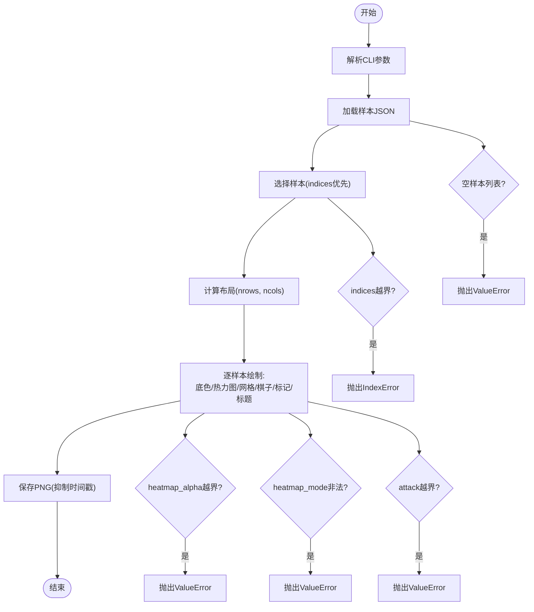
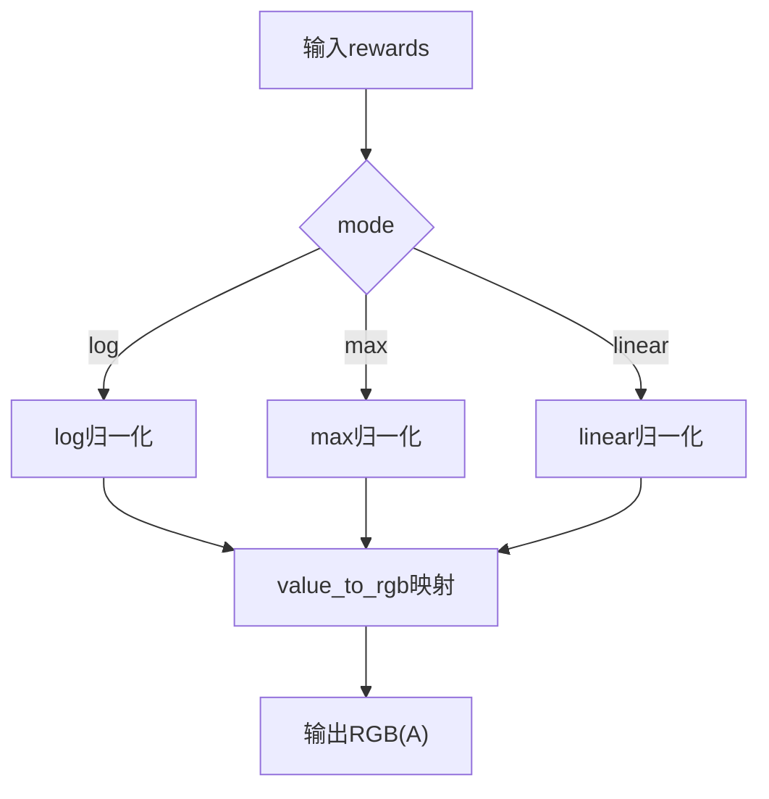
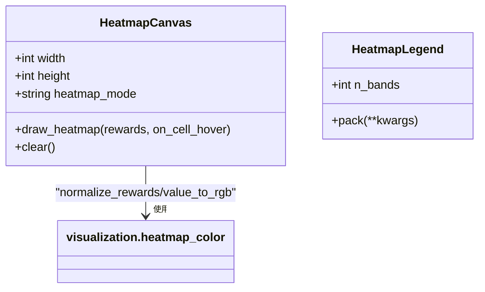
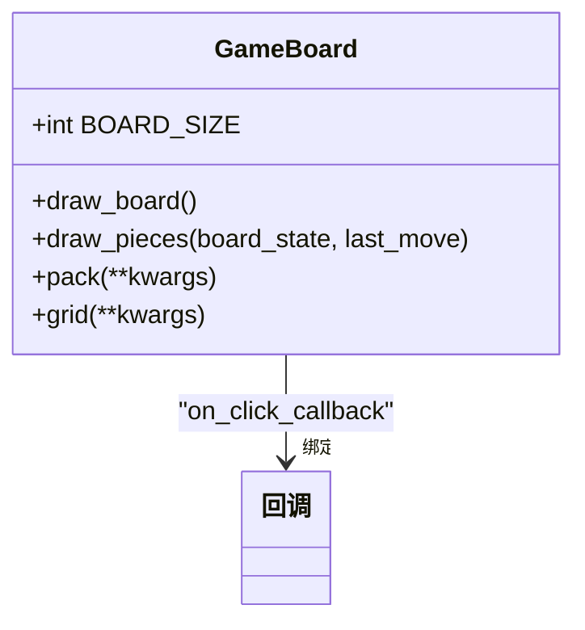
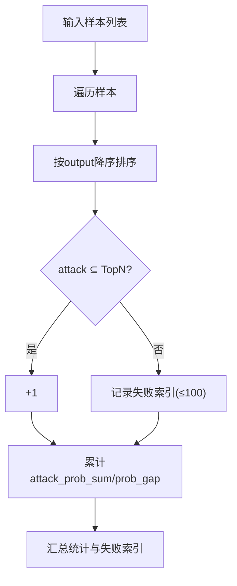
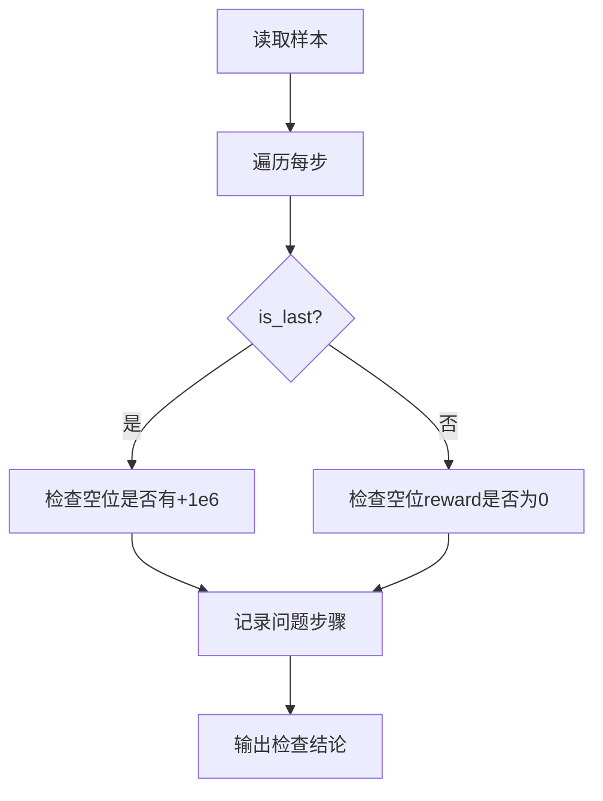
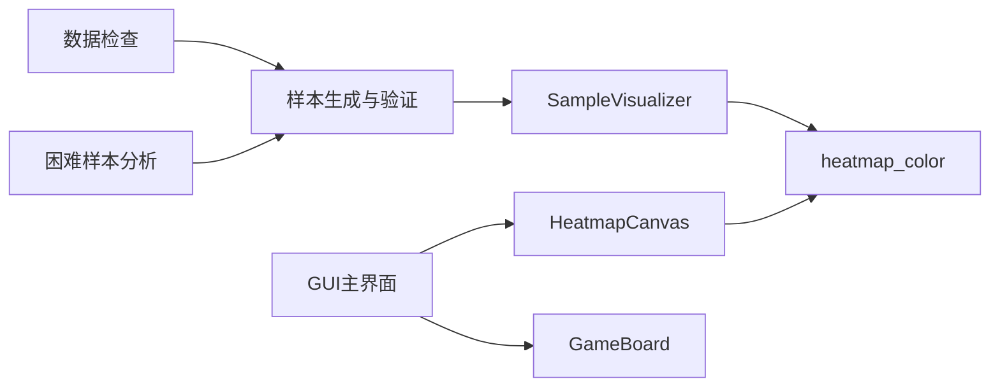

# 样本可视化

<cite>
**本文引用的文件**
- [ai/sample_visualizer.py](file://ai/sample_visualizer.py)
- [visualization/heatmap_color.py](file://visualization/heatmap_color.py)
- [gui/components/heatmap.py](file://gui/components/heatmap.py)
- [gui/components/game_board.py](file://gui/components/game_board.py)
- [gui/main.py](file://gui/main.py)
- [tests/ai/test_sample_visualizer.py](file://tests/ai/test_sample_visualizer.py)
- [design/sample_visualizer_design.md](file://design/sample_visualizer_design.md)
- [temp/viz_sample.py](file://temp/viz_sample.py)
- [ai/sample_generator.py](file://ai/sample_generator.py)
- [temp/check_sample.py](file://temp/check_sample.py)
- [temp/analyze_hard_samples.py](file://temp/analyze_hard_samples.py)
</cite>

## 目录
1. [简介](#简介)
2. [项目结构](#项目结构)
3. [核心组件](#核心组件)
4. [架构总览](#架构总览)
5. [详细组件分析](#详细组件分析)
6. [依赖关系分析](#依赖关系分析)
7. [性能考量](#性能考量)
8. [故障排查指南](#故障排查指南)
9. [结论](#结论)
10. [附录](#附录)

## 简介
本文件面向“五子棋AI样本可视化工具”的技术文档，聚焦以下目标：
- 样本数据的可视化展示：棋盘、棋子、攻击位置标记、可选热力图叠加
- 统计信息的图表化呈现：通过颜色映射与归一化策略，将输出概率/奖励转化为直观的热力图
- 异常样本的检测功能：结合样本生成器的验证能力与数据检查脚本，识别标签质量与分布异常
- 可视化界面设计：静态图与GUI组件的热力图绘制、交互式数据探索
- 使用指南与扩展方法：参数配置、界面操作、结果解读与自定义图表实现

## 项目结构
围绕样本可视化，本仓库的关键模块如下：
- 样本可视化器：ai/sample_visualizer.py 提供命令行工具与类接口，支持新旧样本格式、热力图叠加与布局排版
- 热力图颜色映射：visualization/heatmap_color.py 提供纯函数的颜色映射与归一化算法，支持多种模式
- GUI热力图组件：gui/components/heatmap.py 提供tkinter热力图画布与颜色标尺，支持悬停tooltip
- 棋盘组件：gui/components/game_board.py 提供GUI棋盘绘制与交互
- 样本生成与验证：ai/sample_generator.py 提供样本质量验证（命中率、概率差距等）
- 数据检查与异常检测：temp/check_sample.py、temp/analyze_hard_samples.py 提供数据一致性与困难样本分析
- 设计文档：design/sample_visualizer_design.md 定义了可视化器的目标、API与测试用例

**图表来源**
- [ai/sample_visualizer.py:1-496](file://ai/sample_visualizer.py#L1-L496)
- [visualization/heatmap_color.py:1-204](file://visualization/heatmap_color.py#L1-L204)
- [gui/components/heatmap.py:1-358](file://gui/components/heatmap.py#L1-L358)
- [gui/components/game_board.py:1-170](file://gui/components/game_board.py#L1-L170)
- [gui/main.py:1-462](file://gui/main.py#L1-L462)
- [ai/sample_generator.py:330-511](file://ai/sample_generator.py#L330-L511)
- [temp/check_sample.py:1-99](file://temp/check_sample.py#L1-L99)
- [temp/analyze_hard_samples.py:1-66](file://temp/analyze_hard_samples.py#L1-L66)
- [design/sample_visualizer_design.md:1-115](file://design/sample_visualizer_design.md#L1-L115)
- [temp/viz_sample.py:1-104](file://temp/viz_sample.py#L1-L104)

**章节来源**
- [ai/sample_visualizer.py:1-496](file://ai/sample_visualizer.py#L1-L496)
- [visualization/heatmap_color.py:1-204](file://visualization/heatmap_color.py#L1-L204)
- [gui/components/heatmap.py:1-358](file://gui/components/heatmap.py#L1-L358)
- [gui/components/game_board.py:1-170](file://gui/components/game_board.py#L1-L170)
- [gui/main.py:1-462](file://gui/main.py#L1-L462)
- [ai/sample_generator.py:330-511](file://ai/sample_generator.py#L330-L511)
- [temp/check_sample.py:1-99](file://temp/check_sample.py#L1-L99)
- [temp/analyze_hard_samples.py:1-66](file://temp/analyze_hard_samples.py#L1-L66)
- [design/sample_visualizer_design.md:1-115](file://design/sample_visualizer_design.md#L1-L115)
- [temp/viz_sample.py:1-104](file://temp/viz_sample.py#L1-L104)

## 核心组件
- 样本可视化器（SampleVisualizer）
  - 功能：读取样本JSON，随机或指定索引抽样，绘制棋盘、棋子、攻击位置标记，可选叠加热力图
  - 支持新旧样本格式：新格式含攻击位置、形状、掩码；旧格式通过argmax兜底
  - CLI参数：样本文件、抽样数量、指定索引、随机种子、输出路径、热力图开关与透明度、归一化模式
- 热力图颜色映射（visualization.heatmap_color）
  - 归一化模式：log（推荐）、max、linear
  - 色板：默认白→黄→橙→红（4色渐变）
  - 组合API：normalize_rewards + value_to_rgb + rewards_to_rgba
- GUI热力图组件（gui/components/heatmap.py）
  - HeatmapCanvas：15×15格热力图画布，支持悬停tooltip显示原始reward
  - HeatmapLegend：颜色标尺，支持自定义色节点与档数
- 棋盘组件（gui/components/game_board.py）
  - 绘制棋盘网格与星位，支持棋子绘制与最后落子高亮
- 样本质量验证（ai/sample_generator.py）
  - 验证指标：Hit@N、Hit@N+1、Hit@N+2、攻击位置概率之和、概率差距
  - 失败样本索引收集，便于定位异常
- 数据检查与异常检测（temp/check_sample.py、temp/analyze_hard_samples.py）
  - 数据一致性检查：已占位reward是否为-1e6、最后一步空位是否有+1e6
  - 困难样本分析：按loss分桶统计，识别高梯度样本

**章节来源**
- [ai/sample_visualizer.py:296-404](file://ai/sample_visualizer.py#L296-L404)
- [visualization/heatmap_color.py:63-203](file://visualization/heatmap_color.py#L63-L203)
- [gui/components/heatmap.py:68-357](file://gui/components/heatmap.py#L68-L357)
- [gui/components/game_board.py:7-169](file://gui/components/game_board.py#L7-L169)
- [ai/sample_generator.py:334-440](file://ai/sample_generator.py#L334-L440)
- [temp/check_sample.py:25-46](file://temp/check_sample.py#L25-L46)
- [temp/analyze_hard_samples.py:18-34](file://temp/analyze_hard_samples.py#L18-L34)

## 架构总览
样本可视化工具采用“纯函数颜色映射 + 可视化渲染”的分层设计：
- 纯函数层：颜色映射与归一化（visualization.heatmap_color）
- 图像渲染层：matplotlib静态图（ai/sample_visualizer.py）
- GUI渲染层：tkinter热力图画布（gui/components/heatmap.py）
- 交互层：GUI主界面与棋盘组件（gui/main.py）

**图表来源**
- [ai/sample_visualizer.py:463-491](file://ai/sample_visualizer.py#L463-L491)
- [visualization/heatmap_color.py:63-203](file://visualization/heatmap_color.py#L63-L203)

**章节来源**
- [ai/sample_visualizer.py:406-491](file://ai/sample_visualizer.py#L406-L491)
- [visualization/heatmap_color.py:63-203](file://visualization/heatmap_color.py#L63-L203)

## 详细组件分析

### 样本可视化器（SampleVisualizer）
- 功能特性
  - 兼容新旧样本格式：新格式含攻击位置、形状、掩码；旧格式通过argmax兜底
  - 热力图叠加：仅在空位绘制，支持log/max/linear归一化与透明度控制
  - 样本选择：indices优先，否则按count与seed随机抽样
  - 布局：自适应正方形网格，紧凑排列
- 关键流程
  - 元数据抽取：统一提取board、attack、shape、mask、output、current_player
  - 热力图层：对output进行归一化，映射到RGBA，仅在mask==1的空位绘制
  - 棋子绘制：遍历board，按1=黑、2=白绘制
  - 攻击标记：在attack位置绘制红色星号
  - 标题：包含样本索引、形状、当前玩家、攻击数量
- 错误处理
  - 空样本列表、非法heatmap_alpha、非法heatmap_mode、越界indices
  - 攻击位置越界时显式抛错，避免绘制到棋盘外

**图表来源**
- [ai/sample_visualizer.py:312-403](file://ai/sample_visualizer.py#L312-L403)
- [ai/sample_visualizer.py:408-460](file://ai/sample_visualizer.py#L408-L460)

**章节来源**
- [ai/sample_visualizer.py:86-130](file://ai/sample_visualizer.py#L86-L130)
- [ai/sample_visualizer.py:180-292](file://ai/sample_visualizer.py#L180-L292)
- [ai/sample_visualizer.py:312-403](file://ai/sample_visualizer.py#L312-L403)
- [ai/sample_visualizer.py:408-460](file://ai/sample_visualizer.py#L408-L460)

### 热力图颜色映射（visualization.heatmap_color）
- 归一化策略
  - log：自适应K，将最大值映射至1，对小值保留非零归一化值，适合softmax极端分布
  - max：r/max(r)
  - linear：(r-min)/(max-min)
- 颜色映射
  - 色节点等距线性插值，支持任意n≥2个色节点
  - 默认白→黄→橙→红（4色渐变）
- 组合API
  - rewards_to_rgba：一次性输出RGBA列表，便于matplotlib绘制

**图表来源**
- [visualization/heatmap_color.py:63-121](file://visualization/heatmap_color.py#L63-L121)
- [visualization/heatmap_color.py:128-171](file://visualization/heatmap_color.py#L128-L171)
- [visualization/heatmap_color.py:178-203](file://visualization/heatmap_color.py#L178-L203)

**章节来源**
- [visualization/heatmap_color.py:63-203](file://visualization/heatmap_color.py#L63-L203)

### GUI热力图组件（gui/components/heatmap.py）
- HeatmapCanvas
  - 绘制15×15格热力图，批量归一化，逐格映射RGB并转为tk hex颜色
  - 支持悬停tooltip显示原始reward，便于查看真实概率
  - 支持自定义色节点与归一化模式
- HeatmapLegend
  - 渐变条与色名标签，支持自定义档数与色节点
- 与颜色映射的关系
  - 复用visualization.heatmap_color的归一化与颜色映射，但不使用alpha通道

**图表来源**
- [gui/components/heatmap.py:68-357](file://gui/components/heatmap.py#L68-L357)
- [visualization/heatmap_color.py:63-171](file://visualization/heatmap_color.py#L63-L171)

**章节来源**
- [gui/components/heatmap.py:68-357](file://gui/components/heatmap.py#L68-L357)
- [visualization/heatmap_color.py:63-171](file://visualization/heatmap_color.py#L63-L171)

### 棋盘组件（gui/components/game_board.py）
- 绘制15×15网格与星位
- 支持棋子绘制与最后落子高亮
- 与GUI主界面集成，提供交互点击回调

**图表来源**
- [gui/components/game_board.py:7-169](file://gui/components/game_board.py#L7-L169)

**章节来源**
- [gui/components/game_board.py:7-169](file://gui/components/game_board.py#L7-L169)

### 样本质量验证（ai/sample_generator.py）
- 验证指标
  - Hit@N、Hit@N+1、Hit@N+2：攻击位置是否落入前N/N+1/N+2名
  - attack_prob_sum：攻击位置概率之和
  - prob_gap：攻击位置均值概率减去最大非攻击位置概率
- 失败样本索引：最多记录前100个未命中的样本索引，便于定位异常

**图表来源**
- [ai/sample_generator.py:334-393](file://ai/sample_generator.py#L334-L393)

**章节来源**
- [ai/sample_generator.py:334-440](file://ai/sample_generator.py#L334-L440)

### 数据检查与异常检测（temp/check_sample.py、temp/analyze_hard_samples.py）
- 数据一致性检查
  - 已占位reward必须为-1e6
  - 最后一步空位中必须有一个+1e6
  - 非最后步空位reward应为0（统计性检查）
- 困难样本分析
  - 按loss分桶统计，识别loss≥0.008与grad_norm>0.1的样本

**图表来源**
- [temp/check_sample.py:25-46](file://temp/check_sample.py#L25-L46)

**章节来源**
- [temp/check_sample.py:25-46](file://temp/check_sample.py#L25-L46)
- [temp/analyze_hard_samples.py:18-34](file://temp/analyze_hard_samples.py#L18-L34)

## 依赖关系分析
- 模块耦合
  - SampleVisualizer依赖visualization.heatmap_color进行颜色映射
  - GUI HeatmapCanvas同样依赖visualization.heatmap_color，但不使用alpha通道
  - 样本质量验证与数据检查脚本为独立工具，服务于样本可视化前的质量把关
- 外部依赖
  - matplotlib（Agg后端）、numpy、argparse、json、os、random、sys
  - tkinter（GUI组件）

**图表来源**
- [ai/sample_visualizer.py:36-39](file://ai/sample_visualizer.py#L36-L39)
- [gui/components/heatmap.py:30-34](file://gui/components/heatmap.py#L30-L34)
- [gui/main.py:22-28](file://gui/main.py#L22-L28)
- [ai/sample_generator.py:334-511](file://ai/sample_generator.py#L334-L511)
- [temp/check_sample.py:1-99](file://temp/check_sample.py#L1-L99)
- [temp/analyze_hard_samples.py:1-66](file://temp/analyze_hard_samples.py#L1-L66)

**章节来源**
- [ai/sample_visualizer.py:36-39](file://ai/sample_visualizer.py#L36-L39)
- [gui/components/heatmap.py:30-34](file://gui/components/heatmap.py#L30-L34)
- [gui/main.py:22-28](file://gui/main.py#L22-L28)
- [ai/sample_generator.py:334-511](file://ai/sample_generator.py#L334-L511)
- [temp/check_sample.py:1-99](file://temp/check_sample.py#L1-L99)
- [temp/analyze_hard_samples.py:1-66](file://temp/analyze_hard_samples.py#L1-L66)

## 性能考量
- 颜色映射与归一化
  - 批量归一化：normalize_rewards对整列rewards计算一次全局统计量，减少重复计算
  - 逐格映射：value_to_rgb线性插值，复杂度O(N)，N为225
- 绘图性能
  - matplotlib使用Agg后端，避免GUI初始化开销
  - 热力图仅在空位绘制，mask过滤减少绘制量
- GUI热力图
  - 15×15格，逐格创建矩形，绘制成本低
  - tooltip懒创建，减少内存占用

[本节为通用性能讨论，无需特定文件引用]

## 故障排查指南
- CLI参数错误
  - --indices格式错误：解析失败会抛出ArgumentTypeError
  - heatmap_alpha越界：抛出ValueError
  - heatmap_mode非法：抛出ValueError
  - indices越界：抛出IndexError
- 样本数据异常
  - 攻击位置越界：显式抛错，避免绘制到棋盘外
  - 样本为空列表：抛出ValueError
- GUI组件异常
  - HeatmapCanvas：当rewards长度不为225时静默返回（向后兼容）
  - 归一化模式非法：在draw_heatmap阶段抛出ValueError
- 数据一致性问题
  - 已占位reward非-1e6：检查脚本会记录问题步骤
  - 最后一步空位无+1e6：检查脚本会记录问题步骤
  - 困难样本过多：分析脚本按loss分桶统计，识别高梯度样本

**章节来源**
- [ai/sample_visualizer.py:408-460](file://ai/sample_visualizer.py#L408-L460)
- [ai/sample_visualizer.py:341-352](file://ai/sample_visualizer.py#L341-L352)
- [gui/components/heatmap.py:157-162](file://gui/components/heatmap.py#L157-L162)
- [gui/components/heatmap.py:151-154](file://gui/components/heatmap.py#L151-L154)
- [temp/check_sample.py:25-46](file://temp/check_sample.py#L25-L46)
- [temp/analyze_hard_samples.py:18-34](file://temp/analyze_hard_samples.py#L18-L34)

## 结论
样本可视化工具通过“纯函数颜色映射 + 可视化渲染”的清晰分层，实现了对五子棋样本的直观展示与质量评估。SampleVisualizer提供稳定的CLI与类接口，GUI热力图组件提供交互式探索体验。结合样本生成器的验证与数据检查脚本，能够有效识别标签质量与分布异常，为模型训练提供可靠的数据保障。

[本节为总结性内容，无需特定文件引用]

## 附录

### 使用指南
- CLI使用
  - 基本用法：指定样本JSON文件，输出PNG
  - 参数：--count、--indices、--seed、--output、--no-heatmap、--heatmap-mode、--heatmap-alpha
- GUI使用
  - 启动主界面，进入棋盘组件查看棋局
  - 使用热力图画布查看reward分布，鼠标悬停查看原始reward
- 结果解读
  - 样本图：棋盘底色、网格线、星位点、黑白子、攻击位置红色星号标记
  - 热力图：颜色深浅反映输出概率/奖励强度，掩码过滤空位
  - 标题：包含样本索引、形状、当前玩家、攻击数量

**章节来源**
- [ai/sample_visualizer.py:421-460](file://ai/sample_visualizer.py#L421-L460)
- [gui/main.py:398-461](file://gui/main.py#L398-L461)
- [gui/components/heatmap.py:137-247](file://gui/components/heatmap.py#L137-L247)

### 可视化扩展与自定义
- 自定义色板
  - 通过DEFAULT_COLOR_STOPS或传入color_stops自定义色节点序列
- 归一化模式
  - log（推荐）、max、linear，依据数据分布选择
- GUI热力图增强
  - 增加tooltip格式化、颜色标尺档数调节、悬停回调扩展
- 样本质量可视化
  - 结合verify_samples报告，绘制命中率柱状图、概率差距箱线图
  - 使用temp/check_sample.py输出的问题步骤，标注异常样本位置

**章节来源**
- [visualization/heatmap_color.py:32-39](file://visualization/heatmap_color.py#L32-L39)
- [gui/components/heatmap.py:257-357](file://gui/components/heatmap.py#L257-L357)
- [ai/sample_generator.py:334-440](file://ai/sample_generator.py#L334-L440)
- [temp/check_sample.py:25-46](file://temp/check_sample.py#L25-L46)