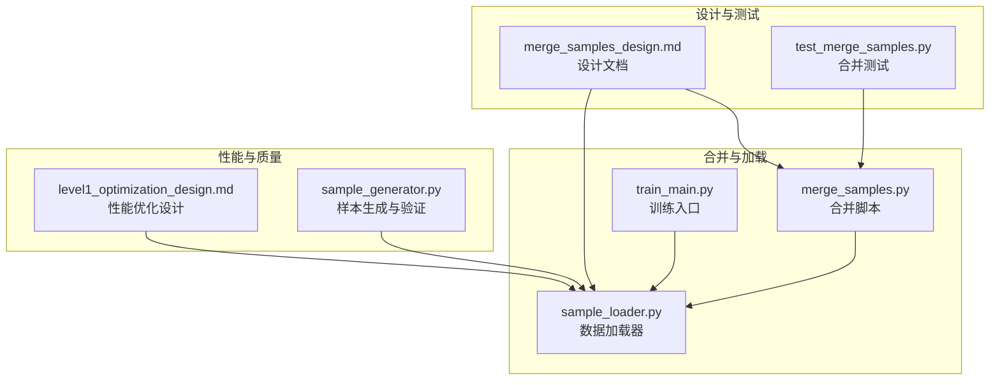
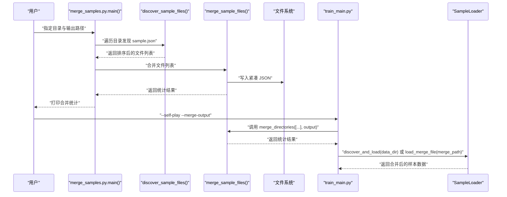
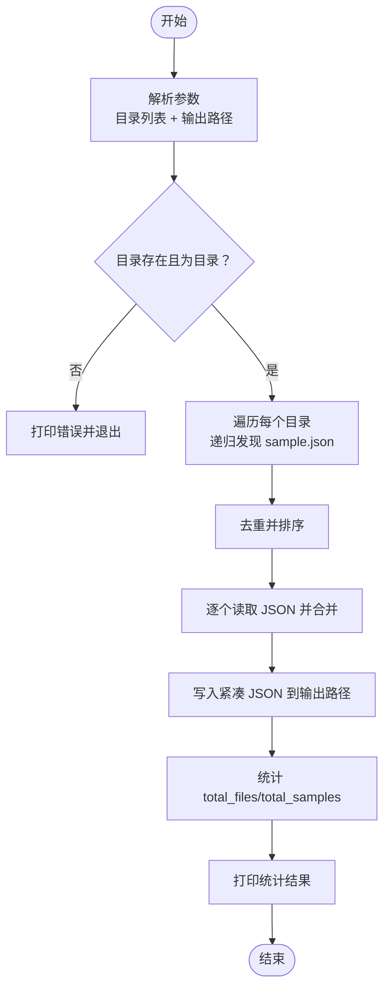
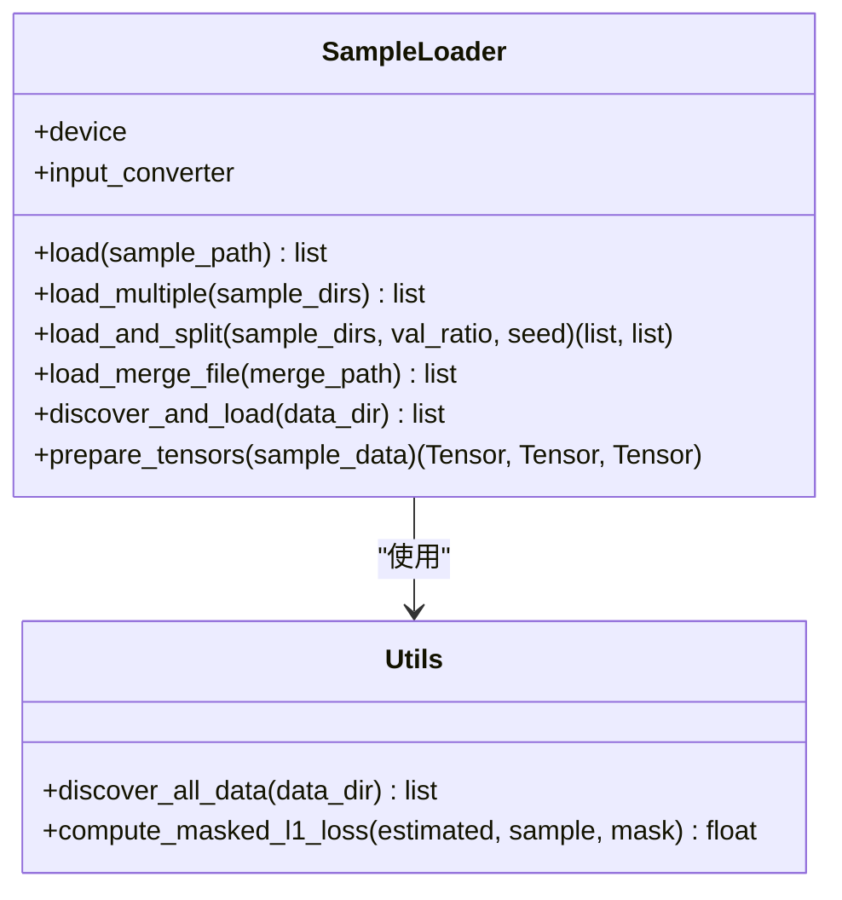
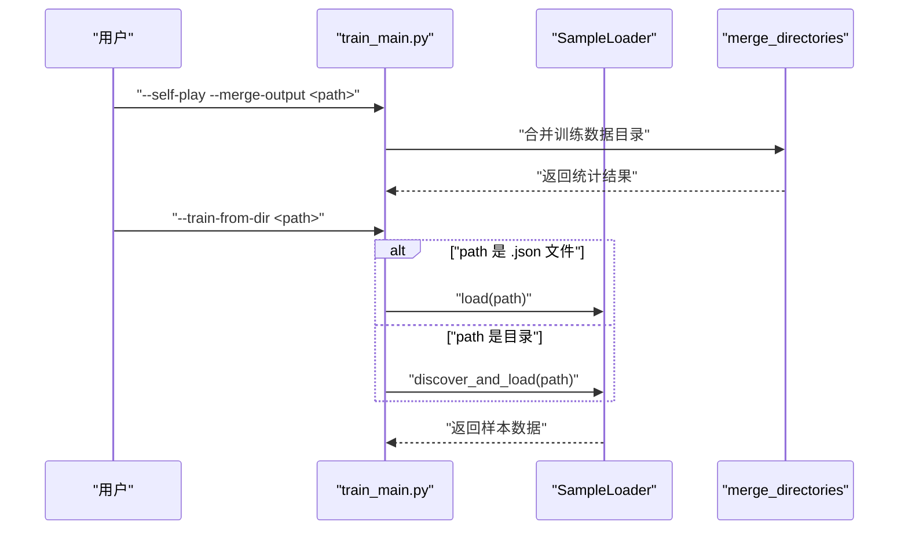
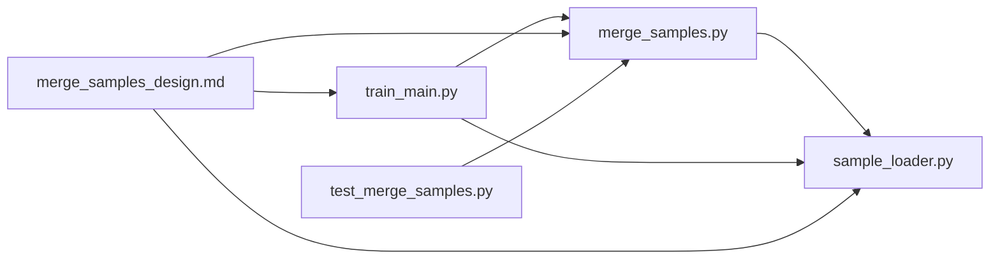

# 样本合并

<cite>
**本文引用的文件**
- [merge_samples.py](file://ai/merge_samples.py)
- [merge_samples_design.md](file://design/merge_samples_design.md)
- [test_merge_samples.py](file://tests/ai/test_merge_samples.py)
- [sample_loader.py](file://ai/sample_loader.py)
- [train_main.py](file://ai/train_main.py)
- [level1_optimization_design.md](file://design/performance/level1_optimization_design.md)
- [sample_generator.py](file://ai/sample_generator.py)
</cite>

## 目录
1. [简介](#简介)
2. [项目结构](#项目结构)
3. [核心组件](#核心组件)
4. [架构总览](#架构总览)
5. [详细组件分析](#详细组件分析)
6. [依赖分析](#依赖分析)
7. [性能考量](#性能考量)
8. [故障排除指南](#故障排除指南)
9. [结论](#结论)
10. [附录](#附录)

## 简介
本文件面向“五子棋AI样本合并系统”，围绕样本合并器的设计原理与实现机制展开，重点覆盖以下方面：
- 多训练数据集的合并策略与数据格式统一处理
- 合并算法的实现与优化（去重、排序、紧凑输出）
- 重复样本检测与去重机制（当前实现为目录级去重，未内置语义/哈希去重）
- 质量控制流程（数据完整性检查、格式验证、异常样本过滤）
- 性能优化策略（内存管理、批量处理、并发处理）
- 合并操作的配置选项、使用示例与故障排除

## 项目结构
与样本合并直接相关的模块与文件如下：
- ai/merge_samples.py：独立的样本合并脚本，提供 CLI 与核心合并逻辑
- design/merge_samples_design.md：合并功能的设计文档，描述 API、流程与集成点
- tests/ai/test_merge_samples.py：针对合并模块的单元测试与 CLI 集成测试
- ai/sample_loader.py：训练数据加载器，支持递归加载与合并文件加载
- ai/train_main.py：训练入口，支持 --self-play 自动合并与 --train-from-dir 递归加载
- design/performance/level1_optimization_design.md：性能优化设计，涉及合并与加载的优化要点
- ai/sample_generator.py：样本生成器，包含样本质量验证流程，可作为合并后数据质量控制参考

**图表来源**
- [merge_samples.py:1-155](file://ai/merge_samples.py#L1-L155)
- [sample_loader.py:1-240](file://ai/sample_loader.py#L1-L240)
- [train_main.py:1-200](file://ai/train_main.py#L1-L200)
- [merge_samples_design.md:1-247](file://design/merge_samples_design.md#L1-L247)
- [test_merge_samples.py:1-249](file://tests/ai/test_merge_samples.py#L1-L249)
- [level1_optimization_design.md:1-124](file://design/performance/level1_optimization_design.md#L1-L124)
- [sample_generator.py:1-200](file://ai/sample_generator.py#L1-L200)

**章节来源**
- [merge_samples.py:1-155](file://ai/merge_samples.py#L1-L155)
- [merge_samples_design.md:1-247](file://design/merge_samples_design.md#L1-L247)

## 核心组件
- 合并脚本模块（ai/merge_samples.py）
  - 提供 discover_sample_files、merge_sample_files、merge_directories 三个核心函数
  - CLI 入口 main()，支持多目录合并与输出路径校验
- 数据加载器（ai/sample_loader.py）
  - 提供 discover_all_data 递归发现 .json 文件
  - 提供 load_merge_file/discover_and_load 以支持合并文件与递归加载
- 训练入口（ai/train_main.py）
  - --self-play 模式支持合并输出
  - --train-from-dir 支持目录递归加载与文件直读
- 设计文档（design/merge_samples_design.md）
  - 描述 API、流程与与训练入口的集成方式
- 测试（tests/ai/test_merge_samples.py）
  - 覆盖文件发现、合并、CLI 行为与输出格式

**章节来源**
- [merge_samples.py:13-102](file://ai/merge_samples.py#L13-L102)
- [sample_loader.py:36-204](file://ai/sample_loader.py#L36-L204)
- [train_main.py:98-194](file://ai/train_main.py#L98-L194)
- [merge_samples_design.md:16-150](file://design/merge_samples_design.md#L16-L150)
- [test_merge_samples.py:18-245](file://tests/ai/test_merge_samples.py#L18-L245)

## 架构总览
样本合并系统采用“独立脚本 + 训练入口集成”的架构：
- 独立脚本负责发现与合并：discover_sample_files → merge_sample_files → 输出紧凑 JSON
- 训练入口在 --self-play 模式下自动调用合并，在 --train-from-dir 模式下递归加载
- 数据加载器在训练阶段统一加载与准备张量

**图表来源**
- [merge_samples.py:105-151](file://ai/merge_samples.py#L105-L151)
- [merge_samples.py:13-39](file://ai/merge_samples.py#L13-L39)
- [merge_samples.py:42-76](file://ai/merge_samples.py#L42-L76)
- [sample_loader.py:185-204](file://ai/sample_loader.py#L185-L204)
- [train_main.py:194-202](file://ai/train_main.py#L194-L202)

## 详细组件分析

### 合并脚本模块（ai/merge_samples.py）
- discover_sample_files(data_dir)
  - 递归遍历目录，收集名为 sample.json 的文件，忽略以 merge_ 开头的 .json 文件
  - 返回按路径排序的文件列表，保证稳定性
- merge_sample_files(sample_files, output_path)
  - 逐个读取 JSON，合并为列表，使用紧凑格式写入输出
  - 自动创建输出目录（若不存在）
  - 返回统计字典：total_files、total_samples、output_path
- merge_directories(directories, output_path)
  - 对每个目录调用 discover_sample_files，合并后去重并保持排序
  - 去重使用 dict.fromkeys 保持顺序同时去除重复文件路径
- main()
  - CLI 参数解析：位置参数为目录列表，-o/--output 为必需输出路径
  - 校验目录存在性与类型，执行合并并打印统计

**图表来源**
- [merge_samples.py:105-151](file://ai/merge_samples.py#L105-L151)
- [merge_samples.py:79-102](file://ai/merge_samples.py#L79-L102)
- [merge_samples.py:42-76](file://ai/merge_samples.py#L42-L76)
- [merge_samples.py:13-39](file://ai/merge_samples.py#L13-L39)

**章节来源**
- [merge_samples.py:13-102](file://ai/merge_samples.py#L13-L102)
- [merge_samples.py:105-151](file://ai/merge_samples.py#L105-L151)

### 数据加载器（ai/sample_loader.py）
- discover_all_data(data_dir)
  - 递归扫描 .json 文件，返回排序后的路径列表
  - 不区分文件名前缀，统一加载
- SampleLoader.load_merge_file(merge_path)
  - 专用于加载 merge_*.json 文件，行为与 load 一致
- SampleLoader.discover_and_load(data_dir)
  - 递归发现并加载所有 .json 文件，合并为样本列表
- prepare_tensors(sample_data)
  - 列表推导提取 input/output/mask，批量转换为张量并移动到设备
  - 采用向量化与紧凑格式，提升性能

**图表来源**
- [sample_loader.py:67-240](file://ai/sample_loader.py#L67-L240)
- [sample_loader.py:36-64](file://ai/sample_loader.py#L36-L64)

**章节来源**
- [sample_loader.py:36-204](file://ai/sample_loader.py#L36-L204)
- [sample_loader.py:206-240](file://ai/sample_loader.py#L206-L240)

### 训练入口（ai/train_main.py）
- --self-play 模式
  - 支持 --merge-output 参数，对局完成后自动调用 merge_directories 合并数据
- --train-from-dir 模式
  - 若参数为 .json 文件：直接加载
  - 若参数为目录：调用 SampleLoader.discover_and_load 递归加载所有 .json 文件
- 参数校验与路由逻辑

**图表来源**
- [train_main.py:194-202](file://ai/train_main.py#L194-L202)
- [train_main.py:98-103](file://ai/train_main.py#L98-L103)
- [sample_loader.py:185-204](file://ai/sample_loader.py#L185-L204)

**章节来源**
- [train_main.py:98-194](file://ai/train_main.py#L98-L194)

### 设计文档（design/merge_samples_design.md）
- 设计原则
  - merge 文件与个体 sample.json 目录隔离，加载时直接合并无需去重
  - 合并脚本独立，可被 --self-play 模式调用
  - 向后兼容：--train-from-dir 同时支持 merge 文件与个体 sample.json
- API 设计
  - 新增模块 ai/merge_samples.py，提供 discover/merge/directories 三个函数
  - 修改 ai/sample_loader.py，新增 load_merge_file 与 discover_and_load
  - 修改 ai/train_main.py，新增 --self-play --merge-output 与 --train-from-dir 递归加载
- 主流程伪代码
  - CLI → merge_directories → merge_sample_files → 输出统计

**章节来源**
- [merge_samples_design.md:9-150](file://design/merge_samples_design.md#L9-L150)

### 测试（tests/ai/test_merge_samples.py）
- 测试用例覆盖
  - 发现文件：递归发现、忽略 merge_*.json、空目录、排序
  - 合并文件：样本数统计、输出可读取、目录创建、空列表、紧凑格式
  - 多目录合并：样本数正确
  - CLI：参数解析、必需项校验、输出存在性
- 测试保障
  - 确保合并脚本在各种边界条件下行为正确
  - 保证 CLI 行为与预期一致

**章节来源**
- [test_merge_samples.py:18-245](file://tests/ai/test_merge_samples.py#L18-L245)

## 依赖分析
- 模块间依赖
  - merge_samples.py 与 sample_loader.py：合并脚本在 --self-play 模式下调用 merge_directories，训练入口在 --train-from-dir 模式下调用 discover_and_load/load_merge_file
  - 设计文档为模块间契约与流程提供规范
  - 测试覆盖合并脚本与训练入口的集成点
- 外部依赖
  - Python 标准库：os、json、argparse、tempfile（测试）
  - PyTorch（sample_loader.prepare_tensors）

**图表来源**
- [merge_samples.py:105-151](file://ai/merge_samples.py#L105-L151)
- [sample_loader.py:185-204](file://ai/sample_loader.py#L185-L204)
- [train_main.py:194-202](file://ai/train_main.py#L194-L202)
- [merge_samples_design.md:16-150](file://design/merge_samples_design.md#L16-L150)
- [test_merge_samples.py:15](file://tests/ai/test_merge_samples.py#L15)

**章节来源**
- [merge_samples.py:105-151](file://ai/merge_samples.py#L105-L151)
- [sample_loader.py:185-204](file://ai/sample_loader.py#L185-L204)
- [train_main.py:194-202](file://ai/train_main.py#L194-L202)
- [merge_samples_design.md:16-150](file://design/merge_samples_design.md#L16-L150)
- [test_merge_samples.py:15](file://tests/ai/test_merge_samples.py#L15)

## 性能考量
- 合并阶段性能优化
  - 紧凑输出：合并时使用紧凑 JSON（无缩进），减少文件体积与 I/O
  - 去重与排序：使用 dict.fromkeys 去重并保持顺序，避免重复文件带来的重复读取
  - 目录级去重：同一文件可能通过不同目录被发现，去重确保只读取一次
- 训练阶段性能优化
  - 合并文件加载：训练入口在 --train-from-dir 模式下递归加载，或直接加载 merge 文件
  - 张量准备：SampleLoader.prepare_tensors 使用列表推导 + 批量转换，减少 Python 解释器开销
- 设计文档中的优化建议
  - 消除冗余 predict、棋盘拷贝、JSON 缩进、prepare_tensors 向量化等（与合并间接相关）

**章节来源**
- [merge_samples.py:68-70](file://ai/merge_samples.py#L68-L70)
- [merge_samples.py:98-100](file://ai/merge_samples.py#L98-L100)
- [sample_loader.py:215-239](file://ai/sample_loader.py#L215-L239)
- [level1_optimization_design.md:74-124](file://design/performance/level1_optimization_design.md#L74-L124)

## 故障排除指南
- 常见问题与解决
  - 目录不存在或不是目录：CLI 会打印错误并退出；请确认路径正确
  - 未指定输出路径：CLI 会要求 -o/--output；请添加输出路径
  - 空目录：返回空列表，合并后输出空数组；确认数据目录结构
  - 输出目录不存在：自动创建；确认权限
  - 合并后文件过大：使用合并文件进行训练，减少 I/O；或检查样本数量
- 质量控制建议
  - 合并前：确保 sample.json 格式正确，字段包含 input/output/mask
  - 合并后：使用训练入口 --train-from-dir 直接加载，验证数据完整性
  - 异常样本过滤：结合样本生成器的验证流程（Hit@N、概率差距等）进行质量评估

**章节来源**
- [merge_samples.py:134-141](file://ai/merge_samples.py#L134-L141)
- [merge_samples.py:120-130](file://ai/merge_samples.py#L120-L130)
- [merge_samples.py:120-130](file://ai/merge_samples.py#L120-L130)
- [sample_generator.py:334-440](file://ai/sample_generator.py#L334-L440)

## 结论
样本合并系统通过独立脚本与训练入口的协同，实现了高效的数据合并与加载：
- 合并策略简洁可靠：目录递归发现、去重与紧凑输出，减少 I/O 与存储开销
- 集成点清晰：--self-play 自动合并、--train-from-dir 递归加载，满足不同工作流需求
- 质量控制可扩展：当前合并不内置语义/哈希去重，可在训练阶段通过样本验证流程进行质量把关
- 性能优化明确：紧凑输出、去重与向量化转换等措施已在设计与实现中体现

## 附录

### 配置选项与使用示例
- 合并脚本 CLI
  - 位置参数：一个或多个包含 sample.json 的数据目录
  - -o/--output：合并后的输出文件路径（必需）
  - 示例：合并单个目录、合并多个目录
- 训练入口
  - --self-play --merge-output：对局完成后自动合并
  - --train-from-dir：支持目录递归加载或直接指定 .json 文件

**章节来源**
- [merge_samples.py:105-151](file://ai/merge_samples.py#L105-L151)
- [train_main.py:194-202](file://ai/train_main.py#L194-L202)