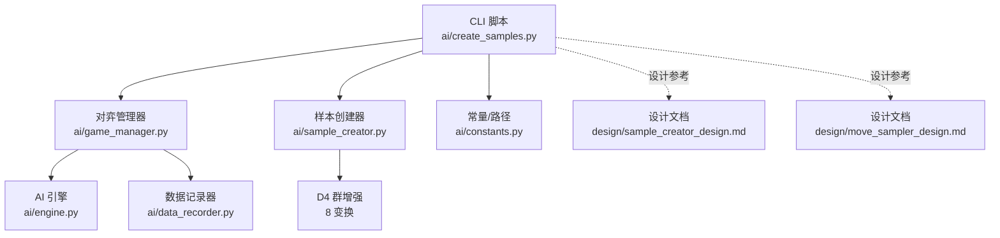
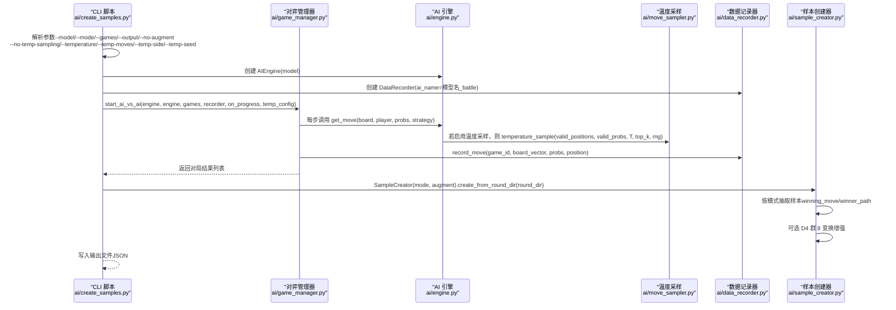
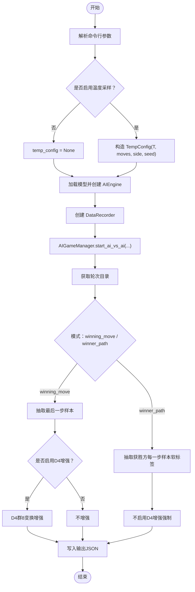
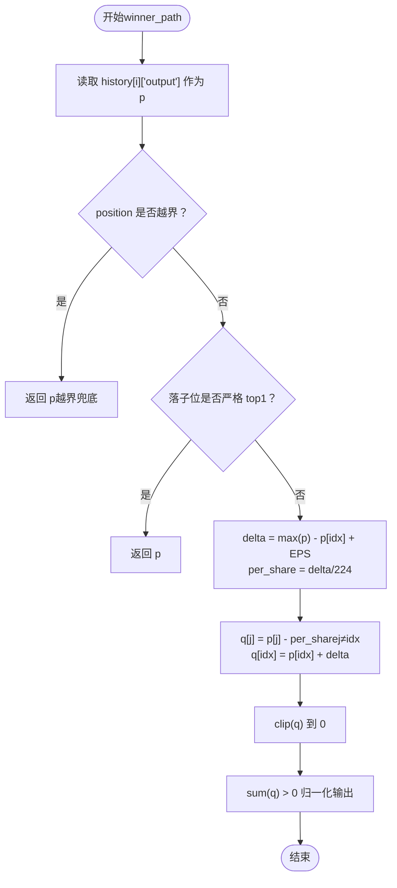
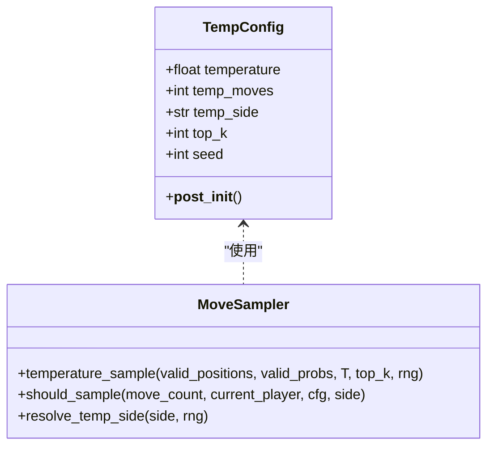
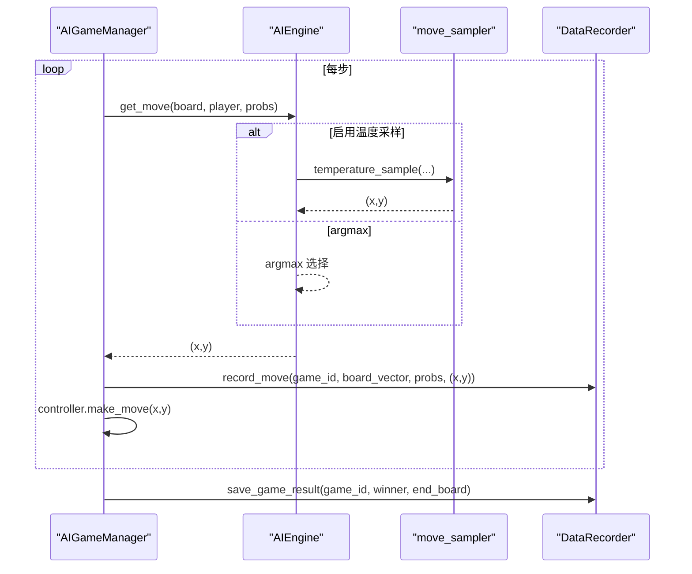
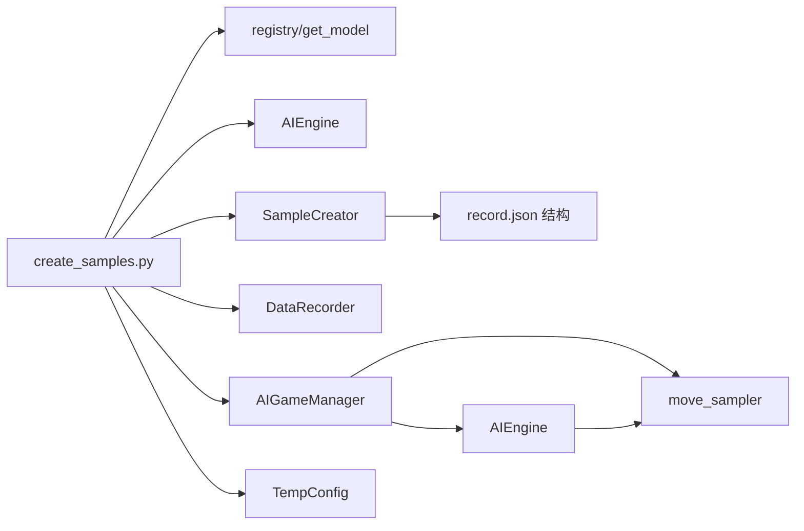

# 样本生成

<cite>
**本文引用的文件**
- [ai/create_samples.py](file://ai/create_samples.py)
- [ai/sample_creator.py](file://ai/sample_creator.py)
- [ai/move_sampler.py](file://ai/move_sampler.py)
- [ai/game_manager.py](file://ai/game_manager.py)
- [ai/engine.py](file://ai/engine.py)
- [ai/data_recorder.py](file://ai/data_recorder.py)
- [ai/constants.py](file://ai/constants.py)
- [design/sample_creator_design.md](file://design/sample_creator_design.md)
- [design/move_sampler_design.md](file://design/move_sampler_design.md)
- [tests/ai/test_sample_creator.py](file://tests/ai/test_sample_creator.py)
- [tests/ai/test_create_samples.py](file://tests/ai/test_create_samples.py)
</cite>

## 目录
1. [简介](#简介)
2. [项目结构](#项目结构)
3. [核心组件](#核心组件)
4. [架构总览](#架构总览)
5. [详细组件分析](#详细组件分析)
6. [依赖分析](#依赖分析)
7. [性能考虑](#性能考虑)
8. [故障排查指南](#故障排查指南)
9. [结论](#结论)
10. [附录](#附录)

## 简介
本文件面向“五子棋AI样本生成功能”，系统性阐述样本生成器的工作原理与实现细节，重点覆盖：
- AI对弈过程中的样本提取机制
- 不同模式下的样本生成策略（winning_move与winner_path）
- 样本创建器的实现，包括棋型样本构造方法、D4群8变换的数据增强、温度采样策略
- 样本生成的CLI接口设计与使用示例
- 样本质量控制标准与验证方法
- 实际代码示例与最佳实践

## 项目结构
围绕样本生成的关键模块如下：
- CLI入口：ai/create_samples.py
- 样本生成器：ai/sample_creator.py
- 温度采样策略：ai/move_sampler.py
- 对弈与记录：ai/game_manager.py、ai/engine.py、ai/data_recorder.py
- 常量与路径：ai/constants.py
- 设计文档：design/sample_creator_design.md、design/move_sampler_design.md
- 测试：tests/ai/test_sample_creator.py、tests/ai/test_create_samples.py

图表来源
- [ai/create_samples.py:1-197](file://ai/create_samples.py#L1-L197)
- [ai/game_manager.py:123-274](file://ai/game_manager.py#L123-L274)
- [ai/engine.py:67-142](file://ai/engine.py#L67-L142)
- [ai/data_recorder.py:17-145](file://ai/data_recorder.py#L17-L145)
- [ai/sample_creator.py:32-104](file://ai/sample_creator.py#L32-L104)
- [ai/constants.py:11-22](file://ai/constants.py#L11-L22)
- [design/sample_creator_design.md:1-536](file://design/sample_creator_design.md#L1-L536)
- [design/move_sampler_design.md:1-551](file://design/move_sampler_design.md#L1-L551)

章节来源
- [ai/create_samples.py:1-197](file://ai/create_samples.py#L1-L197)
- [ai/game_manager.py:123-274](file://ai/game_manager.py#L123-L274)
- [ai/engine.py:67-142](file://ai/engine.py#L67-L142)
- [ai/data_recorder.py:17-145](file://ai/data_recorder.py#L17-L145)
- [ai/sample_creator.py:32-104](file://ai/sample_creator.py#L32-L104)
- [ai/constants.py:11-22](file://ai/constants.py#L11-L22)
- [design/sample_creator_design.md:1-536](file://design/sample_creator_design.md#L1-L536)
- [design/move_sampler_design.md:1-551](file://design/move_sampler_design.md#L1-L551)

## 核心组件
- CLI脚本（ai/create_samples.py）：负责解析参数、加载模型、启动AI对弈、生成样本并输出JSON文件。
- 样本创建器（ai/sample_creator.py）：从record.json中抽取样本，支持winning_move与winner_path两种模式，并可选D4群8变换增强。
- 温度采样（ai/move_sampler.py）：提供温度加权采样策略，配合AI引擎在开局阶段探索多样化路径。
- 对弈与记录（ai/game_manager.py、ai/engine.py、ai/data_recorder.py）：驱动AI对弈，记录每步输入、输出与落子位置，保存完整对局历史。

章节来源
- [ai/create_samples.py:23-196](file://ai/create_samples.py#L23-L196)
- [ai/sample_creator.py:32-104](file://ai/sample_creator.py#L32-L104)
- [ai/move_sampler.py:50-186](file://ai/move_sampler.py#L50-L186)
- [ai/game_manager.py:123-274](file://ai/game_manager.py#L123-L274)
- [ai/engine.py:67-142](file://ai/engine.py#L67-L142)
- [ai/data_recorder.py:17-145](file://ai/data_recorder.py#L17-L145)

## 架构总览
下面的顺序图展示了从CLI到样本生成的完整流程，包括温度采样与数据增强的集成点。

图表来源
- [ai/create_samples.py:113-192](file://ai/create_samples.py#L113-L192)
- [ai/game_manager.py:123-274](file://ai/game_manager.py#L123-L274)
- [ai/engine.py:67-142](file://ai/engine.py#L67-L142)
- [ai/move_sampler.py:117-186](file://ai/move_sampler.py#L117-L186)
- [ai/data_recorder.py:96-140](file://ai/data_recorder.py#L96-L140)
- [ai/sample_creator.py:60-104](file://ai/sample_creator.py#L60-L104)

## 详细组件分析

### 组件A：CLI样本生成器（ai/create_samples.py）
- 功能概述
  - 解析命令行参数，构建TempConfig（可选），加载模型并创建AIEngine。
  - 启动AI对弈（黑白同模型内战），记录每步输入、输出与落子位置。
  - 生成样本：从轮次目录自动发现record.json，调用SampleCreator按模式抽取样本。
  - 输出JSON文件，打印对局统计与样本统计。
- 关键流程
  - 参数解析与TempConfig构造：支持禁用温度采样与自定义温度、步数阈值、采样方、随机种子。
  - 对弈执行：AIGameManager.start_ai_vs_ai，按需启用温度采样。
  - 样本生成：SampleCreator(mode, augment).create_from_round_dir，按模式抽取并可选D4增强。
  - 输出：确保输出目录存在，写入JSON。
- 使用示例
  - winning_move模式（默认）：仅取每局最后一步，启用D4增强。
  - winner_path模式：取获胜方每一步，强制不做D4增强。
  - 其他模型：如fc_v1等。

图表来源
- [ai/create_samples.py:23-196](file://ai/create_samples.py#L23-L196)
- [ai/sample_creator.py:38-104](file://ai/sample_creator.py#L38-L104)
- [ai/game_manager.py:233-274](file://ai/game_manager.py#L233-L274)

章节来源
- [ai/create_samples.py:23-196](file://ai/create_samples.py#L23-L196)
- [tests/ai/test_create_samples.py:23-200](file://tests/ai/test_create_samples.py#L23-L200)

### 组件B：样本创建器（ai/sample_creator.py）
- 支持模式
  - winning_move：每局仅取最后一步，output为one-hot（落子位=1，其余=0），mask全1。
  - winner_path：取获胜方每一步，output采用软标签（基于模型softmax输出，最小增强使其严格top1，其余等额汲取、clip、归一化），mask全1；D4增强强制禁用。
- 样本抽取与增强
  - 从record.json读取history，过滤平局/未结束/空history。
  - winning_move：取history[-1]构造样本。
  - winner_path：按获胜方步序构造样本，每步output为软标签。
  - D4群8变换：对input/board、output、mask分别按索引映射变换，生成8个变体。
- 软标签算法（winner_path）
  - 输入：模型当步softmax输出p（225维，sum≈1）与落子坐标。
  - 若坐标越界：直接返回p。
  - 若落子位已是严格top1（唯一最大）：返回p。
  - 否则：delta = max(p) - p[idx] + EPS（EPS=1e-3），q[idx]=p[idx]+delta，q[j]=p[j]-delta/224，clip到0，再归一化。

图表来源
- [ai/sample_creator.py:171-231](file://ai/sample_creator.py#L171-L231)
- [design/sample_creator_design.md:367-489](file://design/sample_creator_design.md#L367-L489)

章节来源
- [ai/sample_creator.py:32-339](file://ai/sample_creator.py#L32-L339)
- [design/sample_creator_design.md:145-536](file://design/sample_creator_design.md#L145-L536)

### 组件C：温度采样策略（ai/move_sampler.py）
- TempConfig：封装温度值T、前N步温度采样阈值、启用方（black/white/both/random）、可选top_k截断、随机种子。
- temperature_sample：对合法位置按p^(1/T)加权采样，若权重全0则均匀回退。
- should_sample：按步/按方判定是否启用温度采样。
- resolve_temp_side：将random解析为black或white（每局仅解析一次）。

图表来源
- [ai/move_sampler.py:50-186](file://ai/move_sampler.py#L50-L186)

章节来源
- [ai/move_sampler.py:50-258](file://ai/move_sampler.py#L50-L258)
- [design/move_sampler_design.md:1-551](file://design/move_sampler_design.md#L1-L551)

### 组件D：对弈与记录（ai/game_manager.py、ai/engine.py、ai/data_recorder.py）
- AIGameManager：封装单局对弈流程，按步按方编排温度采样，记录每步input、output、position，保存最终结果。
- AIEngine：将棋盘转换为向量，调用模型获取概率分布，在合法位置中按策略选择落子（argmax或sampling）。
- DataRecorder：创建轮次目录与局目录，记录每步数据与最终结果。

图表来源
- [ai/game_manager.py:123-230](file://ai/game_manager.py#L123-L230)
- [ai/engine.py:67-142](file://ai/engine.py#L67-L142)
- [ai/move_sampler.py:117-186](file://ai/move_sampler.py#L117-L186)
- [ai/data_recorder.py:96-140](file://ai/data_recorder.py#L96-L140)

章节来源
- [ai/game_manager.py:123-339](file://ai/game_manager.py#L123-L339)
- [ai/engine.py:67-194](file://ai/engine.py#L67-L194)
- [ai/data_recorder.py:17-145](file://ai/data_recorder.py#L17-L145)

## 依赖分析
- 模块耦合
  - create_samples.py依赖registry（模型加载）、AIEngine、AIGameManager、DataRecorder、SampleCreator、move_sampler.TempConfig。
  - sample_creator.py依赖data_recorder输出的record.json结构（history、output、position）。
  - game_manager.py依赖engine与move_sampler进行温度采样编排。
- 外部依赖
  - JSON文件格式约定（record.json字段）。
  - 目录结构约定（轮次目录、局目录、record.json路径）。

图表来源
- [ai/create_samples.py:15-21](file://ai/create_samples.py#L15-L21)
- [ai/sample_creator.py:74-104](file://ai/sample_creator.py#L74-L104)
- [ai/game_manager.py:123-274](file://ai/game_manager.py#L123-L274)
- [ai/move_sampler.py:50-186](file://ai/move_sampler.py#L50-L186)

章节来源
- [ai/create_samples.py:15-21](file://ai/create_samples.py#L15-L21)
- [ai/sample_creator.py:74-104](file://ai/sample_creator.py#L74-L104)
- [ai/game_manager.py:123-274](file://ai/game_manager.py#L123-L274)
- [ai/move_sampler.py:50-186](file://ai/move_sampler.py#L50-L186)

## 性能考虑
- 数据增强成本
  - D4群8变换将样本量扩大8倍，需平衡内存与IO压力；winner_path模式强制禁用以避免数据爆炸。
- 记录与IO
  - DataRecorder使用紧凑JSON格式（无缩进）降低文件体积，提高写入速度。
- 温度采样
  - 仅在开局阶段启用，避免对训练后期的稳定性造成影响；top_k截断可限制采样空间，减少无效探索。
- 并行与资源
  - 对弈阶段按局独立创建controller，避免共享状态带来的竞争；可结合多进程评估（如SelfPlayCycle）进一步提升吞吐。

[本节为通用性能建议，不直接分析具体文件]

## 故障排查指南
- 常见问题与定位
  - 样本数为0：检查record.json是否存在、winner是否为0或3（平局/未结束）、history是否为空。
  - 越界落子：winning_move模式下越界位置output全0；winner_path模式下越界返回模型原分布。
  - D4增强异常：winner_path模式强制禁用增强；若传入augment=True会被忽略。
  - 温度采样参数被忽略：当--no-temp-sampling启用时，其他温度参数会被忽略并发出警告。
- 质量验证
  - 使用测试用例验证：多文件合并、平局跳过、越界处理、D4增强行为、软标签sum=1、无负值等。
- 诊断建议
  - 通过CLI输出统计核对对局数与样本数；必要时开启--no-augment与--no-temp-sampling进行对照实验。

章节来源
- [tests/ai/test_sample_creator.py:24-200](file://tests/ai/test_sample_creator.py#L24-L200)
- [tests/ai/test_create_samples.py:23-200](file://tests/ai/test_create_samples.py#L23-L200)
- [ai/create_samples.py:113-136](file://ai/create_samples.py#L113-L136)
- [ai/sample_creator.py:38-58](file://ai/sample_creator.py#L38-L58)

## 结论
本文档系统梳理了五子棋AI样本生成的端到端流程，明确了CLI参数、对弈与记录、样本抽取与增强、软标签策略与质量控制。通过winning_move与winner_path两种模式，结合D4群8变换与温度采样，既能高效生成多样化样本，又能保证标签质量与训练稳定性。建议在实际使用中：
- 根据训练目标选择模式（winning_move侧重封口，winner_path侧重整局布局）。
- 控制数据增强规模，避免winner_path模式下的数据爆炸。
- 合理设置温度采样参数，平衡探索与稳定性。
- 严格遵循样本格式规范，利用测试用例进行质量验证。

[本节为总结性内容，不直接分析具体文件]

## 附录

### A. CLI参数与使用示例
- 基本参数
  - --model：模型名称（如cnn_v3.1、fc_v1）
  - --mode：样本生成模式（winning_move或winner_path）
  - --games：对局数
  - --output：输出JSON文件路径
  - --no-augment：禁用D4增强
  - --no-temp-sampling：禁用温度采样
  - --temperature：温度值T（>0）
  - --temp-moves：前N步启用温度采样
  - --temp-side：启用采样的一方（black/white/both/random）
  - --temp-seed：随机种子（用于复现）

- 使用示例
  - winning_move模式（默认）：仅取每局最后一步，启用D4增强。
  - winner_path模式：取获胜方每一步，强制不做D4增强。
  - 其他模型：如fc_v1等。

章节来源
- [ai/create_samples.py:25-110](file://ai/create_samples.py#L25-L110)
- [design/sample_creator_design.md:49-64](file://design/sample_creator_design.md#L49-L64)

### B. 样本格式规范
- 字段要求
  - input：226维向量（前225位为棋盘，第226位为当前落子方）
  - output：225维向量（winning_move为one-hot；winner_path为软标签）
  - mask：225维向量（全1）
  - record.json中history包含每步的input、output、position

- 跳过规则
  - winner=0或3（未结束或平局）整局跳过
  - history为空整局跳过

章节来源
- [ai/sample_creator.py:110-135](file://ai/sample_creator.py#L110-L135)
- [ai/data_recorder.py:96-140](file://ai/data_recorder.py#L96-L140)

### C. 数据增强与软标签算法
- D4群8变换
  - 对board、output、mask分别按索引映射变换，生成8个变体。
  - winner_path模式强制禁用增强。

- winner_path软标签
  - 基于模型softmax输出p，若落子位非严格top1，则通过delta与per_share实现最小增强，clip与归一化保证sum=1且非负。

章节来源
- [ai/sample_creator.py:234-339](file://ai/sample_creator.py#L234-L339)
- [design/sample_creator_design.md:367-489](file://design/sample_creator_design.md#L367-L489)

### D. 最佳实践
- 选择合适模式
  - 初期训练：winning_move快速覆盖封口场景。
  - 布局学习：winner_path覆盖整局决策。
- 控制增强规模
  - winner_path模式下不启用D4增强，避免数据爆炸。
- 温度采样调优
  - 开局阶段适度探索，逐步过渡到argmax。
- 质量监控
  - 使用测试用例验证样本格式、软标签sum=1、无负值等。

章节来源
- [design/move_sampler_design.md:484-524](file://design/move_sampler_design.md#L484-L524)
- [tests/ai/test_sample_creator.py:24-200](file://tests/ai/test_sample_creator.py#L24-L200)
- [tests/ai/test_create_samples.py:23-200](file://tests/ai/test_create_samples.py#L23-L200)