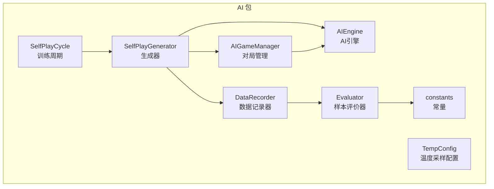
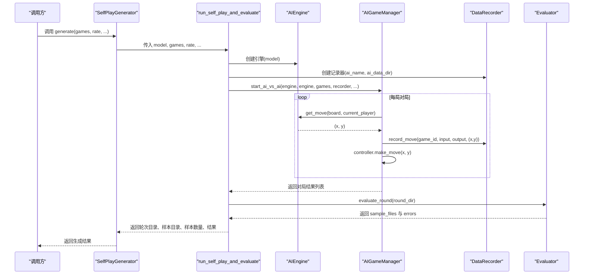
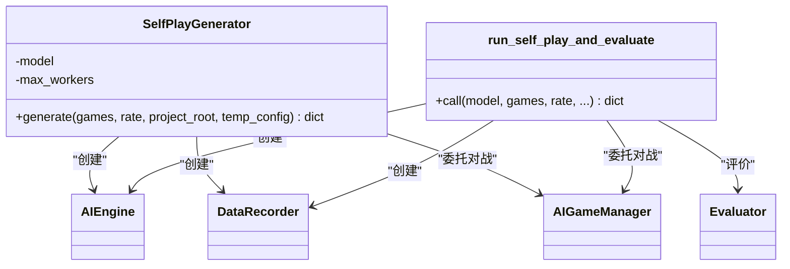
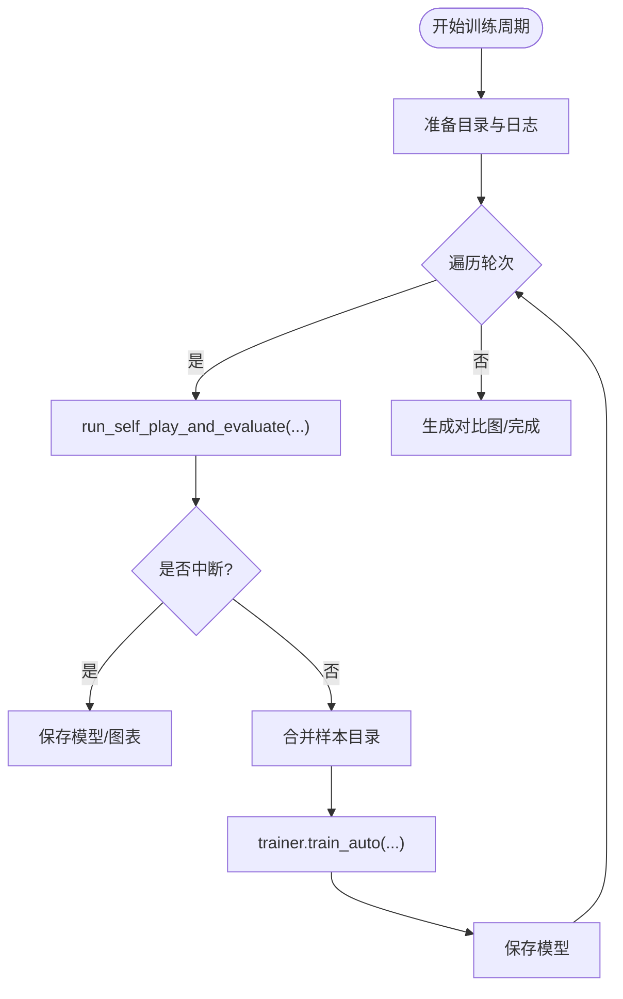
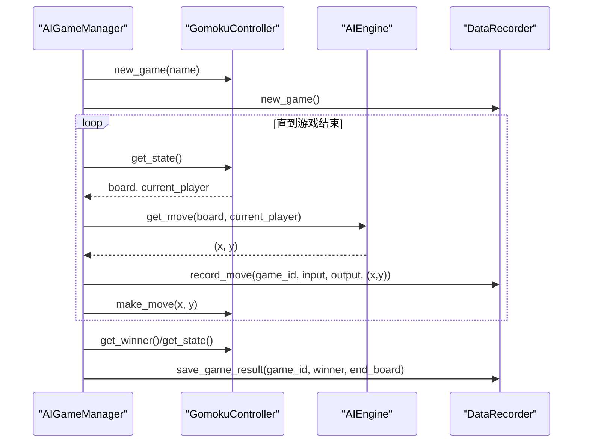
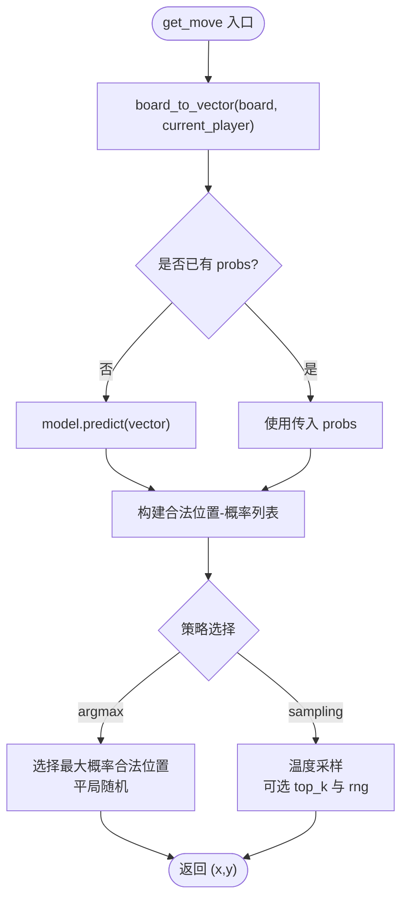
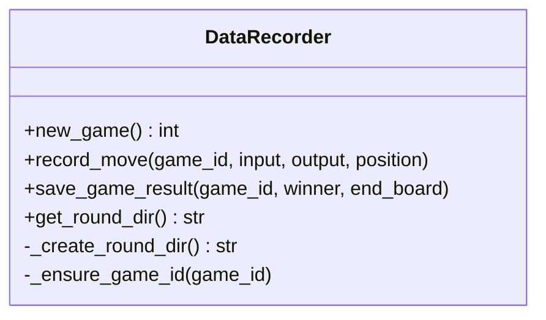
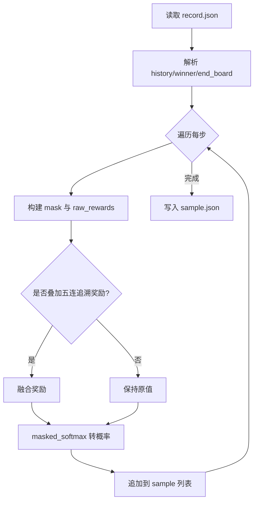
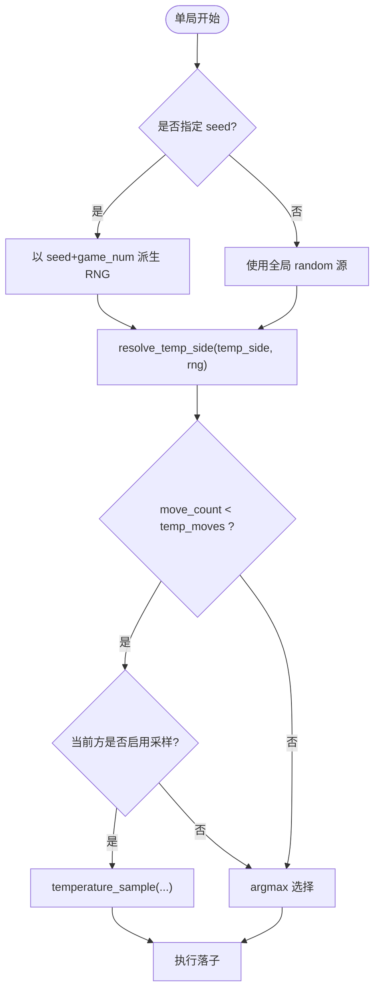
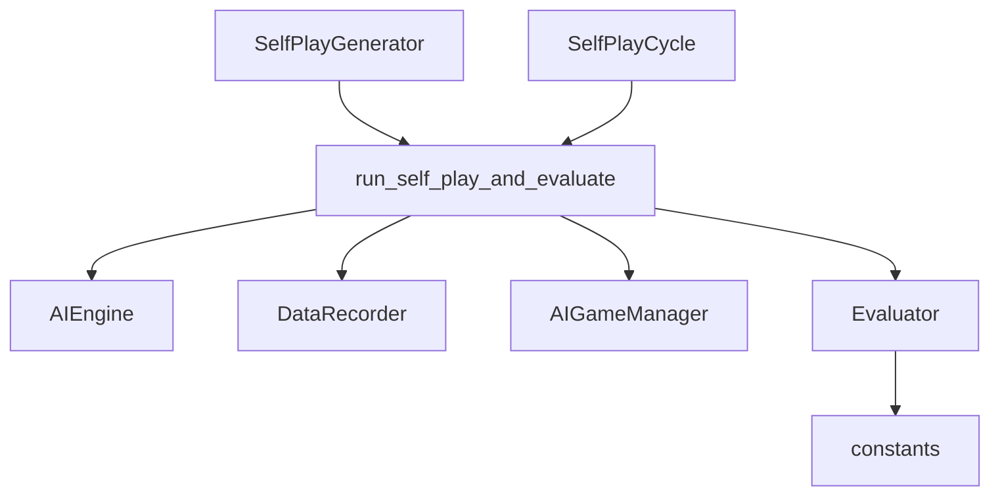

# 自我对弈生成

<cite>
**本文引用的文件**   
- [self_play_generator.py](file://ai/self_play_generator.py)
- [self_play_cycle.py](file://ai/self_play_cycle.py)
- [game_manager.py](file://ai/game_manager.py)
- [data_recorder.py](file://ai/data_recorder.py)
- [engine.py](file://ai/engine.py)
- [evaluator.py](file://ai/evaluator.py)
- [battle.py](file://ai/battle.py)
- [constants.py](file://ai/constants.py)
- [README.md](file://README.md)
- [move_sampler.py](file://ai/move_sampler.py)
- [ai_design.md](file://design/ai_design.md)
- [mini_batch_cycle_design.md](file://design/mini_batch_cycle_design.md)
</cite>

## 目录
1. [简介](#简介)
2. [项目结构](#项目结构)
3. [核心组件](#核心组件)
4. [架构总览](#架构总览)
5. [详细组件分析](#详细组件分析)
6. [依赖关系分析](#依赖关系分析)
7. [性能考量](#性能考量)
8. [故障排查指南](#故障排查指南)
9. [结论](#结论)
10. [附录](#附录)

## 简介
本技术文档面向“五子棋AI自我对弈生成系统”，聚焦于“仅自我对弈+评价”的数据生成流程，解释AI模型之间的对战机制、棋局数据的生成与存储、自我对弈循环的实现与控制、数据收集与格式化、质量控制机制，以及配置参数与使用示例。读者可据此理解从AI引擎到对局记录、再到样本生成的完整链路。

## 项目结构
围绕自我对弈生成的核心模块包括：
- 自我对弈与评价执行器：run_self_play_and_evaluate 及 SelfPlayGenerator
- 自我对弈训练周期：SelfPlayCycle（仅训练周期编排，对弈+评价委托给执行器）
- 游戏管理与对局执行：AIGameManager
- AI引擎与落子策略：AIEngine
- 数据记录器：DataRecorder
- 样本评价器：Evaluator
- 温度采样与随机性控制：move_sampler.TempConfig
- 常量与路径：constants.AI_DATA_DIR、TRAIN_DATA_DIR 等

**图示来源**
- [self_play_generator.py:170-244](file://ai/self_play_generator.py#L170-L244)
- [self_play_cycle.py:20-195](file://ai/self_play_cycle.py#L20-L195)
- [game_manager.py:16-339](file://ai/game_manager.py#L16-L339)
- [engine.py:44-194](file://ai/engine.py#L44-L194)
- [data_recorder.py:17-145](file://ai/data_recorder.py#L17-L145)
- [evaluator.py:51-350](file://ai/evaluator.py#L51-L350)
- [move_sampler.py:50-258](file://ai/move_sampler.py#L50-L258)
- [constants.py:11-26](file://ai/constants.py#L11-L26)

**章节来源**
- [README.md:1-422](file://README.md#L1-L422)
- [ai_design.md:1-746](file://design/ai_design.md#L1-L746)

## 核心组件
- SelfPlayGenerator：封装单轮自我对弈+评价的公共流程，提供 generate(games, rate, ...) 接口，返回轮次目录、样本目录、样本数量与对局结果。
- run_self_play_and_evaluate：核心执行函数，负责创建引擎、记录器、执行AI内战、统计结果、调用Evaluator生成样本、映射训练数据目录。
- SelfPlayCycle：训练周期编排，循环调用 run_self_play_and_evaluate，合并样本并训练模型，支持 mini-batch 与全量更新。
- AIGameManager：管理对局流程，支持固定执方与随机执方两种内战模式，记录每步输入、输出与落子位置。
- AIEngine：将棋盘状态向量化并调用模型预测，按策略（argmax/sampling）选择落子位置。
- DataRecorder：按轮次与局号组织 record.json，记录历史、赢家与终局棋盘。
- Evaluator：读取 record.json，计算每步奖励并生成 sample.json，支持多进程并行。
- TempConfig：温度采样配置，控制采样强度、步数阈值、作用方与随机种子。
- constants：定义 AI_DATA_DIR、TRAIN_DATA_DIR、LOSS_LOG_DIR 等路径常量。

**章节来源**
- [self_play_generator.py:21-168](file://ai/self_play_generator.py#L21-L168)
- [self_play_generator.py:170-244](file://ai/self_play_generator.py#L170-L244)
- [self_play_cycle.py:20-195](file://ai/self_play_cycle.py#L20-L195)
- [game_manager.py:16-339](file://ai/game_manager.py#L16-L339)
- [engine.py:44-194](file://ai/engine.py#L44-L194)
- [data_recorder.py:17-145](file://ai/data_recorder.py#L17-L145)
- [evaluator.py:51-350](file://ai/evaluator.py#L51-L350)
- [move_sampler.py:50-258](file://ai/move_sampler.py#L50-L258)
- [constants.py:11-26](file://ai/constants.py#L11-L26)

## 架构总览
自我对弈生成的端到端流程如下：

**图示来源**
- [self_play_generator.py:198-243](file://ai/self_play_generator.py#L198-L243)
- [self_play_generator.py:21-168](file://ai/self_play_generator.py#L21-L168)
- [game_manager.py:233-274](file://ai/game_manager.py#L233-L274)
- [engine.py:67-142](file://ai/engine.py#L67-L142)
- [data_recorder.py:96-141](file://ai/data_recorder.py#L96-L141)
- [evaluator.py:224-350](file://ai/evaluator.py#L224-L350)

## 详细组件分析

### 自我对弈生成器（SelfPlayGenerator）
- 职责：封装单轮自我对弈+评价流程，屏蔽训练细节，仅产出数据。
- 关键流程：
  - 创建 AIEngine(model)
  - 创建 DataRecorder(ai_name, ai_data_dir)
  - 调用 AIGameManager.start_ai_vs_ai(engine, engine, games, recorder, ...)
  - 统计胜负，调用 Evaluator.evaluate_round(round_dir)
  - 映射训练数据目录 train_data_dir
- 返回结构：包含 round_dir、train_data_dir、sample_dirs、sample_count、results、interrupted（仅执行器返回）

**图示来源**
- [self_play_generator.py:170-244](file://ai/self_play_generator.py#L170-L244)
- [self_play_generator.py:21-168](file://ai/self_play_generator.py#L21-L168)

**章节来源**
- [self_play_generator.py:170-244](file://ai/self_play_generator.py#L170-L244)
- [self_play_generator.py:21-168](file://ai/self_play_generator.py#L21-L168)

### 自我对弈训练周期（SelfPlayCycle）
- 职责：循环执行多轮自我对弈+评价，每轮结束后合并样本并训练模型。
- 关键流程：
  - 生成会话目录，准备 LossLogger
  - 循环调用 run_self_play_and_evaluate
  - 若 sample_dirs 非空，调用 trainer.train_auto 合并训练
  - 保存模型，生成 loss 曲线与对比图
- 支持 mini-batch 与全量更新，参数通过 train_auto 传递。

**图示来源**
- [self_play_cycle.py:38-195](file://ai/self_play_cycle.py#L38-L195)

**章节来源**
- [self_play_cycle.py:20-195](file://ai/self_play_cycle.py#L20-L195)
- [mini_batch_cycle_design.md:16-92](file://design/mini_batch_cycle_design.md#L16-L92)

### 游戏管理与对局执行（AIGameManager）
- 职责：管理对局生命周期，记录每步输入、输出与落子位置；支持固定执方与随机执方两种内战。
- 关键流程：
  - start_ai_vs_ai：固定 engine1 黑、engine2 白
  - start_ai_vs_ai_random：每局随机分配执方
  - _play_single_game：单局循环，按策略选择落子，记录数据，保存结果

**图示来源**
- [game_manager.py:233-339](file://ai/game_manager.py#L233-L339)
- [engine.py:67-142](file://ai/engine.py#L67-L142)
- [data_recorder.py:96-141](file://ai/data_recorder.py#L96-L141)

**章节来源**
- [game_manager.py:16-339](file://ai/game_manager.py#L16-L339)

### AI引擎与落子策略（AIEngine）
- 职责：将棋盘向量化，调用模型预测，按策略（argmax 或 temperature sampling）选择落子。
- 支持策略：
  - argmax：选择最大概率合法位置，平局时随机打破
  - sampling：温度采样，支持 top_k 截断与自定义随机源

**图示来源**
- [engine.py:67-142](file://ai/engine.py#L67-L142)

**章节来源**
- [engine.py:44-194](file://ai/engine.py#L44-L194)

### 数据记录器（DataRecorder）
- 职责：按轮次与局号组织 record.json，记录历史、赢家与终局棋盘。
- 数据结构要点：
  - history：每步记录 input(226维)、output(225维)、position
  - winner：1=黑胜、2=白胜、3=平局
  - end_board：终局棋盘向量（226维）

**图示来源**
- [data_recorder.py:17-145](file://ai/data_recorder.py#L17-L145)

**章节来源**
- [data_recorder.py:17-145](file://ai/data_recorder.py#L17-L145)

### 样本评价器（Evaluator）
- 职责：读取 record.json，计算每步奖励并生成 sample.json。
- 关键流程：
  - 读取 history、winner、end_board
  - 计算 raw_rewards（棋型评估 + 五连追溯融合）
  - masked_softmax 转换为概率分布
  - 多进程并行 evaluate_round，支持串行与回退

**图示来源**
- [evaluator.py:97-210](file://ai/evaluator.py#L97-L210)
- [evaluator.py:224-350](file://ai/evaluator.py#L224-L350)

**章节来源**
- [evaluator.py:51-350](file://ai/evaluator.py#L51-L350)

### 温度采样与随机性控制（TempConfig）
- 职责：控制自我对弈的随机性，支持前 N 步温度采样、按方启用、随机抽签等策略。
- 关键参数：
  - temperature：温度值 T > 0
  - temp_moves：前 N 步启用采样
  - temp_side：作用方（black/white/both/random）
  - top_k：采样前截断阈值
  - seed：随机种子（可复现）

**图示来源**
- [move_sampler.py:192-227](file://ai/move_sampler.py#L192-L227)
- [move_sampler.py:229-258](file://ai/move_sampler.py#L230-L258)
- [game_manager.py:166-223](file://ai/game_manager.py#L166-L223)

**章节来源**
- [move_sampler.py:50-258](file://ai/move_sampler.py#L50-L258)
- [game_manager.py:123-231](file://ai/game_manager.py#L123-L231)

## 依赖关系分析
- SelfPlayGenerator 依赖 AIEngine、DataRecorder、AIGameManager、Evaluator
- run_self_play_and_evaluate 作为公共执行器，被 SelfPlayGenerator 与 SelfPlayCycle 复用
- Evaluator 依赖 constants（路径常量）、line_tracer、reward_calculator、probability_utils
- AIGameManager 依赖 engine（策略）、data_recorder（数据持久化）
- SelfPlayCycle 依赖 SelfPlayGenerator 的执行器，以及 trainer 的训练方法

**图示来源**
- [self_play_generator.py:21-168](file://ai/self_play_generator.py#L21-L168)
- [self_play_cycle.py:111-121](file://ai/self_play_cycle.py#L111-L121)
- [evaluator.py:57-96](file://ai/evaluator.py#L57-L96)

**章节来源**
- [self_play_generator.py:170-244](file://ai/self_play_generator.py#L170-L244)
- [self_play_cycle.py:20-195](file://ai/self_play_cycle.py#L20-L195)
- [evaluator.py:51-96](file://ai/evaluator.py#L51-L96)

## 性能考量
- 并行评价：Evaluator.evaluate_round 支持多进程并行（ProcessPoolExecutor），默认限制最大进程数，遇到进程崩溃自动回退到串行。
- 数据压缩：record.json 与 sample.json 采用紧凑格式（无缩进），显著降低文件体积。
- 训练模式：SelfPlayCycle 支持 mini-batch 与全量更新，mini-batch 可结合打乱与验证集比例提升训练稳定性与效率。
- 温度采样：合理设置 temp_moves 与 temperature，可在开局引入多样性，避免过早收敛。

[本节为通用指导，不涉及特定文件分析]

## 故障排查指南
- 键盘中断处理：run_self_play_and_evaluate 捕获 KeyboardInterrupt，优雅返回已生成的数据与进度。
- 进程池崩溃：Evaluator 在并行模式下遇到 BrokenProcessPool 自动回退到串行处理剩余文件。
- 数据完整性检查：DataRecorder 在保存前校验 game_id 一致性，记录器与 Evaluator 均对缺失字段进行保护性处理。
- 路径与权限：constants 定义的目录需具备读写权限；若环境变量覆盖 LOSS_LOG_DIR，请确保路径存在。

**章节来源**
- [self_play_generator.py:138-167](file://ai/self_play_generator.py#L138-L167)
- [evaluator.py:325-347](file://ai/evaluator.py#L325-L347)
- [data_recorder.py:81-95](file://ai/data_recorder.py#L81-L95)
- [constants.py:19-22](file://ai/constants.py#L19-L22)

## 结论
本系统通过 SelfPlayGenerator 与 SelfPlayCycle 将“自我对弈+评价”流程模块化、可复用且可扩展。借助 DataRecorder 与 Evaluator 的清晰分工，实现了高质量的训练样本生成；配合 TempConfig 的温度采样策略，有效提升了对局多样性与数据质量。整体设计兼顾易用性与性能，适合在持续训练与模型迭代中稳定使用。

[本节为总结性内容，不涉及特定文件分析]

## 附录

### 自我对弈循环与配置
- 轮次控制：SelfPlayCycle.run 支持 rounds 控制轮次数，每轮调用 run_self_play_and_evaluate
- 每轮对局数：games 控制每轮对局数量
- 训练模式：batch_size 非空时走 mini-batch，否则全量更新
- 随机性：通过 TempConfig 控制温度采样强度、步数阈值与作用方

**章节来源**
- [self_play_cycle.py:38-66](file://ai/self_play_cycle.py#L38-L66)
- [mini_batch_cycle_design.md:16-92](file://design/mini_batch_cycle_design.md#L16-L92)

### 数据收集与格式
- record.json：每局历史（input、output、position）、winner、end_board
- sample.json：每步 input、output（softmax 概率分布）、mask
- 路径映射：Evaluator 将 ai_data 下的 record.json 映射到 train_data 下的 sample.json

**章节来源**
- [data_recorder.py:96-141](file://ai/data_recorder.py#L96-L141)
- [evaluator.py:212-222](file://ai/evaluator.py#L212-L222)

### 配置参数说明
- AI模型选择：通过 registry 获取模型实例，支持 random、fc_v1、cnn_v1、cnn_v2、cnn_v3.x 等
- 难度设置：通过 TempConfig.temperature 与 temp_moves 控制
- 随机性控制：TempConfig.temp_side 与 seed 实现按方启用与可复现

**章节来源**
- [battle.py:106-133](file://ai/battle.py#L106-L133)
- [move_sampler.py:77-111](file://ai/move_sampler.py#L77-L111)

### 实际使用示例
- 命令行对战：ai/battle.py 支持指定双方 AI 与对局数，每局执方随机
- 生成样本：SelfPlayGenerator.generate(...) 生成样本并返回目录与统计
- 训练周期：SelfPlayCycle.run(...) 支持多轮自我对弈+训练

**章节来源**
- [README.md:54-75](file://README.md#L54-L75)
- [battle.py:136-199](file://ai/battle.py#L136-L199)
- [self_play_generator.py:198-243](file://ai/self_play_generator.py#L198-L243)
- [self_play_cycle.py:38-98](file://ai/self_play_cycle.py#L38-L98)