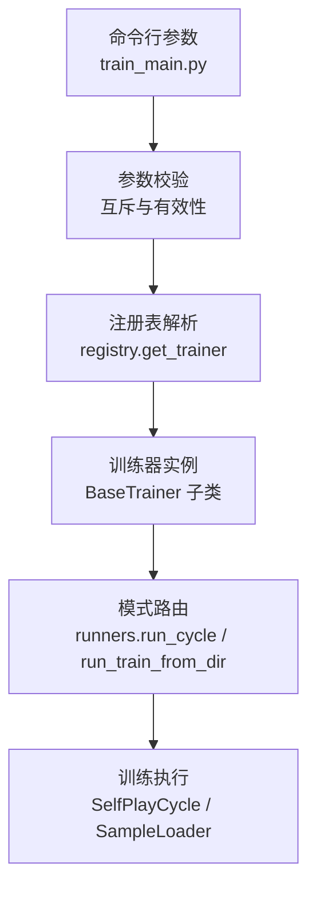
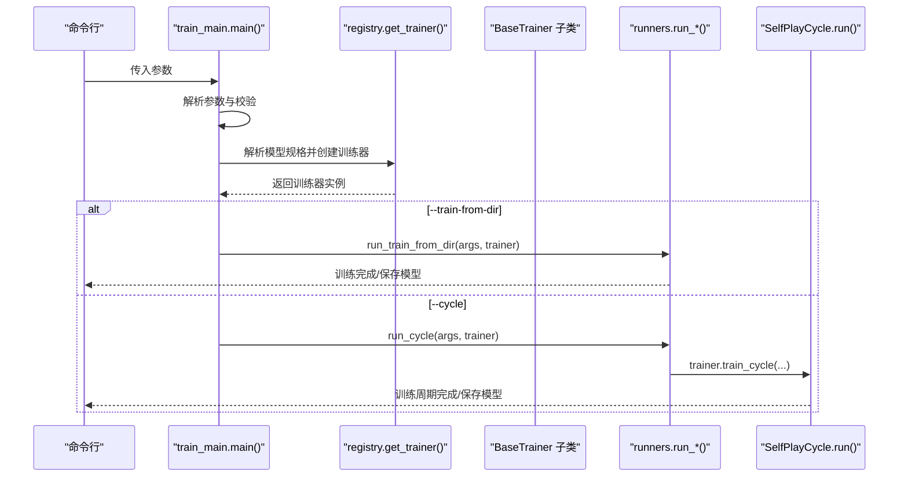
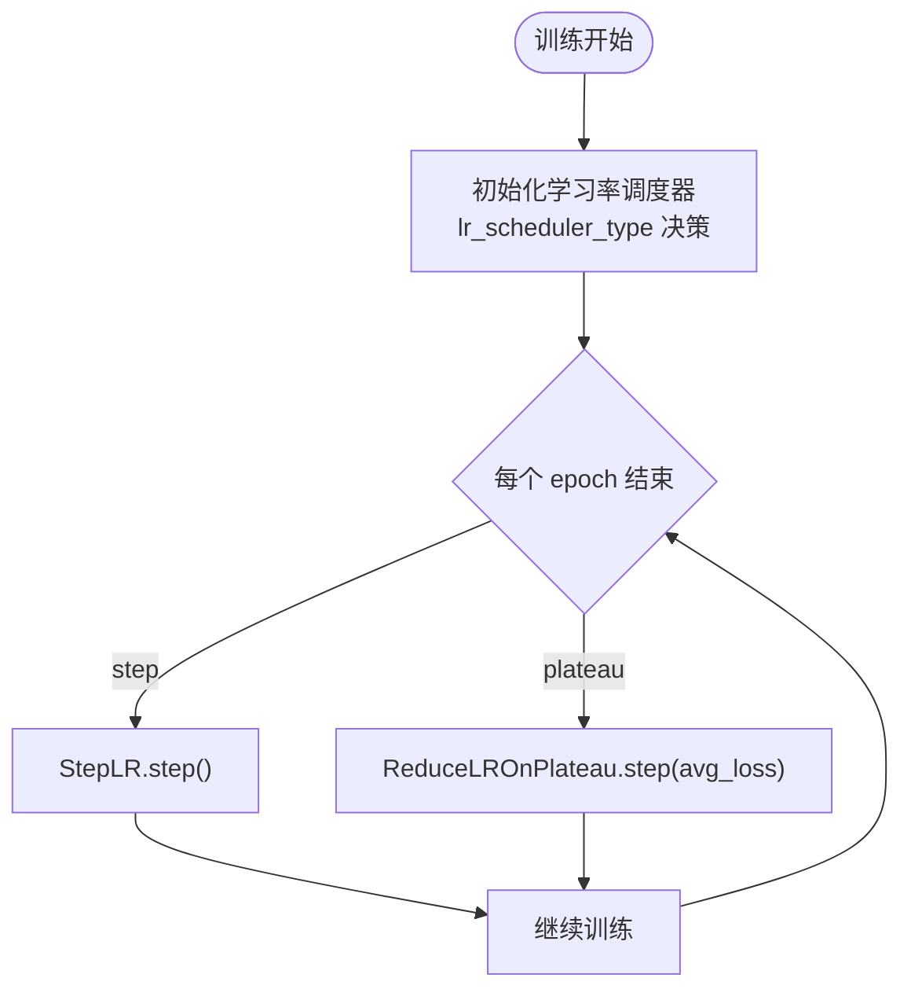
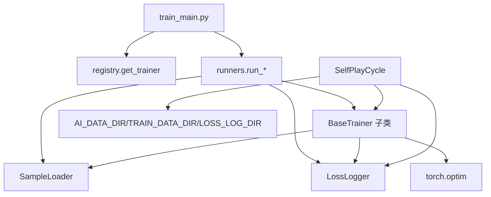

# 训练入口脚本

<cite>
**本文引用的文件**
- [ai/train_main.py](file://ai/train_main.py)
- [ai/runners.py](file://ai/runners.py)
- [ai/base_trainer.py](file://ai/base_trainer.py)
- [ai/self_play_cycle.py](file://ai/self_play_cycle.py)
- [ai/registry.py](file://ai/registry.py)
- [ai/constants.py](file://ai/constants.py)
- [ai/move_sampler.py](file://ai/move_sampler.py)
- [design/learn_rate/lr_scheduler_design.md](file://design/learn_rate/lr_scheduler_design.md)
- [tests/ai/test_train_main.py](file://tests/ai/test_train_main.py)
- [tests/cli/test_train_main_cli.py](file://tests/cli/test_train_main_cli.py)
</cite>

## 目录
1. [简介](#简介)
2. [项目结构](#项目结构)
3. [核心组件](#核心组件)
4. [架构总览](#架构总览)
5. [详细组件分析](#详细组件分析)
6. [依赖分析](#依赖分析)
7. [性能考虑](#性能考虑)
8. [故障排查指南](#故障排查指南)
9. [结论](#结论)
10. [附录](#附录)

## 简介
本文件面向五子棋AI训练入口脚本 train_main.py，系统化阐述其作为训练器入口的核心功能与实现细节，包括：
- 命令行参数解析机制与参数验证逻辑
- 模式路由功能（--cycle周期训练模式 vs --train-from-dir目录训练模式）
- 训练参数配置项（轮次数、每轮对局数、训练迭代数等）的作用与默认值
- 学习率调度器配置（step与plateau两种策略及其参数）
- 温度采样参数（仅在--cycle模式生效）与默认行为
- 完整命令行使用示例与常见场景参数组合
- 参数冲突检测、错误处理与用户友好的帮助信息

## 项目结构
train_main.py 位于 ai 包根目录，作为训练器入口脚本，主要职责是：
- 使用 argparse 定义并解析命令行参数
- 校验参数互斥与有效性
- 通过注册表获取具体模型与训练器实例
- 将参数路由到对应的运行器（runners.py）以执行训练

**图表来源**
- [ai/train_main.py:27-234](file://ai/train_main.py#L27-L234)
- [ai/runners.py:81-255](file://ai/runners.py#L81-L255)
- [ai/registry.py:187-224](file://ai/registry.py#L187-L224)

**章节来源**
- [ai/train_main.py:27-234](file://ai/train_main.py#L27-L234)
- [ai/runners.py:1-255](file://ai/runners.py#L1-L255)
- [ai/registry.py:1-316](file://ai/registry.py#L1-L316)

## 核心组件
- 命令行参数解析器：定义模型、训练模式、训练参数、学习率调度器、温度采样等参数，并提供帮助与示例。
- 参数校验器：确保仅能选择一种训练模式（--cycle 或 --train-from-dir），并进行参数合法性检查。
- 注册表与训练器工厂：根据模型规格（如 fc_v1、cnn_v3.2）解析并创建对应训练器实例。
- 运行器：封装两种训练模式的具体执行逻辑，负责数据发现、训练方法选择与日志输出。
- 训练器基类：提供通用训练流程、学习率调度器初始化、损失计算与日志记录等能力。

**章节来源**
- [ai/train_main.py:27-234](file://ai/train_main.py#L27-L234)
- [ai/runners.py:81-255](file://ai/runners.py#L81-L255)
- [ai/base_trainer.py:32-699](file://ai/base_trainer.py#L32-L699)
- [ai/registry.py:187-224](file://ai/registry.py#L187-L224)

## 架构总览
训练入口的整体调用链如下：

**图表来源**
- [ai/train_main.py:27-234](file://ai/train_main.py#L27-L234)
- [ai/runners.py:81-255](file://ai/runners.py#L81-L255)
- [ai/self_play_cycle.py:38-195](file://ai/self_play_cycle.py#L38-L195)
- [ai/registry.py:187-224](file://ai/registry.py#L187-L224)

## 详细组件分析

### 命令行参数解析与模式路由
- 模型选择：--model 支持 fc_v1、cnn_v3.2 等，注册表负责解析与懒加载。
- 训练模式互斥：--cycle 与 --train-from-dir 二选一，否则抛错。
- 训练参数：
  - --rounds：训练周期轮次数，默认 10
  - --games：每轮对局数，默认 100
  - --epochs：训练迭代数，默认 1000
  - --rate：奖励衰减率，默认 0.9（传给 Evaluator）
  - --fresh：从新模型开始训练（不加载已保存模型）
- 数据加载与训练方法：
  - --train-from-dir：支持直接指定 .json 文件或目录（自动发现 merge 与 sample.json）
  - --batch-size：mini-batch 训练的批次大小；--shuffle 控制每个 epoch 是否打乱
  - --val-ratio：验证集比例，默认 0.0（不分割）
- 学习率调度器：
  - --lr-scheduler：step 或 plateau
  - --lr-step-size：StepLR 衰减间隔，默认 500
  - --lr-gamma：StepLR 衰减系数，默认 0.9
  - --lr-patience：ReduceLROnPlateau 耐心值，默认 100
  - --lr-factor：ReduceLROnPlateau 衰减系数，默认 0.5
- 温度采样（仅 --cycle 模式）：
  - --no-temp-sampling：禁用温度采样（全程 argmax）
  - --temperature：温度值 T（>0），默认 1.0
  - --temp-moves：前 N 个全局步启用温度采样，默认 12
  - --temp-side：启用温度采样的方，取值 black/white/both/random，默认 both
  - --temp-seed：温度采样随机种子

参数校验与错误处理：
- 未指定任何模式参数时提示错误并退出
- 同时指定 --cycle 与 --train-from-dir 时提示冲突并退出
- 模型解析失败或训练器不可用时捕获异常并退出

**章节来源**
- [ai/train_main.py:27-234](file://ai/train_main.py#L27-L234)
- [tests/cli/test_train_main_cli.py:35-43](file://tests/cli/test_train_main_cli.py#L35-L43)
- [tests/ai/test_train_main.py:51-58](file://tests/ai/test_train_main.py#L51-L58)

### 训练模式选择机制
- --cycle 周期训练模式
  - 特点：模型自我对弈生成样本，随后合并训练，循环多轮
  - 关键参数：rounds、games、epochs、rate、batch-size、shuffle、val-ratio、温度采样参数
  - 温度采样默认启用，可通过 --no-temp-sampling 禁用
- --train-from-dir 目录训练模式
  - 特点：从已有数据目录加载样本（支持 .json 文件或包含 sample.json 的子目录）
  - 关键参数：epochs、batch-size、shuffle、val-ratio
  - 自动选择训练方法：提供 batch-size 时使用 mini-batch，否则全量更新

模式路由逻辑：
- 根据是否指定 --train-from-dir 决定调用 run_train_from_dir 或 run_cycle
- run_cycle 内部通过 SelfPlayCycle.run() 执行多轮自我对弈与训练

**章节来源**
- [ai/runners.py:173-255](file://ai/runners.py#L173-L255)
- [ai/self_play_cycle.py:38-195](file://ai/self_play_cycle.py#L38-L195)
- [tests/ai/test_train_main.py:101-200](file://tests/ai/test_train_main.py#L101-L200)

### 训练参数配置详解
- 轮次数（rounds）：训练周期的轮数，默认 10
- 每轮对局数（games）：每轮自我对弈的对局数量，默认 100
- 训练迭代数（epochs）：单次训练的迭代轮数，默认 1000
- 奖励衰减率（rate）：传给 Evaluator 用于生成样本，默认 0.9
- 验证集比例（val-ratio）：默认 0.0（不分割），推荐 0.2
- mini-batch 训练：
  - --batch-size：批次大小，提供时启用 mini-batch
  - --shuffle：每个 epoch 是否打乱数据顺序（仅 mini-batch 有效）

这些参数在 run_cycle 与 run_train_from_dir 中分别透传至训练器的 train_cycle 与 train_auto。

**章节来源**
- [ai/runners.py:173-255](file://ai/runners.py#L173-L255)
- [ai/runners.py:81-172](file://ai/runners.py#L81-L172)
- [ai/base_trainer.py:621-660](file://ai/base_trainer.py#L621-L660)

### 学习率调度器配置
- 支持两种策略：
  - step：固定间隔衰减（StepLR）
  - plateau：按平台衰减（ReduceLROnPlateau）
- 参数：
  - step：--lr-step-size（默认 500）、--lr-gamma（默认 0.9）
  - plateau：--lr-patience（默认 100）、--lr-factor（默认 0.5）
- 生命周期：在 BaseTrainer.__init__ 中根据 lr_scheduler_type 初始化，训练循环结束时 step

**图表来源**
- [ai/base_trainer.py:127-144](file://ai/base_trainer.py#L127-L144)
- [design/learn_rate/lr_scheduler_design.md:67-85](file://design/learn_rate/lr_scheduler_design.md#L67-L85)

**章节来源**
- [ai/base_trainer.py:127-144](file://ai/base_trainer.py#L127-L144)
- [design/learn_rate/lr_scheduler_design.md:13-31](file://design/learn_rate/lr_scheduler_design.md#L13-L31)

### 温度采样参数（仅 --cycle 模式）
- --no-temp-sampling：禁用温度采样（默认启用）
- --temperature：温度值 T（>0），越大越随机，默认 1.0
- --temp-moves：前 N 个全局步启用温度采样，默认 12
- --temp-side：启用温度采样的方，取值 black/white/both/random，默认 both
- --temp-seed：温度采样随机种子

这些参数在 run_cycle 中被构造成 TempConfig 并透传至 trainer.train_cycle，再由 SelfPlayCycle.run() 使用。

**章节来源**
- [ai/runners.py:214-233](file://ai/runners.py#L214-L233)
- [ai/move_sampler.py:50-112](file://ai/move_sampler.py#L50-L112)
- [tests/ai/test_train_main.py:259-312](file://tests/ai/test_train_main.py#L259-L312)

### 训练器工厂与注册表
- get_trainer(spec, **kwargs)：根据模型规格解析并创建训练器实例
- 支持多代模型（如 cnn_v3.2），非多代模型禁止指定代数
- 通过 importlib 懒加载，避免一次性导入所有模型

**章节来源**
- [ai/registry.py:187-224](file://ai/registry.py#L187-L224)
- [ai/registry.py:103-130](file://ai/registry.py#L103-L130)

### 训练器基类与通用训练流程
- 设备选择：优先 GPU，否则 CPU
- 优化器：AdamW（解耦权重衰减），默认学习率与权重衰减
- 损失函数：L1Loss（MAE），支持掩码损失
- 训练方法：
  - train_single：单个 sample.json 训练
  - train_batch：合并多个样本，每个 epoch 仅一次参数更新
  - train_mini_batch：分批训练，收敛更快
  - train_auto：自动选择 train_batch 或 train_mini_batch
  - train_cycle：周期训练（委托 SelfPlayCycle）
- 学习率调度：StepLR 或 ReduceLROnPlateau
- 日志与可视化：LossLogger 记录与绘图

**章节来源**
- [ai/base_trainer.py:32-699](file://ai/base_trainer.py#L32-L699)

## 依赖分析
- train_main.py 依赖：
  - registry.get_trainer：解析模型规格并创建训练器
  - runners.run_cycle / run_train_from_dir：封装模式逻辑
- runners.py 依赖：
  - SampleLoader：发现与加载样本数据
  - LossLogger：日志记录与绘图
- SelfPlayCycle 依赖：
  - AI_DATA_DIR、TRAIN_DATA_DIR、LOSS_LOG_DIR：数据与日志目录
  - run_self_play_and_evaluate：自我对弈与评价
- base_trainer.py 依赖：
  - torch.optim：优化器与学习率调度器
  - LossLogger：日志记录
  - SampleLoader：样本加载与准备

**图表来源**
- [ai/train_main.py:23-24](file://ai/train_main.py#L23-L24)
- [ai/runners.py:18-19](file://ai/runners.py#L18-L19)
- [ai/self_play_cycle.py:12-14](file://ai/self_play_cycle.py#L12-L14)
- [ai/base_trainer.py:10-17](file://ai/base_trainer.py#L10-L17)

**章节来源**
- [ai/train_main.py:23-24](file://ai/train_main.py#L23-L24)
- [ai/runners.py:18-19](file://ai/runners.py#L18-L19)
- [ai/self_play_cycle.py:12-14](file://ai/self_play_cycle.py#L12-L14)
- [ai/base_trainer.py:10-17](file://ai/base_trainer.py#L10-L17)

## 性能考虑
- mini-batch 训练通常比全量更新更快收敛，适合大规模数据
- 验证集比例 val-ratio 建议 0.2，有助于监控过拟合并指导学习率衰减
- 学习率调度器建议优先尝试 step（固定间隔衰减），在损失不再显著下降时可切换 plateau
- 温度采样在训练初期提升探索性，后期建议关闭以稳定收敛

[本节为通用性能建议，无需特定文件引用]

## 故障排查指南
- 参数互斥错误
  - 现象：同时指定 --cycle 与 --train-from-dir
  - 处理：仅保留一种模式
  - 参考：[tests/cli/test_train_main_cli.py:38-43](file://tests/cli/test_train_main_cli.py#L38-L43)
- 未指定任何模式
  - 现象：命令行缺少 --cycle 或 --train-from-dir
  - 处理：添加任一模式参数
  - 参考：[tests/ai/test_train_main.py:51-58](file://tests/ai/test_train_main.py#L51-L58)
- --train-from-dir 路径不存在或数据为空
  - 现象：路径不存在或未发现 .json 文件
  - 处理：检查路径与数据完整性
  - 参考：[ai/runners.py:97-128](file://ai/runners.py#L97-L128)
- 模型规格错误
  - 现象：非多代模型指定代数，或多代模型未指定代数
  - 处理：修正模型规格（如 cnn_v3.2）
  - 参考：[ai/registry.py:168-179](file://ai/registry.py#L168-L179)
- 学习率调度器参数无效
  - 现象：参数类型或取值不合法
  - 处理：检查 step/plateau 参数范围
  - 参考：[ai/base_trainer.py:127-144](file://ai/base_trainer.py#L127-L144)

**章节来源**
- [tests/cli/test_train_main_cli.py:38-43](file://tests/cli/test_train_main_cli.py#L38-L43)
- [tests/ai/test_train_main.py:51-58](file://tests/ai/test_train_main.py#L51-L58)
- [ai/runners.py:97-128](file://ai/runners.py#L97-L128)
- [ai/registry.py:168-179](file://ai/registry.py#L168-L179)
- [ai/base_trainer.py:127-144](file://ai/base_trainer.py#L127-L144)

## 结论
train_main.py 通过清晰的参数解析、严格的互斥校验与灵活的模式路由，为五子棋AI提供了统一的训练入口。结合注册表懒加载与训练器基类的通用能力，既能支持快速从已有数据训练，也能构建完整的自我对弈训练周期。配合学习率调度器与温度采样等高级特性，能够满足不同规模与复杂度的训练需求。

[本节为总结性内容，无需特定文件引用]

## 附录

### 命令行使用示例
- 周期训练（fc_v1 模型）
  - 示例：python ai/train_main.py --model fc_v1 --cycle
  - 自定义参数：python ai/train_main.py --model fc_v1 --cycle --rounds 50 --games 50
  - 从新模型开始：python ai/train_main.py --model fc_v1 --cycle --fresh
- 多代模型周期训练（cnn_v3.2）
  - 示例：python ai/train_main.py --model cnn_v3.2 --cycle
- 从已有数据目录训练
  - 示例：python ai/train_main.py --model fc_v1 --train-from-dir ai/train_data/fc_v1_self_play_1 --epochs 1000
  - 启用 mini-batch：python ai/train_main.py --model fc_v1 --train-from-dir dir --epochs 1000 --batch-size 32 --shuffle
- 学习率调度器
  - step：python ai/train_main.py --model fc_v1 --cycle --lr-scheduler step --lr-step-size 300 --lr-gamma 0.8
  - plateau：python ai/train_main.py --model fc_v1 --cycle --lr-scheduler plateau --lr-patience 50 --lr-factor 0.3
- 温度采样（仅 --cycle）
  - 启用温度采样：python ai/train_main.py --model fc_v1 --cycle --temperature 0.8 --temp-moves 10 --temp-side random
  - 禁用温度采样：python ai/train_main.py --model fc_v1 --cycle --no-temp-sampling

[本节为示例汇总，无需特定文件引用]