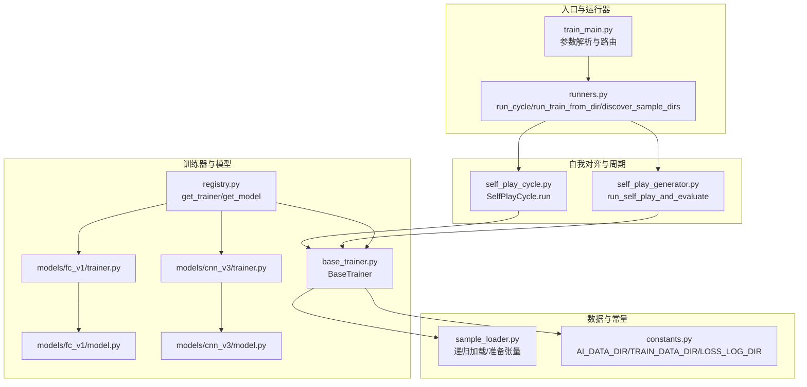
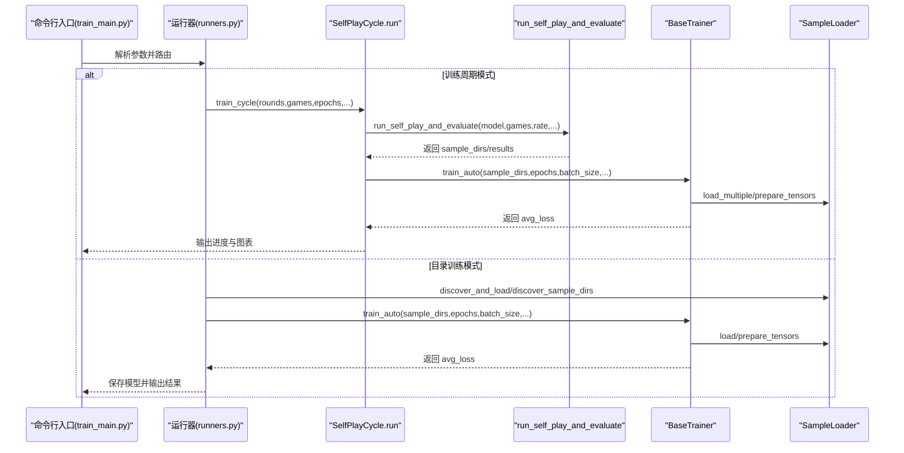
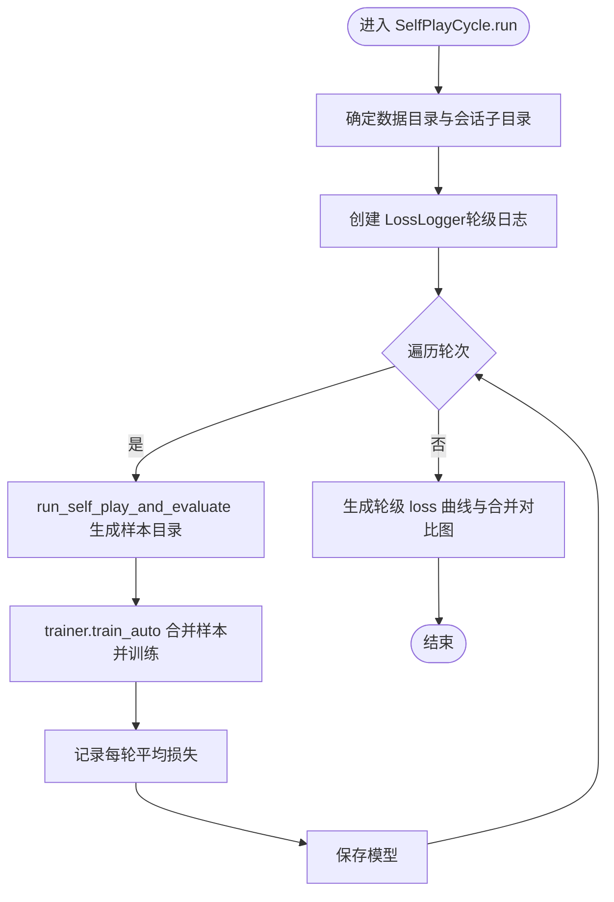
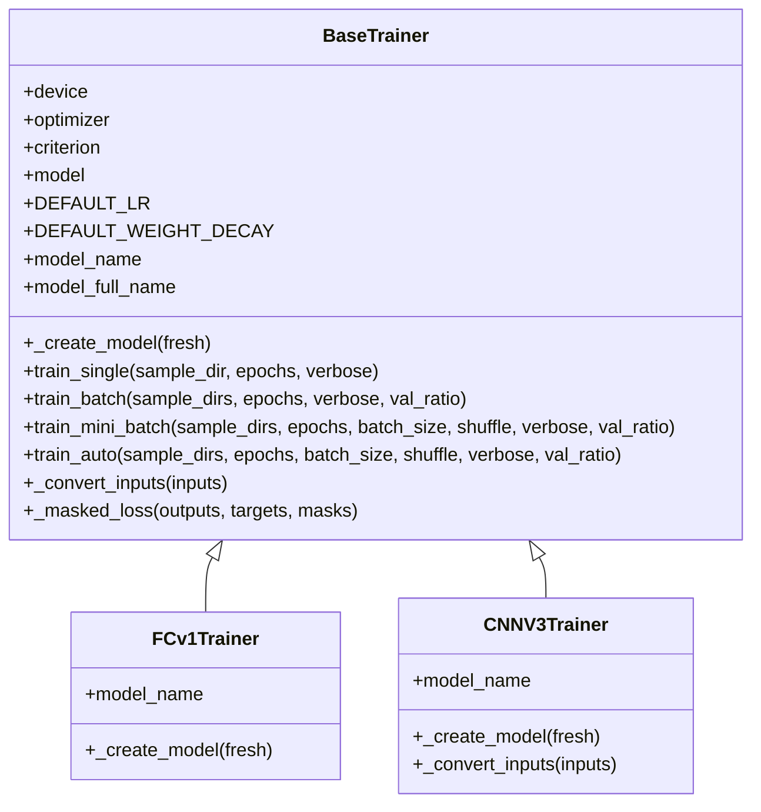
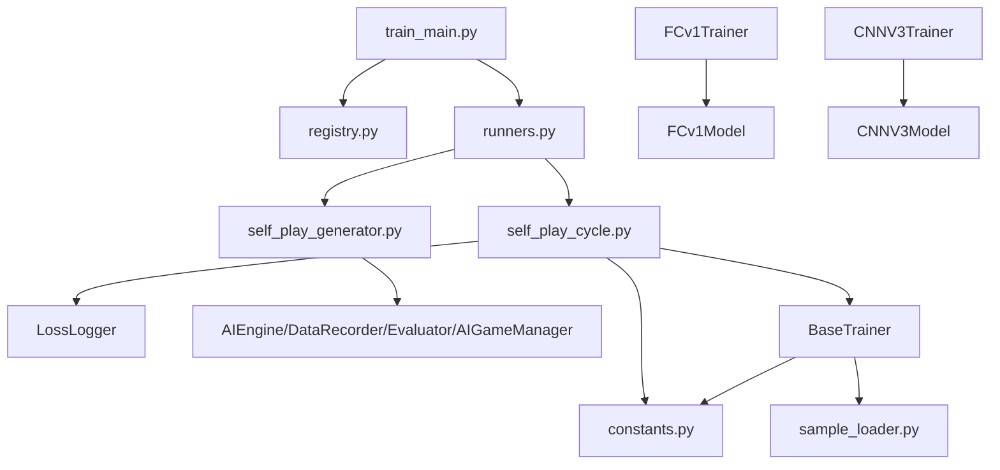

# 训练流程

<cite>
**本文引用的文件**
- [ai/train_main.py](file://ai/train_main.py)
- [ai/runners.py](file://ai/runners.py)
- [ai/self_play_cycle.py](file://ai/self_play_cycle.py)
- [ai/self_play_generator.py](file://ai/self_play_generator.py)
- [ai/base_trainer.py](file://ai/base_trainer.py)
- [ai/sample_loader.py](file://ai/sample_loader.py)
- [ai/constants.py](file://ai/constants.py)
- [ai/registry.py](file://ai/registry.py)
- [ai/models/fc_v1/trainer.py](file://ai/models/fc_v1/trainer.py)
- [ai/models/cnn_v3/trainer.py](file://ai/models/cnn_v3/trainer.py)
- [ai/models/fc_v1/model.py](file://ai/models/fc_v1/model.py)
- [ai/models/cnn_v3/model.py](file://ai/models/cnn_v3/model.py)
- [README.md](file://README.md)
</cite>

## 目录
1. [简介](#简介)
2. [项目结构](#项目结构)
3. [核心组件](#核心组件)
4. [架构总览](#架构总览)
5. [详细组件分析](#详细组件分析)
6. [依赖分析](#依赖分析)
7. [性能考虑](#性能考虑)
8. [故障排查指南](#故障排查指南)
9. [结论](#结论)
10. [附录](#附录)

## 简介
本文件面向五子棋AI训练流程，系统化梳理从命令行入口到自我对弈生成器的完整生命周期，重点解释：
- 训练入口脚本如何解析参数、路由到不同运行模式
- 训练周期模式的工作原理：多轮训练、每轮对局数量、训练轮次管理与进度跟踪
- 目录训练模式的实现：数据目录递归加载、JSON文件解析与批量训练流程
- 训练器初始化过程：模型选择、参数校验、训练器实例化
- 训练参数配置指南：轮次数、对局数、训练迭代数、学习率调度、温度采样等
- 实际命令行使用示例与代码实现细节，帮助开发者理解各阶段职责与交互

## 项目结构
围绕训练流程的关键模块如下：
- 命令行入口与运行器：ai/train_main.py、ai/runners.py
- 自我对弈与训练周期：ai/self_play_cycle.py、ai/self_play_generator.py
- 训练器抽象与实现：ai/base_trainer.py、ai/models/*/trainer.py
- 数据加载与预处理：ai/sample_loader.py
- 常量与注册表：ai/constants.py、ai/registry.py
- 模型实现：ai/models/*/model.py
- 文档与示例：README.md

**图表来源**
- [ai/train_main.py:1-234](file://ai/train_main.py#L1-L234)
- [ai/runners.py:1-255](file://ai/runners.py#L1-L255)
- [ai/self_play_cycle.py:1-195](file://ai/self_play_cycle.py#L1-L195)
- [ai/self_play_generator.py:1-244](file://ai/self_play_generator.py#L1-L244)
- [ai/base_trainer.py:1-699](file://ai/base_trainer.py#L1-L699)
- [ai/sample_loader.py:1-240](file://ai/sample_loader.py#L1-L240)
- [ai/constants.py:1-26](file://ai/constants.py#L1-L26)
- [ai/registry.py:1-316](file://ai/registry.py#L1-L316)
- [ai/models/fc_v1/trainer.py:1-44](file://ai/models/fc_v1/trainer.py#L1-L44)
- [ai/models/cnn_v3/trainer.py:1-73](file://ai/models/cnn_v3/trainer.py#L1-L73)
- [ai/models/fc_v1/model.py:1-132](file://ai/models/fc_v1/model.py#L1-L132)
- [ai/models/cnn_v3/model.py:1-139](file://ai/models/cnn_v3/model.py#L1-L139)

**章节来源**
- [ai/train_main.py:1-234](file://ai/train_main.py#L1-L234)
- [ai/runners.py:1-255](file://ai/runners.py#L1-L255)
- [ai/self_play_cycle.py:1-195](file://ai/self_play_cycle.py#L1-L195)
- [ai/self_play_generator.py:1-244](file://ai/self_play_generator.py#L1-L244)
- [ai/base_trainer.py:1-699](file://ai/base_trainer.py#L1-L699)
- [ai/sample_loader.py:1-240](file://ai/sample_loader.py#L1-L240)
- [ai/constants.py:1-26](file://ai/constants.py#L1-L26)
- [ai/registry.py:1-316](file://ai/registry.py#L1-L316)
- [README.md:1-422](file://README.md#L1-L422)

## 核心组件
- 训练入口与参数解析：ai/train_main.py
  - 负责解析命令行参数、参数合法性校验、模式路由（训练周期或从目录训练）
  - 支持学习率调度、温度采样、验证集比例、mini-batch等训练参数
- 运行器：ai/runners.py
  - 将入口脚本与具体训练逻辑解耦，提供 run_cycle 与 run_train_from_dir
  - 提供 discover_sample_dirs 用于目录训练模式的子目录发现
- 自我对弈与周期：ai/self_play_cycle.py、ai/self_play_generator.py
  - SelfPlayCycle.run：执行多轮训练周期，每轮自我对弈、评价、合并样本并训练
  - run_self_play_and_evaluate：封装单轮自我对弈+评价的公共流程
- 训练器抽象与实现：ai/base_trainer.py、ai/models/*/trainer.py
  - BaseTrainer：统一训练流程、设备选择、优化器、损失函数、学习率调度、训练方法（全量/mini-batch）
  - 具体模型训练器：FCv1Trainer、CNNV3Trainer 等，负责模型创建与输入转换
- 数据加载与预处理：ai/sample_loader.py
  - 递归发现JSON文件、加载与合并、按比例分割训练/验证集、准备PyTorch张量
- 常量与注册表：ai/constants.py、ai/registry.py
  - 常量：AI_DATA_DIR、TRAIN_DATA_DIR、LOSS_LOG_DIR、LOSS_LOG_INTERVAL
  - 注册表：统一管理模型与训练器映射，支持多代模型（如 cnn_v3.1）

**章节来源**
- [ai/train_main.py:27-234](file://ai/train_main.py#L27-L234)
- [ai/runners.py:81-255](file://ai/runners.py#L81-L255)
- [ai/self_play_cycle.py:20-195](file://ai/self_play_cycle.py#L20-L195)
- [ai/self_play_generator.py:21-244](file://ai/self_play_generator.py#L21-L244)
- [ai/base_trainer.py:32-699](file://ai/base_trainer.py#L32-L699)
- [ai/sample_loader.py:67-240](file://ai/sample_loader.py#L67-L240)
- [ai/constants.py:8-26](file://ai/constants.py#L8-L26)
- [ai/registry.py:58-224](file://ai/registry.py#L58-L224)

## 架构总览
训练流程从命令行入口开始，根据模式选择不同路径：
- 训练周期模式：入口脚本解析参数后，调用 runners.run_cycle，内部委托 SelfPlayCycle.run 执行多轮自我对弈与训练
- 目录训练模式：入口脚本解析参数后，调用 runners.run_train_from_dir，内部使用 SampleLoader 递归加载JSON，自动选择训练方法并训练

**图表来源**
- [ai/train_main.py:27-234](file://ai/train_main.py#L27-L234)
- [ai/runners.py:173-255](file://ai/runners.py#L173-L255)
- [ai/self_play_cycle.py:38-195](file://ai/self_play_cycle.py#L38-L195)
- [ai/self_play_generator.py:21-244](file://ai/self_play_generator.py#L21-L244)
- [ai/base_trainer.py:575-604](file://ai/base_trainer.py#L575-L604)
- [ai/sample_loader.py:185-240](file://ai/sample_loader.py#L185-L240)

## 详细组件分析

### 训练入口与参数解析（ai/train_main.py）
- 主要职责
  - 使用 argparse 定义训练参数：--model、--cycle、--rounds、--games、--epochs、--rate、--fresh、--train-from-dir、--batch-size、--shuffle、--lr-scheduler、--lr-step-size、--lr-gamma、--lr-patience、--lr-factor、--val-ratio、温度采样相关参数
  - 参数互斥校验：--cycle 与 --train-from-dir 二选一
  - 通过 registry.get_trainer 创建训练器实例
  - 根据模式路由到 runners.run_cycle 或 runners.run_train_from_dir
- 关键点
  - 学习率调度参数统一打包传入训练器构造函数
  - 温度采样参数在 cycle 模式下默认启用，可通过 --no-temp-sampling 关闭

**章节来源**
- [ai/train_main.py:27-234](file://ai/train_main.py#L27-L234)
- [ai/registry.py:187-224](file://ai/registry.py#L187-L224)

### 运行器（ai/runners.py）
- discover_sample_dirs：扫描训练数据根目录的直接子目录，返回包含 sample.json 的子目录列表（按数字排序）
- run_train_from_dir：
  - 支持直接指定 .json 文件或目录路径（目录会递归发现 .json 文件并合并）
  - 自动选择训练方法：提供 batch_size 时使用 mini-batch，否则全量更新
  - 训练完成后清理临时目录
- run_cycle：
  - 打印训练参数摘要（轮次数、每轮对局数、迭代数、奖励衰减率、学习率调度、验证集比例、温度采样）
  - 构造 TempConfig（默认启用温度采样），委托 BaseTrainer.train_cycle 执行训练周期

**章节来源**
- [ai/runners.py:21-255](file://ai/runners.py#L21-L255)

### 自我对弈与周期（ai/self_play_cycle.py、ai/self_play_generator.py）
- SelfPlayCycle.run：
  - 确定数据目录（正常运行使用常量，测试隔离时基于 project_root 拼接）
  - 生成训练会话唯一子目录名，创建 LossLogger（轮级日志）
  - 循环 rounds 轮，每轮执行 run_self_play_and_evaluate 生成样本目录
  - 调用 trainer.train_auto 合并样本并训练（全量或 mini-batch）
  - 记录每轮平均损失，保存模型，生成 loss 曲线图与合并对比图
  - 支持 Ctrl+C 中断，优雅保存模型与图表
- run_self_play_and_evaluate：
  - 创建 AIEngine、DataRecorder，执行 AIGameManager.start_ai_vs_ai 生成对局数据
  - 调用 Evaluator.evaluate_round 生成 sample.json
  - 返回 round_dir、train_data_dir、sample_dirs、results 等信息
  - 支持 Ctrl+C 中断，返回已生成的部分结果

**图表来源**
- [ai/self_play_cycle.py:38-195](file://ai/self_play_cycle.py#L38-L195)
- [ai/self_play_generator.py:21-168](file://ai/self_play_generator.py#L21-L168)

**章节来源**
- [ai/self_play_cycle.py:20-195](file://ai/self_play_cycle.py#L20-L195)
- [ai/self_play_generator.py:21-244](file://ai/self_play_generator.py#L21-L244)

### 训练器抽象与实现（ai/base_trainer.py、ai/models/*/trainer.py）
- BaseTrainer：
  - 设备选择：优先 GPU，否则 CPU
  - 模型创建：通过 _create_model（子类实现）
  - 优化器：AdamW（解耦权重衰减），默认学习率与权重衰减可覆盖
  - 损失函数：L1Loss（masked）
  - 学习率调度：StepLR 或 ReduceLROnPlateau
  - 训练方法：
    - train_single：单个 sample.json 训练
    - train_batch：合并多个样本后全量更新
    - train_mini_batch：合并样本后按批次训练（更高效）
    - train_auto：根据 batch_size 自动选择 train_batch 或 train_mini_batch
  - 输入转换：默认 FC 模型输入格式；CNN 模型通过覆盖 _convert_inputs 实现 4D 张量
- 具体训练器：
  - FCv1Trainer：创建 FCv1Model，模型名称为 "fc_v1"
  - CNNV3Trainer：创建 CNNV3Model，支持多代模型（gen 参数），覆盖输入转换为 (N, 3, 15, 15)

**图表来源**
- [ai/base_trainer.py:32-699](file://ai/base_trainer.py#L32-L699)
- [ai/models/fc_v1/trainer.py:11-44](file://ai/models/fc_v1/trainer.py#L11-L44)
- [ai/models/cnn_v3/trainer.py:13-73](file://ai/models/cnn_v3/trainer.py#L13-L73)

**章节来源**
- [ai/base_trainer.py:32-699](file://ai/base_trainer.py#L32-L699)
- [ai/models/fc_v1/trainer.py:11-44](file://ai/models/fc_v1/trainer.py#L11-L44)
- [ai/models/cnn_v3/trainer.py:13-73](file://ai/models/cnn_v3/trainer.py#L13-L73)

### 数据加载与预处理（ai/sample_loader.py）
- discover_all_data：递归扫描目录，收集所有 .json 文件（按路径排序）
- discover_and_load：递归发现并加载所有 .json 文件，合并为样本数据
- load_multiple/load：加载单个或多个 sample.json
- load_and_split：按比例随机分割训练/验证集（样本级，可复现）
- prepare_tensors：将样本数据转换为 inputs、targets、masks 三类张量，并移动到设备

**章节来源**
- [ai/sample_loader.py:36-240](file://ai/sample_loader.py#L36-L240)

### 常量与注册表（ai/constants.py、ai/registry.py）
- constants：
  - AI_DATA_DIR、TRAIN_DATA_DIR、LOSS_LOG_DIR、LOSS_LOG_INTERVAL
- registry：
  - MODEL_REGISTRY：模型与训练器映射，支持多代模型（如 cnn_v3.1）
  - get_model/get_trainer：按模型指定字符串解析并懒加载
  - list_models_with_full_name：列出可加载的完整模型名称（含代数）

**章节来源**
- [ai/constants.py:8-26](file://ai/constants.py#L8-L26)
- [ai/registry.py:58-224](file://ai/registry.py#L58-L224)

### 模型实现（ai/models/*/model.py）
- FCv1Model：全连接网络，输入 226 维向量，输出 225 维 Softmax 概率分布
- CNNV3Model：纯卷积网络，输入 (3, 15, 15)，输出 225 维 Softmax 概率分布
- 两者均继承自 NeuralNetworkModel，提供 save/load/predict 等通用能力

**章节来源**
- [ai/models/fc_v1/model.py:91-132](file://ai/models/fc_v1/model.py#L91-L132)
- [ai/models/cnn_v3/model.py:96-139](file://ai/models/cnn_v3/model.py#L96-L139)

## 依赖分析
- 入口脚本依赖注册表创建训练器，再委托运行器执行
- 运行器依赖 SelfPlayCycle.run 或 run_self_play_and_evaluate
- SelfPlayCycle.run 依赖 LossLogger、数据目录常量、run_self_play_and_evaluate
- run_self_play_and_evaluate 依赖 AIEngine、DataRecorder、Evaluator、AIGameManager
- BaseTrainer 依赖 SampleLoader、LossLogger、设备选择、优化器与损失函数
- 具体训练器依赖对应模型实现

**图表来源**
- [ai/train_main.py:23-24](file://ai/train_main.py#L23-L24)
- [ai/runners.py:18-19](file://ai/runners.py#L18-L19)
- [ai/self_play_cycle.py:12-14](file://ai/self_play_cycle.py#L12-L14)
- [ai/self_play_generator.py:11-15](file://ai/self_play_generator.py#L11-L15)
- [ai/base_trainer.py:14-18](file://ai/base_trainer.py#L14-L18)
- [ai/models/fc_v1/trainer.py:7-8](file://ai/models/fc_v1/trainer.py#L7-L8)
- [ai/models/cnn_v3/trainer.py:8-10](file://ai/models/cnn_v3/trainer.py#L8-L10)

**章节来源**
- [ai/train_main.py:23-24](file://ai/train_main.py#L23-L24)
- [ai/runners.py:18-19](file://ai/runners.py#L18-L19)
- [ai/self_play_cycle.py:12-14](file://ai/self_play_cycle.py#L12-L14)
- [ai/self_play_generator.py:11-15](file://ai/self_play_generator.py#L11-L15)
- [ai/base_trainer.py:14-18](file://ai/base_trainer.py#L14-L18)
- [ai/models/fc_v1/trainer.py:7-8](file://ai/models/fc_v1/trainer.py#L7-L8)
- [ai/models/cnn_v3/trainer.py:8-10](file://ai/models/cnn_v3/trainer.py#L8-L10)

## 性能考虑
- 设备选择：优先使用 GPU，显著加速训练与推理
- mini-batch 训练：在大批量数据下更高效，收敛更快；默认启用密集日志记录每个 batch 的 loss 与梯度范数
- 验证集：val_ratio > 0 时自动分割训练/验证集，每轮评估 val_loss，有助于早停与超参调优
- 数据加载：SampleLoader 递归发现 .json 文件并合并，减少 I/O 开销；建议使用合并文件（merge_samples）提升效率
- 学习率调度：StepLR 与 ReduceLROnPlateau 可按策略衰减学习率，稳定训练过程

[本节为通用指导，无需“章节来源”]

## 故障排查指南
- 参数互斥错误：--cycle 与 --train-from-dir 不能同时使用
- 路径不存在或数据为空：目录训练模式下，路径不存在或未发现 .json 文件会触发错误并退出
- 训练中断：Ctrl+C 时会保存当前模型与图表；若为 mini-batch 模式，会刷新密集日志
- 验证集比例非法：val_ratio 必须在 [0, 1) 范围内
- 模型/训练器不可用：registry.get_trainer 会在不支持的模型或多代模型未指定代数时报错

**章节来源**
- [ai/train_main.py:196-207](file://ai/train_main.py#L196-L207)
- [ai/runners.py:94-124](file://ai/runners.py#L94-L124)
- [ai/base_trainer.py:137-143](file://ai/base_trainer.py#L137-L143)
- [ai/registry.py:168-214](file://ai/registry.py#L168-L214)

## 结论
本训练流程通过清晰的模块划分与职责分离，实现了从命令行入口到自我对弈、样本生成、数据加载与训练的完整闭环。训练周期模式支持多轮自我对弈与训练，目录训练模式支持从既有数据快速训练。BaseTrainer 提供统一的训练接口与优化策略，结合 SampleLoader 的高效数据管线与 LossLogger 的可视化反馈，为模型迭代提供了可靠支撑。

[本节为总结，无需“章节来源”]

## 附录

### 训练参数配置指南
- 训练周期模式（--cycle）
  - --rounds：轮次数（默认 10）
  - --games：每轮对局数（默认 100）
  - --epochs：每轮训练迭代数（默认 1000）
  - --rate：奖励衰减率（默认 0.9）
  - --batch-size：mini-batch 训练的批次大小（默认 None，全量更新）
  - --shuffle：每个 epoch 是否打乱数据顺序（仅 mini-batch 有效）
  - --val-ratio：验证集比例（默认 0.0）
  - --lr-scheduler：学习率调度类型（step/plateau）
  - 温度采样：默认启用，可通过 --no-temp-sampling 关闭；支持 --temperature、--temp-moves、--temp-side、--temp-seed
- 目录训练模式（--train-from-dir）
  - --train-from-dir：训练数据目录或 .json 文件路径
  - --epochs：训练迭代数（默认 1000）
  - --batch-size：mini-batch 训练的批次大小（默认 None，全量更新）
  - --shuffle：每个 epoch 是否打乱数据顺序（仅 mini-batch 有效）
  - --val-ratio：验证集比例（默认 0.0）
  - --lr-scheduler：学习率调度类型（step/plateau）

**章节来源**
- [ai/train_main.py:58-192](file://ai/train_main.py#L58-L192)
- [ai/runners.py:173-255](file://ai/runners.py#L173-L255)
- [README.md:146-197](file://README.md#L146-L197)

### 命令行使用示例
- 训练周期（fc_v1 模型）
  - python ai/train_main.py --model fc_v1 --cycle
  - python ai/train_main.py --model fc_v1 --cycle --rounds 50 --games 50
  - python ai/train_main.py --model fc_v1 --cycle --fresh
- 训练周期（多代模型 cnn_v3.2）
  - python ai/train_main.py --model cnn_v3.2 --cycle
- 从目录训练
  - python ai/train_main.py --model fc_v1 --train-from-dir ai/train_data/fc_v1_self_play_1
  - python ai/train_main.py --model cnn_v3.2 --train-from-dir ai/merge_samples/v2 --epochs 1000 --batch-size 4096 --shuffle --val-ratio 0.2

**章节来源**
- [ai/train_main.py:32-48](file://ai/train_main.py#L32-L48)
- [README.md:146-197](file://README.md#L146-L197)