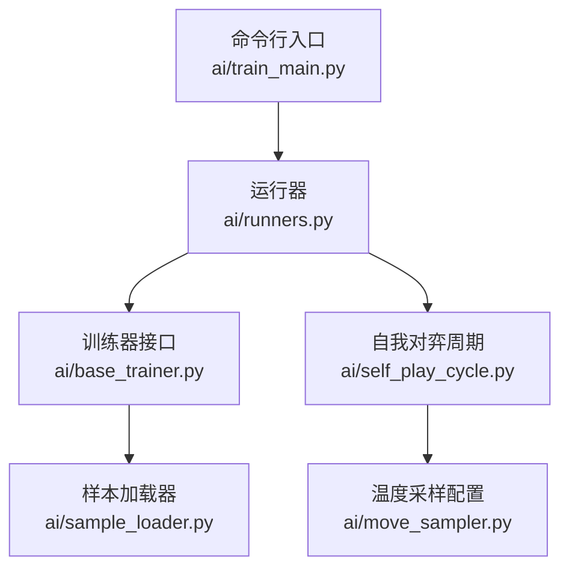
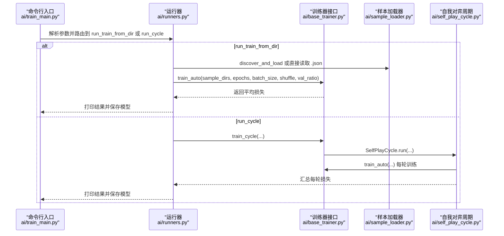
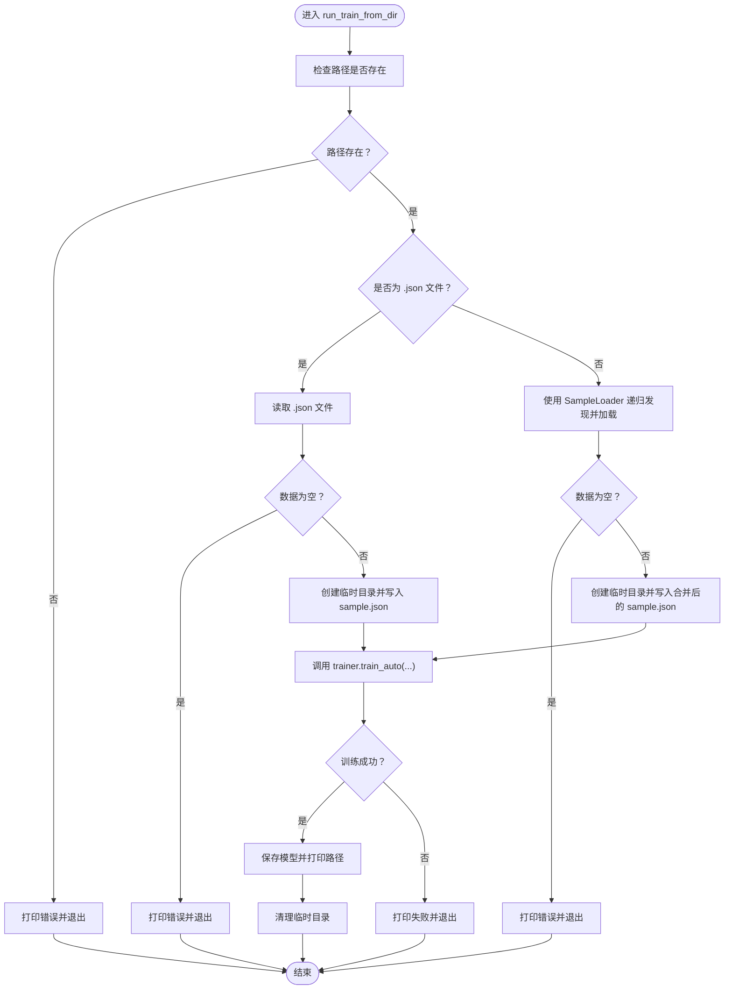
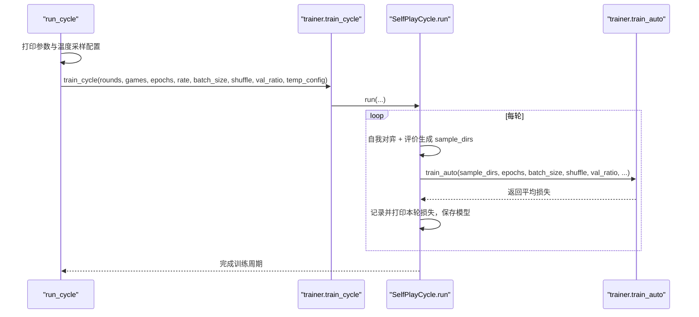
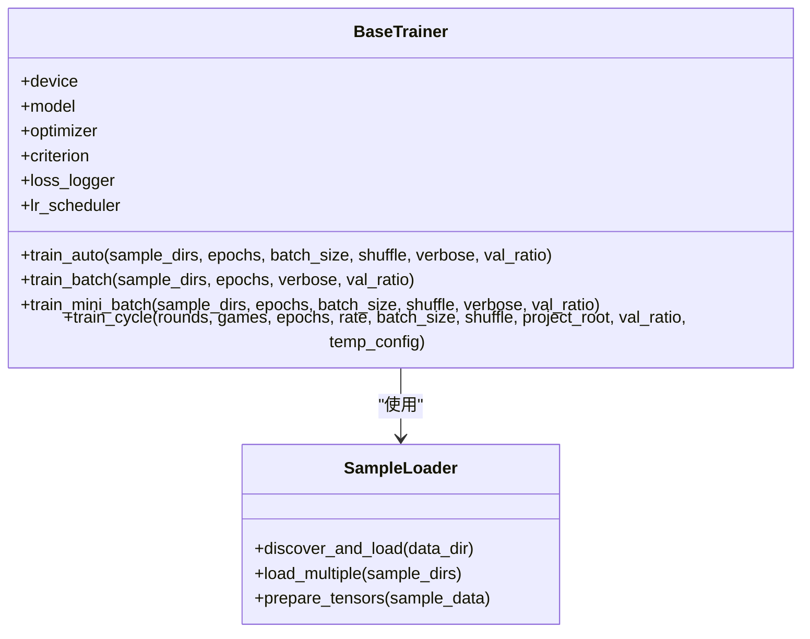
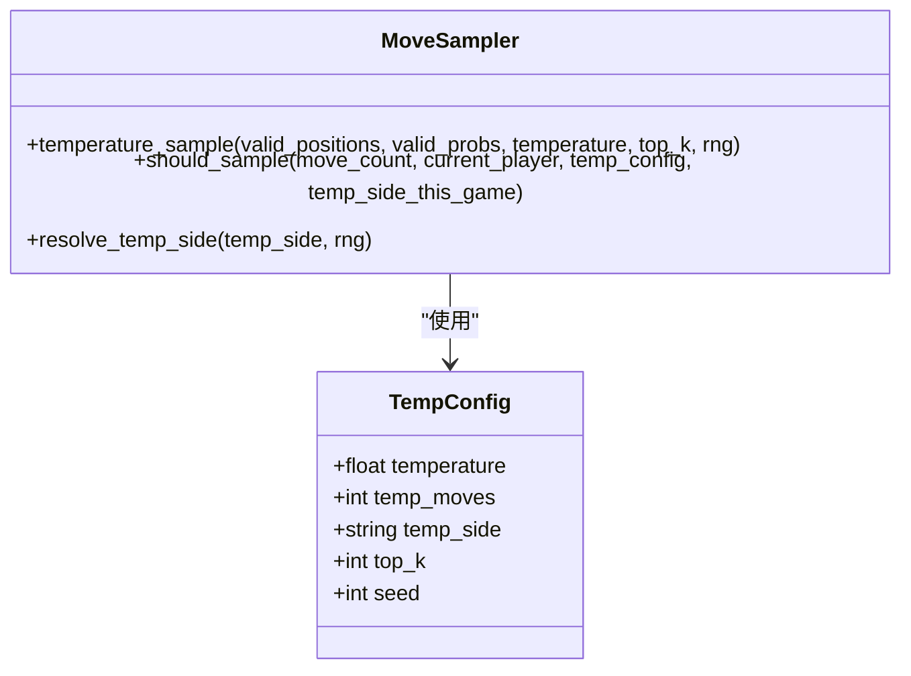
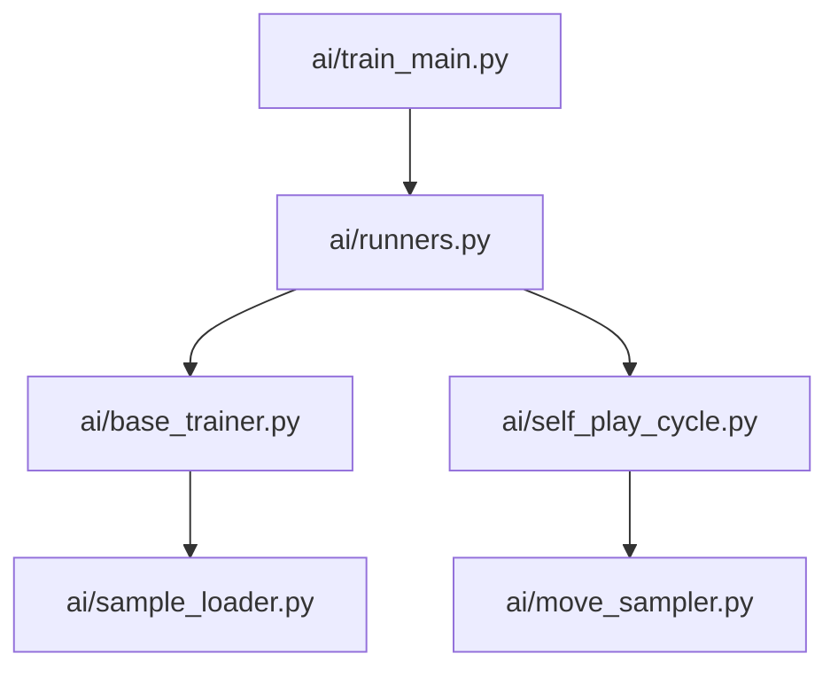

# 训练运行器

<cite>
**本文引用的文件**
- [runners.py](file://ai/runners.py)
- [train_main.py](file://ai/train_main.py)
- [sample_loader.py](file://ai/sample_loader.py)
- [base_trainer.py](file://ai/base_trainer.py)
- [self_play_cycle.py](file://ai/self_play_cycle.py)
- [move_sampler.py](file://ai/move_sampler.py)
- [test_runners.py](file://tests/ai/unit/test_runners.py)
- [test_train_main.py](file://tests/ai/test_train_main.py)
</cite>

## 目录
1. [简介](#简介)
2. [项目结构](#项目结构)
3. [核心组件](#核心组件)
4. [架构总览](#架构总览)
5. [详细组件分析](#详细组件分析)
6. [依赖分析](#依赖分析)
7. [性能考量](#性能考量)
8. [故障排查指南](#故障排查指南)
9. [结论](#结论)
10. [附录](#附录)

## 简介
本文面向五子棋AI训练运行器，系统化阐述训练运行器模块的实现与使用，重点覆盖以下内容：
- run_train_from_dir 与 run_cycle 两大运行模式的工作机制与控制流
- 训练周期模式的执行流程：多轮训练、每轮对局生成、训练协调与日志输出
- 从目录训练模式的实现：数据目录递归扫描、JSON文件批量加载与训练流程自动化
- 参数传递机制：命令行参数到运行器函数的映射与配置对象构建
- 扩展接口说明：自定义训练逻辑集成与钩子函数使用建议
- 完整使用示例与错误处理机制

## 项目结构
训练运行器位于 ai/runners.py，配合 ai/train_main.py 的参数解析与路由，以及 ai/base_trainer.py 的训练器接口，形成“入口脚本 + 运行器 + 训练器”的清晰分层。

**图表来源**
- [train_main.py:27-234](file://ai/train_main.py#L27-L234)
- [runners.py:81-255](file://ai/runners.py#L81-L255)
- [base_trainer.py:32-699](file://ai/base_trainer.py#L32-L699)
- [sample_loader.py:67-240](file://ai/sample_loader.py#L67-L240)
- [self_play_cycle.py:20-195](file://ai/self_play_cycle.py#L20-L195)
- [move_sampler.py:50-258](file://ai/move_sampler.py#L50-L258)

**章节来源**
- [train_main.py:27-234](file://ai/train_main.py#L27-L234)
- [runners.py:1-255](file://ai/runners.py#L1-L255)

## 核心组件
- 运行器模块（ai/runners.py）
  - 提供 run_train_from_dir 与 run_cycle 两个公共函数，分别对应“从已有数据训练”和“训练周期模式”
  - 提供 discover_sample_dirs 辅助函数，用于发现包含 sample.json 的子目录
- 训练器接口（ai/base_trainer.py）
  - 提供 train_auto、train_batch、train_mini_batch、train_cycle 等训练方法
  - 统一损失计算、学习率调度、日志记录与模型保存
- 样本加载器（ai/sample_loader.py）
  - 递归发现 .json 文件、加载与合并、按比例拆分训练/验证集、张量准备
- 自我对弈周期（ai/self_play_cycle.py）
  - 封装训练周期的编排：轮次循环、对局生成与评价、训练调用、日志与绘图
- 温度采样配置（ai/move_sampler.py）
  - 提供 TempConfig 数据类与温度采样相关工具，用于训练周期的开局探索

**章节来源**
- [runners.py:1-255](file://ai/runners.py#L1-L255)
- [base_trainer.py:32-699](file://ai/base_trainer.py#L32-L699)
- [sample_loader.py:67-240](file://ai/sample_loader.py#L67-L240)
- [self_play_cycle.py:20-195](file://ai/self_play_cycle.py#L20-L195)
- [move_sampler.py:50-258](file://ai/move_sampler.py#L50-L258)

## 架构总览
训练运行器采用“入口脚本 + 运行器 + 训练器”的分层设计：
- 入口脚本负责参数解析、参数校验与模式路由
- 运行器负责具体运行模式的业务流程与参数传递
- 训练器负责训练方法的具体实现与资源管理

**图表来源**
- [train_main.py:225-229](file://ai/train_main.py#L225-L229)
- [runners.py:81-255](file://ai/runners.py#L81-L255)
- [base_trainer.py:621-660](file://ai/base_trainer.py#L621-L660)
- [sample_loader.py:185-204](file://ai/sample_loader.py#L185-L204)
- [self_play_cycle.py:134-146](file://ai/self_play_cycle.py#L134-L146)

## 详细组件分析

### 运行器：run_train_from_dir
功能概述
- 支持直接指定 .json 文件或目录路径
- 目录路径会自动发现 merge 文件与 sample.json 子目录
- 自动选择训练方法：提供 batch_size 时使用 mini-batch，否则全量更新
- 训练完成后自动清理临时目录

关键流程
- 路径存在性校验与类型判断
- 若为 .json 文件：直接加载数据并创建临时目录
- 若为目录：使用 SampleLoader 递归发现并加载所有 .json，再创建临时目录
- 调用 trainer.train_auto 并打印训练参数与结果
- 异常处理：路径不存在、数据为空、训练失败时退出
- 清理：finally 中删除临时目录

**图表来源**
- [runners.py:81-171](file://ai/runners.py#L81-L171)
- [sample_loader.py:185-204](file://ai/sample_loader.py#L185-L204)

**章节来源**
- [runners.py:81-171](file://ai/runners.py#L81-L171)
- [sample_loader.py:185-204](file://ai/sample_loader.py#L185-L204)

### 运行器：run_cycle
功能概述
- 执行完整的训练周期：自我对弈 → 评价 → 训练，循环多轮
- 自动选择训练方法：提供 batch_size 时使用 mini-batch，否则全量更新
- 支持温度采样配置（cycle 模式下默认启用）

关键流程
- 参数打印：轮次数、每轮对局数、每轮迭代数、奖励衰减率、学习率调度、验证集比例等
- 温度采样配置：默认启用 TempConfig，可通过参数禁用
- 调用 trainer.train_cycle，内部委托 SelfPlayCycle.run
- 每轮结束后记录并打印平均损失，保存模型
- 异常处理：功能未实现或训练失败时退出

**图表来源**
- [runners.py:173-255](file://ai/runners.py#L173-L255)
- [base_trainer.py:621-660](file://ai/base_trainer.py#L621-L660)
- [self_play_cycle.py:134-146](file://ai/self_play_cycle.py#L134-L146)

**章节来源**
- [runners.py:173-255](file://ai/runners.py#L173-L255)
- [base_trainer.py:621-660](file://ai/base_trainer.py#L621-L660)
- [self_play_cycle.py:134-146](file://ai/self_play_cycle.py#L134-L146)

### 训练器接口：train_auto 与 train_cycle
- train_auto：根据是否提供 batch_size 自动选择 train_batch 或 train_mini_batch
- train_batch：全量数据一次性前向传播，每个 epoch 只更新一次参数
- train_mini_batch：分批次训练，每个 epoch 内多次前向+反向传播
- train_cycle：委托 SelfPlayCycle.run，实现多轮自我对弈与训练

**图表来源**
- [base_trainer.py:575-660](file://ai/base_trainer.py#L575-L660)
- [sample_loader.py:185-240](file://ai/sample_loader.py#L185-L240)

**章节来源**
- [base_trainer.py:575-660](file://ai/base_trainer.py#L575-L660)
- [sample_loader.py:185-240](file://ai/sample_loader.py#L185-L240)

### 温度采样配置：TempConfig
- 封装温度采样参数：temperature、temp_moves、temp_side、top_k、seed
- 提供 should_sample 与 resolve_temp_side 辅助函数，用于对弈阶段的采样决策
- cycle 模式下默认启用温度采样，可通过参数禁用

**图表来源**
- [move_sampler.py:50-111](file://ai/move_sampler.py#L50-L111)
- [move_sampler.py:192-258](file://ai/move_sampler.py#L192-L258)

**章节来源**
- [move_sampler.py:50-111](file://ai/move_sampler.py#L50-L111)
- [move_sampler.py:192-258](file://ai/move_sampler.py#L192-L258)

## 依赖分析
- 运行器依赖训练器接口与样本加载器
- 训练器依赖样本加载器与日志记录器
- 自我对弈周期依赖训练器与温度采样配置
- 入口脚本负责参数解析与模式路由

**图表来源**
- [train_main.py:23-24](file://ai/train_main.py#L23-L24)
- [runners.py:18](file://ai/runners.py#L18)
- [base_trainer.py:17-18](file://ai/base_trainer.py#L17-L18)
- [self_play_cycle.py:14](file://ai/self_play_cycle.py#L14)
- [move_sampler.py:19-21](file://ai/move_sampler.py#L19-L21)

**章节来源**
- [train_main.py:23-24](file://ai/train_main.py#L23-L24)
- [runners.py:18](file://ai/runners.py#L18)
- [base_trainer.py:17-18](file://ai/base_trainer.py#L17-L18)
- [self_play_cycle.py:14](file://ai/self_play_cycle.py#L14)
- [move_sampler.py:19-21](file://ai/move_sampler.py#L19-L21)

## 性能考量
- mini-batch 训练在大样本数据上通常具有更好的收敛速度与内存占用表现
- 全量更新（train_batch）适合小规模数据或快速验证
- 温度采样在训练初期提升探索多样性，有助于跳出局部最优
- 验证集比例与学习率调度可有效防止过拟合并稳定训练过程

[本节为通用指导，无需列出具体文件来源]

## 故障排查指南
常见问题与处理
- 路径不存在或数据为空
  - 现象：直接退出并提示错误
  - 处理：确认路径存在且包含 .json 文件
- 训练失败
  - 现象：捕获异常并退出
  - 处理：查看异常信息，检查数据格式与设备可用性
- 未实现功能
  - 现象：捕获 NotImplementedError 并退出
  - 处理：确认所用模型与训练器支持相应功能
- 临时目录清理
  - 现象：异常或退出时仍需清理
  - 处理：运行器在 finally 中删除临时目录，确保资源回收

**章节来源**
- [runners.py:97-100](file://ai/runners.py#L97-L100)
- [runners.py:108-110](file://ai/runners.py#L108-L110)
- [runners.py:165-167](file://ai/runners.py#L165-L167)
- [runners.py:249-254](file://ai/runners.py#L249-L254)
- [runners.py:168-170](file://ai/runners.py#L168-L170)

## 结论
训练运行器通过清晰的分层设计与完善的参数传递机制，提供了灵活高效的训练入口。run_train_from_dir 与 run_cycle 分别覆盖了“从已有数据训练”和“训练周期模式”的典型场景，结合训练器的自动训练方法与样本加载器的批量处理能力，能够满足不同规模与复杂度的训练需求。通过温度采样与验证集策略，进一步提升了训练的探索性与稳定性。

[本节为总结性内容，无需列出具体文件来源]

## 附录

### 使用示例
- 从已有数据目录训练模型
  - 示例命令：指定模型、训练数据目录、迭代次数等
  - 参考入口脚本参数定义与运行器调用
- 训练周期模式
  - 示例命令：指定模型、轮次数、每轮对局数、奖励衰减率等
  - 可选启用温度采样或禁用温度采样
- 自动选择训练方法
  - 提供 batch_size 时使用 mini-batch，否则全量更新

**章节来源**
- [train_main.py:27-234](file://ai/train_main.py#L27-L234)
- [runners.py:81-171](file://ai/runners.py#L81-L171)
- [runners.py:173-255](file://ai/runners.py#L173-L255)

### 参数传递机制
- 入口脚本负责参数解析与模式校验
- 运行器负责将参数映射到训练器接口
- 训练器内部根据参数选择具体训练方法与日志策略

**章节来源**
- [train_main.py:225-229](file://ai/train_main.py#L225-L229)
- [runners.py:148-157](file://ai/runners.py#L148-L157)
- [base_trainer.py:575-603](file://ai/base_trainer.py#L575-L603)

### 扩展接口与钩子函数
- 自定义训练逻辑
  - 通过实现训练器接口的方法，扩展新的训练流程
  - 在入口脚本中注册新的模式与参数
- 钩子函数
  - 可在训练器中扩展日志记录、学习率调度与模型保存等钩子
  - 通过依赖注入的方式替换或增强默认行为

**章节来源**
- [base_trainer.py:199-212](file://ai/base_trainer.py#L199-L212)
- [base_trainer.py:605-619](file://ai/base_trainer.py#L605-L619)

### 单元测试参考
- 运行器测试
  - 验证 run_train_from_dir 的路径检查、数据加载与异常处理
  - 验证 run_cycle 的参数传递与 train_cycle 调用
- 入口脚本测试
  - 验证参数解析与模式路由
  - 验证 train_auto 与 train_cycle 的参数传递

**章节来源**
- [test_runners.py:164-196](file://tests/ai/unit/test_runners.py#L164-L196)
- [test_train_main.py:147-177](file://tests/ai/test_train_main.py#L147-L177)
- [test_train_main.py:339-347](file://tests/ai/test_train_main.py#L339-L347)