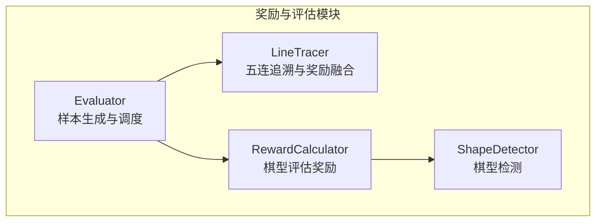
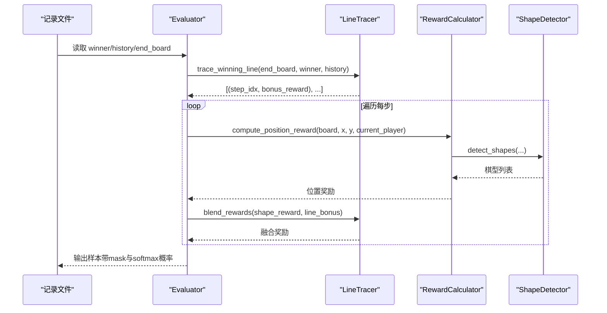
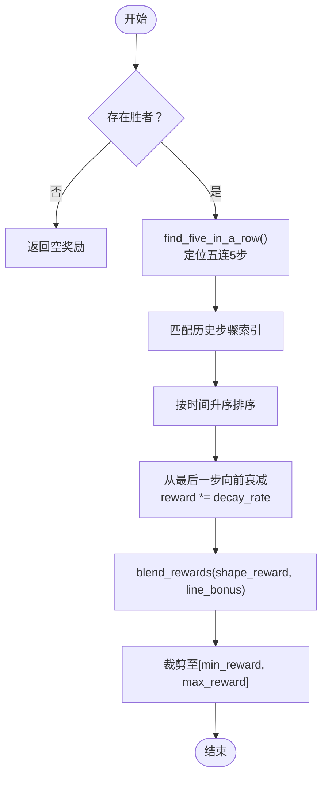
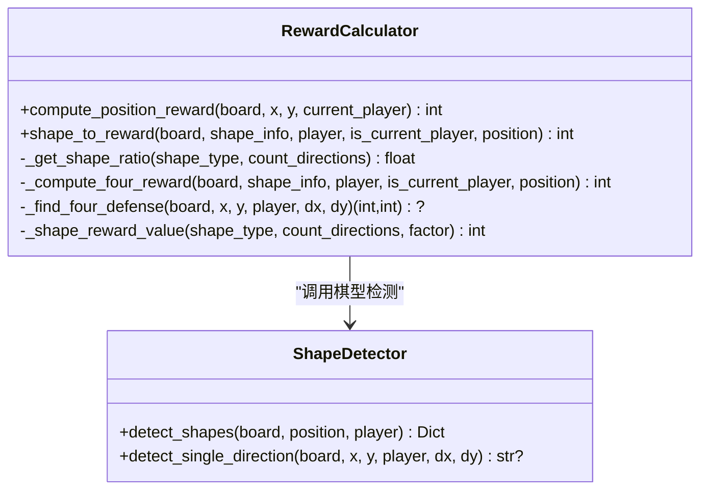
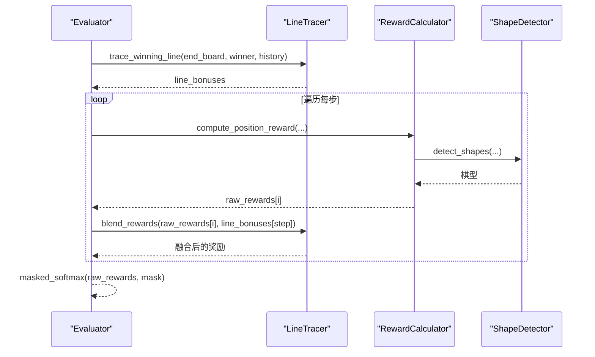
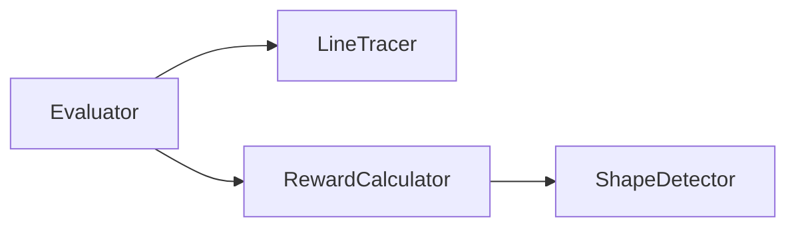

# 五连追溯反向传播

<cite>
**本文引用的文件**
- [ai/line_tracer.py](file://ai/line_tracer.py)
- [ai/reward_calculator.py](file://ai/reward_calculator.py)
- [ai/evaluator.py](file://ai/evaluator.py)
- [ai/shape_detector.py](file://ai/shape_detector.py)
- [design/winning_line_reward_design.md](file://design/winning_line_reward_design.md)
- [task_reports/2026-04-05/五连追溯Reward反向传播算法实现_3.md](file://task_reports/2026-04-05/五连追溯Reward反向传播算法实现_3.md)
- [tests/ai/test_line_tracer.py](file://tests/ai/test_line_tracer.py)
- [tests/ai/test_reward_calculator.py](file://tests/ai/test_reward_calculator.py)
- [temp/analyze_rewards.py](file://temp/analyze_rewards.py)
- [temp/check_reward.py](file://temp/check_reward.py)
</cite>

## 目录
1. [简介](#简介)
2. [项目结构](#项目结构)
3. [核心组件](#核心组件)
4. [架构总览](#架构总览)
5. [详细组件分析](#详细组件分析)
6. [依赖关系分析](#依赖关系分析)
7. [性能考量](#性能考量)
8. [故障排查指南](#故障排查指南)
9. [结论](#结论)
10. [附录](#附录)

## 简介
本文围绕五子棋AI中的“五连追溯反向传播”算法展开，系统阐述其核心思想、数学原理、实现细节与性能表现。该算法在终局阶段定位获胜方构成五连的5步落子，将最大奖励从最后一步向先手逐步反向衰减传播，并与棋型评估奖励进行融合，从而强化训练信号对关键决策点的引导作用。文档还提供可视化示例、复杂度分析、边界条件处理说明以及与其他奖励计算方法的对比。

## 项目结构
本仓库中与五连追溯相关的核心文件与职责如下：
- ai/line_tracer.py：实现五连位置查找、追溯步骤索引、反向衰减奖励计算与奖励融合。
- ai/reward_calculator.py：实现棋型评估奖励计算（含冲四递归防守模拟）。
- ai/evaluator.py：统一调度棋型评估与五连追溯，生成训练样本。
- ai/shape_detector.py：提供棋型检测能力（Numba加速）。
- design/winning_line_reward_design.md：算法设计文档，包含伪代码与融合策略。
- tests/ai/test_line_tracer.py、tests/ai/test_reward_calculator.py：单元测试覆盖。
- temp/analyze_rewards.py、temp/check_reward.py：奖励分析与分布检查脚本。

**图表来源**
- [ai/evaluator.py:132-210](file://ai/evaluator.py#L132-L210)
- [ai/line_tracer.py:10-143](file://ai/line_tracer.py#L10-L143)
- [ai/reward_calculator.py:35-239](file://ai/reward_calculator.py#L35-L239)
- [ai/shape_detector.py:197-314](file://ai/shape_detector.py#L197-L314)

**章节来源**
- [ai/evaluator.py:1-350](file://ai/evaluator.py#L1-L350)
- [ai/line_tracer.py:1-143](file://ai/line_tracer.py#L1-L143)
- [ai/reward_calculator.py:1-239](file://ai/reward_calculator.py#L1-L239)
- [ai/shape_detector.py:1-314](file://ai/shape_detector.py#L1-L314)

## 核心组件
- LineTracer：负责在终局棋盘上定位五连位置，追溯对应历史步骤，按衰减率反向传播奖励，并与棋型评估奖励进行融合。
- RewardCalculator：基于棋型检测结果计算位置奖励，支持冲四递归防守模拟，提供双向检测（我方/敌方）。
- Evaluator：串联棋型评估与五连追溯，生成训练样本；控制并行化与错误回退。
- ShapeDetector：提供高性能棋型检测（Numba加速），支持四个方向的棋型判定。

**章节来源**
- [ai/line_tracer.py:10-143](file://ai/line_tracer.py#L10-L143)
- [ai/reward_calculator.py:35-239](file://ai/reward_calculator.py#L35-L239)
- [ai/evaluator.py:51-210](file://ai/evaluator.py#L51-L210)
- [ai/shape_detector.py:197-314](file://ai/shape_detector.py#L197-L314)

## 架构总览
五连追溯反向传播贯穿以下流程：
1. 终局阶段：从最终棋盘状态与对局历史中定位五连的5步落子。
2. 反向传播：最后一步获得最大奖励，前一步按固定衰减率依次衰减。
3. 奖励融合：将五连追溯奖励与棋型评估奖励按权重融合，确保早期步骤的弱信号不被丢弃。
4. 样本生成：对每个步骤的空位应用Softmax得到概率分布，作为训练目标。

**图表来源**
- [ai/evaluator.py:97-210](file://ai/evaluator.py#L97-L210)
- [ai/line_tracer.py:64-117](file://ai/line_tracer.py#L64-L117)
- [ai/reward_calculator.py:46-99](file://ai/reward_calculator.py#L46-L99)
- [ai/shape_detector.py:197-279](file://ai/shape_detector.py#L197-L279)

## 详细组件分析

### LineTracer：五连追溯与奖励融合
- 五连位置查找：遍历棋盘与四个方向，找到连续同色棋子≥5的起点序列，返回前5个位置。
- 步骤追溯：在历史记录中匹配五连位置，提取对应落子步骤索引，并按时间顺序升序排列。
- 反向传播：从最后一步开始，按固定衰减率逐步衰减，形成奖励序列。
- 奖励融合：采用加法融合，避免早期弱信号被完全丢弃，且对最终奖励范围进行裁剪。

**图表来源**
- [ai/line_tracer.py:28-117](file://ai/line_tracer.py#L28-L117)
- [design/winning_line_reward_design.md:38-75](file://design/winning_line_reward_design.md#L38-L75)

**章节来源**
- [ai/line_tracer.py:10-143](file://ai/line_tracer.py#L10-L143)
- [tests/ai/test_line_tracer.py:16-276](file://tests/ai/test_line_tracer.py#L16-L276)
- [design/winning_line_reward_design.md:1-177](file://design/winning_line_reward_design.md#L1-L177)

### RewardCalculator：棋型评估奖励
- 双向检测：分别计算我方与敌方在该位置的棋型奖励，取较大者。
- 棋型映射：连五、活四、多冲四、冲四、活三、多活三、眠三（动态）、活二（动态）、眠二、独一。
- 冲四递归：若检测到冲四，模拟防守位置并递归计算后续棋型奖励，否则采用简化值。
- 因子调节：敌方棋型奖励乘以因子，体现防守价值。

**图表来源**
- [ai/reward_calculator.py:35-239](file://ai/reward_calculator.py#L35-L239)
- [ai/shape_detector.py:197-314](file://ai/shape_detector.py#L197-L314)

**章节来源**
- [ai/reward_calculator.py:35-239](file://ai/reward_calculator.py#L35-L239)
- [tests/ai/test_reward_calculator.py:16-270](file://tests/ai/test_reward_calculator.py#L16-L270)
- [ai/shape_detector.py:197-314](file://ai/shape_detector.py#L197-L314)

### Evaluator：样本生成与调度
- 读取记录：解析历史、胜者与终局棋盘。
- 五连追溯：仅在存在胜者时执行，生成步骤索引与奖励映射。
- 位置奖励：对每个空位计算棋型评估奖励。
- 融合与Softmax：将五连追溯奖励叠加到对应落子位置，再对空位应用掩码Softmax。

**图表来源**
- [ai/evaluator.py:132-210](file://ai/evaluator.py#L132-L210)

**章节来源**
- [ai/evaluator.py:97-210](file://ai/evaluator.py#L97-L210)

## 依赖关系分析
- LineTracer依赖Evaluator的配置（最大/最小奖励、衰减率、融合权重）。
- Evaluator依赖LineTracer与RewardCalculator，其中RewardCalculator进一步依赖ShapeDetector。
- 形状检测模块支持Numba加速，提升棋型评估性能。

**图表来源**
- [ai/evaluator.py:89-95](file://ai/evaluator.py#L89-L95)
- [ai/reward_calculator.py](file://ai/reward_calculator.py#L10)
- [ai/shape_detector.py:12-19](file://ai/shape_detector.py#L12-L19)

**章节来源**
- [ai/evaluator.py:89-95](file://ai/evaluator.py#L89-L95)
- [ai/reward_calculator.py](file://ai/reward_calculator.py#L10)
- [ai/shape_detector.py:12-19](file://ai/shape_detector.py#L12-L19)

## 性能考量
- 时间复杂度
  - 五连位置查找：O(15×15×4)≈O(100)方向扫描，常数级。
  - 步骤匹配：对历史记录线性扫描，O(H)（H为历史长度）。
  - 反向传播：O(5)（最多5步）。
  - 棋型评估：对每个空位调用棋型检测，单次检测O(15)（四个方向），整体O(E×15)，E为空位数。
  - 总体：O(H + E×15)。在15×15棋盘上，E≈225，整体近似O(1000)级。
- 空间复杂度
  - 临时存储五连步骤索引与奖励序列：O(5)。
  - 每步空位奖励与mask：O(225)。
- 并行化
  - Evaluator支持多进程并行评价，Windows下通过spawn模式与顶层worker函数实现。
- 加速技术
  - ShapeDetector使用Numba JIT加速棋型检测，显著降低评估延迟。

**章节来源**
- [ai/evaluator.py:256-350](file://ai/evaluator.py#L256-L350)
- [ai/shape_detector.py:56-128](file://ai/shape_detector.py#L56-L128)

## 故障排查指南
- 无胜者或平局：不进行五连追溯，返回空奖励，避免误加信号。
- 历史不完整：若无法匹配五连的5步落子，返回空，确保不会误触发。
- 裁剪异常：融合后奖励超出范围将被裁剪至[min_reward, max_reward]，避免Softmax不稳定。
- 并行崩溃：进程池崩溃时回退到串行模式，继续处理剩余文件。
- 冲四递归：若防守后无后续棋型，采用较低奖励值，避免过度高估。

**章节来源**
- [ai/line_tracer.py:76-117](file://ai/line_tracer.py#L76-L117)
- [ai/evaluator.py:325-347](file://ai/evaluator.py#L325-L347)
- [tests/ai/test_line_tracer.py:107-201](file://tests/ai/test_line_tracer.py#L107-L201)

## 结论
五连追溯反向传播算法通过“定位五连5步→反向衰减→与棋型评估融合”的方式，有效强化了训练信号对关键决策点的引导。结合双向棋型评估与Numba加速，系统在15×15棋盘上具备良好的实时性与稳定性。测试覆盖了主流程、边缘场景与融合策略，确保算法正确性与鲁棒性。

## 附录

### 算法实现步骤分解
- 位置验证：在四个方向上连续计数，判断两端阻挡情况，确定棋型类别。
- 方向检测：横向、纵向、主对角线、副对角线四方向扫描。
- 奖励累加：对五连的5步按固定衰减率累乘，形成奖励序列。
- 边界条件：棋盘边缘与角落仅在有效范围内计数，避免越界访问。
- 融合策略：采用加法融合，避免早期弱信号被丢弃。

**章节来源**
- [ai/line_tracer.py:28-117](file://ai/line_tracer.py#L28-L117)
- [ai/shape_detector.py:197-314](file://ai/shape_detector.py#L197-L314)

### 可视化示例与性能测试
- 可视化示例：通过分析脚本展示五连追溯奖励与棋型评估的融合效果，以及非五连位置的棋型评估对比。
- 性能测试：单元测试覆盖横向/纵向/对角线五连、衰减公式、融合裁剪、无胜者/平局等场景。

**章节来源**
- [temp/analyze_rewards.py:1-76](file://temp/analyze_rewards.py#L1-L76)
- [temp/check_reward.py:1-86](file://temp/check_reward.py#L1-L86)
- [tests/ai/test_line_tracer.py:16-276](file://tests/ai/test_line_tracer.py#L16-L276)
- [tests/ai/test_reward_calculator.py:16-270](file://tests/ai/test_reward_calculator.py#L16-L270)

### 与其他奖励计算方法的对比
- 传统方法：仅依赖棋型评估，对早期弱信号关注不足。
- 五连追溯：聚焦五连5步，反向衰减强化关键决策点；与棋型评估融合，兼顾强信号与弱信号贡献。
- 设计动机：避免取max导致早期步骤信号被丢弃，确保训练信号完整性。

**章节来源**
- [design/winning_line_reward_design.md:118-147](file://design/winning_line_reward_design.md#L118-L147)
- [task_reports/2026-04-05/五连追溯Reward反向传播算法实现_3.md:11-26](file://task_reports/2026-04-05/五连追溯Reward反向传播算法实现_3.md#L11-L26)