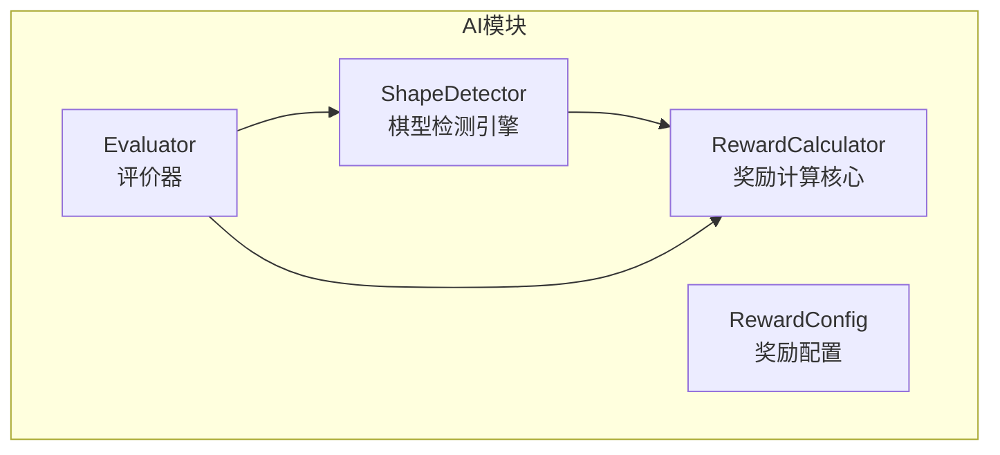
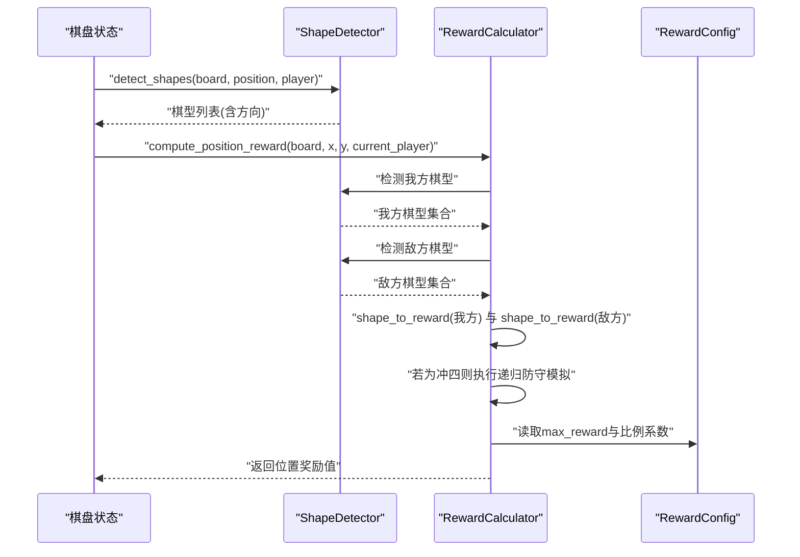
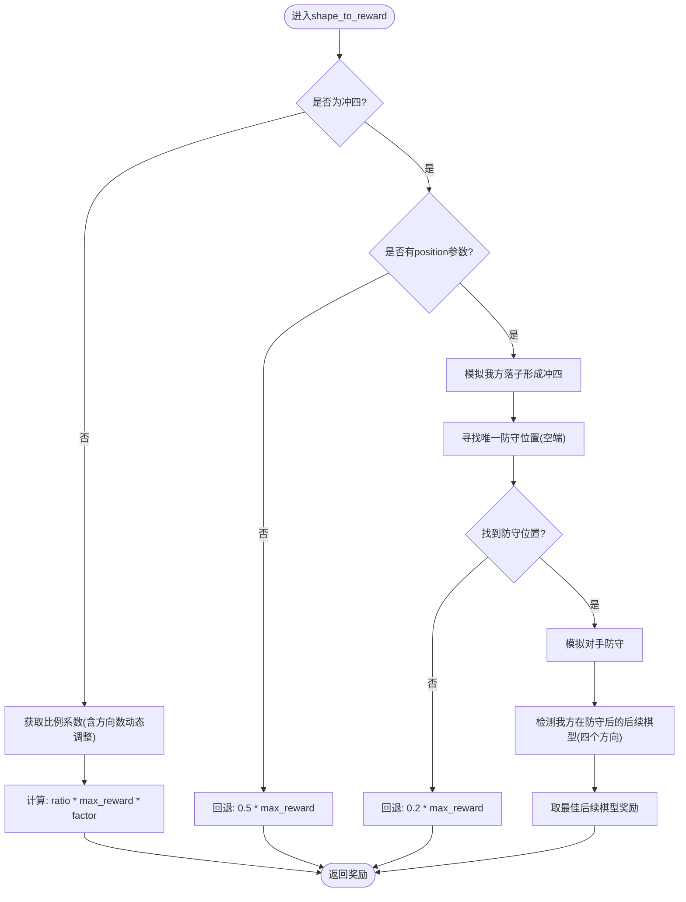
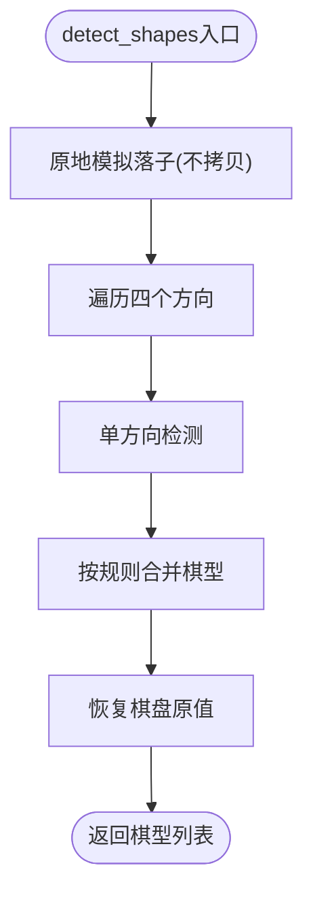
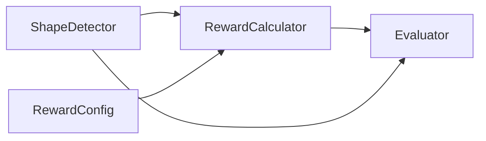
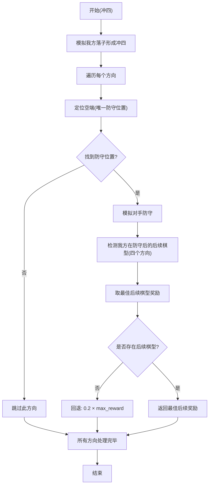
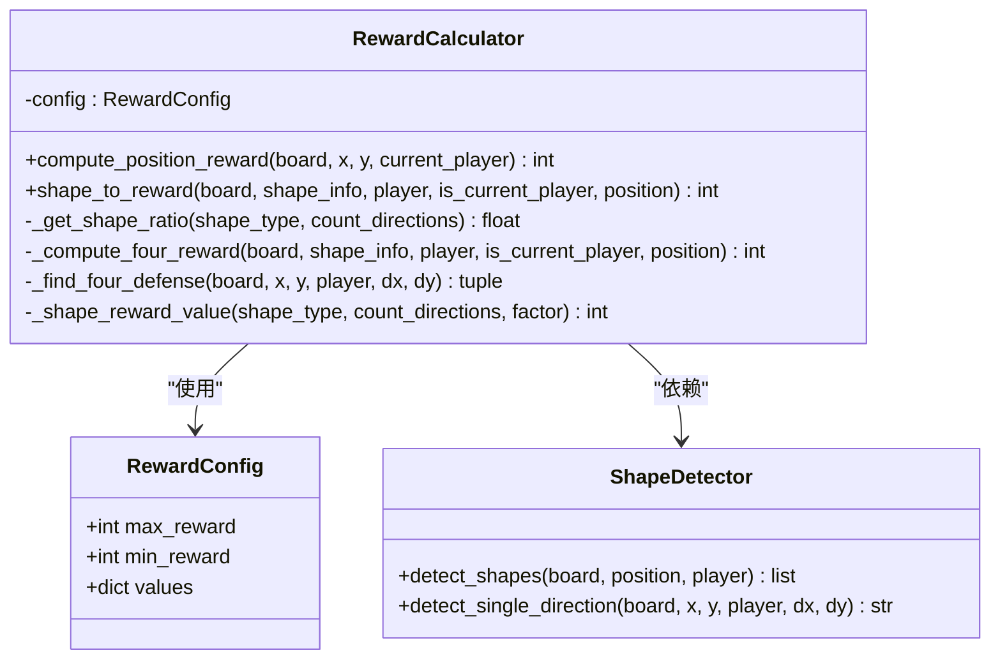

# 奖励计算算法

<cite>
**本文引用的文件**
- [ai/reward_calculator.py](file://ai/reward_calculator.py)
- [ai/shape_detector.py](file://ai/shape_detector.py)
- [ai/evaluator.py](file://ai/evaluator.py)
- [design/evaluator_shape_detection_design.md](file://design/evaluator_shape_detection_design.md)
- [tests/ai/test_reward_calculator.py](file://tests/ai/test_reward_calculator.py)
- [tests/ai/test_shape_detector.py](file://tests/ai/test_shape_detector.py)
</cite>

## 目录
1. [简介](#简介)
2. [项目结构](#项目结构)
3. [核心组件](#核心组件)
4. [架构总览](#架构总览)
5. [详细组件分析](#详细组件分析)
6. [依赖关系分析](#依赖关系分析)
7. [性能考量](#性能考量)
8. [故障排查指南](#故障排查指南)
9. [结论](#结论)
10. [附录](#附录)

## 简介
本文件面向五子棋AI的奖励计算算法，系统性阐述RewardCalculator类的实现原理与双向棋型检测机制，涵盖棋型识别、奖励映射、冲四递归防守模拟、配置体系以及从棋盘状态到奖励值的完整执行流程。文档同时提供可视化流程图与类图，帮助读者快速理解算法设计与工程实现。

## 项目结构
与奖励计算直接相关的模块与文件如下：
- ai/reward_calculator.py：奖励计算核心，包含RewardConfig配置与RewardCalculator类
- ai/shape_detector.py：棋型检测引擎，提供四个方向的棋型识别与合并逻辑
- ai/evaluator.py：评价器，将奖励计算集成到训练样本生成流程
- design/evaluator_shape_detection_design.md：设计文档，描述棋型定义、映射表、递归处理与主流程
- tests/ai/test_reward_calculator.py：奖励计算单元测试
- tests/ai/test_shape_detector.py：棋型检测单元测试

图表来源
- [ai/reward_calculator.py:35-239](file://ai/reward_calculator.py#L35-L239)
- [ai/shape_detector.py:197-280](file://ai/shape_detector.py#L197-L280)
- [ai/evaluator.py:51-200](file://ai/evaluator.py#L51-L200)

章节来源
- [ai/reward_calculator.py:1-239](file://ai/reward_calculator.py#L1-L239)
- [ai/shape_detector.py:1-314](file://ai/shape_detector.py#L1-L314)
- [ai/evaluator.py:1-200](file://ai/evaluator.py#L1-L200)

## 核心组件
- RewardConfig：集中管理奖励配置，包括最大/最小奖励值与各类棋型的比例系数。所有奖励值均以“相对于max_reward的比例”表示，便于统一缩放与裁剪。
- RewardCalculator：核心奖励计算类，负责：
  - 双向检测：分别计算当前落子方与对手方在某位置落子后的棋型与奖励
  - 棋型映射：将棋型类型与方向数量映射为具体奖励值
  - 冲四递归：模拟防守位置并检测后续棋型，避免无限递归
- ShapeDetector：纯函数式棋型检测引擎，支持Numba JIT加速，提供四个方向的棋型识别与合并策略
- Evaluator：训练样本生成器，将奖励计算集成到样本构建流程，并与LineTracer进行五连追溯奖励融合

章节来源
- [ai/reward_calculator.py:13-44](file://ai/reward_calculator.py#L13-L44)
- [ai/reward_calculator.py:35-239](file://ai/reward_calculator.py#L35-L239)
- [ai/shape_detector.py:197-280](file://ai/shape_detector.py#L197-L280)
- [ai/evaluator.py:51-200](file://ai/evaluator.py#L51-L200)

## 架构总览
下图展示了从棋盘状态到奖励值的端到端流程，包括棋型检测、奖励映射与冲四递归处理。

图表来源
- [ai/evaluator.py:162-200](file://ai/evaluator.py#L162-L200)
- [ai/reward_calculator.py:46-74](file://ai/reward_calculator.py#L46-L74)
- [ai/shape_detector.py:197-280](file://ai/shape_detector.py#L197-L280)

## 详细组件分析

### RewardConfig配置类
- 职责：集中管理奖励配置，确保全局一致性
- 关键字段：
  - max_reward/min_reward：奖励上下界，用于裁剪与归一化
  - values：各类棋型相对于max_reward的比例系数字典
- 比例系数示例（基于设计文档与实现）：
  - 连五：1.0
  - 活四/多冲四：0.9
  - 冲四：0.5
  - 多活三：0.8
  - 活三：0.5
  - 眠三：基础0.1，按方向数线性增加（0.1 + count_directions × 0.1）
  - 活二：基础0.3，按方向数线性增加（0.3 + count_directions × 0.1）
  - 眠二/独一：0.0

章节来源
- [ai/reward_calculator.py:13-33](file://ai/reward_calculator.py#L13-L33)
- [design/evaluator_shape_detection_design.md:101-117](file://design/evaluator_shape_detection_design.md#L101-L117)

### RewardCalculator类
- 双向检测：对当前位置分别检测我方与敌方的棋型，取二者奖励的最大值
- 棋型映射：
  - 基于比例系数与max_reward计算
  - 敌方棋型额外乘以0.95因子，体现防守价值略低于进攻价值
  - 眠三/活二按方向数动态增加权重
- 冲四递归：
  - 若无position参数，回退到简化计算（0.5 × max_reward）
  - 否则模拟我方落子形成冲四，寻找唯一空端防守位置，模拟对手防守后检测我方后续棋型，取最佳方向的奖励；若无后续棋型则回退到0.2 × max_reward
  - 递归深度控制：后续棋型使用非递归映射，避免无限递归

图表来源
- [ai/reward_calculator.py:76-191](file://ai/reward_calculator.py#L76-L191)

章节来源
- [ai/reward_calculator.py:46-191](file://ai/reward_calculator.py#L46-L191)

### ShapeDetector类
- 功能：在四个方向（横向、纵向、主对角线、副对角线）检测棋型，返回棋型列表及对应方向
- 合并策略：
  - 连五优先：若有连五，直接返回
  - 活四/冲四：多方向合并为“多冲四”，单方向保持“冲四”
  - 活三：多方向合并为“多活三”，单方向保持“活三”
  - 眠三/活二：记录所有方向，用于count_directions动态权重
- 性能：优先使用Numba JIT加速，不可用时回退到纯Python实现

图表来源
- [ai/shape_detector.py:197-280](file://ai/shape_detector.py#L197-L280)

章节来源
- [ai/shape_detector.py:197-280](file://ai/shape_detector.py#L197-L280)

### Evaluator与奖励融合
- Evaluator在样本生成阶段对每个空位调用compute_position_reward，得到原始奖励向量
- 若存在胜者，通过LineTracer追踪五连路径并叠加衰减奖励，与棋型评估奖励进行加法融合（可配置alpha）

章节来源
- [ai/evaluator.py:162-200](file://ai/evaluator.py#L162-L200)

## 依赖关系分析
- RewardCalculator依赖ShapeDetector进行棋型检测，并依赖RewardConfig进行比例系数与边界值读取
- Evaluator依赖RewardCalculator与ShapeDetector完成样本构建，并与LineTracer协作进行五连追溯奖励融合
- ShapeDetector内部使用Numba JIT加速，不可用时回退到纯Python

图表来源
- [ai/reward_calculator.py:10-10](file://ai/reward_calculator.py#L10-L10)
- [ai/evaluator.py:20-24](file://ai/evaluator.py#L20-L24)

章节来源
- [ai/reward_calculator.py:1-11](file://ai/reward_calculator.py#L1-L11)
- [ai/evaluator.py:1-24](file://ai/evaluator.py#L1-L24)

## 性能考量
- Numba JIT加速：ShapeDetector在可用时对单方向检测进行JIT编译，预期10~30倍加速
- 原地模拟落子：detect_shapes在检测前后原地修改棋盘值并恢复，避免大数组拷贝
- 递归深度控制：冲四递归中使用非递归映射避免无限递归，提升稳定性
- 并行化：Evaluator支持多进程并行处理记录文件，提高样本生成吞吐

章节来源
- [ai/shape_detector.py:12-18](file://ai/shape_detector.py#L12-L18)
- [ai/shape_detector.py:218-236](file://ai/shape_detector.py#L218-L236)
- [ai/evaluator.py:83-88](file://ai/evaluator.py#L83-L88)

## 故障排查指南
- 冲四无position参数：回退到简化计算（0.5 × max_reward）。若期望递归，请确保传入position
- 防守后无后续棋型：回退到较低奖励（0.2 × max_reward）。可通过调整配置或策略提升防守价值
- 敌方棋型奖励偏低：确认敌方系数0.95是否符合预期
- 眠三/活二奖励过低：检查count_directions是否正确统计方向数
- Numba不可用：将自动回退到纯Python实现，性能下降明显，建议安装numba以获得最佳性能

章节来源
- [ai/reward_calculator.py:118-191](file://ai/reward_calculator.py#L118-L191)
- [ai/reward_calculator.py:101-117](file://ai/reward_calculator.py#L101-L117)
- [ai/shape_detector.py:12-18](file://ai/shape_detector.py#L12-L18)

## 结论
RewardCalculator通过双向棋型检测与集中配置体系，实现了稳定、可扩展且可调优的奖励计算框架。配合ShapeDetector的高效棋型识别与Evaluator的样本生成流程，整体方案在性能与准确性之间取得良好平衡。建议在生产环境中启用Numba加速，并根据训练目标微调RewardConfig中的比例系数与边界值。

## 附录

### 棋型与奖励映射表（基于实现与设计文档）
- 连五：1.0 × max_reward（我方）/ 0.95 × max_reward（敌方）
- 活四/多冲四：0.9 × max_reward（我方）/ 0.855 × max_reward（敌方）
- 冲四：递归计算（见下节）
- 多活三：0.8 × max_reward（我方）/ 0.76 × max_reward（敌方）
- 活三：0.5 × max_reward（我方）/ 0.475 × max_reward（敌方）
- 眠三：(0.1 + count_directions × 0.1) × max_reward（我方）/ 同左 × 0.95（敌方）
- 活二：(0.3 + count_directions × 0.1) × max_reward（我方）/ 同左 × 0.95（敌方）
- 眠二/独一：0 × max_reward

章节来源
- [design/evaluator_shape_detection_design.md:101-117](file://design/evaluator_shape_detection_design.md#L101-L117)
- [ai/reward_calculator.py:101-117](file://ai/reward_calculator.py#L101-L117)

### 冲四递归防守模拟流程（代码级）

图表来源
- [ai/reward_calculator.py:118-191](file://ai/reward_calculator.py#L118-L191)

### 类关系图（代码级）

图表来源
- [ai/reward_calculator.py:13-239](file://ai/reward_calculator.py#L13-L239)
- [ai/shape_detector.py:197-280](file://ai/shape_detector.py#L197-L280)