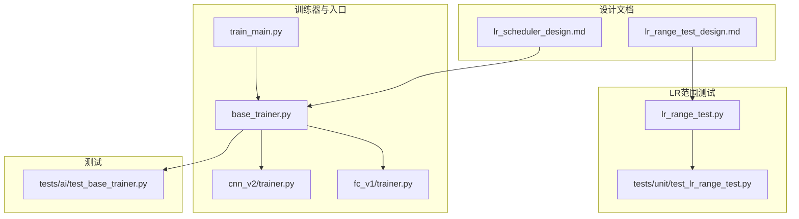
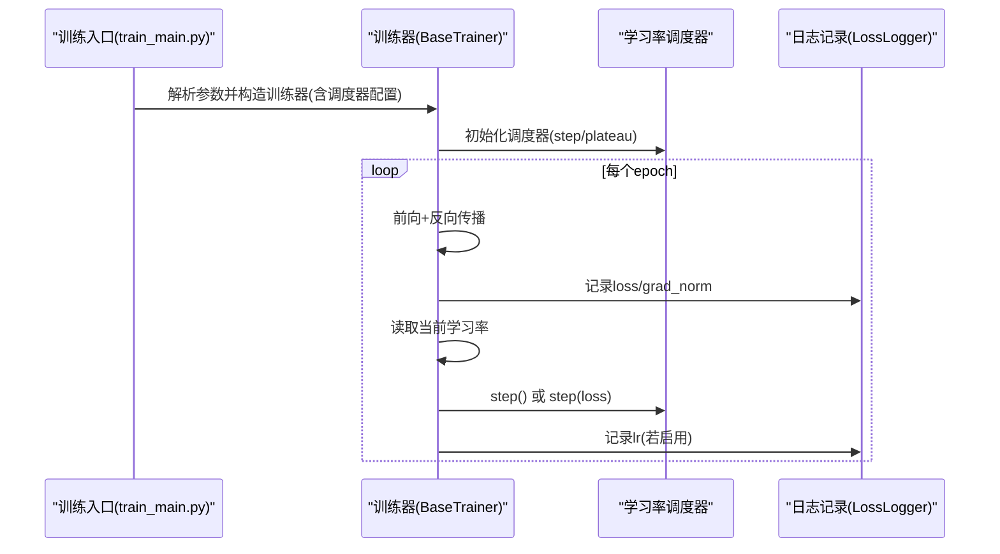
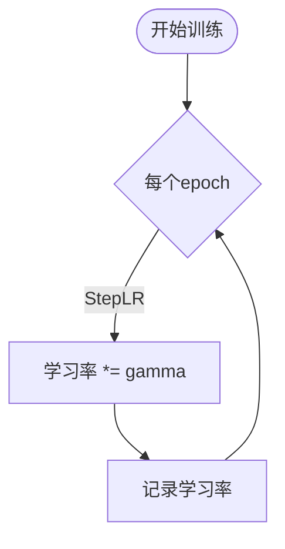
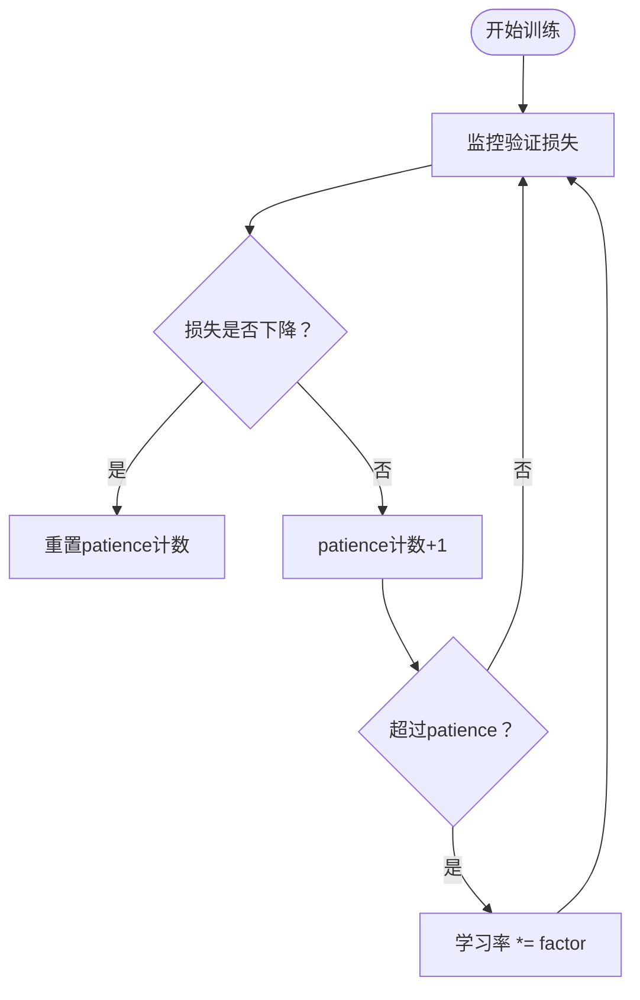
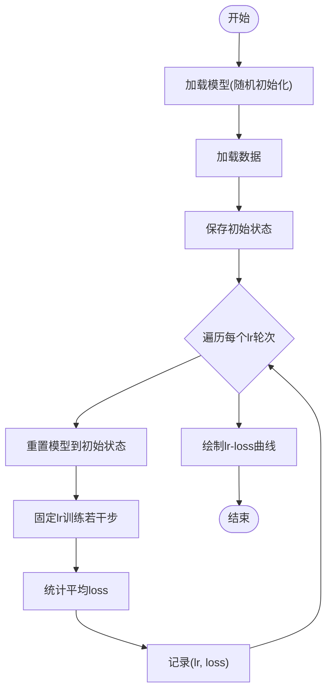
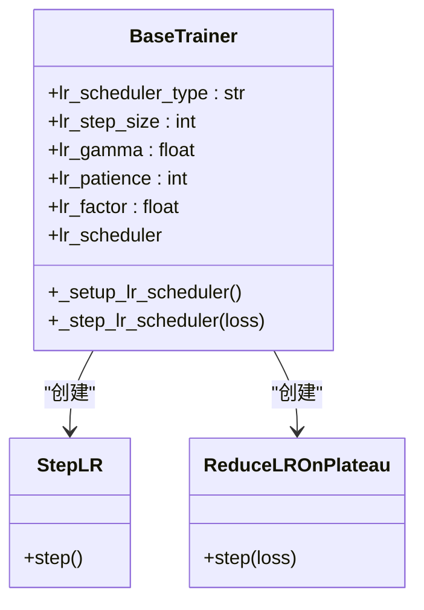
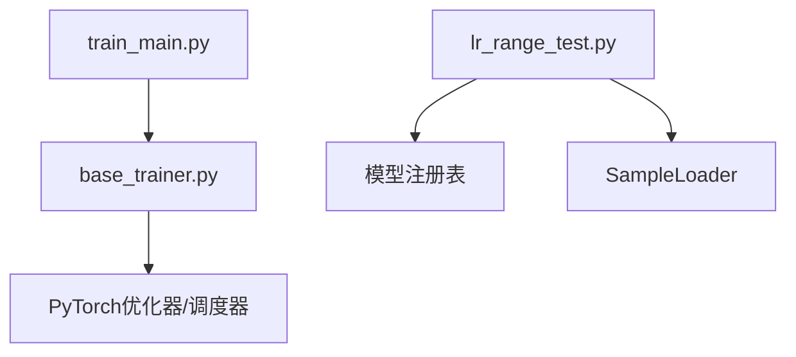

# 学习率调度算法

<cite>
**本文引用的文件**
- [lr_scheduler_design.md](file://design/learn_rate/lr_scheduler_design.md)
- [lr_range_test_design.md](file://design/lr_range_test_design.md)
- [base_trainer.py](file://ai/base_trainer.py)
- [lr_range_test.py](file://ai/lr_range_test.py)
- [train_main.py](file://ai/train_main.py)
- [test_lr_range_test.py](file://tests/unit/test_lr_range_test.py)
- [test_base_trainer.py](file://tests/ai/test_base_trainer.py)
- [cnn_v2/trainer.py](file://ai/models/cnn_v2/trainer.py)
- [fc_v1/trainer.py](file://ai/models/fc_v1/trainer.py)
</cite>

## 目录
1. [简介](#简介)
2. [项目结构](#项目结构)
3. [核心组件](#核心组件)
4. [架构总览](#架构总览)
5. [详细组件分析](#详细组件分析)
6. [依赖关系分析](#依赖关系分析)
7. [性能考量](#性能考量)
8. [故障排查指南](#故障排查指南)
9. [结论](#结论)
10. [附录](#附录)

## 简介
本文件面向五子棋AI训练中的学习率调度，系统阐述以下内容：
- 学习率调度的核心概念与重要性：在训练后期通过自适应学习率抑制参数在损失面“谷底”的过冲，提升收敛稳定性与最终精度。
- StepLR调度器：固定间隔衰减策略，步长间隔与衰减因子的设置策略与实践建议。
- ReduceLROnPlateau调度器：基于验证损失的动态衰减机制，包括损失监控、patience参数与最小学习率限制的注意事项。
- 学习率范围测试（LR Range Test）：指数/线性增长策略、损失曲线分析与最佳学习率区间定位。
- 最佳实践：不同训练阶段的学习率选择策略、动态调整方法与性能优化建议。
- 实际代码示例与参数配置：通过仓库中的训练器与脚本展示如何在项目中落地实现。

## 项目结构
围绕学习率调度的相关文件组织如下：
- 设计文档：学习率调度与LR Range Test的设计说明
- 训练器基类：统一的训练流程与学习率调度集成点
- 训练入口：CLI参数解析与调度器参数透传
- LR Range Test脚本：独立的范围测试工具
- 测试：单元与集成测试覆盖调度器行为与脚本功能

**图表来源**
- [lr_scheduler_design.md:1-184](file://design/learn_rate/lr_scheduler_design.md#L1-L184)
- [lr_range_test_design.md:1-197](file://design/lr_range_test_design.md#L1-L197)
- [base_trainer.py:1-699](file://ai/base_trainer.py#L1-L699)
- [train_main.py:1-234](file://ai/train_main.py#L1-L234)
- [lr_range_test.py:1-289](file://ai/lr_range_test.py#L1-L289)
- [test_lr_range_test.py:1-271](file://tests/unit/test_lr_range_test.py#L1-L271)
- [test_base_trainer.py:1-277](file://tests/ai/test_base_trainer.py#L1-L277)
- [cnn_v2/trainer.py:1-72](file://ai/models/cnn_v2/trainer.py#L1-L72)
- [fc_v1/trainer.py:1-44](file://ai/models/fc_v1/trainer.py#L1-L44)

**章节来源**
- [lr_scheduler_design.md:1-184](file://design/learn_rate/lr_scheduler_design.md#L1-L184)
- [lr_range_test_design.md:1-197](file://design/lr_range_test_design.md#L1-L197)
- [base_trainer.py:1-699](file://ai/base_trainer.py#L1-L699)
- [train_main.py:1-234](file://ai/train_main.py#L1-L234)
- [lr_range_test.py:1-289](file://ai/lr_range_test.py#L1-L289)
- [test_lr_range_test.py:1-271](file://tests/unit/test_lr_range_test.py#L1-L271)
- [test_base_trainer.py:1-277](file://tests/ai/test_base_trainer.py#L1-L277)
- [cnn_v2/trainer.py:1-72](file://ai/models/cnn_v2/trainer.py#L1-L72)
- [fc_v1/trainer.py:1-44](file://ai/models/fc_v1/trainer.py#L1-L44)

## 核心组件
- 学习率调度器基座：在训练器基类中统一管理调度器生命周期与调用时机，支持StepLR与ReduceLROnPlateau两种策略。
- CLI参数透传：训练入口将调度器相关参数解析并传入训练器构造函数，保证配置一致性。
- LR范围测试：独立脚本执行学习率范围测试，绘制lr-loss曲线，辅助确定合适的学习率区间。
- 测试体系：覆盖调度器创建、衰减行为、日志输出以及LR Range Test脚本的功能与边界条件。

**章节来源**
- [base_trainer.py:52-144](file://ai/base_trainer.py#L52-L144)
- [train_main.py:118-152](file://ai/train_main.py#L118-L152)
- [lr_range_test.py:131-210](file://ai/lr_range_test.py#L131-L210)
- [test_lr_range_test.py:124-267](file://tests/unit/test_lr_range_test.py#L124-L267)
- [test_base_trainer.py:197-272](file://tests/ai/test_base_trainer.py#L197-L272)

## 架构总览
学习率调度在训练流程中的位置与交互如下：

**图表来源**
- [train_main.py:209-229](file://ai/train_main.py#L209-L229)
- [base_trainer.py:127-144](file://ai/base_trainer.py#L127-L144)
- [base_trainer.py:305-322](file://ai/base_trainer.py#L305-L322)
- [base_trainer.py:545-573](file://ai/base_trainer.py#L545-L573)

## 详细组件分析

### StepLR调度器
- 原理：每经过固定步长（step_size）个epoch，学习率乘以衰减因子（gamma）。
- 参数设置策略：
  - step_size：建议结合训练总轮数与损失曲线趋势设定，初期可较长以稳定收敛，后期可缩短以精细调节。
  - gamma：通常取0.8~0.95之间，兼顾收敛速度与稳定性。
- 在训练器中的集成：在每个epoch结束时调用step()，StepLR不需要传参。

**图表来源**
- [lr_scheduler_design.md:15-21](file://design/learn_rate/lr_scheduler_design.md#L15-L21)
- [base_trainer.py:605-619](file://ai/base_trainer.py#L605-L619)

**章节来源**
- [lr_scheduler_design.md:15-21](file://design/learn_rate/lr_scheduler_design.md#L15-L21)
- [base_trainer.py:605-619](file://ai/base_trainer.py#L605-L619)

### ReduceLROnPlateau调度器
- 原理：当验证损失在连续patience个epoch内未下降时，将学习率乘以factor（衰减系数）。
- 关键参数：
  - patience：监控窗口大小，过大可能导致响应迟缓，过小可能频繁衰减。
  - factor：典型取0.5~0.8，衰减幅度适中。
  - mode/min：以最小化损失为目标。
- 在训练器中的集成：在每个epoch结束时调用step(loss)，传入当前epoch平均损失。

**图表来源**
- [lr_scheduler_design.md:23-31](file://design/learn_rate/lr_scheduler_design.md#L23-L31)
- [base_trainer.py:605-619](file://ai/base_trainer.py#L605-L619)

**章节来源**
- [lr_scheduler_design.md:23-31](file://design/learn_rate/lr_scheduler_design.md#L23-L31)
- [base_trainer.py:605-619](file://ai/base_trainer.py#L605-L619)

### 学习率范围测试（LR Range Test）
- 目的：快速定位合适的初始学习率区间，避免过高导致发散、过低导致收敛缓慢。
- 实现要点：
  - 线性递增学习率序列（或指数增长策略），每个lr对应一轮固定训练。
  - 每轮开始前重置模型参数，确保loss仅反映lr影响。
  - 使用全量数据作为单个batch，统计每轮平均loss。
  - 绘制lr-loss曲线，观察loss随lr变化的趋势。
- 在项目中的落地：独立脚本，支持命令行参数解析与结果可视化。

**图表来源**
- [lr_range_test_design.md:104-164](file://design/lr_range_test_design.md#L104-L164)
- [lr_range_test.py:131-210](file://ai/lr_range_test.py#L131-L210)

**章节来源**
- [lr_range_test_design.md:1-197](file://design/lr_range_test_design.md#L1-L197)
- [lr_range_test.py:1-289](file://ai/lr_range_test.py#L1-L289)
- [test_lr_range_test.py:124-267](file://tests/unit/test_lr_range_test.py#L124-L267)

### 训练器与调度器集成
- 训练器基类提供统一的调度器生命周期与调用接口：
  - 初始化时根据lr_scheduler_type创建StepLR或ReduceLROnPlateau。
  - 在训练循环中，每个epoch结束时调用step()或step(loss)。
  - 训练日志中输出当前学习率，便于监控。
- CLI入口将调度器参数解析并透传到训练器构造函数，保证配置一致性。

**图表来源**
- [base_trainer.py:52-144](file://ai/base_trainer.py#L52-L144)
- [base_trainer.py:605-619](file://ai/base_trainer.py#L605-L619)

**章节来源**
- [base_trainer.py:52-144](file://ai/base_trainer.py#L52-L144)
- [base_trainer.py:605-619](file://ai/base_trainer.py#L605-L619)
- [train_main.py:209-229](file://ai/train_main.py#L209-L229)

## 依赖关系分析
- 训练器基类依赖PyTorch优化器与调度器模块，统一管理优化器与损失函数。
- CLI入口依赖注册表获取具体训练器实现，并将调度器参数透传。
- LR范围测试脚本依赖模型注册表与样本加载器，独立于训练器基类。

**图表来源**
- [train_main.py:23-24](file://ai/train_main.py#L23-L24)
- [base_trainer.py:10-12](file://ai/base_trainer.py#L10-L12)
- [lr_range_test.py:29-32](file://ai/lr_range_test.py#L29-L32)

**章节来源**
- [train_main.py:23-24](file://ai/train_main.py#L23-L24)
- [base_trainer.py:10-12](file://ai/base_trainer.py#L10-L12)
- [lr_range_test.py:29-32](file://ai/lr_range_test.py#L29-L32)

## 性能考量
- 训练阶段划分与学习率策略：
  - 预训练/早期训练：使用较高学习率（如0.001），快速逼近局部最优。
  - 中期训练：逐步引入StepLR或ReduceLROnPlateau，控制衰减节奏。
  - 后期微调：降低学习率，提升收敛稳定性与泛化能力。
- 调度器参数建议：
  - StepLR：step_size可设为总轮数的1/5~1/10，gamma在0.85~0.95之间。
  - ReduceLROnPlateau：patience设为100~200，factor设为0.5~0.8。
- 日志与可视化：训练日志中输出学习率有助于及时发现异常波动。

**章节来源**
- [lr_scheduler_design.md:150-154](file://design/learn_rate/lr_scheduler_design.md#L150-L154)
- [base_trainer.py:305-322](file://ai/base_trainer.py#L305-L322)

## 故障排查指南
- 调度器未创建：
  - 检查lr_scheduler_type是否为None或拼写错误。
  - 确认训练器构造时传入了正确的调度器参数。
- 调度器未生效：
  - 确认训练循环中每个epoch结束时调用了step()或step(loss)。
  - 检查是否启用了验证损失监控（ReduceLROnPlateau需要传入loss）。
- LR Range Test异常：
  - 检查模型名称是否在注册表中，数据路径是否存在。
  - 确认每轮开始前模型参数被正确重置。
- 测试用例参考：
  - 调度器创建与衰减行为：见测试用例覆盖。
  - LR Range Test脚本功能与边界条件：见单元测试。

**章节来源**
- [test_base_trainer.py:197-272](file://tests/ai/test_base_trainer.py#L197-L272)
- [test_lr_range_test.py:60-267](file://tests/unit/test_lr_range_test.py#L60-L267)
- [lr_range_test_design.md:166-197](file://design/lr_range_test_design.md#L166-L197)

## 结论
本项目通过训练器基类统一集成StepLR与ReduceLROnPlateau两类调度器，并在CLI入口中提供灵活的参数配置；LR范围测试脚本独立运行，辅助定位合适的学习率区间。结合测试用例与日志输出，能够有效提升训练稳定性与收敛效率。建议在不同训练阶段采用差异化的学习率策略，并结合验证损失曲线动态调整调度器参数。

## 附录
- 常用参数速查
  - StepLR：step_size（epoch）、gamma（衰减系数）
  - ReduceLROnPlateau：patience（epoch）、factor（衰减系数）
- 示例命令（基于CLI入口）
  - 启用StepLR：--lr-scheduler step --lr-step-size 500 --lr-gamma 0.9
  - 启用ReduceLROnPlateau：--lr-scheduler plateau --lr-patience 100 --lr-factor 0.5
- LR Range Test命令
  - python ai/lr_range_test.py --model cnn_v2 --data data.json --rounds 50 --epochs 100

**章节来源**
- [train_main.py:118-152](file://ai/train_main.py#L118-L152)
- [lr_range_test.py:242-289](file://ai/lr_range_test.py#L242-L289)