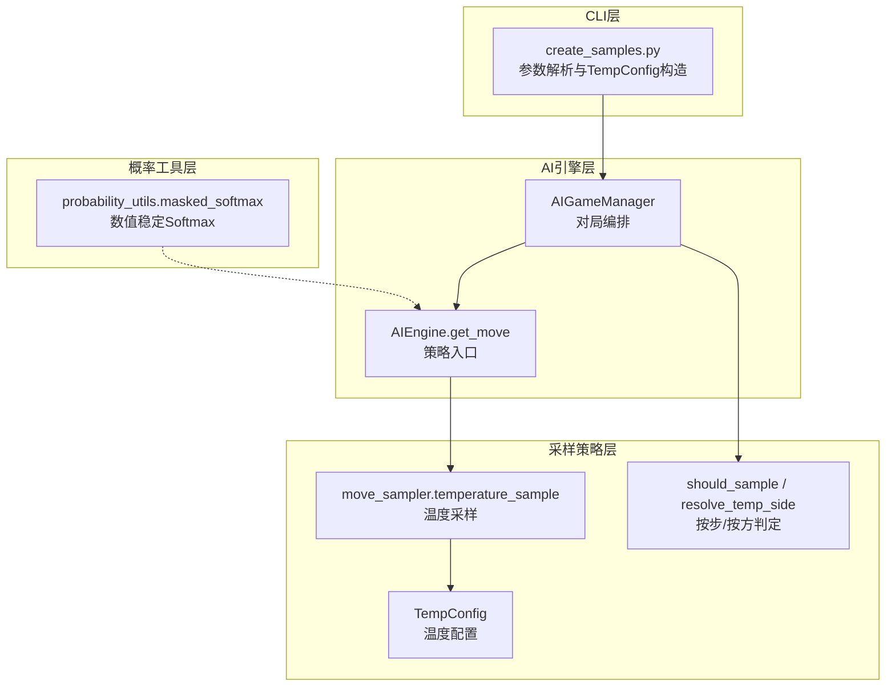
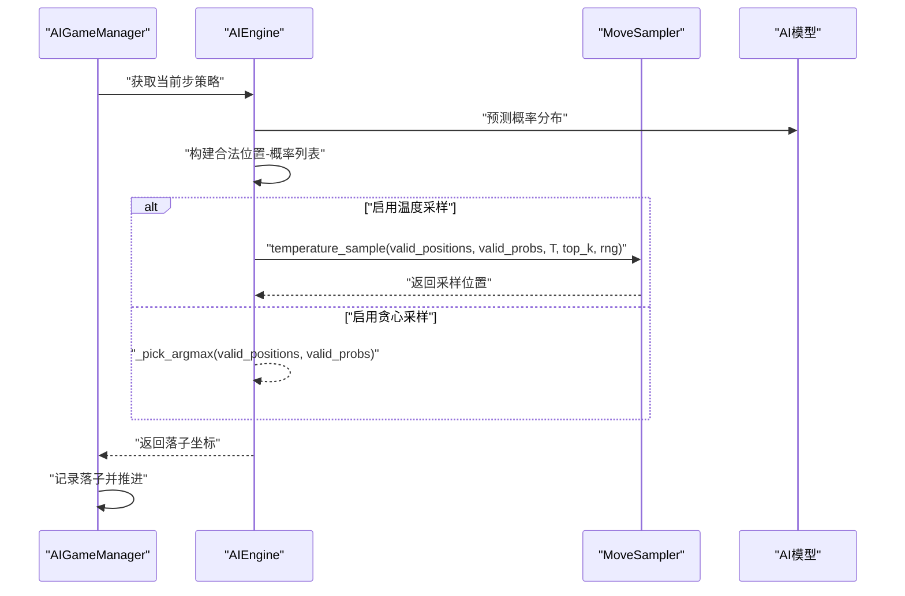
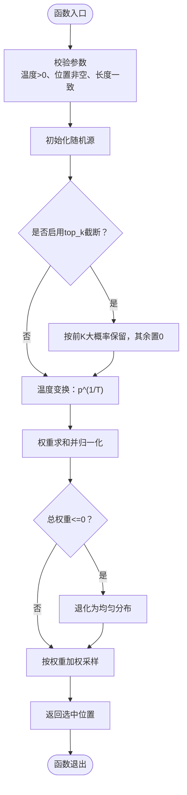
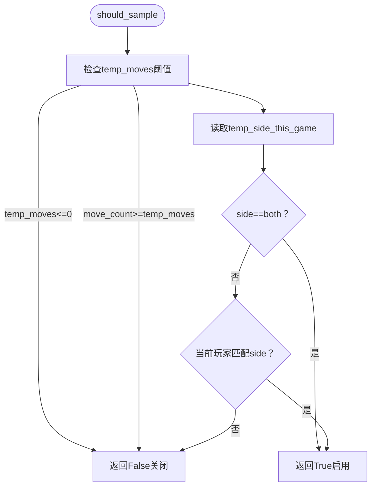
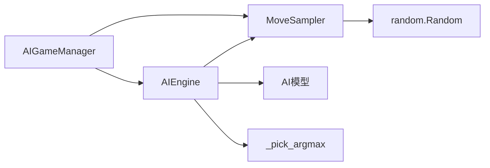

# 移动采样策略

<cite>
**本文引用的文件**
- [move_sampler.py](file://ai/move_sampler.py)
- [probability_utils.py](file://ai/probability_utils.py)
- [move_sampler_design.md](file://design/move_sampler_design.md)
- [test_move_sampler.py](file://tests/ai/test_move_sampler.py)
- [engine.py](file://ai/engine.py)
- [game_manager.py](file://ai/game_manager.py)
- [create_samples.py](file://ai/create_samples.py)
</cite>

## 更新摘要
**所做更改**
- 更新了温度采样策略的实现细节，反映了采样概率处理中的关键bug修复
- 增强了温度采样算法的数值稳定性说明
- 完善了采样概率处理的边界条件处理机制
- 更新了相关测试用例和实现细节的描述

## 目录
1. [简介](#简介)
2. [项目结构](#项目结构)
3. [核心组件](#核心组件)
4. [架构总览](#架构总览)
5. [详细组件分析](#详细组件分析)
6. [依赖关系分析](#依赖关系分析)
7. [性能考量](#性能考量)
8. [故障排查指南](#故障排查指南)
9. [结论](#结论)
10. [附录](#附录)

## 简介
本技术文档围绕五子棋AI的移动采样策略，系统阐述MoveSampler类及相关组件的实现原理与使用方法。重点包括：
- 温度采样、贪心采样（argmax）与随机采样的策略对比与适用场景
- 温度参数T的作用机制：高温度下的探索性采样与低温度下的利用性采样
- softmax概率分布的计算与归一化处理
- 采样范围控制：有效位置过滤与非法移动排除
- 概率分布处理：平滑与极端值处理策略
- 不同采样策略的性能对比与参数调优建议

**更新** 本版本反映了采样概率处理中的关键bug修复，增强了温度采样策略的数值稳定性和边界条件处理。

## 项目结构
与移动采样策略直接相关的模块与文件如下：
- ai/move_sampler.py：温度采样、配置与按步/按方判定
- ai/probability_utils.py：带掩码的数值稳定Softmax
- ai/engine.py：AI引擎落子策略入口，支持sampling与argmax
- ai/game_manager.py：对局编排，按步按方启用温度采样
- ai/create_samples.py：CLI参数解析与TempConfig构造
- tests/ai/test_move_sampler.py：采样策略单元测试
- design/move_sampler_design.md：设计文档与算法伪代码

**图表来源**
- [move_sampler.py:117-186](file://ai/move_sampler.py#L117-L186)
- [engine.py:67-142](file://ai/engine.py#L67-L142)
- [game_manager.py:200-230](file://ai/game_manager.py#L200-L230)
- [probability_utils.py:15-59](file://ai/probability_utils.py#L15-L59)
- [create_samples.py:113-136](file://ai/create_samples.py#L113-L136)

**章节来源**
- [move_sampler.py:1-258](file://ai/move_sampler.py#L1-L258)
- [engine.py:67-194](file://ai/engine.py#L67-L194)
- [game_manager.py:200-339](file://ai/game_manager.py#L200-L339)
- [probability_utils.py:15-59](file://ai/probability_utils.py#L15-L59)
- [create_samples.py:113-136](file://ai/create_samples.py#L113-L136)

## 核心组件
- MoveSampler（temperature_sample）：对合法位置按温度加权采样，支持top_k截断与随机源可控
- TempConfig：封装温度采样配置（温度T、前N步阈值、启用方、top_k、种子）
- should_sample / resolve_temp_side：按步与按方的采样开关判定
- AIEngine.get_move：策略入口，委托sampling分支到MoveSampler
- AIGameManager：对局编排，按步按方启用温度采样
- masked_softmax：数值稳定的Softmax，用于将奖励转换为概率分布

**更新** 本版本增强了温度采样算法的边界条件处理，确保在极端概率值下的数值稳定性。

**章节来源**
- [move_sampler.py:50-186](file://ai/move_sampler.py#L50-L186)
- [engine.py:67-142](file://ai/engine.py#L67-L142)
- [game_manager.py:200-230](file://ai/game_manager.py#L200-L230)
- [probability_utils.py:15-59](file://ai/probability_utils.py#L15-L59)

## 架构总览
温度采样策略在自对弈中的整体流程：
- 每步由AIGameManager判定是否启用温度采样
- 若启用，则AIEngine调用MoveSampler.temperature_sample进行采样
- 若未启用，则采用贪心策略（argmax）
- 模型输出经概率工具层转换为合法位置上的概率分布

**图表来源**
- [game_manager.py:200-230](file://ai/game_manager.py#L200-L230)
- [engine.py:127-142](file://ai/engine.py#L127-L142)
- [move_sampler.py:117-186](file://ai/move_sampler.py#L117-L186)

## 详细组件分析

### MoveSampler（温度采样）
- 功能概述
  - 对合法空位按温度加权采样，支持top_k截断与随机源可控
  - 当权重全非正时，退化为在合法位置上均匀采样，避免异常
- 算法步骤
  1) 可选top_k截断：仅保留概率前K个位置，其余置0
  2) 温度变换：对每个概率取p^(1/T)
  3) 归一化：若总权重<=0，退化为均匀分布
  4) 加权采样：使用choices按权重抽取下标并返回对应位置
- 关键参数
  - temperature：温度T，必须>0；T→0趋近argmax，T→∞趋近均匀
  - top_k：截断阈值；None表示不截断
  - rng：随机源；None使用全局随机源
- 错误处理
  - temperature<=0、空位置列表、位置与概率长度不一致时抛出ValueError
- 性能特性
  - 时间复杂度O(n)（n为合法位置数），top_k截断可降低复杂度
  - 使用标准库随机choices进行加权采样，保证一致性与可复现性

**更新** 本版本修复了温度采样中的关键bug，改进了概率处理的数值稳定性：

**图表来源**
- [move_sampler.py:117-186](file://ai/move_sampler.py#L117-L186)

**章节来源**
- [move_sampler.py:117-186](file://ai/move_sampler.py#L117-L186)
- [test_move_sampler.py:32-146](file://tests/ai/test_move_sampler.py#L32-L146)

### TempConfig（温度配置）
- 字段说明
  - temperature：温度T，>0；越大越随机，趋近0等价argmax
  - temp_moves：前N步启用温度采样，其后切换为argmax；0等同关闭
  - temp_side：启用采样的一方，取值black/white/both/random
  - top_k：可选截断阈值；None表示不截断
  - seed：可选随机种子；None使用全局随机源
- 校验规则
  - temperature必须>0
  - temp_moves必须>=0
  - temp_side必须在支持集合内
  - top_k必须为None或>0
- 默认值
  - temperature=1.0，temp_moves=12，temp_side="both"，top_k=None，seed=None

**章节来源**
- [move_sampler.py:50-112](file://ai/move_sampler.py#L50-L112)
- [test_move_sampler.py:152-179](file://tests/ai/test_move_sampler.py#L152-L179)

### 按步/按方判定（should_sample / resolve_temp_side）
- should_sample
  - 依据move_count与temp_moves阈值决定是否启用温度采样
  - 结合temp_side_this_game与当前玩家，过滤启用方
- resolve_temp_side
  - 将temp_side="random"解析为"black"或"white"（每局抽签一次）
  - 其他值原样返回

**图表来源**
- [move_sampler.py:192-227](file://ai/move_sampler.py#L192-L227)
- [move_sampler.py:229-258](file://ai/move_sampler.py#L229-L258)

**章节来源**
- [move_sampler.py:192-258](file://ai/move_sampler.py#L192-L258)
- [test_move_sampler.py:185-251](file://tests/ai/test_move_sampler.py#L185-L251)

### AIEngine.get_move（策略入口）
- 支持策略
  - "argmax"：选择概率最大的合法位置，必要时随机打破平局
  - "sampling"：委托MoveSampler.temperature_sample执行温度采样
- 输入输出
  - 输入：棋盘、当前玩家、可选预计算概率、策略字符串、温度T、top_k、随机源
  - 输出：落子坐标(x,y)
- 错误处理
  - 棋盘已满、未知策略、sampling时温度<=0时抛出ValueError

**章节来源**
- [engine.py:67-142](file://ai/engine.py#L67-L142)
- [engine.py:144-172](file://ai/engine.py#L144-L172)

### AIGameManager（对局编排）
- 在每步开始前，根据temp_config与当前步数、玩家决定是否启用温度采样
- 若启用，传入温度T、top_k与随机源；否则采用贪心策略
- 每局开始前，若temp_side为"random"，通过resolve_temp_side抽签决定本局启用方

**更新** 本版本增强了温度采样信息的记录机制，支持采样概率的可视化展示。

**章节来源**
- [game_manager.py:200-230](file://ai/game_manager.py#L200-L230)
- [move_sampler.py:229-258](file://ai/move_sampler.py#L229-L258)

### 概率工具（masked_softmax）
- 功能：将奖励值转换为合法位置上的概率分布，支持掩码过滤
- 数值稳定性：先缩放奖励到[-10,-10]范围，再减去最大值，避免exp溢出
- 掩码：仅对mask=1的位置（空位）计算概率，已落子位置概率为0

**章节来源**
- [probability_utils.py:15-59](file://ai/probability_utils.py#L15-L59)

### CLI参数与调用链
- create_samples.py新增温度采样相关参数：--no-temp-sampling、--temperature、--temp-moves、--temp-side、--temp-seed
- 当--no-temp-sampling启用时，TempConfig为None，保持纯贪心策略
- 否则构造TempConfig并传递给AIGameManager.start_ai_vs_ai

**章节来源**
- [create_samples.py:78-136](file://ai/create_samples.py#L78-L136)

## 依赖关系分析
- MoveSampler依赖
  - 标准库random（可注入随机源）
  - dataclasses（TempConfig）
- AIEngine依赖
  - MoveSampler（sampling分支）
  - 模型预测（225维概率分布）
- AIGameManager依赖
  - MoveSampler（按步按方判定）
  - AIEngine（落子策略）

**图表来源**
- [engine.py:131-139](file://ai/engine.py#L131-L139)
- [move_sampler.py:117-186](file://ai/move_sampler.py#L117-L186)
- [game_manager.py:200-230](file://ai/game_manager.py#L200-L230)

**章节来源**
- [engine.py:67-142](file://ai/engine.py#L67-L142)
- [move_sampler.py:50-186](file://ai/move_sampler.py#L50-L186)
- [game_manager.py:200-339](file://ai/game_manager.py#L200-L339)

## 性能考量
- 时间复杂度
  - MoveSampler：O(n)，其中n为合法位置数；top_k截断可将复杂度降至O(n log n)（排序阈值）
  - AIEngine：O(225)（棋盘大小固定）+ O(n)（采样）
  - AIGameManager：每步O(1)判定 + O(n)采样
- 空间复杂度
  - MoveSampler：O(n)（复制概率列表与权重）
  - AIEngine：O(n)（合法位置与概率列表）
- 数值稳定性
  - masked_softmax通过缩放与中心化避免exp溢出
  - **更新** 修复了温度采样中的数值稳定性问题，确保在极端概率值下的准确计算
- 可复现性
  - 通过随机种子与随机源可控，确保采样序列可复现

**更新** 本版本增强了数值稳定性处理，特别是在处理极小或极大的概率值时的精度保证。

## 故障排查指南
- 常见错误与定位
  - temperature<=0：检查TempConfig构造与调用参数
  - 空位置列表：确认棋盘状态与模型输出
  - 长度不一致：检查合法位置与概率列表构建
  - 未知策略：确认strategy参数取值
- 单元测试参考
  - 分布行为测试：T=1时频率贴近原分布、T极小趋近argmax、T极大趋近均匀
  - 边界条件测试：非法温度、空位置、top_k截断、全零概率回退、可复现性
  - 配置校验测试：字段合法性与默认值
  - 判定逻辑测试：阈值前后、启用方过滤、random抽签

**更新** 本版本的测试用例特别强化了数值稳定性测试，确保温度采样在各种边界条件下的正确性。

**章节来源**
- [test_move_sampler.py:32-259](file://tests/ai/test_move_sampler.py#L32-L259)

## 结论
- 温度采样通过T参数在探索与利用之间取得平衡：高T提升多样性，低T增强确定性
- MoveSampler提供了稳健的采样实现，具备top_k截断与数值回退能力
- 通过TempConfig与AIGameManager的编排，可在自对弈中灵活启用温度采样
- 建议结合对照实验与可视化分析，持续调优温度T与temp_moves参数

**更新** 本版本的bug修复进一步提升了温度采样策略的可靠性和数值稳定性，确保在各种情况下都能产生正确的采样结果。

## 附录

### 采样策略适用场景与对比
- 温度采样（sampling）
  - 场景：自对弈初期探索开局多样性，避免路径退化
  - 特点：T越大越随机，T→0趋近贪心
- 贪心采样（argmax）
  - 场景：后期或对局末尾，追求确定性
  - 特点：最大化当前步收益，避免噪声
- 随机采样
  - 场景：基准对照或探索极端随机性
  - 特点：均匀分布，无偏好

### 参数调优建议
- 初始建议
  - temperature：1.0（与原分布一致）
  - temp_moves：12（前12步探索）
  - temp_side：both（双方探索）
  - seed：固定种子便于复现
- 调优策略
  - 若开局多样性不足：提高temperature或temp_moves
  - 若训练不稳定：降低temperature或仅对一方采样
  - 若无差异：检查模型输出是否接近one-hot（此时温度采样退化为贪心）

**更新** 本版本的参数调优建议考虑了数值稳定性因素，建议在确保算法稳定性的前提下进行参数调整。