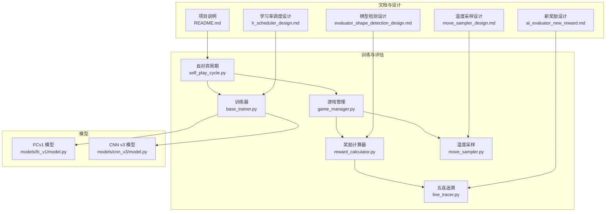
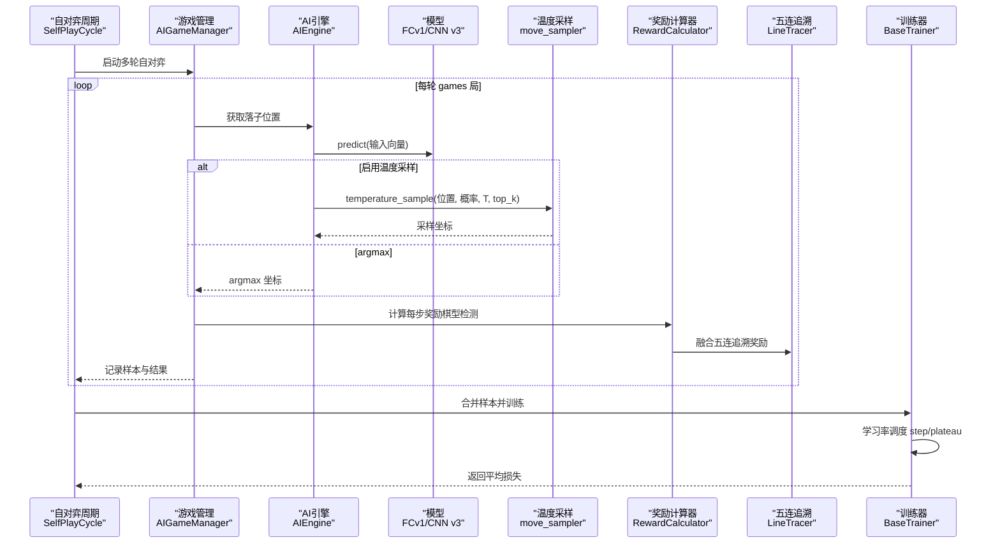
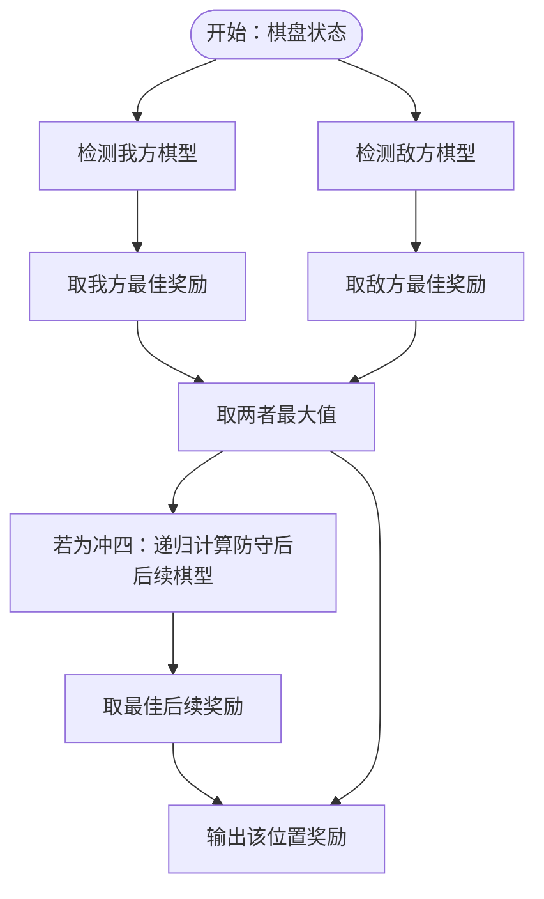
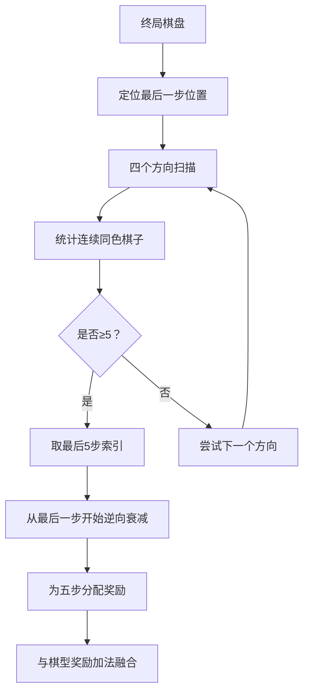
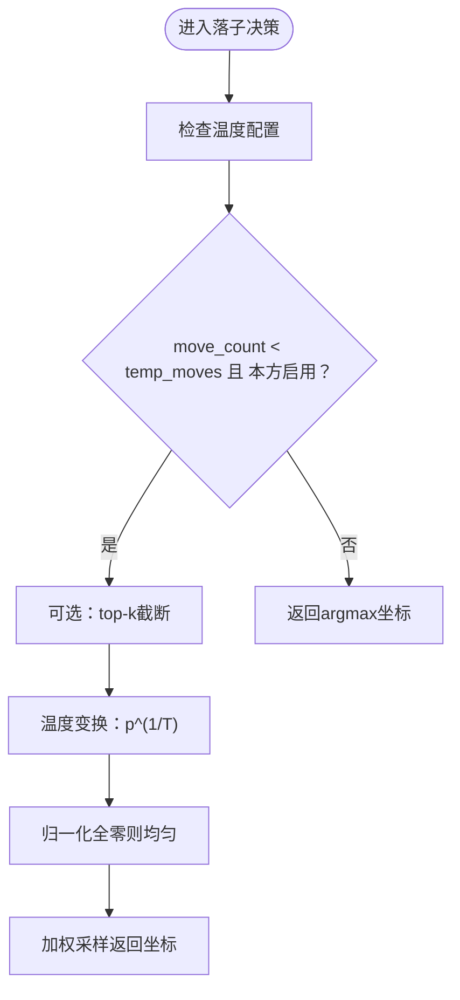
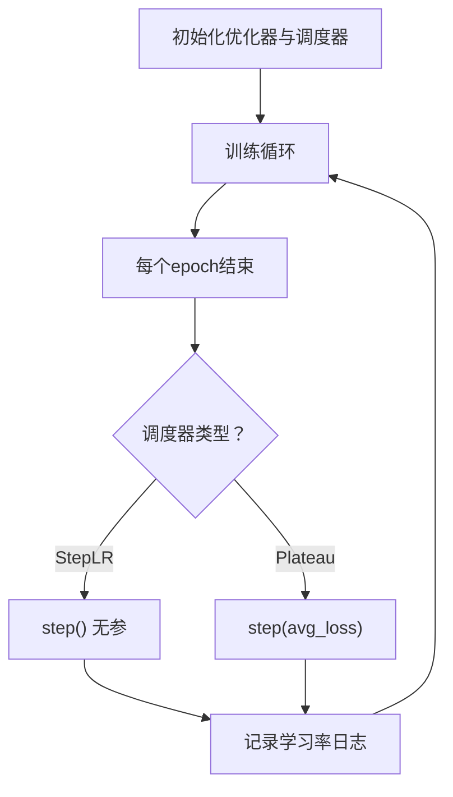
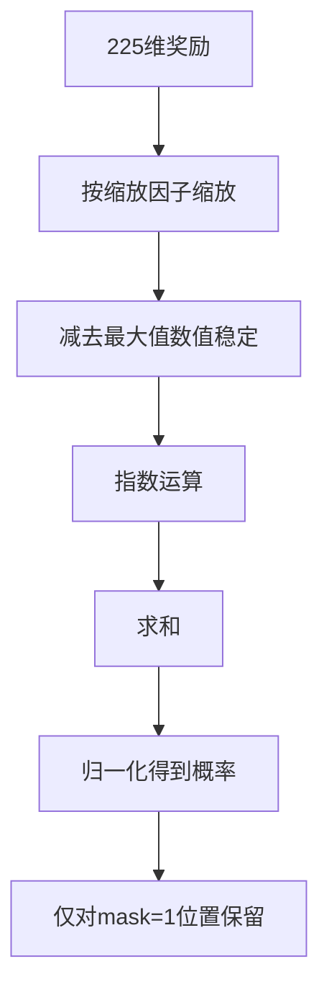
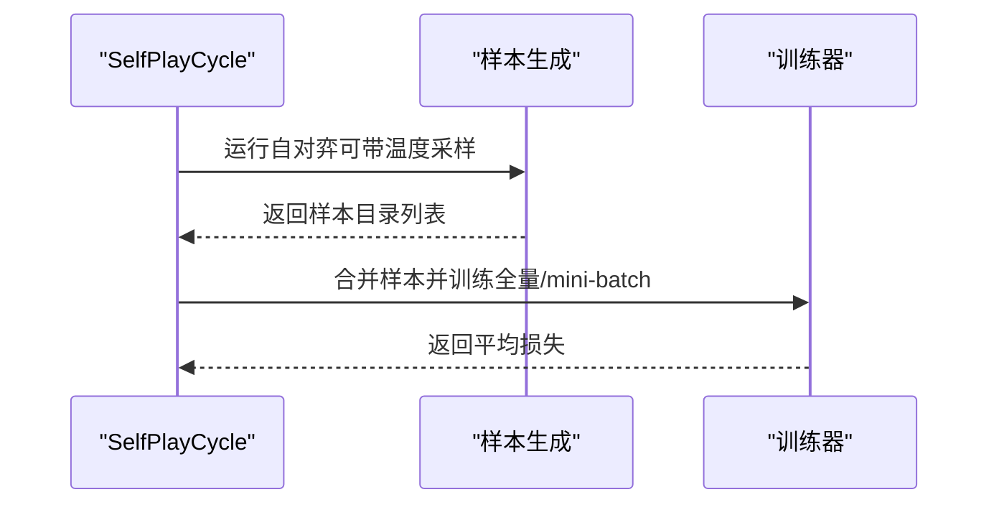
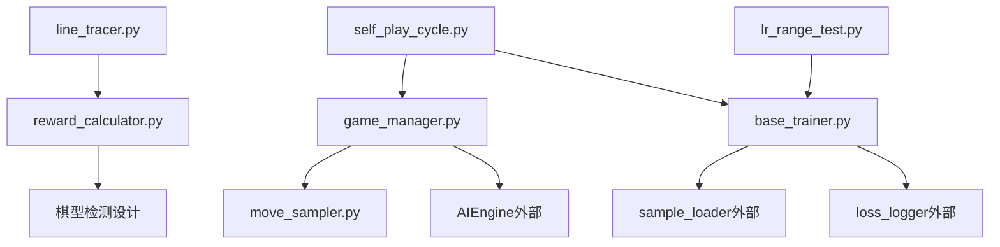

# 训练算法

<cite>
**本文引用的文件**
- [reward_calculator.py](file://ai/reward_calculator.py)
- [line_tracer.py](file://ai/line_tracer.py)
- [move_sampler.py](file://ai/move_sampler.py)
- [probability_utils.py](file://ai/probability_utils.py)
- [base_trainer.py](file://ai/base_trainer.py)
- [self_play_cycle.py](file://ai/self_play_cycle.py)
- [game_manager.py](file://ai/game_manager.py)
- [lr_range_test.py](file://ai/lr_range_test.py)
- [model.py（FCv1）](file://ai/models/fc_v1/model.py)
- [model.py（CNN v3）](file://ai/models/cnn_v3/model.py)
- [ai_evaluator_new_reward.md](file://design/ai_evaluator_new_reward.md)
- [evaluator_shape_detection_design.md](file://design/evaluator_shape_detection_design.md)
- [move_sampler_design.md](file://design/move_sampler_design.md)
- [lr_scheduler_design.md](file://design/learn_rate/lr_scheduler_design.md)
- [README.md](file://README.md)
</cite>

## 目录
1. [简介](#简介)
2. [项目结构](#项目结构)
3. [核心组件](#核心组件)
4. [架构总览](#架构总览)
5. [详细组件分析](#详细组件分析)
6. [依赖分析](#依赖分析)
7. [性能考量](#性能考量)
8. [故障排查指南](#故障排查指南)
9. [结论](#结论)
10. [附录](#附录)

## 简介
本技术文档围绕五子棋AI训练算法，系统阐述以下关键能力与实现细节：
- 奖励反向传播算法：从“五连追溯”到“双向棋型检测”的演进，涵盖奖励值计算、衰减机制与传播路径。
- 五连追溯算法：胜利路径识别、奖励逆向传递与棋型检测优化。
- 温度采样策略：温度参数设置、采样范围控制与随机性调节。
- 学习率调度：StepLR与ReduceLROnPlateau两种调度器的配置与使用场景。
- 概率分布处理：softmax转换、概率归一化与采样策略选择。
- 参数调优与性能优化：结合代码路径与设计文档给出实践建议与效果对比。

## 项目结构
训练算法涉及AI模块的多个子模块协同工作，核心文件如下：
- 奖励与评估：reward_calculator.py、line_tracer.py、evaluator_shape_detection_design.md
- 采样与策略：move_sampler.py、move_sampler_design.md、game_manager.py
- 训练与调度：base_trainer.py、lr_scheduler_design.md、lr_range_test.py、self_play_cycle.py
- 模型适配：model.py（FCv1）、model.py（CNN v3）
- 文档与设计：ai_evaluator_new_reward.md、evaluator_shape_detection_design.md、README.md

**图表来源**
- [reward_calculator.py:1-239](file://ai/reward_calculator.py#L1-L239)
- [line_tracer.py:1-143](file://ai/line_tracer.py#L1-L143)
- [move_sampler.py:1-258](file://ai/move_sampler.py#L1-L258)
- [game_manager.py:1-339](file://ai/game_manager.py#L1-L339)
- [base_trainer.py:1-699](file://ai/base_trainer.py#L1-L699)
- [self_play_cycle.py:1-195](file://ai/self_play_cycle.py#L1-L195)
- [model.py（FCv1）:1-132](file://ai/models/fc_v1/model.py#L1-L132)
- [model.py（CNN v3）:1-139](file://ai/models/cnn_v3/model.py#L1-L139)
- [evaluator_shape_detection_design.md:1-465](file://design/evaluator_shape_detection_design.md#L1-L465)
- [ai_evaluator_new_reward.md:1-242](file://design/ai_evaluator_new_reward.md#L1-L242)
- [move_sampler_design.md:1-551](file://design/move_sampler_design.md#L1-L551)
- [lr_scheduler_design.md:1-184](file://design/learn_rate/lr_scheduler_design.md#L1-L184)
- [README.md:1-422](file://README.md#L1-L422)

**章节来源**
- [README.md:1-422](file://README.md#L1-L422)

## 核心组件
- 奖励计算器（RewardCalculator）：实现双向棋型检测，将棋型映射为数值奖励，支持冲四递归防守模拟与动态比例系数。
- 五连追溯（LineTracer）：从终局棋盘识别五连路径，逆向传播奖励并融合棋型评估奖励。
- 温度采样（move_sampler）：提供阶梯式温度采样策略，支持按步/按方切换与top-k截断。
- 训练器（BaseTrainer）：统一训练流程，支持StepLR与ReduceLROnPlateau学习率调度。
- 概率工具（probability_utils）：带mask的数值稳定softmax，避免大奖励导致exp下溢。
- 自对弈周期（SelfPlayCycle）：编排多轮自对弈与训练，支持温度采样参数透传。
- 模型适配：FCv1与CNN v3模型的输入转换与网络结构，适配训练器的张量格式。

**章节来源**
- [reward_calculator.py:35-239](file://ai/reward_calculator.py#L35-L239)
- [line_tracer.py:10-143](file://ai/line_tracer.py#L10-L143)
- [move_sampler.py:50-258](file://ai/move_sampler.py#L50-L258)
- [probability_utils.py:15-59](file://ai/probability_utils.py#L15-L59)
- [base_trainer.py:32-699](file://ai/base_trainer.py#L32-L699)
- [self_play_cycle.py:20-195](file://ai/self_play_cycle.py#L20-L195)
- [model.py（FCv1）:18-132](file://ai/models/fc_v1/model.py#L18-L132)
- [model.py（CNN v3）:31-139](file://ai/models/cnn_v3/model.py#L31-L139)

## 架构总览
训练算法的整体流程从自对弈开始，生成样本，经过奖励计算与概率转换，进入训练器进行优化，期间可选地启用学习率调度与温度采样策略。

**图表来源**
- [self_play_cycle.py:38-156](file://ai/self_play_cycle.py#L38-L156)
- [game_manager.py:123-339](file://ai/game_manager.py#L123-L339)
- [move_sampler.py:117-186](file://ai/move_sampler.py#L117-L186)
- [reward_calculator.py:46-99](file://ai/reward_calculator.py#L46-L99)
- [line_tracer.py:119-143](file://ai/line_tracer.py#L119-L143)
- [base_trainer.py:257-322](file://ai/base_trainer.py#L257-L322)

## 详细组件分析

### 奖励反向传播算法（从五连追溯到双向棋型检测）
- 核心思路：从“五连追溯”到“双向棋型检测”，对每个空位进行我方与敌方的棋型检测，取最大奖励作为该位置的信号。
- 冲四递归：模拟落子→找唯一防守位置→模拟防守→检测后续棋型，取最佳后续奖励；若无后续则回退到低奖励。
- 动态比例：眠三/活二按方向数动态加权，增强对多方向威胁的敏感度。
- 裁剪与融合：将棋型评估奖励与五连追溯奖励加法融合，限制在合法范围内，避免溢出。

**图表来源**
- [reward_calculator.py:76-191](file://ai/reward_calculator.py#L76-L191)
- [evaluator_shape_detection_design.md:120-160](file://design/evaluator_shape_detection_design.md#L120-L160)

**章节来源**
- [reward_calculator.py:46-191](file://ai/reward_calculator.py#L46-L191)
- [evaluator_shape_detection_design.md:101-160](file://design/evaluator_shape_detection_design.md#L101-L160)

### 五连追溯算法（胜利路径识别与逆向传播）
- 五连识别：遍历四个方向，从最后一步出发，统计同色连续棋子，取最后五个步骤索引。
- 逆向传播：从最后一步开始，按衰减率逐步递减奖励，仅对构成五连的五步赋值。
- 融合策略：与棋型评估奖励加法融合，限制在最大/最小奖励范围内，保证softmax缩放一致性。

**图表来源**
- [line_tracer.py:28-117](file://ai/line_tracer.py#L28-L117)
- [ai_evaluator_new_reward.md:74-93](file://design/ai_evaluator_new_reward.md#L74-L93)

**章节来源**
- [line_tracer.py:28-143](file://ai/line_tracer.py#L28-L143)
- [ai_evaluator_new_reward.md:18-134](file://design/ai_evaluator_new_reward.md#L18-L134)

### 温度采样策略（参数设置、采样范围与随机性）
- 阶梯切换：前N步按温度T采样，之后argmax；支持按方启用（黑/白/双方/随机）。
- 采样公式：对合法位置概率向量p，按q_i ∝ p_i^(1/T)归一化后加权采样。
- top-k截断：仅保留前K个最高概率位置，其余置零，缓解过拟合与极端分布。
- 随机性控制：通过温度T与随机种子控制探索程度与可复现性。

**图表来源**
- [move_sampler.py:117-186](file://ai/move_sampler.py#L117-L186)
- [move_sampler_design.md:28-55](file://design/move_sampler_design.md#L28-L55)

**章节来源**
- [move_sampler.py:50-258](file://ai/move_sampler.py#L50-L258)
- [move_sampler_design.md:1-551](file://design/move_sampler_design.md#L1-L551)

### 学习率调度（StepLR与ReduceLROnPlateau）
- StepLR：固定间隔衰减，适合前期快速收敛、后期稳定。
- ReduceLROnPlateau：基于验证损失的早停式衰减，适合后期精细收敛。
- 生命周期：与训练器绑定，在每个epoch结束时step，支持日志输出当前学习率。

**图表来源**
- [base_trainer.py:127-144](file://ai/base_trainer.py#L127-L144)
- [lr_scheduler_design.md:33-85](file://design/learn_rate/lr_scheduler_design.md#L33-L85)

**章节来源**
- [base_trainer.py:127-144](file://ai/base_trainer.py#L127-L144)
- [lr_scheduler_design.md:1-184](file://design/learn_rate/lr_scheduler_design.md#L1-L184)

### 概率分布处理（softmax、归一化与采样）
- 数值稳定：将奖励按缩放因子缩放至[-10, 10]范围，避免exp下溢。
- Mask处理：仅对空位位置计算softmax，已落子位置概率为0。
- 输出：得到225维概率分布，sum=1，适配训练器的掩码损失。

**图表来源**
- [probability_utils.py:15-59](file://ai/probability_utils.py#L15-L59)

**章节来源**
- [probability_utils.py:15-59](file://ai/probability_utils.py#L15-L59)

### 自对弈训练周期（SelfPlayCycle）
- 多轮自对弈：每轮N局，每局M步，生成样本并合并。
- 温度采样透传：支持TempConfig参数，控制每轮自对弈的探索策略。
- 训练编排：自动选择全量或mini-batch训练，支持验证集与学习率调度。

**图表来源**
- [self_play_cycle.py:38-156](file://ai/self_play_cycle.py#L38-L156)

**章节来源**
- [self_play_cycle.py:20-195](file://ai/self_play_cycle.py#L20-L195)

### 模型适配（FCv1与CNN v3）
- FCv1：输入(226)→多层隐藏→输出(225)→Softmax，适配BaseTrainer默认输入转换。
- CNN v3：输入(3,15,15)→卷积→1×1卷积→Softmax，需专用输入转换函数。
- 二者均支持AdamW优化与L1掩码损失，适配训练器统一流程。

**章节来源**
- [model.py（FCv1）:18-132](file://ai/models/fc_v1/model.py#L18-L132)
- [model.py（CNN v3）:31-139](file://ai/models/cnn_v3/model.py#L31-L139)
- [base_trainer.py:662-699](file://ai/base_trainer.py#L662-L699)

## 依赖分析
- 模块耦合：
  - game_manager依赖move_sampler与AIEngine，编排温度采样与落子策略。
  - reward_calculator与line_tracer共同构成奖励信号生成链。
  - base_trainer依赖sample_loader与loss_logger，统一训练流程。
  - self_play_cycle协调多轮自对弈与训练器。
- 外部依赖：
  - PyTorch优化器与调度器（AdamW、StepLR、ReduceLROnPlateau）。
  - Matplotlib（LR Range Test绘图）。

**图表来源**
- [game_manager.py:16-339](file://ai/game_manager.py#L16-L339)
- [move_sampler.py:1-258](file://ai/move_sampler.py#L1-L258)
- [reward_calculator.py:1-239](file://ai/reward_calculator.py#L1-L239)
- [line_tracer.py:1-143](file://ai/line_tracer.py#L1-L143)
- [base_trainer.py:1-699](file://ai/base_trainer.py#L1-L699)
- [self_play_cycle.py:1-195](file://ai/self_play_cycle.py#L1-L195)
- [lr_range_test.py:1-289](file://ai/lr_range_test.py#L1-L289)

**章节来源**
- [game_manager.py:16-339](file://ai/game_manager.py#L16-L339)
- [base_trainer.py:1-699](file://ai/base_trainer.py#L1-L699)

## 性能考量
- 计算复杂度：
  - 棋型检测：对每个空位检测四个方向，复杂度O(空位数×方向数×单向扫描)。
  - softmax：对每个样本空位计算exp与归一化，复杂度O(空位数)。
  - 五连追溯：遍历方向扫描，复杂度O(终局步数×方向数)。
- 内存与显存：
  - 训练器支持mini-batch，显著降低峰值显存占用。
  - 概率工具使用数值稳定缩放，避免大奖励导致的数值不稳定。
- 并行与I/O：
  - 自对弈阶段可并行生成样本，减少等待时间。
  - 合并样本文件减少训练时I/O开销。

[本节为通用性能讨论，不直接分析具体文件]

## 故障排查指南
- 温度采样异常：
  - 检查温度参数是否>0，top-k是否为None或正整数。
  - 确认temp_moves阈值与temp_side配置是否符合预期。
- 学习率调度无效：
  - 确认lr_scheduler_type参数与训练器初始化一致。
  - 检查ReduceLROnPlateau是否传入avg_loss。
- softmax溢出或NaN：
  - 检查奖励缩放因子与mask设置，确保空位概率非全零。
- 自对弈数据质量：
  - 使用sample_visualizer与sample_generator验证label质量与命中率。

**章节来源**
- [move_sampler.py:77-111](file://ai/move_sampler.py#L77-L111)
- [base_trainer.py:127-144](file://ai/base_trainer.py#L127-L144)
- [probability_utils.py:15-59](file://ai/probability_utils.py#L15-L59)
- [README.md:254-295](file://README.md#L254-L295)

## 结论
本训练算法体系以“双向棋型检测+五连追溯奖励”为核心，辅以温度采样与学习率调度，形成从自对弈到训练的闭环。通过数值稳定的概率处理与可配置的学习率策略，能够在不同阶段平衡探索与利用，提升模型性能与稳定性。建议在训练后期启用ReduceLROnPlateau，并结合LR Range Test确定合适的学习率区间。

[本节为总结性内容，不直接分析具体文件]

## 附录
- 参数调优建议：
  - 温度采样：初期T=1.0，temp_moves=12，temp_side=both；若收敛过慢可适当降低T或延长temp_moves。
  - 学习率：StepLR的step_size与gamma可结合损失曲线调整；Plateau的patience与factor用于后期精细收敛。
  - 概率归一化：确保mask正确，避免空位概率为全零。
- 效果对比：
  - 温度采样vsargmax：通过create_samples与train_main的CLI参数对比，观察样本多样性与训练loss变化。
  - 学习率策略：通过lr_range_test生成LR曲线，选择损失下降最平滑的区间。

**章节来源**
- [README.md:76-197](file://README.md#L76-L197)
- [lr_range_test.py:131-211](file://ai/lr_range_test.py#L131-L211)
- [move_sampler_design.md:484-524](file://design/move_sampler_design.md#L484-L524)