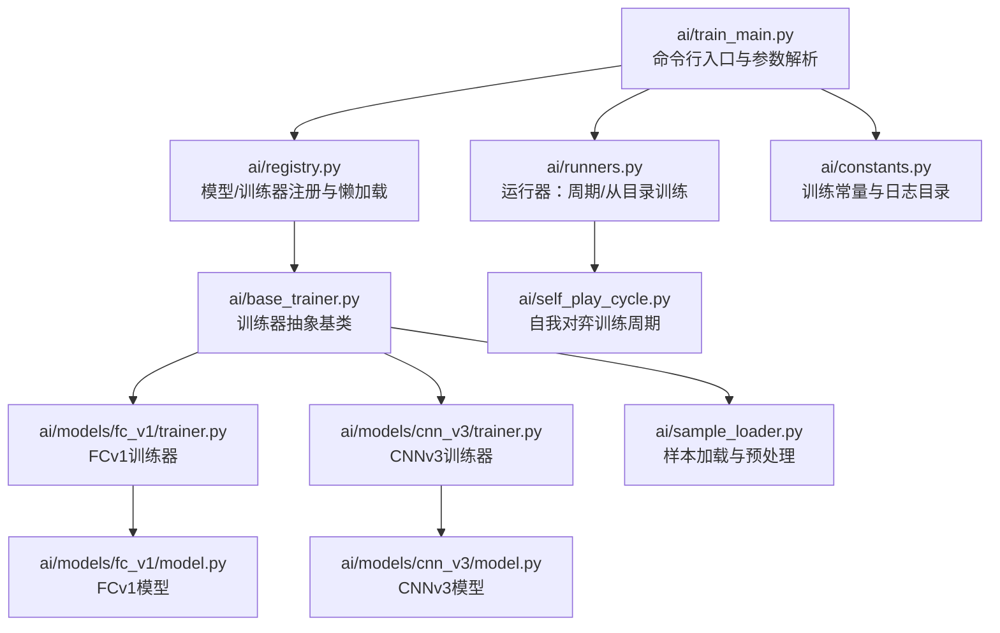
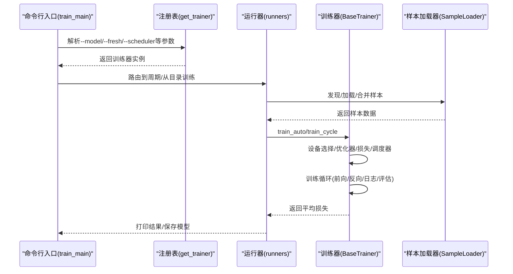
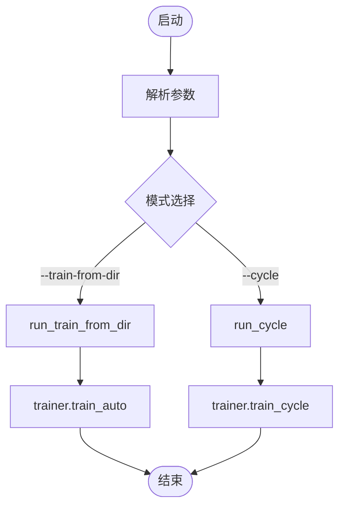
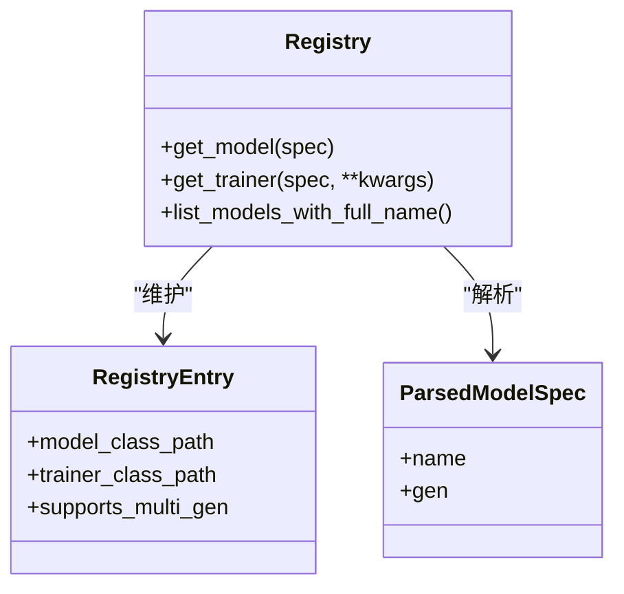
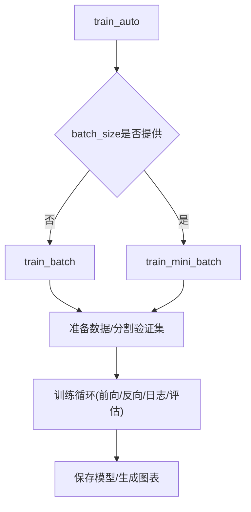
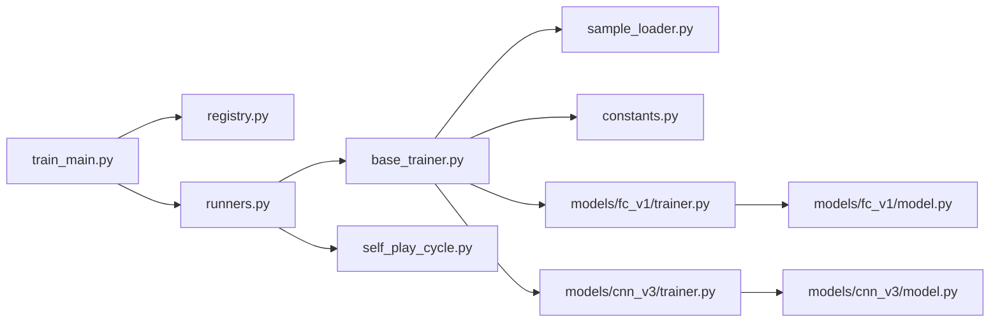

# 训练配置

<cite>
**本文引用的文件**
- [ai/train_main.py](file://ai/train_main.py)
- [ai/base_trainer.py](file://ai/base_trainer.py)
- [ai/constants.py](file://ai/constants.py)
- [ai/registry.py](file://ai/registry.py)
- [ai/runners.py](file://ai/runners.py)
- [ai/self_play_cycle.py](file://ai/self_play_cycle.py)
- [ai/models/fc_v1/trainer.py](file://ai/models/fc_v1/trainer.py)
- [ai/models/cnn_v3/trainer.py](file://ai/models/cnn_v3/trainer.py)
- [ai/models/fc_v1/model.py](file://ai/models/fc_v1/model.py)
- [ai/models/cnn_v3/model.py](file://ai/models/cnn_v3/model.py)
- [ai/sample_loader.py](file://ai/sample_loader.py)
- [tests/ai/test_train_main.py](file://tests/ai/test_train_main.py)
</cite>

## 目录
1. [简介](#简介)
2. [项目结构](#项目结构)
3. [核心组件](#核心组件)
4. [架构总览](#架构总览)
5. [详细组件分析](#详细组件分析)
6. [依赖分析](#依赖分析)
7. [性能考虑](#性能考虑)
8. [故障排查指南](#故障排查指南)
9. [结论](#结论)
10. [附录](#附录)

## 简介
本文件面向五子棋AI训练配置系统，提供从CLI参数到训练器创建、模型注册、训练常量、训练环境与资源分配、最佳实践与故障排查的完整技术文档。读者可据此快速搭建并优化训练环境，涵盖基础训练参数、高级训练选项与特殊场景配置。

## 项目结构
训练配置系统围绕“入口脚本 + 注册表 + 训练器基类 + 具体模型与训练器 + 运行器”组织，形成清晰的职责分离与可扩展的多代模型支持。

**图表来源**
- [ai/train_main.py:1-234](file://ai/train_main.py#L1-L234)
- [ai/registry.py:1-316](file://ai/registry.py#L1-L316)
- [ai/base_trainer.py:1-699](file://ai/base_trainer.py#L1-L699)
- [ai/runners.py:1-255](file://ai/runners.py#L1-L255)
- [ai/self_play_cycle.py:1-195](file://ai/self_play_cycle.py#L1-L195)
- [ai/models/fc_v1/trainer.py:1-44](file://ai/models/fc_v1/trainer.py#L1-L44)
- [ai/models/cnn_v3/trainer.py:1-73](file://ai/models/cnn_v3/trainer.py#L1-L73)
- [ai/models/fc_v1/model.py:1-132](file://ai/models/fc_v1/model.py#L1-L132)
- [ai/models/cnn_v3/model.py:1-139](file://ai/models/cnn_v3/model.py#L1-L139)
- [ai/sample_loader.py:1-240](file://ai/sample_loader.py#L1-L240)
- [ai/constants.py:1-26](file://ai/constants.py#L1-L26)

**章节来源**
- [ai/train_main.py:1-234](file://ai/train_main.py#L1-L234)
- [ai/registry.py:1-316](file://ai/registry.py#L1-L316)
- [ai/base_trainer.py:1-699](file://ai/base_trainer.py#L1-L699)
- [ai/runners.py:1-255](file://ai/runners.py#L1-L255)
- [ai/self_play_cycle.py:1-195](file://ai/self_play_cycle.py#L1-L195)
- [ai/models/fc_v1/trainer.py:1-44](file://ai/models/fc_v1/trainer.py#L1-L44)
- [ai/models/cnn_v3/trainer.py:1-73](file://ai/models/cnn_v3/trainer.py#L1-L73)
- [ai/models/fc_v1/model.py:1-132](file://ai/models/fc_v1/model.py#L1-L132)
- [ai/models/cnn_v3/model.py:1-139](file://ai/models/cnn_v3/model.py#L1-L139)
- [ai/sample_loader.py:1-240](file://ai/sample_loader.py#L1-L240)
- [ai/constants.py:1-26](file://ai/constants.py#L1-L26)

## 核心组件
- 命令行入口与参数解析：负责解析训练模式、超参与调度器配置，并创建训练器与路由到对应运行器。
- 注册表与懒加载：集中管理模型/训练器映射，支持多代模型指定与按需导入。
- 训练器抽象基类：提供通用训练流程、设备选择、优化器/损失函数、学习率调度、日志与验证集评估。
- 具体模型与训练器：FCv1/CNNv3分别实现各自输入转换与网络结构，继承通用训练逻辑。
- 运行器：封装“从目录训练”和“训练周期”两种模式，负责参数打印、数据发现与训练方法分发。
- 自我对弈训练周期：周期编排，对弈+评价后合并样本并调用训练器。
- 样本加载器：统一从JSON到张量的转换、合并与验证集分割。
- 训练常量：定义数据目录、日志目录与日志记录间隔。

**章节来源**
- [ai/train_main.py:27-234](file://ai/train_main.py#L27-L234)
- [ai/registry.py:58-224](file://ai/registry.py#L58-L224)
- [ai/base_trainer.py:32-699](file://ai/base_trainer.py#L32-L699)
- [ai/runners.py:81-255](file://ai/runners.py#L81-L255)
- [ai/self_play_cycle.py:20-195](file://ai/self_play_cycle.py#L20-L195)
- [ai/sample_loader.py:67-240](file://ai/sample_loader.py#L67-L240)
- [ai/constants.py:8-26](file://ai/constants.py#L8-L26)

## 架构总览
训练配置系统采用“入口脚本 → 注册表 → 训练器 → 模型/样本”的分层架构，支持：
- 模型与训练器的动态加载与多代模型扩展
- 单轮次、批量与mini-batch三种训练方式
- 训练周期（自我对弈→评价→训练）与从目录直接训练
- 学习率调度（StepLR/ReduceLROnPlateau）与验证集评估
- GPU/CPU自动选择与显存优化（no_grad评估）

**图表来源**
- [ai/train_main.py:27-234](file://ai/train_main.py#L27-L234)
- [ai/registry.py:187-224](file://ai/registry.py#L187-L224)
- [ai/runners.py:81-255](file://ai/runners.py#L81-L255)
- [ai/base_trainer.py:257-620](file://ai/base_trainer.py#L257-L620)
- [ai/sample_loader.py:80-200](file://ai/sample_loader.py#L80-L200)

## 详细组件分析

### 命令行入口与参数解析（train_main）
- 模式互斥：--cycle与--train-from-dir二选一，防止歧义。
- 基础参数：--model、--cycle、--rounds、--games、--epochs、--rate、--fresh。
- 训练方法：--batch-size与--shuffle控制是否启用mini-batch与数据打乱。
- 学习率调度：--lr-scheduler、--lr-step-size、--lr-gamma、--lr-patience、--lr-factor。
- 温度采样（仅--cycle）：--no-temp-sampling、--temperature、--temp-moves、--temp-side、--temp-seed。
- 参数校验与异常：模式冲突、路径不存在、数据为空等。
- 路由：根据模式调用runners.run_cycle或runners.run_train_from_dir。

**图表来源**
- [ai/train_main.py:27-234](file://ai/train_main.py#L27-L234)
- [ai/runners.py:81-255](file://ai/runners.py#L81-L255)

**章节来源**
- [ai/train_main.py:27-234](file://ai/train_main.py#L27-L234)
- [tests/ai/test_train_main.py:20-200](file://tests/ai/test_train_main.py#L20-L200)

### 注册表与模型/训练器动态加载（registry）
- 注册表：统一维护模型类路径、训练器类路径与是否支持多代模型。
- 规范：模型名禁止包含'.'；多代模型必须在名称后以'.代数'形式指定。
- 懒加载：使用importlib按需导入，首次调用才加载模块。
- 多代模型：支持通过list_models_with_full_name枚举已保存的gen{i}代数。
- 错误处理：未知模型、非多代模型指定代数、多代模型未指定代数、目录冲突等。

**图表来源**
- [ai/registry.py:30-130](file://ai/registry.py#L30-L130)
- [ai/registry.py:150-224](file://ai/registry.py#L150-L224)

**章节来源**
- [ai/registry.py:58-316](file://ai/registry.py#L58-L316)

### 训练器抽象基类（base_trainer）
- 设备选择：优先CUDA，否则CPU。
- 优化器：AdamW（解耦权重衰减），默认学习率与权重衰减可覆盖。
- 损失函数：L1Loss（Masked）。
- 学习率调度：StepLR或ReduceLROnPlateau，统一step接口。
- 训练方法：
  - train_single：单样本目录训练。
  - train_batch：合并多目录样本，每个epoch全量更新一次参数。
  - train_mini_batch：按batch训练，支持dense日志与每epoch评估。
  - train_auto：根据batch_size自动选择train_batch或train_mini_batch。
  - train_cycle：委托SelfPlayCycle执行周期训练。
- 验证集：支持val_inputs/val_targets/val_masks，eval模式+no_grad评估。
- 日志：LossLogger支持注入、依赖注入与自动创建；支持轮次粒度与epoch粒度日志。
- 梯度范数：记录并打印，便于监控梯度爆炸/消失。

**图表来源**
- [ai/base_trainer.py:575-620](file://ai/base_trainer.py#L575-L620)
- [ai/base_trainer.py:360-573](file://ai/base_trainer.py#L360-L573)

**章节来源**
- [ai/base_trainer.py:32-699](file://ai/base_trainer.py#L32-L699)

### 具体模型与训练器

#### FCv1
- 训练器：FCv1Trainer继承BaseTrainer，创建FCv1Model，模型名称为"fc_v1"。
- 模型：全连接网络，输入226维，5层隐藏层，输出225维概率分布。

**章节来源**
- [ai/models/fc_v1/trainer.py:11-44](file://ai/models/fc_v1/trainer.py#L11-L44)
- [ai/models/fc_v1/model.py:18-132](file://ai/models/fc_v1/model.py#L18-L132)

#### CNNv3
- 训练器：CNNV3Trainer继承BaseTrainer，创建CNNV3Model，支持多代模型（gen）。
- 模型：纯卷积网络，输入(3,15,15)，三层3×3卷积+一层1×1卷积，输出225维概率分布。
- 输入转换：重载_input_converter，将226维向量转换为(1,3,15,15)张量。

**章节来源**
- [ai/models/cnn_v3/trainer.py:13-73](file://ai/models/cnn_v3/trainer.py#L13-L73)
- [ai/models/cnn_v3/model.py:31-139](file://ai/models/cnn_v3/model.py#L31-L139)

### 运行器（runners）
- 从目录训练：discover_sample_dirs自动发现含sample.json的子目录；run_train_from_dir支持直接.json或目录，自动合并数据并train_auto。
- 训练周期：打印参数、构造TempConfig（默认启用温度采样），调用trainer.train_cycle。

**章节来源**
- [ai/runners.py:21-255](file://ai/runners.py#L21-L255)

### 自我对弈训练周期（self_play_cycle）
- 目录管理：使用常量AI_DATA_DIR/TRAIN_DATA_DIR或测试隔离的project_root拼接。
- 会话管理：生成带时间戳与UUID的session目录，LossLogger注入或自动创建。
- 周期流程：每轮自我对弈→评价→合并样本→train_auto→保存模型→记录轮次loss→生成图表。

**章节来源**
- [ai/self_play_cycle.py:20-195](file://ai/self_play_cycle.py#L20-L195)

### 样本加载与预处理（sample_loader）
- 加载：单文件/多文件/递归发现；支持merge文件与sample.json混合加载。
- 合并与分割：load_multiple合并；load_and_split按比例随机分割，seed可复现。
- 张量准备：统一转换为inputs/targets/masks张量，支持device移动。

**章节来源**
- [ai/sample_loader.py:67-240](file://ai/sample_loader.py#L67-L240)

### 训练常量（constants）
- 目录常量：AI_DATA_DIR、TRAIN_DATA_DIR、LOSS_LOG_DIR（可通过环境变量覆盖）。
- 日志间隔：LOSS_LOG_INTERVAL默认200。

**章节来源**
- [ai/constants.py:8-26](file://ai/constants.py#L8-L26)

## 依赖分析
- 入口脚本依赖注册表创建训练器，再委托运行器执行具体模式。
- 训练器依赖样本加载器进行数据准备，依赖常量进行目录与日志管理。
- 具体训练器依赖对应模型实现输入转换与网络结构。
- 自我对弈周期依赖训练器与样本加载器，负责编排与日志聚合。

**图表来源**
- [ai/train_main.py:23-24](file://ai/train_main.py#L23-L24)
- [ai/registry.py:23-24](file://ai/registry.py#L23-L24)
- [ai/runners.py:18-19](file://ai/runners.py#L18-L19)
- [ai/base_trainer.py:14-18](file://ai/base_trainer.py#L14-L18)
- [ai/sample_loader.py:6-12](file://ai/sample_loader.py#L6-L12)
- [ai/constants.py:6-22](file://ai/constants.py#L6-L22)
- [ai/models/fc_v1/trainer.py:7-8](file://ai/models/fc_v1/trainer.py#L7-L8)
- [ai/models/cnn_v3/trainer.py:7-10](file://ai/models/cnn_v3/trainer.py#L7-L10)
- [ai/self_play_cycle.py:12-14](file://ai/self_play_cycle.py#L12-L14)

**章节来源**
- [ai/train_main.py:23-24](file://ai/train_main.py#L23-L24)
- [ai/registry.py:23-24](file://ai/registry.py#L23-L24)
- [ai/runners.py:18-19](file://ai/runners.py#L18-L19)
- [ai/base_trainer.py:14-18](file://ai/base_trainer.py#L14-L18)
- [ai/sample_loader.py:6-12](file://ai/sample_loader.py#L6-L12)
- [ai/constants.py:6-22](file://ai/constants.py#L6-L22)
- [ai/models/fc_v1/trainer.py:7-8](file://ai/models/fc_v1/trainer.py#L7-L8)
- [ai/models/cnn_v3/trainer.py:7-10](file://ai/models/cnn_v3/trainer.py#L7-L10)
- [ai/self_play_cycle.py:12-14](file://ai/self_play_cycle.py#L12-L14)

## 性能考虑
- 设备选择：优先CUDA，自动检测GPU可用性；模型网络自动迁移至设备。
- mini-batch优势：更高效、收敛更快；适合大规模数据；注意batch_size与显存匹配。
- 验证集评估：在训练过程中定期评估val_loss，有助于早停与超参调优。
- 日志密度：mini-batch默认dense日志，可获得更细粒度loss曲线；epoch-based日志间隔由常量控制。
- 梯度范数：记录并打印梯度范数，辅助诊断梯度爆炸/消失。
- 并发与资源：周期模式支持评价阶段并行（max_workers），提升吞吐。

[本节为通用性能建议，不直接分析具体文件]

## 故障排查指南
- 模式冲突：同时提供--cycle与--train-from-dir将触发参数错误。
- 路径错误：--train-from-dir指向不存在路径或空目录将导致退出。
- 数据为空：未发现任何.json文件时退出。
- 多代模型：未指定代数或对非多代模型指定代数将报错；gen目录与.pth共存将报错。
- 训练中断：Ctrl+C会保存当前进度与图表，可安全退出。
- 学习率调度：StepLR无需loss参数，Plateau需要；确认参数设置合理。
- 温度采样：仅在--cycle模式生效；非cycle模式传入温度参数会被忽略。

**章节来源**
- [ai/train_main.py:196-207](file://ai/train_main.py#L196-L207)
- [ai/runners.py:94-128](file://ai/runners.py#L94-L128)
- [ai/registry.py:168-179](file://ai/registry.py#L168-L179)
- [ai/base_trainer.py:314-322](file://ai/base_trainer.py#L314-L322)

## 结论
本训练配置系统通过注册表实现模型与训练器的动态加载与多代扩展，结合统一的训练器基类与运行器编排，提供了灵活、可扩展且易于调试的训练体验。配合合理的参数设置、学习率调度与验证集评估，可在CPU/GPU环境下高效完成从样本到模型的训练闭环。

[本节为总结性内容，不直接分析具体文件]

## 附录

### 基础训练参数
- --model：模型名称（如fc_v1、cnn_v3.2），默认fc_v1。
- --cycle：开启训练周期模式。
- --rounds：轮次数，默认10。
- --games：每轮对局数，默认100。
- --epochs：训练迭代数，默认1000。
- --rate：奖励衰减率，默认0.9。
- --fresh：强制创建新模型（不加载已保存模型）。

**章节来源**
- [ai/train_main.py:51-96](file://ai/train_main.py#L51-L96)

### 高级训练选项
- --batch-size：每批次样本数，提供时启用mini-batch训练。
- --shuffle：每个epoch是否打乱数据顺序（仅mini-batch有效）。
- --val-ratio：验证集比例，默认0.0（不分割）。
- --lr-scheduler：学习率调度类型，可选step或plateau。
- --lr-step-size：StepLR衰减间隔（epoch），默认500。
- --lr-gamma：StepLR衰减系数，默认0.9。
- --lr-patience：Plateau耐心值，默认100。
- --lr-factor：Plateau衰减系数，默认0.5。

**章节来源**
- [ai/train_main.py:105-159](file://ai/train_main.py#L105-L159)

### 特殊配置场景
- 温度采样（仅--cycle）：--no-temp-sampling禁用；--temperature、--temp-moves、--temp-side、--temp-seed控制采样行为。
- 从目录训练：--train-from-dir支持直接.json或目录，自动发现merge与sample子目录。
- 多代模型：cnn_v3.1、cnn_v3.2等，注册表与模型目录约定严格。

**章节来源**
- [ai/train_main.py:161-192](file://ai/train_main.py#L161-L192)
- [ai/runners.py:173-255](file://ai/runners.py#L173-L255)
- [ai/registry.py:58-72](file://ai/registry.py#L58-L72)

### 训练常量与系统限制
- 目录常量：AI_DATA_DIR、TRAIN_DATA_DIR、LOSS_LOG_DIR（可环境变量覆盖）。
- 日志间隔：LOSS_LOG_INTERVAL默认200。
- 设备限制：自动检测CUDA，否则使用CPU；显存不足时降低batch_size或关闭dense日志。

**章节来源**
- [ai/constants.py:8-26](file://ai/constants.py#L8-L26)
- [ai/base_trainer.py:21-29](file://ai/base_trainer.py#L21-L29)

### 训练环境与资源分配
- GPU/CPU：优先CUDA，自动选择；模型网络迁移至设备。
- 内存优化：评估时使用eval模式+no_grad减少显存占用。
- 并发训练：周期模式支持max_workers并行评价，提升吞吐。

**章节来源**
- [ai/base_trainer.py:21-29](file://ai/base_trainer.py#L21-L29)
- [ai/self_play_cycle.py:28-36](file://ai/self_play_cycle.py#L28-L36)

### 最佳实践
- 参数调优：先用小batch与少量epoch验证流程，再逐步增大；关注val_loss与loss曲线。
- 性能监控：开启dense日志观察batch级loss，结合梯度范数判断稳定性。
- 故障恢复：利用Ctrl+C中断保存能力，重启后继续训练；必要时使用--fresh重置。
- 配置示例：参考测试用例与运行器打印的参数摘要，确保参数一致性。

**章节来源**
- [tests/ai/test_train_main.py:20-200](file://tests/ai/test_train_main.py#L20-L200)
- [ai/runners.py:133-212](file://ai/runners.py#L133-L212)

### 完整配置示例（路径指引）
- 训练周期（fc_v1）：[ai/train_main.py:32-48](file://ai/train_main.py#L32-L48)
- 训练周期（cnn_v3.2）：[ai/train_main.py:37-38](file://ai/train_main.py#L37-L38)
- 从目录训练：[ai/train_main.py:46-47](file://ai/train_main.py#L46-L47)
- 温度采样参数：[ai/train_main.py:161-192](file://ai/train_main.py#L161-L192)