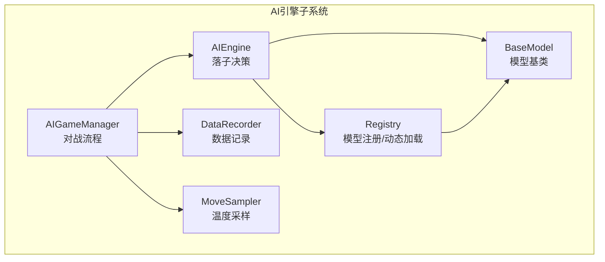
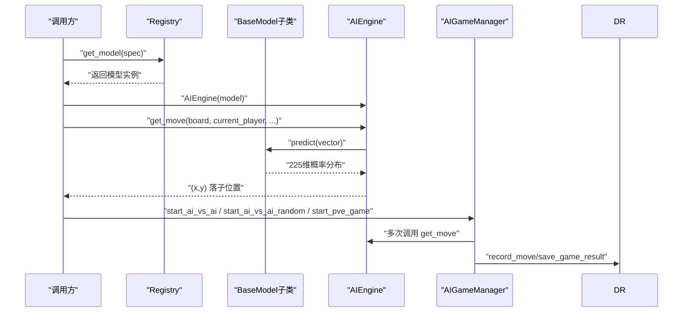
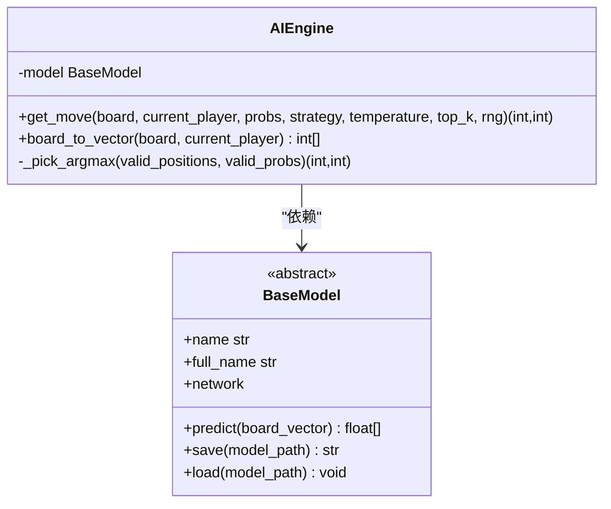
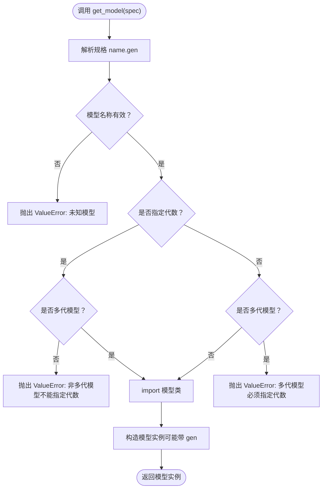
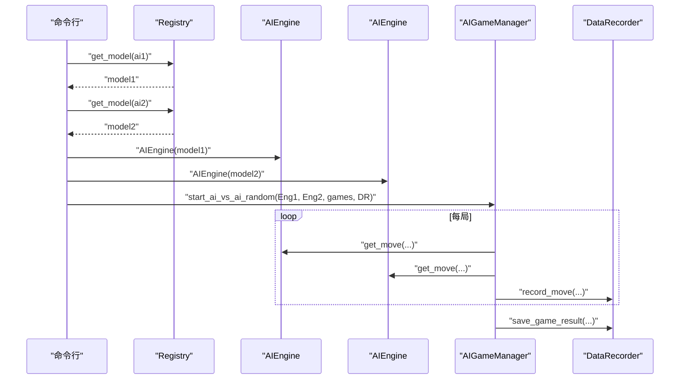
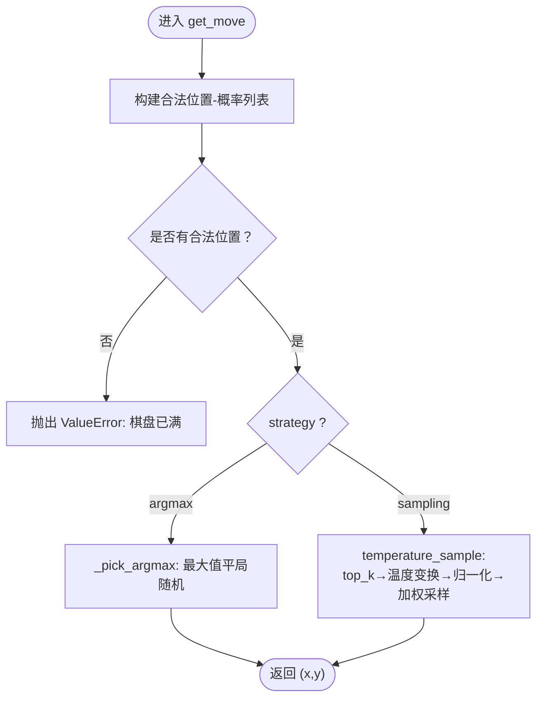
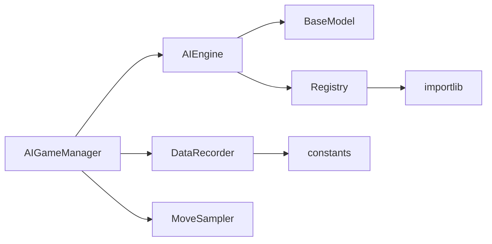

# AI引擎API

<cite>
**本文引用的文件**
- [ai/engine.py](file://ai/engine.py)
- [ai/base_model.py](file://ai/base_model.py)
- [ai/registry.py](file://ai/registry.py)
- [ai/game_manager.py](file://ai/game_manager.py)
- [ai/data_recorder.py](file://ai/data_recorder.py)
- [ai/constants.py](file://ai/constants.py)
- [ai/move_sampler.py](file://ai/move_sampler.py)
- [ai/__init__.py](file://ai/__init__.py)
- [ai/battle.py](file://ai/battle.py)
</cite>

## 目录
1. [简介](#简介)
2. [项目结构](#项目结构)
3. [核心组件](#核心组件)
4. [架构总览](#架构总览)
5. [详细组件分析](#详细组件分析)
6. [依赖分析](#依赖分析)
7. [性能考虑](#性能考虑)
8. [故障排查指南](#故障排查指南)
9. [结论](#结论)
10. [附录](#附录)

## 简介
本文件为AI引擎系统的完整API参考文档，聚焦AIEngine类的核心接口与工作流，涵盖初始化、落子决策、模型加载与信息查询等能力。文档还说明AI引擎与不同AI模型的交互方式（模型注册机制与动态加载流程）、AI对战API的使用指南（双AI对战、人机对战等场景）、状态管理与性能监控接口，并提供最佳实践与排障建议，帮助开发者正确集成与使用AI引擎。

## 项目结构
AI引擎相关代码主要分布在ai包内，核心文件包括：
- 引擎与入口：engine.py、__init__.py
- 模型基类与多代模型支持：base_model.py、registry.py
- 对战与人机流程：game_manager.py、battle.py
- 数据记录与常量：data_recorder.py、constants.py
- 落子采样策略：move_sampler.py

图表来源
- [ai/engine.py:44-194](file://ai/engine.py#L44-L194)
- [ai/base_model.py:24-323](file://ai/base_model.py#L24-L323)
- [ai/registry.py:58-184](file://ai/registry.py#L58-L184)
- [ai/game_manager.py:16-339](file://ai/game_manager.py#L16-L339)
- [ai/data_recorder.py:17-145](file://ai/data_recorder.py#L17-L145)
- [ai/move_sampler.py:117-258](file://ai/move_sampler.py#L117-L258)

章节来源
- [ai/engine.py:1-194](file://ai/engine.py#L1-L194)
- [ai/__init__.py:1-21](file://ai/__init__.py#L1-L21)

## 核心组件
- AIEngine：负责将棋盘状态转换为输入向量，调用模型获取概率分布，并基于策略选择落子位置。
- BaseModel：定义所有AI模型必须实现的接口（predict、name、save、load、network）。
- Registry：统一注册与动态加载模型，支持多代模型（cnn_v3.*）。
- AIGameManager：封装人机对战与AI对战流程，协调引擎与控制器。
- DataRecorder：记录对局历史、落子位置与结果，输出到指定目录。
- MoveSampler：提供温度采样策略与相关配置，支持自对弈阶段性的探索性落子。

章节来源
- [ai/engine.py:44-194](file://ai/engine.py#L44-L194)
- [ai/base_model.py:24-323](file://ai/base_model.py#L24-L323)
- [ai/registry.py:58-184](file://ai/registry.py#L58-L184)
- [ai/game_manager.py:16-339](file://ai/game_manager.py#L16-L339)
- [ai/data_recorder.py:17-145](file://ai/data_recorder.py#L17-L145)
- [ai/move_sampler.py:117-258](file://ai/move_sampler.py#L117-L258)

## 架构总览
AI引擎通过统一注册表按需加载模型，AIEngine接收棋盘状态与当前玩家，调用模型predict得到225维概率分布，随后根据策略（argmax或temperature sampling）在合法位置中选择落子。对战流程由AIGameManager编排，DataRecorder记录每步输入输出与结果，MoveSampler提供温度采样策略。

图表来源
- [ai/registry.py:150-184](file://ai/registry.py#L150-L184)
- [ai/engine.py:67-142](file://ai/engine.py#L67-L142)
- [ai/game_manager.py:123-339](file://ai/game_manager.py#L123-L339)
- [ai/data_recorder.py:96-141](file://ai/data_recorder.py#L96-L141)

## 详细组件分析

### AIEngine类与核心接口
- initialize()：通过构造函数注入BaseModel实例完成初始化。
- get_move()：核心落子决策接口，支持两种策略：
  - argmax：选择概率最大合法位置，平局时随机打破。
  - sampling：温度加权采样，支持top_k截断与自定义随机源。
- board_to_vector()：将15×15棋盘与当前玩家编码为226维向量。
- model_info()：通过BaseModel.full_name与model.name暴露模型信息（非静态方法，需实例化后访问）。

图表来源
- [ai/engine.py:44-194](file://ai/engine.py#L44-L194)
- [ai/base_model.py:24-105](file://ai/base_model.py#L24-L105)

章节来源
- [ai/engine.py:58-194](file://ai/engine.py#L58-L194)

### 模型注册机制与动态加载
- RegistryEntry：记录模型类路径、训练器类路径与是否支持多代模型。
- get_model(spec)：解析模型规格（如“cnn_v3.1”），按需懒加载并返回模型实例。
- 多代模型：cnn_v3支持gen{i}子目录，list_models_with_full_name()枚举有效代数。
- 错误处理：未知模型、非多代模型指定代数、多代模型未指定代数、权重文件缺失等情况均抛出明确异常。

图表来源
- [ai/registry.py:150-184](file://ai/registry.py#L150-L184)
- [ai/registry.py:103-130](file://ai/registry.py#L103-L130)
- [ai/registry.py:237-296](file://ai/registry.py#L237-L296)

章节来源
- [ai/registry.py:58-184](file://ai/registry.py#L58-L184)
- [ai/registry.py:237-296](file://ai/registry.py#L237-L296)

### AI对战API与使用指南
- 双AI对战（固定执方）：AIGameManager.start_ai_vs_ai(engine1, engine2, num_games, recorder, temp_config)
- 双AI对战（每局执方随机）：AIGameManager.start_ai_vs_ai_random(engine1, engine2, num_games, recorder, temp_config)
- 人机对战（PvE）：AIGameManager.start_pve_game(save_name) 与 player_move(x,y)/ai_move() 协作
- 命令行双AI对战：python ai/battle.py --ai1 <name> --ai2 <name> --games N

图表来源
- [ai/battle.py:94-133](file://ai/battle.py#L94-L133)
- [ai/game_manager.py:232-339](file://ai/game_manager.py#L232-L339)
- [ai/data_recorder.py:96-141](file://ai/data_recorder.py#L96-L141)

章节来源
- [ai/battle.py:94-133](file://ai/battle.py#L94-L133)
- [ai/game_manager.py:16-339](file://ai/game_manager.py#L16-L339)

### 落子策略与温度采样
- 策略常量：STRATEGY_ARGMAX、STRATEGY_SAMPLING
- argmax：在合法位置中选择最大概率，平局随机打破
- sampling：temperature_sample按p^(1/T)加权采样，支持top_k截断与自定义随机源
- TempConfig：封装温度、采样步数阈值、启用方与seed等参数
- should_sample / resolve_temp_side：在对局内按步/按方编排采样行为

图表来源
- [ai/engine.py:106-142](file://ai/engine.py#L106-L142)
- [ai/engine.py:144-171](file://ai/engine.py#L144-L171)
- [ai/move_sampler.py:117-186](file://ai/move_sampler.py#L117-L186)

章节来源
- [ai/engine.py:67-142](file://ai/engine.py#L67-L142)
- [ai/move_sampler.py:117-258](file://ai/move_sampler.py#L117-L258)

### 数据记录与性能监控
- DataRecorder：每轮创建轮次目录，每局创建子目录，记录history、winner、end_board
- 常量：AI_DATA_DIR、TRAIN_DATA_DIR、LOSS_LOG_DIR、LOSS_LOG_INTERVAL
- 性能监控：loss日志按间隔写入，便于训练过程观测

章节来源
- [ai/data_recorder.py:17-145](file://ai/data_recorder.py#L17-L145)
- [ai/constants.py:11-26](file://ai/constants.py#L11-L26)

## 依赖分析
- AIEngine依赖BaseModel接口与Registry动态加载模型
- AIGameManager依赖AIEngine、DataRecorder与MoveSampler
- Registry依赖importlib按需导入模型类
- constants提供数据目录与日志目录常量

图表来源
- [ai/engine.py:8-9](file://ai/engine.py#L8-L9)
- [ai/registry.py:22-100](file://ai/registry.py#L22-L100)
- [ai/game_manager.py:10-13](file://ai/game_manager.py#L10-L13)
- [ai/data_recorder.py:12](file://ai/data_recorder.py#L12)
- [ai/constants.py:9-22](file://ai/constants.py#L9-L22)

章节来源
- [ai/engine.py:8-9](file://ai/engine.py#L8-L9)
- [ai/registry.py:22-100](file://ai/registry.py#L22-L100)
- [ai/game_manager.py:10-13](file://ai/game_manager.py#L10-L13)
- [ai/data_recorder.py:12](file://ai/data_recorder.py#L12)
- [ai/constants.py:9-22](file://ai/constants.py#L9-L22)

## 性能考虑
- 预计算概率：get_move支持传入probs以避免重复调用model.predict，提升自对弈效率
- 温度采样：合理设置temperature与top_k，平衡探索与稳定性
- 设备与批处理：神经网络模型predict在eval模式下进行，注意GPU/CPU设备一致性
- 数据记录：record采用紧凑JSON格式，减少I/O开销

章节来源
- [ai/engine.py:110-113](file://ai/engine.py#L110-L113)
- [ai/move_sampler.py:117-186](file://ai/move_sampler.py#L117-L186)
- [ai/base_model.py:195-230](file://ai/base_model.py#L195-L230)
- [ai/data_recorder.py:137-140](file://ai/data_recorder.py#L137-L140)

## 故障排查指南
- 模型加载失败
  - 现象：Unknown model、Non-multi-gen model cannot specify generation、Multi-gen model must specify generation、Weight file not found
  - 排查：确认模型名称与规格（如“cnn_v3.1”），检查权重文件是否存在
- 落子异常
  - 现象：棋盘已满，无空位可落子
  - 排查：检查棋盘状态与策略参数，确保合法位置非空
- 温度采样错误
  - 现象：temperature必须>0、valid_positions长度不一致
  - 排查：校验TempConfig参数与输入向量长度
- 数据记录问题
  - 现象：目录创建失败、文件写入异常
  - 排查：确认AI_DATA_DIR权限与磁盘空间

章节来源
- [ai/registry.py:168-178](file://ai/registry.py#L168-L178)
- [ai/engine.py:124-125](file://ai/engine.py#L124-L125)
- [ai/move_sampler.py:147-157](file://ai/move_sampler.py#L147-L157)
- [ai/data_recorder.py:53-64](file://ai/data_recorder.py#L53-L64)

## 结论
AI引擎通过清晰的接口与模块化设计，实现了从模型注册、动态加载到落子决策与对战流程的完整闭环。开发者可通过AIEngine统一接入多种AI模型，并借助AIGameManager与DataRecorder快速搭建双AI对战与人机对战场景。配合MoveSampler的温度采样策略与DataRecorder的高性能记录，可满足训练、评估与演示等多种需求。

## 附录
- API速查
  - AIEngine.get_move(board, current_player, probs=None, strategy="argmax", temperature=1.0, top_k=None, rng=None) -> (int,int)
  - AIEngine.board_to_vector(board, current_player) -> List[int]
  - AIEngine.model_info() -> str（通过BaseModel.full_name/name）
  - Registry.get_model(spec) -> BaseModel
  - AIGameManager.start_ai_vs_ai / start_ai_vs_ai_random / start_pve_game
  - DataRecorder.record_move / save_game_result
  - MoveSampler.temperature_sample / TempConfig / should_sample / resolve_temp_side

章节来源
- [ai/engine.py:67-142](file://ai/engine.py#L67-L142)
- [ai/base_model.py:61-70](file://ai/base_model.py#L61-L70)
- [ai/registry.py:150-184](file://ai/registry.py#L150-L184)
- [ai/game_manager.py:232-339](file://ai/game_manager.py#L232-L339)
- [ai/data_recorder.py:96-141](file://ai/data_recorder.py#L96-L141)
- [ai/move_sampler.py:117-258](file://ai/move_sampler.py#L117-L258)