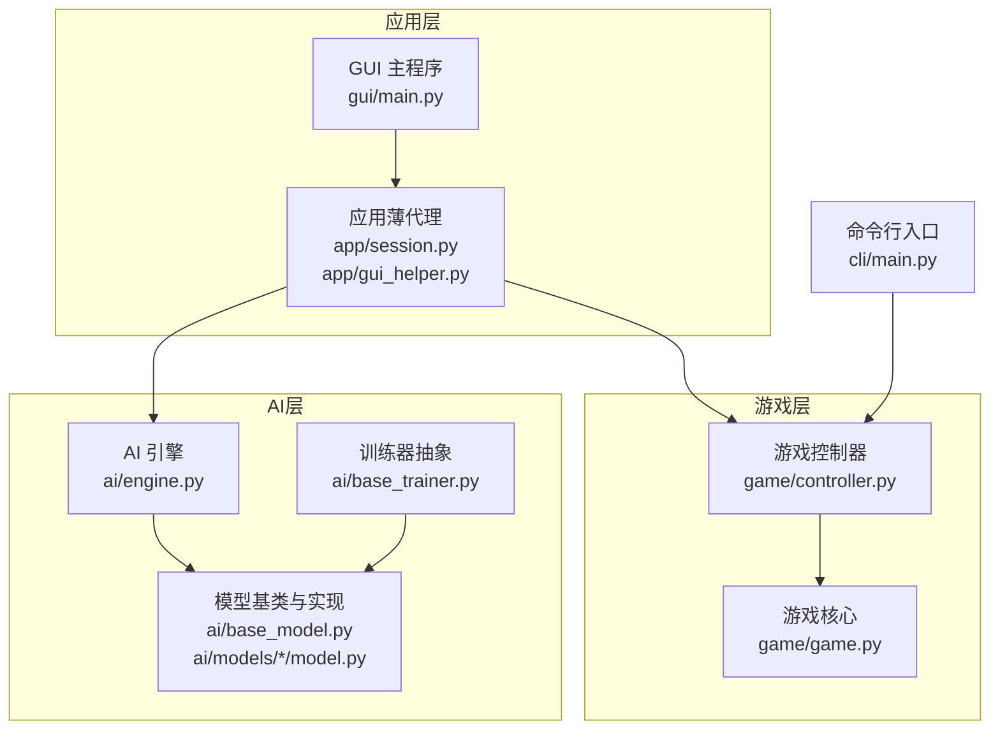
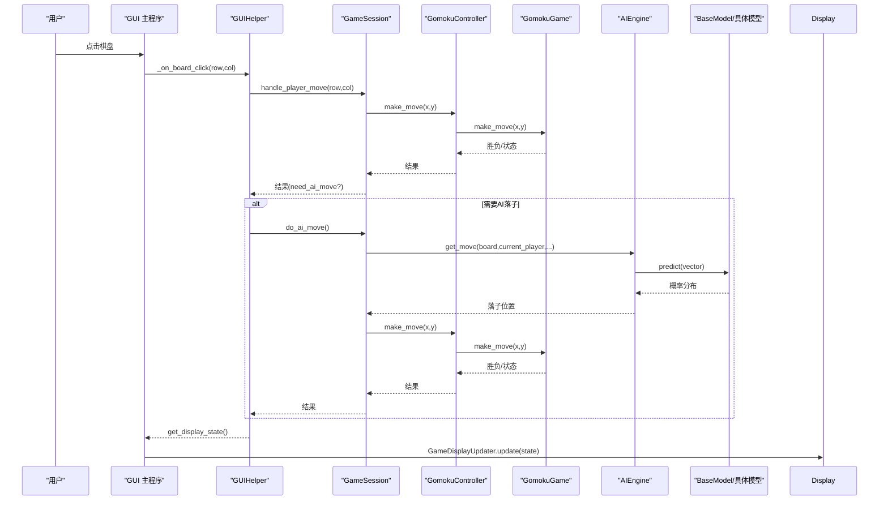
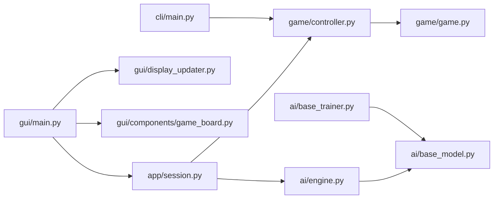

# API参考

<cite>
**本文档引用的文件**
- [ai/__init__.py](file://ai/__init__.py)
- [ai/base_model.py](file://ai/base_model.py)
- [ai/engine.py](file://ai/engine.py)
- [ai/base_trainer.py](file://ai/base_trainer.py)
- [ai/models/fc_v1/model.py](file://ai/models/fc_v1/model.py)
- [ai/models/cnn_v3/model.py](file://ai/models/cnn_v3/model.py)
- [ai/models/random/model.py](file://ai/models/random/model.py)
- [game/controller.py](file://game/controller.py)
- [game/game.py](file://game/game.py)
- [gui/main.py](file://gui/main.py)
- [gui/components/game_board.py](file://gui/components/game_board.py)
- [gui/display_updater.py](file://gui/display_updater.py)
- [app/session.py](file://app/session.py)
- [app/gui_helper.py](file://app/gui_helper.py)
- [cli/main.py](file://cli/main.py)
</cite>

## 目录
1. [简介](#简介)
2. [项目结构](#项目结构)
3. [核心组件](#核心组件)
4. [架构总览](#架构总览)
5. [详细组件分析](#详细组件分析)
6. [依赖分析](#依赖分析)
7. [性能考虑](#性能考虑)
8. [故障排查指南](#故障排查指南)
9. [结论](#结论)
10. [附录](#附录)

## 简介
本API参考文档面向五子棋AI项目的开发者，系统梳理并规范以下接口与组件：
- 游戏控制器API：提供棋盘管理、落子规则、胜负判定、存档读写等统一入口。
- AI引擎API：封装落子决策、策略选择、模型调用与状态查询。
- 模型接口API：定义BaseModel抽象类及其派生类的统一接口、参数约束与实现要求。
- 训练器API：提供训练循环、参数更新、日志记录、学习率调度等能力。
- GUI组件API：包含棋盘组件、显示更新器、事件处理、样式定制与扩展接口。
- CLI接口：提供REPL命令行交互，便于快速调试与演示。

本文件严格依据仓库现有实现进行描述，确保API定义、参数与返回值规范准确可依。

## 项目结构
项目采用分层与按功能域划分的组织方式：
- ai：AI引擎、模型基类、具体模型实现、训练器、评估器、数据记录器等。
- game：游戏核心逻辑与控制器，提供统一的对外接口。
- gui：图形界面组件与主程序，包含棋盘、显示更新器、对话框等。
- app：应用层薄代理，协调GUI与游戏/AI逻辑。
- cli：命令行入口，提供REPL交互。
- tests：单元/集成测试，覆盖核心API与流程。

**图表来源**
- [gui/main.py:31-90](file://gui/main.py#L31-L90)
- [app/session.py:12-62](file://app/session.py#L12-L62)
- [game/controller.py:11-31](file://game/controller.py#L11-L31)
- [ai/engine.py:44-66](file://ai/engine.py#L44-L66)
- [ai/base_model.py:24-36](file://ai/base_model.py#L24-L36)
- [ai/base_trainer.py:32-51](file://ai/base_trainer.py#L32-L51)
- [cli/main.py:19-44](file://cli/main.py#L19-L44)

**章节来源**
- [gui/main.py:31-90](file://gui/main.py#L31-L90)
- [app/session.py:12-62](file://app/session.py#L12-L62)
- [game/controller.py:11-31](file://game/controller.py#L11-L31)
- [ai/engine.py:44-66](file://ai/engine.py#L44-L66)
- [ai/base_model.py:24-36](file://ai/base_model.py#L24-L36)
- [ai/base_trainer.py:32-51](file://ai/base_trainer.py#L32-L51)
- [cli/main.py:19-44](file://cli/main.py#L19-L44)

## 核心组件
本节概述各API模块的职责与对外接口。

- 游戏控制器GomokuController
  - 职责：统一对外接口，管理游戏状态、落子、胜负判定、存档读写。
  - 关键方法：new_game、make_move、list_saves、load_game、is_over、is_draw、get_current_player、get_winner、get_state、get_state_json。
  - 返回值：统一返回字典，包含状态码、错误信息或游戏状态；JSON版本返回字符串。

- AI引擎AIEngine
  - 职责：将棋盘状态转换为模型输入，调用模型预测，按策略选择落子位置。
  - 关键方法：get_move、board_to_vector；工厂函数create_engine。
  - 策略：argmax（默认）、sampling（温度采样）。

- 模型接口BaseModel与NeuralNetworkModel
  - 职责：定义统一的预测、保存/加载、名称与网络属性接口；神经网络模型提供通用实现。
  - 关键方法：predict、save、load、name/full_name；NeuralNetworkModel补充网络创建与输入准备。

- 训练器BaseTrainer
  - 职责：提供训练循环、批量训练、mini-batch训练、学习率调度、日志记录、验证集评估。
  - 关键方法：train_single、train_batch、train_mini_batch、train_auto、train_cycle；内部步骤_forward_backward_step、_run_training_loop等。

- GUI组件
  - GameBoard：棋盘绘制与点击事件；支持布局包装、棋子绘制、最后落子高亮。
  - GameDisplayUpdater：根据状态字典刷新界面元素（棋盘、标签、历史）。

- 应用薄代理
  - GameSession：封装PvP/PvE流程，协调控制器与AI管理器。
  - GUIHelper：处理与界面无关的业务逻辑，提供统一的落子与显示状态接口。

- CLI
  - 提供new、put、list、print、show、short、help、quit等命令，支持REPL交互。

**章节来源**
- [game/controller.py:32-194](file://game/controller.py#L32-L194)
- [ai/engine.py:18-194](file://ai/engine.py#L18-L194)
- [ai/base_model.py:24-323](file://ai/base_model.py#L24-L323)
- [ai/base_trainer.py:32-699](file://ai/base_trainer.py#L32-L699)
- [gui/components/game_board.py:7-170](file://gui/components/game_board.py#L7-L170)
- [gui/display_updater.py:13-110](file://gui/display_updater.py#L13-L110)
- [app/session.py:12-179](file://app/session.py#L12-L179)
- [app/gui_helper.py:12-199](file://app/gui_helper.py#L12-L199)
- [cli/main.py:45-258](file://cli/main.py#L45-L258)

## 架构总览
下图展示从GUI到控制器、AI引擎与模型的调用链路，以及训练器与模型的关系。

**图表来源**
- [gui/main.py:224-243](file://gui/main.py#L224-L243)
- [app/gui_helper.py:53-106](file://app/gui_helper.py#L53-L106)
- [app/session.py:63-102](file://app/session.py#L63-L102)
- [game/controller.py:65-98](file://game/controller.py#L65-L98)
- [game/game.py:22-56](file://game/game.py#L22-L56)
- [ai/engine.py:67-142](file://ai/engine.py#L67-L142)
- [ai/base_model.py:38-91](file://ai/base_model.py#L38-L91)

## 详细组件分析

### 游戏控制器API
- 初始化
  - 参数：save_dir（可选，存档目录）
  - 行为：构造控制器，绑定存档管理器
- 新建游戏
  - 方法：new_game(save_name=None)
  - 参数：save_name（可选，存档名；None则自动生成）
  - 返回：包含状态码与游戏状态的字典；若存档名已存在，返回错误信息
- 落子
  - 方法：make_move(x, y)
  - 参数：坐标(x,y)，范围0-14
  - 返回：包含胜负、当前玩家、棋盘状态；若游戏已结束或异常，返回错误信息
- 存档管理
  - list_saves()：返回所有存档名列表
  - load_game(save_name)：加载指定存档，返回状态或错误
- 查询
  - is_over()、is_draw()、get_current_player()、get_winner()
  - get_state(short=False)：返回完整或简要状态字典
  - get_state_json(short=False)：返回JSON字符串

使用示例（路径引用）
- [新建游戏与落子:76-126](file://cli/main.py#L76-L126)
- [状态查询与JSON输出:141-207](file://cli/main.py#L141-L207)

错误处理
- 越界坐标、占用位置、游戏已结束、存档不存在等均抛出或返回错误信息。

**章节来源**
- [game/controller.py:14-194](file://game/controller.py#L14-L194)
- [cli/main.py:76-207](file://cli/main.py#L76-L207)

### AI引擎API
- 工厂函数
  - create_engine(ai_name)：根据名称创建AIEngine实例；名称映射由注册表维护
- 引擎类
  - get_move(board, current_player, probs=None, strategy="argmax", temperature=1.0, top_k=None, rng=None)
    - 参数：
      - board：15x15棋盘，0=空，1=黑，2=白
      - current_player：当前落子方，1=黑，2=白
      - probs：225维概率分布（可选，跳过模型预测）
      - strategy：落子策略，"argmax"或"sampling"
      - temperature：采样温度，仅在sampling时生效
      - top_k：采样截断阈值（可选）
      - rng：随机源（可选）
    - 返回：(x,y)落子坐标
    - 异常：棋盘已满、未知策略、采样温度<=0
  - board_to_vector(board, current_player)：将棋盘转为226维向量（前225位按行展开，第226位为当前玩家）

策略说明
- argmax：选择概率最大合法位置，平局时随机打破
- sampling：温度加权采样，支持top_k与自定义随机源

使用示例（路径引用）
- [引擎落子决策:67-142](file://ai/engine.py#L67-L142)
- [棋盘向量化:173-194](file://ai/engine.py#L173-L194)

**章节来源**
- [ai/engine.py:18-194](file://ai/engine.py#L18-L194)

### 模型接口API（BaseModel与NeuralNetworkModel）
- BaseModel
  - predict(board_vector)：返回225维概率列表，索引i对应位置(i//15,i%15)，概率和为1
  - name/full_name：模型名称与含代数的完整名称
  - save(model_path=None)、load(model_path=None)：保存/加载模型参数
  - network：神经网络模块（RandomModel为None）
- NeuralNetworkModel（神经网络模型基类）
  - DEFAULT_MODEL_PATH：默认模型保存路径
  - __init__(model_path=None,fresh=False,gen=None)：创建网络实例，按fresh与默认路径加载
  - _create_network()：子类实现，返回nn.Module
  - _prepare_input(board_vector, device)：将226维向量转换为模型输入张量
  - predict(board_vector)：通用前向传播流程（eval模式，no_grad）
  - save/load：保存/加载网络参数

典型实现
- FCv1Model：5层隐藏层，每层1000个神经元，输出Softmax概率
- CNNV3Model：纯卷积网络，三层3x3卷积+一层1x1卷积，输出15x15空间概率图
- RandomModel：对空位均匀分配概率，已落子位置概率为0

使用示例（路径引用）
- [FCv1模型定义:91-132](file://ai/models/fc_v1/model.py#L91-L132)
- [CNNv3模型定义:96-139](file://ai/models/cnn_v3/model.py#L96-L139)
- [Random模型定义:10-64](file://ai/models/random/model.py#L10-L64)

**章节来源**
- [ai/base_model.py:24-323](file://ai/base_model.py#L24-L323)
- [ai/models/fc_v1/model.py:91-132](file://ai/models/fc_v1/model.py#L91-L132)
- [ai/models/cnn_v3/model.py:96-139](file://ai/models/cnn_v3/model.py#L96-L139)
- [ai/models/random/model.py#L10-64:10-64](file://ai/models/random/model.py#L10-L64)

### 训练器API（BaseTrainer）
- 初始化
  - 参数：model（可选）、fresh（是否强制新建）、gen（代数）、device、loss_logger、学习率调度类型与参数
  - 自动检测GPU并移动模型至设备
- 训练方法
  - train_single(sample_dir, epochs=10, verbose=False)：单文件训练
  - train_batch(sample_dirs, epochs=1000, verbose=True, val_ratio=0.0)：批量训练（合并数据集）
  - train_mini_batch(sample_dirs, epochs=1000, batch_size=32, shuffle=True, verbose=True, val_ratio=0.0)：mini-batch训练
  - train_auto(sample_dirs, epochs=1000, batch_size=None, shuffle=True, verbose=True, val_ratio=0.0)：自动选择训练方法
  - train_cycle(rounds=10, games=100, epochs=1000, rate=0.9, batch_size=None, shuffle=False, project_root=None, val_ratio=0.0, temp_config=None)：自对弈训练周期
- 内部流程
  - _forward_backward_step(inputs, targets, masks)：前向+反向+参数更新
  - _run_training_loop(...)：训练循环，支持验证集、学习率调度、日志记录
  - _evaluate_val_loss(val_inputs, val_targets, val_masks)：验证集评估
  - _convert_inputs(inputs)：输入张量转换（子类可覆盖）
  - _masked_loss(outputs, targets, masks)：掩码L1损失

使用示例（路径引用）
- [训练器初始化与设备检测:52-120](file://ai/base_trainer.py#L52-120)
- [单轮次训练:324-358](file://ai/base_trainer.py#L324-358)
- [批量训练:360-407](file://ai/base_trainer.py#L360-407)
- [mini-batch训练:409-573](file://ai/base_trainer.py#L409-573)
- [训练周期:621-660](file://ai/base_trainer.py#L621-660)

**章节来源**
- [ai/base_trainer.py:52-699](file://ai/base_trainer.py#L52-L699)

### GUI组件API
- GameBoard
  - 初始化：parent、on_click_callback
  - 组件方法：pack/grid、draw_board、draw_pieces(board_state,last_move=None)、get_canvas()
  - 事件：Canvas点击事件绑定，计算行列坐标并回调
  - 样式：内置配色与尺寸常量，支持最后落子高亮
- GameDisplayUpdater
  - 初始化：接收GameBoard与各类标签/列表控件引用
  - update(display_state)：根据状态刷新棋盘、标签、历史记录
  - update_history(history)：更新历史列表
  - show_game_over(winner)：弹窗提示获胜方

使用示例（路径引用）
- [棋盘组件初始化与绘制:22-170](file://gui/components/game_board.py#L22-L170)
- [显示更新器刷新逻辑:40-110](file://gui/display_updater.py#L40-110)

**章节来源**
- [gui/components/game_board.py:22-170](file://gui/components/game_board.py#L22-L170)
- [gui/display_updater.py:40-110](file://gui/display_updater.py#L40-L110)

### 应用薄代理API
- GameSession
  - 初始化：mode、controller、ai_name、ai_player
  - make_player_move(x,y)：委托控制器落子，返回含need_ai_move标志的结果
  - start_game(save_name=None)：启动游戏，PvE且AI执黑时自动AI先走
  - do_ai_move()：执行AI落子（PvE）
- GUIHelper
  - handle_player_move(row,col)、handle_ai_move()、get_display_state()、get_player_name(player,winner=0)
  - create_pve_config(selector_result)：根据选择器结果生成PvE配置

使用示例（路径引用）
- [会话流程与AI协调:63-179](file://app/session.py#L63-179)
- [GUI辅助逻辑:53-199](file://app/gui_helper.py#L53-199)

**章节来源**
- [app/session.py:23-179](file://app/session.py#L23-L179)
- [app/gui_helper.py:25-199](file://app/gui_helper.py#L25-L199)

### CLI接口API
- 命令解析：parse_command(controller,input_str)
- 命令处理：
  - new [名称]：新建游戏
  - put <x> <y>：在当前存档落子
  - list：列出所有存档
  - print：显示当前棋盘
  - show <名称>：显示完整存档信息
  - short <名称>：显示简要存档信息
  - help：显示帮助
  - quit/exit：退出
- 错误处理：未知命令、坐标非法、游戏未创建等

使用示例（路径引用）
- [REPL主循环与命令处理:19-258](file://cli/main.py#L19-258)

**章节来源**
- [cli/main.py:45-258](file://cli/main.py#L45-L258)

## 依赖分析
- 模块内聚与耦合
  - game/controller.py与game/game.py强耦合，控制器负责对外接口，游戏核心负责规则。
  - ai/engine.py依赖ai/base_model.py与ai/registry（通过工厂函数间接依赖），实现落子决策。
  - ai/base_trainer.py依赖ai/base_model.py与ai/sample_loader等，提供训练能力。
  - gui/main.py依赖game/controller.py与app/session.py，协调GUI与业务。
  - app/gui_helper.py与app/session.py协作，剥离界面无关逻辑。
- 外部依赖
  - torch、tkinter、typing、json、os、datetime等标准库与第三方库。

**图表来源**
- [gui/main.py:18-28](file://gui/main.py#L18-L28)
- [app/session.py:7-8](file://app/session.py#L7-L8)
- [game/controller.py:3-8](file://game/controller.py#L3-L8)
- [ai/engine.py:9](file://ai/engine.py#L9)
- [ai/base_trainer.py:14](file://ai/base_trainer.py#L14)
- [gui/display_updater.py:9](file://gui/display_updater.py#L9)
- [gui/components/game_board.py:4](file://gui/components/game_board.py#L4)
- [cli/main.py:9](file://cli/main.py#L9)

**章节来源**
- [gui/main.py:18-28](file://gui/main.py#L18-L28)
- [app/session.py:7-8](file://app/session.py#L7-L8)
- [game/controller.py:3-8](file://game/controller.py#L3-L8)
- [ai/engine.py:9](file://ai/engine.py#L9)
- [ai/base_trainer.py:14](file://ai/base_trainer.py#L14)
- [gui/display_updater.py:9](file://gui/display_updater.py#L9)
- [gui/components/game_board.py:4](file://gui/components/game_board.py#L4)
- [cli/main.py:9](file://cli/main.py#L9)

## 性能考虑
- 设备选择：训练器自动检测CUDA并迁移模型至GPU，显著提升推理与训练速度。
- 掩码损失：使用mask对无效位置屏蔽，减少无效梯度计算，提高收敛效率。
- mini-batch：相比全量更新，mini-batch在大样本数据上具备更好的内存占用与收敛速度。
- 采样策略：temperature_sample在探索与利用之间平衡，有助于自对弈多样性。
- 神经网络输入：不同模型的输入转换逻辑（如CNN的3通道编码）需与模型结构匹配，避免不必要的数据搬运。

[本节为通用指导，无需特定文件引用]

## 故障排查指南
常见问题与定位建议：
- 模型加载失败
  - 现象：GUI弹出“模型加载失败”提示
  - 原因：create_engine抛出ValueError，由GameSession转换为ModelLoadError
  - 处理：确认模型名称正确、多代模型指定代数、权重文件存在
  - 参考：[模型加载异常处理:44-51](file://app/session.py#L44-L51)
- 落子异常
  - 现象：make_move返回错误
  - 原因：坐标越界、位置占用、游戏已结束、控制器未初始化
  - 处理：检查坐标范围、游戏状态、控制器生命周期
  - 参考：[落子规则与异常:22-56](file://game/game.py#L22-L56)
- 训练中断
  - 现象：Ctrl+C中断训练，自动保存模型与图表
  - 处理：中断后可安全退出，下次可继续训练
  - 参考：[训练中断处理:314-322](file://ai/base_trainer.py#L314-322)
- GUI显示异常
  - 现象：棋盘不更新、标签不刷新
  - 原因：display_state缺失或控制器未初始化
  - 处理：调用GUIHelper.get_display_state()并确保控制器有游戏实例
  - 参考：[显示更新器:40-82](file://gui/display_updater.py#L40-82)

**章节来源**
- [app/session.py:44-51](file://app/session.py#L44-L51)
- [game/game.py:22-56](file://game/game.py#L22-L56)
- [ai/base_trainer.py:314-322](file://ai/base_trainer.py#L314-L322)
- [gui/display_updater.py:40-82](file://gui/display_updater.py#L40-L82)

## 结论
本API参考文档基于仓库现有实现，系统化梳理了游戏控制器、AI引擎、模型接口、训练器、GUI组件与CLI的对外接口与使用规范。通过明确参数约束、返回值约定与错误处理策略，开发者可据此进行二次开发、扩展训练流程与界面定制，同时确保系统的一致性与稳定性。

[本节为总结性内容，无需特定文件引用]

## 附录
- 模型名称与默认路径
  - fc_v1：默认模型文件路径位于模型目录下
  - cnn_v3：默认模型文件路径位于模型目录下
  - random：无权重文件，占位返回
  - 参考：[FCv1模型默认路径](file://ai/models/fc_v1/model.py#L104)、[CNNV3模型默认路径](file://ai/models/cnn_v3/model.py#L110)、[Random模型实现:27-33](file://ai/models/random/model.py#L27-L33)
- 训练器默认超参
  - 默认学习率：0.001
  - 默认权重衰减：0.01（AdamW）
  - 学习率调度：StepLR或ReduceLROnPlateau
  - 参考：[训练器默认参数:47-51](file://ai/base_trainer.py#L47-L51)

**章节来源**
- [ai/models/fc_v1/model.py:104](file://ai/models/fc_v1/model.py#L104)
- [ai/models/cnn_v3/model.py:110](file://ai/models/cnn_v3/model.py#L110)
- [ai/models/random/model.py:27-33](file://ai/models/random/model.py#L27-L33)
- [ai/base_trainer.py:47-51](file://ai/base_trainer.py#L47-L51)