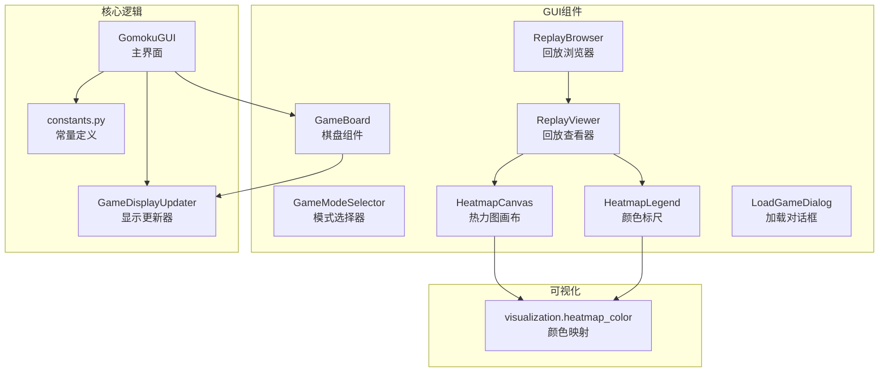
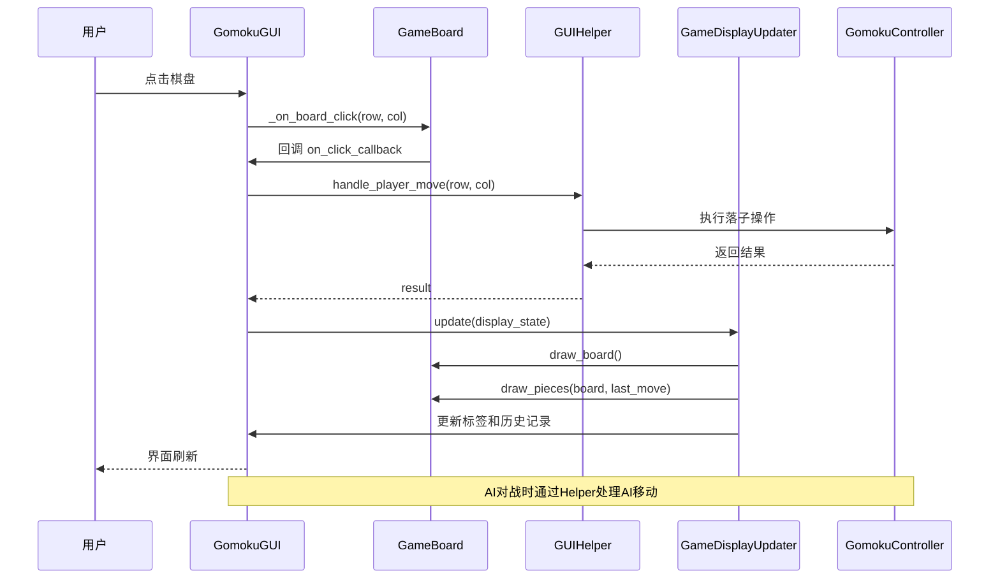
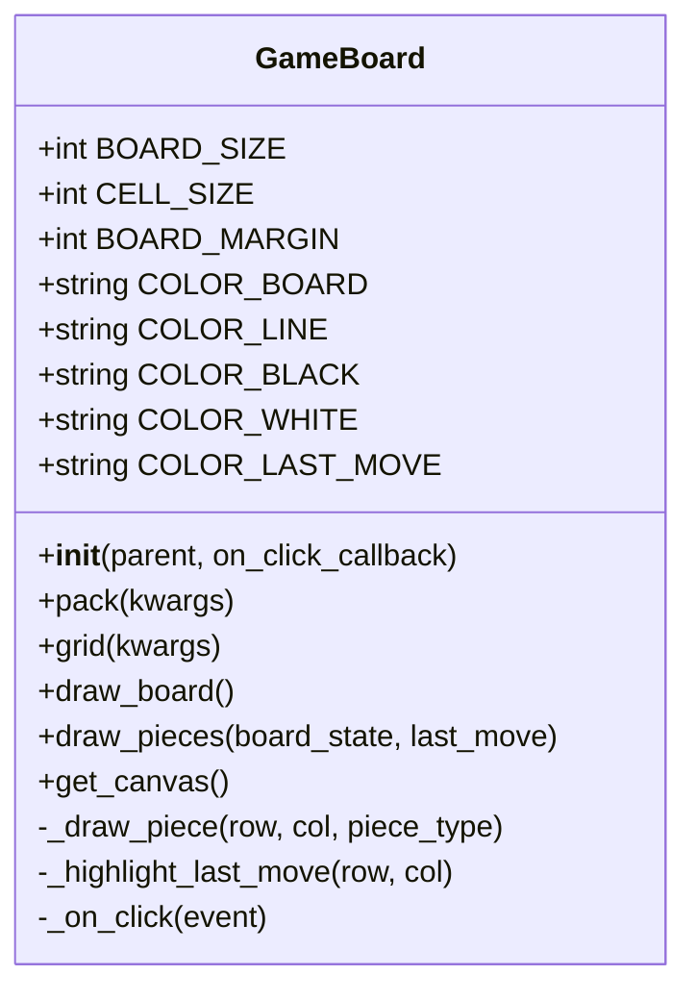
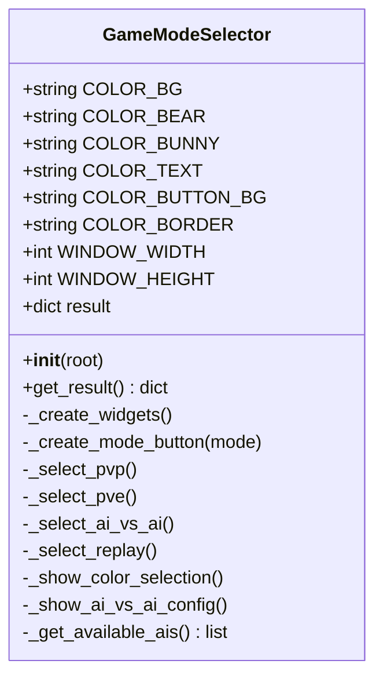
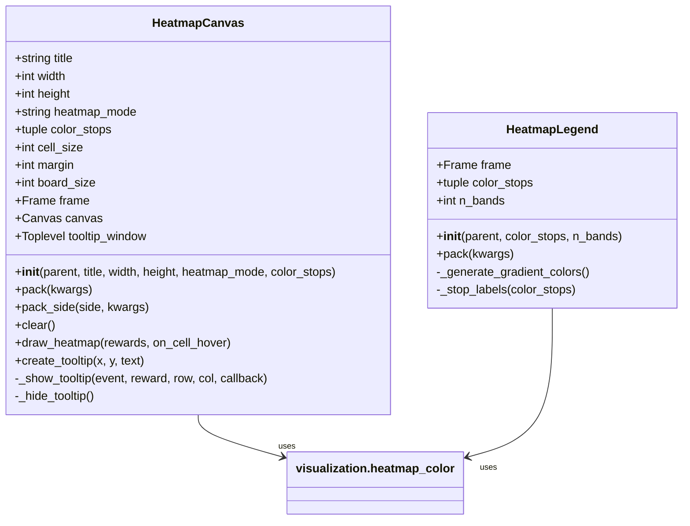
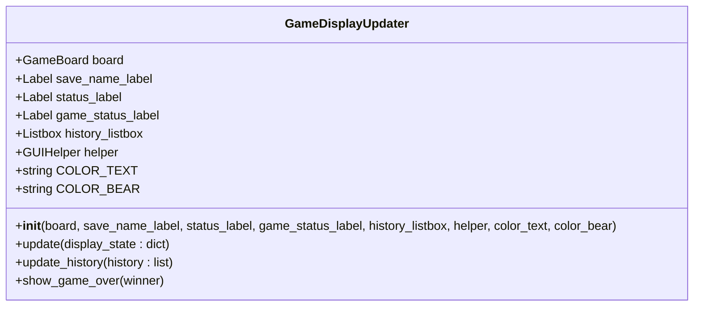
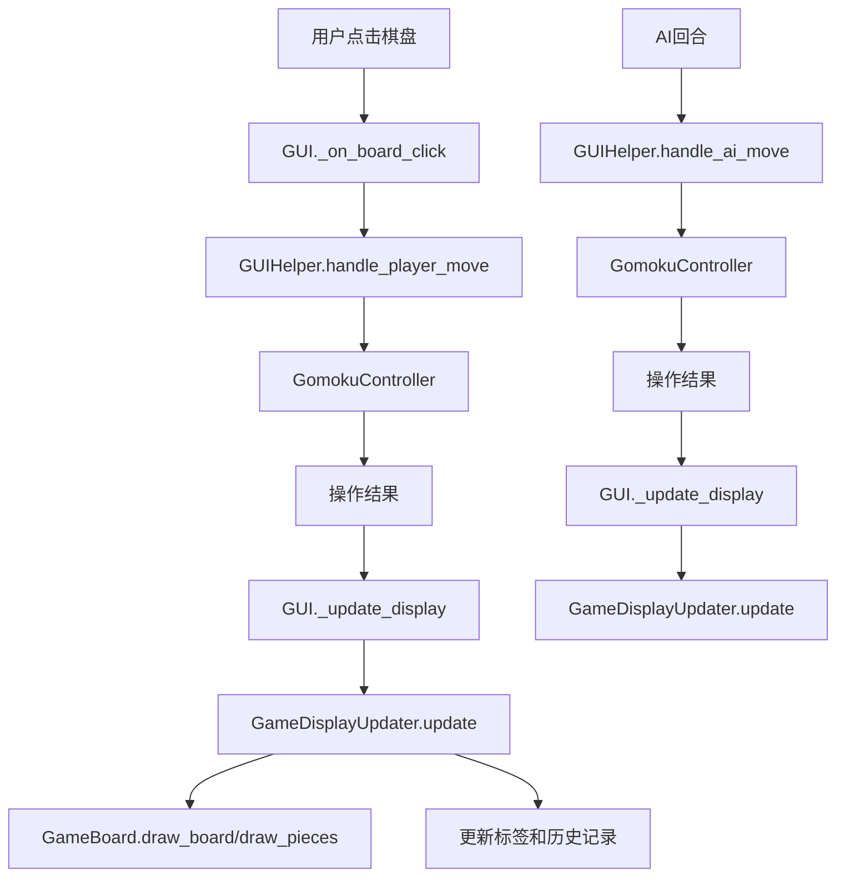
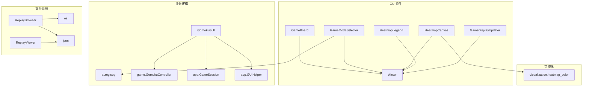

# GUI组件API

<cite>
**本文档引用的文件**
- [gui/components/game_board.py](file://gui/components/game_board.py)
- [gui/components/mode_selector.py](file://gui/components/mode_selector.py)
- [gui/components/heatmap.py](file://gui/components/heatmap.py)
- [gui/display_updater.py](file://gui/display_updater.py)
- [gui/main.py](file://gui/main.py)
- [gui/components/constants.py](file://gui/components/constants.py)
- [gui/components/__init__.py](file://gui/components/__init__.py)
- [gui/components/replay_browser.py](file://gui/components/replay_browser.py)
- [gui/components/replay_viewer.py](file://gui/components/replay_viewer.py)
- [gui/components/load_game_dialog.py](file://gui/components/load_game_dialog.py)
- [visualization/heatmap_color.py](file://visualization/heatmap_color.py)
- [tests/gui/test_game_board.py](file://tests/gui/test_game_board.py)
- [tests/gui/test_mode_selector.py](file://tests/gui/test_mode_selector.py)
- [tests/gui/test_heatmap.py](file://tests/gui/test_heatmap.py)
- [tests/gui/test_display_updater.py](file://tests/gui/test_display_updater.py)
</cite>

## 目录
1. [简介](#简介)
2. [项目结构](#项目结构)
3. [核心组件](#核心组件)
4. [架构概览](#架构概览)
5. [详细组件分析](#详细组件分析)
6. [依赖分析](#依赖分析)
7. [性能考虑](#性能考虑)
8. [故障排除指南](#故障排除指南)
9. [结论](#结论)
10. [附录](#附录)

## 简介
本文件为GUI组件系统的详细API参考文档，涵盖游戏板组件、模式选择器组件、热力图组件以及显示更新器的完整接口规范。文档同时记录组件间的通信机制、事件传递系统，以及组件定制化开发的API规范，帮助开发者快速理解和扩展GUI系统。

## 项目结构
GUI系统采用模块化设计，主要组件位于gui/components目录，核心逻辑集中在gui/main.py中，显示更新器位于gui/display_updater.py，热力图颜色映射算法位于visualization/heatmap_color.py。

**图表来源**
- [gui/main.py:31-462](file://gui/main.py#L31-L462)
- [gui/components/__init__.py:12-42](file://gui/components/__init__.py#L12-L42)

**章节来源**
- [gui/main.py:1-462](file://gui/main.py#L1-L462)
- [gui/components/__init__.py:12-42](file://gui/components/__init__.py#L12-L42)

## 核心组件
本节概述GUI系统的主要组件及其职责：

### 游戏板组件（GameBoard）
- 负责棋盘的绘制和交互
- 支持15×15标准棋盘
- 提供棋子绘制、最后落子标记等功能
- 支持点击事件回调

### 模式选择器组件（GameModeSelector）
- 提供游戏模式选择界面
- 支持人人对战、人机对战、AI内战、回放查看四种模式
- 包含颜色选择和AI配置对话框

### 热力图组件（HeatmapCanvas/HeatmapLegend）
- 提供225格热力图画布
- 支持悬停tooltip显示
- 包含颜色标尺组件
- 支持多种归一化模式和自定义色板

### 显示更新器（GameDisplayUpdater）
- 负责根据display_state字典刷新界面
- 管理棋盘重绘、标签更新、历史记录显示
- 处理游戏结束弹窗

**章节来源**
- [gui/components/game_board.py:7-170](file://gui/components/game_board.py#L7-L170)
- [gui/components/mode_selector.py:12-411](file://gui/components/mode_selector.py#L12-L411)
- [gui/components/heatmap.py:68-358](file://gui/components/heatmap.py#L68-L358)
- [gui/display_updater.py:13-110](file://gui/display_updater.py#L13-L110)

## 架构概览
GUI系统采用分层架构，组件间通过清晰的接口进行通信。

**图表来源**
- [gui/main.py:224-285](file://gui/main.py#L224-L285)
- [gui/display_updater.py:40-82](file://gui/display_updater.py#L40-L82)

## 详细组件分析

### 游戏板组件API详解

#### 类定义与初始化

**图表来源**
- [gui/components/game_board.py:7-170](file://gui/components/game_board.py#L7-L170)

#### 核心接口说明

**初始化接口**
- `__init__(parent, on_click_callback=None)`
  - parent: 父容器（通常为tk.Frame）
  - on_click_callback: 点击回调函数，参数为(row, col)
  - 返回: GameBoard实例

**渲染接口**
- `draw_board()`: 绘制空棋盘网格和星位
- `draw_pieces(board_state, last_move=None)`: 绘制棋子和最后落子标记
  - board_state: 15×15二维数组，0=空, 1=黑, 2=白
  - last_move: 最后落子位置(row, col)

**事件处理接口**
- `_on_click(event)`: 处理鼠标点击事件
- `get_canvas()`: 获取底层Canvas对象

**章节来源**
- [gui/components/game_board.py:22-52](file://gui/components/game_board.py#L22-L52)
- [gui/components/game_board.py:61-119](file://gui/components/game_board.py#L61-L119)
- [gui/components/game_board.py:151-170](file://gui/components/game_board.py#L151-L170)

### 模式选择器组件API详解

#### 类定义与初始化

**图表来源**
- [gui/components/mode_selector.py:12-411](file://gui/components/mode_selector.py#L12-L411)

#### 核心接口说明

**初始化接口**
- `__init__(root)`: 初始化模式选择器
  - root: Tkinter根窗口
  - 返回: GameModeSelector实例

**模式选择接口**
- `_select_pvp()`: 人人对战模式
- `_select_pve()`: 人机对战模式（弹出颜色选择对话框）
- `_select_ai_vs_ai()`: AI内战模式（弹出配置对话框）
- `_select_replay()`: 回放模式

**配置对话框接口**
- `_show_color_selection()`: 人机对战颜色选择
- `_show_ai_vs_ai_config()`: AI内战配置对话框

**查询接口**
- `get_result()`: 获取用户选择结果
  - 返回: 包含模式和参数的字典

**章节来源**
- [gui/components/mode_selector.py:27-44](file://gui/components/mode_selector.py#L27-L44)
- [gui/components/mode_selector.py:176-185](file://gui/components/mode_selector.py#L176-L185)
- [gui/components/mode_selector.py:186-277](file://gui/components/mode_selector.py#L186-L277)
- [gui/components/mode_selector.py:278-391](file://gui/components/mode_selector.py#L278-L391)

### 热力图组件API详解

#### 类定义与初始化

**图表来源**
- [gui/components/heatmap.py:68-358](file://gui/components/heatmap.py#L68-L358)
- [visualization/heatmap_color.py:32-44](file://visualization/heatmap_color.py#L32-L44)

#### 核心接口说明

**HeatmapCanvas接口**
- `__init__(parent, title="热力图", width=280, height=280, heatmap_mode="log", color_stops=None)`
  - heatmap_mode: "log" | "max" | "linear"
  - color_stops: 自定义色节点序列

- `draw_heatmap(rewards, on_cell_hover=None)`: 绘制热力图
  - rewards: 长度225的数值列表
  - on_cell_hover: 悬停回调函数

- `create_tooltip(x, y, text)`: 创建tooltip窗口

**HeatmapLegend接口**
- `__init__(parent, color_stops=None, n_bands=24)`: 初始化颜色标尺
- `_generate_gradient_colors()`: 生成渐变颜色序列
- `_stop_labels(color_stops)`: 生成色节点标签

**颜色映射核心**
- 使用`visualization.heatmap_color`模块
- 支持自定义色板和归一化模式
- 默认使用4色渐变：白→黄→橙→红

**章节来源**
- [gui/components/heatmap.py:71-134](file://gui/components/heatmap.py#L71-L134)
- [gui/components/heatmap.py:137-247](file://gui/components/heatmap.py#L137-L247)
- [gui/components/heatmap.py:260-358](file://gui/components/heatmap.py#L260-L358)

### 显示更新器API详解

#### 类定义与初始化

**图表来源**
- [gui/display_updater.py:13-110](file://gui/display_updater.py#L13-L110)

#### 核心接口说明

**初始化接口**
- `__init__(board, save_name_label, status_label, game_status_label, history_listbox, helper, color_text, color_bear)`
  - 接收所有需要更新的UI组件引用

**更新接口**
- `update(display_state: dict)`: 根据显示状态更新界面
  - 处理无游戏、进行中、结束等不同状态
  - 调用棋盘重绘和历史记录更新

- `update_history(history: list)`: 更新历史记录显示
  - 清空现有记录并重新填充
  - 支持滚动到最后一条

**游戏结束接口**
- `show_game_over(winner)`: 显示游戏结束弹窗

**章节来源**
- [gui/display_updater.py:16-40](file://gui/display_updater.py#L16-L40)
- [gui/display_updater.py:40-101](file://gui/display_updater.py#L40-L101)

### 组件间通信机制

#### 事件流分析

**图表来源**
- [gui/main.py:224-285](file://gui/main.py#L224-L285)
- [gui/display_updater.py:40-82](file://gui/display_updater.py#L40-L82)

**章节来源**
- [gui/main.py:224-285](file://gui/main.py#L224-L285)
- [gui/display_updater.py:40-82](file://gui/display_updater.py#L40-L82)

## 依赖分析

### 外部依赖关系

**图表来源**
- [gui/components/mode_selector.py:392-402](file://gui/components/mode_selector.py#L392-L402)
- [gui/components/heatmap.py:30-34](file://gui/components/heatmap.py#L30-L34)
- [gui/main.py:18-28](file://gui/main.py#L18-L28)

### 内部依赖关系
- gui/main.py依赖所有GUI组件
- gui/display_updater.py依赖GameBoard和标签组件
- gui/components/heatmap.py依赖visualization.heatmap_color
- 回放相关组件相互依赖

**章节来源**
- [gui/main.py:18-28](file://gui/main.py#L18-L28)
- [gui/components/heatmap.py:30-34](file://gui/components/heatmap.py#L30-L34)

## 性能考虑
- 棋盘绘制采用批量操作，减少Canvas重绘次数
- 热力图使用批量归一化，避免重复计算
- tooltip采用懒创建机制，减少内存占用
- 历史记录更新时先清空后插入，避免频繁DOM操作

## 故障排除指南

### 常见问题及解决方案

**棋盘点击无效**
- 检查是否正确设置on_click_callback
- 确认棋盘已正确绑定事件
- 验证事件坐标转换逻辑

**热力图显示异常**
- 检查rewards数组长度是否为225
- 验证heatmap_mode参数是否有效
- 确认color_stops格式正确

**模式选择器无法弹窗**
- 检查Toplevel创建权限
- 验证父窗口引用是否正确
- 确认对话框层级设置

**显示更新器不工作**
- 检查display_state字典结构
- 验证各标签组件引用
- 确认update_history参数格式

**章节来源**
- [tests/gui/test_game_board.py:169-212](file://tests/gui/test_game_board.py#L169-L212)
- [tests/gui/test_heatmap.py:79-88](file://tests/gui/test_heatmap.py#L79-L88)
- [tests/gui/test_mode_selector.py:46-100](file://tests/gui/test_mode_selector.py#L46-L100)
- [tests/gui/test_display_updater.py:124-238](file://tests/gui/test_display_updater.py#L124-L238)

## 结论
本GUI组件系统提供了完整的五子棋游戏界面，具有以下特点：
- 模块化设计，组件职责清晰
- 完善的事件处理机制
- 灵活的配置选项和自定义能力
- 良好的扩展性和维护性

系统支持多种游戏模式，提供丰富的用户交互体验，并具备良好的性能表现。

## 附录

### API使用示例路径
- [棋盘组件使用示例:112-113](file://gui/main.py#L112-L113)
- [模式选择器使用示例:400-403](file://gui/main.py#L400-L403)
- [热力图组件使用示例:139-140](file://gui/components/replay_viewer.py#L139-L140)
- [显示更新器使用示例:269-272](file://gui/main.py#L269-L272)

### 测试覆盖范围
- [游戏板组件测试:17-212](file://tests/gui/test_game_board.py#L17-L212)
- [模式选择器组件测试:17-166](file://tests/gui/test_mode_selector.py#L17-L166)
- [热力图组件测试:39-341](file://tests/gui/test_heatmap.py#L39-L341)
- [显示更新器测试:30-359](file://tests/gui/test_display_updater.py#L30-L359)