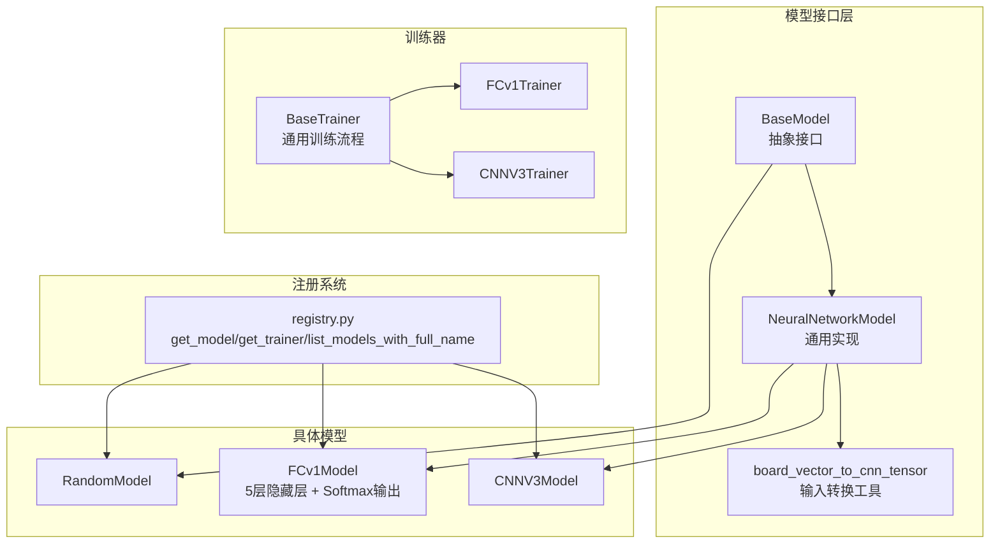
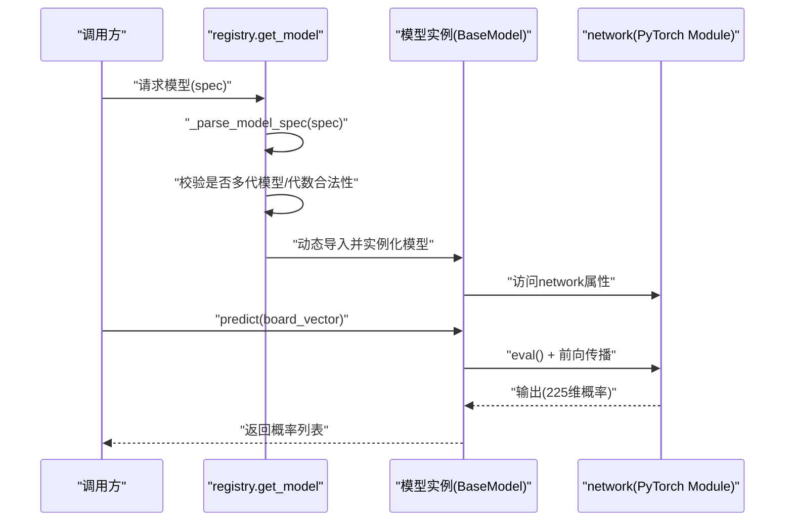
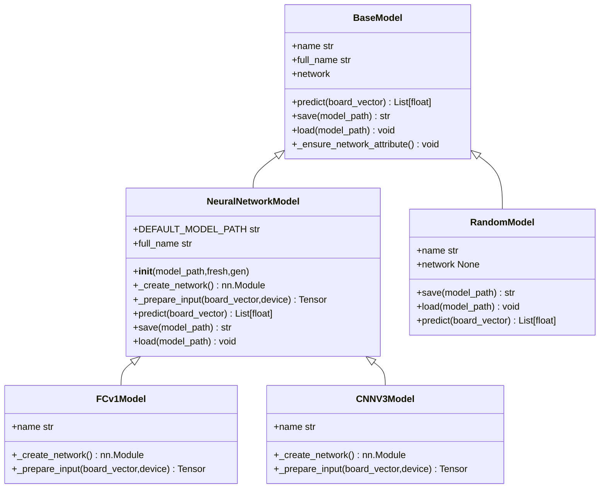
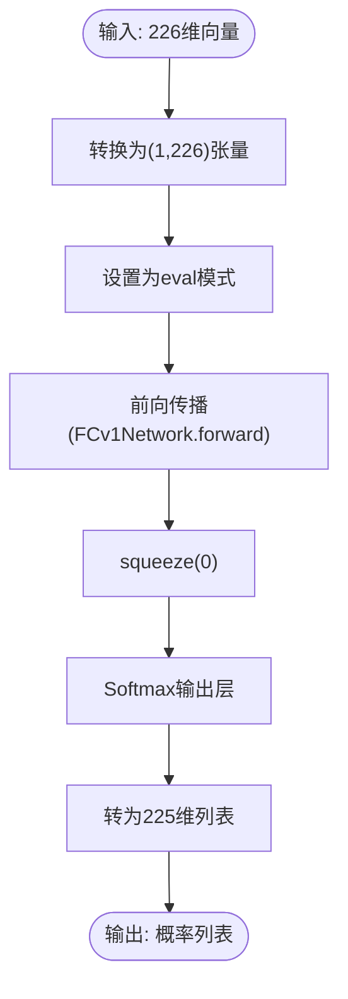
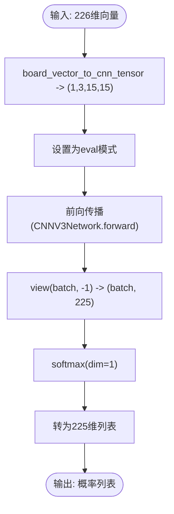
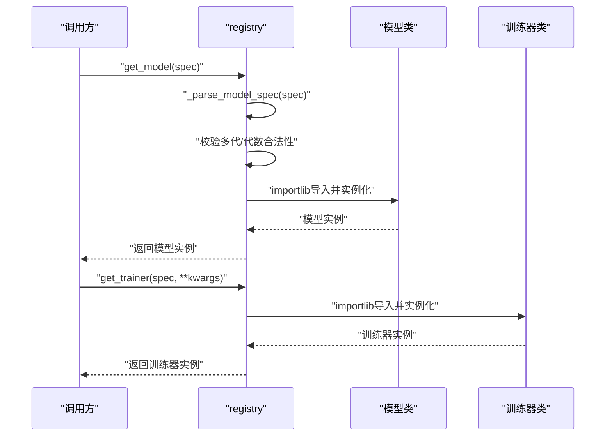
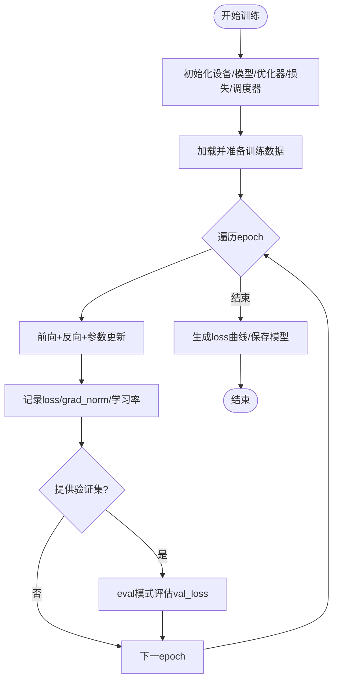
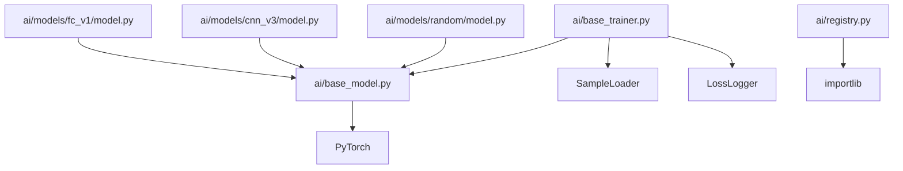

# 模型接口API

<cite>
**本文引用的文件**
- [ai/base_model.py](file://ai/base_model.py)
- [ai/registry.py](file://ai/registry.py)
- [ai/models/fc_v1/model.py](file://ai/models/fc_v1/model.py)
- [ai/models/fc_v1/MODEL.md](file://ai/models/fc_v1/MODEL.md)
- [ai/models/cnn_v3/model.py](file://ai/models/cnn_v3/model.py)
- [ai/base_trainer.py](file://ai/base_trainer.py)
- [ai/models/random/model.py](file://ai/models/random/model.py)
- [ai/models/__init__.py](file://ai/models/__init__.py)
- [ai/models/fc_v1/trainer.py](file://ai/models/fc_v1/trainer.py)
- [ai/models/cnn_v3/trainer.py](file://ai/models/cnn_v3/trainer.py)
- [tests/ai/test_fc_v1_model.py](file://tests/ai/test_fc_v1_model.py)
- [tests/ai/test_cnn_models.py](file://tests/ai/test_cnn_models.py)
- [tests/ai/unit/test_registry.py](file://tests/ai/unit/test_registry.py)
- [design/fc_v1_design.md](file://design/fc_v1_design.md)
</cite>

## 目录
1. [简介](#简介)
2. [项目结构](#项目结构)
3. [核心组件](#核心组件)
4. [架构总览](#架构总览)
5. [详细组件分析](#详细组件分析)
6. [依赖分析](#依赖分析)
7. [性能考虑](#性能考虑)
8. [故障排查指南](#故障排查指南)
9. [结论](#结论)
10. [附录](#附录)

## 简介
本文件为AI模型接口系统的详细API文档，聚焦于BaseModel抽象类及其派生模型的接口规范，涵盖：
- BaseModel与NeuralNetworkModel的接口契约与实现要点
- forward()前向传播、predict()预测接口、save()/load()状态持久化
- FCv1与CNNV3两种典型实现的差异与特性
- 模型注册系统API：注册、查找与实例化流程
- 新模型开发的接口规范、实现指南与测试方法

## 项目结构
围绕模型接口的核心代码分布在以下模块：
- ai/base_model.py：定义BaseModel、NeuralNetworkModel及通用输入转换工具
- ai/registry.py：统一模型注册表，支持多代模型与懒加载
- ai/models/*/model.py：具体模型实现（如FCv1、CNNV3、Random）
- ai/base_trainer.py：训练器抽象基类，提供通用训练流程
- ai/models/*/trainer.py：各模型对应的训练器实现
- tests/...：覆盖模型行为、注册系统与训练器的单元与集成测试

**图表来源**
- [ai/base_model.py:24-323](file://ai/base_model.py#L24-L323)
- [ai/registry.py:58-184](file://ai/registry.py#L58-L184)
- [ai/base_trainer.py:32-699](file://ai/base_trainer.py#L32-L699)
- [ai/models/fc_v1/model.py:91-132](file://ai/models/fc_v1/model.py#L91-L132)
- [ai/models/cnn_v3/model.py:96-139](file://ai/models/cnn_v3/model.py#L96-L139)
- [ai/models/random/model.py:10-64](file://ai/models/random/model.py#L10-L64)

**章节来源**
- [ai/base_model.py:1-323](file://ai/base_model.py#L1-L323)
- [ai/registry.py:1-316](file://ai/registry.py#L1-L316)
- [ai/base_trainer.py:1-699](file://ai/base_trainer.py#L1-L699)

## 核心组件
本节梳理BaseModel与NeuralNetworkModel的接口契约、输入输出约定与实现要点。

- 接口契约
  - predict(board_vector): 预测每个落子位置的概率
    - 输入：226维向量，前225位为棋盘状态（0=空，1=黑，2=白），最后1位为当前落子方（1=黑，2=白）
    - 输出：225维列表，按行展开对应(0,0)到(14,14)，值域(0,1)，和为1
  - name: 模型名称（property）
  - full_name: 含代数的完整名称（多代模型覆盖）
  - save(model_path=None): 保存模型参数至文件，返回实际保存路径
  - load(model_path=None): 从文件加载模型参数
  - network: 神经网络模块属性（RandomModel为None）

- 通用实现（NeuralNetworkModel）
  - 默认行为：自动加载默认路径权重（若存在），fresh=True时强制新建
  - predict通用流程：设备推断 → 输入转换 → eval模式前向 → squeeze → 列表返回
  - save/load：保存/加载network.state_dict()，使用weights_only加载
  - _create_network/_prepare_input：子类必须实现
  - 多代模型支持：DEFAULT_MODEL_PATH可按gen动态覆盖为gen{i}/子目录

- 输入转换工具
  - board_vector_to_cnn_tensor：将226维向量转换为(1,3,15,15)张量，通道分别为黑棋、白棋、当前方

**章节来源**
- [ai/base_model.py:24-323](file://ai/base_model.py#L24-L323)

## 架构总览
下图展示模型接口、注册系统与训练器之间的交互关系：

**图表来源**
- [ai/registry.py:150-184](file://ai/registry.py#L150-L184)
- [ai/base_model.py:195-230](file://ai/base_model.py#L195-L230)

**章节来源**
- [ai/registry.py:103-184](file://ai/registry.py#L103-L184)
- [ai/base_model.py:126-276](file://ai/base_model.py#L126-L276)

## 详细组件分析

### BaseModel与NeuralNetworkModel类图

**图表来源**
- [ai/base_model.py:24-323](file://ai/base_model.py#L24-L323)
- [ai/models/fc_v1/model.py:91-132](file://ai/models/fc_v1/model.py#L91-L132)
- [ai/models/cnn_v3/model.py:96-139](file://ai/models/cnn_v3/model.py#L96-L139)
- [ai/models/random/model.py:10-64](file://ai/models/random/model.py#L10-L64)

**章节来源**
- [ai/base_model.py:24-323](file://ai/base_model.py#L24-L323)
- [ai/models/fc_v1/model.py:91-132](file://ai/models/fc_v1/model.py#L91-L132)
- [ai/models/cnn_v3/model.py:96-139](file://ai/models/cnn_v3/model.py#L96-L139)
- [ai/models/random/model.py:10-64](file://ai/models/random/model.py#L10-L64)

### FCv1模型接口与实现
**更新** FCv1模型已从10层隐藏层架构更新为5层隐藏层架构，并增加了Softmax输出层。

- 网络结构：输入层(226)→5层隐藏(每层1000, ReLU)→输出层(225)→Softmax
- 参数量：从946万降至446万
- 输入格式：(1,226)张量，直接展平
- predict流程：输入转为(1,226)→前向→squeeze→225维列表
- save/load：保存/加载network.state_dict()

**图表来源**
- [ai/models/fc_v1/model.py:119-131](file://ai/models/fc_v1/model.py#L119-L131)
- [ai/base_model.py:195-230](file://ai/base_model.py#L195-L230)

**章节来源**
- [ai/models/fc_v1/model.py:18-132](file://ai/models/fc_v1/model.py#L18-L132)
- [ai/models/fc_v1/MODEL.md:88-116](file://ai/models/fc_v1/MODEL.md#L88-L116)
- [tests/ai/test_fc_v1_model.py:20-372](file://tests/ai/test_fc_v1_model.py#L20-L372)

### CNNV3模型接口与实现
- 网络结构：3×3卷积×3 + 1×1卷积输出，无BN/Dropout，参数量约1.9k
- 输入格式：(1,3,15,15)张量，通道为黑棋、白棋、当前方
- 输入转换：复用board_vector_to_cnn_tensor
- predict流程：输入转为(1,3,15,15)→前向→flatten→softmax→225维列表

**图表来源**
- [ai/models/cnn_v3/model.py:125-138](file://ai/models/cnn_v3/model.py#L125-L138)
- [ai/base_model.py:278-322](file://ai/base_model.py#L278-L322)

**章节来源**
- [ai/models/cnn_v3/model.py:31-139](file://ai/models/cnn_v3/model.py#L31-L139)
- [tests/ai/test_cnn_models.py:259-341](file://tests/ai/test_cnn_models.py#L259-L341)

### RandomModel接口与实现
- 无神经网络，network返回None
- predict：对空位均匀分配概率，已落子位置概率为0
- save/load：占位实现（无参数需要持久化）

**章节来源**
- [ai/models/random/model.py:10-64](file://ai/models/random/model.py#L10-L64)

### 模型注册系统API
- get_model(spec: str)：根据spec返回模型实例
  - 规则：用户显式指定gen→优先信任；未指定时依据注册表声明判定
  - 多代模型必须指定代数；非多代模型不可指定代数
- get_trainer(spec: str, **kwargs)：返回训练器实例
  - 与get_model相同的校验逻辑；trainer_path为None时报错
- list_models_with_full_name()：返回可加载的完整模型指定字符串列表
  - 非多代模型：返回模型名本身
  - 多代模型：仅当gen{i}/目录下存在.pth文件时才视为有效代数

**图表来源**
- [ai/registry.py:150-224](file://ai/registry.py#L150-L224)

**章节来源**
- [ai/registry.py:58-316](file://ai/registry.py#L58-L316)
- [tests/ai/unit/test_registry.py:26-288](file://tests/ai/unit/test_registry.py#L26-L288)

### 训练器接口与流程
- BaseTrainer提供通用训练流程：单轮次、批量、mini-batch、训练周期
- 自动检测GPU并移动模型；AdamW优化器；L1Loss + mask
- 支持StepLR与ReduceLROnPlateau学习率调度
- 训练循环：for-epoch → 前向+反向+参数更新 → 日志记录 → 可选验证集评估

**图表来源**
- [ai/base_trainer.py:257-322](file://ai/base_trainer.py#L257-L322)
- [ai/base_trainer.py:409-573](file://ai/base_trainer.py#L409-L573)

**章节来源**
- [ai/base_trainer.py:32-699](file://ai/base_trainer.py#L32-L699)

## 依赖分析
- BaseModel/NeuralNetworkModel与PyTorch强耦合，依赖torch与torch.nn
- 注册系统通过importlib实现懒加载，避免模块级导入所有模型
- 训练器依赖BaseModel接口与SampleLoader、LossLogger等组件
- FCv1/CNNV3共享输入转换工具，降低重复逻辑

**图表来源**
- [ai/base_model.py:20-21](file://ai/base_model.py#L20-L21)
- [ai/registry.py:22-24](file://ai/registry.py#L22-L24)
- [ai/base_trainer.py:14-18](file://ai/base_trainer.py#L14-L18)

**章节来源**
- [ai/base_model.py:16-323](file://ai/base_model.py#L16-L323)
- [ai/registry.py:22-101](file://ai/registry.py#L22-L101)
- [ai/base_trainer.py:14-18](file://ai/base_trainer.py#L14-L18)

## 性能考虑
- 设备选择：优先GPU，自动检测CUDA可用性
- 前向传播：eval模式+no_grad减少内存与计算开销
- 输入转换：CNN模型使用共享工具函数，避免重复逻辑
- 训练策略：mini-batch相比全量更新收敛更快、更高效
- 损失计算：mask控制有效位置，提升训练稳定性
- **参数量优化**：FCv1从10层隐藏层降至5层，参数量从946万降至446万，显著提升推理效率

## 故障排查指南
- 无法加载模型权重
  - 检查DEFAULT_MODEL_PATH是否存在；多代模型需指定gen且命中对应.pth
  - 非多代模型不可指定代数；多代模型必须指定代数
- 未知模型或训练器
  - 确认MODEL_REGISTRY中存在该模型；random无训练器
- 注册表冲突
  - 多代模型目录下不可同时存在.pth文件与gen{i}/目录
- 训练中断
  - BaseTrainer在KeyboardInterrupt时会保存当前进度与图表
- **FCv1模型问题**
  - 确认模型使用的是5层隐藏层架构而非旧版10层架构
  - 验证Softmax输出层正常工作，输出概率和为1

**章节来源**
- [ai/registry.py:168-178](file://ai/registry.py#L168-L178)
- [ai/registry.py:284-287](file://ai/registry.py#L284-L287)
- [ai/base_trainer.py:314-321](file://ai/base_trainer.py#L314-L321)

## 结论
本API体系以BaseModel为核心，统一了AI模型的预测、保存与加载接口；NeuralNetworkModel提供通用实现，降低子类重复代码；registry.py实现模型与训练器的统一注册与懒加载；BaseTrainer提供标准化训练流程。FCv1与CNNV3展示了不同网络结构的实现差异，满足从全连接到纯卷积的不同需求。通过完善的测试覆盖，确保接口一致性与行为正确性。**最新的架构优化将FCv1从10层隐藏层精简为5层，参数量减半，同时增加Softmax输出层确保概率分布的有效性。**

## 附录

### 新模型开发接口规范与实现指南
- 继承关系
  - 若使用PyTorch：继承NeuralNetworkModel，实现_DEFAULT_MODEL_PATH、name、_create_network、_prepare_input
  - 若不使用神经网络：继承BaseModel，实现predict/name/save/load/network
- 输入输出约定
  - predict输入：226维向量（棋盘+当前方）
  - predict输出：225维概率列表，和为1
- 状态持久化
  - save：保存network.state_dict()至DEFAULT_MODEL_PATH或指定路径
  - load：从指定路径加载state_dict，设置eval模式
- 多代模型支持
  - 在__init__中动态覆盖DEFAULT_MODEL_PATH为gen{i}/子目录
  - full_name属性返回"模型名.代数"
- 训练器对接
  - 实现BaseTrainer子类，覆盖_create_model与model_name
  - 如需自定义输入转换，覆盖_base_trainer._convert_inputs
- 测试建议
  - 行为测试：形状、范围、和为1、一致性、默认加载、保存/加载
  - 集成测试：完整工作流（创建→预测→保存→加载→再预测）
  - 注册系统测试：get_model/get_trainer正确性与异常处理
- **架构设计建议**
  - 考虑从10层架构精简为5层以提升效率
  - 确保输出层使用Softmax保证概率分布有效性
  - 控制参数量在合理范围内，平衡模型容量与推理速度

**章节来源**
- [ai/base_model.py:107-276](file://ai/base_model.py#L107-L276)
- [ai/base_trainer.py:145-170](file://ai/base_trainer.py#L145-L170)
- [tests/ai/test_fc_v1_model.py:83-372](file://tests/ai/test_fc_v1_model.py#L83-L372)
- [tests/ai/test_cnn_models.py:82-341](file://tests/ai/test_cnn_models.py#L82-L341)
- [tests/ai/unit/test_registry.py:26-288](file://tests/ai/unit/test_registry.py#L26-L288)
- [ai/models/fc_v1/MODEL.md:88-116](file://ai/models/fc_v1/MODEL.md#L88-L116)