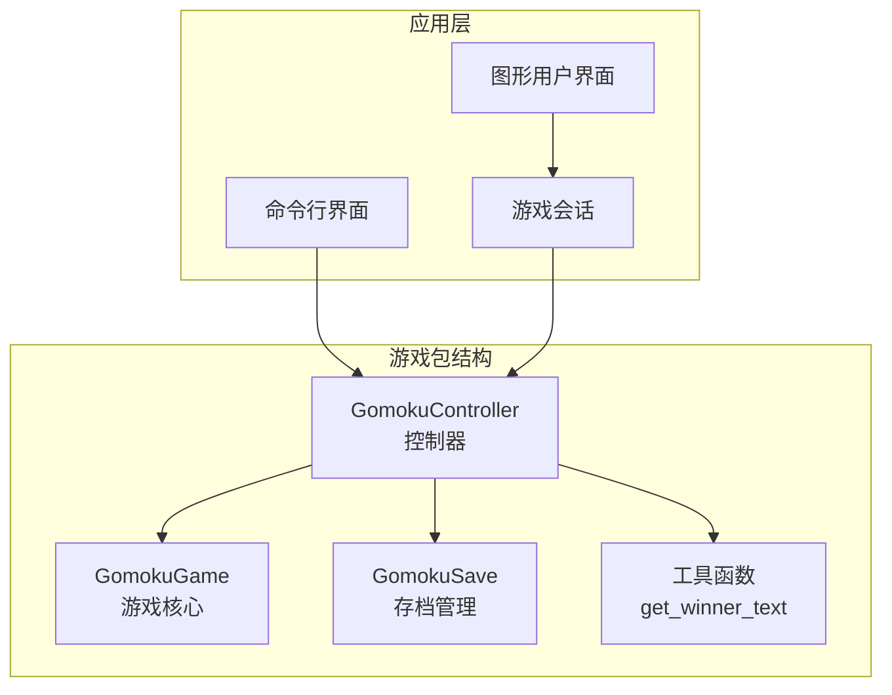
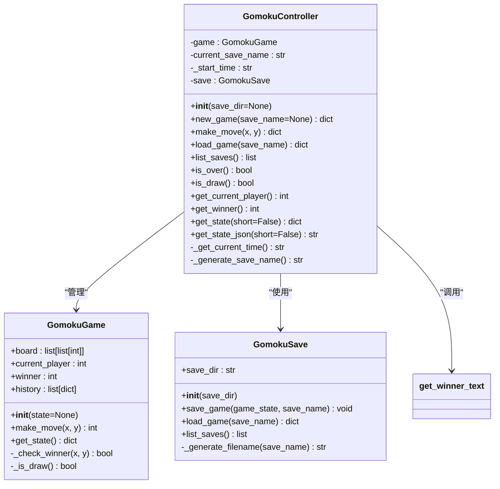
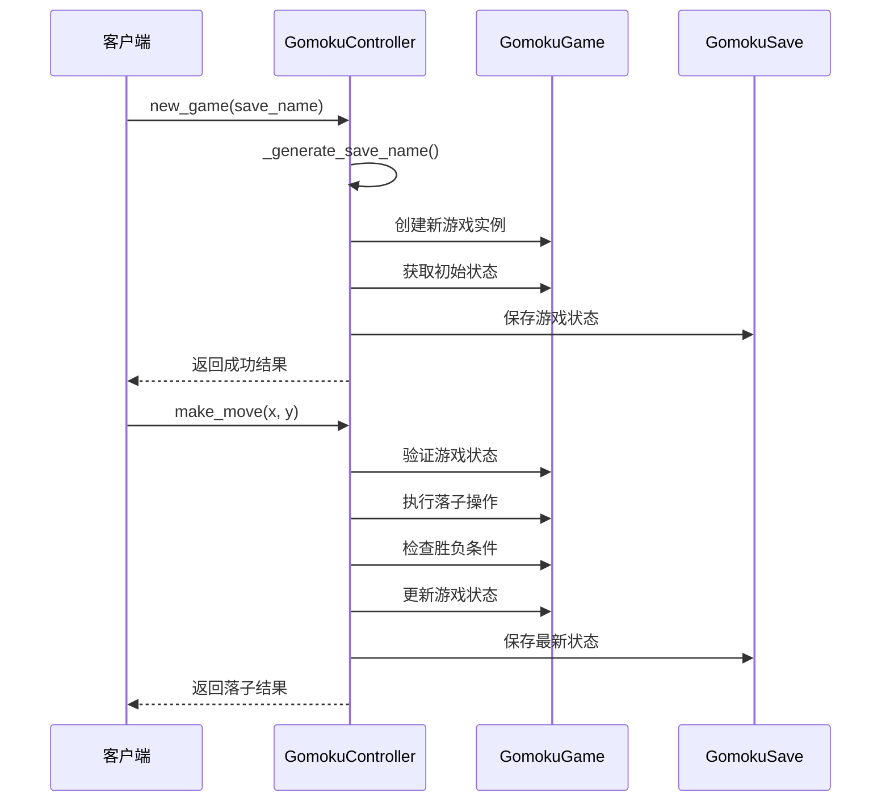
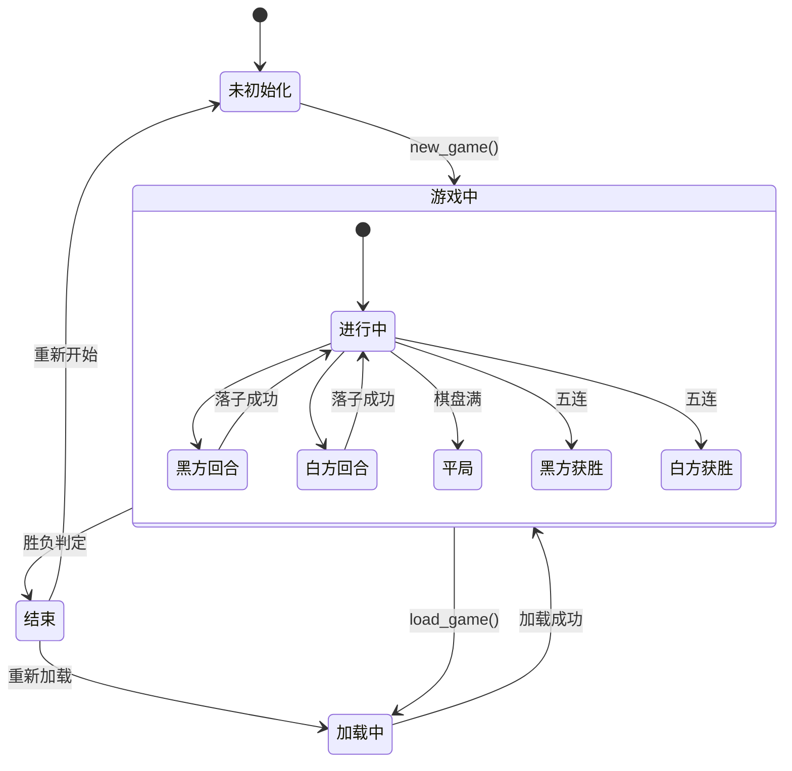
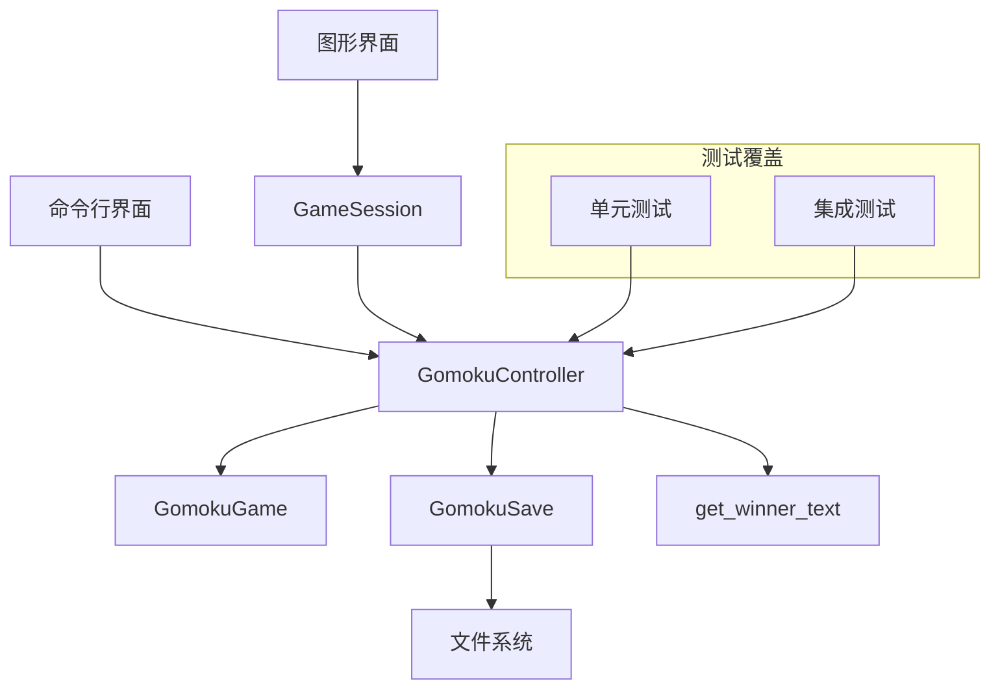

# 游戏控制器API

<cite>
**本文档引用的文件**
- [controller.py](file://game/controller.py)
- [game.py](file://game/game.py)
- [save.py](file://game/save.py)
- [__init__.py](file://game/__init__.py)
- [test_controller.py](file://tests/test_controller.py)
- [main.py](file://cli/main.py)
- [session.py](file://app/session.py)
</cite>

## 目录
1. [简介](#简介)
2. [项目结构](#项目结构)
3. [核心组件](#核心组件)
4. [架构概览](#架构概览)
5. [详细组件分析](#详细组件分析)
6. [依赖关系分析](#依赖关系分析)
7. [性能考虑](#性能考虑)
8. [故障排除指南](#故障排除指南)
9. [结论](#结论)

## 简介

GomokuController是五子棋游戏的核心控制器类，负责管理游戏生命周期、处理玩家落子操作、管理存档系统以及提供状态查询功能。该控制器作为游戏系统的唯一对外接口，封装了复杂的业务逻辑，为上层应用（CLI、GUI、AI引擎）提供了简洁统一的API。

## 项目结构

游戏控制器位于`game`包中，采用分层架构设计：



**图表来源**
- [controller.py:11-194](file://game/controller.py#L11-L194)
- [game.py:4-118](file://game/game.py#L4-L118)
- [save.py:9-93](file://game/save.py#L9-L93)

**章节来源**
- [controller.py:1-194](file://game/controller.py#L1-L194)
- [game.py:1-118](file://game/game.py#L1-L118)
- [save.py:1-93](file://save.py#L1-L93)

## 核心组件

### GomokuController类概述

GomokuController是游戏系统的中央协调者，主要职责包括：
- 游戏生命周期管理（创建、加载、保存）
- 玩家落子操作处理
- 状态查询和信息获取
- 错误处理和边界情况管理

### 主要数据结构



**图表来源**
- [controller.py:11-194](file://game/controller.py#L11-L194)
- [game.py:4-118](file://game/game.py#L4-L118)
- [save.py:9-93](file://game/save.py#L9-L93)

**章节来源**
- [controller.py:11-194](file://game/controller.py#L11-L194)
- [game.py:4-118](file://game/game.py#L4-L118)
- [save.py:9-93](file://game/save.py#L9-L93)

## 架构概览

### 控制器工作流程



**图表来源**
- [controller.py:32-98](file://game/controller.py#L32-L98)
- [game.py:22-56](file://game/game.py#L22-L56)
- [save.py:17-34](file://game/save.py#L17-L34)

### 状态管理模式



**图表来源**
- [controller.py:123-145](file://game/controller.py#L123-L145)
- [game.py:67-117](file://game/game.py#L67-L117)

## 详细组件分析

### 初始化方法

#### new_game() - 创建新游戏

**方法签名**: `new_game(save_name=None) -> dict`

**功能描述**: 创建新的五子棋游戏实例并保存初始状态。

**参数**:
- `save_name` (str, 可选): 存档名称。如果为None，则自动生成名称。

**返回值**:
```json
{
    "status": "success",
    "state": {
        "name": "存档名称",
        "board": [[0,0,0,...], ...],
        "current_player": 1,
        "winner": 0,
        "history": [],
        "start_time": "YYYY-MM-DD HH:MM:SS"
    }
}
```

**异常处理**:
- 存档名称冲突：返回错误信息
- 路径权限问题：抛出异常

**使用示例**:
```python
# 基本用法
controller = GomokuController()
result = controller.new_game("我的第一局游戏")

# 自动命名
result = controller.new_game()  # 自动生成"我的游戏1"
```

**章节来源**
- [controller.py:32-63](file://game/controller.py#L32-L63)
- [test_controller.py:83-94](file://tests/test_controller.py#L83-L94)

### 落子操作

#### make_move() - 执行落子

**方法签名**: `make_move(x, y) -> dict`

**功能描述**: 在当前玩家回合执行落子操作。

**参数**:
- `x` (int): 棋盘行坐标 (0-14)
- `y` (int): 棋盘列坐标 (0-14)

**返回值结构**:
```json
{
    "status": "success",
    "winner": 0,  // 0=未结束, 1=黑胜, 2=白胜, 3=平局
    "current_player": 2,  // 下一个玩家
    "board": [[0,0,0,...], ...],
    "game_over": true,  // 胜负判定时存在
    "result": "黑方获胜"  // 胜负判定时存在
}
```

**异常处理**:
- 无游戏状态：返回"请先创建或加载游戏"
- 游戏已结束：返回"游戏已结束"
- 坐标越界：返回"坐标超出范围"
- 位置被占用：返回"位置已被占用"
- 其他异常：捕获并返回错误信息

**使用示例**:
```python
# 有效落子
result = controller.make_move(7, 7)
if result["status"] == "success":
    print(f"落子成功，轮到玩家{result['current_player']}")

# 无效落子
result = controller.make_move(15, 15)  # 越界
if "error" in result:
    print(f"错误: {result['error']}")
```

**章节来源**
- [controller.py:65-98](file://game/controller.py#L65-L98)
- [test_controller.py:95-120](file://tests/test_controller.py#L95-L120)

### 存档管理

#### load_game() - 加载存档

**方法签名**: `load_game(save_name) -> dict`

**功能描述**: 从磁盘加载指定的存档文件。

**参数**:
- `save_name` (str): 存档名称

**返回值**:
```json
{
    "status": "success",
    "state": {
        "name": "存档名称",
        "board": [[0,0,0,...], ...],
        "current_player": 1,
        "winner": 0,
        "history": [],
        "start_time": "YYYY-MM-DD HH:MM:SS"
    }
}
```

**异常处理**:
- 存档不存在：返回错误信息
- 文件读取失败：返回错误信息
- JSON解析错误：返回错误信息

**使用示例**:
```python
# 加载现有存档
result = controller.load_game("我的第一局游戏")
if result["status"] == "success":
    print("存档加载成功")
    print(f"当前玩家: {result['state']['current_player']}")
```

**章节来源**
- [controller.py:103-121](file://game/controller.py#L103-L121)
- [test_controller.py:185-200](file://tests/test_controller.py#L185-L200)

#### list_saves() - 列出存档

**方法签名**: `list_saves() -> list[str]`

**功能描述**: 返回系统中所有可用的存档名称列表。

**参数**: 无

**返回值**: `["存档A", "存档B", "存档C"]`

**使用示例**:
```python
# 获取所有存档
saves = controller.list_saves()
for save_name in saves:
    print(f"- {save_name}")
```

**章节来源**
- [controller.py:99-101](file://game/controller.py#L99-L101)
- [test_controller.py:201-208](file://tests/test_controller.py#L201-L208)

### 状态查询

#### is_over() - 检测游戏结束

**方法签名**: `is_over() -> bool`

**功能描述**: 检查游戏是否已经结束（有胜负或平局）。

**参数**: 无

**返回值**: `True` 如果游戏结束，`False` 如果仍在进行中

**使用示例**:
```python
if controller.is_over():
    print("游戏已结束")
else:
    print("游戏继续进行中")
```

**章节来源**
- [controller.py:123-127](file://game/controller.py#L123-L127)
- [test_controller.py:249-251](file://tests/test_controller.py#L249-L251)

#### is_draw() - 检测平局

**方法签名**: `is_draw() -> bool`

**功能描述**: 检查游戏是否为平局状态。

**参数**: 无

**返回值**: `True` 如果是平局，`False` 否则

**使用示例**:
```python
if controller.is_draw():
    print("游戏以平局结束")
```

**章节来源**
- [controller.py:129-133](file://game/controller.py#L129-L133)
- [test_controller.py:253-255](file://tests/test_controller.py#L253-L255)

#### get_current_player() - 获取当前玩家

**方法签名**: `get_current_player() -> int`

**功能描述**: 返回当前回合的玩家编号。

**参数**: 无

**返回值**: `1` 表示黑方，`2` 表示白方，`None` 表示无游戏状态

**使用示例**:
```python
current_player = controller.get_current_player()
if current_player == 1:
    print("黑方回合")
elif current_player == 2:
    print("白方回合")
```

**章节来源**
- [controller.py:135-139](file://game/controller.py#L135-L139)
- [test_controller.py:257-259](file://tests/test_controller.py#L257-L259)

#### get_winner() - 获取获胜方

**方法签名**: `get_winner() -> int`

**功能描述**: 返回获胜方的编号。

**参数**: 无

**返回值**: `1` 表示黑方获胜，`2` 表示白方获胜，`3` 表示平局，`None` 表示无游戏状态

**使用示例**:
```python
winner = controller.get_winner()
if winner == 1:
    print("黑方获胜")
elif winner == 2:
    print("白方获胜")
elif winner == 3:
    print("平局")
```

**章节来源**
- [controller.py:141-145](file://game/controller.py#L141-L145)
- [test_controller.py:261-263](file://tests/test_controller.py#L261-L263)

#### get_state() - 获取游戏状态

**方法签名**: `get_state(short=False) -> dict`

**功能描述**: 返回当前游戏的完整状态信息。

**参数**:
- `short` (bool): `True` 返回简化状态，`False` 返回完整状态

**简化状态结构**:
```json
{
    "board": [[0,0,0,...], ...],
    "current_player": 1,
    "winner": 0
}
```

**完整状态结构**:
```json
{
    "name": "存档名称",
    "board": [[0,0,0,...], ...],
    "current_player": 1,
    "winner": 0,
    "history": [{"x": 7, "y": 7, "player": 1}],
    "start_time": "YYYY-MM-DD HH:MM:SS"
}
```

**返回值**: 状态字典或错误信息

**使用示例**:
```python
# 获取完整状态
full_state = controller.get_state(short=False)

# 获取简化状态
short_state = controller.get_state(short=True)
```

**章节来源**
- [controller.py:147-169](file://game/controller.py#L147-L169)
- [test_controller.py:271-296](file://tests/test_controller.py#L271-L296)

#### get_state_json() - 获取JSON格式状态

**方法签名**: `get_state_json(short=False) -> str`

**功能描述**: 返回JSON格式的游戏状态字符串。

**参数**:
- `short` (bool): `True` 返回简化状态，`False` 返回完整状态

**返回值**: JSON字符串

**使用示例**:
```python
# 获取完整状态的JSON
json_state = controller.get_state_json(short=False)
print(json_state)  # 格式化的JSON字符串
```

**章节来源**
- [controller.py:171-174](file://game/controller.py#L171-L174)
- [test_controller.py:298-319](file://tests/test_controller.py#L298-L319)

## 依赖关系分析

### 组件依赖图



**图表来源**
- [controller.py:6-8](file://game/controller.py#L6-L8)
- [main.py:9-10](file://cli/main.py#L9-L10)
- [session.py:7-8](file://app/session.py#L7-L8)

### 错误处理策略

```mermaid
flowchart TD
Start([操作开始]) --> Validate[验证输入参数]
Validate --> ParamValid{参数有效?}
ParamValid --> |否| ReturnError[返回错误信息]
ParamValid --> |是| CheckGame[检查游戏状态]
CheckGame --> GameExists{游戏存在?}
GameExists --> |否| ReturnNoGame[返回"请先创建或加载游戏"]
GameExists --> |是| CheckGameOver[检查游戏是否结束]
CheckGameOver --> GameOver{游戏已结束?}
GameOver --> |是| ReturnGameOver[返回"游戏已结束"]
GameOver --> |否| ExecuteOp[执行操作]
ExecuteOp --> Success{操作成功?}
Success --> |否| CatchException[捕获异常]
Success --> |是| UpdateState[更新状态]
CatchException --> ReturnError
UpdateState --> ReturnSuccess[返回成功结果]
ReturnError --> End([操作结束])
ReturnNoGame --> End
ReturnGameOver --> End
ReturnSuccess --> End
```

**图表来源**
- [controller.py:67-97](file://game/controller.py#L67-L97)
- [controller.py:105-121](file://game/controller.py#L105-L121)

**章节来源**
- [controller.py:1-194](file://game/controller.py#L1-L194)
- [game.py:1-118](file://game/game.py#L1-L118)
- [save.py:1-93](file://game/save.py#L1-L93)

## 性能考虑

### 时间复杂度分析

- **new_game()**: O(1) - 创建新游戏实例和保存操作
- **make_move()**: O(n) - n为棋盘大小，主要消耗在胜负检查
- **load_game()**: O(1) - 文件I/O操作
- **list_saves()**: O(m) - m为存档文件数量
- **状态查询**: O(1) - 直接访问属性

### 内存使用优化

- 使用深拷贝避免外部修改影响游戏状态
- 按需加载存档，避免内存泄漏
- 及时清理临时状态和缓存

### 并发安全

- 控制器实例不是线程安全的
- 建议在单线程环境中使用
- 如需多线程支持，建议使用锁机制

## 故障排除指南

### 常见问题及解决方案

#### 1. 存档相关问题

**问题**: "存档已存在"
**原因**: 新建游戏时使用了已存在的存档名称
**解决**: 使用不同的存档名称或让系统自动生成

**问题**: "存档不存在"
**原因**: 尝试加载不存在的存档
**解决**: 检查存档名称或使用`list_saves()`查看可用存档

#### 2. 游戏状态问题

**问题**: "请先创建或加载游戏"
**原因**: 在没有游戏实例的情况下执行操作
**解决**: 先调用`new_game()`或`load_game()`

**问题**: "游戏已结束"
**原因**: 尝试在游戏结束后继续落子
**解决**: 开始新游戏或重新加载存档

#### 3. 输入验证问题

**问题**: "坐标超出范围"
**原因**: 落子坐标不在0-14范围内
**解决**: 确保坐标在有效范围内

**问题**: "位置已被占用"
**原因**: 目标位置已有棋子
**解决**: 选择其他空位置

### 最佳实践

#### 错误处理最佳实践

```python
# 好的做法：检查返回值
result = controller.make_move(x, y)
if "error" in result:
    print(f"落子失败: {result['error']}")
    return

# 好的做法：使用异常处理
try:
    result = controller.load_game(save_name)
except FileNotFoundError:
    print("存档不存在，请检查存档名称")
except Exception as e:
    print(f"加载失败: {e}")
```

#### 边界情况处理

- **空棋盘**: 确保棋盘初始化正确
- **平局检测**: 使用`is_draw()`方法专门检测平局
- **胜负判定**: 使用`get_winner()`获取最终结果
- **状态同步**: 操作后及时检查`is_over()`状态

#### 性能优化建议

- **批量操作**: 对于大量落子操作，考虑减少状态查询频率
- **状态缓存**: 对频繁访问的状态信息进行本地缓存
- **异步处理**: 对耗时操作（如AI思考）使用异步处理

**章节来源**
- [test_controller.py:104-120](file://tests/test_controller.py#L104-L120)
- [test_controller.py:238-243](file://tests/test_controller.py#L238-L243)
- [test_controller.py:244-247](file://tests/test_controller.py#L244-L247)

## 结论

GomokuController类提供了完整而健壮的五子棋游戏控制接口。其设计遵循单一职责原则，将复杂的业务逻辑封装在控制器内部，为上层应用提供了清晰、一致的API。

### 主要优势

1. **完整性**: 覆盖了游戏生命周期的所有关键操作
2. **健壮性**: 完善的错误处理和边界情况管理
3. **易用性**: 简洁的API设计，易于理解和使用
4. **可扩展性**: 清晰的架构为未来功能扩展提供了基础

### 使用建议

- 始终检查操作返回值中的错误信息
- 在执行重要操作前验证游戏状态
- 合理使用状态查询方法来管理UI更新
- 注意存档管理和文件系统权限

该控制器为五子棋游戏的开发提供了坚实的基础，无论是命令行界面、图形界面还是AI对战场景都能提供一致的用户体验。