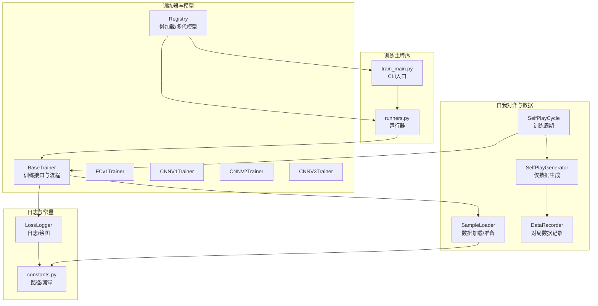
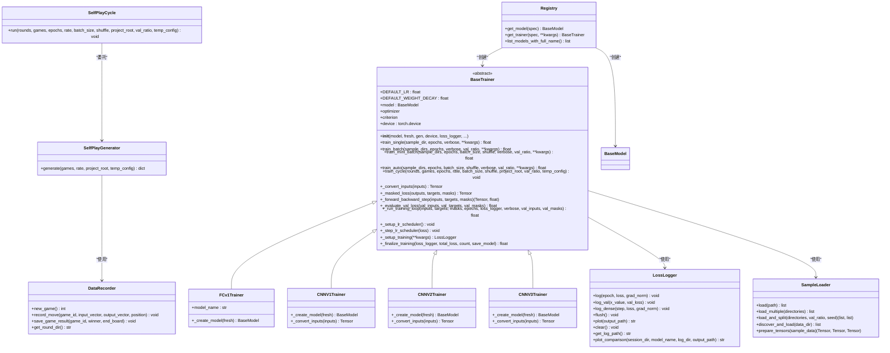
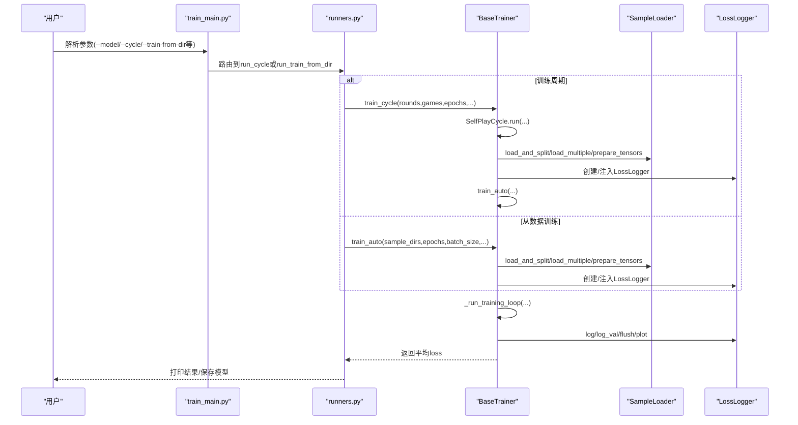
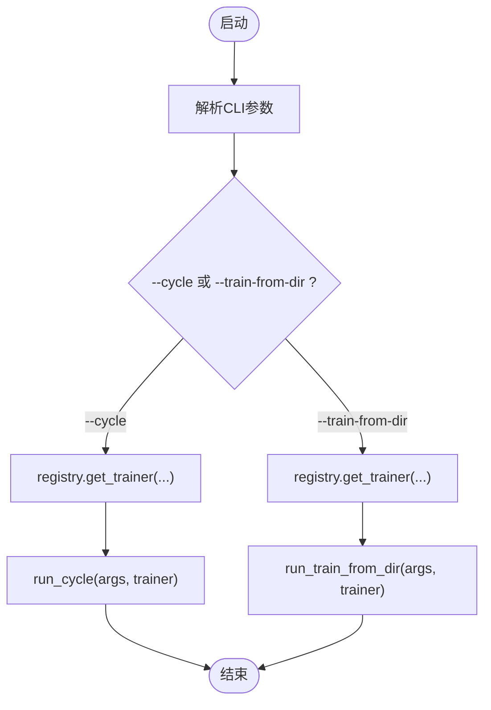
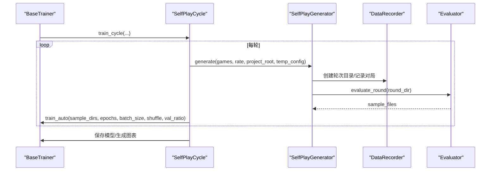
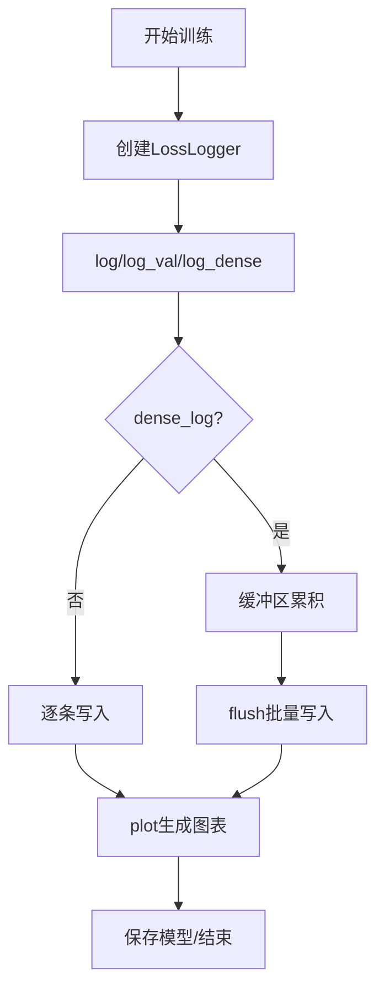
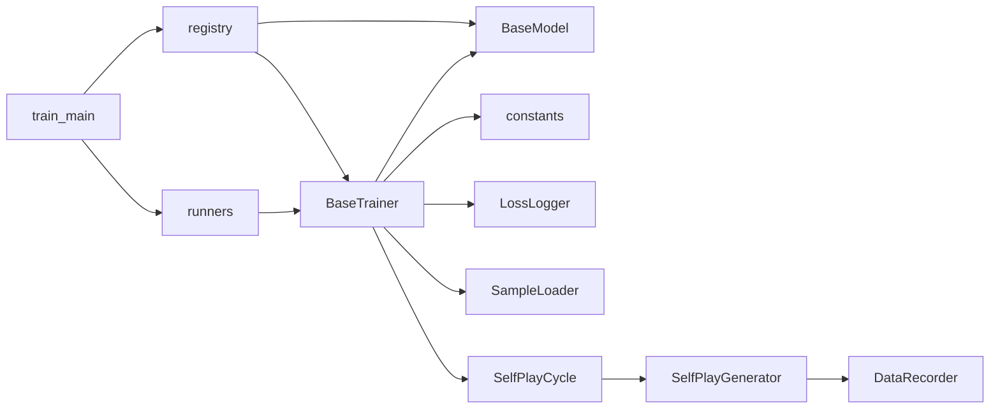

# 训练器API

<cite>
**本文引用的文件**
- [ai/base_trainer.py](file://ai/base_trainer.py)
- [ai/train_main.py](file://ai/train_main.py)
- [ai/self_play_generator.py](file://ai/self_play_generator.py)
- [ai/runners.py](file://ai/runners.py)
- [ai/constants.py](file://ai/constants.py)
- [ai/loss_logger.py](file://ai/loss_logger.py)
- [ai/sample_loader.py](file://ai/sample_loader.py)
- [ai/self_play_cycle.py](file://ai/self_play_cycle.py)
- [ai/data_recorder.py](file://ai/data_recorder.py)
- [ai/models/fc_v1/trainer.py](file://ai/models/fc_v1/trainer.py)
- [ai/models/cnn_v1/trainer.py](file://ai/models/cnn_v1/trainer.py)
- [ai/models/cnn_v2/trainer.py](file://ai/models/cnn_v2/trainer.py)
- [ai/models/cnn_v3/trainer.py](file://ai/models/cnn_v3/trainer.py)
- [ai/registry.py](file://ai/registry.py)
</cite>

## 目录
1. [简介](#简介)
2. [项目结构](#项目结构)
3. [核心组件](#核心组件)
4. [架构总览](#架构总览)
5. [详细组件分析](#详细组件分析)
6. [依赖分析](#依赖分析)
7. [性能考虑](#性能考虑)
8. [故障排查指南](#故障排查指南)
9. [结论](#结论)
10. [附录](#附录)

## 简介
本文件为AI训练器系统的完整API参考文档，聚焦于BaseTrainer抽象类的训练接口与训练主程序API，涵盖训练循环、验证、检查点保存与加载、训练流程控制、自我对弈生成器、日志记录、性能监控与故障恢复机制。文档面向开发者与高级用户，既提供高层概览，也给出代码级的结构与流程图示。

## 项目结构
训练器系统围绕“抽象训练器 + 多模型适配 + 训练主程序 + 自我对弈 + 日志与数据管线”组织，主要模块如下：
- 抽象训练器：BaseTrainer，提供通用训练接口与流程控制
- 模型训练器实现：各模型的trainer子类，覆盖模型创建与输入转换
- 训练主程序：train_main.py，封装CLI参数解析与运行器路由
- 自我对弈：SelfPlayCycle与SelfPlayGenerator，生成训练样本
- 日志与数据：LossLogger、SampleLoader、DataRecorder
- 注册表：registry.py，统一模型与训练器的懒加载与多代模型支持

**图表来源**
- [ai/base_trainer.py](file://ai/base_trainer.py)
- [ai/train_main.py](file://ai/train_main.py)
- [ai/self_play_cycle.py](file://ai/self_play_cycle.py)
- [ai/self_play_generator.py](file://ai/self_play_generator.py)
- [ai/sample_loader.py](file://ai/sample_loader.py)
- [ai/data_recorder.py](file://ai/data_recorder.py)
- [ai/loss_logger.py](file://ai/loss_logger.py)
- [ai/constants.py](file://ai/constants.py)
- [ai/registry.py](file://ai/registry.py)

**章节来源**
- [ai/base_trainer.py](file://ai/base_trainer.py)
- [ai/train_main.py](file://ai/train_main.py)
- [ai/self_play_cycle.py](file://ai/self_play_cycle.py)
- [ai/self_play_generator.py](file://ai/self_play_generator.py)
- [ai/sample_loader.py](file://ai/sample_loader.py)
- [ai/data_recorder.py](file://ai/data_recorder.py)
- [ai/loss_logger.py](file://ai/loss_logger.py)
- [ai/constants.py](file://ai/constants.py)
- [ai/registry.py](file://ai/registry.py)

## 核心组件
- BaseTrainer：定义训练器抽象接口与通用训练流程，包括train_single、train_batch、train_mini_batch、train_auto、train_cycle等；提供学习率调度、掩码损失、训练循环、验证、日志与模型保存等能力。
- 训练主程序：train_main.py提供CLI参数解析与运行器路由，支持训练周期与从已有数据训练两种模式。
- 自我对弈：SelfPlayCycle与SelfPlayGenerator负责模型自我对弈、评价与样本生成，支持温度采样与中断恢复。
- 日志与数据：LossLogger负责训练日志记录与曲线图生成；SampleLoader负责从JSON样本到PyTorch张量的转换；DataRecorder负责对局数据持久化。
- 注册表：registry.py统一管理模型与训练器映射，支持多代模型指定与懒加载。

**章节来源**
- [ai/base_trainer.py](file://ai/base_trainer.py)
- [ai/train_main.py](file://ai/train_main.py)
- [ai/self_play_cycle.py](file://ai/self_play_cycle.py)
- [ai/self_play_generator.py](file://ai/self_play_generator.py)
- [ai/loss_logger.py](file://ai/loss_logger.py)
- [ai/sample_loader.py](file://ai/sample_loader.py)
- [ai/data_recorder.py](file://ai/data_recorder.py)
- [ai/registry.py](file://ai/registry.py)

## 架构总览
训练器系统采用“抽象基类 + 具体模型适配 + 主程序入口 + 自我对弈 + 日志数据”的分层设计。BaseTrainer提供统一训练接口，具体模型训练器覆盖模型创建与输入转换；训练主程序通过注册表获取训练器并路由到相应运行器；自我对弈模块生成样本并交由训练器训练；LossLogger与SampleLoader贯穿训练全流程。

**图表来源**
- [ai/base_trainer.py](file://ai/base_trainer.py)
- [ai/models/fc_v1/trainer.py](file://ai/models/fc_v1/trainer.py)
- [ai/models/cnn_v1/trainer.py](file://ai/models/cnn_v1/trainer.py)
- [ai/models/cnn_v2/trainer.py](file://ai/models/cnn_v2/trainer.py)
- [ai/models/cnn_v3/trainer.py](file://ai/models/cnn_v3/trainer.py)
- [ai/loss_logger.py](file://ai/loss_logger.py)
- [ai/sample_loader.py](file://ai/sample_loader.py)
- [ai/self_play_cycle.py](file://ai/self_play_cycle.py)
- [ai/self_play_generator.py](file://ai/self_play_generator.py)
- [ai/data_recorder.py](file://ai/data_recorder.py)
- [ai/registry.py](file://ai/registry.py)

## 详细组件分析

### BaseTrainer抽象类API
- 初始化与设备选择
  - 支持显式指定设备或自动检测GPU/CPU；模型网络自动迁移至设备；AdamW优化器按需创建；默认L1Loss掩码损失。
  - 学习率调度器支持step/plateau两种类型，可配置衰减参数。
- 训练接口
  - train_single：单轮次训练，从单个sample目录加载数据，适合快速验证。
  - train_batch：全量更新训练，合并多个样本目录数据，每个epoch仅一次参数更新，支持可选验证集。
  - train_mini_batch：小批量训练，每个epoch内按batch多次前向+反向+参数更新，支持可选验证集与密集日志。
  - train_auto：自动选择训练方法，根据batch_size是否提供决定使用train_batch或train_mini_batch。
  - train_cycle：训练周期，委托SelfPlayCycle执行多轮自我对弈+评价+训练。
- 验证与损失
  - _evaluate_val_loss：在验证集上评估loss，使用eval模式与no_grad避免梯度计算。
  - _masked_loss：计算掩码L1损失，mask为1的位置求平均。
- 训练循环与日志
  - _run_training_loop：统一训练循环，支持键盘中断、学习率调度、日志记录与图表生成。
  - _setup_training/_finalize_training：训练前后环境设置与收尾（生成图表、保存模型）。
- 输入转换与模型抽象
  - _convert_inputs：默认FC输入转换；CNN模型需覆盖为4D张量。
  - _create_model/model_name：抽象方法，子类必须实现模型创建与名称。
- 学习率调度
  - _setup_lr_scheduler/_step_lr_scheduler：封装StepLR与ReduceLROnPlateau的创建与step调用。

**图表来源**
- [ai/train_main.py](file://ai/train_main.py)
- [ai/runners.py](file://ai/runners.py)
- [ai/base_trainer.py](file://ai/base_trainer.py)
- [ai/sample_loader.py](file://ai/sample_loader.py)
- [ai/loss_logger.py](file://ai/loss_logger.py)

**章节来源**
- [ai/base_trainer.py](file://ai/base_trainer.py)

### 训练主程序API（train_main.py）
- CLI参数
  - --model：指定模型，支持多代模型如cnn_v3.1
  - --cycle：开启训练周期模式
  - --rounds/--games/--epochs：周期轮次、每轮对局数、每轮训练轮数
  - --rate：奖励衰减率，传给Evaluator
  - --fresh：强制新建模型
  - --train-from-dir：从已有数据目录或文件训练
  - --batch-size/--shuffle：小批量训练参数
  - --lr-scheduler/--lr-step-size/--lr-gamma/--lr-patience/--lr-factor：学习率调度
  - --val-ratio：验证集比例
  - --no-temp-sampling/--temperature/--temp-moves/--temp-side/--temp-seed：温度采样参数（仅周期模式）
- 参数校验与路由
  - --cycle与--train-from-dir二选一
  - 通过registry.get_trainer创建训练器实例
  - 路由到run_cycle或run_train_from_dir执行

**图表来源**
- [ai/train_main.py](file://ai/train_main.py)
- [ai/registry.py](file://ai/registry.py)
- [ai/runners.py](file://ai/runners.py)

**章节来源**
- [ai/train_main.py](file://ai/train_main.py)

### 自我对弈生成器API（SelfPlayGenerator与SelfPlayCycle）
- SelfPlayGenerator.generate
  - 执行模型自我对弈，生成对局数据并调用Evaluator生成样本
  - 支持温度采样配置与项目根目录参数
  - 返回轮次目录、训练数据目录、样本目录列表、样本数量与对局结果
- SelfPlayCycle.run
  - 多轮训练周期：每轮自我对弈→评价→训练
  - 自动创建会话目录与LossLogger（轮级/epoch级）
  - 支持中断恢复、模型保存、合并对比图生成

**图表来源**
- [ai/self_play_cycle.py](file://ai/self_play_cycle.py)
- [ai/self_play_generator.py](file://ai/self_play_generator.py)
- [ai/data_recorder.py](file://ai/data_recorder.py)

**章节来源**
- [ai/self_play_generator.py](file://ai/self_play_generator.py)
- [ai/self_play_cycle.py](file://ai/self_play_cycle.py)

### 日志记录与性能监控（LossLogger）
- 日志记录
  - log：记录epoch/step级loss与可选梯度范数
  - log_val：记录验证集loss（与train loss分离）
  - log_dense：小批量密集日志（内存缓冲，flush批量写入）
  - flush：批量写入缓冲区
- 图表生成
  - plot：生成loss曲线图，支持双Y轴（loss与grad norm）、叠加val loss、降采样
  - plot_comparison：合并对比多轮epoch级日志
- 目录与常量
  - LOSS_LOG_DIR：日志根目录，可通过环境变量覆盖
  - LOSS_LOG_INTERVAL：日志记录间隔

**图表来源**
- [ai/loss_logger.py](file://ai/loss_logger.py)
- [ai/constants.py](file://ai/constants.py)

**章节来源**
- [ai/loss_logger.py](file://ai/loss_logger.py)
- [ai/constants.py](file://ai/constants.py)

### 数据加载与准备（SampleLoader）
- 加载与合并
  - load/load_multiple：从单个或多个目录加载sample.json
  - load_and_split：按比例分割训练/验证集（样本级随机，可复现）
  - discover_and_load：递归发现并加载目录下所有.json文件
- 张量准备
  - prepare_tensors：将样本数据转换为inputs/targets/masks三元组张量，并移动到指定设备

**章节来源**
- [ai/sample_loader.py](file://ai/sample_loader.py)

### 模型训练器实现（各模型trainer）
- FCv1Trainer：继承BaseTrainer，实现模型创建与名称
- CNNV1Trainer/CNNV2Trainer/CNNV3Trainer：继承BaseTrainer，覆盖输入转换为CNN所需4D张量
- 多代模型：cnn_v3支持gen参数，通过registry解析模型指定字符串

**章节来源**
- [ai/models/fc_v1/trainer.py](file://ai/models/fc_v1/trainer.py)
- [ai/models/cnn_v1/trainer.py](file://ai/models/cnn_v1/trainer.py)
- [ai/models/cnn_v2/trainer.py](file://ai/models/cnn_v2/trainer.py)
- [ai/models/cnn_v3/trainer.py](file://ai/models/cnn_v3/trainer.py)
- [ai/registry.py](file://ai/registry.py)

## 依赖分析
- BaseTrainer依赖
  - BaseModel：模型抽象
  - constants：AI_DATA_DIR/TRAIN_DATA_DIR/LOSS_LOG_DIR/LOSS_LOG_INTERVAL
  - LossLogger：日志记录与绘图
  - SampleLoader：样本加载与张量准备
  - SelfPlayCycle：训练周期编排
- 训练主程序依赖
  - registry：模型/训练器解析与懒加载
  - runners：运行器逻辑（从数据训练/训练周期）
- 自我对弈依赖
  - engine、game_manager、data_recorder、evaluator
- 日志与数据
  - constants提供路径常量
  - LossLogger依赖matplotlib（可选）

**图表来源**
- [ai/base_trainer.py](file://ai/base_trainer.py)
- [ai/train_main.py](file://ai/train_main.py)
- [ai/runners.py](file://ai/runners.py)
- [ai/self_play_cycle.py](file://ai/self_play_cycle.py)
- [ai/self_play_generator.py](file://ai/self_play_generator.py)
- [ai/data_recorder.py](file://ai/data_recorder.py)
- [ai/constants.py](file://ai/constants.py)
- [ai/registry.py](file://ai/registry.py)

**章节来源**
- [ai/base_trainer.py](file://ai/base_trainer.py)
- [ai/train_main.py](file://ai/train_main.py)
- [ai/runners.py](file://ai/runners.py)
- [ai/self_play_cycle.py](file://ai/self_play_cycle.py)
- [ai/self_play_generator.py](file://ai/self_play_generator.py)
- [ai/data_recorder.py](file://ai/data_recorder.py)
- [ai/constants.py](file://ai/constants.py)
- [ai/registry.py](file://ai/registry.py)

## 性能考虑
- 设备与内存
  - 自动检测GPU并迁移模型与张量；小批量训练可降低显存占用；grad norm可用于梯度裁剪与异常检测
- 训练策略
  - train_mini_batch相比train_batch收敛更快、效率更高；建议在显存充足时启用
  - 验证集监控可结合ReduceLROnPlateau自动调整学习率
- 日志与绘图
  - 密集日志（dense_log）在小批量模式下启用，注意flush频率与磁盘IO
  - 大数据量时LossLogger自动降采样，避免图表过于密集
- 数据加载
  - SampleLoader支持递归发现与合并，减少手动组织成本；load_and_split保证可复现的训练/验证分割

[本节为通用指导，无需引用具体文件]

## 故障排查指南
- 训练中断
  - Ctrl+C触发中断：训练器自动保存模型与图表，提示“已保存当前进度”
  - SelfPlayCycle与runners同样具备中断恢复逻辑，尽量在轮次边界保存中间产物
- 路径与数据
  - --train-from-dir指向的路径不存在或无.json文件：返回错误并退出
  - SampleLoader.load_and_split的val_ratio非法：抛出异常
- 模型与训练器
  - 未知模型或不支持的模型：registry抛出异常
  - 多代模型未指定代数或非多代模型指定代数：校验失败
- 日志与绘图
  - matplotlib不可用：LossLogger降级为仅记录日志文件，不生成图表
  - 日志文件损坏：LossLogger忽略格式错误行，保证健壮性

**章节来源**
- [ai/base_trainer.py](file://ai/base_trainer.py)
- [ai/self_play_cycle.py](file://ai/self_play_cycle.py)
- [ai/runners.py](file://ai/runners.py)
- [ai/loss_logger.py](file://ai/loss_logger.py)
- [ai/sample_loader.py](file://ai/sample_loader.py)
- [ai/registry.py](file://ai/registry.py)

## 结论
本API文档系统性梳理了BaseTrainer抽象类的训练接口、训练主程序的使用方式、自我对弈生成器的流程与参数、以及日志记录与性能监控机制。通过注册表与多模型适配，系统实现了良好的扩展性与可维护性；通过LossLogger与SelfPlayCycle，训练过程具备完善的可观测性与可恢复性。建议在生产环境中优先采用小批量训练与验证集监控，并合理配置学习率调度与日志策略。

[本节为总结，无需引用具体文件]

## 附录
- 常用命令示例
  - 训练周期（如fc_v1或cnn_v3.2）：python ai/train_main.py --model fc_v1 --cycle
  - 从数据训练：python ai/train_main.py --model fc_v1 --train-from-dir ai/train_data/fc_v1_self_play_1 --epochs 1000
  - 启用小批量训练：--batch-size 32 --shuffle
  - 启用验证集：--val-ratio 0.2
  - 学习率调度：--lr-scheduler step --lr-step-size 500 --lr-gamma 0.9
- 关键参数速查
  - --model：模型名称（支持多代如cnn_v3.1）
  - --cycle/--train-from-dir：二选一
  - --rounds/--games/--epochs：周期参数
  - --rate：奖励衰减率
  - --batch-size/--shuffle：小批量参数
  - --lr-scheduler/--lr-step-size/--lr-gamma/--lr-patience/--lr-factor：学习率调度
  - --val-ratio：验证集比例
  - --no-temp-sampling/--temperature/--temp-moves/--temp-side/--temp-seed：温度采样（仅周期模式）

[本节为概览，无需引用具体文件]