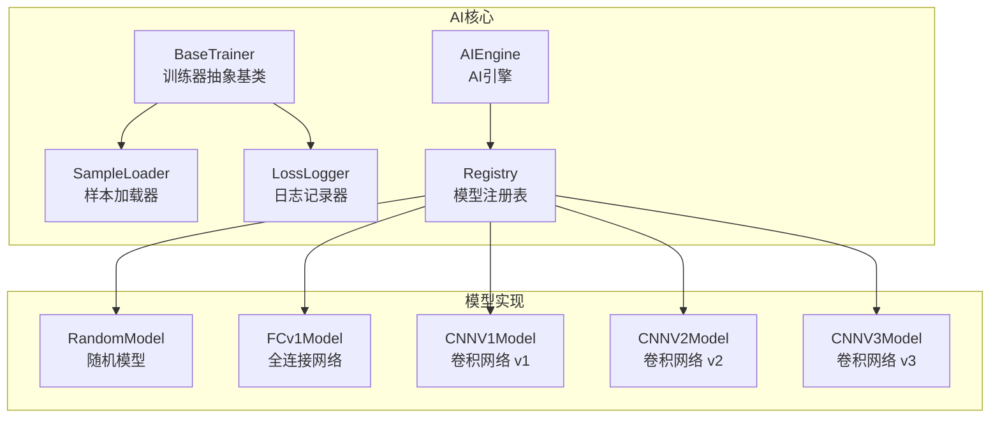
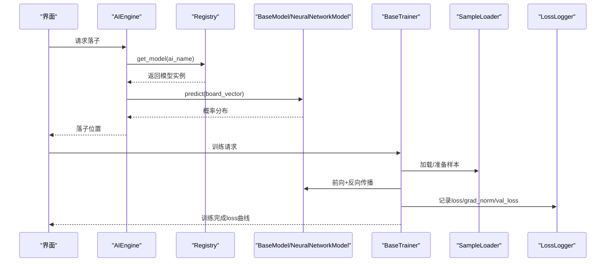
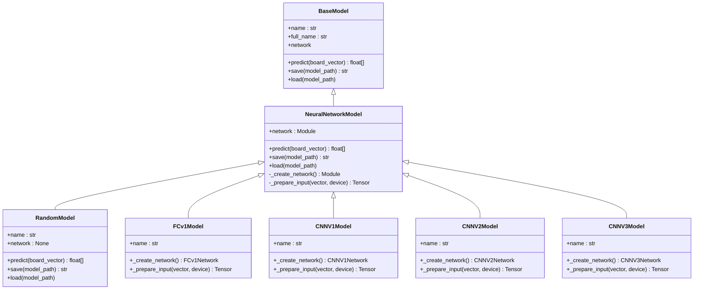
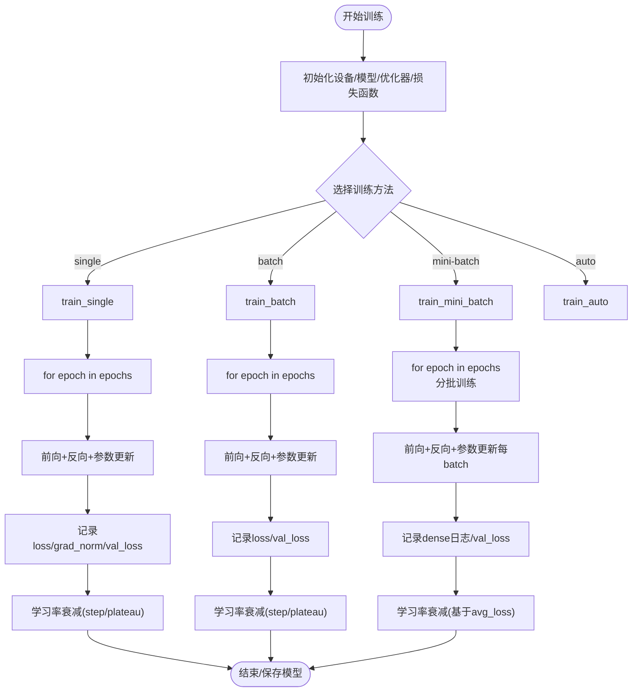
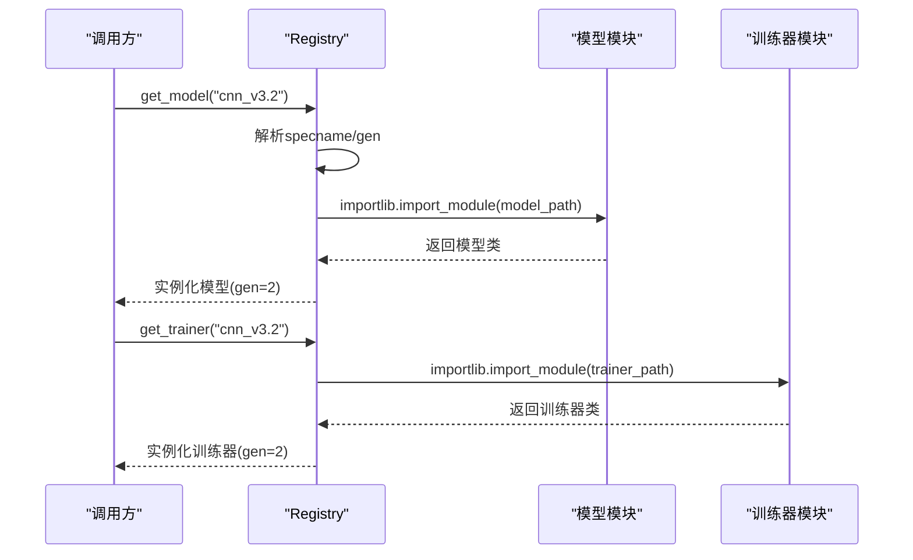
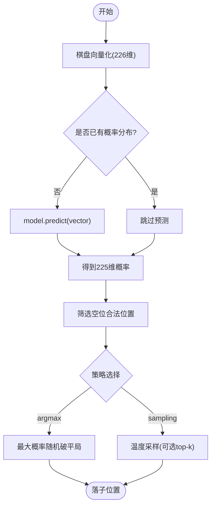
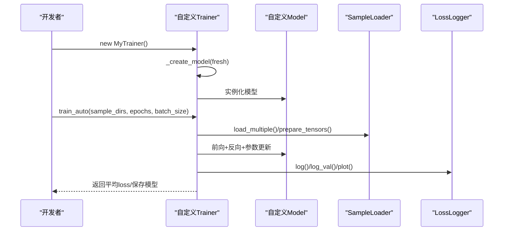
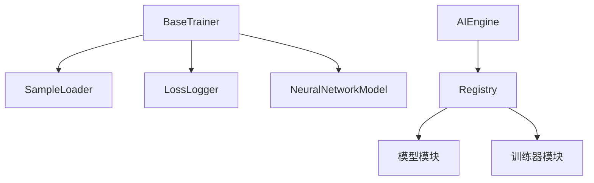

# AI模型开发

<cite>
**本文引用的文件**
- [ai/base_trainer.py](file://ai/base_trainer.py)
- [ai/models/__init__.py](file://ai/models/__init__.py)
- [ai/registry.py](file://ai/registry.py)
- [ai/engine.py](file://ai/engine.py)
- [ai/constants.py](file://ai/constants.py)
- [ai/sample_loader.py](file://ai/sample_loader.py)
- [ai/loss_logger.py](file://ai/loss_logger.py)
- [ai/models/fc_v1/model.py](file://ai/models/fc_v1/model.py)
- [ai/models/cnn_v1/model.py](file://ai/models/cnn_v1/model.py)
- [ai/models/cnn_v2/model.py](file://ai/models/cnn_v2/model.py)
- [ai/models/cnn_v3/model.py](file://ai/models/cnn_v3/model.py)
- [ai/models/random/model.py](file://ai/models/random/model.py)
- [ai/models/fc_v1/trainer.py](file://ai/models/fc_v1/trainer.py)
</cite>

## 目录
1. [简介](#简介)
2. [项目结构](#项目结构)
3. [核心组件](#核心组件)
4. [架构总览](#架构总览)
5. [详细组件分析](#详细组件分析)
6. [依赖分析](#依赖分析)
7. [性能考虑](#性能考虑)
8. [故障排查指南](#故障排查指南)
9. [结论](#结论)
10. [附录](#附录)

## 简介
本指南面向五子棋AI模型开发者，系统阐述AI模型接口规范、训练器开发方法、模型注册与动态加载机制，并提供从零实现新AI模型的完整步骤。内容涵盖：
- BaseModel/NeuralNetworkModel抽象类的设计理念与接口契约
- BaseTrainer基类的使用方式与训练循环实现
- 模型注册系统（registry）的注册、命名与动态加载
- 典型模型实现（全连接网络、卷积网络）的输入输出格式与预测方法
- 训练流程、损失函数设计、学习率调度与日志可视化
- 性能优化技巧、调试方法与测试策略

## 项目结构
本项目采用“模型-训练器-注册表-引擎”的分层组织方式：
- ai/base_trainer.py：训练器抽象基类，封装通用训练流程、设备选择、损失计算、学习率调度与日志记录
- ai/models/：内置模型实现（随机、FC v1、CNN v1/ v2/ v3）
- ai/registry.py：模型注册与动态加载，支持多代模型（cnn_v3.*）
- ai/engine.py：AI引擎，桥接UI与模型，负责落子策略选择
- ai/sample_loader.py：样本加载与张量准备
- ai/loss_logger.py：训练日志记录与loss曲线生成
- ai/constants.py：AI相关路径与全局常量

**图表来源**
- [ai/base_trainer.py:32-699](file://ai/base_trainer.py#L32-L699)
- [ai/sample_loader.py:67-240](file://ai/sample_loader.py#L67-L240)
- [ai/loss_logger.py:28-461](file://ai/loss_logger.py#L28-L461)
- [ai/registry.py:58-316](file://ai/registry.py#L58-L316)
- [ai/engine.py:44-194](file://ai/engine.py#L44-L194)
- [ai/models/random/model.py:10-64](file://ai/models/random/model.py#L10-L64)
- [ai/models/fc_v1/model.py:91-132](file://ai/models/fc_v1/model.py#L91-L132)
- [ai/models/cnn_v1/model.py:106-148](file://ai/models/cnn_v1/model.py#L106-L148)
- [ai/models/cnn_v2/model.py:117-160](file://ai/models/cnn_v2/model.py#L117-L160)
- [ai/models/cnn_v3/model.py:96-139](file://ai/models/cnn_v3/model.py#L96-L139)

**章节来源**
- [ai/base_trainer.py:1-699](file://ai/base_trainer.py#L1-L699)
- [ai/models/__init__.py:1-28](file://ai/models/__init__.py#L1-L28)
- [ai/registry.py:1-316](file://ai/registry.py#L1-L316)
- [ai/engine.py:1-194](file://ai/engine.py#L1-L194)
- [ai/constants.py:1-26](file://ai/constants.py#L1-L26)
- [ai/sample_loader.py:1-240](file://ai/sample_loader.py#L1-L240)
- [ai/loss_logger.py:1-461](file://ai/loss_logger.py#L1-L461)

## 核心组件
本节聚焦AI模型与训练器的核心抽象与契约。

- BaseModel/NeuralNetworkModel接口契约
  - 必须实现的抽象成员：save、load、predict
  - network属性：神经网络模块（若使用）；RandomModel返回None
  - full_name属性：模型完整名称（含代数），用于命名与保存
  - 典型实现：RandomModel（非神经网络）、FCv1Model/CNNV*Model（神经网络模型）

- BaseTrainer通用训练器
  - 设备自动检测（CUDA优先）、优化器（AdamW）、损失函数（L1Loss，带mask）
  - 训练方法：train_single、train_batch、train_mini_batch、train_auto、train_cycle
  - 学习率调度：StepLR、ReduceLROnPlateau
  - 日志：LossLogger支持稀疏/密集日志、验证集loss记录、loss曲线生成

- SampleLoader样本加载
  - 支持单/多目录样本加载、训练/验证集分割、张量准备（inputs、targets、masks）
  - 输入转换器可插拔（_convert_inputs），默认FC格式

- LossLogger日志
  - JSON Lines记录，支持epoch/step两种x轴、val_loss叠加、grad_norm双轴图
  - 可选matplotlib降级、降采样、对比图生成

**章节来源**
- [ai/models/random/model.py:10-64](file://ai/models/random/model.py#L10-L64)
- [ai/models/fc_v1/model.py:91-132](file://ai/models/fc_v1/model.py#L91-L132)
- [ai/models/cnn_v1/model.py:106-148](file://ai/models/cnn_v1/model.py#L106-L148)
- [ai/models/cnn_v2/model.py:117-160](file://ai/models/cnn_v2/model.py#L117-L160)
- [ai/models/cnn_v3/model.py:96-139](file://ai/models/cnn_v3/model.py#L96-L139)
- [ai/base_trainer.py:32-699](file://ai/base_trainer.py#L32-L699)
- [ai/sample_loader.py:67-240](file://ai/sample_loader.py#L67-L240)
- [ai/loss_logger.py:28-461](file://ai/loss_logger.py#L28-L461)

## 架构总览
下图展示了从引擎到模型、再到训练器与样本/日志的完整链路。

**图表来源**
- [ai/engine.py:18-194](file://ai/engine.py#L18-L194)
- [ai/registry.py:150-224](file://ai/registry.py#L150-L224)
- [ai/base_trainer.py:324-699](file://ai/base_trainer.py#L324-L699)
- [ai/sample_loader.py:206-240](file://ai/sample_loader.py#L206-L240)
- [ai/loss_logger.py:124-177](file://ai/loss_logger.py#L124-L177)

## 详细组件分析

### BaseModel/NeuralNetworkModel抽象类
- 设计理念
  - 统一模型接口：predict、save、load、network、full_name
  - 神经网络模型通过NeuralNetworkModel复用通用逻辑（初始化、前向、保存/加载）
  - 非神经网络模型（如RandomModel）仍遵循BaseModel契约，但network=None

- 关键接口与职责
  - predict：接收226维向量，返回225维概率分布
  - save/load：模型持久化（路径策略由具体模型实现）
  - network：神经网络模块或None
  - full_name：含代数的完整模型名（多代模型支持）

**图表来源**
- [ai/models/random/model.py:10-64](file://ai/models/random/model.py#L10-L64)
- [ai/models/fc_v1/model.py:91-132](file://ai/models/fc_v1/model.py#L91-L132)
- [ai/models/cnn_v1/model.py:106-148](file://ai/models/cnn_v1/model.py#L106-L148)
- [ai/models/cnn_v2/model.py:117-160](file://ai/models/cnn_v2/model.py#L117-L160)
- [ai/models/cnn_v3/model.py:96-139](file://ai/models/cnn_v3/model.py#L96-L139)

**章节来源**
- [ai/models/random/model.py:10-64](file://ai/models/random/model.py#L10-L64)
- [ai/models/fc_v1/model.py:91-132](file://ai/models/fc_v1/model.py#L91-L132)
- [ai/models/cnn_v1/model.py:106-148](file://ai/models/cnn_v1/model.py#L106-L148)
- [ai/models/cnn_v2/model.py:117-160](file://ai/models/cnn_v2/model.py#L117-L160)
- [ai/models/cnn_v3/model.py:96-139](file://ai/models/cnn_v3/model.py#L96-L139)

### BaseTrainer训练器基类
- 训练流程
  - 设备选择：优先CUDA，否则CPU
  - 模型创建：支持fresh参数强制新建
  - 优化器：AdamW（解耦权重衰减）
  - 损失函数：L1Loss（Masked L1 Loss）
  - 训练方法：
    - train_single：单样本目录训练
    - train_batch：全量更新，支持验证集
    - train_mini_batch：mini-batch训练，支持密集日志与验证
    - train_auto：自动选择batch或mini-batch
    - train_cycle：自对弈训练周期

- 学习率调度
  - StepLR：按epoch衰减
  - ReduceLROnPlateau：基于验证loss的早停式衰减

- 日志与可视化
  - LossLogger支持epoch/step两种日志、val_loss叠加、grad_norm双轴图
  - 支持生成loss曲线图与轮次对比图

**图表来源**
- [ai/base_trainer.py:257-620](file://ai/base_trainer.py#L257-L620)
- [ai/loss_logger.py:124-177](file://ai/loss_logger.py#L124-L177)

**章节来源**
- [ai/base_trainer.py:32-699](file://ai/base_trainer.py#L32-L699)
- [ai/loss_logger.py:28-461](file://ai/loss_logger.py#L28-L461)

### 模型注册系统（Registry）
- 功能
  - 统一管理模型与训练器映射，支持多代模型（cnn_v3.*）
  - 懒加载：首次使用时才导入模块
  - 规范化命名：模型名禁止包含“.”；多代模型通过“模型名.代数”指定

- 关键流程
  - get_model/spec解析（支持“模型名”或“模型名.代数”）
  - get_trainer/spec解析（训练器存在性校验）
  - list_models_with_full_name：枚举可加载的完整模型名（含代数）

**图表来源**
- [ai/registry.py:103-224](file://ai/registry.py#L103-L224)

**章节来源**
- [ai/registry.py:1-316](file://ai/registry.py#L1-L316)

### AI引擎（AIEngine）
- 职责
  - 将棋盘状态转换为226维向量
  - 调用模型predict获取225维概率分布
  - 根据策略（argmax/sampling）选择落子位置

- 策略
  - argmax：最大概率合法位置，平局时随机打破
  - sampling：温度采样，支持top-k截断与自定义随机源

**图表来源**
- [ai/engine.py:67-142](file://ai/engine.py#L67-L142)

**章节来源**
- [ai/engine.py:1-194](file://ai/engine.py#L1-L194)

### 典型模型实现

#### 全连接网络（FC v1）
- 网络结构：输入层(226) -> 5层隐藏(1000, ReLU) -> 输出层(225) -> Softmax
- 输入格式：226维向量（展平棋盘+当前玩家）
- 预测：直接前向，返回225维概率分布

**章节来源**
- [ai/models/fc_v1/model.py:1-132](file://ai/models/fc_v1/model.py#L1-L132)

#### 卷积网络（CNN v1/v2/v3）
- CNN v1：3层卷积（3→32→64→128）+2层全连接（28800→150→225）
- CNN v2：统一64通道，FC1从28800→64，显著降低参数量
- CNN v3：纯卷积（无FC/BatchNorm/Dropout），1×1卷积替代全连接
- 输入格式：(3, 15, 15)张量（黑子、白子、当前玩家）
- 预测：前向后Softmax，输出225维概率分布

**章节来源**
- [ai/models/cnn_v1/model.py:1-148](file://ai/models/cnn_v1/model.py#L1-L148)
- [ai/models/cnn_v2/model.py:1-160](file://ai/models/cnn_v2/model.py#L1-L160)
- [ai/models/cnn_v3/model.py:1-139](file://ai/models/cnn_v3/model.py#L1-L139)

#### 随机模型（Random）
- 行为：对空位均匀分配概率，已落子位置概率为0
- 适用：基准对照、调试阶段

**章节来源**
- [ai/models/random/model.py:1-64](file://ai/models/random/model.py#L1-L64)

### 训练器开发指南

#### 基于BaseTrainer的训练器实现步骤
- 继承BaseTrainer，实现：
  - _create_model(fresh)：返回具体模型实例
  - model_name属性：返回模型名称字符串
- 可选覆盖：
  - _convert_inputs：针对CNN模型返回(3,15,15)张量
  - DEFAULT_LR/DEFAULT_WEIGHT_DECAY：学习率与权重衰减
- 训练方法选择：
  - 小数据集：train_single或train_batch
  - 大数据集：train_mini_batch（建议）
  - 自对弈：train_cycle

**图表来源**
- [ai/base_trainer.py:575-620](file://ai/base_trainer.py#L575-L620)
- [ai/models/fc_v1/trainer.py:11-44](file://ai/models/fc_v1/trainer.py#L11-L44)

**章节来源**
- [ai/base_trainer.py:32-699](file://ai/base_trainer.py#L32-L699)
- [ai/models/fc_v1/trainer.py:1-44](file://ai/models/fc_v1/trainer.py#L1-L44)

## 依赖分析
- 模块耦合
  - BaseTrainer依赖SampleLoader、LossLogger、模型的network属性
  - Registry依赖importlib按需导入模型/训练器模块
  - Engine依赖Registry加载模型
- 外部依赖
  - PyTorch（神经网络）、matplotlib（可选，用于绘图）

**图表来源**
- [ai/base_trainer.py:14-18](file://ai/base_trainer.py#L14-L18)
- [ai/registry.py:83-100](file://ai/registry.py#L83-L100)
- [ai/engine.py:38-41](file://ai/engine.py#L38-L41)

**章节来源**
- [ai/base_trainer.py:1-699](file://ai/base_trainer.py#L1-L699)
- [ai/registry.py:1-316](file://ai/registry.py#L1-L316)
- [ai/engine.py:1-194](file://ai/engine.py#L1-L194)

## 性能考虑
- 设备加速
  - 自动检测CUDA，优先使用GPU；注意显存占用与batch size平衡
- 批训练策略
  - mini-batch：更快收敛、更高效；建议开启dense_log并定期flush
  - batch：全量更新，适合小数据集
- 网络结构
  - CNN v2/CNN v3显著降低参数量，提升推理速度
- 日志与可视化
  - 大量日志写盘可能成为瓶颈，合理设置LOSS_LOG_INTERVAL
  - matplotlib降级处理，避免阻塞训练

[本节为通用指导，无需特定文件引用]

## 故障排查指南
- 模型加载失败
  - 检查模型名称与代数是否正确（Registry校验）
  - 多代模型必须指定代数，非多代模型不可指定代数
- 训练中断
  - Ctrl+C触发保存与图表生成；检查保存路径与权限
- 损失异常
  - 检查mask与target格式一致性；确认L1Loss与Softmax输出
- 可视化问题
  - matplotlib不可用时自动降级；确保JSONL日志文件存在

**章节来源**
- [ai/registry.py:164-224](file://ai/registry.py#L164-L224)
- [ai/base_trainer.py:314-322](file://ai/base_trainer.py#L314-L322)
- [ai/loss_logger.py:196-294](file://ai/loss_logger.py#L196-L294)

## 结论
本指南提供了从接口契约、训练器实现到注册与动态加载的完整开发路径。通过遵循BaseModel/NeuralNetworkModel的抽象约定与BaseTrainer的通用训练流程，开发者可以快速实现并迭代不同类型的AI模型，结合LossLogger与自对弈训练周期，持续优化模型性能。

[本节为总结，无需特定文件引用]

## 附录

### AI模型接口规范摘要
- 必须实现
  - predict：输入226维向量，输出225维概率分布
  - save/load：模型持久化
  - network：神经网络模块或None
  - full_name：完整模型名（含代数）
- 典型模型
  - RandomModel：随机策略
  - FCv1Model：全连接网络
  - CNNV*Model：卷积网络系列

**章节来源**
- [ai/models/random/model.py:10-64](file://ai/models/random/model.py#L10-L64)
- [ai/models/fc_v1/model.py:91-132](file://ai/models/fc_v1/model.py#L91-L132)
- [ai/models/cnn_v1/model.py:106-148](file://ai/models/cnn_v1/model.py#L106-L148)
- [ai/models/cnn_v2/model.py:117-160](file://ai/models/cnn_v2/model.py#L117-L160)
- [ai/models/cnn_v3/model.py:96-139](file://ai/models/cnn_v3/model.py#L96-L139)

### 训练器开发清单
- 继承BaseTrainer，实现：
  - _create_model(fresh)
  - model_name
- 可选优化：
  - _convert_inputs（CNN模型）
  - 学习率调度配置
  - 日志策略（dense/sparse）

**章节来源**
- [ai/base_trainer.py:32-699](file://ai/base_trainer.py#L32-L699)
- [ai/models/fc_v1/trainer.py:11-44](file://ai/models/fc_v1/trainer.py#L11-L44)

### 模型注册与命名规范
- 基础模型名：random、fc_v1、cnn_v1、cnn_v2、cnn_v3
- 多代模型：cnn_v3.1、cnn_v3.2 等
- 规范要求：
  - 模型名禁止包含“.”
  - 多代模型必须指定代数
  - 无训练器模型（如random）注册时trainer_path为None

**章节来源**
- [ai/registry.py:58-72](file://ai/registry.py#L58-L72)
- [ai/registry.py:150-224](file://ai/registry.py#L150-L224)

### 输入输出格式规范
- FC模型
  - 输入：(N, 226)浮点张量
  - 输出：(N, 225)概率分布
- CNN模型
  - 输入：(N, 3, 15, 15)张量
  - 输出：(N, 225)概率分布

**章节来源**
- [ai/base_trainer.py:662-676](file://ai/base_trainer.py#L662-L676)
- [ai/models/cnn_v1/model.py:134-147](file://ai/models/cnn_v1/model.py#L134-L147)
- [ai/models/cnn_v2/model.py:146-159](file://ai/models/cnn_v2/model.py#L146-L159)
- [ai/models/cnn_v3/model.py:125-138](file://ai/models/cnn_v3/model.py#L125-L138)

### 损失函数与掩码
- 损失函数：L1Loss（MAE），支持mask
- 掩码作用：仅对mask=1的位置计算损失，避免无效位置干扰
- 训练循环：每batch/epoch计算loss与grad_norm，记录到LossLogger

**章节来源**
- [ai/base_trainer.py:100-101](file://ai/base_trainer.py#L100-L101)
- [ai/base_trainer.py:678-698](file://ai/base_trainer.py#L678-L698)
- [ai/sample_loader.py:206-239](file://ai/sample_loader.py#L206-L239)