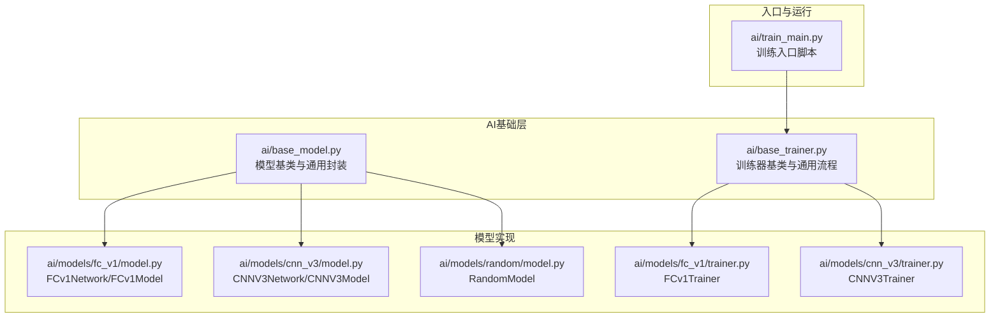
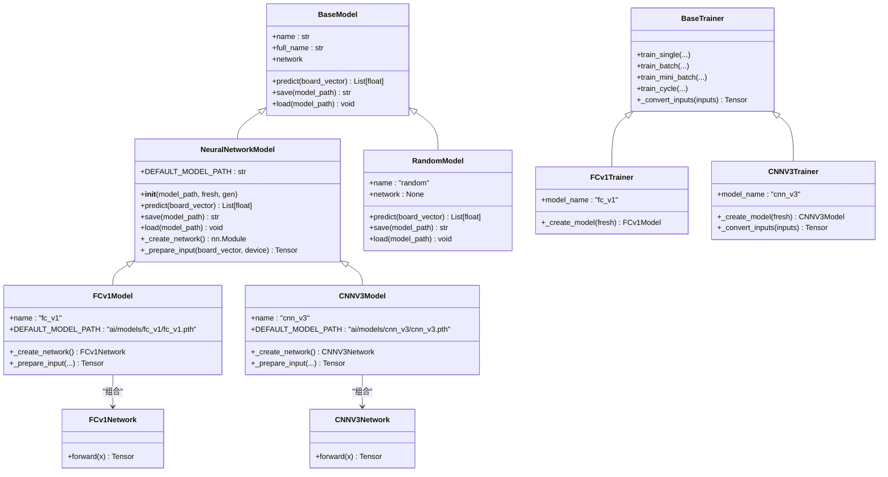
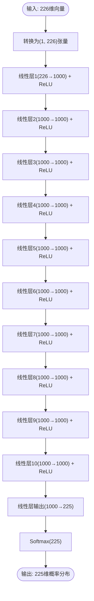
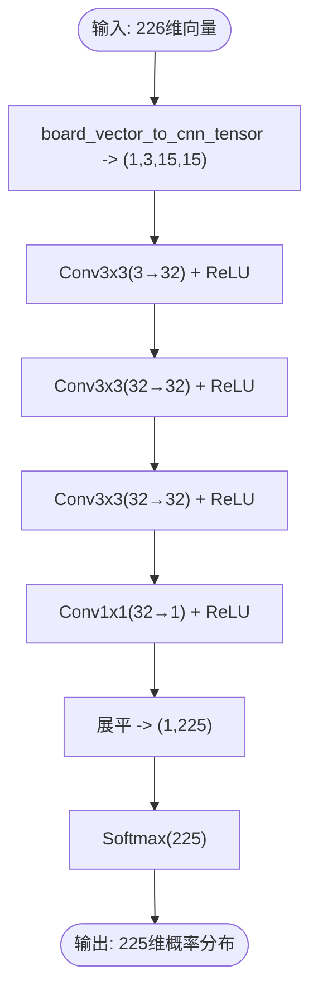
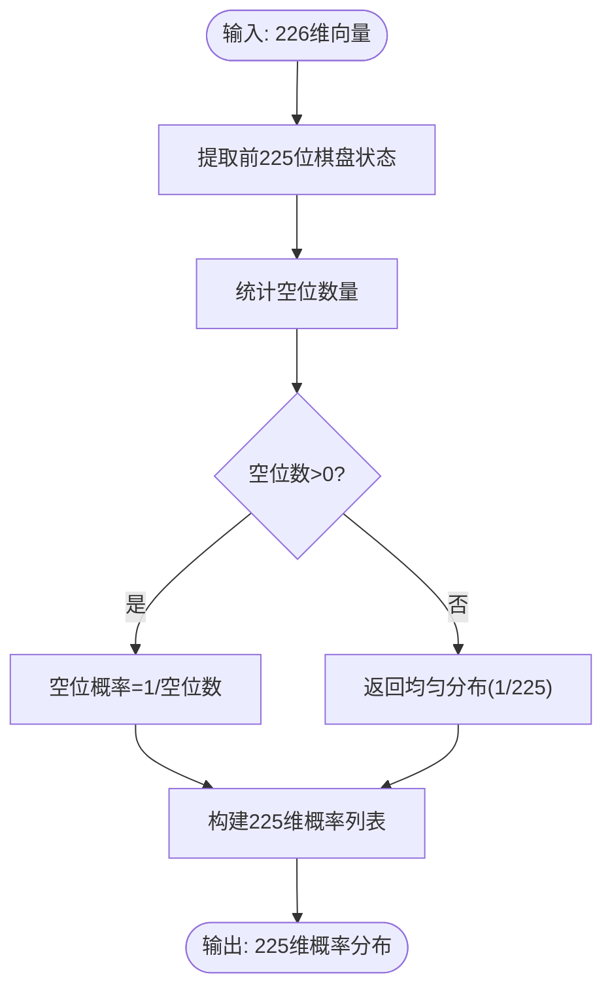
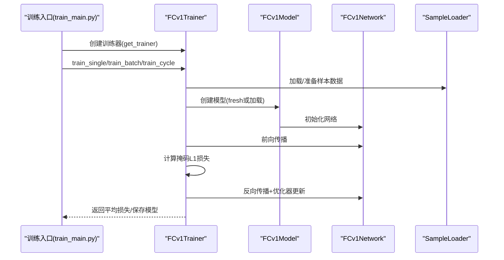
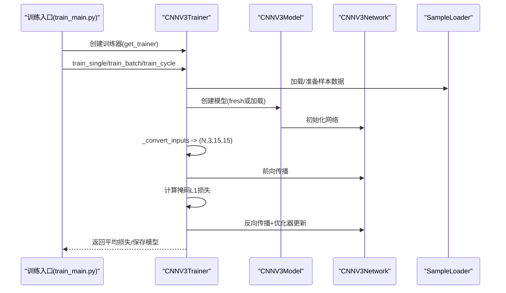
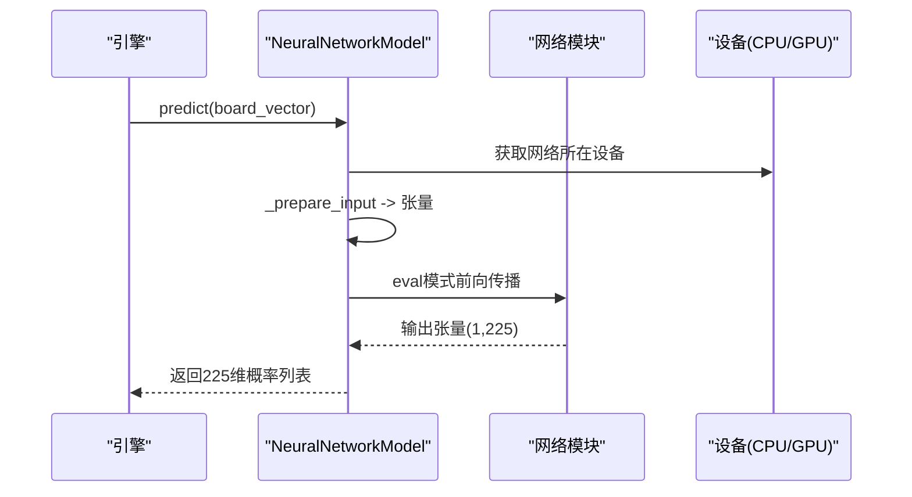
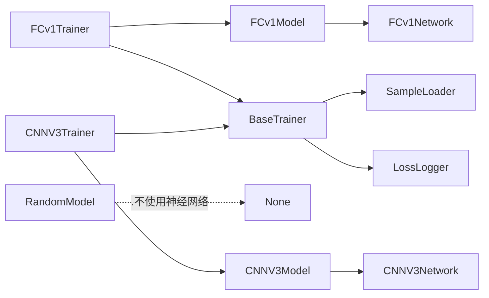

# 模型实现示例

<cite>
**本文引用的文件**
- [ai/models/fc_v1/model.py](file://ai/models/fc_v1/model.py)
- [ai/models/fc_v1/trainer.py](file://ai/models/fc_v1/trainer.py)
- [ai/models/fc_v1/MODEL.md](file://ai/models/fc_v1/MODEL.md)
- [ai/models/cnn_v3/model.py](file://ai/models/cnn_v3/model.py)
- [ai/models/cnn_v3/trainer.py](file://ai/models/cnn_v3/trainer.py)
- [ai/models/cnn_v3/gen3/训练方法.md](file://ai/models/cnn_v3/gen3/训练方法.md)
- [ai/models/random/model.py](file://ai/models/random/model.py)
- [ai/base_model.py](file://ai/base_model.py)
- [ai/base_trainer.py](file://ai/base_trainer.py)
- [ai/train_main.py](file://ai/train_main.py)
</cite>

## 目录
1. [简介](#简介)
2. [项目结构](#项目结构)
3. [核心组件](#核心组件)
4. [架构总览](#架构总览)
5. [详细组件分析](#详细组件分析)
6. [依赖分析](#依赖分析)
7. [性能考量](#性能考量)
8. [故障排查指南](#故障排查指南)
9. [结论](#结论)
10. [附录](#附录)

## 简介
本指南面向希望在五子棋环境中实现与训练AI模型的开发者，提供三种模型的完整实现参考：FCv1全连接网络模型、CNNV3卷积网络模型与Random随机模型。文档涵盖模型架构设计、网络层配置、激活函数选择、输入预处理、前向传播与输出后处理流程，并给出训练与推理的端到端示例路径。同时总结不同模型的优缺点与适用场景，并提供性能对比与优化建议。

## 项目结构
围绕AI模型的核心目录与文件如下：
- ai/base_model.py：定义统一的模型接口与通用神经网络封装
- ai/base_trainer.py：定义训练器抽象基类与通用训练流程
- ai/models/fc_v1：FCv1全连接模型与训练器
- ai/models/cnn_v3：CNNV3卷积模型与训练器
- ai/models/random：Random随机模型
- ai/train_main.py：多模型训练入口脚本

**图表来源**
- [ai/base_model.py:1-323](file://ai/base_model.py#L1-L323)
- [ai/base_trainer.py:1-699](file://ai/base_trainer.py#L1-L699)
- [ai/models/fc_v1/model.py:1-132](file://ai/models/fc_v1/model.py#L1-L132)
- [ai/models/fc_v1/trainer.py:1-44](file://ai/models/fc_v1/trainer.py#L1-L44)
- [ai/models/cnn_v3/model.py:1-139](file://ai/models/cnn_v3/model.py#L1-L139)
- [ai/models/cnn_v3/trainer.py:1-73](file://ai/models/cnn_v3/trainer.py#L1-L73)
- [ai/models/random/model.py:1-64](file://ai/models/random/model.py#L1-L64)
- [ai/train_main.py:1-234](file://ai/train_main.py#L1-L234)

**章节来源**
- [ai/base_model.py:1-323](file://ai/base_model.py#L1-L323)
- [ai/base_trainer.py:1-699](file://ai/base_trainer.py#L1-L699)
- [ai/models/fc_v1/model.py:1-132](file://ai/models/fc_v1/model.py#L1-L132)
- [ai/models/cnn_v3/model.py:1-139](file://ai/models/cnn_v3/model.py#L1-L139)
- [ai/models/random/model.py:1-64](file://ai/models/random/model.py#L1-L64)
- [ai/train_main.py:1-234](file://ai/train_main.py#L1-L234)

## 核心组件
- 模型基类与通用封装
  - BaseModel：定义统一接口（predict/name/save/load/network）
  - NeuralNetworkModel：封装PyTorch模型的通用逻辑（__init__/predict/save/load），子类仅需实现网络创建与输入准备
  - board_vector_to_cnn_tensor：CNN输入张量转换工具
- 训练器基类
  - BaseTrainer：统一训练流程（单轮次/批量/mini-batch/训练周期）、设备选择、优化器与学习率调度、掩码损失、日志与保存
- 模型实现
  - FCv1：10层隐藏层的全连接网络，输出225维reward
  - CNNV3：纯卷积网络，无BN/Dropout，用1×1卷积替代FC，输出15×15空间概率图
  - Random：对空位均匀分配概率，引擎据此随机选择

**章节来源**
- [ai/base_model.py:24-323](file://ai/base_model.py#L24-L323)
- [ai/base_trainer.py:32-699](file://ai/base_trainer.py#L32-L699)
- [ai/models/fc_v1/model.py:18-132](file://ai/models/fc_v1/model.py#L18-L132)
- [ai/models/cnn_v3/model.py:31-139](file://ai/models/cnn_v3/model.py#L31-L139)
- [ai/models/random/model.py:10-64](file://ai/models/random/model.py#L10-L64)

## 架构总览
下面的类图展示了模型与训练器之间的继承与组合关系，以及输入/输出的统一约定。

**图表来源**
- [ai/base_model.py:24-323](file://ai/base_model.py#L24-L323)
- [ai/models/fc_v1/model.py:91-132](file://ai/models/fc_v1/model.py#L91-L132)
- [ai/models/cnn_v3/model.py:96-139](file://ai/models/cnn_v3/model.py#L96-L139)
- [ai/models/random/model.py:10-64](file://ai/models/random/model.py#L10-L64)
- [ai/base_trainer.py:32-170](file://ai/base_trainer.py#L32-L170)
- [ai/models/fc_v1/trainer.py:11-44](file://ai/models/fc_v1/trainer.py#L11-L44)
- [ai/models/cnn_v3/trainer.py:13-44](file://ai/models/cnn_v3/trainer.py#L13-L44)

## 详细组件分析

### FCv1 全连接模型
- 架构设计
  - 输入层：226维（棋盘按行展开+当前落子方）
  - 隐藏层：10层，每层1000神经元，ReLU激活
  - 输出层：225维（每个位置的reward）
  - 激活函数：ReLU用于隐藏层，Softmax用于最终输出概率分布
- 网络层配置与复杂度
  - 参数量：约946万（见MODEL.md）
  - 计算复杂度：随层数与神经元数线性增长
- 输入预处理
  - 直接将226维向量转换为(1, 226)张量
- 前向传播
  - 逐层线性变换+ReLU，最后输出225维
- 输出后处理
  - Softmax得到概率分布（值域(0,1)，和为1）

**图表来源**
- [ai/models/fc_v1/model.py:18-88](file://ai/models/fc_v1/model.py#L18-L88)

**章节来源**
- [ai/models/fc_v1/model.py:1-132](file://ai/models/fc_v1/model.py#L1-L132)
- [ai/models/fc_v1/MODEL.md:1-81](file://ai/models/fc_v1/MODEL.md#L1-L81)

### CNNV3 卷积模型
- 架构设计
  - 输入：(15x15x3)通道（黑棋、白棋、当前落子方）
  - 卷积层：3层3×3卷积（统一32通道，ReLU），保持空间结构
  - 输出层：1×1卷积(32→1)直接输出15×15空间概率图，展平后Softmax
  - 激活函数：ReLU用于卷积层，Softmax用于最终输出
- 网络层配置与复杂度
  - 参数量：约1.9万（见cnn_v3_design.md）
  - 计算复杂度：受益于卷积的空间局部性，适合棋盘布局
- 输入预处理
  - 使用board_vector_to_cnn_tensor将226维向量转换为(1, 3, 15, 15)张量
- 前向传播
  - 3层卷积+ReLU，1层1×1卷积，展平后Softmax
- 输出后处理
  - 225维概率分布（值域(0,1)，和为1）

**图表来源**
- [ai/models/cnn_v3/model.py:31-93](file://ai/models/cnn_v3/model.py#L31-L93)
- [ai/base_model.py:278-323](file://ai/base_model.py#L278-L323)

**章节来源**
- [ai/models/cnn_v3/model.py:1-139](file://ai/models/cnn_v3/model.py#L1-L139)
- [ai/base_model.py:278-323](file://ai/base_model.py#L278-L323)
- [design/cnn_v3_design.md:1-173](file://design/cnn_v3_design.md#L1-L173)

### Random 随机模型
- 架构设计
  - 不使用神经网络，直接对空位均匀分配概率，已落子位置概率为0
- 输入预处理
  - 读取前225位棋盘状态，统计空位数量
- 输出后处理
  - 空位概率=1/空位数，非空位为0；若棋盘已满，返回均匀分布

**图表来源**
- [ai/models/random/model.py:35-64](file://ai/models/random/model.py#L35-L64)

**章节来源**
- [ai/models/random/model.py:1-64](file://ai/models/random/model.py#L1-L64)

### 训练流程与推理流程

#### FCv1 训练流程（序列图）

**图表来源**
- [ai/train_main.py:27-234](file://ai/train_main.py#L27-L234)
- [ai/base_trainer.py:324-603](file://ai/base_trainer.py#L324-L603)
- [ai/models/fc_v1/trainer.py:11-44](file://ai/models/fc_v1/trainer.py#L11-L44)
- [ai/models/fc_v1/model.py:91-132](file://ai/models/fc_v1/model.py#L91-L132)

**章节来源**
- [ai/train_main.py:1-234](file://ai/train_main.py#L1-L234)
- [ai/base_trainer.py:324-603](file://ai/base_trainer.py#L324-L603)
- [ai/models/fc_v1/trainer.py:1-44](file://ai/models/fc_v1/trainer.py#L1-L44)

#### CNNV3 训练流程（序列图）

**图表来源**
- [ai/train_main.py:27-234](file://ai/train_main.py#L27-L234)
- [ai/base_trainer.py:324-603](file://ai/base_trainer.py#L324-L603)
- [ai/models/cnn_v3/trainer.py:25-73](file://ai/models/cnn_v3/trainer.py#L25-L73)
- [ai/models/cnn_v3/model.py:96-139](file://ai/models/cnn_v3/model.py#L96-L139)

**章节来源**
- [ai/train_main.py:1-234](file://ai/train_main.py#L1-L234)
- [ai/base_trainer.py:324-603](file://ai/base_trainer.py#L324-L603)
- [ai/models/cnn_v3/trainer.py:1-73](file://ai/models/cnn_v3/trainer.py#L1-L73)

#### 推理流程（序列图）

**图表来源**
- [ai/base_model.py:195-231](file://ai/base_model.py#L195-L231)

**章节来源**
- [ai/base_model.py:195-231](file://ai/base_model.py#L195-L231)

## 依赖分析
- 组件耦合与内聚
  - 模型层：FCv1Model/CNNV3Model/RandomModel分别实现各自输入准备与网络结构，内聚高、耦合低
  - 训练器层：BaseTrainer提供统一训练流程，子类仅实现模型创建与输入转换，内聚高、耦合低
  - 基础层：board_vector_to_cnn_tensor被CNN模型共享，避免重复逻辑
- 外部依赖
  - PyTorch：神经网络框架与优化器
  - 样本加载：SampleLoader负责数据加载与张量准备
  - 可视化与日志：LossLogger负责损失曲线生成

**图表来源**
- [ai/base_trainer.py:122-125](file://ai/base_trainer.py#L122-L125)
- [ai/models/fc_v1/trainer.py:23-32](file://ai/models/fc_v1/trainer.py#L23-L32)
- [ai/models/cnn_v3/trainer.py:25-35](file://ai/models/cnn_v3/trainer.py#L25-L35)
- [ai/models/fc_v1/model.py:91-117](file://ai/models/fc_v1/model.py#L91-L117)
- [ai/models/cnn_v3/model.py:96-123](file://ai/models/cnn_v3/model.py#L96-L123)

**章节来源**
- [ai/base_trainer.py:1-699](file://ai/base_trainer.py#L1-L699)
- [ai/models/fc_v1/trainer.py:1-44](file://ai/models/fc_v1/trainer.py#L1-L44)
- [ai/models/cnn_v3/trainer.py:1-73](file://ai/models/cnn_v3/trainer.py#L1-L73)

## 性能考量
- 计算效率
  - FCv1：参数量大，前向/反向计算开销高，适合小批量或验证性实验
  - CNNV3：参数量小，卷积计算高效，适合大规模训练与部署
  - Random：O(1)时间复杂度，推理极快，适合基准或探索性实验
- 内存占用
  - CNNV3在GPU上优势明显，适合大批量训练
  - FCv1在小显存设备上可能受限
- 收敛速度
  - CNNV3由于卷积结构与较小参数量，通常收敛更快
  - FCv1需要更长训练时间，且易受输入表示与奖励信号稀疏性影响
- 适用场景
  - FCv1：教学演示、快速原型、对比研究
  - CNNV3：生产级部署、大规模自我对弈、资源受限环境
  - Random：基线对照、快速A/B测试

[本节为通用指导，无需列出具体文件来源]

## 故障排查指南
- 训练器初始化失败
  - 检查模型名称是否正确注册（train_main.py通过registry获取训练器）
  - 确认fresh参数与默认模型路径是否存在
- 设备选择问题
  - BaseTrainer自动检测CUDA，若无GPU则回退CPU；确认torch.cuda是否可用
- 掩码损失异常
  - 确认masks_tensor维度与outputs/targets一致，mask求和大于0
- 训练中断与保存
  - BaseTrainer捕获KeyboardInterrupt，自动保存模型与损失曲线
- CNN输入格式错误
  - 确认使用board_vector_to_cnn_tensor转换为(1,3,15,15)张量
- 随机模型无参数
  - RandomModel.network为None，不参与优化器与GPU移动

**章节来源**
- [ai/base_trainer.py:21-120](file://ai/base_trainer.py#L21-L120)
- [ai/base_trainer.py:214-238](file://ai/base_trainer.py#L214-L238)
- [ai/base_trainer.py:678-699](file://ai/base_trainer.py#L678-L699)
- [ai/models/cnn_v3/trainer.py:46-73](file://ai/models/cnn_v3/trainer.py#L46-L73)
- [ai/models/random/model.py:22-33](file://ai/models/random/model.py#L22-L33)

## 结论
本指南提供了FCv1、CNNV3与Random三种五子棋AI模型的完整实现参考。FCv1适合教学与对比，CNNV3在参数量与计算效率上更具优势，Random提供快速基线。结合BaseTrainer提供的统一训练流程与train_main入口，开发者可快速开展训练与推理实验，并根据任务需求选择合适模型。

[本节为总结性内容，无需列出具体文件来源]

## 附录

### 训练与推理示例路径
- FCv1
  - 训练入口：ai/train_main.py（--model fc_v1）
  - 训练器：ai/models/fc_v1/trainer.py
  - 模型：ai/models/fc_v1/model.py
  - 模型说明：ai/models/fc_v1/MODEL.md
- CNNV3
  - 训练入口：ai/train_main.py（--model cnn_v3）
  - 训练器：ai/models/cnn_v3/trainer.py
  - 模型：ai/models/cnn_v3/model.py
  - 训练方法：ai/models/cnn_v3/gen3/训练方法.md
- Random
  - 模型：ai/models/random/model.py

**章节来源**
- [ai/train_main.py:1-234](file://ai/train_main.py#L1-L234)
- [ai/models/fc_v1/trainer.py:1-44](file://ai/models/fc_v1/trainer.py#L1-L44)
- [ai/models/fc_v1/model.py:1-132](file://ai/models/fc_v1/model.py#L1-L132)
- [ai/models/fc_v1/MODEL.md:1-81](file://ai/models/fc_v1/MODEL.md#L1-L81)
- [ai/models/cnn_v3/trainer.py:1-73](file://ai/models/cnn_v3/trainer.py#L1-L73)
- [ai/models/cnn_v3/model.py:1-139](file://ai/models/cnn_v3/model.py#L1-L139)
- [ai/models/cnn_v3/gen3/训练方法.md:1-19](file://ai/models/cnn_v3/gen3/训练方法.md#L1-L19)
- [ai/models/random/model.py:1-64](file://ai/models/random/model.py#L1-L64)