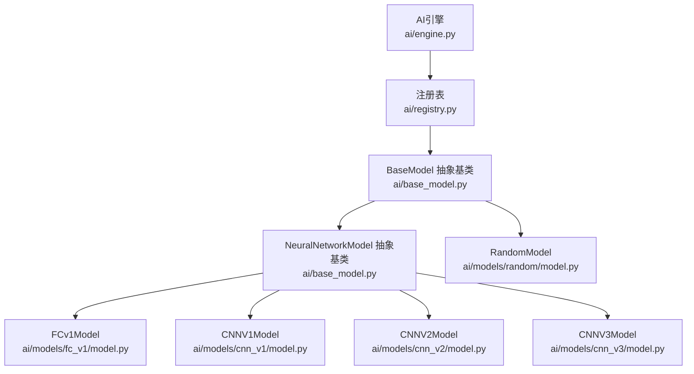
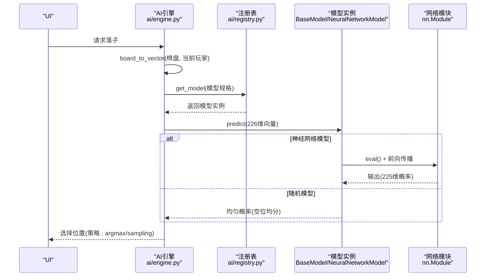
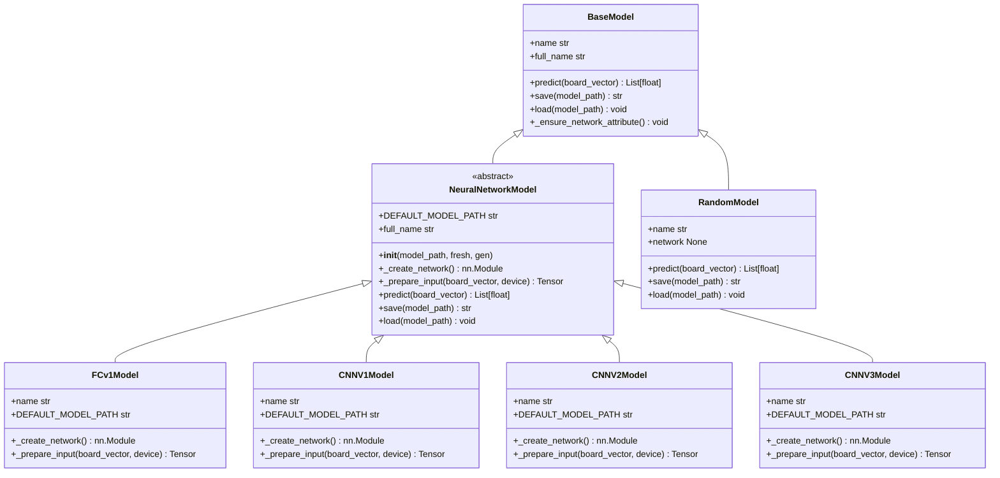
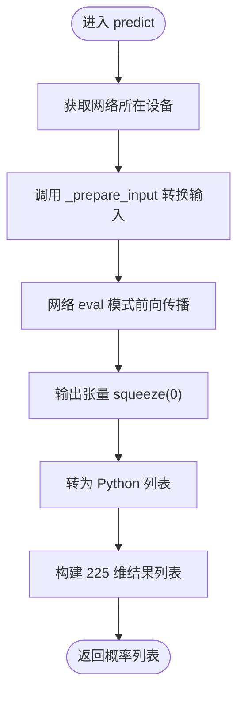
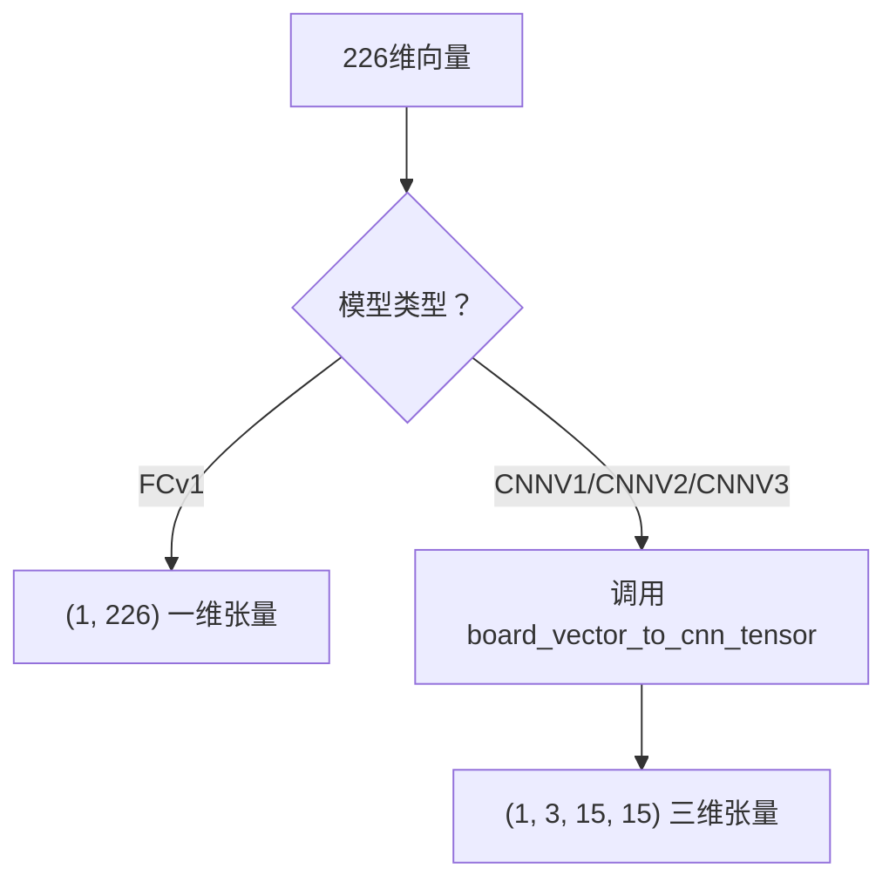
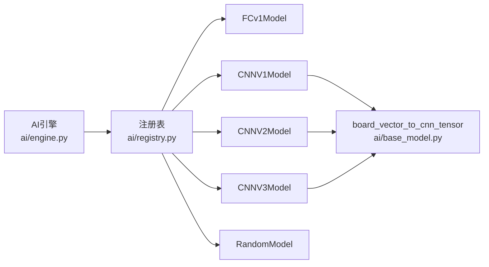

# 模型接口规范

<cite>
**本文引用的文件**
- [ai/base_model.py](file://ai/base_model.py)
- [ai/models/fc_v1/model.py](file://ai/models/fc_v1/model.py)
- [ai/models/cnn_v1/model.py](file://ai/models/cnn_v1/model.py)
- [ai/models/cnn_v2/model.py](file://ai/models/cnn_v2/model.py)
- [ai/models/cnn_v3/model.py](file://ai/models/cnn_v3/model.py)
- [ai/models/random/model.py](file://ai/models/random/model.py)
- [ai/engine.py](file://ai/engine.py)
- [ai/registry.py](file://ai/registry.py)
- [tests/ai/test_neural_network_model.py](file://tests/ai/test_neural_network_model.py)
- [tests/ai/test_base_model_multi_gen.py](file://tests/ai/test_base_model_multi_gen.py)
</cite>

## 目录
1. [简介](#简介)
2. [项目结构](#项目结构)
3. [核心组件](#核心组件)
4. [架构总览](#架构总览)
5. [详细组件分析](#详细组件分析)
6. [依赖分析](#依赖分析)
7. [性能考虑](#性能考虑)
8. [故障排查指南](#故障排查指南)
9. [结论](#结论)
10. [附录](#附录)

## 简介
本文件面向五子棋AI模型的接口规范，聚焦于BaseModel抽象基类的设计理念与核心接口要求，以及NeuralNetworkModel基类提供的通用功能。文档明确以下关键点：
- predict方法的输入输出格式规范：输入为226维棋盘向量（前225维按行展开棋盘状态，第226维为当前落子方），输出为225维概率分布（Softmax，值域(0,1)，和为1）。
- name属性的命名规范与多代模型的full_name扩展。
- save/load方法的实现要求与默认路径策略。
- NeuralNetworkModel的网络初始化、设备管理、前向传播流程。
- 不同模型类型的输入格式差异：FC模型的一维向量输入、CNN模型的三维张量输入。
- 错误处理与调试技巧，结合测试用例与实际模型实现进行说明。

## 项目结构
围绕模型接口规范，相关代码主要分布在以下模块：
- ai/base_model.py：定义BaseModel与NeuralNetworkModel，提供统一接口与通用逻辑。
- ai/models/fc_v1/model.py：FCv1模型实现，演示全连接网络的接口实现方式。
- ai/models/cnn_v1/model.py、ai/models/cnn_v2/model.py、ai/models/cnn_v3/model.py：CNN系列模型实现，演示卷积网络的接口实现方式。
- ai/models/random/model.py：RandomModel实现，演示非神经网络模型的接口实现方式。
- ai/engine.py：AI引擎，负责将棋盘转换为226维向量并调用模型predict。
- ai/registry.py：模型注册表，支持多代模型的名称解析与懒加载。
- tests/ai/test_neural_network_model.py、tests/ai/test_base_model_multi_gen.py：覆盖接口一致性、输入输出格式、多代模型行为与工具函数的测试。

**图表来源**
- [ai/engine.py:18-42](file://ai/engine.py#L18-L42)
- [ai/registry.py:58-72](file://ai/registry.py#L58-L72)
- [ai/base_model.py:24-105](file://ai/base_model.py#L24-L105)
- [ai/base_model.py:107-276](file://ai/base_model.py#L107-L276)
- [ai/models/fc_v1/model.py:91-132](file://ai/models/fc_v1/model.py#L91-L132)
- [ai/models/cnn_v1/model.py:106-148](file://ai/models/cnn_v1/model.py#L106-L148)
- [ai/models/cnn_v2/model.py:117-160](file://ai/models/cnn_v2/model.py#L117-L160)
- [ai/models/cnn_v3/model.py:96-139](file://ai/models/cnn_v3/model.py#L96-L139)
- [ai/models/random/model.py:10-64](file://ai/models/random/model.py#L10-L64)

**章节来源**
- [ai/base_model.py:1-323](file://ai/base_model.py#L1-L323)
- [ai/engine.py:1-194](file://ai/engine.py#L1-L194)
- [ai/registry.py:1-316](file://ai/registry.py#L1-L316)

## 核心组件
本节聚焦BaseModel与NeuralNetworkModel的设计与职责，以及各模型实现如何遵循接口规范。

- BaseModel
  - 角色：定义所有AI模型必须实现的统一接口，包括predict、name、save、load，以及network属性约定。
  - 关键点：network属性为实例属性（非抽象方法），子类在__init__中赋值；BaseTrainer依赖self.model.network存在，因此子类必须设置此属性。
  - full_name：默认返回name本身，多代模型可在子类中覆盖以包含代数信息。

- NeuralNetworkModel
  - 角色：为使用PyTorch的神经网络模型提供通用实现，子类仅需实现_network创建与_input准备。
  - 通用能力：
    - __init__：支持fresh、model_path与DEFAULT_MODEL_PATH的加载策略；多代模型支持gen参数，动态覆盖DEFAULT_MODEL_PATH至gen{i}/子目录。
    - predict：统一的前向传播流程（eval模式、禁用梯度、设备一致、输出转列表）。
    - save/load：保存/加载网络state_dict，自动创建目录；load后置网络为eval模式。
    - board_vector_to_cnn_tensor：CNN模型共用的输入转换工具函数。

- RandomModel
  - 角色：非神经网络模型示例，不使用神经网络（network返回None），predict返回均匀概率分布（空位均分，已落子位置为0）。

**章节来源**
- [ai/base_model.py:24-105](file://ai/base_model.py#L24-L105)
- [ai/base_model.py:107-276](file://ai/base_model.py#L107-L276)
- [ai/models/random/model.py:10-64](file://ai/models/random/model.py#L10-L64)

## 架构总览
下图展示了从引擎到模型的调用链路，以及模型类型对输入格式的影响。

**图表来源**
- [ai/engine.py:67-142](file://ai/engine.py#L67-L142)
- [ai/registry.py:150-184](file://ai/registry.py#L150-L184)
- [ai/base_model.py:195-230](file://ai/base_model.py#L195-L230)

**章节来源**
- [ai/engine.py:18-194](file://ai/engine.py#L18-L194)
- [ai/registry.py:150-184](file://ai/registry.py#L150-L184)

## 详细组件分析

### BaseModel与NeuralNetworkModel类图

**图表来源**
- [ai/base_model.py:24-105](file://ai/base_model.py#L24-L105)
- [ai/base_model.py:107-276](file://ai/base_model.py#L107-L276)
- [ai/models/fc_v1/model.py:91-132](file://ai/models/fc_v1/model.py#L91-L132)
- [ai/models/cnn_v1/model.py:106-148](file://ai/models/cnn_v1/model.py#L106-L148)
- [ai/models/cnn_v2/model.py:117-160](file://ai/models/cnn_v2/model.py#L117-L160)
- [ai/models/cnn_v3/model.py:96-139](file://ai/models/cnn_v3/model.py#L96-L139)
- [ai/models/random/model.py:10-64](file://ai/models/random/model.py#L10-L64)

**章节来源**
- [ai/base_model.py:24-323](file://ai/base_model.py#L24-L323)
- [ai/models/fc_v1/model.py:91-132](file://ai/models/fc_v1/model.py#L91-L132)
- [ai/models/cnn_v1/model.py:106-148](file://ai/models/cnn_v1/model.py#L106-L148)
- [ai/models/cnn_v2/model.py:117-160](file://ai/models/cnn_v2/model.py#L117-L160)
- [ai/models/cnn_v3/model.py:96-139](file://ai/models/cnn_v3/model.py#L96-L139)
- [ai/models/random/model.py:10-64](file://ai/models/random/model.py#L10-L64)

### predict方法输入输出规范
- 输入格式
  - 226维向量：前225维按行优先展开棋盘状态（0=空，1=黑，2=白），第226维为当前落子方（1=黑，2=白）。
  - AI引擎负责将15x15棋盘转换为该向量。
- 输出格式
  - 225维概率列表：按索引i对应位置(i//15, i%15)，值域(0,1)，所有概率之和为1（Softmax输出）。
- 设备与前向传播
  - 神经网络模型predict内部会获取网络所在设备，将输入转换为张量并移动到同一设备，禁用梯度执行前向传播，最后将输出转为列表返回。

**图表来源**
- [ai/base_model.py:195-230](file://ai/base_model.py#L195-L230)

**章节来源**
- [ai/engine.py:174-193](file://ai/engine.py#L174-L193)
- [ai/base_model.py:38-52](file://ai/base_model.py#L38-L52)
- [ai/base_model.py:195-230](file://ai/base_model.py#L195-L230)

### name与full_name命名规范
- name：模型名称，字符串，用于标识模型类型。
- full_name：完整模型名称，默认与name相同；多代模型（gen不为None）时返回“模型名.代数”，如“cnn_v3.2”。
- RandomModel不接受gen参数，因此其full_name与name一致。

**章节来源**
- [ai/base_model.py:54-70](file://ai/base_model.py#L54-L70)
- [ai/base_model.py:254-266](file://ai/base_model.py#L254-L266)
- [tests/ai/test_base_model_multi_gen.py:30-62](file://tests/ai/test_base_model_multi_gen.py#L30-L62)
- [tests/ai/test_base_model_multi_gen.py:105-112](file://tests/ai/test_base_model_multi_gen.py#L105-L112)

### save/load方法实现要求
- save
  - 默认使用DEFAULT_MODEL_PATH；若目录不存在则自动创建。
  - 保存网络state_dict，返回实际保存路径。
- load
  - 从指定路径加载state_dict，weights_only=True以确保安全加载。
  - 加载后将网络置为eval模式。
- 多代模型
  - DEFAULT_MODEL_PATH在gen不为None时动态覆盖为gen{i}/子目录。
  - save会在必要时自动创建gen子目录。

**章节来源**
- [ai/base_model.py:232-252](file://ai/base_model.py#L232-L252)
- [ai/base_model.py:268-275](file://ai/base_model.py#L268-L275)
- [tests/ai/test_neural_network_model.py:257-292](file://tests/ai/test_neural_network_model.py#L257-L292)
- [tests/ai/test_base_model_multi_gen.py:114-176](file://tests/ai/test_base_model_multi_gen.py#L114-L176)

### NeuralNetworkModel通用功能
- 网络初始化
  - 子类通过实现_create_network返回nn.Module实例。
  - 支持fresh参数：为True时不加载任何权重，直接使用随机初始化。
- 设备管理
  - predict内部通过next(network.parameters()).device获取设备，确保输入与网络在同一设备上。
- 前向传播流程
  - eval模式 + torch.no_grad禁用梯度。
  - 输出张量squeeze(0)后转为列表，保证返回225维浮点列表。

**章节来源**
- [ai/base_model.py:126-160](file://ai/base_model.py#L126-L160)
- [ai/base_model.py:195-230](file://ai/base_model.py#L195-L230)

### 不同模型类型的输入格式差异
- FC模型（FCv1）
  - 输入：一维张量(1, 226)，直接使用展平的226维向量。
  - 实现：_prepare_input返回unsqueeze(0)后的tensor。
- CNN模型（CNNV1/CNNV2/CNNV3）
  - 输入：三维张量(1, 3, 15, 15)，通道含义：黑棋、白棋、当前落子方。
  - 实现：调用board_vector_to_cnn_tensor完成转换，该函数在base_model.py中定义，供多个CNN模型复用。

**图表来源**
- [ai/base_model.py:178-193](file://ai/base_model.py#L178-L193)
- [ai/base_model.py:278-322](file://ai/base_model.py#L278-L322)
- [ai/models/fc_v1/model.py:119-131](file://ai/models/fc_v1/model.py#L119-L131)
- [ai/models/cnn_v1/model.py:134-147](file://ai/models/cnn_v1/model.py#L134-L147)
- [ai/models/cnn_v2/model.py:146-159](file://ai/models/cnn_v2/model.py#L146-L159)
- [ai/models/cnn_v3/model.py:125-138](file://ai/models/cnn_v3/model.py#L125-L138)

**章节来源**
- [ai/base_model.py:178-193](file://ai/base_model.py#L178-L193)
- [ai/base_model.py:278-322](file://ai/base_model.py#L278-L322)
- [ai/models/fc_v1/model.py:119-131](file://ai/models/fc_v1/model.py#L119-L131)
- [ai/models/cnn_v1/model.py:134-147](file://ai/models/cnn_v1/model.py#L134-L147)
- [ai/models/cnn_v2/model.py:146-159](file://ai/models/cnn_v2/model.py#L146-L159)
- [ai/models/cnn_v3/model.py:125-138](file://ai/models/cnn_v3/model.py#L125-L138)

### 具体实现示例与最佳实践
- FCv1Model
  - 通过实现_create_network返回FCv1Network，_prepare_input将226维向量转换为(1, 226)张量。
  - 默认保存路径为ai/models/fc_v1/fc_v1.pth。
- CNNV1/CNNV2/CNNV3Model
  - 通过实现_create_network返回对应CNN网络，_prepare_input调用board_vector_to_cnn_tensor。
  - 默认保存路径分别为ai/models/cnn_v1/cnn.pth、ai/models/cnn_v2/cnn_v2.pth、ai/models/cnn_v3/cnn_v3.pth。
- RandomModel
  - 不使用神经网络，predict对空位均匀分配概率，已落子位置概率为0。

**章节来源**
- [ai/models/fc_v1/model.py:91-132](file://ai/models/fc_v1/model.py#L91-L132)
- [ai/models/cnn_v1/model.py:106-148](file://ai/models/cnn_v1/model.py#L106-L148)
- [ai/models/cnn_v2/model.py:117-160](file://ai/models/cnn_v2/model.py#L117-L160)
- [ai/models/cnn_v3/model.py:96-139](file://ai/models/cnn_v3/model.py#L96-L139)
- [ai/models/random/model.py:35-64](file://ai/models/random/model.py#L35-L64)

## 依赖分析
- 模型到引擎
  - AI引擎通过registry.get_model获取模型实例，然后调用model.predict。
- 模型到注册表
  - 多代模型通过“模型名.代数”的规格字符串解析，注册表负责懒加载与参数校验。
- 模型到工具函数
  - CNN模型共享board_vector_to_cnn_tensor，确保输入编码一致。

**图表来源**
- [ai/engine.py:18-42](file://ai/engine.py#L18-L42)
- [ai/registry.py:58-72](file://ai/registry.py#L58-L72)
- [ai/base_model.py:278-322](file://ai/base_model.py#L278-L322)

**章节来源**
- [ai/engine.py:18-194](file://ai/engine.py#L18-L194)
- [ai/registry.py:150-184](file://ai/registry.py#L150-L184)
- [ai/base_model.py:278-322](file://ai/base_model.py#L278-L322)

## 性能考虑
- 设备一致性：NeuralNetworkModel在predict中通过网络参数设备进行输入张量放置，避免跨设备拷贝带来的性能损耗。
- 禁用梯度：使用torch.no_grad禁用梯度计算，显著降低推理开销。
- 输出格式：直接返回Python列表，便于后续策略选择与采样。
- 多代模型目录：save时自动创建gen子目录，避免手动管理目录的开销与错误。

[本节为通用指导，无需列出具体文件来源]

## 故障排查指南
- 模型未设置network属性
  - 现象：BaseTrainer初始化时报AttributeError。
  - 原因：子类未在__init__中设置self.network。
  - 处理：确保神经网络模型设置self.network为nn.Module实例；RandomModel设置为None。
- 多代模型未指定代数
  - 现象：get_model抛出ValueError。
  - 原因：多代模型必须指定代数，如"cnn_v3.1"。
  - 处理：使用正确的规格字符串，或在注册表中确认模型支持多代。
- 代数格式错误
  - 现象：解析"模型名.代数"时抛出ValueError。
  - 原因：代数必须为正整数且非空。
  - 处理：修正代数为≥1的整数。
- 生成的gen目录为空
  - 现象：list_models_with_full_name不显示该多代模型。
  - 原因：gen{i}/目录下不存在.pth文件。
  - 处理：确保训练产生权重文件后再进行展示。
- 输入维度不匹配
  - 现象：CNN模型报错或输出异常。
  - 原因：未使用board_vector_to_cnn_tensor转换输入。
  - 处理：确保CNN模型的_prepare_input调用该工具函数。

**章节来源**
- [ai/base_model.py:93-105](file://ai/base_model.py#L93-L105)
- [ai/registry.py:161-179](file://ai/registry.py#L161-L179)
- [ai/registry.py:103-129](file://ai/registry.py#L103-L129)
- [ai/registry.py:237-296](file://ai/registry.py#L237-L296)
- [tests/ai/test_neural_network_model.py:306-397](file://tests/ai/test_neural_network_model.py#L306-L397)

## 结论
本规范明确了BaseModel与NeuralNetworkModel的接口与通用实现，统一了输入输出格式与命名规范，并提供了多代模型的扩展机制。FC与CNN两类模型分别采用一维向量与三维张量输入，NeuralNetworkModel的通用逻辑确保了模型加载、保存与推理的一致性。通过测试用例与实际模型实现，可以可靠地实现符合规范的五子棋AI模型。

[本节为总结性内容，无需列出具体文件来源]

## 附录
- 接口契约摘要
  - predict：输入226维向量，输出225维概率列表（Softmax，和为1）。
  - name：模型名称；full_name：多代模型为“模型名.代数”。
  - save/load：保存/加载网络state_dict，支持多代模型的gen子目录。
- 常见问题速查
  - 如何正确实现模型接口：参考FCv1与CNNV1/2/3的_create_network与_prepare_input实现。
  - 如何处理多代模型：在DEFAULT_MODEL_PATH中使用gen{i}/子目录，遵循注册表解析规则。
  - 如何调试输入格式：使用board_vector_to_cnn_tensor核对CNN输入通道。

[本节为补充说明，无需列出具体文件来源]