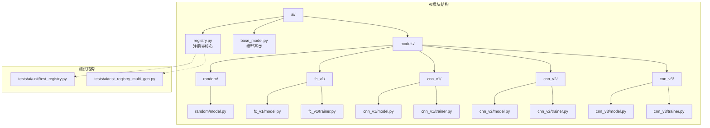
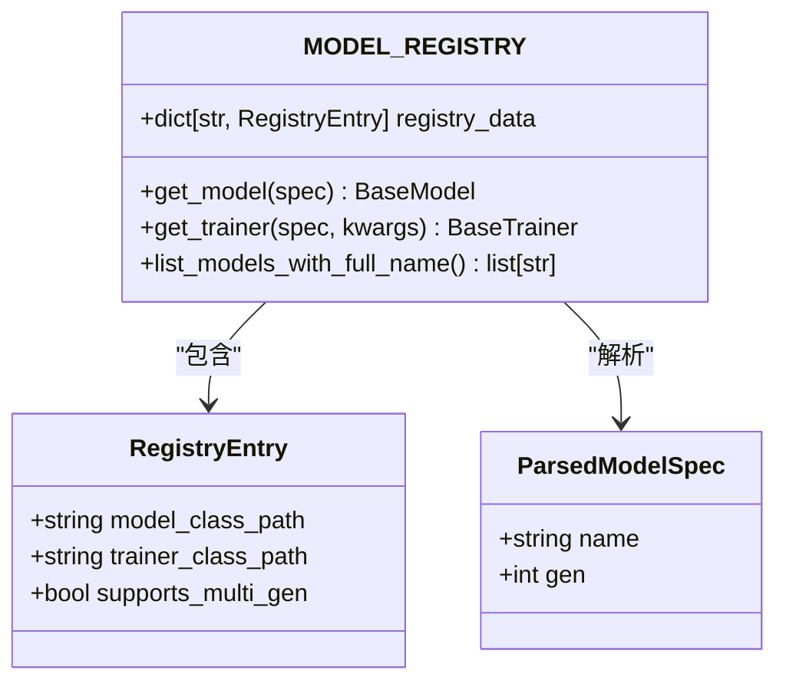
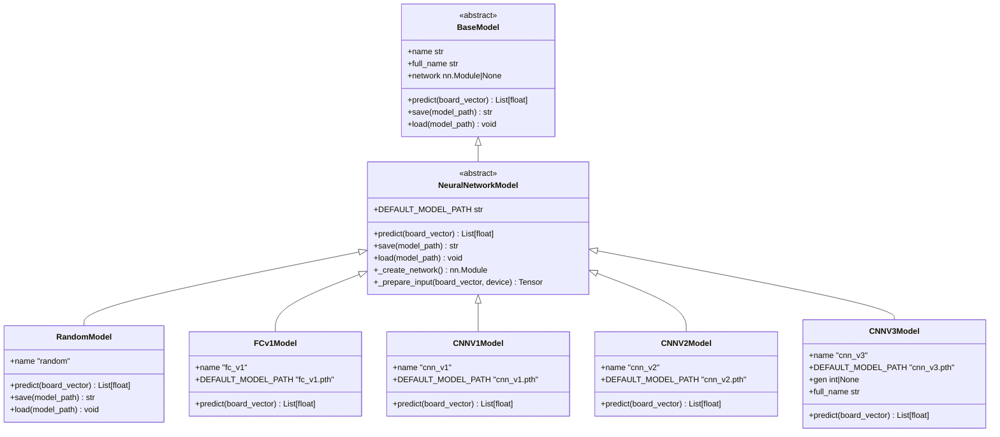
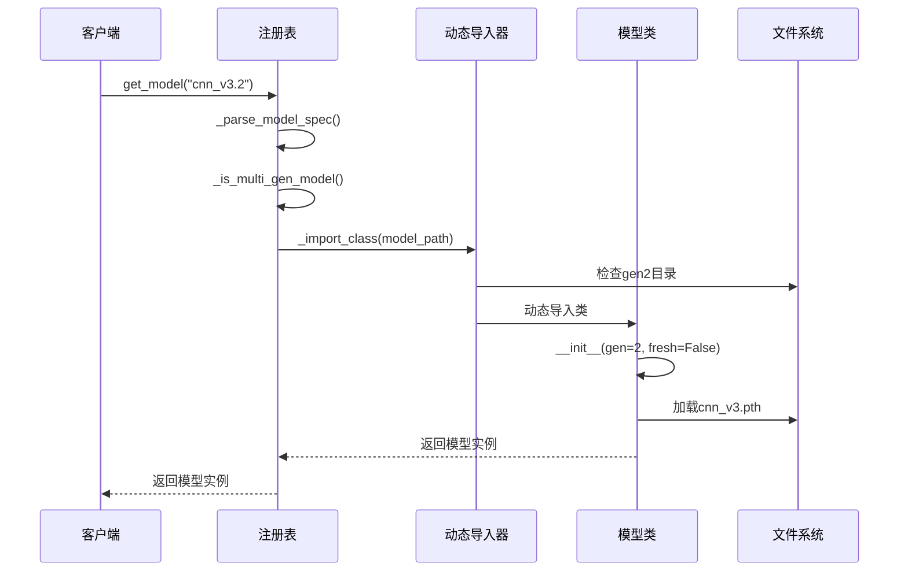
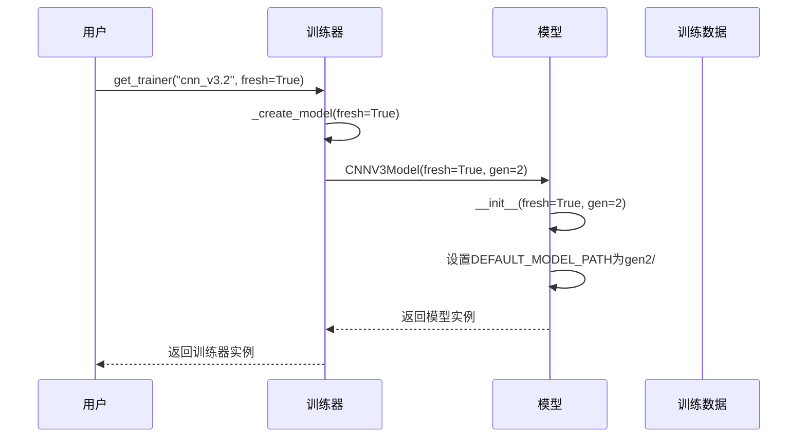
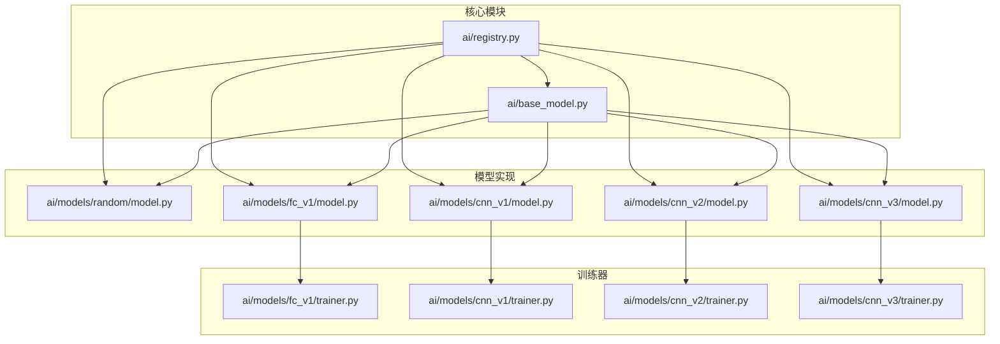

# 模型注册系统

<cite>
**本文引用的文件**
- [ai/registry.py](file://ai/registry.py)
- [ai/base_model.py](file://ai/base_model.py)
- [ai/models/__init__.py](file://ai/models/__init__.py)
- [ai/models/random/model.py](file://ai/models/random/model.py)
- [ai/models/fc_v1/model.py](file://ai/models/fc_v1/model.py)
- [ai/models/fc_v1/trainer.py](file://ai/models/fc_v1/trainer.py)
- [ai/models/cnn_v1/model.py](file://ai/models/cnn_v1/model.py)
- [ai/models/cnn_v1/trainer.py](file://ai/models/cnn_v1/trainer.py)
- [ai/models/cnn_v2/model.py](file://ai/models/cnn_v2/model.py)
- [ai/models/cnn_v2/trainer.py](file://ai/models/cnn_v2/trainer.py)
- [ai/models/cnn_v3/model.py](file://ai/models/cnn_v3/model.py)
- [ai/models/cnn_v3/trainer.py](file://ai/models/cnn_v3/trainer.py)
- [tests/ai/unit/test_registry.py](file://tests/ai/unit/test_registry.py)
- [tests/ai/test_registry_multi_gen.py](file://tests/ai/test_registry_multi_gen.py)
- [design/multi_gen_model_design.md](file://design/multi_gen_model_design.md)
</cite>

## 目录
1. [简介](#简介)
2. [项目结构](#项目结构)
3. [核心组件](#核心组件)
4. [架构概览](#架构概览)
5. [详细组件分析](#详细组件分析)
6. [依赖关系分析](#依赖关系分析)
7. [性能考虑](#性能考虑)
8. [故障排除指南](#故障排除指南)
9. [结论](#结论)

## 简介

五子棋AI模型注册系统是一个基于Python的统一模型管理框架，采用懒加载机制实现AI模型的自动发现和动态加载。该系统支持多代模型管理，为不同版本的AI模型提供了标准化的注册、查找和实例化机制。

系统的核心特性包括：
- **统一注册表**：集中管理所有AI模型和训练器的映射关系
- **懒加载机制**：使用importlib按需动态导入，避免启动时的模块加载开销
- **多代模型支持**：为CNN v3等模型提供版本管理和路径管理功能
- **类型安全**：使用NamedTuple确保注册表数据结构的完整性
- **完整的生命周期管理**：从模型注册到实例化的全流程支持

## 项目结构



**图表来源**
- [ai/registry.py:1-316](file://ai/registry.py#L1-L316)
- [ai/models/__init__.py:1-28](file://ai/models/__init__.py#L1-L28)

**章节来源**
- [ai/registry.py:1-316](file://ai/registry.py#L1-L316)
- [ai/models/__init__.py:1-28](file://ai/models/__init__.py#L1-L28)

## 核心组件

### 注册表数据结构

注册表采用统一的数据结构来管理所有AI模型：



**图表来源**
- [ai/registry.py:30-52](file://ai/registry.py#L30-L52)
- [ai/registry.py:58-72](file://ai/registry.py#L58-L72)

### 模型类层次结构

系统采用清晰的类继承层次结构：



**图表来源**
- [ai/base_model.py:24-323](file://ai/base_model.py#L24-L323)
- [ai/models/random/model.py:10-64](file://ai/models/random/model.py#L10-L64)
- [ai/models/fc_v1/model.py:91-132](file://ai/models/fc_v1/model.py#L91-L132)
- [ai/models/cnn_v1/model.py](file://ai/models/cnn_v1/model.py)
- [ai/models/cnn_v2/model.py](file://ai/models/cnn_v2/model.py)
- [ai/models/cnn_v3/model.py:96-139](file://ai/models/cnn_v3/model.py#L96-L139)

**章节来源**
- [ai/registry.py:30-72](file://ai/registry.py#L30-L72)
- [ai/base_model.py:24-323](file://ai/base_model.py#L24-L323)

## 架构概览

### 系统架构图

```mermaid
graph TB
subgraph "应用层"
A[AI引擎]
B[训练器]
C[评估器]
end
subgraph "注册表层"
D[MODEL_REGISTRY]
E[_parse_model_spec]
F[_import_class]
G[list_models_with_full_name]
end
subgraph "模型层"
H[BaseModel]
I[NeuralNetworkModel]
J[具体模型实现]
end
subgraph "文件系统"
K[模型权重文件]
L[gen{i}目录结构]
end
A --> D
B --> D
C --> D
D --> E
D --> F
D --> G
F --> H
H --> I
I --> J
J --> K
J --> L
```

**图表来源**
- [ai/registry.py:150-224](file://ai/registry.py#L150-L224)
- [ai/base_model.py:107-276](file://ai/base_model.py#L107-L276)

### 懒加载机制流程



**图表来源**
- [ai/registry.py:150-184](file://ai/registry.py#L150-L184)
- [ai/registry.py:83-100](file://ai/registry.py#L83-L100)
- [ai/base_model.py:126-165](file://ai/base_model.py#L126-L165)

**章节来源**
- [ai/registry.py:83-100](file://ai/registry.py#L83-L100)
- [ai/base_model.py:126-165](file://ai/base_model.py#L126-L165)

## 详细组件分析

### 注册表核心功能

#### 模型规格解析

注册表实现了智能的模型规格解析机制：

```mermaid
flowchart TD
A[输入: "cnn_v3.2"] --> B{是否包含"."}
B --> |否| C[返回ParsedModelSpec(name="cnn_v3", gen=None)]
B --> |是| D[右分割获取name和gen_str]
D --> E{gen_str是否为空}
E --> |是| F[抛出ValueError: "代数必须为正整数"]
E --> |否| G[尝试转换为整数]
G --> H{转换成功?}
H --> |否| F
H --> |是| I{gen≥1?}
I --> |否| F
I --> |是| J[返回ParsedModelSpec(name="cnn_v3", gen=2)]
```

**图表来源**
- [ai/registry.py:103-129](file://ai/registry.py#L103-L129)

#### 多代模型管理

多代模型的管理机制确保了版本控制的严谨性：

```mermaid
flowchart TD
A[输入: "cnn_v3.1"] --> B{模型名称在注册表中?}
B --> |否| C[抛出ValueError: "未知的模型"]
B --> |是| D{是否指定gen?}
D --> |是| E{_is_multi_gen_model()检查}
E --> |否| F[抛出ValueError: "非多代模型不能指定代数"]
D --> |否| G{supports_multi_gen?}
G --> |否| F
G --> |是| H[抛出ValueError: "多代模型必须指定代数"]
E --> |是| I[继续执行]
H --> I
I --> J[加载模型类]
J --> K[检查gen目录是否存在.pth文件]
K --> L{存在?}
L --> |否| M[抛出ValueError: 权重文件不存在]
L --> |是| N[创建模型实例]
```

**图表来源**
- [ai/registry.py:150-184](file://ai/registry.py#L150-L184)
- [ai/registry.py:237-296](file://ai/registry.py#L237-L296)

**章节来源**
- [ai/registry.py:103-129](file://ai/registry.py#L103-L129)
- [ai/registry.py:150-184](file://ai/registry.py#L150-L184)
- [ai/registry.py:237-296](file://ai/registry.py#L237-L296)

### 模型类实现

#### 基础模型类设计

BaseModel定义了所有AI模型必须实现的标准接口：

| 方法 | 描述 | 返回值 |
|------|------|--------|
| `predict(board_vector)` | 预测每个落子位置的概率 | 225维概率列表 |
| `name` | 模型名称属性 | 字符串 |
| `full_name` | 含代数的完整名称 | 字符串 |
| `save(model_path)` | 保存模型参数 | 保存路径 |
| `load(model_path)` | 加载模型参数 | 无 |

#### 神经网络模型特化

NeuralNetworkModel为使用PyTorch的模型提供了通用实现：

```mermaid
classDiagram
class NeuralNetworkModel {
+DEFAULT_MODEL_PATH : str
+gen : int|None
+__init__(model_path=None, fresh=False, gen=None)
+predict(board_vector) List[float]
+save(model_path=None) str
+load(model_path) void
+_create_network() nn.Module*
+_prepare_input(board_vector, device) Tensor*
}
note for NeuralNetworkModel : "* 子类必须实现"
```

**图表来源**
- [ai/base_model.py:107-276](file://ai/base_model.py#L107-L276)

**章节来源**
- [ai/base_model.py:24-323](file://ai/base_model.py#L24-L323)

### 训练器集成

#### 训练器基类设计

BaseTrainer为所有训练器提供了统一的接口和通用逻辑：



**图表来源**
- [ai/models/cnn_v3/trainer.py:25-35](file://ai/models/cnn_v3/trainer.py#L25-L35)
- [ai/base_model.py:126-165](file://ai/base_model.py#L126-L165)

**章节来源**
- [ai/models/cnn_v3/trainer.py:13-73](file://ai/models/cnn_v3/trainer.py#L13-L73)

## 依赖关系分析

### 模块依赖图



**图表来源**
- [ai/registry.py:58-72](file://ai/registry.py#L58-L72)
- [ai/models/__init__.py:11-27](file://ai/models/__init__.py#L11-L27)

### 依赖关系特点

1. **低耦合高内聚**：注册表与具体模型实现解耦，通过字符串路径进行关联
2. **动态导入**：使用importlib实现按需加载，避免启动时的模块依赖
3. **类型安全**：使用NamedTuple确保注册表数据结构的一致性
4. **向后兼容**：新版本功能不影响现有模型的使用

**章节来源**
- [ai/registry.py:58-72](file://ai/registry.py#L58-L72)
- [ai/models/__init__.py:11-27](file://ai/models/__init__.py#L11-L27)

## 性能考虑

### 懒加载优化

注册系统采用了多项性能优化措施：

1. **按需导入**：仅在需要时才导入模型模块，减少启动时间
2. **缓存机制**：importlib自动缓存已导入的模块
3. **文件系统检查**：多代模型的gen目录检查避免不必要的I/O操作

### 内存使用优化

- **延迟实例化**：模型实例只在实际需要时创建
- **GPU内存管理**：神经网络模型在CPU上创建，由训练器统一管理设备迁移
- **权重文件管理**：多代模型的权重文件按目录组织，便于清理和管理

## 故障排除指南

### 常见问题及解决方案

#### 模型名称错误

**问题**：`ValueError: 未知的模型: 'unknown_model'`

**原因**：模型名称不在注册表中

**解决方案**：
1. 检查模型名称拼写
2. 确认模型已在MODEL_REGISTRY中注册
3. 验证模型类路径正确性

#### 多代模型配置错误

**问题**：`ValueError: 多代模型必须指定代数，如 cnn_v3.1`

**原因**：多代模型未指定代数

**解决方案**：
1. 使用完整模型规格："cnn_v3.1"
2. 确认gen目录存在且包含.pth文件
3. 验证权重文件路径正确

#### 权重文件缺失

**问题**：`ValueError: 模型权重文件不存在: /path/to/gen2/cnn_v3.pth`

**原因**：多代模型指定的gen目录不存在或权重文件缺失

**解决方案**：
1. 检查gen目录结构：`cnn_v3/gen2/`
2. 确认目录中有`.pth`文件
3. 验证文件权限和路径正确性

#### 训练器不可用

**问题**：`ValueError: 不支持的模型: 'random'`

**原因**：模型没有对应的训练器实现

**解决方案**：
1. 检查模型是否支持训练
2. 确认训练器类路径正确
3. 验证训练器类实现

### 调试技巧

#### 启用详细日志

```python
import logging
logging.basicConfig(level=logging.DEBUG)
logger = logging.getLogger('ai.registry')
```

#### 验证注册表状态

```python
from ai.registry import MODEL_REGISTRY
print("已注册模型:", list(MODEL_REGISTRY.keys()))
for name, entry in MODEL_REGISTRY.items():
    print(f"{name}: {entry.model_class_path}")
```

#### 检查模型规格解析

```python
from ai.registry import _parse_model_spec
spec = "cnn_v3.2"
parsed = _parse_model_spec(spec)
print(f"解析结果: name={parsed.name}, gen={parsed.gen}")
```

**章节来源**
- [tests/ai/unit/test_registry.py:94-106](file://tests/ai/unit/test_registry.py#L94-L106)
- [tests/ai/test_registry_multi_gen.py:293-303](file://tests/ai/test_registry_multi_gen.py#L293-L303)

## 结论

五子棋AI模型注册系统通过精心设计的架构实现了模型管理的标准化和自动化。系统的主要优势包括：

1. **统一管理**：通过注册表集中管理所有AI模型，提供一致的访问接口
2. **灵活扩展**：支持新模型的轻松添加，无需修改核心代码
3. **版本控制**：完善的多代模型支持机制，确保模型版本的可追溯性
4. **性能优化**：懒加载机制显著减少了启动时间和内存占用
5. **类型安全**：使用NamedTuple和类型注解确保代码质量

该系统为五子棋AI的发展奠定了坚实的基础，支持从简单随机模型到复杂深度学习模型的演进，同时保持了良好的可维护性和扩展性。