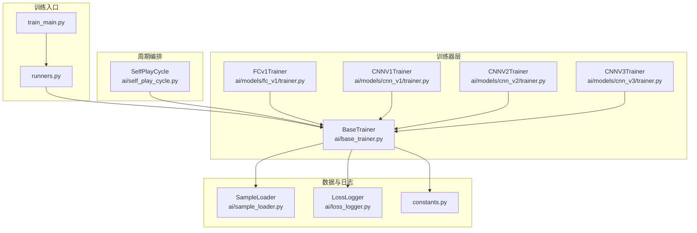
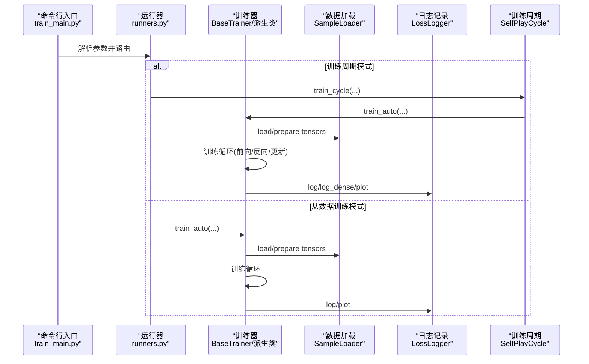
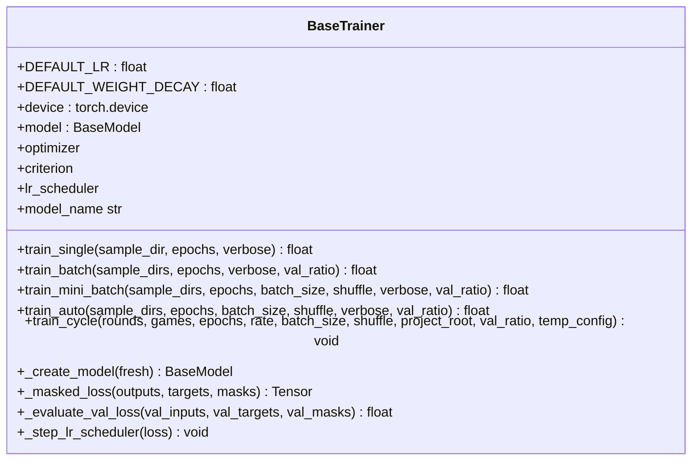
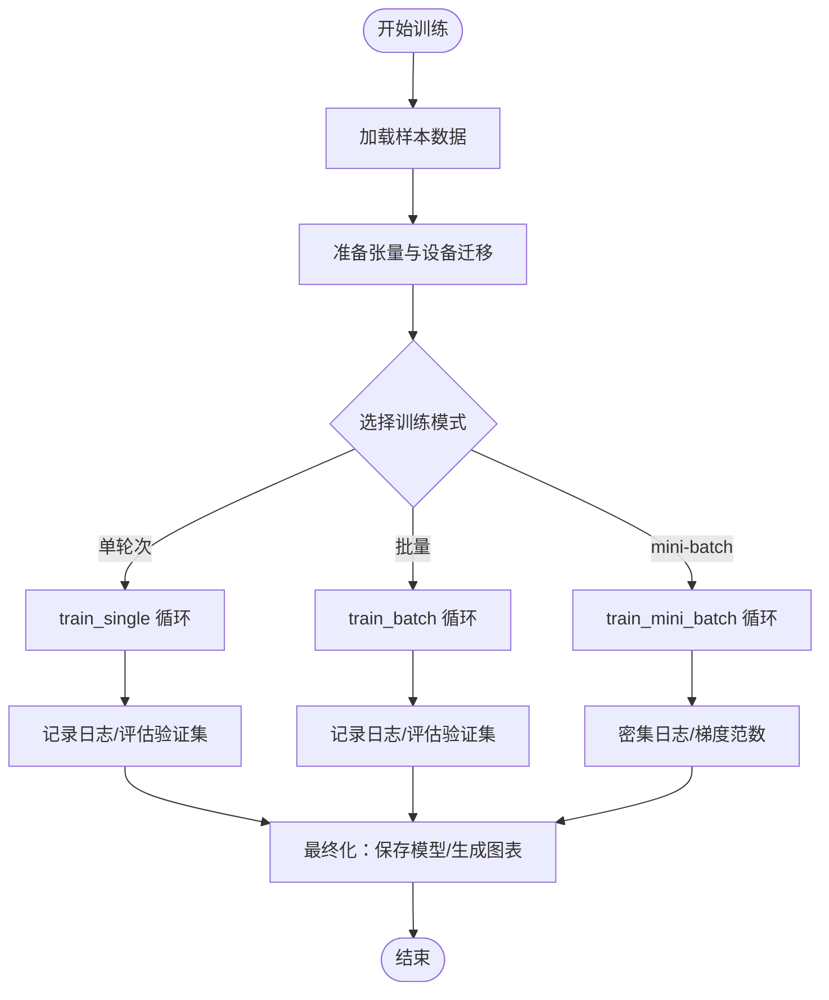
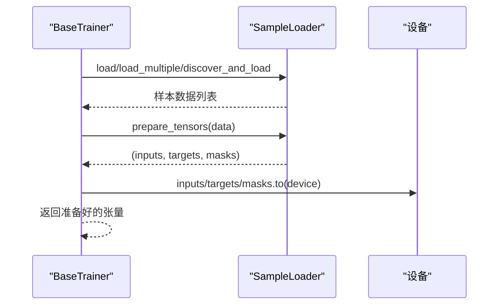
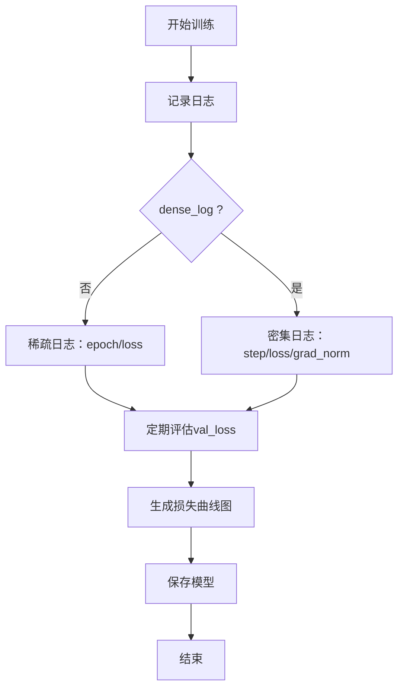
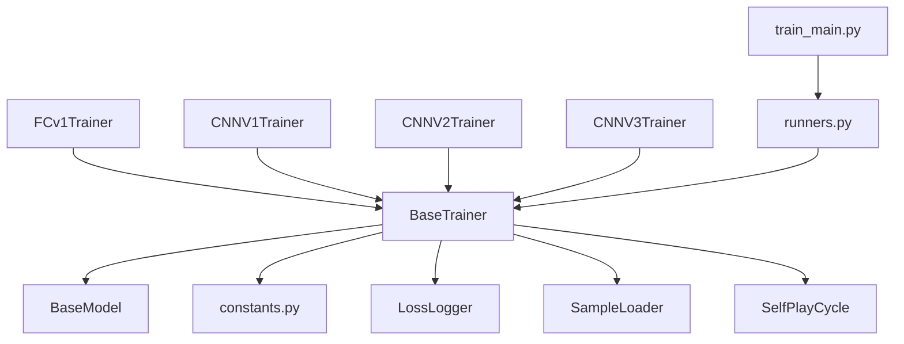

# 训练系统开发

<cite>
**本文引用的文件**
- [ai/base_trainer.py](file://ai/base_trainer.py)
- [ai/train_main.py](file://ai/train_main.py)
- [ai/loss_logger.py](file://ai/loss_logger.py)
- [ai/sample_loader.py](file://ai/sample_loader.py)
- [ai/self_play_cycle.py](file://ai/self_play_cycle.py)
- [ai/runners.py](file://ai/runners.py)
- [ai/constants.py](file://ai/constants.py)
- [ai/models/fc_v1/trainer.py](file://ai/models/fc_v1/trainer.py)
- [ai/models/cnn_v1/trainer.py](file://ai/models/cnn_v1/trainer.py)
- [ai/models/cnn_v2/trainer.py](file://ai/models/cnn_v2/trainer.py)
- [ai/models/cnn_v3/trainer.py](file://ai/models/cnn_v3/trainer.py)
- [README.md](file://README.md)
- [design/base_trainer_design.md](file://design/base_trainer_design.md)
- [design/dense_loss_log_design.md](file://design/dense_loss_log_design.md)
</cite>

## 目录
1. [简介](#简介)
2. [项目结构](#项目结构)
3. [核心组件](#核心组件)
4. [架构总览](#架构总览)
5. [详细组件分析](#详细组件分析)
6. [依赖分析](#依赖分析)
7. [性能考量](#性能考量)
8. [故障排查指南](#故障排查指南)
9. [结论](#结论)
10. [附录](#附录)

## 简介
本指南面向五子棋AI训练系统的开发者，围绕BaseTrainer基类及其衍生训练器，系统讲解训练循环实现、损失函数设计、优化器配置、数据生成器、模型评估器、学习率调度器等关键组件。文档还提供训练参数配置最佳实践、训练过程监控与日志记录机制（含损失曲线绘制与验证集评估）、训练脚本示例与常见问题解决方案，帮助读者快速搭建并高效迭代AI训练流水线。

## 项目结构
训练系统主要由以下模块组成：
- 训练器基类与派生训练器：BaseTrainer及各模型训练器（FCv1/CNNv1/CNNv2/CNNv3）
- 训练入口与运行器：train_main.py与runners.py
- 数据加载与预处理：sample_loader.py
- 训练日志与可视化：loss_logger.py
- 自我对弈训练周期：self_play_cycle.py
- 常量与路径：constants.py
- 文档与设计：README.md、design/*.md

**图表来源**
- [ai/train_main.py:1-234](file://ai/train_main.py#L1-L234)
- [ai/runners.py:1-255](file://ai/runners.py#L1-L255)
- [ai/base_trainer.py:1-699](file://ai/base_trainer.py#L1-L699)
- [ai/sample_loader.py:1-240](file://ai/sample_loader.py#L1-L240)
- [ai/loss_logger.py:1-461](file://ai/loss_logger.py#L1-L461)
- [ai/self_play_cycle.py:1-195](file://ai/self_play_cycle.py#L1-L195)
- [ai/constants.py:1-26](file://ai/constants.py#L1-L26)

**章节来源**
- [README.md:1-422](file://README.md#L1-L422)
- [ai/train_main.py:1-234](file://ai/train_main.py#L1-L234)
- [ai/runners.py:1-255](file://ai/runners.py#L1-L255)

## 核心组件
- BaseTrainer基类：提供统一的训练接口与通用训练逻辑，包括设备检测、优化器与损失函数初始化、训练循环封装、学习率调度、验证集评估、日志记录与模型保存等。
- 派生训练器：FCv1Trainer、CNNV1Trainer、CNNV2Trainer、CNNV3Trainer分别实现模型创建与输入转换，继承BaseTrainer的训练能力。
- SampleLoader：负责从sample.json加载与预处理数据，支持多目录合并、训练/验证集分割、张量准备与设备迁移。
- LossLogger：记录训练日志至JSON Lines文件，并生成损失曲线图；支持密集日志（mini-batch）与稀疏日志（全量更新），具备降采样与双Y轴可视化能力。
- SelfPlayCycle：编排训练周期，执行自我对弈、样本生成、合并与训练，并在周期结束后生成对比图。
- runners与train_main：命令行入口，解析参数并路由到对应运行模式（从数据训练或训练周期）。

**章节来源**
- [ai/base_trainer.py:32-699](file://ai/base_trainer.py#L32-L699)
- [ai/models/fc_v1/trainer.py:1-44](file://ai/models/fc_v1/trainer.py#L1-L44)
- [ai/models/cnn_v1/trainer.py:1-72](file://ai/models/cnn_v1/trainer.py#L1-L72)
- [ai/models/cnn_v2/trainer.py:1-72](file://ai/models/cnn_v2/trainer.py#L1-L72)
- [ai/models/cnn_v3/trainer.py:1-73](file://ai/models/cnn_v3/trainer.py#L1-L73)
- [ai/sample_loader.py:67-240](file://ai/sample_loader.py#L67-L240)
- [ai/loss_logger.py:28-461](file://ai/loss_logger.py#L28-L461)
- [ai/self_play_cycle.py:20-195](file://ai/self_play_cycle.py#L20-L195)
- [ai/runners.py:1-255](file://ai/runners.py#L1-L255)
- [ai/train_main.py:1-234](file://ai/train_main.py#L1-L234)

## 架构总览
训练系统采用“入口路由—训练器—数据/日志—周期编排”的分层架构。入口脚本负责参数解析与模式路由，训练器封装训练流程，数据加载器与日志记录器提供数据与可视化支撑，周期编排模块协调自我对弈与训练。

**图表来源**
- [ai/train_main.py:27-234](file://ai/train_main.py#L27-L234)
- [ai/runners.py:81-255](file://ai/runners.py#L81-L255)
- [ai/base_trainer.py:257-620](file://ai/base_trainer.py#L257-L620)
- [ai/sample_loader.py:67-240](file://ai/sample_loader.py#L67-L240)
- [ai/loss_logger.py:28-461](file://ai/loss_logger.py#L28-L461)
- [ai/self_play_cycle.py:38-195](file://ai/self_play_cycle.py#L38-L195)

## 详细组件分析

### BaseTrainer基类设计与使用
- 设备与模型初始化：自动检测GPU/CPU，将模型网络移动到目标设备；若存在网络则初始化AdamW优化器与L1Loss（masked）。
- 训练方法族：
  - train_single：单个样本目录训练，适合小规模数据或快速验证。
  - train_batch：合并多个样本后进行全量更新，每个epoch仅一次参数更新。
  - train_mini_batch：mini-batch训练，支持密集日志与梯度范数记录，收敛更快。
  - train_auto：根据batch_size自动选择train_batch或train_mini_batch。
  - train_cycle：训练周期，委托SelfPlayCycle执行自我对弈与训练编排。
- 损失与掩码：_masked_loss对225维输出与目标应用mask，避免无效位置参与损失计算。
- 学习率调度：支持StepLR与ReduceLROnPlateau，封装_step_lr_scheduler统一步进。
- 验证集评估：_evaluate_val_loss在验证集上评估loss，使用no_grad避免显存浪费。
- 日志与保存：_setup_training/_finalize_training负责LossLogger生命周期与最终图表生成、模型保存。

**图表来源**
- [ai/base_trainer.py:32-699](file://ai/base_trainer.py#L32-L699)

**章节来源**
- [ai/base_trainer.py:32-699](file://ai/base_trainer.py#L32-L699)

### 训练循环实现与关键流程
- 单轮次训练（train_single）：加载单个sample.json，准备张量，执行for-epoch循环，每步清零梯度、前向、掩码损失、反向、参数更新、累计损失与日志记录。
- 批量训练（train_batch）：合并多目录样本，按epochs全量更新一次参数；支持val_ratio分割验证集并在日志中记录val_loss。
- mini-batch训练（train_mini_batch）：按batch_size分批训练，每个batch一次前向/反向/更新；支持密集日志（log_dense）与梯度范数记录；每个epoch结束评估val_loss。
- 训练周期（train_cycle）：委托SelfPlayCycle执行多轮自我对弈与训练，每轮结束后合并样本并训练，生成回合级与epoch级日志与图表。

**图表来源**
- [ai/base_trainer.py:324-573](file://ai/base_trainer.py#L324-L573)
- [ai/self_play_cycle.py:38-195](file://ai/self_play_cycle.py#L38-L195)

**章节来源**
- [ai/base_trainer.py:257-573](file://ai/base_trainer.py#L257-L573)
- [ai/self_play_cycle.py:38-195](file://ai/self_play_cycle.py#L38-L195)

### 损失函数与掩码设计
- 损失函数：使用L1Loss（MAE），reduction='none'以便按样本逐元素计算后再应用mask。
- 掩码损失：_masked_loss将loss与mask相乘，mask求和大于0时取平均，否则返回sum，避免除零。
- 目标与mask维度：均为(N, 225)，输出与目标亦为225维，适配棋盘位置价值估计。

**章节来源**
- [ai/base_trainer.py:678-699](file://ai/base_trainer.py#L678-L699)

### 优化器与学习率调度
- 优化器：AdamW，权重衰减默认0.01，学习率默认0.001；若模型无网络则optimizer为None。
- 学习率调度：
  - StepLR：固定间隔衰减，step_size与gamma可配置。
  - ReduceLROnPlateau：以最小化loss为准则，patience与factor可配置。
- 统一步进：_step_lr_scheduler根据调度器类型调用step(loss)或step()。

**章节来源**
- [ai/base_trainer.py:89-144](file://ai/base_trainer.py#L89-L144)
- [ai/base_trainer.py:605-620](file://ai/base_trainer.py#L605-L620)

### 数据生成器与样本加载
- SampleLoader职责：
  - 加载单个/多个/递归发现样本文件。
  - 将样本数据转换为inputs、targets、masks三类张量，自动迁移到目标设备。
  - 支持按比例分割训练/验证集，保证可复现。
- 输入转换：FC模型默认将输入转为(N, 226)；CNN模型通过board_vector_to_cnn_tensor转换为(N, 3, 15, 15)。

**图表来源**
- [ai/sample_loader.py:67-240](file://ai/sample_loader.py#L67-L240)
- [ai/base_trainer.py:122-126](file://ai/base_trainer.py#L122-L126)

**章节来源**
- [ai/sample_loader.py:67-240](file://ai/sample_loader.py#L67-L240)

### 模型评估器与验证集评估
- 验证集评估：_evaluate_val_loss在验证集上前向传播，使用torch.no_grad避免梯度计算，返回标量val_loss。
- 适用场景：训练过程中定期评估val_loss，结合学习率调度与早停策略（如ReduceLROnPlateau）。

**章节来源**
- [ai/base_trainer.py:214-239](file://ai/base_trainer.py#L214-L239)

### 学习率调度器配置
- StepLR：适合长期稳定训练，衰减间隔与系数可调。
- ReduceLROnPlateau：适合损失波动较大时，以val_loss为依据动态衰减。
- 参数建议：StepLR的step_size与gamma；Plateau的patience与factor；可通过命令行参数传入。

**章节来源**
- [ai/base_trainer.py:127-144](file://ai/base_trainer.py#L127-L144)
- [ai/train_main.py:194-234](file://ai/train_main.py#L194-L234)

### 训练参数配置最佳实践
- 批量大小（batch_size）：mini-batch训练时建议从较小值起步（如32/128/4096），根据显存与收敛速度调整；开启dense_log记录每个batch的loss与梯度范数。
- 学习率（DEFAULT_LR）：AdamW默认0.001；可结合LR范围测试确定合适区间；后期可启用学习率衰减。
- 训练轮数（epochs）：周期训练建议从较小轮数（如1~5）开始，逐步增加；单次训练可根据数据规模与收敛情况设定。
- 验证集比例（val_ratio）：推荐0.2，用于监控过拟合并配合学习率调度。
- 数据打乱（shuffle）：mini-batch模式建议开启，提升收敛稳定性。
- 设备选择：优先使用GPU，自动检测CUDA可用性。

**章节来源**
- [README.md:115-197](file://README.md#L115-L197)
- [ai/train_main.py:194-234](file://ai/train_main.py#L194-L234)
- [ai/base_trainer.py:47-72](file://ai/base_trainer.py#L47-L72)

### 训练过程监控与日志记录
- 日志类型：
  - 稀疏日志（train_batch）：按epoch记录loss。
  - 密集日志（train_mini_batch）：按batch记录loss与梯度范数，内存缓冲+批量写入，避免频繁I/O。
- 可视化：
  - LossLogger.plot：自动生成损失曲线图；若包含grad_norm字段，绘制双Y轴（Loss+梯度范数）；若包含val_loss，叠加验证集曲线；超过5000点自动降采样。
  - LossLogger.plot_comparison：将同一会话下多轮epoch级日志合并绘制对比图。
- 训练周期日志：
  - SelfPlayCycle在回合级与epoch级分别记录日志，周期结束生成对比图。

**图表来源**
- [ai/loss_logger.py:28-461](file://ai/loss_logger.py#L28-L461)
- [ai/self_play_cycle.py:38-195](file://ai/self_play_cycle.py#L38-L195)

**章节来源**
- [ai/loss_logger.py:28-461](file://ai/loss_logger.py#L28-L461)
- [ai/self_play_cycle.py:38-195](file://ai/self_play_cycle.py#L38-L195)

### 训练脚本示例
- 从数据训练（单/多目录）：指定--train-from-dir，可直接指定.json文件或目录（递归加载）。
- 训练周期：指定--cycle，可自定义轮数、每轮对局数、每轮迭代数、奖励衰减率、批次大小、是否打乱、验证集比例、学习率调度等。
- 常用组合：
  - 全量更新：--model cnn_v2 --train-from-dir ai/merge_samples/v2 --epochs 1000
  - mini-batch：--model cnn_v3.2 --train-from-dir ai/merge_samples/v2 --epochs 1000 --batch-size 4096 --shuffle --val-ratio 0.2
  - 训练周期：--model cnn_v2 --cycle --batch-size 128 --shuffle --rounds 1 --games 600 --epochs 2000

**章节来源**
- [README.md:115-197](file://README.md#L115-L197)
- [ai/train_main.py:27-234](file://ai/train_main.py#L27-L234)
- [ai/runners.py:81-255](file://ai/runners.py#L81-L255)

## 依赖分析
- BaseTrainer依赖：
  - BaseModel（模型抽象）、constants（路径与日志间隔）、LossLogger（日志）、SampleLoader（数据）、SelfPlayCycle（周期训练）。
- 派生训练器依赖BaseTrainer，覆盖模型创建与输入转换。
- runners与train_main依赖注册表（registry）获取训练器实例，再路由到对应运行模式。

**图表来源**
- [ai/base_trainer.py:14-18](file://ai/base_trainer.py#L14-L18)
- [ai/models/fc_v1/trainer.py:1-44](file://ai/models/fc_v1/trainer.py#L1-L44)
- [ai/models/cnn_v1/trainer.py:1-72](file://ai/models/cnn_v1/trainer.py#L1-L72)
- [ai/models/cnn_v2/trainer.py:1-72](file://ai/models/cnn_v2/trainer.py#L1-L72)
- [ai/models/cnn_v3/trainer.py:1-73](file://ai/models/cnn_v3/trainer.py#L1-L73)
- [ai/runners.py:23-24](file://ai/runners.py#L23-L24)
- [ai/train_main.py:23-24](file://ai/train_main.py#L23-L24)

**章节来源**
- [ai/base_trainer.py:14-18](file://ai/base_trainer.py#L14-L18)
- [ai/runners.py:23-24](file://ai/runners.py#L23-L24)
- [ai/train_main.py:23-24](file://ai/train_main.py#L23-L24)

## 性能考量
- 设备选择：优先使用GPU，自动检测CUDA可用性；输入张量在CPU转换后统一迁移到设备。
- mini-batch优势：更高效的收敛与更稳定的梯度估计；通过dense_log记录batch级loss与梯度范数，便于诊断梯度爆炸/消失。
- I/O优化：LossLogger采用内存缓冲+批量写入，降低磁盘I/O频率；日志文件按会话子目录隔离，便于管理。
- 降采样：绘图时对大量数据进行降采样，避免图表过于密集影响可读性。
- 数据分割：支持val_ratio分割训练/验证集，结合学习率调度与早停策略，避免过拟合。

**章节来源**
- [ai/base_trainer.py:21-29](file://ai/base_trainer.py#L21-L29)
- [ai/loss_logger.py:167-177](file://ai/loss_logger.py#L167-L177)
- [ai/loss_logger.py:328-363](file://ai/loss_logger.py#L328-L363)
- [ai/base_trainer.py:470-535](file://ai/base_trainer.py#L470-L535)

## 故障排查指南
- 样本文件缺失：train_single与train_batch在sample.json不存在时报FileNotFoundError；确认路径正确与文件存在。
- 参数冲突：--cycle与--train-from-dir互斥，同时使用会触发参数校验错误。
- 空数据目录：discover_and_load返回空列表时，run_train_from_dir会提示未找到训练数据。
- 模型保存失败：_finalize_training与_self_play_cycle在保存模型时捕获异常并打印错误信息。
- 图表生成失败：LossLogger在matplotlib不可用或绘图异常时优雅降级，不影响训练流程。
- 训练中断：支持Ctrl+C中断，自动保存模型与图表，可安全退出。

**章节来源**
- [ai/base_trainer.py:340-344](file://ai/base_trainer.py#L340-L344)
- [ai/train_main.py:196-207](file://ai/train_main.py#L196-L207)
- [ai/runners.py:103-128](file://ai/runners.py#L103-L128)
- [ai/loss_logger.py:196-202](file://ai/loss_logger.py#L196-L202)
- [ai/self_play_cycle.py:157-177](file://ai/self_play_cycle.py#L157-L177)

## 结论
BaseTrainer为五子棋AI训练提供了统一、可扩展的训练框架，结合SampleLoader与LossLogger实现了从数据到可视化的完整闭环。通过train_auto自动选择训练模式、train_cycle编排自我对弈与训练、LossLogger的密集/稀疏日志与降采样可视化，开发者可以高效地开展模型训练与迭代。建议在实践中遵循参数配置最佳实践，合理使用验证集与学习率调度，利用密集日志与图表监控训练过程，持续优化模型性能。

## 附录
- 常用命令参考：
  - 从数据训练：python ai/train_main.py --model cnn_v3.2 --train-from-dir ai/merge_samples/v2 --epochs 1000 --batch-size 4096 --shuffle --val-ratio 0.2
  - 训练周期：python ai/train_main.py --model cnn_v2 --cycle --batch-size 128 --shuffle --rounds 1 --games 600 --epochs 2000
- 设计文档参考：
  - BaseTrainer设计：[design/base_trainer_design.md](file://design/base_trainer_design.md)
  - 密集日志设计：[design/dense_loss_log_design.md](file://design/dense_loss_log_design.md)