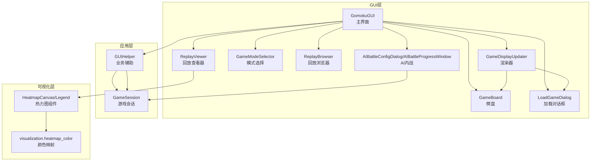
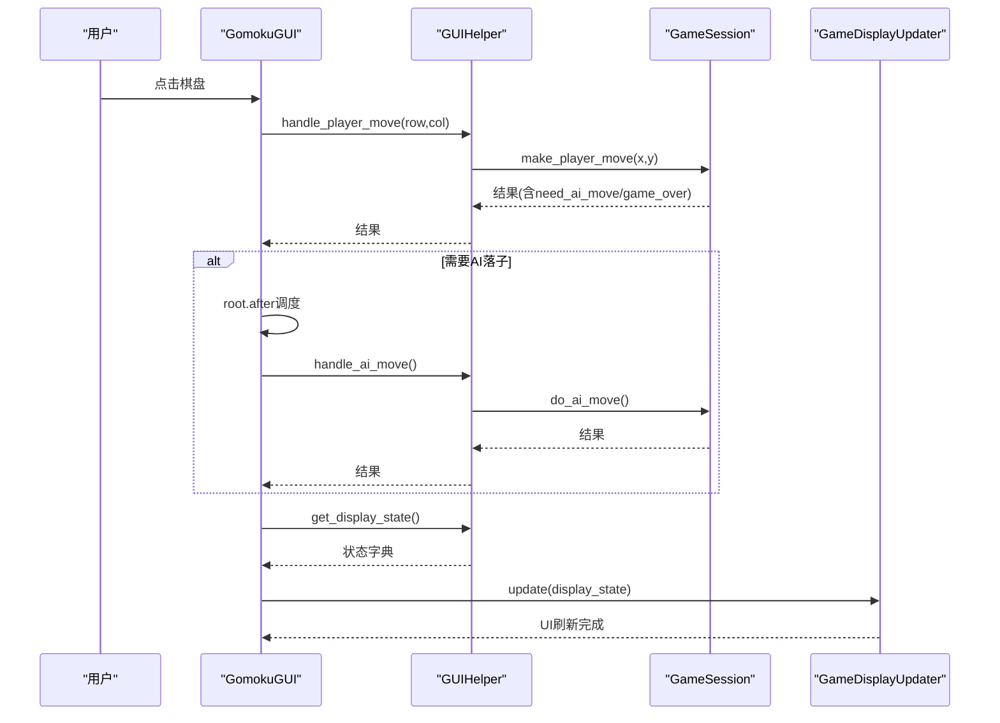
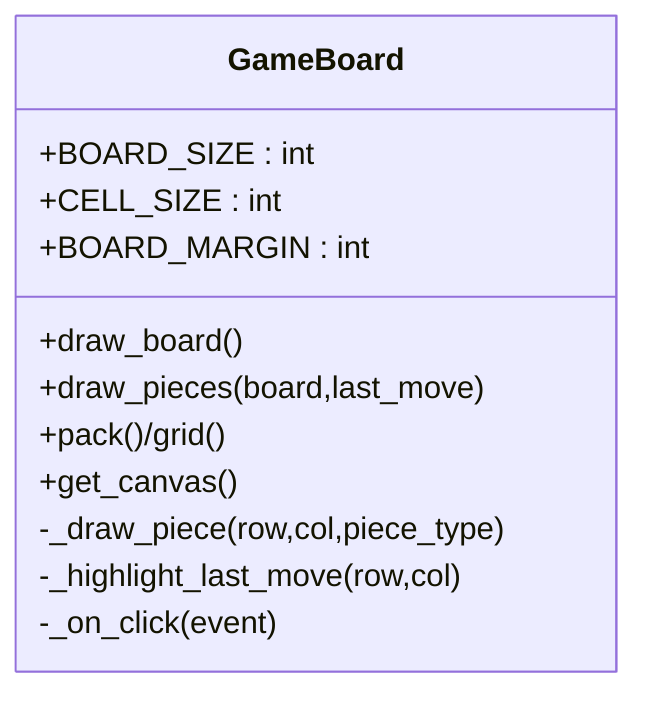
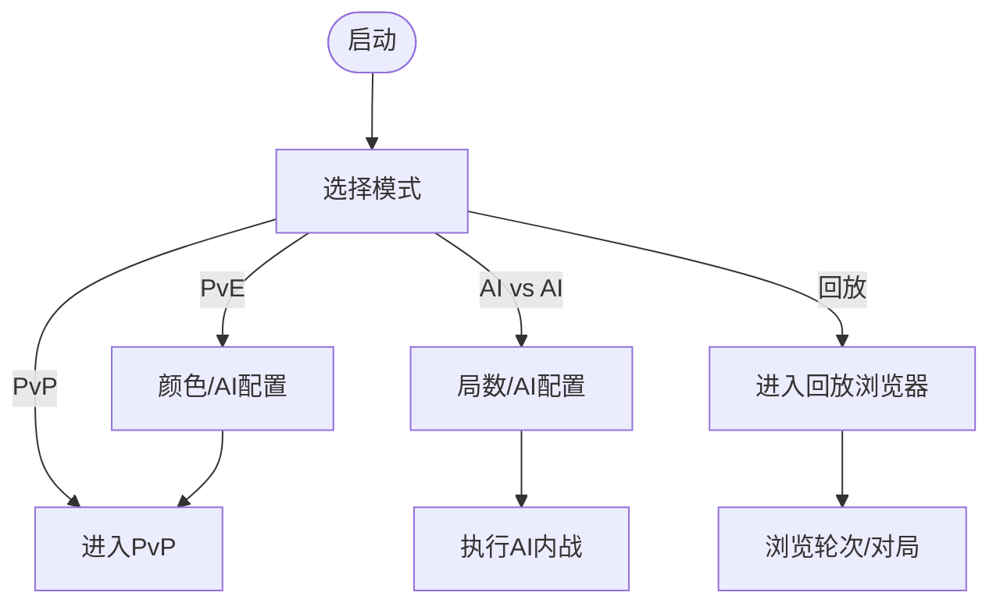
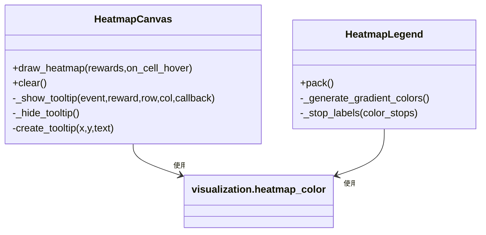
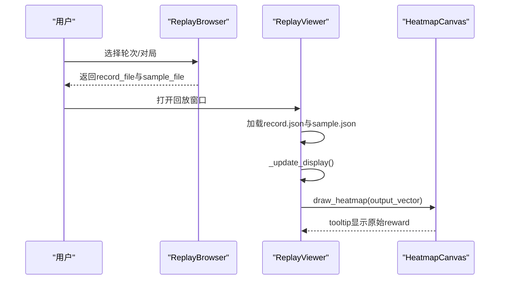
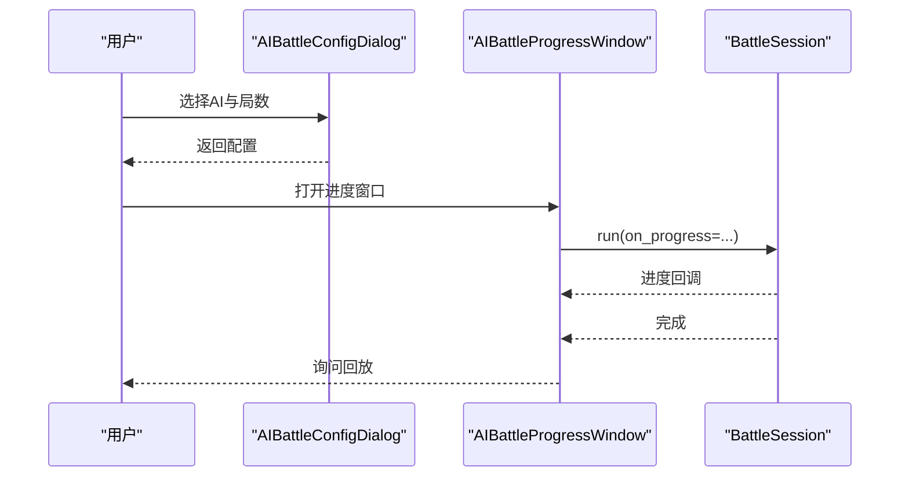
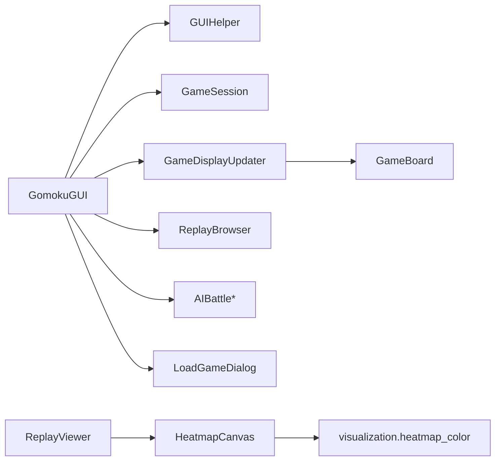
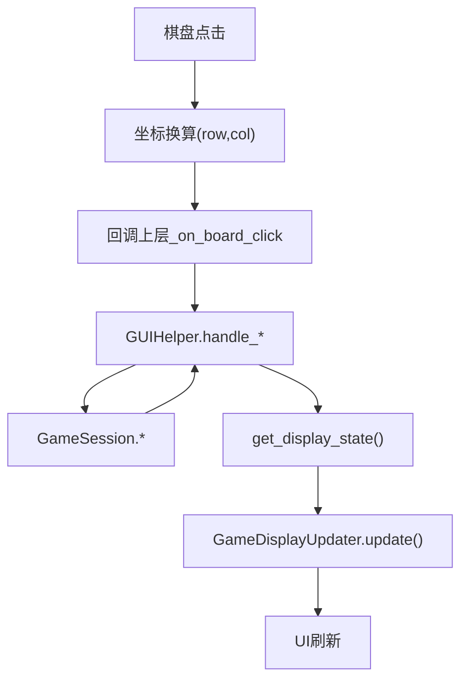
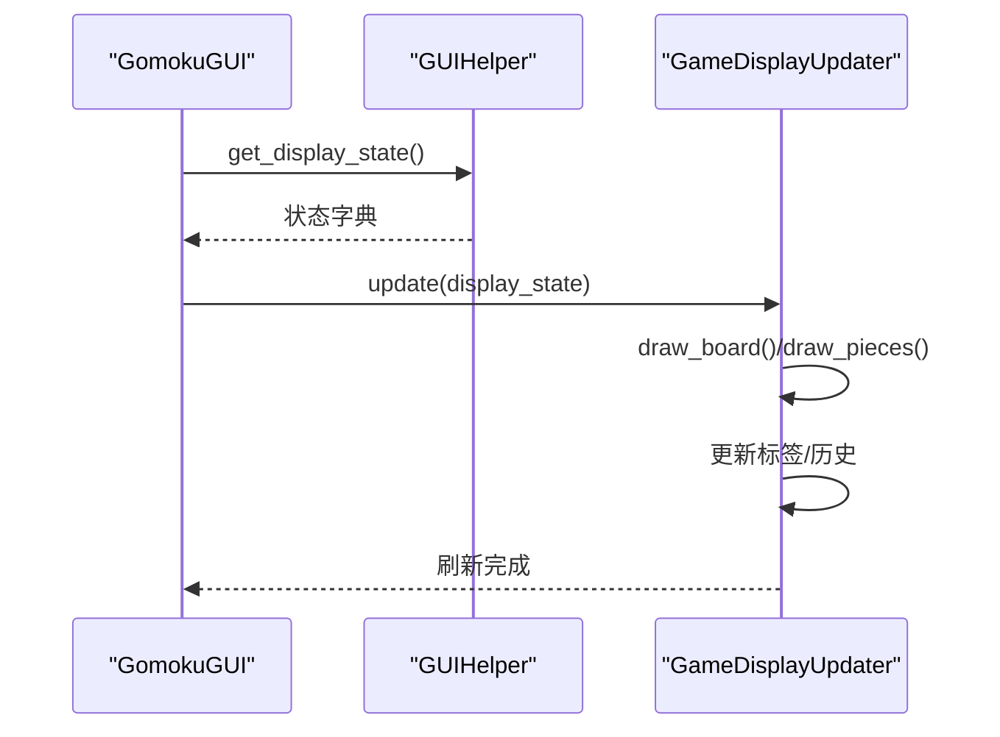

# GUI开发

<cite>
**本文引用的文件**
- [gui/main.py](file://gui/main.py)
- [gui/display_updater.py](file://gui/display_updater.py)
- [gui/components/game_board.py](file://gui/components/game_board.py)
- [gui/components/mode_selector.py](file://gui/components/mode_selector.py)
- [gui/components/heatmap.py](file://gui/components/heatmap.py)
- [gui/components/constants.py](file://gui/components/constants.py)
- [gui/components/load_game_dialog.py](file://gui/components/load_game_dialog.py)
- [gui/components/replay_browser.py](file://gui/components/replay_browser.py)
- [gui/components/replay_viewer.py](file://gui/components/replay_viewer.py)
- [gui/components/ai_battle.py](file://gui/components/ai_battle.py)
- [app/gui_helper.py](file://app/gui_helper.py)
- [app/session.py](file://app/session.py)
- [visualization/heatmap_color.py](file://visualization/heatmap_color.py)
</cite>

## 目录
1. [简介](#简介)
2. [项目结构](#项目结构)
3. [核心组件](#核心组件)
4. [架构总览](#架构总览)
5. [组件详解](#组件详解)
6. [依赖关系分析](#依赖关系分析)
7. [性能与刷新策略](#性能与刷新策略)
8. [主题系统设计](#主题系统设计)
9. [事件处理机制](#事件处理机制)
10. [显示更新机制](#显示更新机制)
11. [组件扩展指南](#组件扩展指南)
12. [故障排查](#故障排查)
13. [结论](#结论)

## 简介
本指南面向五子棋AI项目的GUI开发，系统阐述组件化架构、组件通信与状态同步、事件处理、主题系统、核心GUI组件（棋盘、模式选择器、热力图等）、显示更新与性能优化、以及扩展开发实践。文档以仓库现有代码为依据，结合可视化与AI数据回放能力，帮助开发者快速理解并高效迭代GUI模块。

## 项目结构
GUI相关代码集中在gui目录，采用“组件化 + 会话层 + 渲染器”的分层设计：
- gui/main.py：主界面与入口，负责菜单、布局、事件路由与会话协调
- gui/display_updater.py：渲染器，负责将状态字典渲染到UI控件
- gui/components/*：可复用GUI组件（棋盘、模式选择器、热力图、回放浏览器/查看器、AI内战等）
- app/gui_helper.py 与 app/session.py：业务会话与辅助逻辑，解耦GUI与业务
- visualization/heatmap_color.py：热力图颜色映射算法，供热力图组件复用

图表来源
- [gui/main.py:1-462](file://gui/main.py#L1-L462)
- [gui/display_updater.py:1-110](file://gui/display_updater.py#L1-L110)
- [gui/components/game_board.py:1-170](file://gui/components/game_board.py#L1-L170)
- [gui/components/mode_selector.py:1-411](file://gui/components/mode_selector.py#L1-L411)
- [gui/components/heatmap.py:1-358](file://gui/components/heatmap.py#L1-L358)
- [gui/components/replay_browser.py:1-383](file://gui/components/replay_browser.py#L1-L383)
- [gui/components/replay_viewer.py:1-426](file://gui/components/replay_viewer.py#L1-L426)
- [gui/components/ai_battle.py:1-346](file://gui/components/ai_battle.py#L1-L346)
- [app/gui_helper.py:1-199](file://app/gui_helper.py#L1-L199)
- [app/session.py:1-179](file://app/session.py#L1-L179)
- [visualization/heatmap_color.py:1-204](file://visualization/heatmap_color.py#L1-L204)

章节来源
- [gui/main.py:1-462](file://gui/main.py#L1-L462)
- [gui/display_updater.py:1-110](file://gui/display_updater.py#L1-L110)

## 核心组件
- GomokuGUI：主界面容器，负责菜单、布局、事件路由、与会话协调
- GameDisplayUpdater：渲染器，接收状态字典并更新棋盘、标签、历史列表
- GameBoard：棋盘组件，绘制网格、棋子与最后落子高亮
- GameModeSelector：模式选择器，提供PvP/PvE/AI vs AI/回放四种入口
- HeatmapCanvas/Legend：热力图组件，支持悬停tooltip与颜色标尺
- ReplayBrowser/ReplayViewer：回放浏览与播放器，支持record.json与sample.json
- AIBattleConfigDialog/AIBattleProgressWindow：AI内战配置与进度窗口
- LoadGameDialog：加载游戏对话框
- GUIHelper/GameSession：业务会话与辅助逻辑，解耦GUI与业务

章节来源
- [gui/main.py:31-462](file://gui/main.py#L31-L462)
- [gui/display_updater.py:13-110](file://gui/display_updater.py#L13-L110)
- [gui/components/game_board.py:7-170](file://gui/components/game_board.py#L7-L170)
- [gui/components/mode_selector.py:12-411](file://gui/components/mode_selector.py#L12-L411)
- [gui/components/heatmap.py:68-358](file://gui/components/heatmap.py#L68-L358)
- [gui/components/replay_browser.py:12-383](file://gui/components/replay_browser.py#L12-L383)
- [gui/components/replay_viewer.py:13-426](file://gui/components/replay_viewer.py#L13-L426)
- [gui/components/ai_battle.py:22-346](file://gui/components/ai_battle.py#L22-L346)
- [gui/components/load_game_dialog.py:11-56](file://gui/components/load_game_dialog.py#L11-L56)
- [app/gui_helper.py:12-199](file://app/gui_helper.py#L12-L199)
- [app/session.py:12-179](file://app/session.py#L12-L179)

## 架构总览
GUI采用“控制器-会话-渲染器-组件”分层：
- 控制器：GomokuGUI作为顶层控制器，接收用户事件，委派给GUIHelper
- 会话层：GUIHelper封装业务逻辑，GameSession协调游戏流程与AI引擎
- 渲染器：GameDisplayUpdater将状态字典渲染到UI控件
- 组件层：GameBoard、HeatmapCanvas、ReplayViewer等各自负责UI绘制与交互

图表来源
- [gui/main.py:224-273](file://gui/main.py#L224-L273)
- [app/gui_helper.py:53-106](file://app/gui_helper.py#L53-L106)
- [app/session.py:63-102](file://app/session.py#L63-L102)
- [gui/display_updater.py:40-82](file://gui/display_updater.py#L40-L82)

## 组件详解

### 棋盘组件 GameBoard
- 职责：绘制15×15棋盘网格、棋子、最后落子高亮；处理点击事件并回调上层
- 关键点：
  - 使用Canvas绘制网格与星位，棋子采用内外两层椭圆模拟立体感
  - 点击事件通过坐标换算映射到棋盘行列，边界外忽略
  - 仅保留“棋子”和“最后落子”两类tag，便于增量刷新

图表来源
- [gui/components/game_board.py:7-170](file://gui/components/game_board.py#L7-L170)

章节来源
- [gui/components/game_board.py:61-170](file://gui/components/game_board.py#L61-L170)

### 模式选择器 GameModeSelector
- 职责：启动时提供四种模式入口，支持PvE颜色选择、AI内战参数配置、回放入口
- 关键点：
  - 通过Toplevel弹窗收集用户选择，返回标准化结果
  - PvE模式下弹出颜色与AI选择对话框
  - AI内战模式弹出配置对话框，支持局数与双方AI选择

图表来源
- [gui/components/mode_selector.py:176-411](file://gui/components/mode_selector.py#L176-L411)

章节来源
- [gui/components/mode_selector.py:12-411](file://gui/components/mode_selector.py#L12-L411)

### 热力图组件 HeatmapCanvas/Legend
- 职责：绘制15×15格热力图，支持悬停tooltip显示原始reward值，提供颜色标尺
- 关键点：
  - 复用visualization.heatmap_color的归一化与颜色映射算法
  - 支持log/max/linear三种归一化模式
  - 悬停tooltip显示原始reward，避免误导
  - Legend提供默认白→黄→橙→红色阶与中文标签

图表来源
- [gui/components/heatmap.py:68-358](file://gui/components/heatmap.py#L68-L358)
- [visualization/heatmap_color.py:63-204](file://visualization/heatmap_color.py#L63-L204)

章节来源
- [gui/components/heatmap.py:1-358](file://gui/components/heatmap.py#L1-L358)
- [visualization/heatmap_color.py:1-204](file://visualization/heatmap_color.py#L1-L204)

### 回放浏览器与查看器
- ReplayBrowser：轮次选择器与对局选择器组合，读取ai_data目录结构，解析record.json
- ReplayViewer：回放播放器，支持上下步、跳转结局、重置；可选显示AI与Sample热力图
- 关键点：
  - 从record.json读取历史，从sample.json读取每步输出向量
  - 支持鼠标悬停查看格子reward
  - 可选显示棋盘与热力图，信息文本展示输入/输出片段与实际落子reward

图表来源
- [gui/components/replay_browser.py:300-383](file://gui/components/replay_browser.py#L300-L383)
- [gui/components/replay_viewer.py:13-426](file://gui/components/replay_viewer.py#L13-L426)
- [gui/components/heatmap.py:137-247](file://gui/components/heatmap.py#L137-L247)

章节来源
- [gui/components/replay_browser.py:1-383](file://gui/components/replay_browser.py#L1-L383)
- [gui/components/replay_viewer.py:1-426](file://gui/components/replay_viewer.py#L1-L426)

### AI内战组件
- AIBattleConfigDialog：配置黑/白方AI与对局数
- AIBattleProgressWindow：后台线程执行BattleSession，进度与完成状态反馈
- 关键点：
  - 捕获ModelLoadError并在主线程弹窗提示
  - 完成后询问是否回放，回调通知上层

图表来源
- [gui/components/ai_battle.py:22-346](file://gui/components/ai_battle.py#L22-L346)

章节来源
- [gui/components/ai_battle.py:1-346](file://gui/components/ai_battle.py#L1-L346)

### 加载游戏对话框 LoadGameDialog
- 职责：列出可用存档，返回用户选择或None
- 关键点：使用Listbox展示，等待父窗口关闭后返回结果

章节来源
- [gui/components/load_game_dialog.py:1-56](file://gui/components/load_game_dialog.py#L1-L56)

## 依赖关系分析
- 组件间依赖：
  - GomokuGUI依赖GUIHelper与GameSession，间接依赖控制器与AI引擎
  - GameDisplayUpdater依赖GameBoard与GUIHelper
  - ReplayViewer依赖HeatmapCanvas/Legend
  - HeatmapCanvas依赖visualization.heatmap_color
- 外部依赖：
  - Tkinter（标准库）
  - ai.registry（模型枚举）
  - app.exceptions（异常）

图表来源
- [gui/main.py:18-28](file://gui/main.py#L18-L28)
- [gui/display_updater.py:16-38](file://gui/display_updater.py#L16-L38)
- [gui/components/heatmap.py:30-34](file://gui/components/heatmap.py#L30-L34)
- [gui/components/replay_viewer.py:9-10](file://gui/components/replay_viewer.py#L9-L10)

章节来源
- [gui/main.py:18-28](file://gui/main.py#L18-L28)
- [gui/display_updater.py:16-38](file://gui/display_updater.py#L16-L38)
- [gui/components/heatmap.py:30-34](file://gui/components/heatmap.py#L30-L34)
- [gui/components/replay_viewer.py:9-10](file://gui/components/replay_viewer.py#L9-L10)

## 性能与刷新策略
- 刷新粒度
  - 棋盘：仅删除“棋子”和“最后落子”tag，重绘当前状态，避免全量重绘
  - 历史列表：每次更新清空并重新插入，末尾滚动至可见
- 事件调度
  - AI落子使用root.after延时，避免阻塞UI线程
- 热力图
  - 归一化批量计算一次，逐格映射颜色，tooltip显示原始值
- 建议
  - 大量历史更新时可考虑列表框虚拟化（当前版本未实现）
  - 热力图hover回调可加入节流，避免频繁tooltip创建销毁

章节来源
- [gui/components/game_board.py:105-119](file://gui/components/game_board.py#L105-L119)
- [gui/display_updater.py:89-100](file://gui/display_updater.py#L89-L100)
- [gui/main.py:240-242](file://gui/main.py#L240-L242)
- [gui/components/heatmap.py:161-195](file://gui/components/heatmap.py#L161-L195)

## 主题系统设计
- 颜色方案（森林/小动物主题）
  - 背景、文字、边框、棋子、按钮、高亮等颜色集中定义于constants.py
  - 主题色：小熊棕、小兔粉、松鼠褐
- 字体与尺寸
  - 标题、副标题、按钮、常规、小号、等宽字体统一配置
  - 棋盘、棋子、热力图等尺寸参数集中管理
- 动物表情符号
  - 黑/白/最后落子表情符号贯穿界面，增强趣味性

章节来源
- [gui/components/constants.py:3-66](file://gui/components/constants.py#L3-L66)
- [gui/main.py:34-40](file://gui/main.py#L34-L40)

## 事件处理机制
- 用户交互事件
  - 棋盘点击：GameBoard将事件坐标转换为行列，回调上层
  - 模式选择：按钮绑定命令，弹窗收集参数
  - 回放控制：按钮触发上一步/下一步/跳转/重置
- 事件流向
  - GUI捕获事件 → GUIHelper封装业务 → GameSession协调 → 渲染器更新UI
- 错误处理
  - 模型加载失败、落子失败等通过消息框提示

图表来源
- [gui/components/game_board.py:151-166](file://gui/components/game_board.py#L151-L166)
- [gui/main.py:224-273](file://gui/main.py#L224-L273)
- [app/gui_helper.py:108-148](file://app/gui_helper.py#L108-L148)
- [gui/display_updater.py:40-82](file://gui/display_updater.py#L40-L82)

章节来源
- [gui/main.py:224-273](file://gui/main.py#L224-L273)
- [app/gui_helper.py:53-106](file://app/gui_helper.py#L53-L106)
- [gui/components/game_board.py:151-166](file://gui/components/game_board.py#L151-L166)

## 显示更新机制
- 状态来源：GUIHelper.get_display_state()返回包含has_game/save_name/board/history等字段的状态字典
- 渲染流程：GameDisplayUpdater.update()根据状态字典更新棋盘、标签、历史列表
- 历史更新：update_history()清空并重填，末尾滚动
- 游戏结束：show_game_over()弹窗提示

图表来源
- [app/gui_helper.py:108-148](file://app/gui_helper.py#L108-L148)
- [gui/display_updater.py:40-101](file://gui/display_updater.py#L40-L101)

章节来源
- [app/gui_helper.py:108-148](file://app/gui_helper.py#L108-L148)
- [gui/display_updater.py:40-101](file://gui/display_updater.py#L40-L101)

## 组件扩展指南
- 新增组件
  - 在gui/components下创建新模块，遵循现有命名与导出约定
  - 通过constants.py统一主题与尺寸，保持风格一致
- 修改现有组件
  - 棋盘：注意tag管理与增量绘制，避免全量重绘
  - 热力图：新增归一化模式或色板时，确保与visualization.heatmap_color保持一致
- 功能增强
  - 回放：可增加“播放速度”、“自动播放”等控制项
  - 模式选择：可扩展更多AI参数（难度、搜索深度等）
- 跨平台与响应式
  - 当前为固定尺寸布局，如需响应式可引入grid权重与pack(fill/expand)策略
  - 注意不同平台字体与字号差异，可通过FONTS配置微调

章节来源
- [gui/components/constants.py:3-66](file://gui/components/constants.py#L3-L66)
- [gui/components/heatmap.py:71-99](file://gui/components/heatmap.py#L71-L99)

## 故障排查
- 模型加载失败
  - 现象：PvE或AI内战时弹窗提示
  - 处理：捕获ModelLoadError，提示用户并回退到模式选择
- 落子失败
  - 现象：点击无效或提示失败
  - 处理：GUIHelper返回error，GUI弹窗提示
- 回放数据缺失
  - 现象：提示暂无回放数据
  - 处理：确认ai_data目录存在且包含record.json

章节来源
- [gui/main.py:418-420](file://gui/main.py#L418-L420)
- [gui/main.py:248-249](file://gui/main.py#L248-L249)
- [gui/main.py:384-386](file://gui/main.py#L384-L386)
- [gui/components/ai_battle.py:269-272](file://gui/components/ai_battle.py#L269-L272)

## 结论
本GUI采用清晰的分层与组件化设计，通过GUIHelper与GameSession解耦业务与界面，借助GameDisplayUpdater实现状态驱动的UI刷新。热力图组件复用可视化算法，保证颜色映射的一致性与可扩展性。建议在后续迭代中引入响应式布局、列表虚拟化与热力图节流等优化，进一步提升用户体验与性能表现。