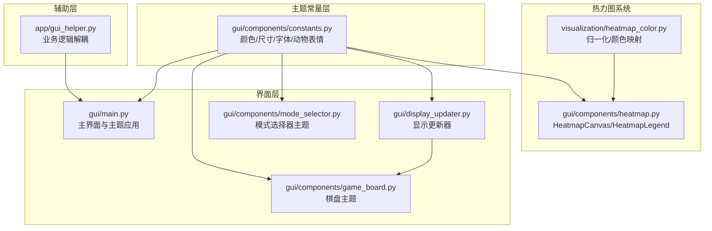
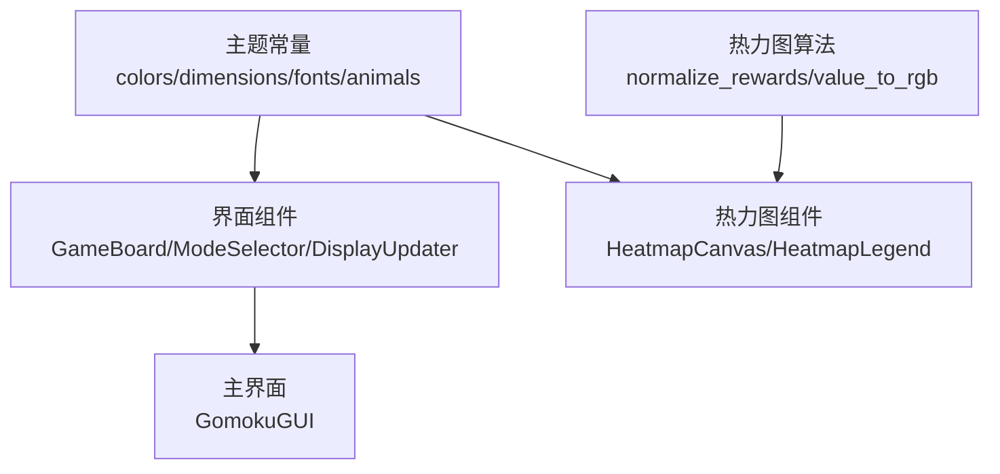
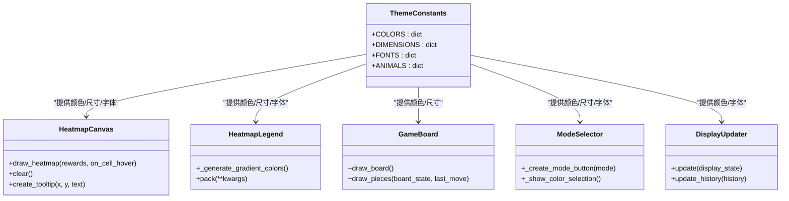
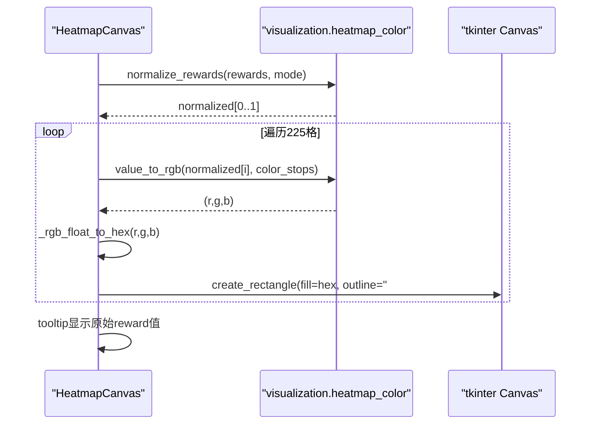
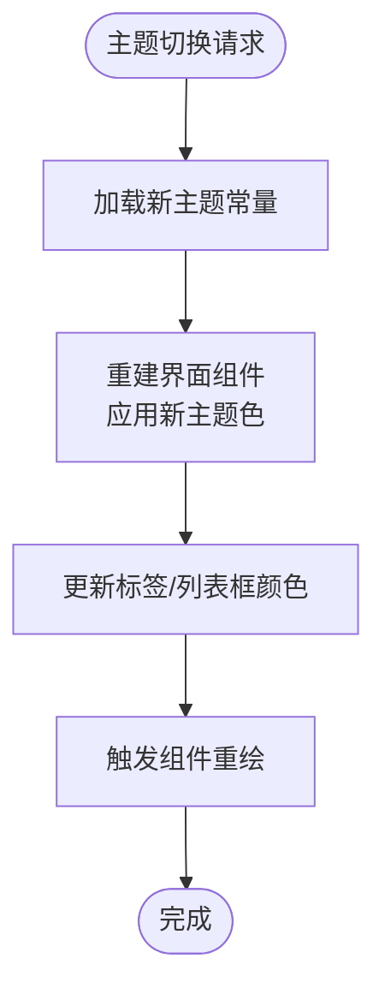
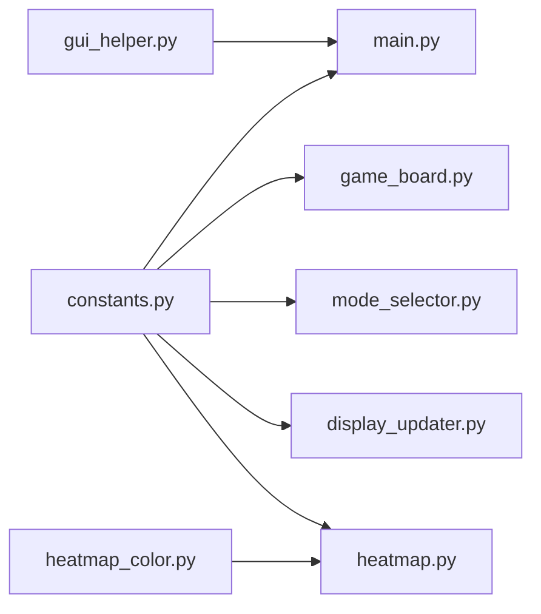

# 主题系统设计

<cite>
**本文档引用的文件**
- [gui/components/constants.py](file://gui/components/constants.py)
- [gui/components/heatmap.py](file://gui/components/heatmap.py)
- [visualization/heatmap_color.py](file://visualization/heatmap_color.py)
- [gui/display_updater.py](file://gui/display_updater.py)
- [gui/main.py](file://gui/main.py)
- [gui/components/game_board.py](file://gui/components/game_board.py)
- [gui/components/mode_selector.py](file://gui/components/mode_selector.py)
- [app/gui_helper.py](file://app/gui_helper.py)
- [design/gui_heatmap_reuse_design.md](file://design/gui_heatmap_reuse_design.md)
- [design/gui_helper_refactor_design.md](file://design/gui_helper_refactor_design.md)
- [tests/unit/test_heatmap_color.py](file://tests/unit/test_heatmap_color.py)
- [tests/gui/test_heatmap.py](file://tests/gui/test_heatmap.py)
- [coverage_report/style_cb_5c747636.css](file://coverage_report/style_cb_5c747636.css)
</cite>

## 目录
1. [简介](#简介)
2. [项目结构](#项目结构)
3. [核心组件](#核心组件)
4. [架构概览](#架构概览)
5. [详细组件分析](#详细组件分析)
6. [依赖分析](#依赖分析)
7. [性能考量](#性能考量)
8. [故障排除指南](#故障排除指南)
9. [结论](#结论)
10. [附录](#附录)

## 简介
本设计文档围绕五子棋AI项目的GUI主题系统进行全面阐述，重点涵盖颜色方案管理、样式配置与主题切换机制。文档从色彩理论与无障碍设计出发，系统梳理主题常量的组织结构（颜色、字体、尺寸），并深入解析动态主题切换的实现策略（样式更新、组件重绘与过渡效果）。同时，文档详细说明热力图颜色映射系统（概率到颜色的转换算法、渐变色彩设计与视觉感知优化），并提供主题定制指南（自定义颜色、字体替换与图标资源管理）、跨平台适配策略（高DPI支持与暗色模式）、以及主题系统的扩展性设计（插件化与用户自定义主题）。

## 项目结构
GUI主题系统主要分布在以下模块：
- 主题常量与配置：gui/components/constants.py
- 热力图组件：gui/components/heatmap.py（复用visualization/heatmap_color）
- 热力图颜色映射核心：visualization/heatmap_color.py
- 主界面与主题应用：gui/main.py
- 棋盘组件与主题颜色：gui/components/game_board.py
- 模式选择器与主题：gui/components/mode_selector.py
- 显示更新器与主题颜色传递：gui/display_updater.py
- GUI辅助与主题解耦：app/gui_helper.py
- 设计文档与测试：design/*.md 与 tests/*

**图表来源**
- [gui/components/constants.py:1-66](file://gui/components/constants.py#L1-L66)
- [gui/components/heatmap.py:1-358](file://gui/components/heatmap.py#L1-L358)
- [visualization/heatmap_color.py:1-204](file://visualization/heatmap_color.py#L1-L204)
- [gui/main.py:1-462](file://gui/main.py#L1-L462)
- [gui/components/game_board.py:1-170](file://gui/components/game_board.py#L1-L170)
- [gui/components/mode_selector.py:1-411](file://gui/components/mode_selector.py#L1-L411)
- [gui/display_updater.py:1-110](file://gui/display_updater.py#L1-L110)
- [app/gui_helper.py:1-199](file://app/gui_helper.py#L1-L199)

**章节来源**
- [gui/components/constants.py:1-66](file://gui/components/constants.py#L1-L66)
- [gui/components/heatmap.py:1-358](file://gui/components/heatmap.py#L1-L358)
- [visualization/heatmap_color.py:1-204](file://visualization/heatmap_color.py#L1-L204)
- [gui/main.py:1-462](file://gui/main.py#L1-L462)
- [gui/components/game_board.py:1-170](file://gui/components/game_board.py#L1-L170)
- [gui/components/mode_selector.py:1-411](file://gui/components/mode_selector.py#L1-L411)
- [gui/display_updater.py:1-110](file://gui/display_updater.py#L1-L110)
- [app/gui_helper.py:1-199](file://app/gui_helper.py#L1-L199)

## 核心组件
- 主题常量管理：集中定义颜色、尺寸、字体与动物表情，确保全局一致性与可维护性。
- 热力图颜色映射：基于可视化核心模块，提供可配置色板与多种归一化模式，保证在softmax分布下的层次识别。
- 主界面主题应用：在主界面与各组件中统一注入主题色，实现一致的视觉风格。
- 棋盘与按钮主题：棋盘背景、线条、棋子与按钮颜色均来自主题常量，确保视觉和谐。
- 显示更新器：负责根据主题色更新标签与列表框的前景色与背景色，保证文本可读性。

**章节来源**
- [gui/components/constants.py:1-66](file://gui/components/constants.py#L1-L66)
- [gui/components/heatmap.py:1-358](file://gui/components/heatmap.py#L1-L358)
- [visualization/heatmap_color.py:1-204](file://visualization/heatmap_color.py#L1-L204)
- [gui/main.py:1-462](file://gui/main.py#L1-L462)
- [gui/components/game_board.py:1-170](file://gui/components/game_board.py#L1-L170)
- [gui/display_updater.py:1-110](file://gui/display_updater.py#L1-L110)

## 架构概览
主题系统采用“常量集中管理 + 组件主题应用”的分层架构：
- 常量层：提供颜色、尺寸、字体与表情符号的统一定义。
- 核心算法层：热力图颜色映射算法独立于UI，确保可复用与可测试。
- 组件层：各GUI组件从常量层读取主题配置，实现主题的一致性。
- 主界面层：主界面聚合组件并注入主题色，形成完整的主题体验。

**图表来源**
- [gui/components/constants.py:1-66](file://gui/components/constants.py#L1-L66)
- [visualization/heatmap_color.py:1-204](file://visualization/heatmap_color.py#L1-L204)
- [gui/components/heatmap.py:1-358](file://gui/components/heatmap.py#L1-L358)
- [gui/main.py:1-462](file://gui/main.py#L1-L462)

## 详细组件分析

### 主题常量与组织结构
- 颜色方案（森林/小动物主题）：包含背景、棋盘、文字、边框、高亮、棋子与按钮等颜色键值，确保视觉层次清晰。
- 尺寸规范：窗口尺寸、棋盘画布尺寸、单元格大小、棋子半径与高亮半径等，保证布局一致性。
- 字体配置：标题、副标题、按钮、常规、小号与等宽字体，满足不同信息层级的可读性需求。
- 动物表情符号：用于增强主题趣味性与识别度。

**图表来源**
- [gui/components/constants.py:1-66](file://gui/components/constants.py#L1-L66)
- [gui/components/heatmap.py:68-358](file://gui/components/heatmap.py#L68-L358)
- [gui/components/game_board.py:7-170](file://gui/components/game_board.py#L7-L170)
- [gui/components/mode_selector.py:12-411](file://gui/components/mode_selector.py#L12-L411)
- [gui/display_updater.py:13-110](file://gui/display_updater.py#L13-L110)

**章节来源**
- [gui/components/constants.py:1-66](file://gui/components/constants.py#L1-L66)

### 热力图颜色映射系统
- 归一化策略：支持log、max、linear三种模式，默认log，专门优化softmax分布的次高位可辨识度。
- 色板设计：默认4色（白→黄→橙→红），信息密度高且与样本可视化一致；支持自定义色板。
- 颜色映射：value_to_rgb在色节点间进行RGB线性插值，_rgb_float_to_hex将浮点RGB转换为tkinter可接受的hex字符串。
- Tooltip显示：展示原始reward值而非归一化值，便于用户理解真实概率。

**图表来源**
- [gui/components/heatmap.py:137-247](file://gui/components/heatmap.py#L137-L247)
- [visualization/heatmap_color.py:63-122](file://visualization/heatmap_color.py#L63-L122)
- [visualization/heatmap_color.py:128-172](file://visualization/heatmap_color.py#L128-L172)

**章节来源**
- [gui/components/heatmap.py:1-358](file://gui/components/heatmap.py#L1-L358)
- [visualization/heatmap_color.py:1-204](file://visualization/heatmap_color.py#L1-L204)
- [design/gui_heatmap_reuse_design.md:191-241](file://design/gui_heatmap_reuse_design.md#L191-L241)

### 主界面主题应用与动态切换机制
- 主界面主题注入：GomokuGUI从常量导入主题色，统一配置根窗口、标签、按钮与列表框的外观。
- 显示更新器：根据主题色更新标签前景色与列表框选中背景色，保证文本可读性与高对比度。
- 动态切换策略：当前实现通过重新实例化组件并注入新主题色实现切换；建议扩展为事件驱动的主题变更通知与增量样式更新，减少全量重建成本。

**图表来源**
- [gui/main.py:31-90](file://gui/main.py#L31-L90)
- [gui/display_updater.py:40-101](file://gui/display_updater.py#L40-L101)

**章节来源**
- [gui/main.py:1-462](file://gui/main.py#L1-L462)
- [gui/display_updater.py:1-110](file://gui/display_updater.py#L1-L110)

### 棋盘与按钮主题
- 棋盘主题：棋盘背景色、线条颜色、棋子颜色与最后落子高亮颜色均来自常量，确保视觉一致性。
- 按钮主题：按钮背景色、悬停效果与前景色均来自常量，提升交互体验与品牌识别度。

**章节来源**
- [gui/components/game_board.py:1-170](file://gui/components/game_board.py#L1-L170)
- [gui/components/mode_selector.py:1-411](file://gui/components/mode_selector.py#L1-L411)

### GUI辅助与主题解耦
- GUIHelper将业务逻辑与界面解耦，便于测试与主题变更时的最小化影响。
- 主题变更时，只需调整常量层与界面层的绑定，无需修改业务逻辑。

**章节来源**
- [app/gui_helper.py:1-199](file://app/gui_helper.py#L1-L199)
- [design/gui_helper_refactor_design.md:1-281](file://design/gui_helper_refactor_design.md#L1-L281)

## 依赖分析
- 热力图组件依赖可视化核心模块，实现颜色映射算法的复用与测试隔离。
- 主界面与组件依赖主题常量，确保全局主题一致性。
- GUIHelper作为业务逻辑与界面的桥梁，降低主题变更对业务的影响。

**图表来源**
- [gui/components/constants.py:1-66](file://gui/components/constants.py#L1-L66)
- [gui/components/heatmap.py:1-358](file://gui/components/heatmap.py#L1-L358)
- [visualization/heatmap_color.py:1-204](file://visualization/heatmap_color.py#L1-L204)
- [gui/main.py:1-462](file://gui/main.py#L1-L462)
- [gui/components/game_board.py:1-170](file://gui/components/game_board.py#L1-L170)
- [gui/components/mode_selector.py:1-411](file://gui/components/mode_selector.py#L1-L411)
- [gui/display_updater.py:1-110](file://gui/display_updater.py#L1-L110)
- [app/gui_helper.py:1-199](file://app/gui_helper.py#L1-L199)

**章节来源**
- [gui/components/heatmap.py:1-358](file://gui/components/heatmap.py#L1-L358)
- [visualization/heatmap_color.py:1-204](file://visualization/heatmap_color.py#L1-L204)
- [gui/main.py:1-462](file://gui/main.py#L1-L462)

## 性能考量
- 热力图归一化采用批量处理，避免逐格重复计算，提升渲染效率。
- 颜色映射通过线性插值实现，计算开销小，适合实时渲染。
- 建议在主题切换时采用增量更新策略，避免全量重建带来的性能损耗。

## 故障排除指南
- 归一化模式错误：当heatmap_mode不在{"log","max","linear"}时，normalize_rewards会抛出ValueError。应在调用前校验模式参数。
- Tooltip显示问题：tooltip显示原始reward值，若reward为非数值类型，将退化为字符串显示。确保传入数值类型以获得最佳体验。
- 颜色越界：value_to_rgb会对越界值进行截断，确保输出合法hex字符串。

**章节来源**
- [visualization/heatmap_color.py:83-89](file://visualization/heatmap_color.py#L83-L89)
- [gui/components/heatmap.py:198-215](file://gui/components/heatmap.py#L198-L215)
- [tests/unit/test_heatmap_color.py:218-226](file://tests/unit/test_heatmap_color.py#L218-L226)
- [tests/gui/test_heatmap.py:251-282](file://tests/gui/test_heatmap.py#L251-L282)

## 结论
本主题系统通过集中化的常量管理、可配置的热力图颜色映射与统一的主题应用策略，实现了良好的视觉一致性与可维护性。结合色彩理论与无障碍设计原则，系统在可读性与用户体验方面表现优异。未来可在主题切换的动态化与性能优化方面进一步完善，并扩展插件化与用户自定义主题能力。

## 附录

### 主题定制指南
- 自定义颜色方案：在gui/components/constants.py中添加或修改COLORS键值，确保与组件使用的颜色键一致。
- 字体替换：在FONTS中添加新的字体配置，并在组件中引用相应键值。
- 图标资源管理：将图标资源集中存放于resources目录，通过常量统一引用，避免硬编码。

### 跨平台适配策略
- 高DPI支持：通过tkinter的高DPI适配机制与字体缩放策略，确保在不同DPI下的显示一致性。
- 暗色模式：利用CSS媒体查询与系统偏好设置，实现自动暗色模式切换与主题色调整。

**章节来源**
- [coverage_report/style_cb_5c747636.css:35-57](file://coverage_report/style_cb_5c747636.css#L35-L57)