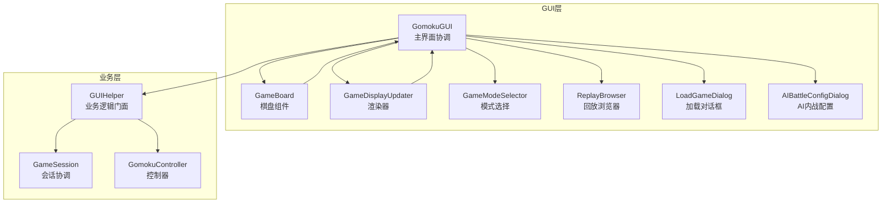
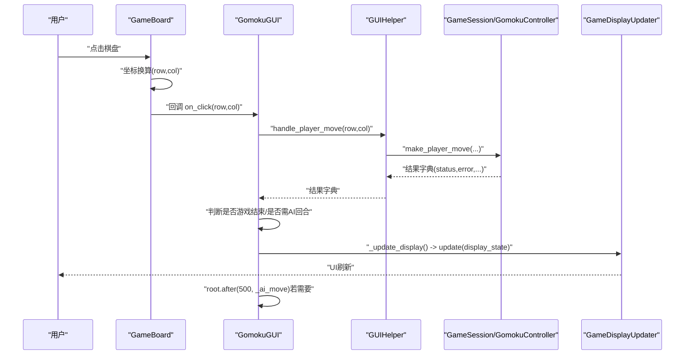
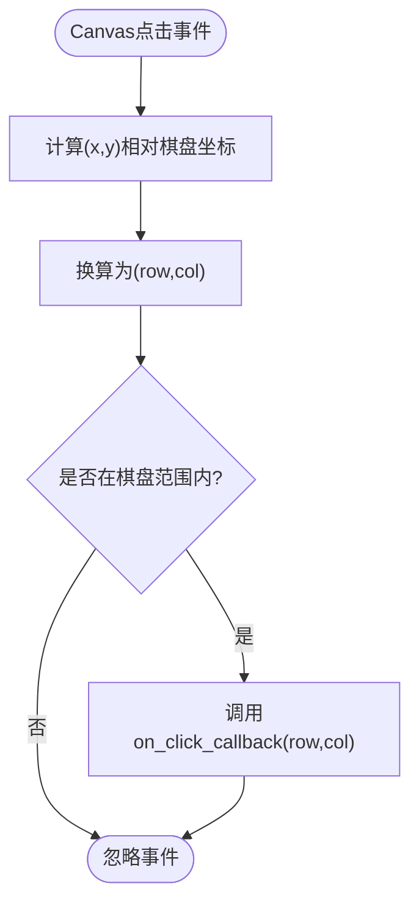
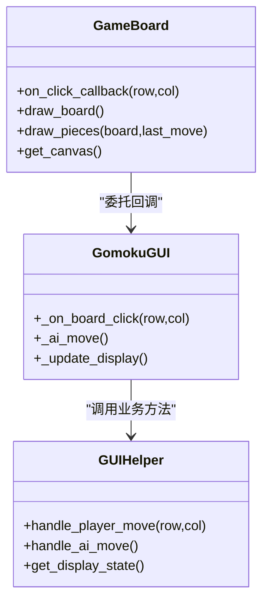
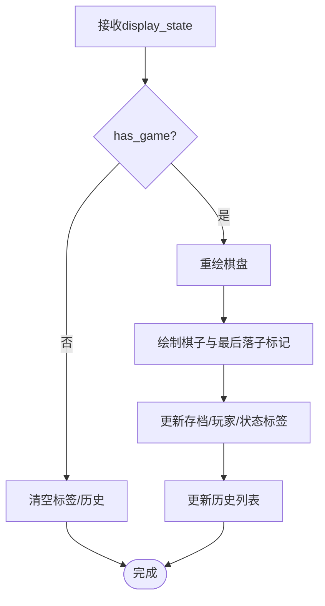
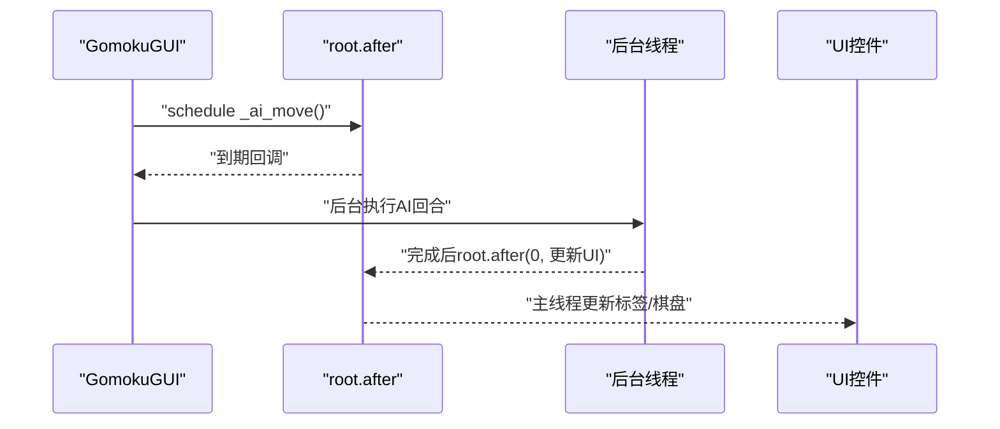
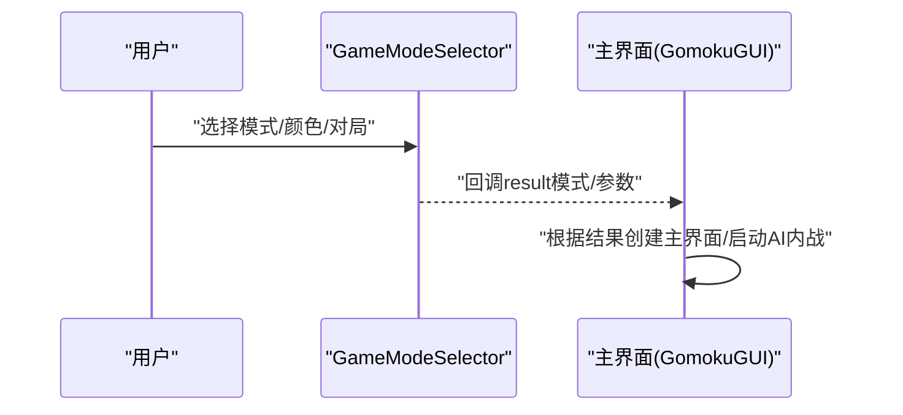
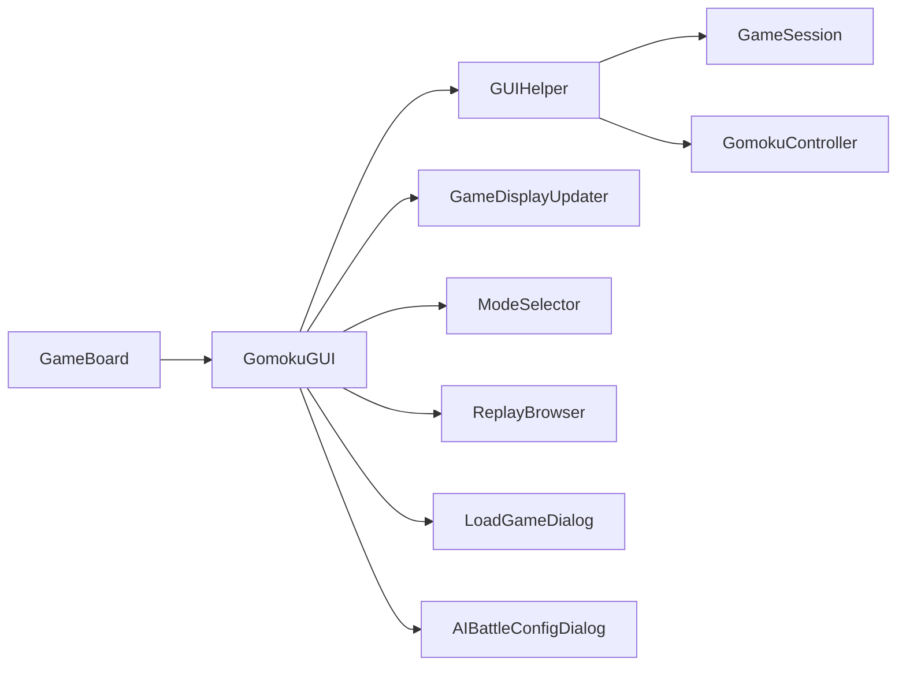

# 事件处理机制

<cite>
**本文引用的文件**
- [gui/main.py](file://gui/main.py)
- [gui/components/game_board.py](file://gui/components/game_board.py)
- [app/gui_helper.py](file://app/gui_helper.py)
- [gui/display_updater.py](file://gui/display_updater.py)
- [gui/components/constants.py](file://gui/components/constants.py)
- [gui/components/mode_selector.py](file://gui/components/mode_selector.py)
- [gui/components/replay_browser.py](file://gui/components/replay_browser.py)
- [gui/components/load_game_dialog.py](file://gui/components/load_game_dialog.py)
- [gui/components/ai_battle.py](file://gui/components/ai_battle.py)
- [tests/gui/test_gomoku_gui.py](file://tests/gui/test_gomoku_gui.py)
- [tests/gui/test_game_board.py](file://tests/gui/test_game_board.py)
- [tests/gui/test_display_updater.py](file://tests/gui/test_display_updater.py)
</cite>

## 目录
1. [引言](#引言)
2. [项目结构](#项目结构)
3. [核心组件](#核心组件)
4. [架构总览](#架构总览)
5. [详细组件分析](#详细组件分析)
6. [依赖分析](#依赖分析)
7. [性能考虑](#性能考虑)
8. [故障排查指南](#故障排查指南)
9. [结论](#结论)
10. [附录](#附录)

## 引言
本文件系统性梳理五子棋GUI的事件处理机制，聚焦以下目标：
- 用户交互事件的捕获与处理流程：鼠标点击、键盘输入（空格暂停）、窗口事件（菜单、按钮、对话框）。
- 事件冒泡与事件委托模式在GUI组件中的应用。
- 事件回调系统的实现原理：回调注册、触发与参数传递。
- 异步事件处理策略：事件队列管理、线程安全与性能优化。
- GUI状态更新的事件驱动机制：状态变更监听、UI刷新触发与批量更新策略。
- 最佳实践：事件优先级管理、重复事件过滤与内存泄漏防护。
- 调试方法与常见错误的解决方案。

## 项目结构
GUI层采用“组件化 + 事件驱动”的设计：
- 主界面 GomokuGUI 负责组织菜单、按钮、信息面板与棋盘组件，并协调事件分发。
- GameBoard 作为底层Canvas组件，负责鼠标点击事件的捕获与坐标转换，并将事件委托给上层回调。
- GUIHelper 将业务逻辑与界面解耦，集中处理落子、AI回合、状态查询等。
- GameDisplayUpdater 负责将 display_state 渲染到各个UI控件。
- ModeSelector、ReplayBrowser、LoadGameDialog、AIBattleConfigDialog 等组件通过回调与主界面协作。
- Tkinter 的 after/after_idle 提供轻量异步调度，避免阻塞主线程。

图表来源
- [gui/main.py:31-90](file://gui/main.py#L31-L90)
- [gui/components/game_board.py:22-51](file://gui/components/game_board.py#L22-L51)
- [app/gui_helper.py:12-24](file://app/gui_helper.py#L12-L24)
- [gui/display_updater.py:13-39](file://gui/display_updater.py#L13-L39)

章节来源
- [gui/main.py:91-458](file://gui/main.py#L91-L458)
- [gui/components/game_board.py:10-51](file://gui/components/game_board.py#L10-L51)
- [app/gui_helper.py:12-148](file://app/gui_helper.py#L12-L148)
- [gui/display_updater.py:13-109](file://gui/display_updater.py#L13-L109)

## 核心组件
- GomokuGUI：主界面协调者，负责菜单、按钮、信息面板与棋盘的组装；处理菜单命令、按钮点击、AI回合调度与显示更新。
- GameBoard：棋盘Canvas组件，绑定鼠标点击事件，进行坐标换算，将(row,col)回调至上层。
- GUIHelper：业务门面，封装与会话与控制器的交互，统一返回结构化的结果字典，屏蔽界面细节。
- GameDisplayUpdater：渲染器，接收 display_state，更新棋盘、标签、历史列表与弹窗。
- ModeSelector/ReplayBrowser/LoadGameDialog/AIBattleConfigDialog：对话框与选择器组件，通过回调将用户选择传递给主界面。

章节来源
- [gui/main.py:31-90](file://gui/main.py#L31-L90)
- [gui/components/game_board.py:7-51](file://gui/components/game_board.py#L7-L51)
- [app/gui_helper.py:12-148](file://app/gui_helper.py#L12-L148)
- [gui/display_updater.py:13-109](file://gui/display_updater.py#L13-L109)
- [gui/components/mode_selector.py:12-51](file://gui/components/mode_selector.py#L12-L51)
- [gui/components/replay_browser.py:300-382](file://gui/components/replay_browser.py#L300-L382)
- [gui/components/load_game_dialog.py:11-55](file://gui/components/load_game_dialog.py#L11-L55)
- [gui/components/ai_battle.py:22-168](file://gui/components/ai_battle.py#L22-L168)

## 架构总览
GUI事件流遵循“捕获/委托 → 业务门面 → 状态更新 → 渲染”的闭环：
- 鼠标点击：GameBoard捕获Canvas点击事件，换算为棋盘坐标，委托给GomokuGUI的回调。
- 业务处理：GomokuGUI调用GUIHelper，后者协调GameSession与GomokuController，返回结构化结果。
- 状态更新：GomokuGUI调用GameDisplayUpdater，将display_state渲染到UI。
- 异步调度：AI回合与对话框进度通过root.after与线程实现非阻塞。

图表来源
- [gui/components/game_board.py:151-166](file://gui/components/game_board.py#L151-L166)
- [gui/main.py:224-243](file://gui/main.py#L224-L243)
- [app/gui_helper.py:53-82](file://app/gui_helper.py#L53-L82)
- [gui/display_updater.py:40-82](file://gui/display_updater.py#L40-L82)

## 详细组件分析

### 鼠标点击事件处理（棋盘）
- 捕获：GameBoard在Canvas上绑定<Button-1>事件。
- 坐标换算：基于BOARD_MARGIN、CELL_SIZE进行行列换算，使用整除确保负坐标映射到非法范围。
- 边界检查：仅在[0,15)范围内触发回调。
- 委托：调用传入的on_click_callback(row,col)，由上层GomokuGUI处理。

图表来源
- [gui/components/game_board.py:151-166](file://gui/components/game_board.py#L151-L166)

章节来源
- [gui/components/game_board.py:151-166](file://gui/components/game_board.py#L151-L166)
- [tests/gui/test_game_board.py:169-212](file://tests/gui/test_game_board.py#L169-L212)

### 业务门面与回调系统（GUIHelper）
- 回调注册：GomokuGUI在构造GameBoard时注入on_click_callback，形成事件委托链。
- 回调触发：GameBoard将(row,col)回调至GomokuGUI._on_board_click。
- 业务处理：GUIHelper封装落子、AI回合、状态查询，统一返回字典，便于上层分支处理。
- 参数传递：回调函数签名固定为on_click(row,col)，返回值通过结构化字典承载状态与错误信息。

图表来源
- [gui/components/game_board.py:22-31](file://gui/components/game_board.py#L22-L31)
- [gui/main.py:224-268](file://gui/main.py#L224-L268)
- [app/gui_helper.py:53-106](file://app/gui_helper.py#L53-L106)

章节来源
- [gui/main.py:224-268](file://gui/main.py#L224-L268)
- [app/gui_helper.py:53-106](file://app/gui_helper.py#L53-L106)

### 显示更新与事件驱动（GameDisplayUpdater）
- 输入：display_state字典，包含has_game、save_name、board、last_move、history、winner、current_player等。
- 输出：更新棋盘、标签、历史列表与弹窗。
- 批量更新：update一次性完成棋盘重绘、棋子绘制、标签更新与历史刷新，避免多次重绘造成的闪烁与性能损耗。
- 历史更新：update_history先清空再插入，确保列表一致性。

图表来源
- [gui/display_updater.py:40-101](file://gui/display_updater.py#L40-L101)

章节来源
- [gui/display_updater.py:40-101](file://gui/display_updater.py#L40-L101)
- [tests/gui/test_display_updater.py:124-237](file://tests/gui/test_display_updater.py#L124-L237)

### 异步事件与线程安全
- Tkinter异步：GomokuGUI使用root.after延迟调度AI回合，避免阻塞事件循环。
- AI内战异步：AIBattleProgressWindow在后台线程运行BattleSession，通过root.after将进度与结果切换到主线程，保证UI安全更新。
- 线程安全要点：
  - 仅通过root.after在主线程访问UI控件。
  - 模型加载异常通过root.after弹窗提示，避免跨线程直接操作UI。
  - 使用threading.Event进行状态同步（见GPU保活模块，用于键盘监听场景）。

图表来源
- [gui/main.py:244-268](file://gui/main.py#L244-L268)
- [gui/components/ai_battle.py:251-282](file://gui/components/ai_battle.py#L251-L282)

章节来源
- [gui/main.py:244-268](file://gui/main.py#L244-L268)
- [gui/components/ai_battle.py:251-317](file://gui/components/ai_battle.py#L251-L317)

### 键盘输入事件（空格暂停，辅助用途）
- GPU保活模块在独立线程监听空格键，通过Event与主线程通信，确保主线程不会错过暂停/恢复切换。
- 该机制与五子棋GUI主事件循环解耦，但体现了键盘事件的异步监听与线程安全思想。

章节来源
- [ai/keep_gpu_alive.py:94-175](file://ai/keep_gpu_alive.py#L94-L175)

### 窗口事件与对话框（菜单、按钮、对话框）
- 菜单与按钮：GomokuGUI创建菜单与按钮，绑定命令函数（新建/保存/加载/回放）。
- 对话框：LoadGameDialog、AIBattleConfigDialog、ReplayBrowser等通过Toplevel与wait_window实现阻塞式交互，回调返回用户选择。
- 事件冒泡：按钮的悬停效果通过bind("<Enter>/<Leave>")实现，属于标准事件冒泡与委托。

图表来源
- [gui/components/mode_selector.py:176-277](file://gui/components/mode_selector.py#L176-L277)
- [gui/components/replay_browser.py:347-382](file://gui/components/replay_browser.py#L347-L382)
- [gui/components/load_game_dialog.py:14-55](file://gui/components/load_game_dialog.py#L14-L55)
- [gui/main.py:398-458](file://gui/main.py#L398-L458)

章节来源
- [gui/main.py:91-104](file://gui/main.py#L91-L104)
- [gui/main.py:287-320](file://gui/main.py#L287-L320)
- [gui/components/mode_selector.py:176-277](file://gui/components/mode_selector.py#L176-L277)
- [gui/components/replay_browser.py:300-382](file://gui/components/replay_browser.py#L300-L382)
- [gui/components/load_game_dialog.py:14-55](file://gui/components/load_game_dialog.py#L14-L55)

## 依赖分析
- 组件耦合：
  - GomokuGUI与GameBoard通过回调耦合，低耦合高内聚。
  - GUIHelper作为门面，隔离业务与界面，降低GomokuGUI复杂度。
  - GameDisplayUpdater依赖UI控件引用，职责单一，便于测试。
- 外部依赖：
  - Tkinter事件循环与after机制。
  - 会话与控制器（GameSession/GomokuController）。
  - AI模型注册与BattleSession（AI内战）。

图表来源
- [gui/main.py:31-90](file://gui/main.py#L31-L90)
- [app/gui_helper.py:12-24](file://app/gui_helper.py#L12-L24)
- [gui/display_updater.py:13-39](file://gui/display_updater.py#L13-L39)

章节来源
- [gui/main.py:31-90](file://gui/main.py#L31-L90)
- [app/gui_helper.py:12-24](file://app/gui_helper.py#L12-L24)
- [gui/display_updater.py:13-39](file://gui/display_updater.py#L13-L39)

## 性能考虑
- 事件队列与批量更新：UI更新集中在GameDisplayUpdater.update中，减少多次重绘。
- 异步调度：root.after用于延时AI回合，避免阻塞事件循环。
- 绘制优化：GameBoard.draw_pieces先删除“piece”和“last_move”标签，再重绘，避免累积图形对象。
- 对话框与窗口：使用Toplevel与wait_window，避免阻塞主线程；必要时通过回调返回结果。

章节来源
- [gui/display_updater.py:46-101](file://gui/display_updater.py#L46-L101)
- [gui/components/game_board.py:97-119](file://gui/components/game_board.py#L97-L119)
- [gui/main.py:244-268](file://gui/main.py#L244-L268)

## 故障排查指南
- 重复落子不刷新：
  - 现象：重复点击同一位置不更新UI。
  - 原因：业务层返回非成功状态，GomokuGUI不调用_update_display。
  - 验证：测试用例覆盖重复落子不刷新。
  
  章节来源
  - [tests/gui/test_gomoku_gui.py:119-125](file://tests/gui/test_gomoku_gui.py#L119-L125)

- 无游戏时点击崩溃：
  - 现象：未创建游戏就点击棋盘。
  - 处理：GomokuGUI提示“请先新建游戏”，不崩溃。
  
  章节来源
  - [gui/main.py:224-243](file://gui/main.py#L224-L243)

- AI回合调度：
  - 现象：PvE模式下玩家落子后未触发AI。
  - 验证：测试用例断言AI回合被调度。
  
  章节来源
  - [tests/gui/test_gomoku_gui.py:163-168](file://tests/gui/test_gomoku_gui.py#L163-L168)

- 历史列表异常：
  - 现象：历史列表不清空导致重复。
  - 处理：GameDisplayUpdater.update_history先清空再插入。
  
  章节来源
  - [gui/display_updater.py:83-101](file://gui/display_updater.py#L83-L101)

- 模型加载失败：
  - 现象：AI内战模型加载异常。
  - 处理：AIBattleProgressWindow捕获ModelLoadError并通过root.after弹窗提示。
  
  章节来源
  - [gui/components/ai_battle.py:267-272](file://gui/components/ai_battle.py#L267-L272)

- 调试建议：
  - 使用测试用例中的mock与after替身，验证回调是否被调用、UI是否按预期刷新。
  - 在关键路径添加日志（如记录_update_display调用次数）辅助定位问题。

章节来源
- [tests/gui/test_gomoku_gui.py:62-67](file://tests/gui/test_gomoku_gui.py#L62-L67)
- [tests/gui/test_display_updater.py:124-237](file://tests/gui/test_display_updater.py#L124-L237)

## 结论
本项目通过清晰的事件委托与门面模式，实现了鼠标点击、菜单按钮、对话框与AI回合的事件驱动GUI。核心优势包括：
- 低耦合：GameBoard仅负责捕获与委托，业务逻辑集中在GUIHelper。
- 易维护：GameDisplayUpdater统一渲染，批量更新提升性能。
- 线程安全：通过root.after与后台线程配合，保障UI更新安全。
- 可测试：大量测试用例覆盖关键事件路径，便于回归与调试。

## 附录
- 事件优先级管理：GUI层未显式实现优先级，建议在回调链中保持“输入捕获 → 业务处理 → 渲染”的顺序，避免渲染阻塞输入。
- 重复事件过滤：可在GameBoard中增加点击去抖或在上层记录最近一次点击位置，避免重复处理。
- 内存泄漏防护：确保对话框destroy、Canvas图形对象按标签删除、线程daemon化与及时停止监听线程。