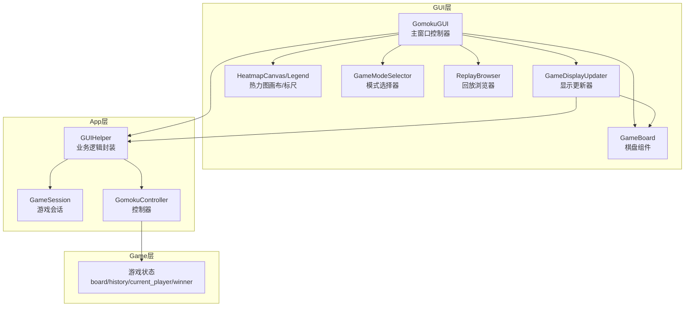
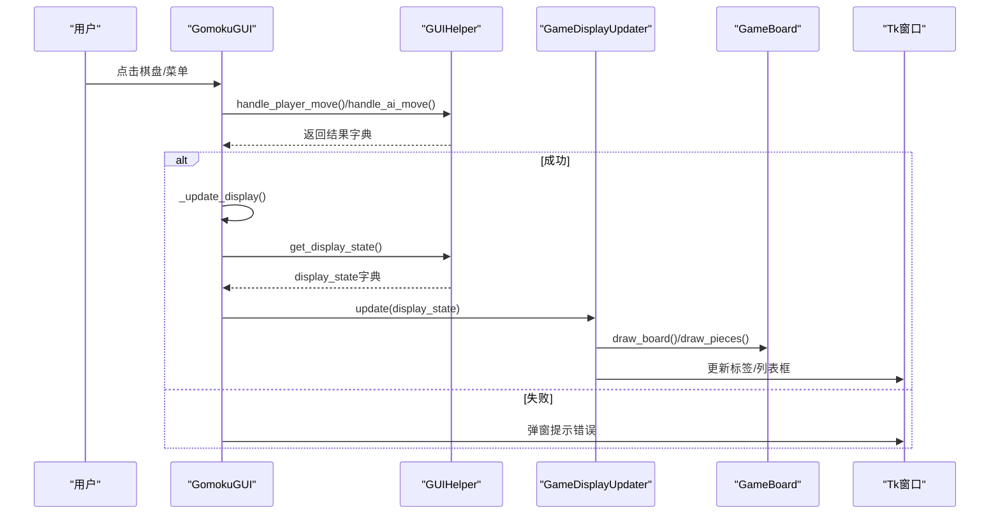
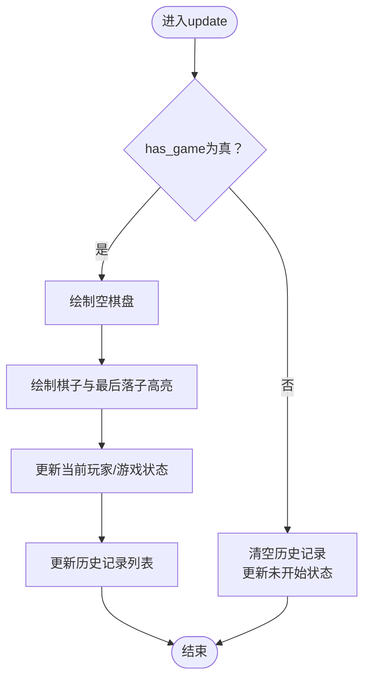
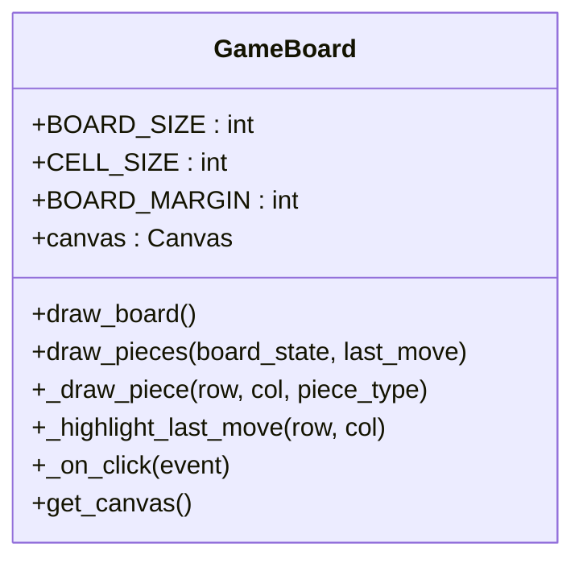
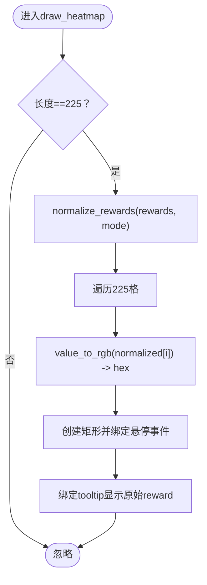
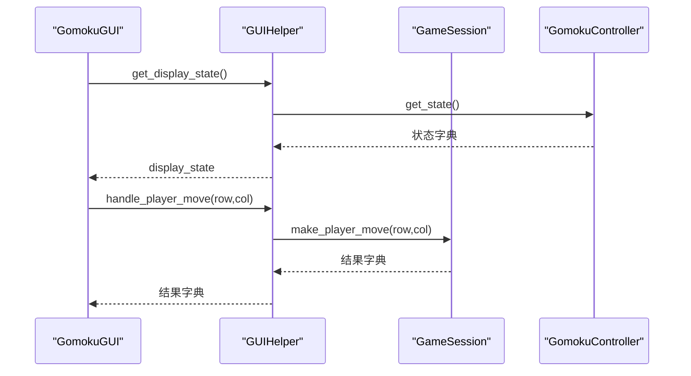
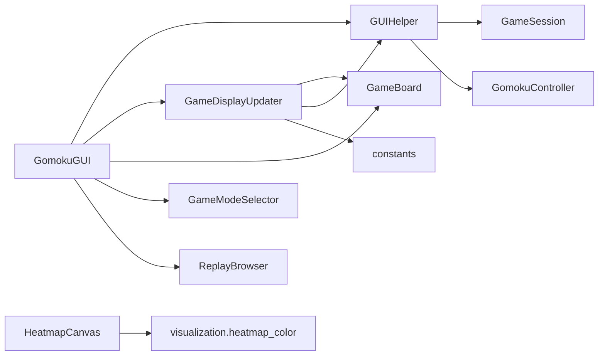

# 显示更新机制

<cite>
**本文引用的文件**
- [display_updater.py](file://gui/display_updater.py)
- [main.py](file://gui/main.py)
- [game_board.py](file://gui/components/game_board.py)
- [heatmap.py](file://gui/components/heatmap.py)
- [gui_helper.py](file://app/gui_helper.py)
- [constants.py](file://gui/components/constants.py)
- [test_display_updater.py](file://tests/gui/test_display_updater.py)
- [test_gomoku_gui.py](file://tests/gui/test_gomoku_gui.py)
- [heatmap_color.py](file://visualization/heatmap_color.py)
- [mode_selector.py](file://gui/components/mode_selector.py)
- [replay_browser.py](file://gui/components/replay_browser.py)
- [ai_battle.py](file://gui/ai_battle.py)
</cite>

## 目录
1. [简介](#简介)
2. [项目结构](#项目结构)
3. [核心组件](#核心组件)
4. [架构总览](#架构总览)
5. [详细组件分析](#详细组件分析)
6. [依赖关系分析](#依赖关系分析)
7. [性能考虑](#性能考虑)
8. [故障排查指南](#故障排查指南)
9. [结论](#结论)
10. [附录](#附录)

## 简介
本文件系统性阐述五子棋GUI的显示更新机制，重点围绕以下目标：
- 解释显示更新的架构设计：状态监听机制、UI刷新策略与性能优化
- 深入剖析DisplayUpdater类的实现原理：状态变更检测、增量更新算法与批量渲染优化
- 说明组件状态同步机制：父子组件状态传递、全局状态管理与局部状态隔离
- 总结渲染性能优化策略：双缓冲思想、脏区域检测与帧率控制
- 介绍响应式更新机制：事件驱动更新、定时刷新与条件更新策略
- 提供显示更新的调试工具与错误处理：渲染性能监控、状态变更追踪、内存使用分析、异常恢复与回滚策略、用户反馈与多线程协调

## 项目结构
GUI相关代码主要集中在gui目录，配合app层的业务逻辑与game层的状态管理，形成清晰的分层：
- gui层：负责界面渲染与用户交互（主窗口、棋盘、热力图、模式选择、回放浏览）
- app层：封装业务逻辑（GUIHelper、GameSession、GameController）
- game层：维护游戏状态（board、history、current_player、winner等）

图表来源
- [main.py:31-90](file://gui/main.py#L31-L90)
- [display_updater.py:13-40](file://gui/display_updater.py#L13-L40)
- [game_board.py:7-52](file://gui/components/game_board.py#L7-L52)
- [gui_helper.py:12-24](file://app/gui_helper.py#L12-L24)

章节来源
- [main.py:31-90](file://gui/main.py#L31-L90)
- [display_updater.py:13-40](file://gui/display_updater.py#L13-L40)
- [gui_helper.py:12-24](file://app/gui_helper.py#L12-L24)

## 核心组件
- GomokuGUI：主窗口控制器，负责菜单、按钮、事件绑定与显示更新调度
- GameDisplayUpdater：显示更新器，根据display_state字典刷新棋盘、标签、历史记录
- GameBoard：棋盘组件，负责绘制网格、棋子与最后落子高亮
- GUIHelper：业务逻辑封装，提供get_display_state、handle_player_move、handle_ai_move等接口
- HeatmapCanvas/Legend：热力图画布与颜色标尺，支持悬停tooltip与批量绘制
- GameModeSelector/ReplayBrowser：模式选择与回放浏览组件
- constants：颜色、字体、尺寸等主题常量

章节来源
- [main.py:31-90](file://gui/main.py#L31-L90)
- [display_updater.py:13-110](file://gui/display_updater.py#L13-L110)
- [game_board.py:7-170](file://gui/components/game_board.py#L7-L170)
- [gui_helper.py:12-199](file://app/gui_helper.py#L12-L199)
- [constants.py:1-66](file://gui/components/constants.py#L1-L66)

## 架构总览
显示更新采用“事件驱动 + 定时刷新”的响应式架构：
- 事件驱动：用户点击棋盘、菜单操作触发GUIHelper处理业务逻辑，随后调用GomokuGUI._update_display
- 定时刷新：root.after调度AI落子、AI先走等异步流程
- 条件更新：仅在状态发生有意义变化时进行UI刷新，避免无效重绘
- 批量渲染：GameDisplayUpdater集中处理多个UI控件的更新，减少Tkinter调用次数

图表来源
- [main.py:224-284](file://gui/main.py#L224-L284)
- [gui_helper.py:53-106](file://app/gui_helper.py#L53-L106)
- [display_updater.py:40-82](file://gui/display_updater.py#L40-L82)

## 详细组件分析

### DisplayUpdater类实现原理
- 状态变更检测：通过display_state字典中的has_game、winner、current_player、board、last_move、history等字段判断是否需要刷新
- 增量更新算法：仅在有游戏且winner==0时绘制棋子；历史记录采用全量替换（先清空再插入），避免重复渲染
- 批量渲染优化：集中调用Board的draw_board/draw_pieces，减少多次Canvas操作；标签更新采用一次性配置

图表来源
- [display_updater.py:40-101](file://gui/display_updater.py#L40-L101)

章节来源
- [display_updater.py:13-110](file://gui/display_updater.py#L13-L110)

### 棋盘组件（GameBoard）
- 绘制策略：先删除所有棋子与高亮标记，再按board_state重新绘制，确保状态一致性
- 交互处理：将Canvas坐标转换为棋盘行列，进行边界检查后回调上层
- 性能优化：使用tag区分棋子与高亮，便于局部更新；最后落子高亮单独绘制，避免重复遍历

图表来源
- [game_board.py:7-170](file://gui/components/game_board.py#L7-L170)

章节来源
- [game_board.py:7-170](file://gui/components/game_board.py#L7-L170)

### 热力图组件（HeatmapCanvas/Legend）
- 归一化与颜色映射：复用visualization.heatmap_color的normalize_rewards与value_to_rgb，支持log/max/linear三种模式
- 批量绘制：先计算全局归一化，再逐格绘制矩形并绑定悬停事件
- Tooltip：懒创建，复用已有窗口，动态更新位置与内容
- Legend：按色节点等距插值生成渐变条与中文标签

图表来源
- [heatmap.py:137-195](file://gui/components/heatmap.py#L137-L195)
- [heatmap_color.py:63-122](file://visualization/heatmap_color.py#L63-L122)

章节来源
- [heatmap.py:68-358](file://gui/components/heatmap.py#L68-L358)
- [heatmap_color.py:1-204](file://visualization/heatmap_color.py#L1-L204)

### GUIHelper与状态同步
- get_display_state：聚合controller状态，提取board、last_move、history等关键字段
- handle_player_move/handle_ai_move：封装业务逻辑，返回标准化结果字典
- get_player_name：结合ANIMALS常量生成带emoji的玩家名称

图表来源
- [gui_helper.py:108-148](file://app/gui_helper.py#L108-L148)
- [gui_helper.py:53-106](file://app/gui_helper.py#L53-L106)

章节来源
- [gui_helper.py:12-199](file://app/gui_helper.py#L12-L199)

### 响应式更新机制
- 事件驱动更新：棋盘点击、菜单命令触发业务逻辑，随后集中刷新UI
- 定时刷新：root.after调度AI落子、AI先走，避免阻塞主线程
- 条件更新：仅在状态变化或必要时刷新，如历史记录全量替换、棋子增量绘制

章节来源
- [main.py:224-284](file://gui/main.py#L224-L284)
- [display_updater.py:83-101](file://gui/display_updater.py#L83-L101)

### 组件状态同步与隔离
- 全局状态管理：GameSession封装游戏流程，GUIHelper封装业务逻辑，二者通过标准接口传递状态
- 局部状态隔离：GameBoard仅关注绘制，不参与业务决策；DisplayUpdater仅负责UI刷新
- 父子组件状态传递：GomokuGUI持有Board实例引用，在update中调用其绘制方法

章节来源
- [main.py:75-85](file://gui/main.py#L75-L85)
- [display_updater.py:31-38](file://gui/display_updater.py#L31-L38)

## 依赖关系分析
- GomokuGUI依赖GUIHelper与GameSession，间接依赖GameController与游戏状态
- GameDisplayUpdater依赖GameBoard与GUIHelper，依赖constants中的颜色常量
- HeatmapCanvas依赖visualization.heatmap_color的归一化与颜色映射函数
- ModeSelector与ReplayBrowser作为独立组件，通过回调与主窗口交互

图表来源
- [main.py:22-28](file://gui/main.py#L22-L28)
- [display_updater.py:16-38](file://gui/display_updater.py#L16-L38)
- [heatmap.py:30-34](file://gui/components/heatmap.py#L30-L34)

章节来源
- [main.py:22-28](file://gui/main.py#L22-L28)
- [display_updater.py:16-38](file://gui/display_updater.py#L16-L38)
- [heatmap.py:30-34](file://gui/components/heatmap.py#L30-L34)

## 性能考虑
- 双缓冲思想：GameBoard先删除棋子与高亮tag，再重新绘制，避免闪烁与重叠
- 脏区域检测：DisplayUpdater按需绘制棋子，未开始游戏时跳过棋子绘制
- 批量渲染优化：HeatmapCanvas一次性计算归一化，逐格绘制矩形；DisplayUpdater集中更新标签与列表框
- 帧率控制：通过root.after异步调度AI落子，避免阻塞UI线程
- 内存使用：Tooltip复用窗口，避免频繁创建销毁；历史记录列表框采用全量替换，简化状态管理

章节来源
- [game_board.py:105-118](file://gui/components/game_board.py#L105-L118)
- [display_updater.py:46-81](file://gui/display_updater.py#L46-L81)
- [heatmap.py:155-195](file://gui/components/heatmap.py#L155-L195)

## 故障排查指南
- 渲染性能监控：可通过测试用例观察UI更新频率与耗时，定位异常卡顿
- 状态变更追踪：使用测试断言验证标签文本、前景色、历史记录内容等预期变化
- 内存使用分析：关注Tooltip窗口生命周期，确保在离开时销毁
- 异常恢复与回滚：当AI模型加载失败时，主窗口捕获ModelLoadError并提示用户；显示更新过程中出现异常应保证UI状态一致性
- 用户反馈：通过messagebox展示错误与提示信息，确保用户了解当前状态
- 多线程协调：GUI线程负责UI更新，业务逻辑通过回调与异步调度与UI解耦，避免竞态条件

章节来源
- [test_display_updater.py:1-359](file://tests/gui/test_display_updater.py#L1-L359)
- [test_gomoku_gui.py:1-295](file://tests/gui/test_gomoku_gui.py#L1-L295)
- [main.py:418-456](file://gui/main.py#L418-L456)

## 结论
本项目的显示更新机制通过清晰的分层与职责分离，实现了高效、稳定的GUI渲染。DisplayUpdater集中处理UI刷新，GameBoard专注绘制，HeatmapCanvas提供高性能热力图渲染，GUIHelper与GameSession承担业务逻辑与状态管理。事件驱动与定时刷新相结合，既保证了响应性，又避免了过度渲染。测试用例覆盖了关键路径，为调试与回归提供了保障。

## 附录
- 设计参考：参考design/gui_heatmap_reuse_design.md与design/gui_helper_refactor_design.md，确保颜色映射与GUI辅助逻辑的复用与解耦
- 模式选择与回放：GameModeSelector与ReplayBrowser提供完整的用户交互流程，与显示更新机制协同工作

章节来源
- [mode_selector.py:1-411](file://gui/components/mode_selector.py#L1-L411)
- [replay_browser.py:300-383](file://gui/components/replay_browser.py#L300-L383)
- [ai_battle.py:11-36](file://gui/ai_battle.py#L11-L36)