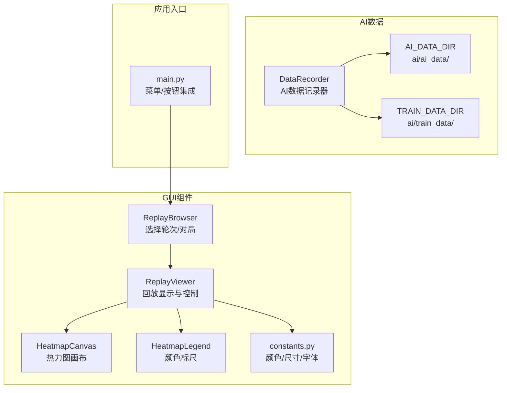
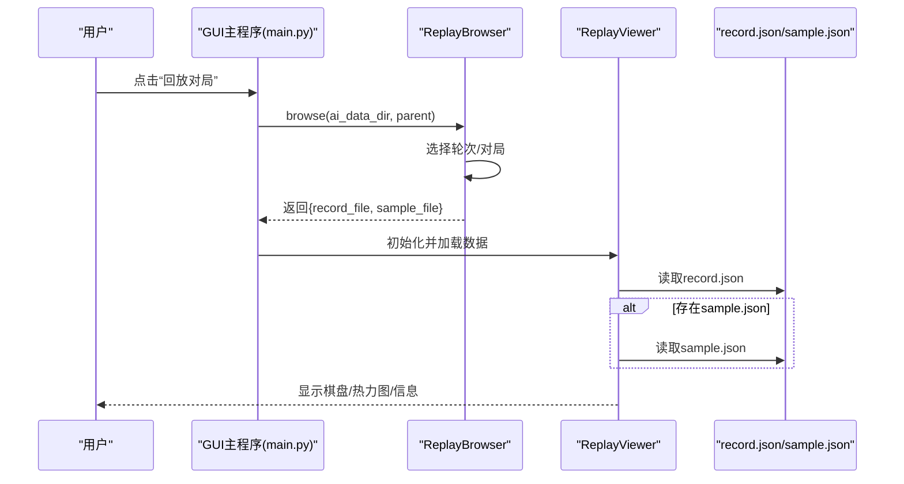
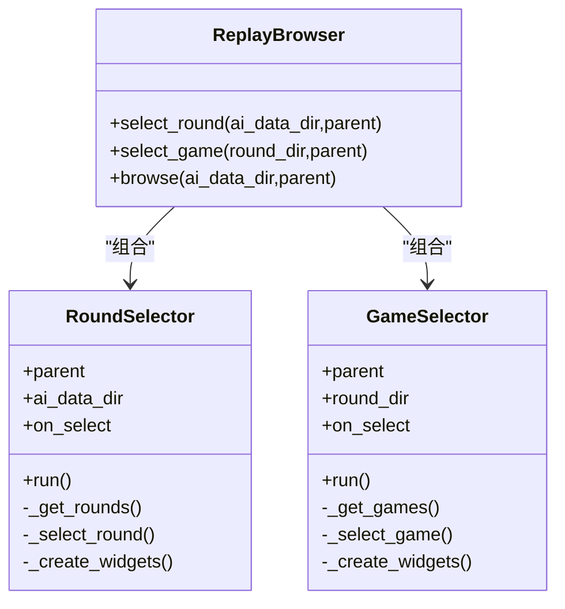
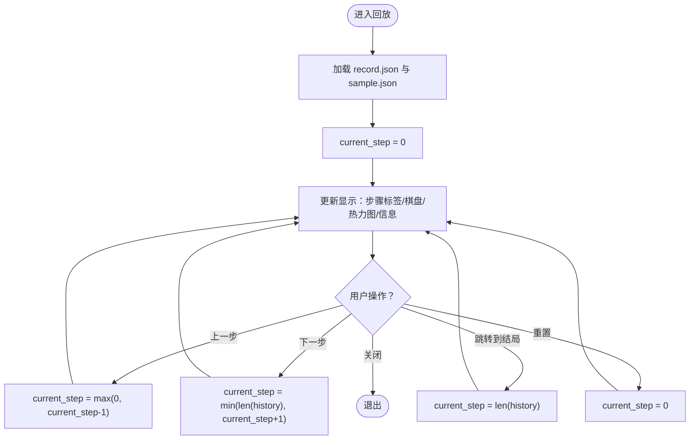
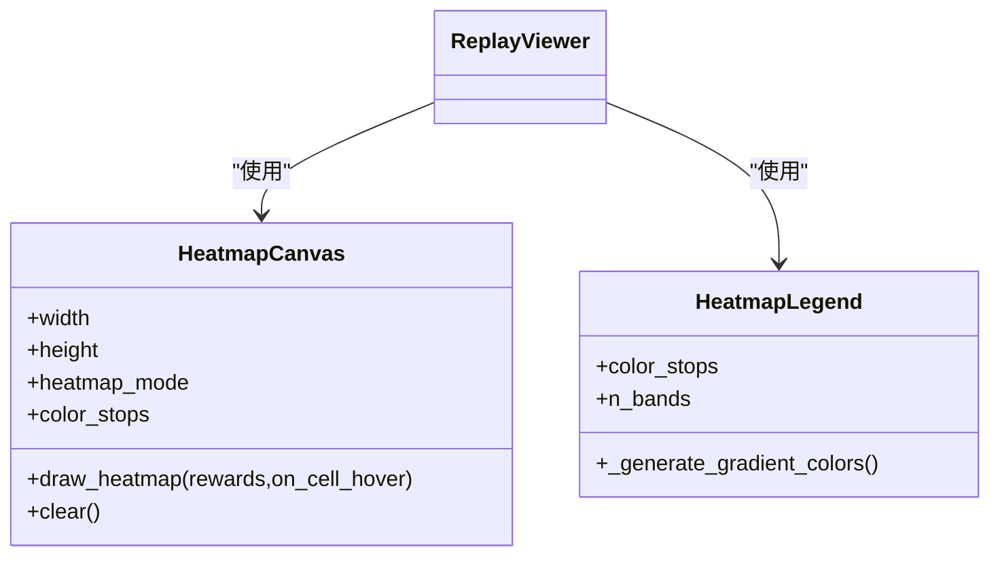
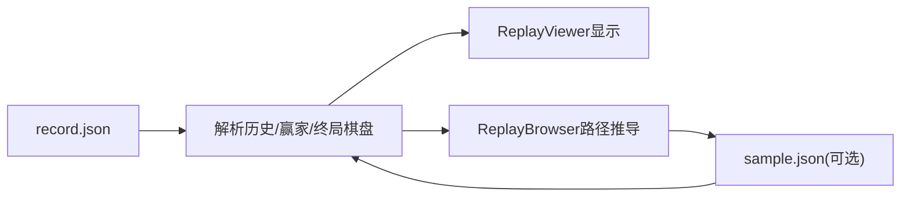
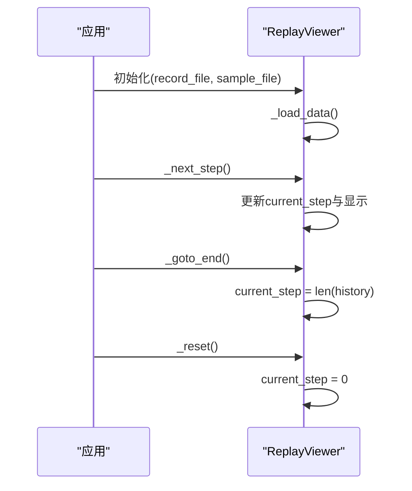
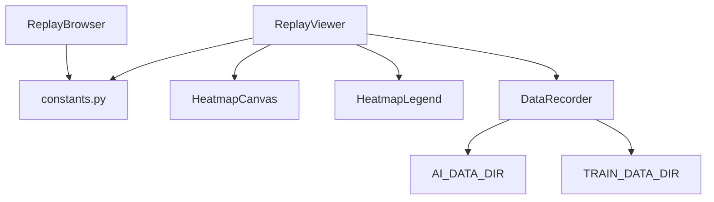

# 回放浏览器组件ReplayBrowser

<cite>
**本文引用的文件**
- [replay_browser.py](file://gui/components/replay_browser.py)
- [replay_viewer.py](file://gui/components/replay_viewer.py)
- [constants.py](file://gui/components/constants.py)
- [heatmap.py](file://gui/components/heatmap.py)
- [data_recorder.py](file://ai/data_recorder.py)
- [constants.py](file://ai/constants.py)
- [main.py](file://gui/main.py)
- [test_replay_browser.py](file://tests/gui/test_replay_browser.py)
- [test_replay_viewer.py](file://tests/gui/test_replay_viewer.py)
</cite>

## 目录
1. [简介](#简介)
2. [项目结构](#项目结构)
3. [核心组件](#核心组件)
4. [架构总览](#架构总览)
5. [详细组件分析](#详细组件分析)
6. [依赖分析](#依赖分析)
7. [性能考虑](#性能考虑)
8. [故障排查指南](#故障排查指南)
9. [结论](#结论)
10. [附录](#附录)

## 简介
本文件为五子棋AI项目的回放浏览器组件ReplayBrowser的详细技术文档。ReplayBrowser负责从AI内战产生的对局数据中选择并加载特定对局，配合ReplayViewer实现对对局的可视化回放。组件涵盖以下能力：
- 对局数据管理：轮次与对局的层级选择、数据结构与持久化策略
- 播放控制：步进控制、播放/暂停状态管理、播放速度调节与时间轴导航
- 回放播放算法：步进控制、状态恢复与动画过渡效果
- 用户交互：进度条拖拽、快退快进、循环播放
- 数据加载：文件读取、格式解析与错误处理
- 组件配置：播放参数、界面样式与用户体验优化
- 组件API：load_replay、playback_control、current_position等

## 项目结构
ReplayBrowser位于GUI组件层，与AI数据记录器协同工作，数据来源为AI内战对局的record.json与可选的sample.json。

**图表来源**
- [replay_browser.py:300-383](file://gui/components/replay_browser.py#L300-L383)
- [replay_viewer.py:13-426](file://gui/components/replay_viewer.py#L13-L426)
- [data_recorder.py:17-145](file://ai/data_recorder.py#L17-L145)
- [constants.py:11-15](file://ai/constants.py#L11-L15)
- [main.py:379-396](file://gui/main.py#L379-L396)

**章节来源**
- [replay_browser.py:1-383](file://gui/components/replay_browser.py#L1-L383)
- [replay_viewer.py:1-426](file://gui/components/replay_viewer.py#L1-L426)
- [data_recorder.py:1-145](file://ai/data_recorder.py#L1-L145)
- [constants.py:1-66](file://gui/components/constants.py#L1-L66)
- [main.py:1-462](file://gui/main.py#L1-L462)

## 核心组件
- ReplayBrowser：封装轮次选择器与对局选择器，提供browse静态方法串联选择流程，返回record.json与sample.json路径。
- ReplayViewer：负责回放显示与控制，包含棋盘绘制、热力图绘制、信息文本展示与步进控制。
- HeatmapCanvas/HeatmapLegend：热力图画布与颜色标尺，支持悬停tooltip与多种归一化模式。
- constants：统一的颜色、尺寸与字体配置，保证界面风格一致。
- DataRecorder：AI内战对局数据的记录器，生成record.json与可选sample.json，决定回放数据的结构与来源。

**章节来源**
- [replay_browser.py:300-383](file://gui/components/replay_browser.py#L300-L383)
- [replay_viewer.py:13-426](file://gui/components/replay_viewer.py#L13-L426)
- [heatmap.py:68-358](file://gui/components/heatmap.py#L68-L358)
- [constants.py:1-66](file://gui/components/constants.py#L1-L66)
- [data_recorder.py:17-145](file://ai/data_recorder.py#L17-L145)

## 架构总览
ReplayBrowser与ReplayViewer通过record.json驱动回放，若存在sample.json则同时显示AI输出与样本输出对比。数据来源于AI内战对局的持久化文件，路径遵循固定命名规范。

**图表来源**
- [main.py:379-396](file://gui/main.py#L379-L396)
- [replay_browser.py:348-383](file://gui/components/replay_browser.py#L348-L383)
- [replay_viewer.py:16-63](file://gui/components/replay_viewer.py#L16-L63)

## 详细组件分析

### ReplayBrowser组件
- 职责
  - 轮次选择：遍历ai_data目录，统计每轮次下的对局数量，提供双击选择。
  - 对局选择：扫描轮次目录下的game子目录，筛选包含record.json的对局，显示胜负与步数。
  - 浏览流程：串联轮次与对局选择，返回record.json与sample.json路径（若存在）。
- 数据结构
  - 轮次项：name、path、display
  - 对局项：id、path、record_file、display
- 持久化策略
  - 轮次目录：ai/ai_data/{ai_name}_{round_num}/
  - 对局目录：{round_dir}/{game_id}/
  - 对局文件：{game_dir}/record.json
  - 样本文件：与record.json同级，路径通过替换文件名得到（ai_data→train_data）
- 错误处理
  - 目录不存在或为空时显示提示并允许关闭。
  - record.json格式异常时跳过该对局（try-except）。
- API
  - static select_round(ai_data_dir, parent=None) → dict|None
  - static select_game(round_dir, parent=None) → dict|None
  - static browse(ai_data_dir, parent=None) → dict|None

**图表来源**
- [replay_browser.py:12-149](file://gui/components/replay_browser.py#L12-L149)
- [replay_browser.py:151-297](file://gui/components/replay_browser.py#L151-L297)
- [replay_browser.py:300-383](file://gui/components/replay_browser.py#L300-L383)

**章节来源**
- [replay_browser.py:12-149](file://gui/components/replay_browser.py#L12-L149)
- [replay_browser.py:151-297](file://gui/components/replay_browser.py#L151-L297)
- [replay_browser.py:300-383](file://gui/components/replay_browser.py#L300-L383)
- [test_replay_browser.py:45-206](file://tests/gui/test_replay_browser.py#L45-L206)

### ReplayViewer组件
- 职责
  - 加载record.json与可选sample.json，构建history与sample_data。
  - 提供步进控制：上一步、下一步、跳转到结局、重置。
  - 绘制棋盘网格与棋子，高亮最后落子位置。
  - 绘制AI热力图与Sample热力图（若存在），支持悬停tooltip。
  - 展示信息文本：当前步数、落子方、落子位置、输入/输出向量片段、Sample实际落子reward。
- 数据结构
  - history：每步包含position、input、output
  - sample_data：每步包含input、output、mask（若存在）
- 播放控制
  - current_step：当前步索引（0表示初始状态）
  - 步进边界：0..len(history)，防止越界
- 界面布局
  - 左侧：棋盘画布
  - 右侧：AI热力图、Sample热力图（可选）、颜色标尺、信息文本、历史记录列表
- 错误处理
  - 输入/输出向量长度不足时跳过绘制。
  - 跳转到结局时避免索引越界。

**图表来源**
- [replay_viewer.py:16-63](file://gui/components/replay_viewer.py#L16-L63)
- [replay_viewer.py:208-229](file://gui/components/replay_viewer.py#L208-L229)
- [replay_viewer.py:230-260](file://gui/components/replay_viewer.py#L230-L260)

**章节来源**
- [replay_viewer.py:16-426](file://gui/components/replay_viewer.py#L16-L426)
- [test_replay_viewer.py:18-288](file://tests/gui/test_replay_viewer.py#L18-L288)

### HeatmapCanvas与HeatmapLegend
- HeatmapCanvas
  - 接收225维reward向量，按行优先映射到15×15网格。
  - 支持多种归一化模式（log/max/linear），默认log。
  - 悬停显示tooltip，展示原始reward值。
- HeatmapLegend
  - 渲染颜色标尺，标注最小到最大值。
  - 默认4色渐变（白→黄→橙→红）。

**图表来源**
- [heatmap.py:68-358](file://gui/components/heatmap.py#L68-L358)
- [replay_viewer.py:136-171](file://gui/components/replay_viewer.py#L136-L171)

**章节来源**
- [heatmap.py:68-358](file://gui/components/heatmap.py#L68-L358)
- [replay_viewer.py:136-171](file://gui/components/replay_viewer.py#L136-L171)

### 数据加载机制与格式解析
- record.json
  - 结构：包含history（数组，每步含position、input、output）、winner、end_board等。
  - history每步：position为[x,y]，input通常为226维（棋盘+当前玩家），output为225维reward。
- sample.json
  - 结构：与record.json类似，但每步包含input、output、mask。
  - ReplayViewer在存在sample.json时额外绘制Sample热力图，并在信息文本中显示实际落子reward。
- 路径映射
  - ReplayBrowser根据record.json路径推导sample.json路径：将ai_data替换为train_data并替换文件名为sample.json。

**图表来源**
- [data_recorder.py:74-140](file://ai/data_recorder.py#L74-L140)
- [replay_browser.py:372-376](file://gui/components/replay_browser.py#L372-L376)
- [replay_viewer.py:48-63](file://gui/components/replay_viewer.py#L48-L63)

**章节来源**
- [data_recorder.py:74-140](file://ai/data_recorder.py#L74-L140)
- [replay_browser.py:372-376](file://gui/components/replay_browser.py#L372-L376)
- [replay_viewer.py:48-63](file://gui/components/replay_viewer.py#L48-L63)

### 组件配置选项
- 界面样式
  - 颜色：通过constants.py统一管理，包括背景、文字、边框、棋子、按钮与热力图边框。
  - 尺寸：棋盘画布、单元格、棋子半径、热力图单元尺寸等。
  - 字体：标题、副标题、按钮、常规、小号、等宽字体。
- 播放参数
  - 归一化模式：HeatmapCanvas支持"log"/"max"/"linear"。
  - 热力图颜色：默认4色渐变，可通过color_stops自定义。
- 用户体验
  - 棋盘网格与高亮：清晰显示最后落子位置。
  - 信息文本：可切换显示输入/输出向量片段与Sample数据。
  - Tooltip：鼠标悬停显示格子坐标与reward。

**章节来源**
- [constants.py:1-66](file://gui/components/constants.py#L1-L66)
- [heatmap.py:71-99](file://gui/components/heatmap.py#L71-L99)
- [replay_viewer.py:38-46](file://gui/components/replay_viewer.py#L38-L46)

### 组件API接口
- load_replay
  - 作用：加载指定对局的record.json与sample.json，初始化回放显示。
  - 参数：record_file（必填）、sample_file（可选）。
  - 返回：ReplayViewer实例（在ReplayWindow中使用）。
- playback_control
  - 作用：控制回放播放流程。
  - 方法：_prev_step、_next_step、_goto_end、_reset。
  - 状态：current_step（0..len(history)）。
- current_position
  - 作用：查询当前步的落子位置。
  - 实现：通过history[current_step-1].position（current_step>0时）。

**图表来源**
- [replay_viewer.py:16-63](file://gui/components/replay_viewer.py#L16-L63)
- [replay_viewer.py:208-229](file://gui/components/replay_viewer.py#L208-L229)

**章节来源**
- [replay_viewer.py:16-63](file://gui/components/replay_viewer.py#L16-L63)
- [replay_viewer.py:208-229](file://gui/components/replay_viewer.py#L208-L229)

## 依赖分析
- ReplayBrowser依赖
  - GUI常量：颜色、尺寸、字体（用于界面风格统一）。
  - 文件系统：读取ai_data目录与轮次/对局子目录。
- ReplayViewer依赖
  - HeatmapCanvas/HeatmapLegend：热力图绘制与颜色标尺。
  - constants：界面颜色与尺寸。
  - JSON文件：record.json与sample.json。
- DataRecorder依赖
  - AI数据目录常量：AI_DATA_DIR、TRAIN_DATA_DIR。
  - 输出格式：history每步包含position、input、output；sample.json包含mask。

**图表来源**
- [replay_browser.py:9](file://gui/components/replay_browser.py#L9)
- [replay_viewer.py:9-11](file://gui/components/replay_viewer.py#L9-L11)
- [constants.py:11-15](file://ai/constants.py#L11-L15)
- [data_recorder.py:12](file://ai/data_recorder.py#L12)

**章节来源**
- [replay_browser.py:9](file://gui/components/replay_browser.py#L9)
- [replay_viewer.py:9-11](file://gui/components/replay_viewer.py#L9-L11)
- [constants.py:11-15](file://ai/constants.py#L11-L15)
- [data_recorder.py:12](file://ai/data_recorder.py#L12)

## 性能考虑
- 文件读取
  - record.json与sample.json采用UTF-8编码读取，避免大文件重复解析。
- 绘制优化
  - 棋盘网格与棋子绘制在Canvas上，仅在状态变化时重绘。
  - 热力图批量归一化与颜色转换，避免逐帧重复计算。
- 内存管理
  - history与sample_data作为内存缓存，建议在长对局场景下谨慎使用信息文本的完整向量显示。
- I/O与路径
  - ReplayBrowser通过字符串替换推导sample.json路径，减少文件系统扫描。

[本节为通用性能建议，无需特定文件引用]

## 故障排查指南
- 无回放数据
  - 现象：提示“暂无回放数据，请先进行 AI 内战对战”。
  - 原因：ai_data目录不存在或为空。
  - 处理：确认AI内战已完成并生成record.json。
- 无法选择轮次/对局
  - 现象：列表为空或提示未找到数据。
  - 原因：目录权限问题或record.json缺失。
  - 处理：检查目录结构与文件完整性。
- 热力图不显示
  - 现象：棋盘显示但热力图空白。
  - 原因：output向量长度不足或格式异常。
  - 处理：确认DataRecorder输出格式正确（225维reward）。
- 跳转到结局报错
  - 现象：跳转到结局时索引越界。
  - 原因：历史记录为空或索引计算错误。
  - 处理：确保current_step边界检查生效（已内置）。

**章节来源**
- [main.py:384-386](file://gui/main.py#L384-L386)
- [replay_viewer.py:286-297](file://gui/components/replay_viewer.py#L286-L297)
- [test_replay_viewer.py:213-227](file://tests/gui/test_replay_viewer.py#L213-L227)

## 结论
ReplayBrowser与ReplayViewer共同实现了从AI内战数据到可视化回放的完整链路。组件通过清晰的数据结构与稳健的错误处理，提供了直观的回放体验。结合HeatmapCanvas与HeatmapLegend，用户可以对比AI输出与样本输出，深入理解AI决策过程。未来可在播放速度调节、进度条拖拽与循环播放方面进一步增强交互体验。

[本节为总结性内容，无需特定文件引用]

## 附录

### 数据模型与字段说明
- record.json
  - history：数组，每步含position、input、output
  - winner：0未结束/1黑胜/2白胜/3平局
  - end_board：最终棋盘状态
- sample.json
  - 每步含input、output、mask

**章节来源**
- [data_recorder.py:74-140](file://ai/data_recorder.py#L74-L140)
- [replay_viewer.py:48-63](file://gui/components/replay_viewer.py#L48-L63)