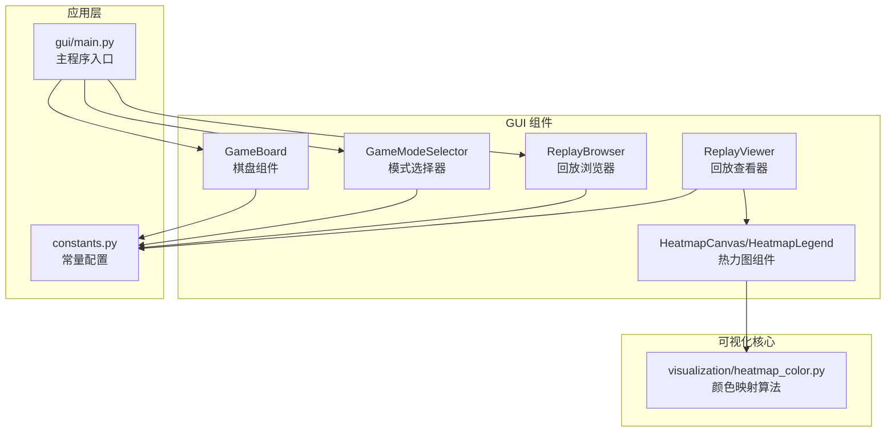
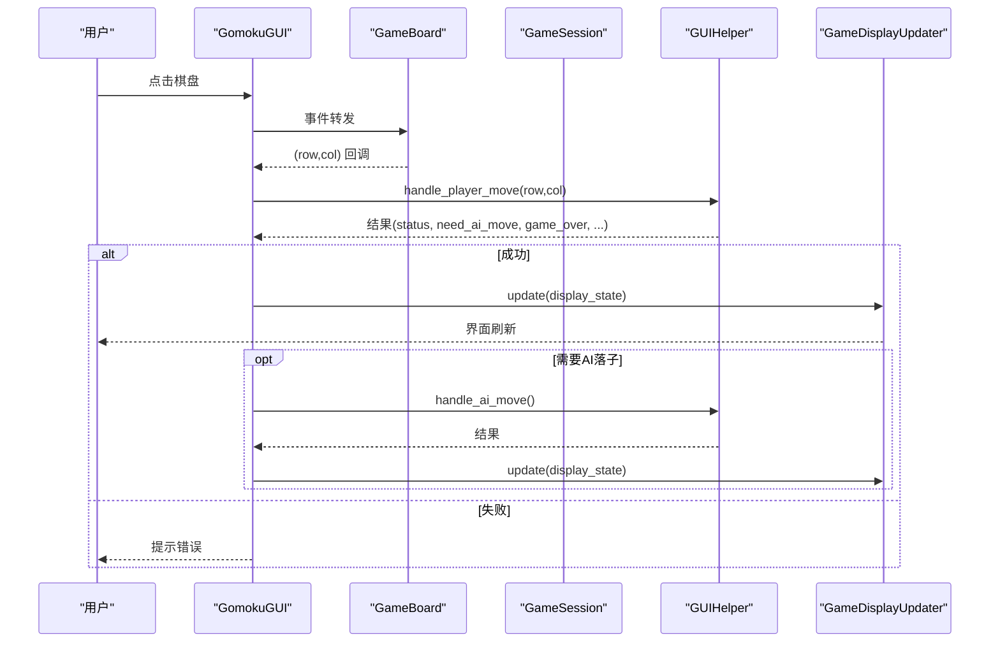
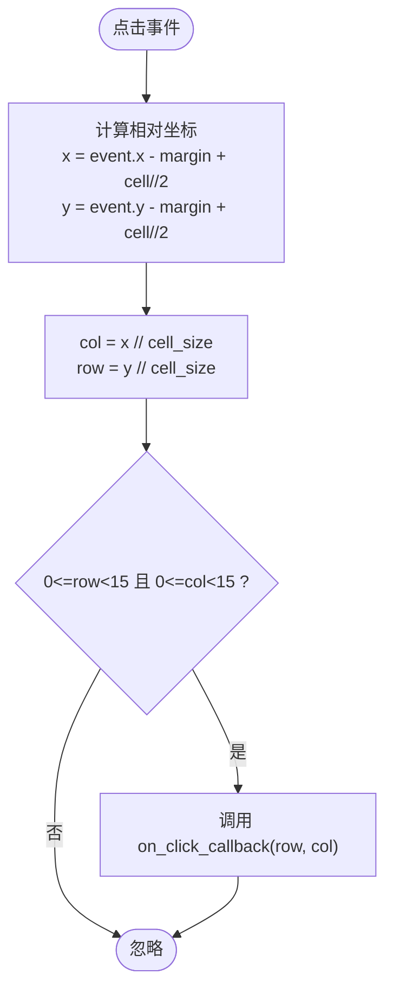
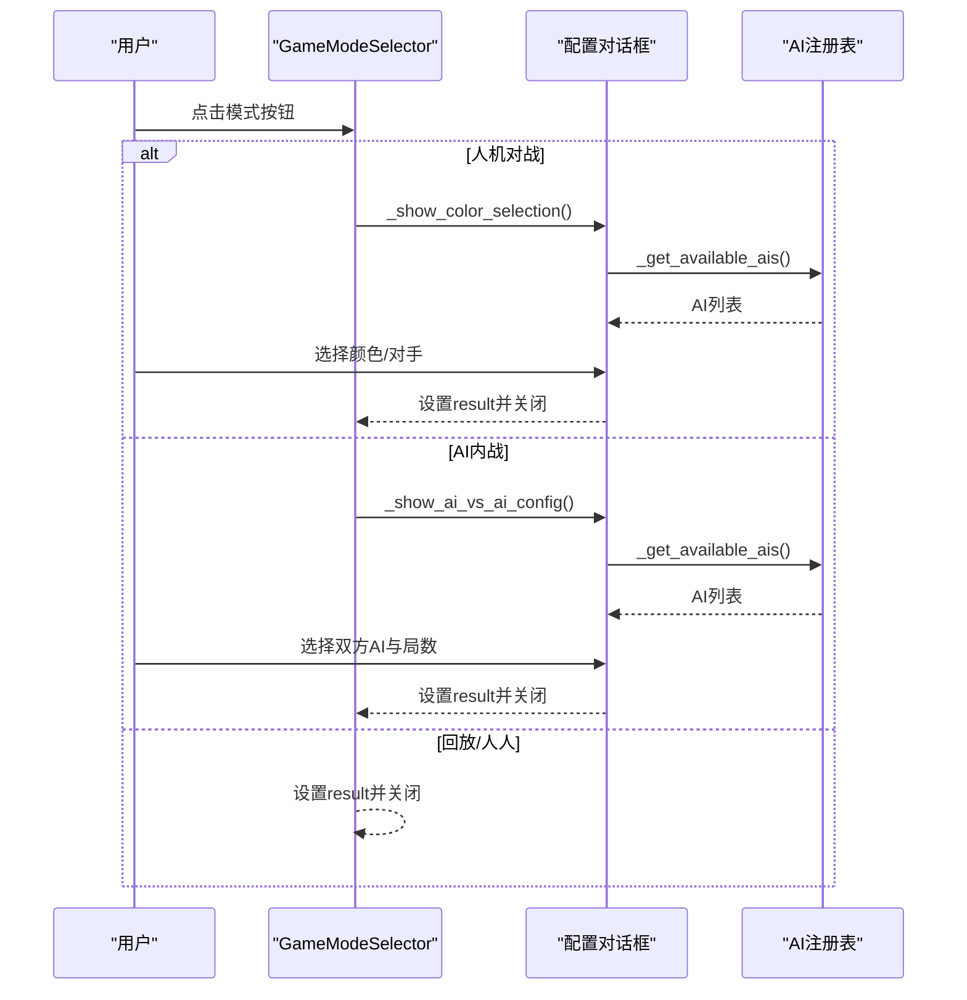
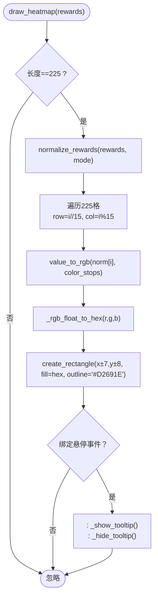
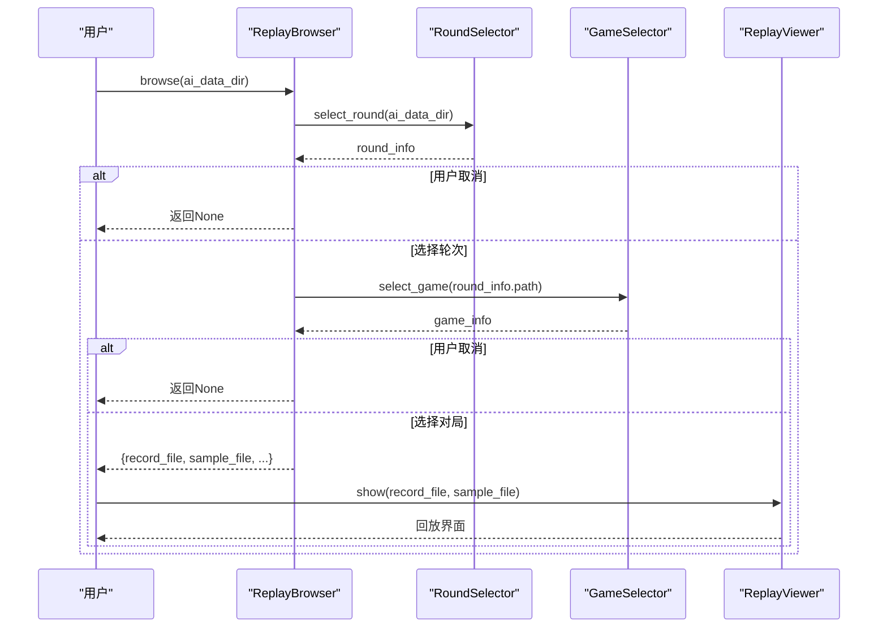
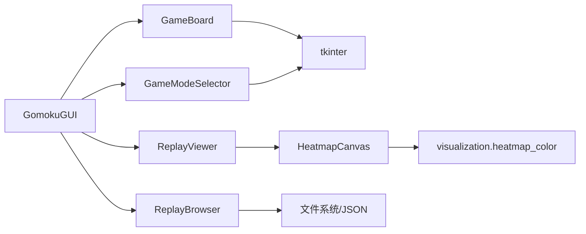

# 核心组件详解

<cite>
**本文引用的文件**
- [gui/components/game_board.py](file://gui/components/game_board.py)
- [gui/components/mode_selector.py](file://gui/components/mode_selector.py)
- [gui/components/heatmap.py](file://gui/components/heatmap.py)
- [gui/components/replay_browser.py](file://gui/components/replay_browser.py)
- [gui/components/replay_viewer.py](file://gui/components/replay_viewer.py)
- [gui/components/constants.py](file://gui/components/constants.py)
- [gui/main.py](file://gui/main.py)
- [visualization/heatmap_color.py](file://visualization/heatmap_color.py)
- [tests/gui/test_game_board.py](file://tests/gui/test_game_board.py)
- [tests/gui/test_heatmap.py](file://tests/gui/test_heatmap.py)
- [tests/gui/test_mode_selector.py](file://tests/gui/test_mode_selector.py)
- [tests/gui/test_replay_browser.py](file://tests/gui/test_replay_browser.py)
</cite>

## 目录
1. [简介](#简介)
2. [项目结构](#项目结构)
3. [核心组件](#核心组件)
4. [架构总览](#架构总览)
5. [详细组件分析](#详细组件分析)
6. [依赖关系分析](#依赖关系分析)
7. [性能考量](#性能考量)
8. [故障排查指南](#故障排查指南)
9. [结论](#结论)
10. [附录](#附录)

## 简介
本文件面向五子棋AI项目的GUI核心组件，系统性阐述以下组件的设计与实现：
- 棋盘组件 GameBoard：Canvas绘图、事件处理、棋子绘制算法与交互响应流程
- 模式选择器组件 GameModeSelector：游戏模式切换逻辑、用户界面更新与状态同步
- 热力图组件 HeatmapCanvas/HeatmapLegend：概率数据可视化、颜色映射算法与实时更新策略
- 回放浏览器组件 ReplayBrowser/ReplayViewer：对局数据管理、播放控制与时间轴导航
并提供API接口设计、配置选项、组件协作与状态管理策略，帮助开发者快速理解与扩展。

## 项目结构
GUI相关代码集中在 gui/components 与 gui 目录，配合 visualization 提供颜色映射算法，tests/gui 提供单元测试覆盖。

图表来源
- [gui/main.py:1-462](file://gui/main.py#L1-L462)
- [gui/components/game_board.py:1-170](file://gui/components/game_board.py#L1-L170)
- [gui/components/mode_selector.py:1-411](file://gui/components/mode_selector.py#L1-L411)
- [gui/components/heatmap.py:1-358](file://gui/components/heatmap.py#L1-L358)
- [gui/components/replay_browser.py:1-383](file://gui/components/replay_browser.py#L1-L383)
- [gui/components/replay_viewer.py:1-426](file://gui/components/replay_viewer.py#L1-L426)
- [gui/components/constants.py:1-66](file://gui/components/constants.py#L1-L66)
- [visualization/heatmap_color.py:1-204](file://visualization/heatmap_color.py#L1-L204)

章节来源
- [gui/main.py:1-462](file://gui/main.py#L1-L462)
- [gui/components/constants.py:1-66](file://gui/components/constants.py#L1-L66)

## 核心组件
本节概述四个核心GUI组件的职责与关键特性：
- GameBoard：负责15×15棋盘的绘制与点击交互，支持棋子绘制与最后落子高亮
- GameModeSelector：启动时提供PvP/PvE/AI vs AI/回放四种模式选择，支持参数配置对话框
- HeatmapCanvas/HeatmapLegend：基于可视化算法的225格热力图画布与颜色标尺，支持悬停tooltip
- ReplayBrowser/ReplayViewer：回放数据浏览与播放控制，支持轮次与对局选择、时间轴导航

章节来源
- [gui/components/game_board.py:1-170](file://gui/components/game_board.py#L1-L170)
- [gui/components/mode_selector.py:1-411](file://gui/components/mode_selector.py#L1-L411)
- [gui/components/heatmap.py:1-358](file://gui/components/heatmap.py#L1-L358)
- [gui/components/replay_browser.py:1-383](file://gui/components/replay_browser.py#L1-L383)
- [gui/components/replay_viewer.py:1-426](file://gui/components/replay_viewer.py#L1-L426)

## 架构总览
GUI采用“组件化 + 主程序协调”的架构：
- 主程序负责菜单、按钮、状态标签与历史记录列表的布局与事件绑定
- GameBoard作为核心交互组件，将点击事件回调至主程序
- GameModeSelector在启动阶段决定游戏模式与参数，随后进入主界面
- ReplayBrowser/ReplayViewer负责回放流程的UI与数据驱动
- HeatmapCanvas复用visualization模块的颜色映射算法，保证一致性与可配置性

图表来源
- [gui/main.py:224-268](file://gui/main.py#L224-L268)
- [gui/components/game_board.py:151-166](file://gui/components/game_board.py#L151-L166)

章节来源
- [gui/main.py:1-462](file://gui/main.py#L1-L462)

## 详细组件分析

### 棋盘组件 GameBoard
- 绘图技术
  - 使用Canvas绘制15×15网格线与星位点，支持固定边距与单元格尺寸
  - 棋子采用两层椭圆绘制（阴影+主体），实现立体感
  - 最后落子位置以红色圆环高亮
- 事件处理机制
  - 绑定鼠标左键点击事件，将屏幕坐标转换为棋盘行列索引
  - 使用整除运算确保边界外点击不触发回调
  - 回调参数为(row, col)，交由上层处理
- 棋子绘制算法
  - 遍历15×15二维数组，仅在非空位置绘制棋子
  - 支持last_move参数高亮最后落子
- 交互响应流程
  - 点击→坐标换算→边界检查→回调通知→上层更新显示

图表来源
- [gui/components/game_board.py:151-166](file://gui/components/game_board.py#L151-L166)

章节来源
- [gui/components/game_board.py:1-170](file://gui/components/game_board.py#L1-L170)
- [tests/gui/test_game_board.py:169-212](file://tests/gui/test_game_board.py#L169-L212)

### 模式选择器组件 GameModeSelector
- 功能实现
  - 提供四种模式：人人对战、人机对战、AI内战、查看回放
  - 人机对战：弹出颜色选择对话框，确定执棋颜色与AI模型
  - AI内战：弹出配置对话框，设置双方AI与对局数量
  - 查看回放：直接进入回放流程
- 切换逻辑
  - 每个模式按钮设置result字典，destroy根窗口后返回
  - 通过委托调用注册表获取可用AI列表
- 状态同步
  - result字段承载最终选择，供主程序读取并进入相应流程

图表来源
- [gui/components/mode_selector.py:176-277](file://gui/components/mode_selector.py#L176-L277)
- [gui/components/mode_selector.py:278-390](file://gui/components/mode_selector.py#L278-L390)
- [gui/components/mode_selector.py:392-402](file://gui/components/mode_selector.py#L392-L402)

章节来源
- [gui/components/mode_selector.py:1-411](file://gui/components/mode_selector.py#L1-L411)
- [tests/gui/test_mode_selector.py:38-108](file://tests/gui/test_mode_selector.py#L38-L108)

### 热力图组件 HeatmapCanvas/HeatmapLegend
- 技术实现
  - HeatmapCanvas：绘制15×15格子，每个格子为16×16像素矩形，支持悬停tooltip
  - 颜色映射：复用visualization.heatmap_color模块，支持log/max/linear三种归一化模式
  - 默认色板：白→黄→橙→红四色渐变，支持自定义色节点
  - Tooltip：显示原始reward值，使用{:.6g}格式化，避免长尾数字
- 算法与复杂度
  - 归一化：normalize_rewards对225个值批量归一化，O(n)
  - 颜色映射：value_to_rgb对每个值插值，O(n)
  - 总体：O(n)，n=225
- 实时更新策略
  - clear→批量归一化→逐格绘制→绑定悬停事件
  - 悬停时动态创建/复用tooltip窗口，减少资源消耗

图表来源
- [gui/components/heatmap.py:137-195](file://gui/components/heatmap.py#L137-L195)
- [visualization/heatmap_color.py:63-122](file://visualization/heatmap_color.py#L63-L122)

章节来源
- [gui/components/heatmap.py:1-358](file://gui/components/heatmap.py#L1-L358)
- [visualization/heatmap_color.py:1-204](file://visualization/heatmap_color.py#L1-L204)
- [tests/gui/test_heatmap.py:73-219](file://tests/gui/test_heatmap.py#L73-L219)

### 回放浏览器组件 ReplayBrowser/ReplayViewer
- 回放浏览器
  - RoundSelector：列出ai_data下的轮次目录，统计对局数量
  - GameSelector：在选定轮次下枚举对局，读取record.json显示胜负与步数
  - ReplayBrowser：组合选择流程，返回record_file与sample_file路径
- 回放查看器
  - ReplayViewer：左侧棋盘网格，右侧AI热力图与颜色标尺，底部信息文本与历史列表
  - 支持上一步/下一步/跳转结局/重置，动态绘制棋子与热力图
  - 若存在sample.json，则同时显示Sample热力图

图表来源
- [gui/components/replay_browser.py:300-383](file://gui/components/replay_browser.py#L300-L383)
- [gui/components/replay_viewer.py:379-426](file://gui/components/replay_viewer.py#L379-L426)

章节来源
- [gui/components/replay_browser.py:1-383](file://gui/components/replay_browser.py#L1-L383)
- [gui/components/replay_viewer.py:1-426](file://gui/components/replay_viewer.py#L1-L426)
- [tests/gui/test_replay_browser.py:45-206](file://tests/gui/test_replay_browser.py#L45-L206)

## 依赖关系分析
- 组件耦合
  - GameBoard与主程序强耦合：通过回调将(row,col)传递给上层
  - HeatmapCanvas依赖visualization.heatmap_color模块，解耦颜色映射算法
  - ReplayBrowser/ReplayViewer依赖文件系统与JSON数据，耦合数据结构
- 外部依赖
  - tkinter：所有组件的基础UI框架
  - ai.registry：模式选择器获取可用AI列表
  - visualization.heatmap_color：热力图颜色映射核心算法
- 潜在循环依赖
  - 未发现直接循环依赖；组件间通过回调与静态方法解耦

图表来源
- [gui/components/game_board.py:1-170](file://gui/components/game_board.py#L1-L170)
- [gui/components/mode_selector.py:1-411](file://gui/components/mode_selector.py#L1-L411)
- [gui/components/heatmap.py:1-358](file://gui/components/heatmap.py#L1-L358)
- [gui/components/replay_browser.py:1-383](file://gui/components/replay_browser.py#L1-L383)
- [gui/components/replay_viewer.py:1-426](file://gui/components/replay_viewer.py#L1-L426)
- [gui/main.py:1-462](file://gui/main.py#L1-L462)

章节来源
- [gui/main.py:1-462](file://gui/main.py#L1-L462)

## 性能考量
- 绘制优化
  - GameBoard：仅清除棋子与高亮标记，保留棋盘线，避免重复绘制网格
  - HeatmapCanvas：批量归一化与颜色映射，逐格绘制矩形，整体O(n)
- 事件处理
  - 点击坐标换算使用整除，避免浮点误差导致的边界问题
  - Tooltip窗口懒创建与复用，减少频繁创建销毁的开销
- 数据访问
  - 回放浏览器按需读取record.json，避免一次性加载大量数据
  - ReplayViewer仅在必要时绘制棋子与热力图，降低Canvas压力

[本节为通用性能建议，无需特定文件来源]

## 故障排查指南
- 棋盘点击无效
  - 检查是否传入on_click_callback，确认事件绑定生效
  - 确认点击位置在棋盘范围内，边界外点击不会触发回调
- 热力图颜色异常
  - 检查heatmap_mode是否为"log"/"max"/"linear"之一
  - 自定义色板需至少2个色节点，否则会抛出ValueError
- 回放数据缺失
  - 确认ai_data目录存在且包含轮次与对局目录
  - 对局需包含record.json，且包含winner与history字段
- 模式选择器无法获取AI列表
  - 确认注册表可用，且list_models_with_full_name返回非空列表

章节来源
- [gui/components/game_board.py:151-166](file://gui/components/game_board.py#L151-L166)
- [gui/components/heatmap.py:151-154](file://gui/components/heatmap.py#L151-L154)
- [gui/components/replay_browser.py:107-126](file://gui/components/replay_browser.py#L107-L126)
- [gui/components/mode_selector.py:392-402](file://gui/components/mode_selector.py#L392-L402)

## 结论
本项目GUI组件围绕“可配置、可扩展、低耦合”设计目标，通过清晰的职责划分与稳定的API接口，实现了从模式选择到棋盘交互、从热力图可视化到回放浏览的完整闭环。颜色映射算法与数据驱动的回放系统提升了用户体验与可维护性。建议在后续迭代中进一步完善组件的事件回调签名与错误处理，增强可测试性与可扩展性。

[本节为总结性内容，无需特定文件来源]

## 附录

### 组件API接口设计
- GameBoard
  - 构造：parent, on_click_callback=None
  - 方法：pack/grid/layout, draw_board(), draw_pieces(board_state, last_move=None), get_canvas()
  - 事件：点击回调(row, col)
- GameModeSelector
  - 构造：root
  - 方法：_create_widgets(), _select_pvp/_pve/_ai_vs_ai/_replay, _get_available_ais(), get_result()
  - 结果：result字典，包含mode与参数
- HeatmapCanvas
  - 构造：parent, title, width, height, heatmap_mode, color_stops
  - 方法：pack/pack_side/clear/draw_heatmap(rewards, on_cell_hover), create_tooltip(x,y,text), _hide_tooltip()
- HeatmapLegend
  - 构造：parent, color_stops=None, n_bands=24
  - 方法：pack, _generate_gradient_colors(), _stop_labels(color_stops)
- ReplayBrowser
  - 静态方法：select_round(ai_data_dir,parent), select_game(round_dir,parent), browse(ai_data_dir,parent)
- ReplayViewer
  - 构造：parent, record_file, sample_file=None
  - 方法：_create_widgets(), _update_display(), _draw_heatmaps(), _draw_pieces(), _update_info_text()

章节来源
- [gui/components/game_board.py:22-170](file://gui/components/game_board.py#L22-L170)
- [gui/components/mode_selector.py:27-411](file://gui/components/mode_selector.py#L27-L411)
- [gui/components/heatmap.py:68-358](file://gui/components/heatmap.py#L68-L358)
- [gui/components/replay_browser.py:300-383](file://gui/components/replay_browser.py#L300-L383)
- [gui/components/replay_viewer.py:13-426](file://gui/components/replay_viewer.py#L13-L426)

### 组件配置选项
- GameBoard
  - 常量：BOARD_SIZE, CELL_SIZE, BOARD_MARGIN
  - 颜色：COLOR_BOARD, COLOR_LINE, COLOR_BLACK, COLOR_WHITE, COLOR_LAST_MOVE
  - 布局：pack/grid
- HeatmapCanvas
  - 尺寸：width/height
  - 归一化：heatmap_mode ∈ {"log","max","linear"}
  - 色板：color_stops（默认四色）
- HeatmapLegend
  - 档数：n_bands（默认24）
- ReplayViewer
  - 显示选项：BooleanVar(show_board/show_input/show_output)
- 常量配置
  - 颜色、尺寸、字体、动物表情等集中于constants.py

章节来源
- [gui/components/game_board.py:10-51](file://gui/components/game_board.py#L10-L51)
- [gui/components/heatmap.py:71-104](file://gui/components/heatmap.py#L71-L104)
- [gui/components/heatmap.py:260-276](file://gui/components/heatmap.py#L260-L276)
- [gui/components/replay_viewer.py:37-46](file://gui/components/replay_viewer.py#L37-L46)
- [gui/components/constants.py:1-66](file://gui/components/constants.py#L1-L66)

### 组件协作与状态管理
- 主程序GomokuGUI协调各组件：菜单、按钮、状态标签、历史列表与棋盘
- GameBoard将点击事件上抛至主程序，主程序通过GUIHelper与GameSession协调游戏流程
- 回放流程：ReplayBrowser选择数据→ReplayViewer加载并显示→支持播放控制与时间轴导航
- 状态同步：通过result字典、回调函数与display_updater实现

章节来源
- [gui/main.py:105-320](file://gui/main.py#L105-L320)
- [gui/main.py:379-396](file://gui/main.py#L379-L396)
- [gui/components/replay_viewer.py:13-182](file://gui/components/replay_viewer.py#L13-L182)