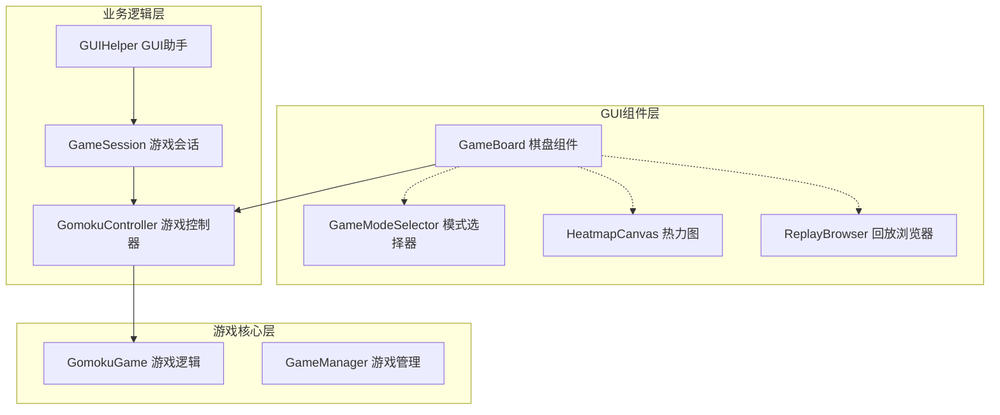
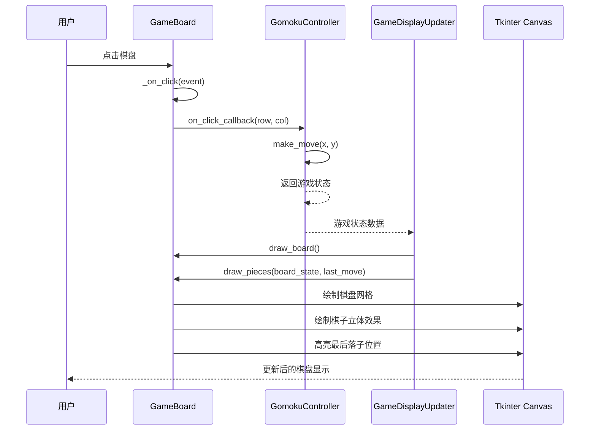
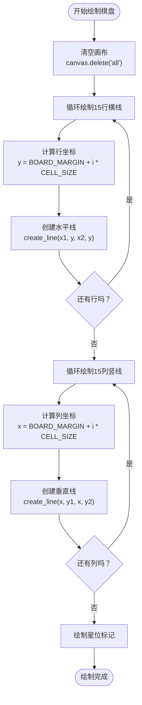
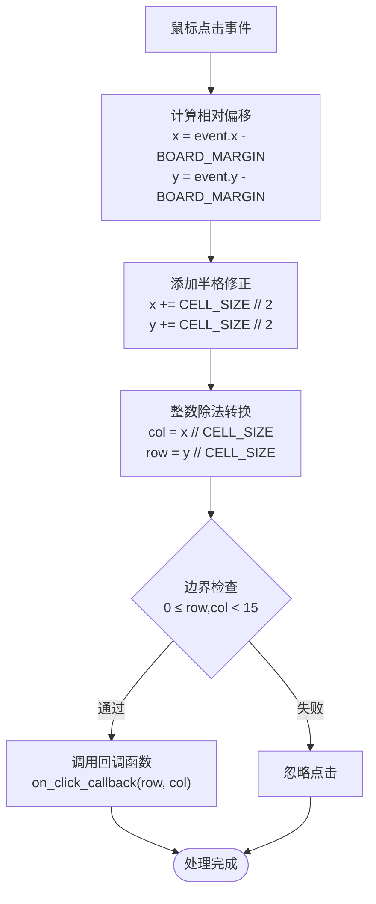
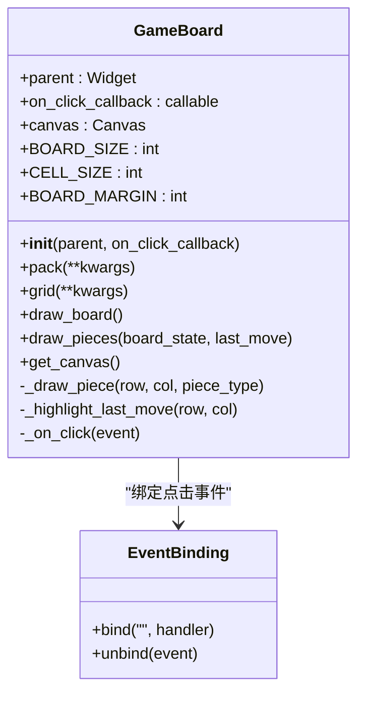
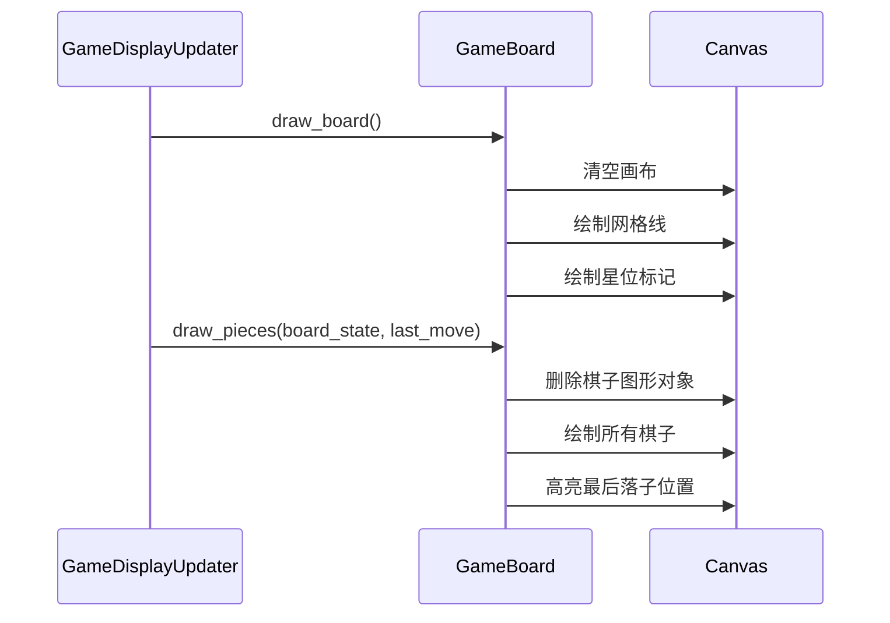
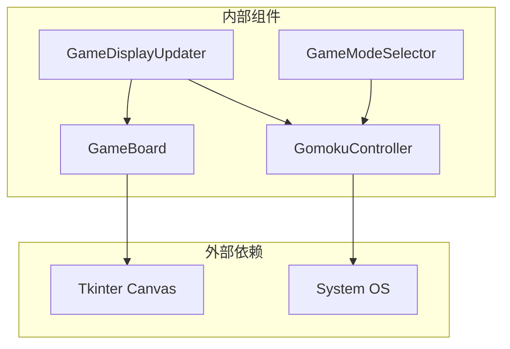

# 棋盘组件GameBoard

<cite>
**本文档引用的文件**
- [game_board.py](file://gui/components/game_board.py)
- [constants.py](file://gui/components/constants.py)
- [test_game_board.py](file://tests/gui/test_game_board.py)
- [main.py](file://gui/main.py)
- [display_updater.py](file://gui/display_updater.py)
- [controller.py](file://game/controller.py)
</cite>

## 目录
1. [简介](#简介)
2. [项目结构](#项目结构)
3. [核心组件](#核心组件)
4. [架构概览](#架构概览)
5. [详细组件分析](#详细组件分析)
6. [依赖关系分析](#依赖关系分析)
7. [性能考虑](#性能考虑)
8. [故障排除指南](#故障排除指南)
9. [结论](#结论)

## 简介

GameBoard是五子棋AI项目中的核心棋盘组件，基于Tkinter Canvas实现。该组件负责棋盘的绘制、棋子的渲染以及用户交互处理。它采用15×15网格系统，实现了完整的Canvas绘图技术应用，包括立体效果的棋子绘制、阴影处理和颜色配置系统。

## 项目结构

GameBoard组件位于GUI组件模块中，与整个五子棋系统的其他组件紧密集成：

**图表来源**
- [main.py:112](file://gui/main.py#L112)
- [display_updater.py:31](file://gui/display_updater.py#L31)

**章节来源**
- [main.py:105-113](file://gui/main.py#L105-L113)
- [gui/components/__init__.py:13-20](file://gui/components/__init__.py#L13-L20)

## 核心组件

### 棋盘配置参数

GameBoard组件采用固定的棋盘配置参数：

| 参数 | 值 | 描述 |
|------|-----|------|
| BOARD_SIZE | 15 | 棋盘大小（15×15网格） |
| CELL_SIZE | 42 | 单元格尺寸（像素） |
| BOARD_MARGIN | 50 | 边距尺寸（像素） |
| canvas_size | 730 | 画布总尺寸（像素） |

### 颜色配置系统

组件支持两种颜色配置方案：

**内置颜色配置（GameBoard类内定义）**
- COLOR_BOARD: "#E3C16F" - 棋盘背景色（木质原色）
- COLOR_LINE: "#8B4513" - 线条颜色（深棕色）
- COLOR_BLACK: "#2C2C2C" - 黑子颜色
- COLOR_WHITE: "#FFFAF0" - 白子颜色
- COLOR_LAST_MOVE: "#FF6B35" - 最后落子标记颜色（橙色）

**全局颜色常量（constants.py）**
- COLORS字典提供森林/小动物主题配色方案
- 支持多种主题颜色：bear、rabbit、squirrel等

**章节来源**
- [game_board.py:10-21](file://gui/components/game_board.py#L10-L21)
- [constants.py:3-28](file://gui/components/constants.py#L3-L28)

## 架构概览

GameBoard在整个五子棋系统中扮演着关键角色，作为用户界面的核心组件：

**图表来源**
- [main.py:224-243](file://gui/main.py#L224-L243)
- [display_updater.py:40-82](file://gui/display_updater.py#L40-L82)

## 详细组件分析

### Canvas绘图技术实现

#### 棋盘绘制算法

GameBoard使用Canvas的create_line方法绘制15×15网格：

**图表来源**
- [game_board.py:61-95](file://gui/components/game_board.py#L61-L95)

#### 棋子绘制算法

棋子采用立体效果设计，每个棋子由两个椭圆组成：

**棋子绘制流程**：
1. 计算棋子中心坐标：x = BOARD_MARGIN + col × CELL_SIZE
2. 绘制阴影椭圆（外圈）：半径18px，填充深棕色
3. 绘制主体椭圆（内圈）：半径16px，填充棋子颜色，带轮廓边框

**立体效果实现**：
- 阴影层：#5D4E37深棕色，提供立体感
- 主体层：黑子#2C2C2C或白子#FFFAF0，带深棕色轮廓
- 半径差：阴影比主体大2px，增强立体效果

**章节来源**
- [game_board.py:120-139](file://gui/components/game_board.py#L120-L139)

### 坐标转换算法

GameBoard实现了精确的坐标映射算法：

**图表来源**
- [game_board.py:151-166](file://gui/components/game_board.py#L151-L166)

#### 边界检查机制

坐标转换算法特别处理了负数坐标的情况：
- 使用整数除法（//）而非截断（int()）
- 负数坐标会被映射到-1，通过边界检查被拒绝
- 确保点击边界外的区域不会触发回调

**章节来源**
- [test_game_board.py:191-212](file://tests/gui/test_game_board.py#L191-L212)

### 事件处理机制

#### 点击事件绑定

GameBoard支持动态事件绑定：

**图表来源**
- [game_board.py:22-51](file://gui/components/game_board.py#L22-L51)

#### 回调函数调用

当有效点击发生时，GameBoard会：
1. 调用传入的回调函数
2. 传递(row, col)坐标参数
3. 不再进行额外的验证（假设上层已验证有效性）

**章节来源**
- [game_board.py:46-48](file://gui/components/game_board.py#L46-L48)
- [test_game_board.py:169-189](file://tests/gui/test_game_board.py#L169-L189)

### 棋盘状态管理

#### board_state二维数组处理

GameBoard期望接收15×15的二维数组：
- 0：空位
- 1：黑子
- 2：白子

**批量绘制策略**：
1. 先删除所有棋子图形对象（保留棋盘线）
2. 遍历整个board_state数组
3. 对于每个非空位置，调用_draw_piece方法
4. 最后处理last_move高亮显示

#### last_move高亮显示

最后落子位置采用特殊的视觉标记：
- 绘制红色圆环标记
- 半径20px，宽度3px
- 使用COLOR_LAST_MOVE颜色配置

**章节来源**
- [game_board.py:97-119](file://gui/components/game_board.py#L97-L119)
- [game_board.py:140-149](file://gui/components/game_board.py#L140-L149)

### 实时重绘策略

#### 清晰的重绘流程

**图表来源**
- [display_updater.py:46-60](file://gui/display_updater.py#L46-L60)

#### 性能优化考虑

- 使用标签系统区分不同类型的图形对象
- 只删除必要的图形对象，避免全量重绘
- 采用批量绘制减少Canvas操作次数

**章节来源**
- [game_board.py:105-118](file://gui/components/game_board.py#L105-L118)

## 依赖关系分析

### 组件间依赖关系

**图表来源**
- [game_board.py:4](file://gui/components/game_board.py#L4)
- [display_updater.py:6](file://gui/display_updater.py#L6)

### 数据流依赖

GameBoard的数据流遵循以下模式：

1. **输入数据**：board_state二维数组、last_move坐标
2. **处理过程**：坐标转换、边界检查、图形绘制
3. **输出结果**：更新后的Canvas显示

**章节来源**
- [controller.py:65-97](file://game/controller.py#L65-L97)
- [display_updater.py:40-82](file://gui/display_updater.py#L40-L82)

## 性能考虑

### 绘制性能优化

1. **增量更新**：只删除必要的图形对象，避免全量重绘
2. **批量操作**：同一帧内完成所有Canvas操作
3. **内存管理**：合理使用标签系统管理图形对象

### 坐标计算优化

- 使用整数运算避免浮点误差
- 预计算常用值（BOARD_MARGIN、CELL_SIZE）
- 减少重复的数学运算

## 故障排除指南

### 常见问题及解决方案

#### 棋盘显示异常

**问题**：棋盘线条显示不正确
**原因**：坐标计算错误或Canvas尺寸设置不当
**解决**：检查BOARD_MARGIN和CELL_SIZE配置，验证canvas_size计算

#### 棋子绘制问题

**问题**：棋子无法正确显示
**原因**：颜色配置错误或坐标转换失败
**解决**：确认COLOR_BLACK和COLOR_WHITE配置，检查坐标映射算法

#### 点击响应异常

**问题**：点击无效或响应不准确
**原因**：事件绑定失败或边界检查逻辑错误
**解决**：验证_on_click方法实现，检查边界检查条件

**章节来源**
- [test_game_board.py:32-72](file://tests/gui/test_game_board.py#L32-L72)
- [test_game_board.py:169-212](file://tests/gui/test_game_board.py#L169-L212)

## 结论

GameBoard组件是一个设计精良的棋盘渲染组件，具有以下特点：

1. **完整的Canvas绘图实现**：支持复杂的图形绘制和样式配置
2. **精确的坐标转换**：实现了可靠的点击事件处理机制
3. **灵活的颜色配置**：支持多种主题和自定义配色方案
4. **高效的批量绘制**：采用增量更新策略优化性能
5. **清晰的事件处理**：提供了标准的回调接口

该组件与整个五子棋系统的其他组件完美集成，为用户提供了一个直观、响应迅速的棋盘界面。其设计充分考虑了性能和用户体验，在保持代码简洁的同时实现了丰富的功能特性。