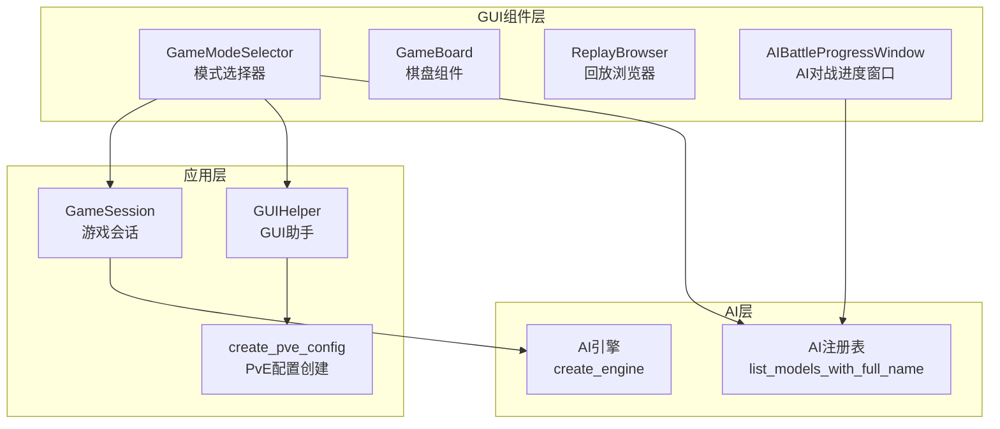
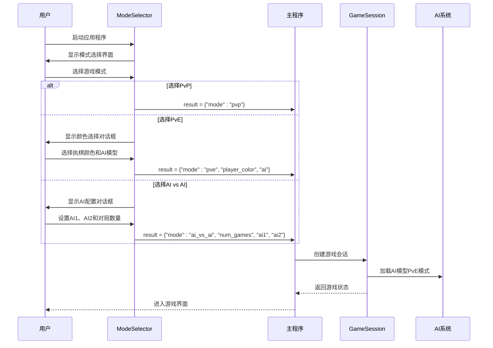
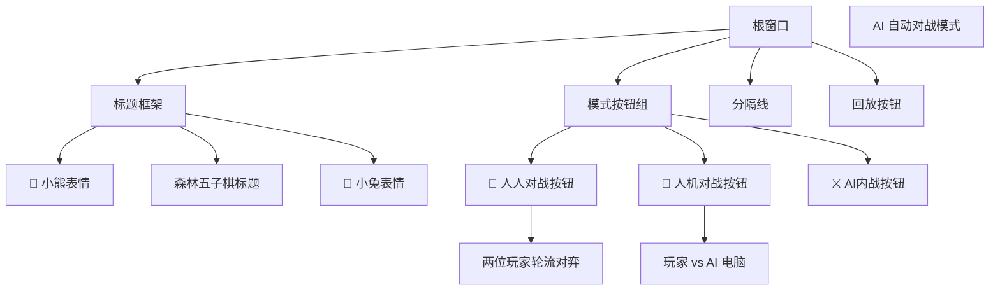
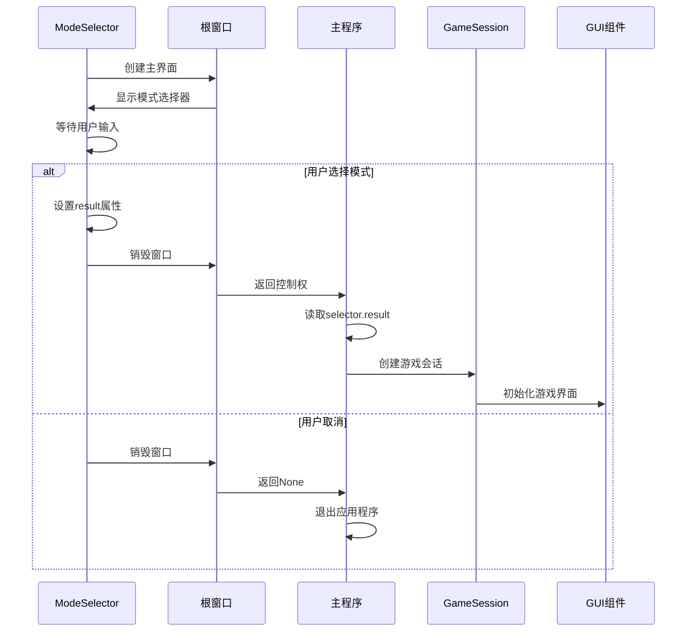
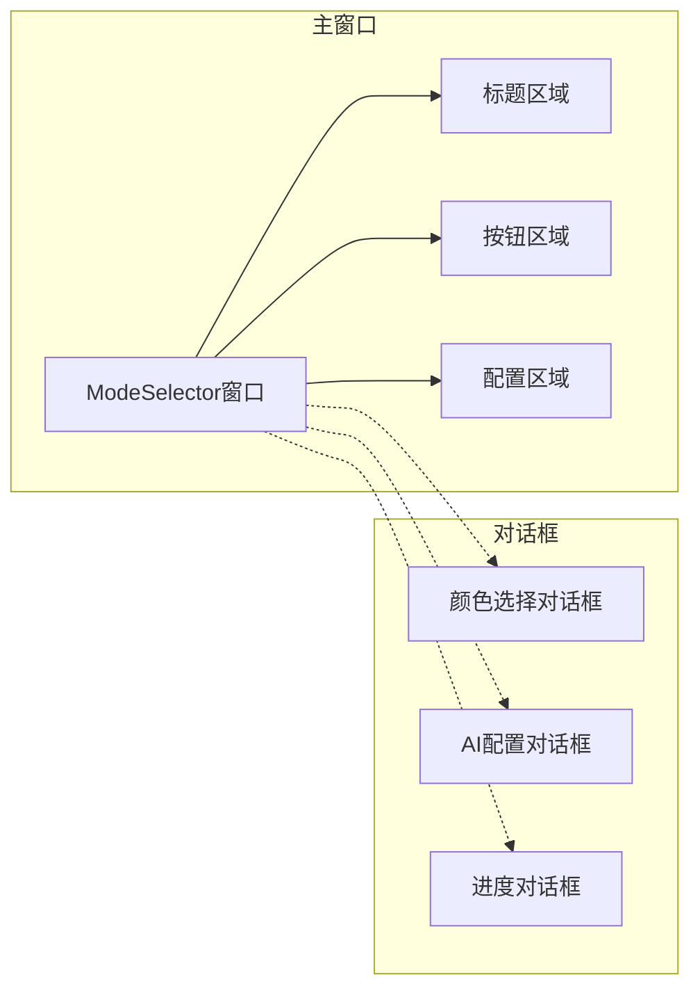
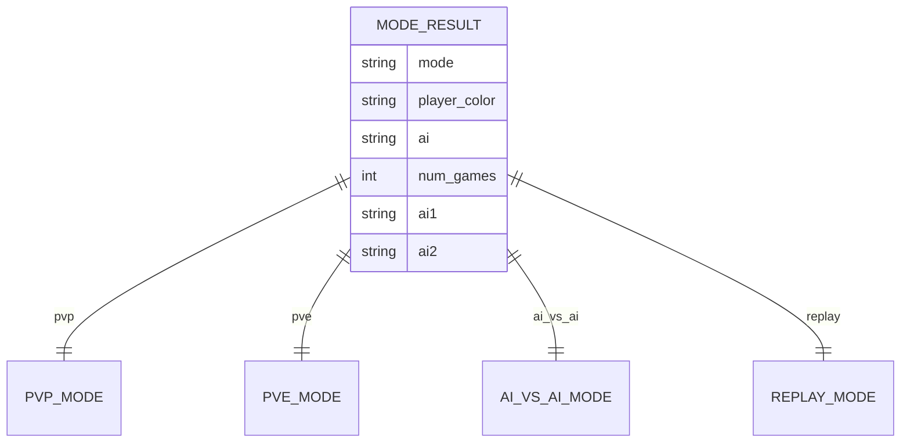
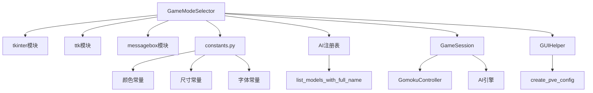

# 模式选择器组件ModeSelector

<cite>
**本文档引用的文件**
- [mode_selector.py](file://gui/components/mode_selector.py)
- [constants.py](file://gui/components/constants.py)
- [main.py](file://gui/main.py)
- [session.py](file://app/session.py)
- [gui_helper.py](file://app/gui_helper.py)
- [ai_battle.py](file://gui/ai_battle.py)
- [test_mode_selector.py](file://tests/gui/test_mode_selector.py)
</cite>

## 目录
1. [简介](#简介)
2. [项目结构](#项目结构)
3. [核心组件](#核心组件)
4. [架构概览](#架构概览)
5. [详细组件分析](#详细组件分析)
6. [依赖关系分析](#依赖关系分析)
7. [性能考虑](#性能考虑)
8. [故障排除指南](#故障排除指南)
9. [结论](#结论)

## 简介

ModeSelector（模式选择器）是五子棋AI项目中的关键组件，负责在应用程序启动时为用户提供三种游戏模式的选择界面。该组件实现了完整的用户交互流程，包括模式选择、配置参数设置和结果返回机制。

该组件支持以下三种游戏模式：
- **PvP（人人对战）**：两位玩家轮流对弈
- **PvE（人机对战）**：玩家 vs AI电脑，支持自定义AI对手和执棋颜色
- **AI vs AI（AI内战）**：AI自动对战模式，支持多局对战和AI模型选择

## 项目结构

ModeSelector组件位于GUI系统的组件层中，与主应用程序通过清晰的接口进行交互。其组织结构如下：



**图表来源**
- [mode_selector.py:12-52](file://gui/components/mode_selector.py#L12-L52)
- [main.py:22-28](file://gui/main.py#L22-L28)

**章节来源**
- [mode_selector.py:1-411](file://gui/components/mode_selector.py#L1-L411)
- [constants.py:1-66](file://gui/components/constants.py#L1-L66)

## 核心组件

### GameModeSelector类设计

GameModeSelector是一个基于tkinter的图形界面组件，采用面向对象的设计模式，提供了完整的模式选择功能。

#### 主要特性
- **三种游戏模式支持**：PvP、PvE、AI vs AI
- **动态配置界面**：根据用户选择显示相应的配置对话框
- **结果封装**：将用户选择封装为标准化的数据结构
- **主题化设计**：采用森林/小动物主题的视觉风格

#### 关键属性
- **COLOR_BG**: 背景色（米色）
- **COLOR_BEAR**: 小熊棕（黑棋颜色）
- **COLOR_BUNNY**: 小兔粉（白棋颜色）
- **COLOR_TEXT**: 文字颜色（深棕）
- **WINDOW_WIDTH/WINDOW_HEIGHT**: 窗口尺寸（400x600）

**章节来源**
- [mode_selector.py:15-26](file://gui/components/mode_selector.py#L15-L26)
- [constants.py:4-28](file://gui/components/constants.py#L4-L28)

## 架构概览

ModeSelector在整个应用程序架构中扮演着启动器的角色，负责初始化游戏环境并传递用户选择的配置信息。



**图表来源**
- [main.py:400-457](file://gui/main.py#L400-L457)
- [mode_selector.py:176-410](file://gui/components/mode_selector.py#L176-L410)

## 详细组件分析

### 模式选择界面设计

ModeSelector采用简洁直观的界面设计，为每种游戏模式提供专门的按钮和描述信息。

#### 界面元素结构



**图表来源**
- [mode_selector.py:55-143](file://gui/components/mode_selector.py#L55-L143)

#### 模式配置参数

| 模式 | 参数 | 数据类型 | 默认值 | 描述 |
|------|------|----------|--------|------|
| PvP | mode | string | "pvp" | 人人对战模式标识 |
| PvE | mode | string | "pve" | 人机对战模式标识 |
| PvE | player_color | string | "black" | 玩家执棋颜色 |
| PvE | ai | string | "random" | AI模型名称 |
| AI vs AI | mode | string | "ai_vs_ai" | AI内战模式标识 |
| AI vs AI | num_games | int | 1 | 对战局数 |
| AI vs AI | ai1 | string | "random" | 黑方AI模型 |
| AI vs AI | ai2 | string | "random" | 白方AI模型 |

**章节来源**
- [mode_selector.py:91-110](file://gui/components/mode_selector.py#L91-L110)
- [mode_selector.py:364-390](file://gui/components/mode_selector.py#L364-L390)

### 用户界面更新机制

ModeSelector实现了完整的用户交互响应流程，包括按钮状态变化、视觉反馈和事件处理。

#### 交互流程

```mermaid
flowchart TD
Start([用户启动]) --> ShowInterface[显示模式选择界面]
ShowInterface --> UserAction{用户操作}
UserAction --> |点击PvP| PvPSelect[选择PvP模式]
UserAction --> |点击PvE| PvEShowDialog[显示颜色选择对话框]
UserAction --> |点击AI vs AI| AIVsAIShowDialog[显示AI配置对话框]
UserAction --> |点击回放| ReplaySelect[选择回放模式]
PvPSelect --> SetResult1[设置result={"mode":"pvp"}]
PvEShowDialog --> UserColorChoice{选择执棋颜色}
UserColorChoice --> |选择黑棋| BlackSelect[设置player_color="black"]
UserColorChoice --> |选择白棋| WhiteSelect[设置player_color="white"]
BlackSelect --> SetResult2[设置result={"mode":"pve","player_color":"black","ai":selected}]
WhiteSelect --> SetResult3[设置result={"mode":"pve","player_color":"white","ai":selected}]
AIVsAIShowDialog --> UserAIConfig{配置AI参数}
UserAIConfig --> |设置参数| SetResult4[设置result={"mode":"ai_vs_ai","num_games":N,"ai1":A1,"ai2":A2}]
ReplaySelect --> SetResult5[设置result={"mode":"replay"}]
SetResult1 --> DestroyRoot[销毁窗口]
SetResult2 --> DestroyRoot
SetResult3 --> DestroyRoot
SetResult4 --> DestroyRoot
SetResult5 --> DestroyRoot
```

**图表来源**
- [mode_selector.py:176-410](file://gui/components/mode_selector.py#L176-L410)

#### 视觉反馈机制

组件采用了多层次的视觉反馈设计：

1. **按钮状态变化**：鼠标悬停时改变颜色和前景色
2. **激活状态**：按钮被按下时显示不同的背景和前景颜色
3. **禁用状态**：某些情况下按钮可能被禁用
4. **对话框层级**：模态对话框确保用户完成配置

**章节来源**
- [mode_selector.py:153-174](file://gui/components/mode_selector.py#L153-L174)
- [mode_selector.py:256-276](file://gui/components/mode_selector.py#L256-L276)

### 状态同步机制

ModeSelector通过result属性实现状态同步，该属性在用户做出选择时被设置，并在主程序中被读取和处理。

#### 状态传播流程



**图表来源**
- [main.py:400-457](file://gui/main.py#L400-L457)
- [mode_selector.py:404-410](file://gui/components/mode_selector.py#L404-L410)

#### 父组件通信

ModeSelector与主程序之间的通信通过以下方式实现：

1. **结果返回**：通过`get_result()`方法返回选择结果
2. **直接访问**：主程序直接访问`selector.result`属性
3. **事件驱动**：用户操作触发相应的回调函数

**章节来源**
- [mode_selector.py:404-410](file://gui/components/mode_selector.py#L404-L410)
- [main.py:405-408](file://gui/main.py#L405-L408)

### 组件集成方式

ModeSelector与主界面的集成采用了模块化的架构设计，确保了良好的可维护性和扩展性。

#### 布局集成



**图表来源**
- [mode_selector.py:190-390](file://gui/components/mode_selector.py#L190-L390)

#### 生命周期管理

ModeSelector遵循标准的tkinter生命周期管理模式：

1. **初始化阶段**：创建窗口、设置属性、绑定事件
2. **显示阶段**：居中显示、等待用户输入
3. **交互阶段**：处理用户操作、更新界面状态
4. **销毁阶段**：清理资源、返回控制权

**章节来源**
- [mode_selector.py:27-52](file://gui/components/mode_selector.py#L27-L52)
- [mode_selector.py:190-390](file://gui/components/mode_selector.py#L190-L390)

### 组件API接口

ModeSelector提供了简洁明了的API接口，满足不同场景下的使用需求。

#### 公共方法

| 方法名 | 参数 | 返回值 | 描述 |
|--------|------|--------|------|
| `__init__(root)` | root: Tkinter根窗口 | None | 初始化模式选择器 |
| `get_result()` | 无 | dict或None | 获取用户选择结果 |
| `_select_pvp()` | 无 | None | 选择人人对战模式 |
| `_select_pve()` | 无 | None | 选择人机对战模式 |
| `_select_ai_vs_ai()` | 无 | None | 选择AI内战模式 |
| `_select_replay()` | 无 | None | 选择回放模式 |

#### 结果数据结构



**图表来源**
- [mode_selector.py:176-410](file://gui/components/mode_selector.py#L176-L410)

**章节来源**
- [mode_selector.py:404-410](file://gui/components/mode_selector.py#L404-L410)

## 依赖关系分析

ModeSelector组件的依赖关系相对简单，主要依赖于GUI常量定义和AI注册表系统。



**图表来源**
- [mode_selector.py:7-9](file://gui/components/mode_selector.py#L7-L9)
- [mode_selector.py:392-402](file://gui/components/mode_selector.py#L392-L402)

### 外部依赖

| 依赖项 | 用途 | 版本要求 | 备注 |
|--------|------|----------|------|
| tkinter | GUI框架 | Python标准库 | 核心UI组件 |
| ttk | 主题化控件 | Python标准库 | 改进的控件样式 |
| ai.registry | AI模型注册表 | 项目内部 | 动态AI模型发现 |
| app.session | 游戏会话管理 | 项目内部 | 游戏状态管理 |
| app.gui_helper | GUI辅助工具 | 项目内部 | PvE配置创建 |

**章节来源**
- [mode_selector.py:392-402](file://gui/components/mode_selector.py#L392-L402)
- [main.py:18-28](file://gui/main.py#L18-L28)

## 性能考虑

ModeSelector组件在设计时充分考虑了性能优化和用户体验。

### 内存管理

- **延迟加载**：AI模型列表通过委托方式获取，避免不必要的内存占用
- **对话框复用**：使用Toplevel窗口而非永久创建多个实例
- **事件清理**：确保窗口销毁时释放所有绑定的事件处理器

### 响应性优化

- **异步处理**：AI内战模式使用后台线程避免界面冻结
- **进度反馈**：提供实时进度更新和状态指示
- **快速响应**：按钮点击立即反馈，减少用户等待时间

### 资源管理

- **窗口生命周期**：严格控制窗口的创建和销毁时机
- **资源池管理**：避免重复创建相同的控件实例
- **垃圾回收**：及时清理不再使用的变量和对象引用

## 故障排除指南

### 常见问题及解决方案

#### 模式选择无响应

**症状**：点击按钮后界面无反应

**可能原因**：
1. tkinter事件循环阻塞
2. 回调函数未正确绑定
3. 窗口层级问题

**解决方法**：
- 检查主事件循环是否正常运行
- 验证按钮command参数是否正确设置
- 确认窗口的transient和grab_set设置

#### AI模型加载失败

**症状**：PvE模式下AI模型无法加载

**可能原因**：
1. AI模型文件缺失
2. 模型格式不兼容
3. 内存不足

**解决方法**：
- 检查AI模型文件是否存在
- 验证模型版本兼容性
- 确保有足够的系统内存

#### 对话框显示异常

**症状**：配置对话框无法正常显示

**可能原因**：
1. 父窗口未正确创建
2. 模态设置冲突
3. 屏幕分辨率问题

**解决方法**：
- 确保根窗口先于对话框创建
- 检查transient和grab_set的正确使用
- 调整对话框位置以适应屏幕尺寸

**章节来源**
- [test_mode_selector.py:32-166](file://tests/gui/test_mode_selector.py#L32-L166)

## 结论

ModeSelector组件作为五子棋AI项目的核心入口组件，成功实现了以下目标：

1. **功能完整性**：支持三种游戏模式的完整选择流程
2. **用户体验**：提供直观、响应迅速的用户界面
3. **架构清晰**：与主应用程序保持清晰的职责分离
4. **可扩展性**：为未来添加新游戏模式预留了良好接口

该组件的设计体现了良好的软件工程实践，包括清晰的接口定义、完善的错误处理机制和优秀的用户体验设计。通过模块化的架构设计，ModeSelector不仅满足了当前的功能需求，也为未来的功能扩展奠定了坚实的基础。