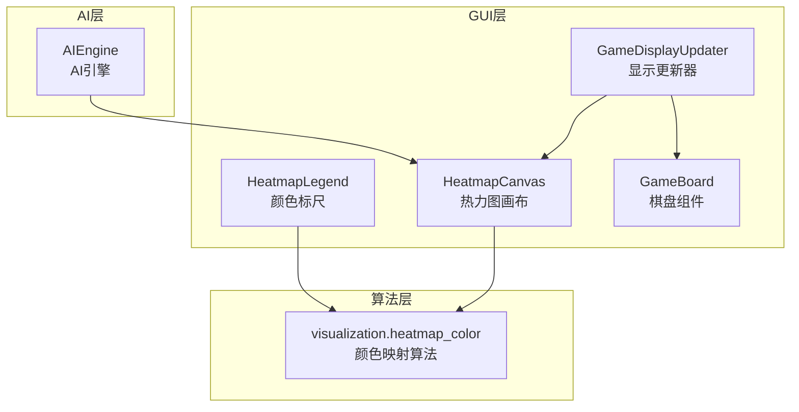
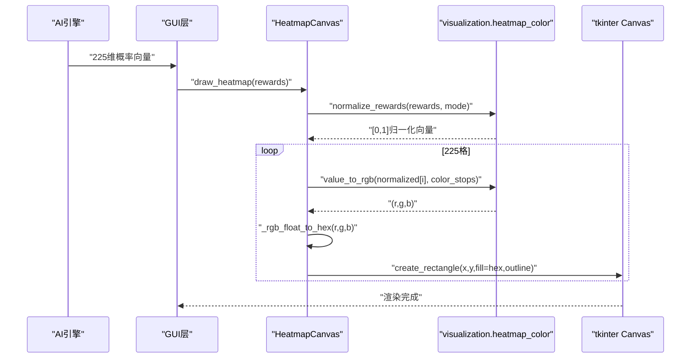
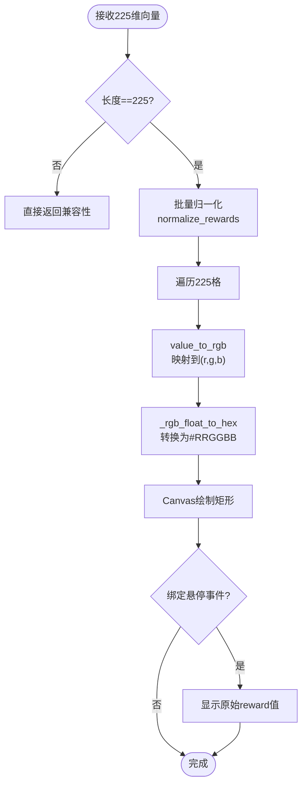
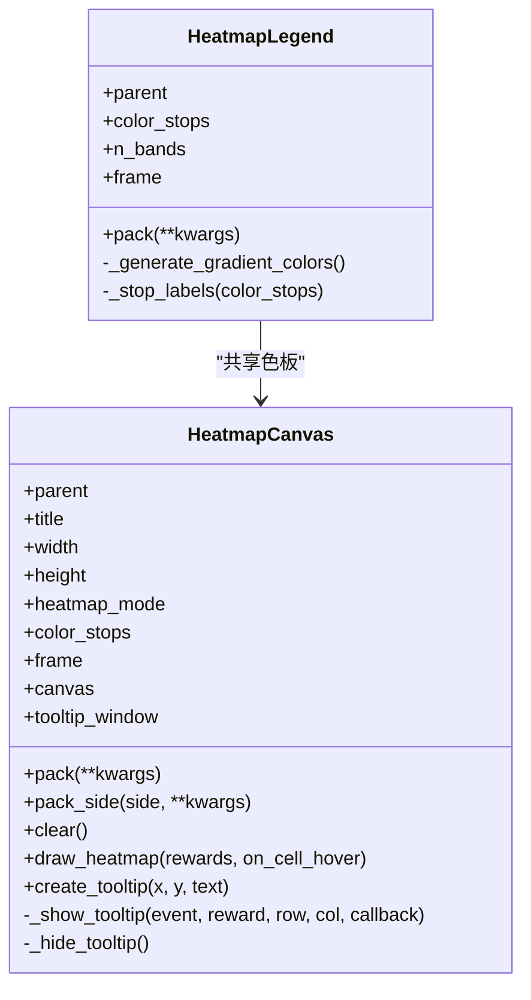
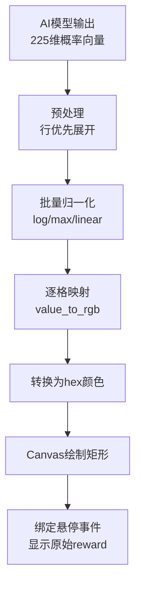
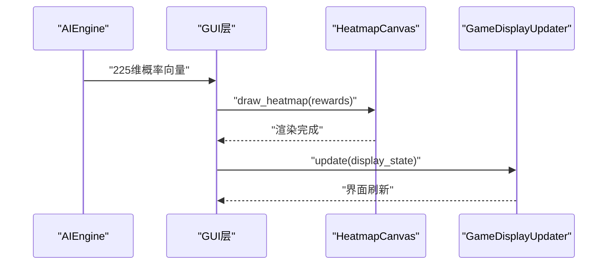
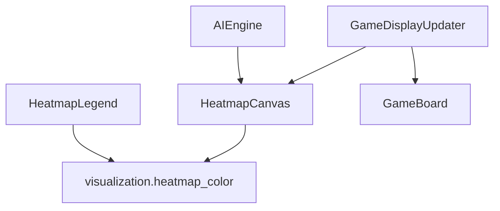

# 热力图组件Heatmap

<cite>
**本文档引用的文件**
- [gui/components/heatmap.py](file://gui/components/heatmap.py)
- [visualization/heatmap_color.py](file://visualization/heatmap_color.py)
- [tests/gui/test_heatmap.py](file://tests/gui/test_heatmap.py)
- [tests/unit/test_heatmap_color.py](file://tests/unit/test_heatmap_color.py)
- [design/gui_heatmap_reuse_design.md](file://design/gui_heatmap_reuse_design.md)
- [gui/components/game_board.py](file://gui/components/game_board.py)
- [gui/display_updater.py](file://gui/display_updater.py)
- [ai/engine.py](file://ai/engine.py)
</cite>

## 目录
1. [简介](#简介)
2. [项目结构](#项目结构)
3. [核心组件](#核心组件)
4. [架构概览](#架构概览)
5. [详细组件分析](#详细组件分析)
6. [依赖分析](#依赖分析)
7. [性能考虑](#性能考虑)
8. [故障排查指南](#故障排查指南)
9. [结论](#结论)
10. [附录](#附录)

## 简介
本文件为五子棋AI项目中的热力图组件Heatmap的详细技术文档。Heatmap组件负责将AI模型输出的225维概率向量映射为15×15棋盘的热力图可视化，提供颜色编码、悬停提示、颜色标尺等功能。组件采用“算法复用 + GUI适配”的设计，核心颜色映射算法来自独立的可视化模块，保证跨场景复用与一致性。

## 项目结构
Heatmap相关代码主要位于以下位置：
- GUI组件：gui/components/heatmap.py
- 可视化算法：visualization/heatmap_color.py
- 单元测试：tests/unit/test_heatmap_color.py
- GUI测试：tests/gui/test_heatmap.py
- 设计文档：design/gui_heatmap_reuse_design.md
- 集成示例：gui/components/game_board.py、gui/display_updater.py、ai/engine.py

**图表来源**
- [gui/components/heatmap.py:68-357](file://gui/components/heatmap.py#L68-L357)
- [visualization/heatmap_color.py:1-204](file://visualization/heatmap_color.py#L1-L204)
- [gui/components/game_board.py:7-170](file://gui/components/game_board.py#L7-L170)
- [gui/display_updater.py:13-110](file://gui/display_updater.py#L13-L110)
- [ai/engine.py:44-194](file://ai/engine.py#L44-L194)

**章节来源**
- [gui/components/heatmap.py:1-358](file://gui/components/heatmap.py#L1-L358)
- [visualization/heatmap_color.py:1-204](file://visualization/heatmap_color.py#L1-L204)

## 核心组件
Heatmap组件包含两个公开类：
- HeatmapCanvas：15×15棋盘热力图画布，支持悬停tooltip
- HeatmapLegend：颜色标尺（渐变条 + 色名标签）

二者均依赖visualization.heatmap_color模块提供的颜色映射算法，实现可配置的归一化模式与色板。

**章节来源**
- [gui/components/heatmap.py:68-357](file://gui/components/heatmap.py#L68-L357)
- [visualization/heatmap_color.py:32-39](file://visualization/heatmap_color.py#L32-L39)

## 架构概览
Heatmap组件的运行流程如下：
1. AI引擎生成225维概率向量
2. GUI层接收向量并调用HeatmapCanvas.draw_heatmap
3. 组件内部进行批量归一化（log/max/linear）
4. 逐格调用颜色映射函数生成RGB
5. 转换为tkinter可用的hex颜色并在Canvas上绘制矩形
6. 悬停时显示原始reward值（非归一化）

**图表来源**
- [gui/components/heatmap.py:137-195](file://gui/components/heatmap.py#L137-L195)
- [visualization/heatmap_color.py:63-122](file://visualization/heatmap_color.py#L63-L122)
- [visualization/heatmap_color.py:128-172](file://visualization/heatmap_color.py#L128-L172)

## 详细组件分析

### HeatmapCanvas组件
HeatmapCanvas是热力图画布的核心，负责：
- 绘制15×15棋盘（每个格子16×16像素，外加20像素边距）
- 批量归一化225维概率向量
- 颜色映射与Canvas绘制
- 悬停tooltip显示原始reward值

#### 数据映射与颜色编码
- 输入：225维概率向量（行优先）
- 归一化：支持"log"、"max"、"linear"三种模式
- 颜色映射：默认白→黄→橙→红四色渐变
- 输出：Canvas矩形填充颜色（#RRGGBB）

#### 渲染机制
- Canvas叠加绘制：逐格create_rectangle
- 透明度控制：tkinter不支持alpha通道，通过outline边框增强可读性
- 实时更新：clear后重新绘制，避免重叠

**图表来源**
- [gui/components/heatmap.py:137-195](file://gui/components/heatmap.py#L137-L195)
- [gui/components/heatmap.py:41-58](file://gui/components/heatmap.py#L41-L58)

**章节来源**
- [gui/components/heatmap.py:68-247](file://gui/components/heatmap.py#L68-L247)

### HeatmapLegend组件
HeatmapLegend提供颜色标尺，与热力图使用相同的色板与归一化策略：
- 默认4色（白→黄→橙→红）
- 渐变档数：默认24档（3段×8档）
- 标签：显示各色节点中文名称

**图表来源**
- [gui/components/heatmap.py:257-357](file://gui/components/heatmap.py#L257-L357)
- [gui/components/heatmap.py:68-135](file://gui/components/heatmap.py#L68-L135)

**章节来源**
- [gui/components/heatmap.py:257-357](file://gui/components/heatmap.py#L257-L357)

### 颜色映射算法
颜色映射算法来自visualization.heatmap_color模块，提供三个核心函数：

#### 归一化函数
- normalize_rewards：将任意数值范围映射到[0,1]
- 支持模式：
  - "log"：log(1 + r*K) / log(1 + max*K)，自适应K，提升softmax极值分布的可辨度
  - "max"：r / max(r)，最简单直观
  - "linear"：(r - min) / (max - min)，适合均匀分布

#### 颜色映射函数
- value_to_rgb：单值到RGB三元组映射
- 色节点等距分布在[0,1]，相邻节点在RGB空间线性插值
- 默认色板：白→黄→橙→红（4色）

#### 组合API
- rewards_to_rgba：一次性生成RGBA列表（matplotlib专用）
- HeatmapCanvas不使用此API，因为tkinter不支持alpha

**章节来源**
- [visualization/heatmap_color.py:63-122](file://visualization/heatmap_color.py#L63-L122)
- [visualization/heatmap_color.py:128-172](file://visualization/heatmap_color.py#L128-L172)
- [visualization/heatmap_color.py:178-204](file://visualization/heatmap_color.py#L178-L204)

### 数据处理流程
Heatmap组件的数据处理遵循以下流程：
1. AI模型输出225维概率向量
2. GUI层调用HeatmapCanvas.draw_heatmap
3. 组件内部进行批量归一化
4. 逐格颜色映射与hex转换
5. Canvas绘制与悬停绑定

**图表来源**
- [gui/components/heatmap.py:137-195](file://gui/components/heatmap.py#L137-L195)
- [visualization/heatmap_color.py:63-122](file://visualization/heatmap_color.py#L63-L122)

**章节来源**
- [gui/components/heatmap.py:137-195](file://gui/components/heatmap.py#L137-L195)

### 组件配置选项
HeatmapCanvas支持以下配置：
- heatmap_mode：归一化模式（"log"/"max"/"linear"，默认"log"）
- color_stops：自定义色节点序列（默认使用DEFAULT_COLOR_STOPS）
- 宽高：画布尺寸（默认280×280像素）
- 边距与格子大小：margin=20，cell_size=16

HeatmapLegend支持：
- color_stops：色节点（默认4色）
- n_bands：渐变档数（默认24）

**章节来源**
- [gui/components/heatmap.py:71-104](file://gui/components/heatmap.py#L71-L104)
- [gui/components/heatmap.py:260-276](file://gui/components/heatmap.py#L260-L276)

### 组件集成方式
Heatmap组件与AI引擎和GUI系统的集成方式：
- AI引擎：AIEngine.get_move返回225维概率向量，GUI层调用HeatmapCanvas.draw_heatmap
- GUI刷新：GameDisplayUpdater.update负责整体界面刷新，包括棋盘、标签、历史记录
- 集成示例：在replay_viewer.py中同时显示AI热力图与Sample热力图

**图表来源**
- [ai/engine.py:67-142](file://ai/engine.py#L67-L142)
- [gui/display_updater.py:40-82](file://gui/display_updater.py#L40-L82)
- [gui/components/heatmap.py:137-195](file://gui/components/heatmap.py#L137-L195)

**章节来源**
- [ai/engine.py:67-142](file://ai/engine.py#L67-L142)
- [gui/display_updater.py:40-82](file://gui/display_updater.py#L40-L82)

### 组件API接口
HeatmapCanvas公开API：
- __init__(parent, title="热力图", width=280, height=280, heatmap_mode="log", color_stops=None)
- pack(**kwargs) / pack_side(side, **kwargs)
- clear()：清空画布
- draw_heatmap(rewards, on_cell_hover=None)：绘制热力图
- create_tooltip(x, y, text)：创建tooltip

HeatmapLegend公开API：
- __init__(parent, color_stops=None, n_bands=24)
- pack(**kwargs)

注意：HeatmapLegend提供clear_heatmap方法，但HeatmapCanvas未提供clear_heatmap方法。如需清空热力图，可调用clear()或重新绘制。

**章节来源**
- [gui/components/heatmap.py:68-135](file://gui/components/heatmap.py#L68-L135)
- [gui/components/heatmap.py:257-327](file://gui/components/heatmap.py#L257-L327)

## 依赖分析
Heatmap组件的依赖关系如下：
- HeatmapCanvas依赖visualization.heatmap_color模块的归一化与颜色映射函数
- HeatmapLegend依赖相同的算法，但内部实现替换为逐档生成
- GUI层通过GameDisplayUpdater协调棋盘与热力图的显示

**图表来源**
- [gui/components/heatmap.py:30-34](file://gui/components/heatmap.py#L30-L34)
- [visualization/heatmap_color.py:1-20](file://visualization/heatmap_color.py#L1-L20)

**章节来源**
- [gui/components/heatmap.py:30-34](file://gui/components/heatmap.py#L30-L34)
- [visualization/heatmap_color.py:1-20](file://visualization/heatmap_color.py#L1-L20)

## 性能考虑
- 批量归一化：对整个225维向量进行一次归一化，避免重复计算
- 逐格颜色映射：在Canvas上逐格绘制，避免额外的图像合成
- 内存优化：使用Canvas的tag绑定悬停事件，减少额外数据结构
- 颜色转换：_rgb_float_to_hex在模块内完成，避免重复转换

## 故障排查指南
常见问题与解决方案：
- 归一化模式错误：当heatmap_mode不在{"log","max","linear"}时，normalize_rewards会抛出ValueError。请检查传入的模式字符串。
- 长度不匹配：当rewards长度不等于225时，draw_heatmap会静默返回（向后兼容）。请确保传入正确的225维向量。
- tooltip显示异常：tooltip显示的是原始reward值（非归一化值），如果显示为长尾浮点数，可通过tooltip的格式化逻辑进行截断。
- 颜色显示异常：检查color_stops参数是否正确传入，以及默认色板是否被意外修改。

**章节来源**
- [gui/components/heatmap.py:157-159](file://gui/components/heatmap.py#L157-L159)
- [gui/components/heatmap.py:159-163](file://gui/components/heatmap.py#L159-L163)
- [gui/components/heatmap.py:198-214](file://gui/components/heatmap.py#L198-L214)

## 结论
Heatmap组件通过复用独立的可视化算法模块，实现了高性能、可配置的热力图可视化。其设计满足了AI模型输出的实时可视化需求，提供了良好的用户体验与可维护性。组件的归一化模式与色板均可配置，能够适应不同的数据分布与展示需求。

## 附录

### 测试用例清单
- HeatmapCanvas测试：G1-G8（默认模式、自定义模式、颜色映射、tooltip精度等）
- HeatmapLegend测试：G9-G12（默认档数、自定义档数、首末颜色等）
- 单元测试：T1-T10（value_to_rgb端点、插值、越界、normalize_rewards模式、rewards_to_rgba等）

**章节来源**
- [tests/gui/test_heatmap.py:147-219](file://tests/gui/test_heatmap.py#L147-L219)
- [tests/gui/test_heatmap.py:247-290](file://tests/gui/test_heatmap.py#L247-L290)
- [tests/unit/test_heatmap_color.py:35-257](file://tests/unit/test_heatmap_color.py#L35-L257)