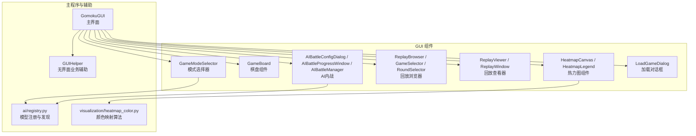
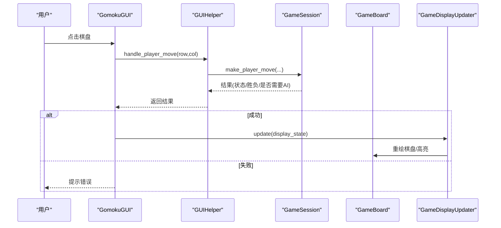
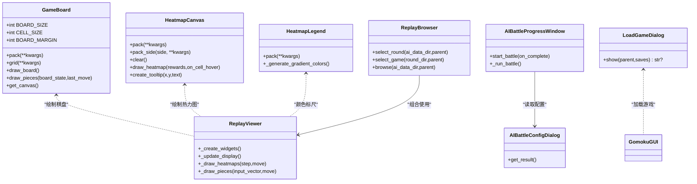
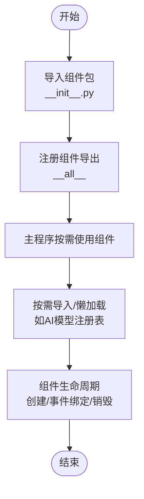
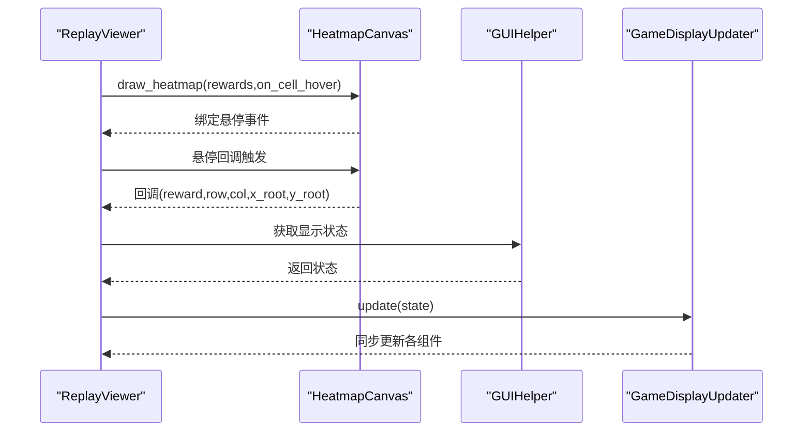
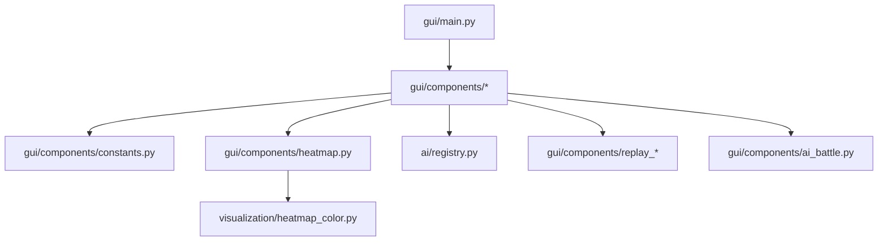

# 组件扩展开发

<cite>
**本文引用的文件**
- [gui/components/__init__.py](file://gui/components/__init__.py)
- [gui/components/constants.py](file://gui/components/constants.py)
- [gui/components/game_board.py](file://gui/components/game_board.py)
- [gui/components/heatmap.py](file://gui/components/heatmap.py)
- [gui/components/mode_selector.py](file://gui/components/mode_selector.py)
- [gui/components/replay_viewer.py](file://gui/components/replay_viewer.py)
- [gui/components/replay_browser.py](file://gui/components/replay_browser.py)
- [gui/components/ai_battle.py](file://gui/components/ai_battle.py)
- [gui/components/load_game_dialog.py](file://gui/components/load_game_dialog.py)
- [gui/main.py](file://gui/main.py)
- [visualization/heatmap_color.py](file://visualization/heatmap_color.py)
- [design/gui_helper_refactor_design.md](file://design/gui_helper_refactor_design.md)
- [design/gui_heatmap_reuse_design.md](file://design/gui_heatmap_reuse_design.md)
- [ai/registry.py](file://ai/registry.py)
</cite>

## 目录
1. [简介](#简介)
2. [项目结构](#项目结构)
3. [核心组件](#核心组件)
4. [架构总览](#架构总览)
5. [详细组件分析](#详细组件分析)
6. [依赖分析](#依赖分析)
7. [性能考虑](#性能考虑)
8. [故障排查指南](#故障排查指南)
9. [结论](#结论)
10. [附录](#附录)

## 简介
本指南面向五子棋AI项目的GUI组件扩展开发，围绕“组件类设计模式、接口规范与继承关系”“现有组件的修改与增强”“组件插件系统实现原理”“组件间通信扩展”“第三方组件集成”“最佳实践与性能优化”“版本管理与向后兼容”等方面，提供系统化的开发指导。文档以现有GUI组件为蓝本，结合设计文档与核心算法模块，帮助开发者在不破坏既有契约的前提下，安全地扩展与演进GUI能力。

## 项目结构
GUI组件采用“功能模块化 + 常量/样式集中化”的组织方式：
- 组件模块：gui/components 下按功能拆分，包含棋盘、热力图、模式选择、回放浏览/查看、AI内战、加载对话框等。
- 常量与样式：gui/components/constants.py 提供颜色、尺寸、字体、动物表情等统一配置。
- 主程序：gui/main.py 负责菜单、主界面布局与组件编排，通过GUIHelper与业务层解耦。
- 算法复用：gui/components/heatmap.py 复用 visualization/heatmap_color.py 的颜色映射与归一化算法，避免重复实现。

图表来源
- [gui/main.py:31-90](file://gui/main.py#L31-L90)
- [gui/components/__init__.py:13-41](file://gui/components/__init__.py#L13-L41)
- [gui/components/heatmap.py:30-34](file://gui/components/heatmap.py#L30-L34)
- [visualization/heatmap_color.py:32-39](file://visualization/heatmap_color.py#L32-L39)
- [ai/registry.py:12-20](file://ai/registry.py#L12-L20)

章节来源
- [gui/components/__init__.py:1-42](file://gui/components/__init__.py#L1-L42)
- [gui/components/constants.py:1-66](file://gui/components/constants.py#L1-L66)
- [gui/main.py:31-90](file://gui/main.py#L31-L90)

## 核心组件
- 模式选择器：负责启动时的模式选择与参数收集，支持PvP、PvE、AI内战、回放查看等。
- 棋盘组件：负责15×15棋盘绘制与点击交互，支持最后落子高亮。
- 热力图组件：基于复用算法绘制225格热力图，支持tooltip与颜色标尺。
- 回放浏览器/查看器：提供轮次与对局选择、回放窗口展示与信息面板。
- AI内战组件：配置黑/白双方AI与对局数，异步执行并提供进度与回放引导。
- 加载对话框：封装存档选择逻辑，返回选中存档名。
- 常量模块：统一颜色、尺寸、字体与动物表情等主题资源。

章节来源
- [gui/components/mode_selector.py:12-411](file://gui/components/mode_selector.py#L12-L411)
- [gui/components/game_board.py:7-170](file://gui/components/game_board.py#L7-L170)
- [gui/components/heatmap.py:68-358](file://gui/components/heatmap.py#L68-L358)
- [gui/components/replay_browser.py:12-383](file://gui/components/replay_browser.py#L12-L383)
- [gui/components/replay_viewer.py:13-426](file://gui/components/replay_viewer.py#L13-L426)
- [gui/components/ai_battle.py:22-346](file://gui/components/ai_battle.py#L22-L346)
- [gui/components/load_game_dialog.py:11-56](file://gui/components/load_game_dialog.py#L11-L56)
- [gui/components/constants.py:3-66](file://gui/components/constants.py#L3-L66)

## 架构总览
GUI层与业务层通过GUIHelper解耦，主程序仅负责界面编排与事件分发，业务逻辑由会话与控制器承担。热力图组件通过导入算法模块实现跨模块复用，避免重复实现与视觉不一致。

图表来源
- [gui/main.py:224-243](file://gui/main.py#L224-L243)
- [gui/main.py:269-273](file://gui/main.py#L269-L273)
- [design/gui_helper_refactor_design.md:46-83](file://design/gui_helper_refactor_design.md#L46-L83)

章节来源
- [gui/main.py:224-273](file://gui/main.py#L224-L273)
- [design/gui_helper_refactor_design.md:23-90](file://design/gui_helper_refactor_design.md#L23-L90)

## 详细组件分析

### 组件类设计模式与接口规范
- 组件职责单一：每个组件封装特定UI功能（如棋盘绘制、热力图绘制、回放浏览等），通过清晰的初始化参数与公开方法暴露能力。
- 组件契约稳定：组件导出接口（如pack/grid/draw_heatmap等）保持稳定，便于外部调用与测试。
- 依赖注入与回调：组件通过回调（如on_click_callback/on_cell_hover）与外部交互，降低紧耦合。

图表来源
- [gui/components/game_board.py:7-170](file://gui/components/game_board.py#L7-L170)
- [gui/components/heatmap.py:68-358](file://gui/components/heatmap.py#L68-L358)
- [gui/components/replay_viewer.py:13-426](file://gui/components/replay_viewer.py#L13-L426)
- [gui/components/replay_browser.py:300-383](file://gui/components/replay_browser.py#L300-L383)
- [gui/components/ai_battle.py:22-346](file://gui/components/ai_battle.py#L22-L346)
- [gui/components/load_game_dialog.py:11-56](file://gui/components/load_game_dialog.py#L11-L56)

章节来源
- [gui/components/game_board.py:22-52](file://gui/components/game_board.py#L22-L52)
- [gui/components/heatmap.py:137-195](file://gui/components/heatmap.py#L137-L195)
- [gui/components/replay_viewer.py:42-47](file://gui/components/replay_viewer.py#L42-L47)
- [gui/components/replay_browser.py:300-346](file://gui/components/replay_browser.py#L300-L346)
- [gui/components/ai_battle.py:166-169](file://gui/components/ai_battle.py#L166-L169)
- [gui/components/load_game_dialog.py:14-56](file://gui/components/load_game_dialog.py#L14-L56)

### 现有组件的修改与增强方法
- 样式定制：通过常量模块统一修改颜色、尺寸、字体，确保主题一致性。
- 功能扩展：在组件内部新增方法或属性，同时保持对外接口不变；例如在棋盘组件中增加额外标记或动画。
- 行为调整：通过回调参数与事件绑定实现行为扩展，如为热力图增加更多hover信息或交互。

章节来源
- [gui/components/constants.py:3-66](file://gui/components/constants.py#L3-L66)
- [gui/components/game_board.py:151-166](file://gui/components/game_board.py#L151-L166)
- [gui/components/heatmap.py:185-194](file://gui/components/heatmap.py#L185-L194)

### 组件插件系统的实现原理
- 插件注册机制：通过集中导出与模块化组织，新增组件只需在组件包的__init__.py中注册，即可被主程序统一导入与使用。
- 动态加载：利用Python模块导入特性，按需加载组件；对于AI模型选择，使用注册表进行懒加载与命名解析。
- 生命周期管理：组件在创建时完成布局与事件绑定，在销毁时清理资源（如tooltip窗口）。

图表来源
- [gui/components/__init__.py:22-41](file://gui/components/__init__.py#L22-L41)
- [ai/registry.py:12-20](file://ai/registry.py#L12-L20)

章节来源
- [gui/components/__init__.py:13-41](file://gui/components/__init__.py#L13-L41)
- [ai/registry.py:12-20](file://ai/registry.py#L12-L20)

### 组件间通信的扩展方式
- 事件系统扩展：通过回调函数（如on_click_callback/on_cell_hover）实现组件间的消息传递；在热力图中，hover事件可触发外部回调以联动其他组件。
- 数据共享机制：通过公共状态对象或会话对象共享数据；主程序通过GUIHelper获取显示状态并驱动多个组件更新。
- 状态同步策略：在主程序中集中调度显示更新器，确保棋盘、历史记录、状态标签等组件同步刷新。

图表来源
- [gui/components/replay_viewer.py:279-298](file://gui/components/replay_viewer.py#L279-L298)
- [gui/components/heatmap.py:185-194](file://gui/components/heatmap.py#L185-L194)
- [gui/main.py:269-273](file://gui/main.py#L269-L273)

章节来源
- [gui/components/replay_viewer.py:279-377](file://gui/components/replay_viewer.py#L279-L377)
- [gui/main.py:269-273](file://gui/main.py#L269-L273)

### 第三方组件的集成方法
- 兼容性检查：确保第三方组件遵循相同的布局与事件约定（如pack/grid、回调签名），避免破坏现有组件契约。
- 接口适配：通过包装器或适配层对接第三方组件，使其满足GUI组件的接口规范。
- 冲突解决：在组件注册与导入阶段进行命名冲突检查，必要时提供别名或前缀隔离。

章节来源
- [gui/components/__init__.py:13-41](file://gui/components/__init__.py#L13-L41)

### 组件开发的最佳实践
- 代码规范：组件类保持单一职责，方法短小清晰；使用常量模块统一主题资源；避免硬编码颜色与尺寸。
- 文档编写：为组件提供清晰的初始化参数说明与回调签名；在__init__.py中维护导出列表与版本信息。
- 测试策略：为组件的关键流程（如点击、绘制、hover）编写单元测试；对热力图的颜色映射与legend生成进行回归测试。

章节来源
- [gui/components/constants.py:3-66](file://gui/components/constants.py#L3-L66)
- [gui/components/heatmap.py:328-347](file://gui/components/heatmap.py#L328-L347)
- [design/gui_heatmap_reuse_design.md:242-277](file://design/gui_heatmap_reuse_design.md#L242-L277)

### 组件性能优化指南
- 渲染优化：热力图采用批量归一化与逐格颜色映射，减少重复计算；棋盘绘制仅重绘必要元素（如保留棋盘线，清除棋子层）。
- 内存管理：tooltip窗口按需创建与销毁，避免长期持有；组件在销毁时清理Canvas与窗口引用。
- 响应速度提升：AI内战使用后台线程执行，主线程通过after调度更新UI，避免阻塞。

章节来源
- [gui/components/heatmap.py:161-162](file://gui/components/heatmap.py#L161-L162)
- [gui/components/game_board.py:105-107](file://gui/components/game_board.py#L105-L107)
- [gui/components/heatmap.py:216-221](file://gui/components/heatmap.py#L216-L221)
- [gui/components/ai_battle.py:279-282](file://gui/components/ai_battle.py#L279-L282)

### 版本管理与向后兼容
- API演进策略：保持组件公开接口稳定，新增参数提供默认值；对废弃符号（如旧色板常量）在设计文档中明确迁移路径。
- 迁移指南：参考热力图重构设计文档，逐步替换内部实现并同步测试用例；对依赖注册表的组件（如AI内战）确保模型名称与代数规范一致。

章节来源
- [design/gui_heatmap_reuse_design.md:102-111](file://design/gui_heatmap_reuse_design.md#L102-L111)
- [design/gui_heatmap_reuse_design.md:280-287](file://design/gui_heatmap_reuse_design.md#L280-L287)
- [ai/registry.py:12-20](file://ai/registry.py#L12-L20)

## 依赖分析
组件间的依赖关系主要体现在“主程序编排 + 算法模块复用 + 注册表发现”三个方面：
- 主程序依赖组件包导出，组件内部依赖常量模块与算法模块。
- 热力图组件依赖可视化算法模块，实现颜色映射与归一化。
- AI内战与模式选择依赖注册表，实现模型名称解析与懒加载。

图表来源
- [gui/main.py:22-28](file://gui/main.py#L22-L28)
- [gui/components/heatmap.py:30-34](file://gui/components/heatmap.py#L30-L34)
- [visualization/heatmap_color.py:32-39](file://visualization/heatmap_color.py#L32-L39)
- [ai/registry.py:12-20](file://ai/registry.py#L12-L20)

章节来源
- [gui/main.py:22-28](file://gui/main.py#L22-L28)
- [gui/components/heatmap.py:30-34](file://gui/components/heatmap.py#L30-L34)
- [visualization/heatmap_color.py:32-39](file://visualization/heatmap_color.py#L32-L39)
- [ai/registry.py:12-20](file://ai/registry.py#L12-L20)

## 性能考虑
- 热力图绘制：批量归一化与逐格映射，避免重复计算；tooltip按需创建，减少内存占用。
- 棋盘绘制：仅重绘棋子层，保留棋盘线，降低重绘成本。
- 异步执行：AI内战在后台线程运行，主线程通过after调度，保证UI流畅。

章节来源
- [gui/components/heatmap.py:161-162](file://gui/components/heatmap.py#L161-L162)
- [gui/components/game_board.py:105-107](file://gui/components/game_board.py#L105-L107)
- [gui/components/ai_battle.py:279-282](file://gui/components/ai_battle.py#L279-L282)

## 故障排查指南
- 模型加载失败：在AI内战进度窗口中捕获模型加载异常并弹窗提示，随后回调通知主流程。
- 回放数据缺失：当ai_data目录不存在时，回放入口给出友好提示。
- 热力图模式异常：归一化模式非法时在绘制阶段抛出异常，确保调用方及时修正。

章节来源
- [gui/components/ai_battle.py:269-272](file://gui/components/ai_battle.py#L269-L272)
- [gui/main.py:384-386](file://gui/main.py#L384-L386)
- [gui/components/heatmap.py:151-154](file://gui/components/heatmap.py#L151-L154)

## 结论
通过模块化组件设计、稳定的接口契约、算法模块复用与注册表发现机制，五子棋AI项目的GUI具备良好的扩展性与可维护性。遵循本文档的开发规范与最佳实践，可在不破坏向后兼容的前提下，持续增强GUI能力并提升用户体验。

## 附录
- 设计文档参考：GUI Helper重构设计、GUI热力图复用设计，明确了组件职责分离与算法复用策略。
- 算法模块参考：visualization/heatmap_color.py 提供可配置的归一化与颜色映射，支持多种色板与模式。

章节来源
- [design/gui_helper_refactor_design.md:1-281](file://design/gui_helper_refactor_design.md#L1-L281)
- [design/gui_heatmap_reuse_design.md:1-347](file://design/gui_heatmap_reuse_design.md#L1-L347)
- [visualization/heatmap_color.py:63-122](file://visualization/heatmap_color.py#L63-L122)