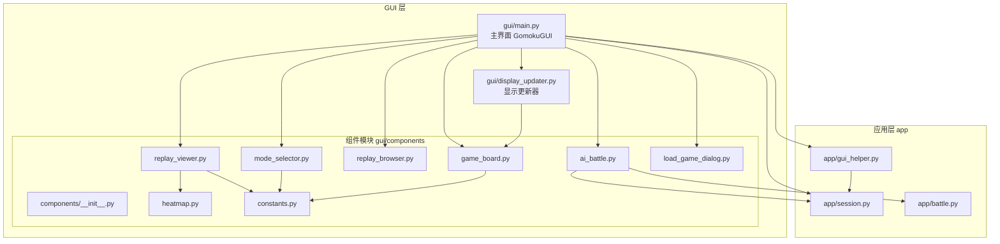
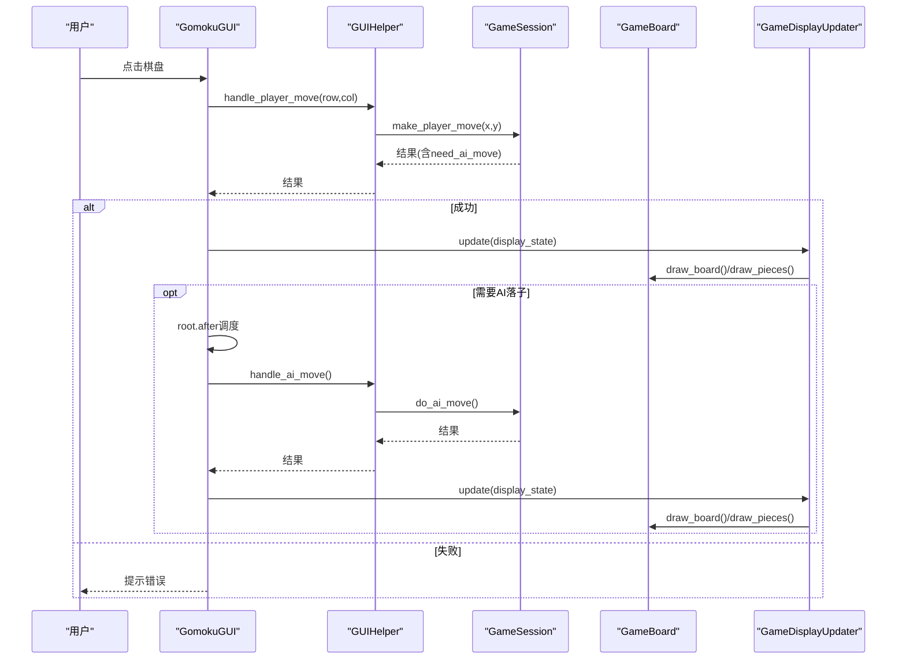
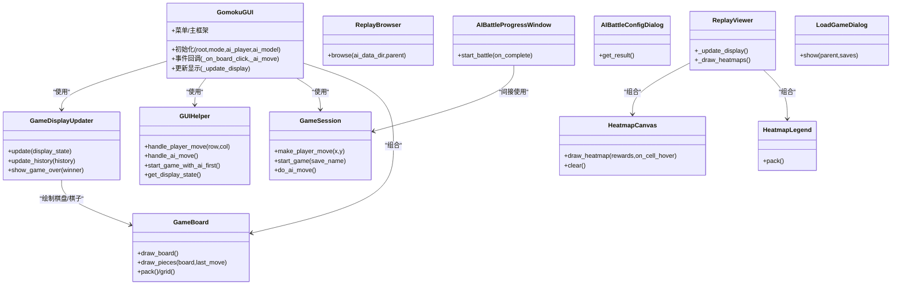
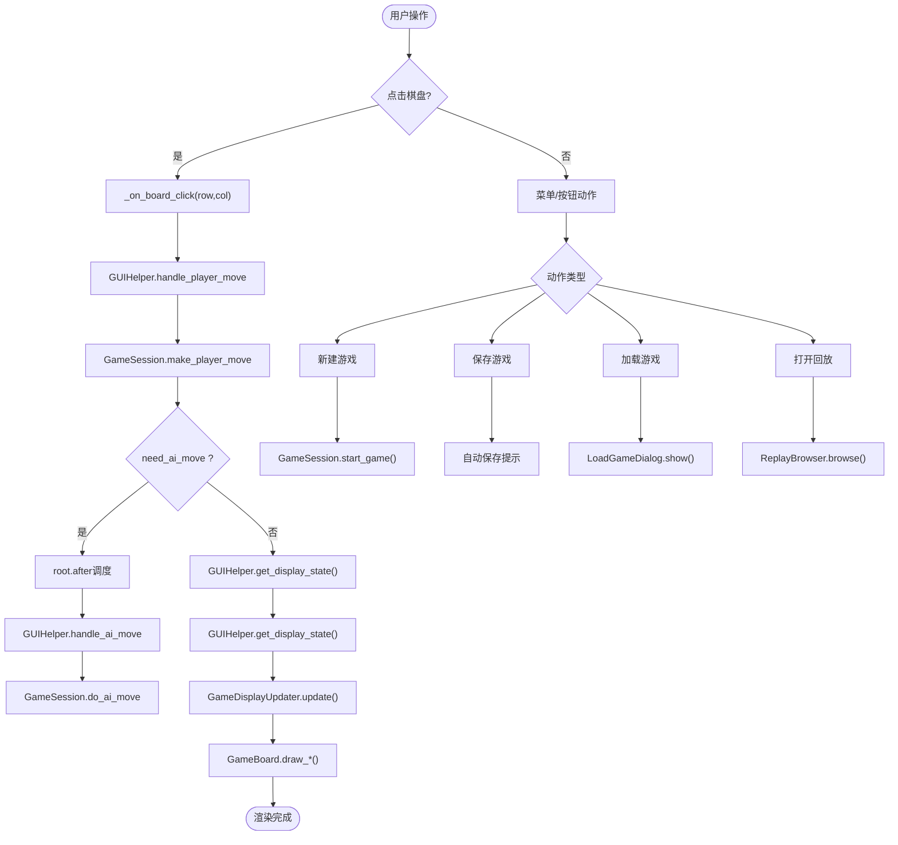
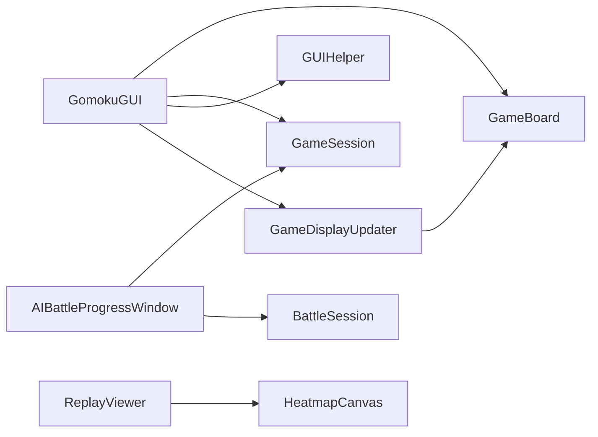

# 组件架构设计

<cite>
**本文引用的文件**
- [gui/main.py](file://gui/main.py)
- [gui/display_updater.py](file://gui/display_updater.py)
- [gui/components/__init__.py](file://gui/components/__init__.py)
- [gui/components/game_board.py](file://gui/components/game_board.py)
- [gui/components/mode_selector.py](file://gui/components/mode_selector.py)
- [gui/components/constants.py](file://gui/components/constants.py)
- [gui/components/heatmap.py](file://gui/components/heatmap.py)
- [gui/components/replay_browser.py](file://gui/components/replay_browser.py)
- [gui/components/replay_viewer.py](file://gui/components/replay_viewer.py)
- [gui/components/ai_battle.py](file://gui/components/ai_battle.py)
- [gui/components/load_game_dialog.py](file://gui/components/load_game_dialog.py)
- [app/gui_helper.py](file://app/gui_helper.py)
- [app/session.py](file://app/session.py)
- [app/battle.py](file://app/battle.py)
</cite>

## 目录
1. [简介](#简介)
2. [项目结构](#项目结构)
3. [核心组件](#核心组件)
4. [架构总览](#架构总览)
5. [详细组件分析](#详细组件分析)
6. [依赖关系分析](#依赖关系分析)
7. [性能考虑](#性能考虑)
8. [故障排查指南](#故障排查指南)
9. [结论](#结论)
10. [附录](#附录)

## 简介
本文件面向五子棋AI项目的GUI组件架构，系统阐述组件化设计理念、层次结构、职责分离、模块化原则，以及组件间通信机制（事件传递、状态共享、数据流）、生命周期管理（初始化、渲染、更新、销毁）、布局管理（pack/grid/place）、数据绑定与父子/兄弟协作、全局状态管理、扩展指南与性能优化策略。目标是帮助开发者快速理解并高效维护与扩展GUI组件体系。

## 项目结构
GUI相关代码集中在gui包及其components子模块，配合app层的会话与辅助逻辑，形成清晰的分层：
- gui：顶层主程序与显示更新器
- gui/components：可复用的UI组件（棋盘、模式选择、热力图、回放、AI内战、加载对话框等）
- app：薄代理层（会话、GUI辅助、AI内战会话）

图表来源
- [gui/main.py:1-462](file://gui/main.py#L1-L462)
- [gui/display_updater.py:1-110](file://gui/display_updater.py#L1-L110)
- [gui/components/__init__.py:1-42](file://gui/components/__init__.py#L1-L42)
- [gui/components/game_board.py:1-170](file://gui/components/game_board.py#L1-L170)
- [gui/components/mode_selector.py:1-411](file://gui/components/mode_selector.py#L1-L411)
- [gui/components/heatmap.py:1-358](file://gui/components/heatmap.py#L1-L358)
- [gui/components/replay_browser.py:1-383](file://gui/components/replay_browser.py#L1-L383)
- [gui/components/replay_viewer.py:1-426](file://gui/components/replay_viewer.py#L1-L426)
- [gui/components/ai_battle.py:1-346](file://gui/components/ai_battle.py#L1-L346)
- [gui/components/load_game_dialog.py:1-56](file://gui/components/load_game_dialog.py#L1-L56)
- [gui/components/constants.py:1-66](file://gui/components/constants.py#L1-L66)
- [app/gui_helper.py:1-199](file://app/gui_helper.py#L1-L199)
- [app/session.py:1-179](file://app/session.py#L1-L179)
- [app/battle.py:1-104](file://app/battle.py#L1-L104)

章节来源
- [gui/main.py:1-462](file://gui/main.py#L1-L462)
- [gui/components/__init__.py:1-42](file://gui/components/__init__.py#L1-L42)

## 核心组件
- GomokuGUI：顶层主界面，负责菜单、主框架、组件装配与事件编排，协调控制器、会话与显示更新器。
- GameDisplayUpdater：纯渲染器，接收display_state并更新棋盘、标签、历史列表。
- GUIHelper：GUI与业务逻辑的薄桥接，封装落子、AI移动、显示状态获取等。
- GameSession：会话层，统一管理PvP/PvE流程，协调AI引擎与控制器。
- GameBoard：棋盘组件，负责绘制网格、棋子与最后落子高亮，暴露pack/grid接口。
- ModeSelector：模式选择器，提供PvP/PvE/AI内战/回放入口。
- HeatmapCanvas/Legend：热力图组件，支持悬停tooltip与颜色标尺。
- ReplayBrowser/Viewer：回放浏览与播放器，支持轮次/对局选择与步进回放。
- AIBattleConfigDialog/ProgressWindow/AIBattleManager：AI内战配置、进度窗口与管理器。
- LoadGameDialog：存档加载对话框。
- constants：颜色、尺寸、字体、动物表情常量。

章节来源
- [gui/main.py:31-462](file://gui/main.py#L31-L462)
- [gui/display_updater.py:13-110](file://gui/display_updater.py#L13-L110)
- [app/gui_helper.py:12-199](file://app/gui_helper.py#L12-L199)
- [app/session.py:12-179](file://app/session.py#L12-L179)
- [gui/components/game_board.py:7-170](file://gui/components/game_board.py#L7-L170)
- [gui/components/mode_selector.py:12-411](file://gui/components/mode_selector.py#L12-L411)
- [gui/components/heatmap.py:68-358](file://gui/components/heatmap.py#L68-L358)
- [gui/components/replay_browser.py:12-383](file://gui/components/replay_browser.py#L12-L383)
- [gui/components/replay_viewer.py:13-426](file://gui/components/replay_viewer.py#L13-L426)
- [gui/components/ai_battle.py:22-346](file://gui/components/ai_battle.py#L22-L346)
- [gui/components/load_game_dialog.py:11-56](file://gui/components/load_game_dialog.py#L11-L56)
- [gui/components/constants.py:1-66](file://gui/components/constants.py#L1-L66)

## 架构总览
GUI采用“组件化 + 会话/辅助薄桥接”的分层架构：
- 视图层：GomokuGUI与各组件（GameBoard、ModeSelector、Heatmap、Replay等）
- 渲染层：GameDisplayUpdater集中处理UI刷新
- 业务层：GUIHelper封装业务逻辑；GameSession统一流程；BattleSession负责AI内战
- 数据与事件：组件通过回调/会话/辅助类传递事件，display_state驱动渲染

图表来源
- [gui/main.py:224-273](file://gui/main.py#L224-L273)
- [app/gui_helper.py:53-106](file://app/gui_helper.py#L53-L106)
- [app/session.py:63-102](file://app/session.py#L63-L102)
- [gui/display_updater.py:40-82](file://gui/display_updater.py#L40-L82)
- [gui/components/game_board.py:97-119](file://gui/components/game_board.py#L97-L119)

## 详细组件分析

### 组件层次与职责分离
- 视图组件：ModeSelector、GameBoard、HeatmapCanvas/Legend、ReplayBrowser/Viewer、AIBattleConfigDialog/ProgressWindow、LoadGameDialog
- 顶层协调：GomokuGUI（菜单、主框架、事件编排）
- 渲染器：GameDisplayUpdater（集中刷新）
- 业务薄桥：GUIHelper（落子、AI移动、显示状态）
- 会话：GameSession（流程编排）、BattleSession（AI内战）

图表来源
- [gui/main.py:31-462](file://gui/main.py#L31-L462)
- [gui/display_updater.py:13-110](file://gui/display_updater.py#L13-L110)
- [app/gui_helper.py:12-199](file://app/gui_helper.py#L12-L199)
- [app/session.py:12-179](file://app/session.py#L12-L179)
- [gui/components/game_board.py:7-170](file://gui/components/game_board.py#L7-L170)
- [gui/components/heatmap.py:68-358](file://gui/components/heatmap.py#L68-L358)
- [gui/components/replay_viewer.py:13-426](file://gui/components/replay_viewer.py#L13-L426)
- [gui/components/ai_battle.py:22-346](file://gui/components/ai_battle.py#L22-L346)
- [gui/components/load_game_dialog.py:11-56](file://gui/components/load_game_dialog.py#L11-L56)

章节来源
- [gui/main.py:31-462](file://gui/main.py#L31-L462)
- [gui/display_updater.py:13-110](file://gui/display_updater.py#L13-L110)
- [app/gui_helper.py:12-199](file://app/gui_helper.py#L12-L199)
- [app/session.py:12-179](file://app/session.py#L12-L179)
- [gui/components/game_board.py:7-170](file://gui/components/game_board.py#L7-L170)
- [gui/components/heatmap.py:68-358](file://gui/components/heatmap.py#L68-L358)
- [gui/components/replay_viewer.py:13-426](file://gui/components/replay_viewer.py#L13-L426)
- [gui/components/ai_battle.py:22-346](file://gui/components/ai_battle.py#L22-L346)
- [gui/components/load_game_dialog.py:11-56](file://gui/components/load_game_dialog.py#L11-L56)

### 组件间通信机制
- 事件传递
  - 棋盘点击：GameBoard绑定Canvas点击事件，回调GomokuGUI的_on_board_click
  - 控制按钮：菜单与按钮命令直接触发GomokuGUI的方法
  - AI内战：AIBattleProgressWindow通过后台线程执行BattleSession.run，使用root.after在主线程更新UI
- 状态共享
  - display_state：GUIHelper.get_display_state()聚合控制器状态，GameDisplayUpdater据此刷新
  - 会话状态：GameSession封装当前模式、AI玩家、控制器引用，统一对外接口
- 数据流
  - 输入：用户事件（点击、按钮、对话框确认）
  - 处理：GUIHelper封装业务逻辑，GameSession协调控制器与AI引擎
  - 输出：display_state驱动GameDisplayUpdater更新UI

图表来源
- [gui/main.py:224-273](file://gui/main.py#L224-L273)
- [app/gui_helper.py:53-148](file://app/gui_helper.py#L53-L148)
- [app/session.py:63-178](file://app/session.py#L63-L178)
- [gui/display_updater.py:40-82](file://gui/display_updater.py#L40-L82)
- [gui/components/load_game_dialog.py:14-56](file://gui/components/load_game_dialog.py#L14-L56)
- [gui/components/replay_browser.py:347-383](file://gui/components/replay_browser.py#L347-L383)

章节来源
- [gui/main.py:224-273](file://gui/main.py#L224-L273)
- [app/gui_helper.py:53-148](file://app/gui_helper.py#L53-L148)
- [app/session.py:63-178](file://app/session.py#L63-L178)
- [gui/display_updater.py:40-82](file://gui/display_updater.py#L40-L82)
- [gui/components/load_game_dialog.py:14-56](file://gui/components/load_game_dialog.py#L14-L56)
- [gui/components/replay_browser.py:347-383](file://gui/components/replay_browser.py#L347-L383)

### 生命周期管理
- 初始化
  - GomokuGUI.__init__：创建控制器、会话、GUIHelper；构建菜单与主框架；创建GameDisplayUpdater
  - 各组件在父容器中初始化并注册事件（如GameBoard绑定点击）
- 渲染
  - GameDisplayUpdater.update根据display_state重绘棋盘、标签与历史
  - GameBoard.draw_board/draw_pieces分别绘制网格与棋子
- 更新
  - GUIHelper.get_display_state聚合控制器状态，供Updater刷新
  - 回放Viewer按步进更新棋盘与热力图
- 销毁
  - 模式切换/回放窗口关闭时，组件释放资源（如tooltip窗口destroy）

章节来源
- [gui/main.py:42-90](file://gui/main.py#L42-L90)
- [gui/display_updater.py:40-110](file://gui/display_updater.py#L40-L110)
- [gui/components/game_board.py:22-56](file://gui/components/game_board.py#L22-L56)
- [gui/components/replay_viewer.py:230-377](file://gui/components/replay_viewer.py#L230-L377)

### 布局管理
- pack：主界面采用pack组织主框架、棋盘与信息面板，适合线性布局与相对简单的位置关系
- grid：组件内部网格绘制（棋盘网格、热力图格子）使用Canvas的几何计算，而非tk的grid
- place：本项目未直接使用place，但可通过Canvas的create_rectangle/create_oval等实现精确放置

章节来源
- [gui/main.py:105-223](file://gui/main.py#L105-L223)
- [gui/components/game_board.py:61-96](file://gui/components/game_board.py#L61-L96)
- [gui/components/heatmap.py:137-195](file://gui/components/heatmap.py#L137-L195)

### 数据绑定与状态管理
- 单向数据流：用户事件 → GUIHelper → GameSession → 控制器；display_state → GameDisplayUpdater → UI
- 组件内状态：GameBoard维护last_move高亮；HeatmapCanvas维护tooltip懒创建；ReplayViewer维护current_step
- 全局状态：GameSession持有模式与AI玩家；GUIHelper聚合控制器状态；constants集中管理主题色与尺寸

章节来源
- [app/gui_helper.py:108-148](file://app/gui_helper.py#L108-L148)
- [gui/display_updater.py:40-82](file://gui/display_updater.py#L40-L82)
- [gui/components/game_board.py:140-149](file://gui/components/game_board.py#L140-L149)
- [gui/components/heatmap.py:118-120](file://gui/components/heatmap.py#L118-L120)
- [gui/components/replay_viewer.py:35-46](file://gui/components/replay_viewer.py#L35-L46)
- [gui/components/constants.py:1-66](file://gui/components/constants.py#L1-L66)

### 组件扩展指南
- 自定义组件创建规范
  - 明确职责：单一职责，避免与控制器/会话耦合
  - 接口设计：提供清晰的回调/属性接口，遵循constants中的主题风格
  - 布局：优先使用pack/grid，必要时在Canvas中精确绘制
- 组件继承模式
  - 可继承现有组件（如基于GameBoard扩展特殊标记）
  - 通过组合而非深度继承实现功能扩展
- 接口设计原则
  - 事件回调命名统一（如on_click/on_hover）
  - 参数最小化，返回结构化结果（含status/error字段）
  - 与constants解耦，避免硬编码颜色/尺寸

章节来源
- [gui/components/__init__.py:1-42](file://gui/components/__init__.py#L1-L42)
- [gui/components/constants.py:1-66](file://gui/components/constants.py#L1-L66)

## 依赖关系分析
- 组件内聚与耦合
  - GomokuGUI高内聚地编排各组件，低耦合地通过回调与会话交互
  - GameDisplayUpdater与GameBoard强耦合（直接引用），但职责清晰
  - GUIHelper与GameSession弱耦合，通过方法调用传递状态
- 外部依赖
  - app层：GameSession、GUIHelper、BattleSession
  - 可视化：HeatmapCanvas依赖visualization.heatmap_color
  - Tkinter：所有组件均基于tkinter

图表来源
- [gui/main.py:31-462](file://gui/main.py#L31-L462)
- [gui/display_updater.py:13-110](file://gui/display_updater.py#L13-L110)
- [app/gui_helper.py:12-199](file://app/gui_helper.py#L12-L199)
- [app/session.py:12-179](file://app/session.py#L12-L179)
- [gui/components/replay_viewer.py:13-426](file://gui/components/replay_viewer.py#L13-L426)
- [gui/components/heatmap.py:68-358](file://gui/components/heatmap.py#L68-L358)
- [app/battle.py:15-104](file://app/battle.py#L15-L104)

章节来源
- [gui/main.py:31-462](file://gui/main.py#L31-L462)
- [gui/display_updater.py:13-110](file://gui/display_updater.py#L13-L110)
- [app/gui_helper.py:12-199](file://app/gui_helper.py#L12-L199)
- [app/session.py:12-179](file://app/session.py#L12-L179)
- [gui/components/replay_viewer.py:13-426](file://gui/components/replay_viewer.py#L13-L426)
- [gui/components/heatmap.py:68-358](file://gui/components/heatmap.py#L68-L358)
- [app/battle.py:15-104](file://app/battle.py#L15-L104)

## 性能考虑
- 渲染优化
  - 仅重绘变化部分：GameBoard.draw_pieces先删除"piece"/"last_move"标签，避免重复绘制
  - 批量归一化：HeatmapCanvas对整列奖励做normalize_rewards，减少重复计算
- 事件与线程
  - AI内战在后台线程执行，使用root.after回调主线程更新UI，避免阻塞
  - 棋盘点击采用整除计算行列，避免浮点误差导致的越界
- 内存管理
  - Tooltip懒创建与销毁（_hide_tooltip），避免长期驻留
  - 回放Viewer按步进更新，避免一次性加载过多数据

章节来源
- [gui/components/game_board.py:97-119](file://gui/components/game_board.py#L97-L119)
- [gui/components/heatmap.py:137-195](file://gui/components/heatmap.py#L137-L195)
- [gui/components/replay_viewer.py:230-260](file://gui/components/replay_viewer.py#L230-L260)
- [gui/main.py:257-267](file://gui/main.py#L257-L267)

## 故障排查指南
- 模型加载失败
  - 现象：PvE或AI内战时弹窗提示“模型加载失败”
  - 处理：捕获ModelLoadError，提示用户并回退到模式选择界面
- 落子失败
  - 现象：点击无效或提示“落子失败”
  - 处理：GUIHelper返回错误状态，GomokuGUI弹出提示
- 回放数据缺失
  - 现象：提示“暂无回放数据，请先进行 AI 内战对战”
  - 处理：检查AI数据目录是否存在

章节来源
- [gui/main.py:418-457](file://gui/main.py#L418-L457)
- [app/gui_helper.py:53-106](file://app/gui_helper.py#L53-L106)
- [gui/main.py:381-386](file://gui/main.py#L381-L386)

## 结论
本GUI组件架构通过清晰的分层与职责分离，实现了良好的可维护性与扩展性。组件间通过回调与会话层进行松耦合交互，display_state驱动的单向数据流保证了渲染一致性。布局采用pack/grid满足常见需求，Canvas绘制满足复杂图形展示。建议在新增组件时遵循单一职责、接口最小化与主题一致性的原则，以保持整体架构的稳定性与可演进性。

## 附录
- 常量与主题
  - 颜色、尺寸、字体、动物表情等集中定义于constants，便于统一风格与主题切换
- 组件导出
  - components/__init__.py统一导出组件，便于上层按需导入

章节来源
- [gui/components/constants.py:1-66](file://gui/components/constants.py#L1-L66)
- [gui/components/__init__.py:13-42](file://gui/components/__init__.py#L13-L42)