# 开发者指南

<cite>
**本文引用的文件**
- [ai/__init__.py](file://ai/__init__.py)
- [ai/engine.py](file://ai/engine.py)
- [ai/base_trainer.py](file://ai/base_trainer.py)
- [ai/game_manager.py](file://ai/game_manager.py)
- [ai/data_recorder.py](file://ai/data_recorder.py)
- [ai/evaluator.py](file://ai/evaluator.py)
- [app/__init__.py](file://app/__init__.py)
- [app/session.py](file://app/session.py)
- [app/gui_helper.py](file://app/gui_helper.py)
- [game/__init__.py](file://game/__init__.py)
- [game/controller.py](file://game/controller.py)
- [gui/main.py](file://gui/main.py)
- [gui/display_updater.py](file://gui/display_updater.py)
- [cli/main.py](file://cli/main.py)
</cite>

## 目录
1. [简介](#简介)
2. [项目结构](#项目结构)
3. [核心组件](#核心组件)
4. [架构总览](#架构总览)
5. [详细组件分析](#详细组件分析)
6. [依赖分析](#依赖分析)
7. [性能考虑](#性能考虑)
8. [故障排查指南](#故障排查指南)
9. [结论](#结论)
10. [附录](#附录)

## 简介
本指南面向五子棋AI项目的开发者，系统阐述项目的分层架构、模块化设计与组件化界面实现原理，深入解析AI引擎、游戏控制器、应用会话等关键组件，并提供AI模型开发、GUI开发、测试框架与代码贡献的完整实践路径。内容兼顾不同经验层次，既提供高层概览，也给出代码级细节与可视化图示。

## 项目结构
项目采用清晰的分层组织：
- game：纯业务逻辑层，封装五子棋规则、存档与状态管理，不依赖UI。
- ai：AI引擎与训练流水线，包含模型、训练器、数据记录、评价器等。
- app：薄代理层，协调game与ai，提供会话与GUI辅助。
- gui：组件化界面层，包含棋盘、模式选择、回放等组件与主题系统。
- cli：命令行入口，提供REPL交互与基础命令。
- tests：pytest测试套件，覆盖单元、集成与边缘场景。
- design：设计文档与性能优化方案。
- visualization：可视化工具（如热力图配色）。

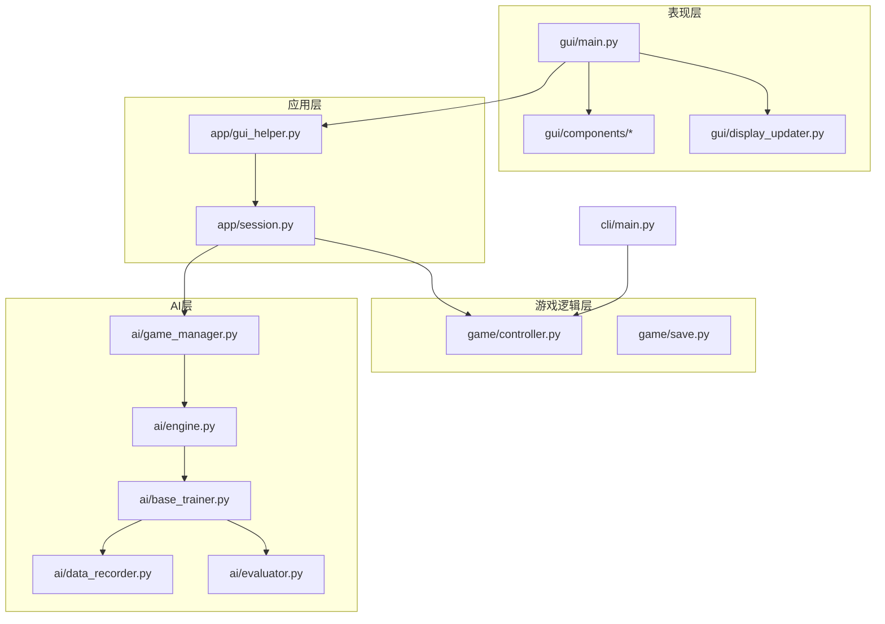

**图示来源**
- [gui/main.py:31-90](file://gui/main.py#L31-L90)
- [gui/display_updater.py:13-40](file://gui/display_updater.py#L13-L40)
- [app/session.py:12-62](file://app/session.py#L12-L62)
- [app/gui_helper.py:12-24](file://app/gui_helper.py#L12-L24)
- [game/controller.py:11-32](file://game/controller.py#L11-L32)
- [ai/engine.py:44-66](file://ai/engine.py#L44-L66)
- [ai/base_trainer.py:32-52](file://ai/base_trainer.py#L32-L52)
- [ai/data_recorder.py:17-42](file://ai/data_recorder.py#L17-L42)
- [ai/evaluator.py:51-89](file://ai/evaluator.py#L51-L89)
- [ai/game_manager.py:16-39](file://ai/game_manager.py#L16-L39)
- [cli/main.py:19-44](file://cli/main.py#L19-L44)

**章节来源**
- [game/__init__.py:1-55](file://game/__init__.py#L1-L55)
- [ai/__init__.py:1-21](file://ai/__init__.py#L1-L21)
- [app/__init__.py:1-20](file://app/__init__.py#L1-L20)
- [gui/main.py:1-462](file://gui/main.py#L1-L462)
- [cli/main.py:1-258](file://cli/main.py#L1-L258)

## 核心组件
- 游戏控制器（GomokuController）：统一对外接口，负责新建/加载/落子/状态查询与存档。
- AI引擎（AIEngine）：桥接UI与AI模型，将棋盘状态向量化并按策略选择落子。
- 训练器（BaseTrainer）：抽象训练流程，支持GPU加速、多种训练方式与学习率调度。
- 游戏管理器（AIGameManager）：封装人机对战与AI内战流程，协调落子与数据记录。
- 数据记录器（DataRecorder）：按轮次与对局组织AI对战数据，生成训练样本输入。
- 评价器（Evaluator）：从对局记录生成带奖励的训练样本，支持并行评价。
- 应用会话（GameSession）：薄代理层，协调模式、落子与AI调度。
- GUI辅助（GUIHelper）：将界面与业务逻辑解耦，提供显示状态与动作封装。
- CLI入口（cli/main.py）：REPL交互，演示基础命令与棋盘打印。

**章节来源**
- [game/controller.py:11-194](file://game/controller.py#L11-L194)
- [ai/engine.py:44-194](file://ai/engine.py#L44-L194)
- [ai/base_trainer.py:32-699](file://ai/base_trainer.py#L32-L699)
- [ai/game_manager.py:16-339](file://ai/game_manager.py#L16-L339)
- [ai/data_recorder.py:17-145](file://ai/data_recorder.py#L17-L145)
- [ai/evaluator.py:51-350](file://ai/evaluator.py#L51-L350)
- [app/session.py:12-179](file://app/session.py#L12-L179)
- [app/gui_helper.py:12-199](file://app/gui_helper.py#L12-L199)
- [cli/main.py:19-258](file://cli/main.py#L19-L258)

## 架构总览
系统遵循“表现层-应用层-业务层-AI层”的分层设计，各层职责清晰、边界明确：
- 表现层：GUI与CLI，负责用户交互与展示。
- 应用层：会话与辅助，屏蔽UI细节，统一业务流程。
- 业务层：游戏规则与存档，不依赖AI。
- AI层：模型、训练、数据与评价，独立于UI与游戏规则。

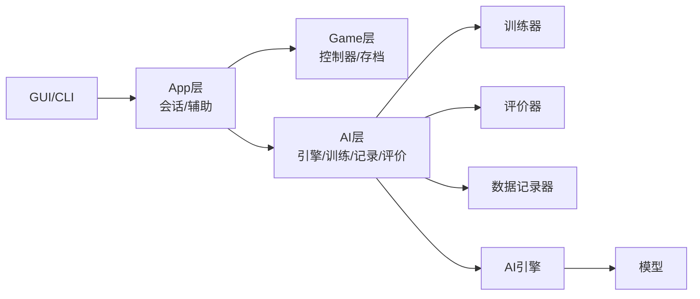

**图示来源**
- [gui/main.py:18-29](file://gui/main.py#L18-L29)
- [app/session.py:12-52](file://app/session.py#L12-L52)
- [game/controller.py:11-32](file://game/controller.py#L11-L32)
- [ai/engine.py:44-66](file://ai/engine.py#L44-L66)
- [ai/base_trainer.py:32-52](file://ai/base_trainer.py#L32-L52)
- [ai/data_recorder.py:17-42](file://ai/data_recorder.py#L17-L42)
- [ai/evaluator.py:51-89](file://ai/evaluator.py#L51-L89)

## 详细组件分析

### AI引擎（AIEngine）
AI引擎负责将棋盘状态转换为模型输入，调用模型获取概率分布，并按策略选择合法位置落子。支持两种策略：argmax（默认，随机破并列）与temperature sampling（温度采样）。

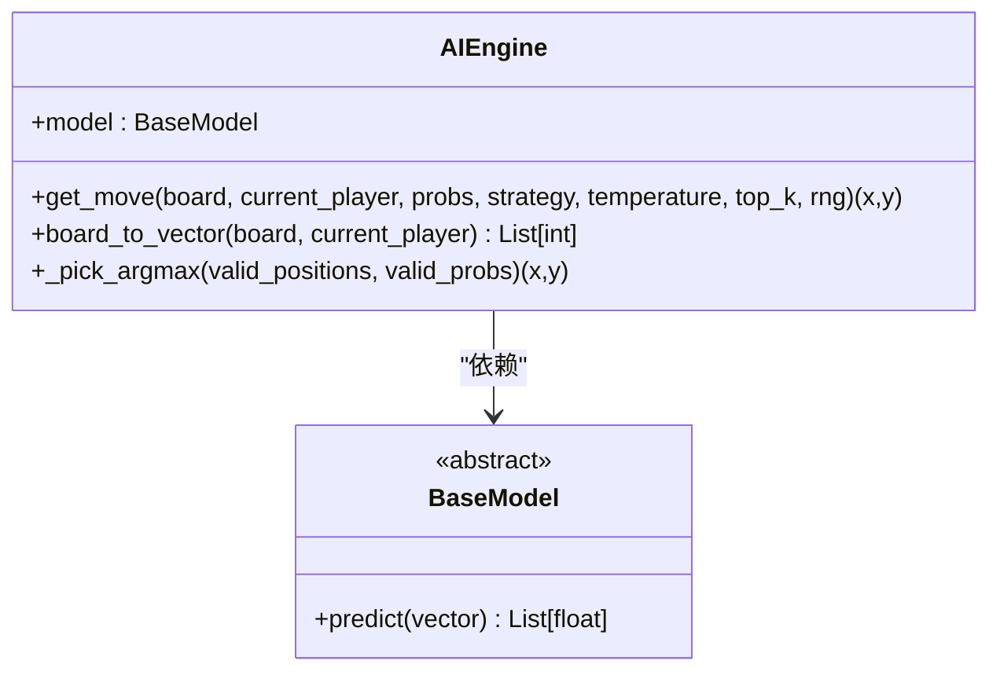

**图示来源**
- [ai/engine.py:44-194](file://ai/engine.py#L44-L194)

**章节来源**
- [ai/engine.py:44-194](file://ai/engine.py#L44-L194)

### 训练器（BaseTrainer）
训练器提供统一的训练接口与流程，支持单轮次、批量与mini-batch训练，自动检测GPU并使用AdamW优化器与L1Loss，支持StepLR与ReduceLROnPlateau学习率调度，具备中断保存与损失曲线生成能力。

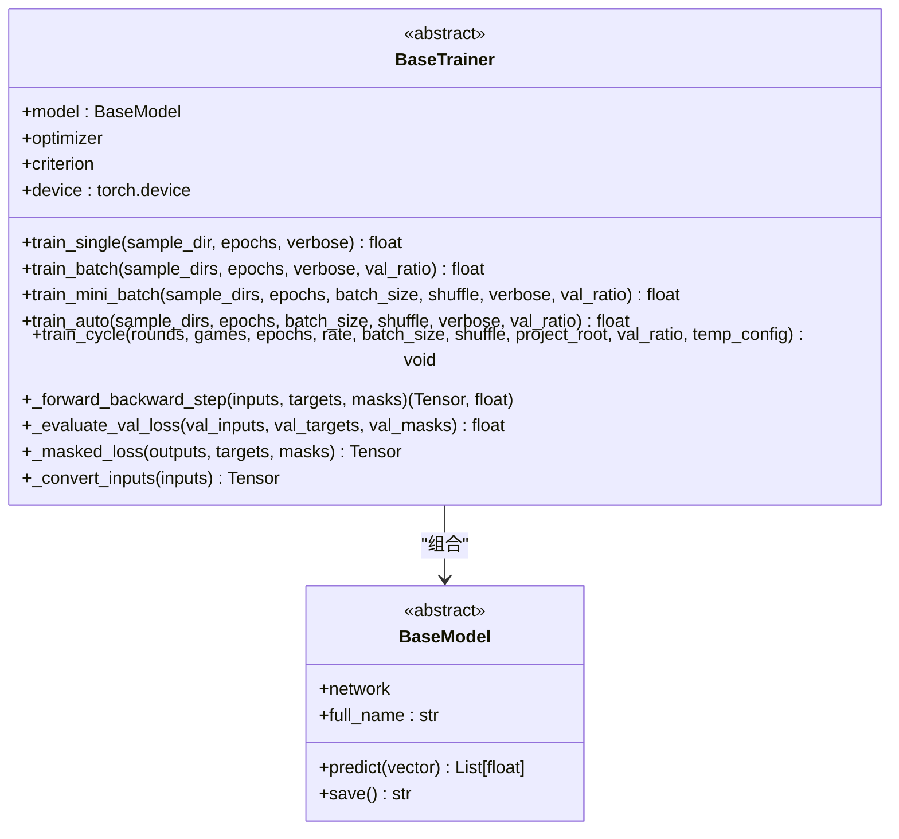

**图示来源**
- [ai/base_trainer.py:32-699](file://ai/base_trainer.py#L32-L699)

**章节来源**
- [ai/base_trainer.py:32-699](file://ai/base_trainer.py#L32-L699)

### 游戏管理器（AIGameManager）
管理人机对战与AI内战流程，协调控制器与引擎，支持温度采样配置与跨局进度回调，提供统一的数据记录接口。

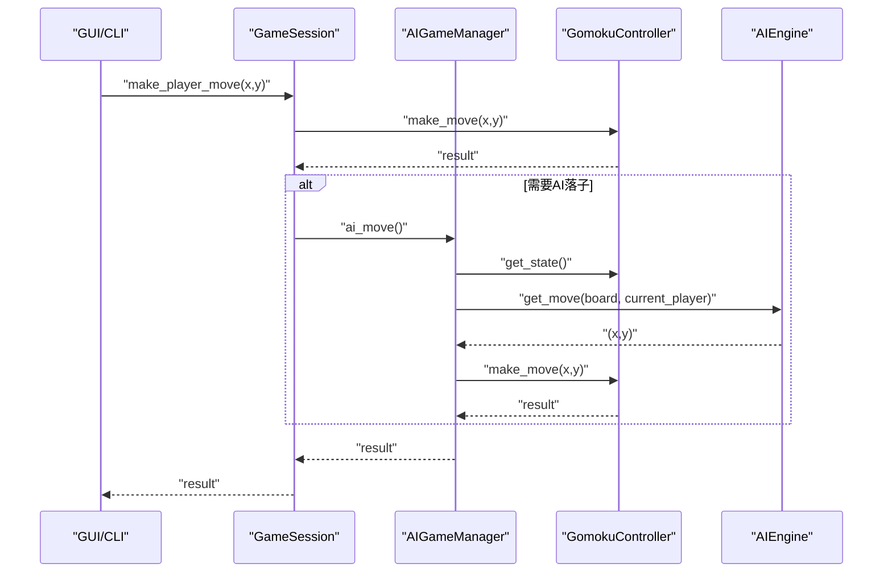

**图示来源**
- [ai/game_manager.py:60-122](file://ai/game_manager.py#L60-L122)
- [app/session.py:63-103](file://app/session.py#L63-L103)
- [game/controller.py:65-98](file://game/controller.py#L65-L98)

**章节来源**
- [ai/game_manager.py:16-339](file://ai/game_manager.py#L16-L339)
- [app/session.py:12-179](file://app/session.py#L12-L179)
- [game/controller.py:65-194](file://game/controller.py#L65-L194)

### 数据记录器（DataRecorder）
按轮次与对局组织AI对战数据，记录每步输入、输出与落子位置，并在游戏结束时保存完整记录文件。

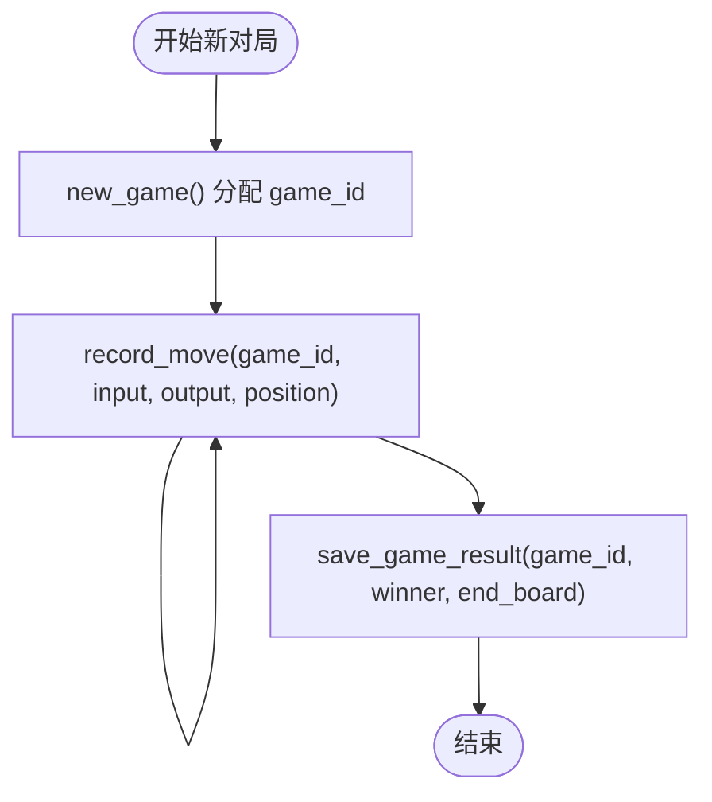

**图示来源**
- [ai/data_recorder.py:66-145](file://ai/data_recorder.py#L66-L145)

**章节来源**
- [ai/data_recorder.py:17-145](file://ai/data_recorder.py#L17-L145)

### 评价器（Evaluator）
从AI对战记录生成训练样本，采用双向棋型检测与五连追溯奖励融合，通过Softmax生成概率分布，并支持多进程并行评价。

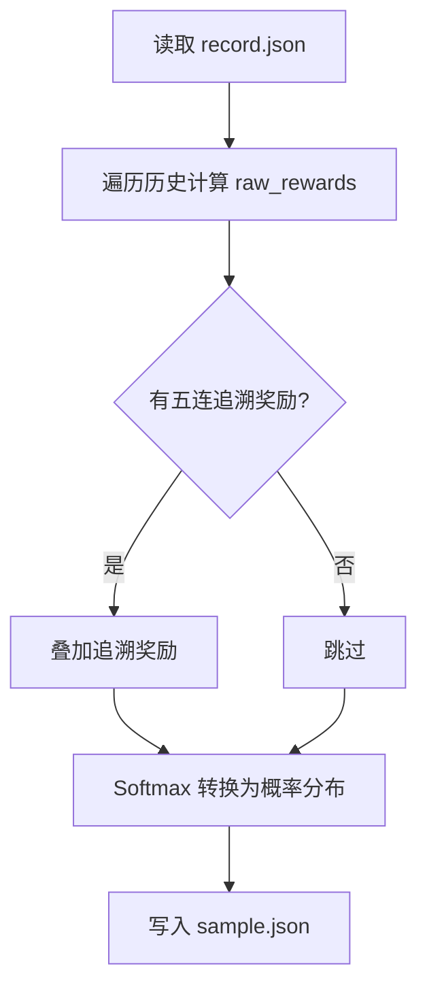

**图示来源**
- [ai/evaluator.py:132-210](file://ai/evaluator.py#L132-L210)

**章节来源**
- [ai/evaluator.py:51-350](file://ai/evaluator.py#L51-L350)

### 应用会话（GameSession）
封装游戏会话流程，区分PvP与PvE模式，协调控制器与AI管理器，向GUI提供统一落子接口与AI调度标志。

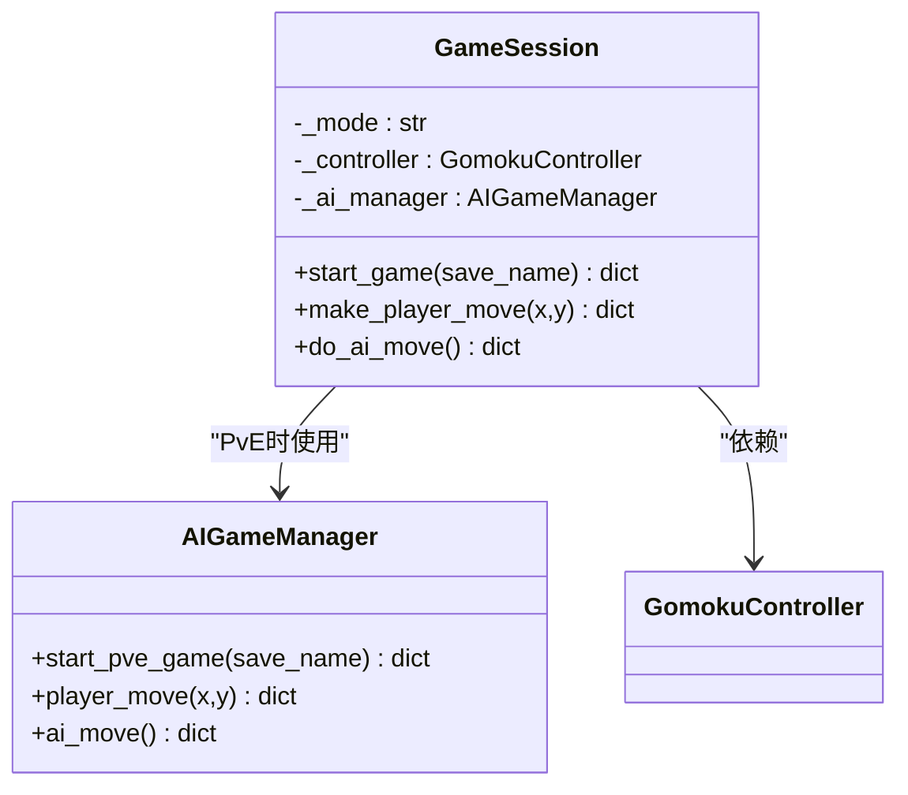

**图示来源**
- [app/session.py:12-179](file://app/session.py#L12-L179)
- [ai/game_manager.py:16-122](file://ai/game_manager.py#L16-L122)

**章节来源**
- [app/session.py:12-179](file://app/session.py#L12-L179)
- [ai/game_manager.py:16-122](file://ai/game_manager.py#L16-L122)

### GUI辅助（GUIHelper）
将界面与业务逻辑解耦，提供显示状态获取、玩家落子处理与AI落子处理，统一返回结构便于界面更新。

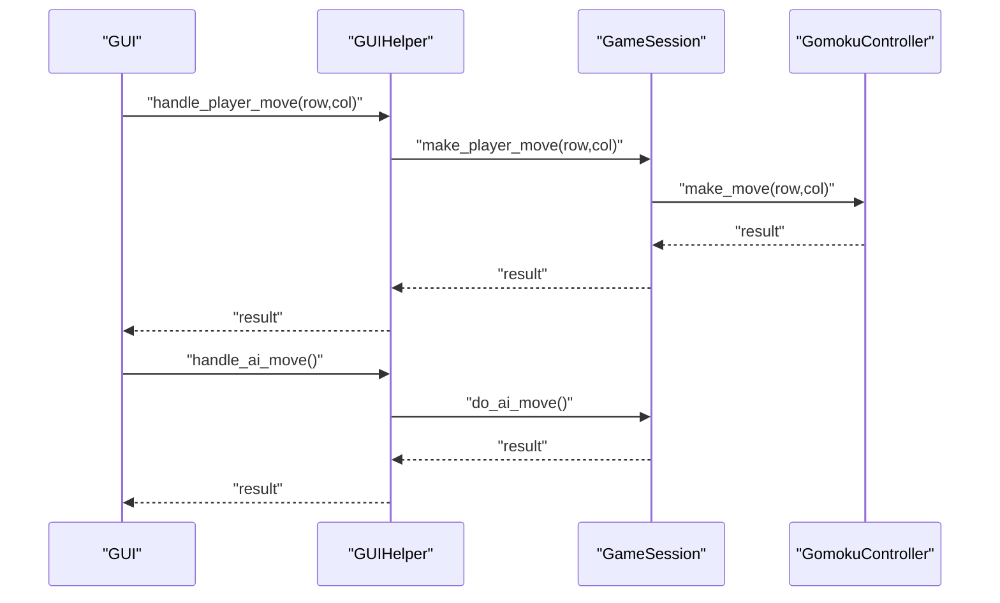

**图示来源**
- [app/gui_helper.py:53-106](file://app/gui_helper.py#L53-L106)
- [app/session.py:63-179](file://app/session.py#L63-L179)

**章节来源**
- [app/gui_helper.py:12-199](file://app/gui_helper.py#L12-L199)
- [app/session.py:63-179](file://app/session.py#L63-L179)

### CLI入口（cli/main.py）
提供命令行交互，支持新建/落子/查看/帮助等命令，打印棋盘与状态，便于快速验证游戏逻辑。

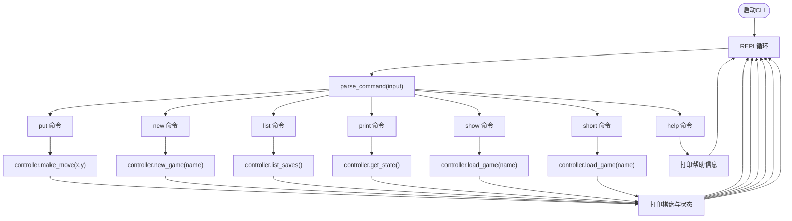

**图示来源**
- [cli/main.py:45-224](file://cli/main.py#L45-L224)

**章节来源**
- [cli/main.py:19-258](file://cli/main.py#L19-L258)

## 依赖分析
- 模块内聚与耦合
  - game/controller.py 仅依赖 game/save 与 game/game，保持纯业务逻辑。
  - ai/engine.py 依赖 ai/base_model 与 ai/move_sampler，形成清晰的AI层边界。
  - app/session.py 依赖 game 与 ai，作为薄代理层，避免UI耦合。
  - gui/main.py 依赖 app 与 gui/components，通过 GUIHelper 解耦业务。
- 外部依赖
  - torch、tkinter、json、concurrent.futures 等标准库与第三方库。
- 循环依赖规避
  - 引擎与采样器通过本地导入避免循环依赖；GUI与AI通过会话与辅助解耦。

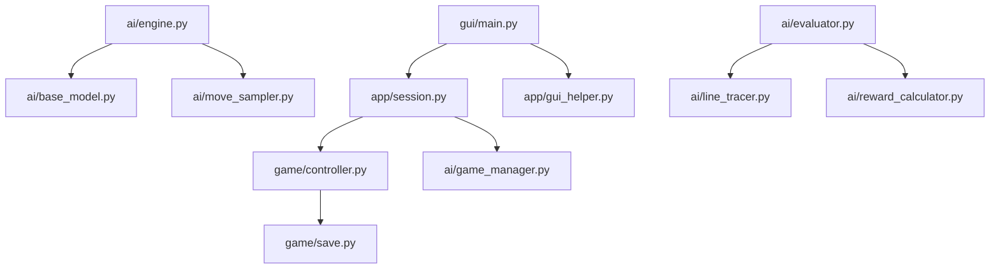

**图示来源**
- [game/controller.py:6-8](file://game/controller.py#L6-L8)
- [ai/engine.py:9-13](file://ai/engine.py#L9-L13)
- [app/session.py:7-8](file://app/session.py#L7-L8)
- [gui/main.py:18-28](file://gui/main.py#L18-L28)
- [ai/evaluator.py:20-23](file://ai/evaluator.py#L20-L23)

**章节来源**
- [game/controller.py:6-8](file://game/controller.py#L6-L8)
- [ai/engine.py:9-13](file://ai/engine.py#L9-L13)
- [app/session.py:7-8](file://app/session.py#L7-L8)
- [gui/main.py:18-28](file://gui/main.py#L18-L28)
- [ai/evaluator.py:20-23](file://ai/evaluator.py#L20-L23)

## 性能考虑
- 训练性能
  - 自动检测GPU并使用AdamW优化器与L1Loss，支持StepLR与ReduceLROnPlateau。
  - mini-batch训练提升收敛速度，支持密集日志与验证集监控。
  - 中断保护：键盘中断时保存模型与图表，保障训练进度。
- 推理性能
  - AIEngine支持传入预计算的概率向量，避免重复模型调用。
  - argmax策略随机破并列，避免自对弈路径退化。
- 评价性能
  - Evaluator支持多进程并行，遇到BrokenProcessPool自动回退串行。
  - 记录文件采用紧凑JSON格式，减少磁盘占用。
- GUI性能
  - GUIHelper集中业务逻辑，减少界面层负担；DisplayUpdater按需刷新。

[本节为通用性能讨论，不直接分析具体文件，故无章节来源]

## 故障排查指南
- 模型加载失败
  - 现象：PvE模式下创建AI引擎或会话抛出模型加载错误。
  - 处理：捕获并转换为 ModelLoadError，GUI层弹窗提示并回退。
  - 参考：[app/session.py:44-51](file://app/session.py#L44-L51)、[app/exceptions.py](file://app/exceptions.py)
- 棋盘已满
  - 现象：AI引擎在合法位置为空时抛出异常。
  - 处理：检查引擎调用参数与棋盘状态，确保有空位。
  - 参考：[ai/engine.py:124-126](file://ai/engine.py#L124-L126)
- 训练中断
  - 现象：Ctrl+C中断训练，训练器保存当前进度。
  - 处理：确认保存路径与日志，继续或恢复训练。
  - 参考：[ai/base_trainer.py:314-322](file://ai/base_trainer.py#L314-L322)
- 进程池崩溃
  - 现象：多进程评价时Worker进程被杀。
  - 处理：自动回退串行模式，检查内存与文件权限。
  - 参考：[ai/evaluator.py:336-347](file://ai/evaluator.py#L336-L347)
- 存档冲突
  - 现象：新建游戏时存档名已存在。
  - 处理：使用默认命名或更换名称。
  - 参考：[game/controller.py:42-47](file://game/controller.py#L42-L47)

**章节来源**
- [app/session.py:44-51](file://app/session.py#L44-L51)
- [ai/engine.py:124-126](file://ai/engine.py#L124-L126)
- [ai/base_trainer.py:314-322](file://ai/base_trainer.py#L314-L322)
- [ai/evaluator.py:336-347](file://ai/evaluator.py#L336-L347)
- [game/controller.py:42-47](file://game/controller.py#L42-L47)

## 结论
本项目通过清晰的分层与模块化设计，实现了从GUI到AI的完整闭环：表现层专注交互，应用层解耦业务，游戏层聚焦规则，AI层独立训练与推理。开发者可基于现有接口与抽象快速扩展模型、优化训练流程与增强GUI体验。

[本节为总结性内容，不直接分析具体文件，故无章节来源]

## 附录

### AI模型开发指南
- 模型接口规范
  - 继承 BaseModel，实现 predict(vector) 返回225维概率分布。
  - 提供 full_name 属性，用于命名与保存。
  - 参考：[ai/base_trainer.py:145-170](file://ai/base_trainer.py#L145-L170)
- 新模型实现步骤
  - 定义模型类并实现 predict。
  - 在 ai/registry 中注册模型名称与类映射。
  - 使用 AIEngine.create_engine(ai_name) 创建引擎实例。
  - 参考：[ai/engine.py:18-42](file://ai/engine.py#L18-L42)
- 训练器开发方法
  - 继承 BaseTrainer，实现 _create_model 与 model_name。
  - 可覆盖 _convert_inputs 适配不同输入格式（如CNN的4D张量）。
  - 使用 train_auto/train_batch/train_mini_batch 选择训练方式。
  - 参考：[ai/base_trainer.py:145-170](file://ai/base_trainer.py#L145-L170)

**章节来源**
- [ai/base_trainer.py:145-170](file://ai/base_trainer.py#L145-L170)
- [ai/engine.py:18-42](file://ai/engine.py#L18-L42)

### GUI开发最佳实践
- 组件架构
  - 使用组件化布局（棋盘、信息面板、按钮），通过 GameDisplayUpdater 统一渲染。
  - GUIHelper 将业务逻辑与界面分离，便于测试与维护。
  - 参考：[gui/main.py:105-223](file://gui/main.py#L105-L223)、[gui/display_updater.py:13-82](file://gui/display_updater.py#L13-L82)
- 事件处理机制
  - 棋盘点击 -> GUIHelper.handle_player_move -> GameSession -> Controller.make_move。
  - AI落子通过 after 延迟调度，避免阻塞UI线程。
  - 参考：[gui/main.py:224-268](file://gui/main.py#L224-L268)、[app/gui_helper.py:53-106](file://app/gui_helper.py#L53-L106)
- 主题系统与扩展
  - 通过 constants 定义配色与字体，支持多主题扩展。
  - 新增组件时遵循单一职责，尽量复用现有组件与样式。
  - 参考：[gui/main.py:34-40](file://gui/main.py#L34-L40)、[gui/components/constants.py](file://gui/components/constants.py)

**章节来源**
- [gui/main.py:105-223](file://gui/main.py#L105-L223)
- [gui/display_updater.py:13-82](file://gui/display_updater.py#L13-L82)
- [app/gui_helper.py:53-106](file://app/gui_helper.py#L53-L106)

### 测试框架使用
- pytest配置与运行
  - tests目录按模块划分：unit、primary、integration、edge，便于分层测试。
  - 使用 conftest.py 统一fixture，如数据库/临时目录清理。
  - 参考：[tests/conftest.py](file://tests/conftest.py)、[tests/run_tests.py](file://tests/run_tests.py)
- 单元测试编写
  - 针对核心函数与类方法编写最小化、可复现的测试用例。
  - 使用mock与依赖注入（如LossLogger）隔离外部副作用。
  - 参考：[tests/unit/](file://tests/unit/)、[ai/base_trainer.py:104-113](file://ai/base_trainer.py#L104-L113)
- 集成测试策略
  - 覆盖端到端流程：GUI -> Session -> Controller -> AI -> Recorder/Evaluator。
  - 使用真实数据与最小化环境，关注错误路径与边界条件。
  - 参考：[tests/integration/](file://tests/integration/)
- 覆盖率分析
  - 项目提供coverage_report目录，包含HTML报告与索引页面。
  - 结合pytest-cov与CI流程，持续跟踪关键路径覆盖率。
  - 参考：[coverage_report/index.html](file://coverage_report/index.html)

**章节来源**
- [tests/conftest.py](file://tests/conftest.py)
- [tests/run_tests.py](file://tests/run_tests.py)
- [tests/unit/](file://tests/unit/)
- [tests/integration/](file://tests/integration/)
- [ai/base_trainer.py:104-113](file://ai/base_trainer.py#L104-L113)

### 代码贡献指南与编码规范
- 分支与提交
  - 功能开发在特性分支，提交信息清晰描述变更与动机。
  - 通过PR审查，确保测试通过与文档更新。
- 代码风格
  - 遵循Python PEP 8，模块与类命名清晰，注释完整。
  - 避免魔法数字与硬编码，使用常量与配置文件。
- 变更影响评估
  - 关注对 game、ai、app、gui 的影响面，必要时同步更新文档与测试。
- 性能与稳定性
  - 新增训练/推理逻辑需提供性能基准与回归测试。
  - 错误处理与日志记录完善，避免静默失败。

[本节为通用指导，不直接分析具体文件，故无章节来源]