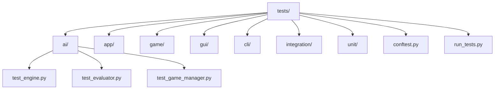
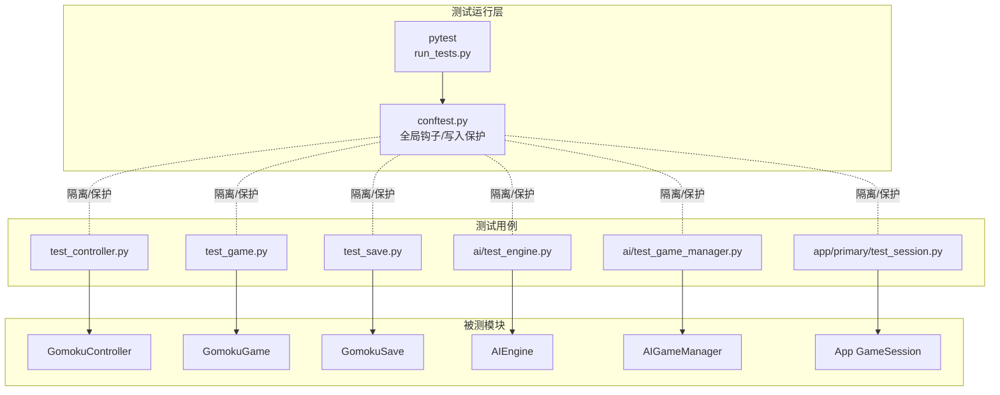
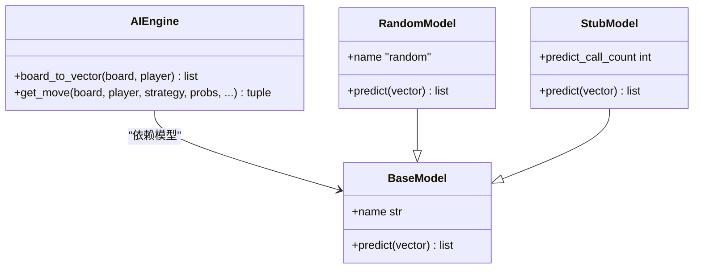
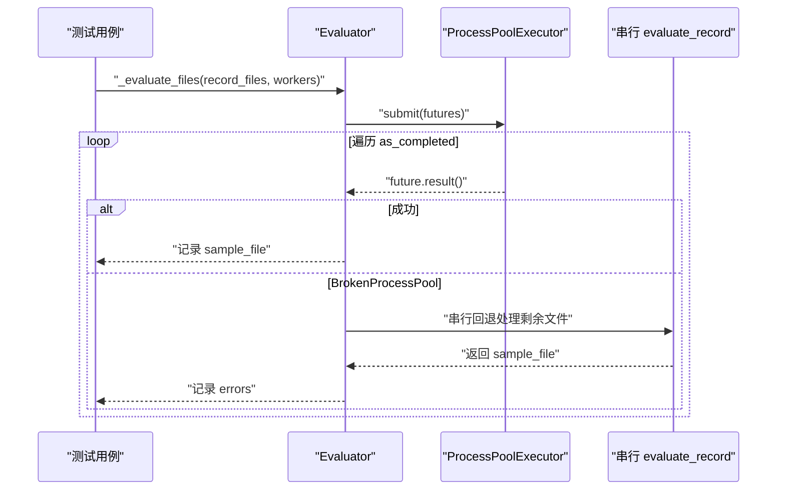
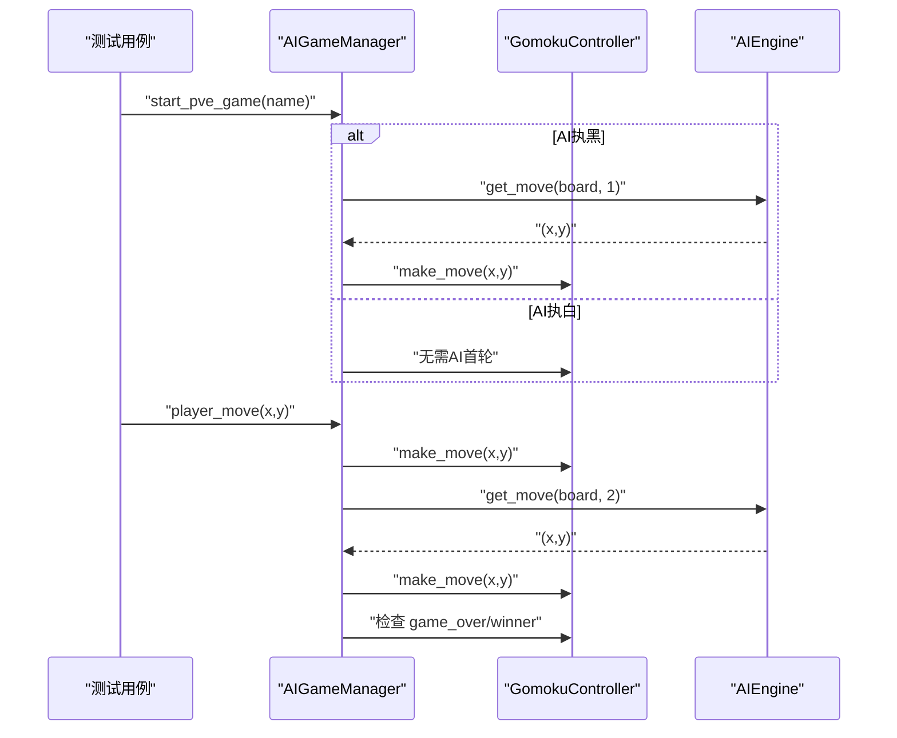
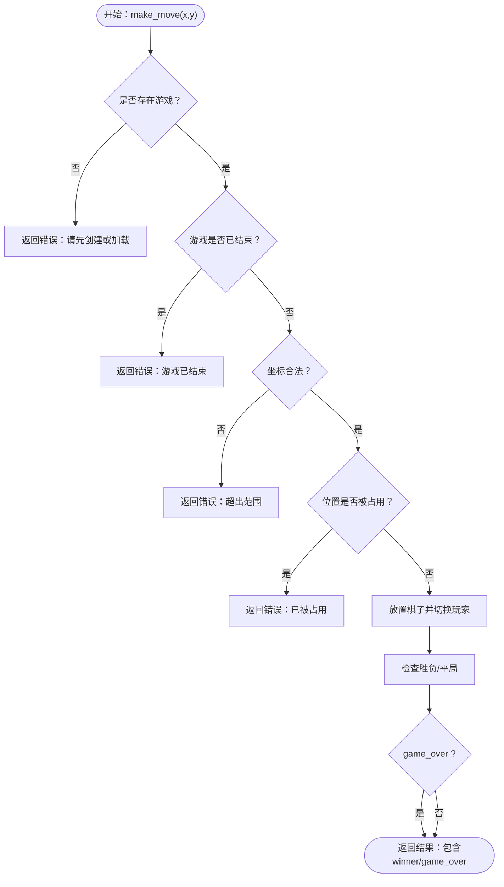
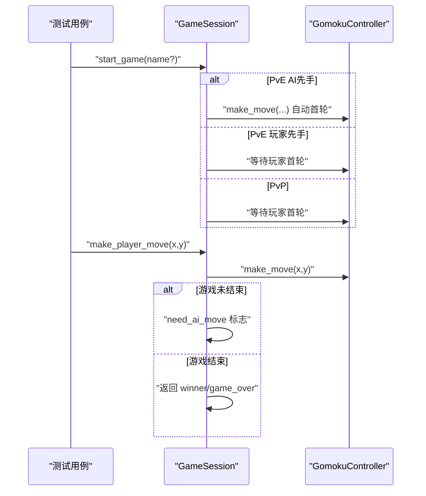
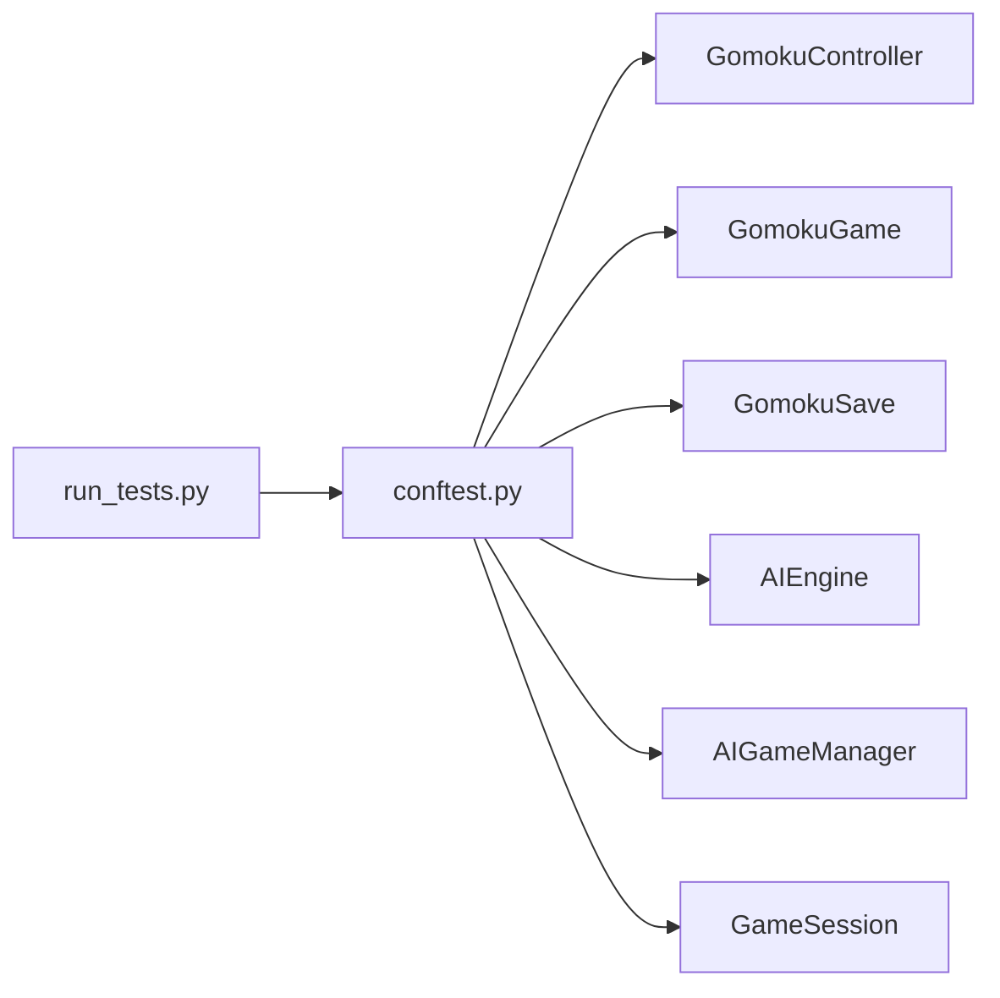

# 单元测试

<cite>
**本文引用的文件**
- [tests/conftest.py](file://tests/conftest.py)
- [tests/run_tests.py](file://tests/run_tests.py)
- [tests/test_controller.py](file://tests/test_controller.py)
- [tests/test_game.py](file://tests/test_game.py)
- [tests/test_save.py](file://tests/test_save.py)
- [tests/ai/test_engine.py](file://tests/ai/test_engine.py)
- [tests/ai/test_evaluator.py](file://tests/ai/test_evaluator.py)
- [tests/ai/test_game_manager.py](file://tests/ai/test_game_manager.py)
- [tests/app/primary/test_session.py](file://tests/app/primary/test_session.py)
</cite>

## 目录
1. [简介](#简介)
2. [项目结构](#项目结构)
3. [核心组件](#核心组件)
4. [架构总览](#架构总览)
5. [详细组件分析](#详细组件分析)
6. [依赖分析](#依赖分析)
7. [性能考虑](#性能考虑)
8. [故障排查指南](#故障排查指南)
9. [结论](#结论)
10. [附录](#附录)

## 简介
本文件面向五子棋AI项目的单元测试体系，系统阐述测试编写原则、最佳实践与实现细节，覆盖AI引擎、游戏控制器、GUI组件与应用会话等模块。文档提供测试用例组织结构、命名规范、断言方法使用建议，并结合仓库现有测试文件，给出AI决策算法、游戏规则验证、界面交互与数据持久化的测试思路与示例路径。同时，说明测试数据准备与管理（模拟对象、测试夹具、环境搭建）、测试覆盖率要求与分析方法。

## 项目结构
测试工程采用分层与按功能域划分的组织方式：
- tests/：顶层测试目录
  - ai/：AI相关测试（unit/primary/edge/integration）
  - app/：应用会话与异常处理测试
  - game/：游戏逻辑与存档测试
  - gui/：GUI组件测试
  - cli/：命令行工具测试
  - integration/：端到端集成测试
  - unit/：通用单元测试
  - conftest.py：pytest全局配置与写入保护钩子
  - run_tests.py：统一入口脚本，兼容直接运行pytest

**图表来源**
- [tests/conftest.py:1-119](file://tests/conftest.py#L1-L119)
- [tests/run_tests.py:1-60](file://tests/run_tests.py#L1-L60)

**章节来源**
- [tests/conftest.py:1-119](file://tests/conftest.py#L1-L119)
- [tests/run_tests.py:1-60](file://tests/run_tests.py#L1-L60)

## 核心组件
- 测试框架与运行
  - pytest：统一测试运行与收集
  - conftest.py：全局环境初始化、写入保护钩子、sys.path修正
  - run_tests.py：兼容入口，统一调用pytest，禁用输出捕获以规避Windows GUI兼容问题
- 测试夹具与环境
  - 临时目录隔离：控制器、存档、AI数据、训练数据均使用临时目录，避免跨测试污染
  - 写入保护：拦截对受保护目录的写入，防止测试污染生产数据
- 断言与校验
  - 结构化返回值断言：控制器、会话、引擎等接口返回字典，断言status/error字段与业务含义
  - 状态一致性断言：棋盘、历史、赢家、当前玩家等状态字段
  - 异常断言：越界、重复落子、游戏结束后再落子等异常路径
  - 模拟与桩：AI引擎使用StubModel控制概率分布，验证策略分支行为

**章节来源**
- [tests/conftest.py:16-118](file://tests/conftest.py#L16-L118)
- [tests/run_tests.py:19-55](file://tests/run_tests.py#L19-L55)
- [tests/test_controller.py:62-82](file://tests/test_controller.py#L62-L82)
- [tests/test_game.py:15-26](file://tests/test_game.py#L15-L26)
- [tests/ai/test_engine.py:22-50](file://tests/ai/test_engine.py#L22-L50)

## 架构总览
测试架构围绕“隔离环境 + 结构化断言 + 模拟桩”展开，确保各模块独立验证与可重复执行。

**图表来源**
- [tests/conftest.py:16-118](file://tests/conftest.py#L16-L118)
- [tests/run_tests.py:49-55](file://tests/run_tests.py#L49-L55)
- [tests/test_controller.py:12-14](file://tests/test_controller.py#L12-L14)
- [tests/test_game.py](file://tests/test_game.py#L9)
- [tests/test_save.py](file://tests/test_save.py#L14)
- [tests/ai/test_engine.py:16-19](file://tests/ai/test_engine.py#L16-L19)
- [tests/ai/test_game_manager.py:18-22](file://tests/ai/test_game_manager.py#L18-L22)
- [tests/app/primary/test_session.py:21-27](file://tests/app/primary/test_session.py#L21-L27)

## 详细组件分析

### AI引擎测试（AIEngine）
- 测试目标
  - 棋盘向量编码正确性（board_to_vector）
  - 落子策略：argmax、sampling、未知策略、预计算probs
  - 随机模型输出格式与概率和为1、空位均匀分布
  - create_engine工厂函数行为与回退策略变更
- 关键断言
  - 向量维度与当前玩家标记
  - 落子位置合法性与空位约束
  - 概率分布总和与空位概率一致性
  - 策略分支行为与异常路径
- 示例路径
  - [AIEngine.board_to_vector:60-88](file://tests/ai/test_engine.py#L60-L88)
  - [AIEngine.get_move 策略分支:315-420](file://tests/ai/test_engine.py#L315-L420)
  - [RandomModel 概率分布:146-253](file://tests/ai/test_engine.py#L146-L253)
  - [create_engine 工厂函数:258-295](file://tests/ai/test_engine.py#L258-L295)

**图表来源**
- [tests/ai/test_engine.py:16-50](file://tests/ai/test_engine.py#L16-L50)
- [tests/ai/test_engine.py:52-141](file://tests/ai/test_engine.py#L52-L141)
- [tests/ai/test_engine.py:255-295](file://tests/ai/test_engine.py#L255-L295)

**章节来源**
- [tests/ai/test_engine.py:52-527](file://tests/ai/test_engine.py#L52-L527)

### 评估器进程池崩溃回退测试（Evaluator）
- 测试目标
  - 进程池崩溃时回退到串行处理
  - 仅处理剩余未完成文件，避免重复处理已成功文件
  - 路径转换一致性（record ↔ sample）
- 关键断言
  - 回退后处理文件数量与错误计数
  - 已成功文件不出现在remaining_files中
  - 串行回退仅处理未提交/未完成的文件
- 示例路径
  - [进程池崩溃回退:77-133](file://tests/ai/test_evaluator.py#L77-L133)
  - [不重复处理已成功文件:134-192](file://tests/ai/test_evaluator.py#L134-L192)
  - [串行模式无回退:262-272](file://tests/ai/test_evaluator.py#L262-L272)

**图表来源**
- [tests/ai/test_evaluator.py:77-133](file://tests/ai/test_evaluator.py#L77-L133)
- [tests/ai/test_evaluator.py:134-192](file://tests/ai/test_evaluator.py#L134-L192)

**章节来源**
- [tests/ai/test_evaluator.py:56-276](file://tests/ai/test_evaluator.py#L56-L276)

### 游戏管理器测试（AIGameManager）
- 测试目标
  - 人机对战启动与轮次控制（AI执黑/白）
  - 玩家落子后AI自动落子与游戏结束判断
  - AI内战流程、存档名称唯一性、end_board维度一致性
- 关键断言
  - 历史步数与当前玩家切换
  - 游戏结束标志与赢家
  - 记录文件存在与路径结构
- 示例路径
  - [PvE启动与AI首轮:53-75](file://tests/ai/test_game_manager.py#L53-L75)
  - [玩家落子触发AI:76-97](file://tests/ai/test_game_manager.py#L76-L97)
  - [AI内战单局/多局:178-225](file://tests/ai/test_game_manager.py#L178-L225)
  - [end_board维度回归:301-343](file://tests/ai/test_game_manager.py#L301-L343)

**图表来源**
- [tests/ai/test_game_manager.py:53-151](file://tests/ai/test_game_manager.py#L53-L151)

**章节来源**
- [tests/ai/test_game_manager.py:25-405](file://tests/ai/test_game_manager.py#L25-L405)

### 游戏控制器测试（GomokuController）
- 测试目标
  - 新建/加载/列出存档、落子合法性、胜负判定、平局判定
  - 状态获取（完整/简化）、JSON序列化
- 关键断言
  - 错误信息包含“已被占用/超出范围/游戏已结束/请先创建或加载”
  - 胜负/平局标志与is_over/is_draw一致性
  - 状态字段完整性与short/full差异
- 示例路径
  - [新建/落子/胜负/平局:83-184](file://tests/test_controller.py#L83-L184)
  - [加载/列表/状态:185-319](file://tests/test_controller.py#L185-L319)

**图表来源**
- [tests/test_controller.py:95-243](file://tests/test_controller.py#L95-L243)

**章节来源**
- [tests/test_controller.py:59-319](file://tests/test_controller.py#L59-L319)

### 游戏逻辑测试（GomokuGame）
- 测试目标
  - 初始化、状态获取、落子合法性、胜负/平局检测
  - 深拷贝保护与状态隔离
- 关键断言
  - 棋盘维度、初始状态、历史长度
  - 异常信息与game_over路径
  - 平局检测（模7模式构造）
- 示例路径
  - [初始化/状态获取:15-42](file://tests/test_game.py#L15-L42)
  - [落子合法性/胜负:42-105](file://tests/test_game.py#L42-L105)
  - [平局检测:165-204](file://tests/test_game.py#L165-L204)
  - [状态隔离:219-245](file://tests/test_game.py#L219-L245)

**章节来源**
- [tests/test_game.py:12-245](file://tests/test_game.py#L12-L245)

### 存档管理测试（GomokuSave）
- 测试目标
  - 目录创建、文件保存/加载、列表排序、同名同日不覆盖
- 关键断言
  - 文件命名包含时间戳、JSON内容正确
  - 列表按日期降序、包含下划线名称解析
- 示例路径
  - [保存/加载/列表:52-227](file://tests/test_save.py#L52-L227)
  - [同名同日不覆盖:256-284](file://tests/test_save.py#L256-L284)
  - [含下划线名称:286-303](file://tests/test_save.py#L286-L303)

**章节来源**
- [tests/test_save.py:31-303](file://tests/test_save.py#L31-L303)

### 应用会话测试（GameSession）
- 测试目标
  - 模式属性、AI玩家属性、边缘情况（重复创建、pvp调用AI、无游戏调用AI）
  - PvP/PvE主流程：落子、AI触发、游戏结束与赢家
  - start_game自动命名与AI先手/后手
- 关键断言
  - need_ai_move标志与模式一致性
  - 返回结构包含status/game_over/winner
  - 异常信息与工厂函数行为
- 示例路径
  - [create_engine工厂函数:46-61](file://tests/app/primary/test_session.py#L46-L61)
  - [PvP主流程:142-173](file://tests/app/primary/test_session.py#L142-L173)
  - [PvE主流程:174-221](file://tests/app/primary/test_session.py#L174-L221)
  - [游戏结束场景:222-249](file://tests/app/primary/test_session.py#L222-L249)
  - [start_game行为:251-304](file://tests/app/primary/test_session.py#L251-L304)

**图表来源**
- [tests/app/primary/test_session.py:251-304](file://tests/app/primary/test_session.py#L251-L304)

**章节来源**
- [tests/app/primary/test_session.py:46-304](file://tests/app/primary/test_session.py#L46-L304)

## 依赖分析
- 测试耦合与内聚
  - 控制器/游戏/存档测试与具体实现强耦合，但通过临时目录与mock降低耦合度
  - AI引擎测试通过StubModel与RandomModel实现高内聚、低耦合
  - 评估器测试通过mock进程池与future，隔离外部资源
- 外部依赖与集成点
  - conftest.py安装写入保护钩子，拦截对受保护目录的写入
  - run_tests.py统一调用pytest，禁用输出捕获以兼容GUI测试
- 循环依赖
  - 未发现直接循环依赖；模块间通过接口与工厂函数解耦

**图表来源**
- [tests/conftest.py:16-118](file://tests/conftest.py#L16-L118)
- [tests/run_tests.py:49-55](file://tests/run_tests.py#L49-L55)

**章节来源**
- [tests/conftest.py:16-118](file://tests/conftest.py#L16-L118)
- [tests/run_tests.py:49-55](file://tests/run_tests.py#L49-L55)

## 性能考虑
- 测试并发与稳定性
  - 评估器测试通过mock进程池与future，避免真实进程开销与不稳定因素
  - AI引擎测试通过固定随机种子与预设概率向量，保证可重复性
- I/O与临时目录
  - 所有持久化测试使用临时目录，避免磁盘I/O对测试性能的影响
- GUI测试兼容
  - run_tests.py默认禁用输出捕获，规避Windows上Tcl/Tk初始化失败问题

[本节为通用指导，不直接分析具体文件]

## 故障排查指南
- 写入保护错误
  - 现象：测试试图写入受保护目录（如ai/models、game/save等）
  - 处理：改用临时目录或pytest提供的tmp_path fixture；避免直接写入项目目录
  - 参考：[写入保护钩子:92-106](file://tests/conftest.py#L92-L106)
- GUI测试失败（间歇性）
  - 现象：Windows上GUI测试不稳定
  - 处理：使用run_tests.py运行，其默认禁用输出捕获
  - 参考：[禁用输出捕获:52-54](file://tests/run_tests.py#L52-L54)
- 评估器进程池崩溃
  - 现象：BrokenProcessPool导致并行失败
  - 处理：验证回退逻辑仅处理剩余文件，不重复处理已成功文件
  - 参考：[回退逻辑测试:77-192](file://tests/ai/test_evaluator.py#L77-L192)
- 存档同名同日覆盖
  - 现象：同一天同名存档覆盖
  - 处理：确认文件名包含时间戳，避免覆盖
  - 参考：[同名同日不覆盖:256-284](file://tests/test_save.py#L256-L284)

**章节来源**
- [tests/conftest.py:92-106](file://tests/conftest.py#L92-L106)
- [tests/run_tests.py:52-54](file://tests/run_tests.py#L52-L54)
- [tests/ai/test_evaluator.py:77-192](file://tests/ai/test_evaluator.py#L77-L192)
- [tests/test_save.py:256-284](file://tests/test_save.py#L256-L284)

## 结论
本测试体系通过隔离环境、结构化断言与模拟桩，实现了对AI引擎、游戏规则、应用会话与数据持久化的全面验证。配合写入保护与临时目录策略，确保测试稳定性与可重复性。建议持续补充边界条件与异常路径测试，进一步提升覆盖率与鲁棒性。

[本节为总结，不直接分析具体文件]

## 附录

### 测试用例组织与命名规范
- 目录结构
  - tests/ai/unit、tests/ai/primary、tests/ai/edge：按粒度与风险分级
  - tests/app/primary、tests/app/edge：按业务主流程与边缘场景
- 命名规范
  - 测试类：TestXxx
  - 测试方法：test_xxx_描述（如test_make_move_valid、test_pve_player_move_triggers_ai_flag）
  - 边界与异常：test_*_edge 或 test_*_invalid
- 断言方法
  - 结构化返回值：assert result["status"]=="success"/"error"
  - 字段存在性：assert "field" in result
  - 异常断言：pytest.raises(ExceptionType, match="...")

[本节为通用规范，不直接分析具体文件]

### 测试覆盖率与分析
- 覆盖率要求
  - 关键代码路径：AI决策策略（argmax/sampling）、游戏规则（胜负/平局）、存档流程（保存/加载/列表）
  - 边界条件：满盘、重复落子、越界、游戏结束后落子、进程池崩溃回退
- 分析方法
  - 使用pytest-cov生成HTML报告，定位未覆盖分支
  - 针对AI引擎策略分支与评估器回退逻辑补充用例
  - 对控制器与会话的错误路径进行穷举断言

[本节为通用指导，不直接分析具体文件]