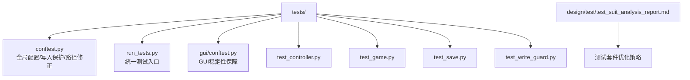
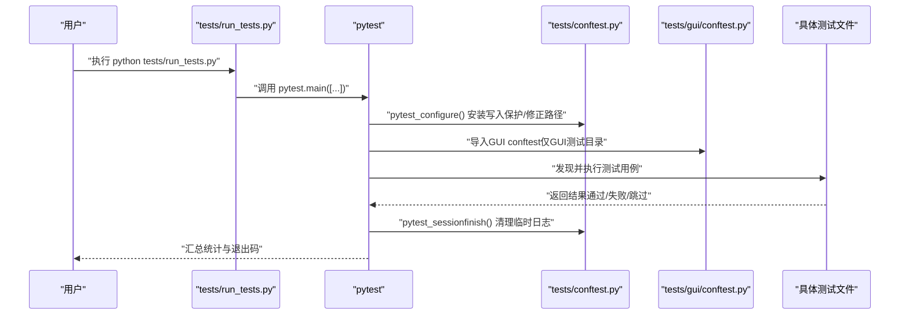
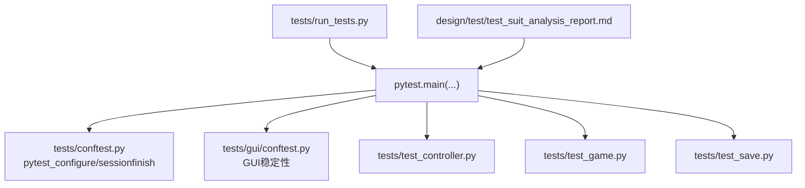

# 测试执行

<cite>
**本文引用的文件**
- [tests/conftest.py](file://tests/conftest.py)
- [tests/run_tests.py](file://tests/run_tests.py)
- [tests/gui/conftest.py](file://tests/gui/conftest.py)
- [tests/test_controller.py](file://tests/test_controller.py)
- [tests/test_game.py](file://tests/test_game.py)
- [tests/test_save.py](file://tests/test_save.py)
- [tests/test_write_guard.py](file://tests/test_write_guard.py)
- [design/test/test_suit_analysis_report.md](file://design/test/test_suit_analysis_report.md)
</cite>

## 目录
1. [简介](#简介)
2. [项目结构](#项目结构)
3. [核心组件](#核心组件)
4. [架构总览](#架构总览)
5. [详细组件分析](#详细组件分析)
6. [依赖分析](#依赖分析)
7. [性能考量](#性能考量)
8. [故障排查指南](#故障排查指南)
9. [结论](#结论)
10. [附录](#附录)

## 简介
本文件面向五子棋AI项目的测试执行，系统阐述测试发现机制、排序与执行策略；详解测试运行器的配置与使用（含pytest命令行参数、过滤选项与并行执行建议）；给出测试分组与优先级策略、执行时间优化方法；说明测试结果统计、错误解读与性能指标收集；介绍持续集成环境下的测试执行与报告集成；最后提供故障排查与监控优化指南。

## 项目结构
测试相关的核心文件与目录如下：
- tests/conftest.py：全局pytest配置，负责环境初始化、写入保护hook、sys.path修正、损失日志目录隔离等。
- tests/run_tests.py：统一测试入口脚本，封装pytest调用，默认禁用输出捕获以规避Windows GUI兼容问题。
- tests/gui/conftest.py：GUI测试专用的conftest，解决Windows+Python 3.13下Tcl解释器不稳定导致的非确定性失败。
- tests/test_controller.py、tests/test_game.py、tests/test_save.py：核心业务逻辑测试样例，展示测试组织方式与断言风格。
- tests/test_write_guard.py：对tests/conftest.py中写入保护hook进行回归测试，验证受保护目录拦截与例外放行。
- design/test/test_suit_analysis_report.md：测试套件分析与优化策略文档，包含标记策略、合并策略、参数化策略等。

图表来源
- [tests/conftest.py:1-119](file://tests/conftest.py#L1-L119)
- [tests/run_tests.py:1-60](file://tests/run_tests.py#L1-L60)
- [tests/gui/conftest.py:1-53](file://tests/gui/conftest.py#L1-L53)
- [tests/test_controller.py:1-200](file://tests/test_controller.py#L1-L200)
- [tests/test_game.py:1-200](file://tests/test_game.py#L1-L200)
- [tests/test_save.py:1-200](file://tests/test_save.py#L1-L200)
- [tests/test_write_guard.py:1-177](file://tests/test_write_guard.py#L1-L177)
- [design/test/test_suit_analysis_report.md:127-183](file://design/test/test_suit_analysis_report.md#L127-L183)

章节来源
- [tests/conftest.py:1-119](file://tests/conftest.py#L1-L119)
- [tests/run_tests.py:1-60](file://tests/run_tests.py#L1-L60)
- [tests/gui/conftest.py:1-53](file://tests/gui/conftest.py#L1-L53)
- [tests/test_controller.py:1-200](file://tests/test_controller.py#L1-L200)
- [tests/test_game.py:1-200](file://tests/test_game.py#L1-L200)
- [tests/test_save.py:1-200](file://tests/test_save.py#L1-L200)
- [tests/test_write_guard.py:1-177](file://tests/test_write_guard.py#L1-L177)
- [design/test/test_suit_analysis_report.md:127-183](file://design/test/test_suit_analysis_report.md#L127-L183)

## 核心组件
- 测试运行器与入口
  - tests/run_tests.py：统一入口，调用pytest，禁用输出捕获以避免Windows GUI兼容问题；同时兼容性地设置损失日志目录与sys.path修正。
  - 命令行等价：python -m pytest tests/ -v -s，用户可追加其他参数覆盖默认行为。
- 全局配置与隔离
  - tests/conftest.py：在会话开始前设置独立的损失日志目录，避免污染真实数据；安装写入保护hook，拦截对受保护目录的写入；修正sys.path确保项目根可导入；会话结束清理临时日志目录。
- GUI稳定性保障
  - tests/gui/conftest.py：在GUI测试目录内，模块导入时即创建唯一真实Tk根窗口，将tk.Tk()替换为返回Toplevel的工厂，避免Windows+Python 3.13下Tcl解释器退化导致的非确定性失败。
- 写入保护回归测试
  - tests/test_write_guard.py：验证不同写入模式、路径形式、子目录、相对路径等场景均被正确拦截，同时确认读取、临时目录与tmp_path等例外场景不受影响。

章节来源
- [tests/run_tests.py:1-60](file://tests/run_tests.py#L1-L60)
- [tests/conftest.py:1-119](file://tests/conftest.py#L1-L119)
- [tests/gui/conftest.py:1-53](file://tests/gui/conftest.py#L1-L53)
- [tests/test_write_guard.py:1-177](file://tests/test_write_guard.py#L1-L177)

## 架构总览
下图展示了测试执行的关键流程：从入口脚本到pytest会话、再到全局配置与各测试文件的协作关系。

图表来源
- [tests/run_tests.py:49-55](file://tests/run_tests.py#L49-L55)
- [tests/conftest.py:109-119](file://tests/conftest.py#L109-L119)
- [tests/gui/conftest.py:23-53](file://tests/gui/conftest.py#L23-L53)

## 详细组件分析

### 测试发现机制与排序
- 发现范围
  - tests/目录下的所有以test_开头的文件、类、方法均会被pytest发现与执行。
- 排序策略
  - 默认按文件系统顺序与定义顺序执行；可通过标记与选择器控制执行顺序与集合。
- 标记与过滤
  - 在全局配置中注册“slow”标记，用于标识耗时较长的测试；可在CI中使用-m "not slow"排除慢测试，缩短构建时间。
- 参数化与分组
  - 文档建议采用参数化替代重复测试，合并碎片文件，减少fixture开销与维护成本。

章节来源
- [design/test/test_suit_analysis_report.md:127-183](file://design/test/test_suit_analysis_report.md#L127-L183)

### 测试运行器配置与使用
- 入口脚本
  - tests/run_tests.py：默认禁用输出捕获（-s），以规避Windows上Tcl/Tk初始化失败引发的GUI测试间歇性失败；用户可通过追加参数覆盖默认行为。
  - 该脚本还兼容性地设置损失日志目录与sys.path修正，确保与tests/conftest.py的职责互补。
- 命令行参数示例
  - 基础：python -m pytest tests/ -v -s
  - 排除慢测试：python -m pytest tests/ -m "not slow"
  - 并行执行（建议）：python -m pytest tests/ -n auto -x（需安装pytest-xdist插件）
  - 仅运行某类测试：python -m pytest tests/ -k "test_game" 或 -k "not gui"
  - 输出详细统计：python -m pytest tests/ --tb=short --lf --ff
- 与GUI测试相关的注意事项
  - tests/gui/conftest.py已在GUI测试目录内全局替换tk.Tk()，无需额外参数；若遇到GUI问题，优先检查该目录内的配置。

章节来源
- [tests/run_tests.py:9-11](file://tests/run_tests.py#L9-L11)
- [tests/run_tests.py:54](file://tests/run_tests.py#L54)
- [tests/gui/conftest.py:1-17](file://tests/gui/conftest.py#L1-L17)

### 测试执行策略与最佳实践
- 分组策略
  - 按功能域分层：tests/ai、tests/app、tests/cli、tests/gui、tests/integration、tests/unit 等，便于针对性执行与并行化。
  - 使用pytest标记区分优先级：如“slow”、“integration”、“gui”等，CI中可按需剔除或单独运行。
- 优先级设置
  - 建议将高频、关键路径测试置于primary目录，慢测试置于edge或integration，便于快速反馈。
- 执行时间优化
  - 使用参数化减少重复用例；合并碎片测试文件；对慢测试使用mock或减小规模；在CI中排除“slow”标记。
- 资源隔离
  - tests/conftest.py为损失日志创建独立目录并在会话结束后清理；GUI测试通过共享root避免多次初始化Tcl。

章节来源
- [design/test/test_suit_analysis_report.md:127-183](file://design/test/test_suit_analysis_report.md#L127-L183)
- [tests/conftest.py:16-26](file://tests/conftest.py#L16-L26)
- [tests/gui/conftest.py:23-53](file://tests/gui/conftest.py#L23-L53)

### 测试结果分析与报告生成
- 成功/失败统计
  - pytest默认输出通过/失败/跳过的计数；结合--tb=short查看最短回溯；--lf（上次失败优先）与--ff（失败后继续）有助于快速定位。
- 错误信息解读
  - 写入保护拦截：当尝试写入受保护目录时，会抛出包含明确提示的AssertionError；应改为使用临时目录或tmp_path fixture。
  - GUI相关错误：若出现Tcl初始化问题，检查GUI conftest是否生效，或在入口脚本中确认未意外覆盖捕获设置。
- 性能指标收集
  - 可结合pytest-benchmark或pytest-timeout插件记录耗时与超时；配合CI缓存与并行执行进一步优化。
- 报告生成
  - 建议在CI中生成Junit XML与HTML报告，便于与平台集成；pytest-html或junitxml可作为输出格式。

章节来源
- [tests/test_write_guard.py:32-97](file://tests/test_write_guard.py#L32-L97)
- [tests/run_tests.py:9-11](file://tests/run_tests.py#L9-L11)

### 持续集成环境下的测试执行
- 流水线配置要点
  - 安装pytest-xdist以启用并行执行；在CI中设置缓存（如pip缓存、临时目录缓存）；使用矩阵任务分别运行不同类别测试。
  - 对GUI测试单独分配任务，避免与其他测试争抢显示资源。
- 自动化触发
  - PR与主干推送触发全量测试；对特定目录变更仅触发相关测试子集。
- 报告集成
  - 上传测试报告至CI平台，结合覆盖率与性能报告进行质量门禁。

（本节为通用CI实践说明，不直接分析具体文件）

### 测试执行的故障排查指南
- 常见执行错误
  - 写入受保护目录：检查是否使用了受保护路径；应改用tmp_path或临时目录。
  - GUI测试不稳定：确认GUI conftest已生效；避免在入口脚本中强制开启捕获。
  - 路径导入问题：确保项目根在sys.path首位；入口脚本与conftest均做了路径修正，若仍有问题，检查虚拟环境与工作目录。
- 环境问题
  - Windows+Python 3.13：GUI测试需依赖tests/gui/conftest.py提供的Tcl稳定化策略。
  - 依赖缺失：确保pytest、pytest-xdist、pytest-html等插件已安装。
- 性能瓶颈识别
  - 使用--durations=10查看最慢用例；结合标记策略排除“slow”测试；对长耗时用例进行参数化或mock。

章节来源
- [tests/test_write_guard.py:102-142](file://tests/test_write_guard.py#L102-L142)
- [tests/gui/conftest.py:1-17](file://tests/gui/conftest.py#L1-L17)
- [tests/conftest.py:32-41](file://tests/conftest.py#L32-L41)

## 依赖分析
- 入口与配置
  - tests/run_tests.py依赖pytest并调用其main函数；默认参数包含tests/、-v、-s。
  - tests/conftest.py在pytest_configure阶段安装写入保护hook与路径修正；在pytest_sessionfinish阶段清理临时日志。
  - tests/gui/conftest.py在GUI测试目录内替换tk.Tk()，确保Tcl解释器稳定。
- 测试文件依赖
  - tests/test_controller.py、tests/test_game.py、tests/test_save.py等通过sys.path修正导入被测模块，确保测试与生产代码解耦。
- 标记与策略
  - design/test/test_suit_analysis_report.md提出标记策略与优化建议，指导测试分组与执行顺序。

图表来源
- [tests/run_tests.py:49-55](file://tests/run_tests.py#L49-L55)
- [tests/conftest.py:109-119](file://tests/conftest.py#L109-L119)
- [tests/gui/conftest.py:23-53](file://tests/gui/conftest.py#L23-L53)
- [design/test/test_suit_analysis_report.md:127-183](file://design/test/test_suit_analysis_report.md#L127-L183)

章节来源
- [tests/run_tests.py:49-55](file://tests/run_tests.py#L49-L55)
- [tests/conftest.py:109-119](file://tests/conftest.py#L109-L119)
- [tests/gui/conftest.py:23-53](file://tests/gui/conftest.py#L23-L53)
- [design/test/test_suit_analysis_report.md:127-183](file://design/test/test_suit_analysis_report.md#L127-L183)

## 性能考量
- 并行执行
  - 建议使用pytest-xdist的-n auto参数进行自动并行；GUI测试可单独串行执行，避免显示资源竞争。
- 标记与过滤
  - 使用-m "not slow"在CI中快速运行；对高频回归测试单独建立矩阵任务。
- 参数化与合并
  - 将重复用例参数化，合并碎片文件，减少fixture重复初始化开销。
- 缓存与I/O
  - tests/conftest.py为损失日志创建独立目录并清理，避免磁盘I/O对其他测试造成干扰。

章节来源
- [design/test/test_suit_analysis_report.md:127-183](file://design/test/test_suit_analysis_report.md#L127-L183)
- [tests/conftest.py:16-26](file://tests/conftest.py#L16-L26)

## 故障排查指南
- 写入保护拦截
  - 现象：AssertionError提示写入受保护目录。
  - 处理：改用tmp_path或临时目录；确认未误用受保护路径。
- GUI测试失败
  - 现象：Tcl初始化错误或非确定性失败。
  - 处理：确保GUI conftest生效；避免强制开启捕获；必要时在入口脚本中不覆盖默认参数。
- 路径导入失败
  - 现象：无法导入被测模块。
  - 处理：确认项目根在sys.path首位；入口脚本与conftest均已修正路径。

章节来源
- [tests/test_write_guard.py:32-97](file://tests/test_write_guard.py#L32-L97)
- [tests/gui/conftest.py:1-17](file://tests/gui/conftest.py#L1-L17)
- [tests/conftest.py:32-41](file://tests/conftest.py#L32-L41)

## 结论
本项目测试体系通过统一入口、全局配置与GUI稳定性保障，实现了可靠的测试执行基础。结合标记策略、参数化与合并碎片文件等优化手段，可在保证覆盖率的同时显著缩短执行时间。在CI环境中，建议启用并行执行、缓存与报告集成，以获得更快的反馈与更高的质量可见性。

## 附录
- 常用命令参考
  - 全量测试：python -m pytest tests/ -v -s
  - 排除慢测试：python -m pytest tests/ -m "not slow"
  - 并行执行：python -m pytest tests/ -n auto -x
  - 仅运行某类测试：python -m pytest tests/ -k "test_game"
  - 查看失败用例优先：python -m pytest tests/ --lf
- 相关文件索引
  - 入口与配置：[tests/run_tests.py:1-60](file://tests/run_tests.py#L1-L60)、[tests/conftest.py:1-119](file://tests/conftest.py#L1-L119)
  - GUI稳定性：[tests/gui/conftest.py:1-53](file://tests/gui/conftest.py#L1-L53)
  - 写入保护回归：[tests/test_write_guard.py:1-177](file://tests/test_write_guard.py#L1-L177)
  - 测试套件优化策略：[design/test/test_suit_analysis_report.md:127-183](file://design/test/test_suit_analysis_report.md#L127-L183)