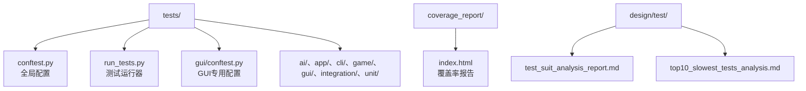
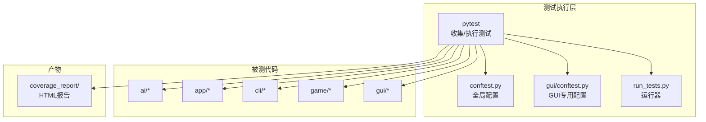
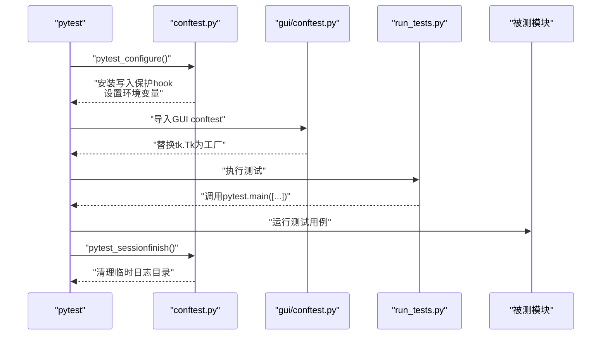
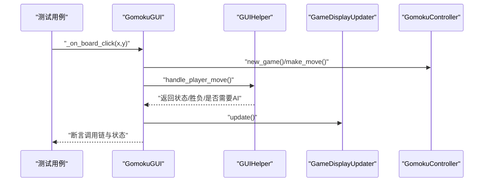
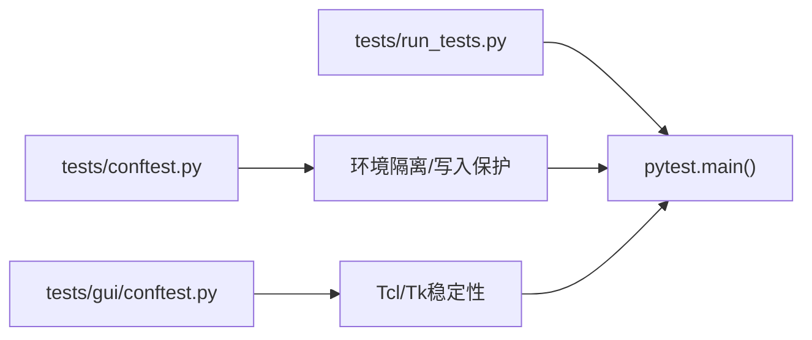

# 测试框架

<cite>
**本文引用的文件**
- [tests/conftest.py](file://tests/conftest.py)
- [tests/run_tests.py](file://tests/run_tests.py)
- [tests/gui/conftest.py](file://tests/gui/conftest.py)
- [tests/test_controller.py](file://tests/test_controller.py)
- [tests/ai/test_engine.py](file://tests/ai/test_engine.py)
- [tests/gui/test_main.py](file://tests/gui/test_main.py)
- [tests/cli/test_main.py](file://tests/cli/test_main.py)
- [coverage_report/index.html](file://coverage_report/index.html)
- [design/test/test_suit_analysis_report.md](file://design/test/test_suit_analysis_report.md)
- [design/test/top10_slowest_tests_analysis.md](file://design/test/top10_slowest_tests_analysis.md)
</cite>

## 目录
1. [简介](#简介)
2. [项目结构](#项目结构)
3. [核心组件](#核心组件)
4. [架构总览](#架构总览)
5. [详细组件分析](#详细组件分析)
6. [依赖分析](#依赖分析)
7. [性能考量](#性能考量)
8. [故障排查指南](#故障排查指南)
9. [结论](#结论)
10. [附录](#附录)

## 简介
本文件系统化梳理五子棋AI项目的测试框架，覆盖pytest配置与使用、测试组织结构、单元与集成测试设计、覆盖率分析、最佳实践、持续集成与自动化流程以及测试环境与结果分析。文档面向不同技术背景读者，既提供高层概览，也给出代码级细节与可视化图示。

## 项目结构
测试相关的核心目录与文件如下：
- tests/：统一测试入口与配置
  - conftest.py：全局pytest配置（环境变量、sys.path、写入保护hook）
  - run_tests.py：兼容性测试运行器（封装pytest调用）
  - gui/conftest.py：GUI测试专用配置（解决Windows+Python 3.13下Tcl/Tk不稳定问题）
  - ai/、app/、cli/、game/、gui/、integration/、unit/：按功能域划分的测试套件
- coverage_report/：覆盖率HTML报告
- design/test/：测试套件分析与性能分析文档

**图表来源**
- [tests/conftest.py:1-119](file://tests/conftest.py#L1-L119)
- [tests/run_tests.py:1-60](file://tests/run_tests.py#L1-L60)
- [tests/gui/conftest.py:1-53](file://tests/gui/conftest.py#L1-L53)
- [coverage_report/index.html](file://coverage_report/index.html)
- [design/test/test_suit_analysis_report.md](file://design/test/test_suit_analysis_report.md)
- [design/test/top10_slowest_tests_analysis.md](file://design/test/top10_slowest_tests_analysis.md)

**章节来源**
- [tests/conftest.py:1-119](file://tests/conftest.py#L1-L119)
- [tests/run_tests.py:1-60](file://tests/run_tests.py#L1-L60)
- [tests/gui/conftest.py:1-53](file://tests/gui/conftest.py#L1-L53)

## 核心组件
- 全局pytest配置与环境隔离
  - 通过环境变量隔离训练损失日志目录，避免污染真实数据
  - 安装写入保护hook，拦截对受保护目录的写入，防止测试破坏生产数据
  - 统一设置sys.path，确保从项目根目录导入模块
- GUI测试专用配置
  - 在导入阶段替换tk.Tk为共享root的工厂函数，避免Windows+Python 3.13下Tcl解释器退化导致的非确定性失败
- 测试运行器
  - 提供python tests/run_tests.py兼容入口；默认禁用输出捕获以规避Windows Tcl/Tk兼容问题
- 覆盖率报告
  - HTML报告位于coverage_report/index.html，包含按模块/函数维度的覆盖率索引与详情页

**章节来源**
- [tests/conftest.py:16-26](file://tests/conftest.py#L16-L26)
- [tests/conftest.py:44-107](file://tests/conftest.py#L44-L107)
- [tests/conftest.py:109-119](file://tests/conftest.py#L109-L119)
- [tests/gui/conftest.py:3-17](file://tests/gui/conftest.py#L3-L17)
- [tests/gui/conftest.py:23-53](file://tests/gui/conftest.py#L23-L53)
- [tests/run_tests.py:9-11](file://tests/run_tests.py#L9-L11)
- [tests/run_tests.py:50-55](file://tests/run_tests.py#L50-L55)
- [coverage_report/index.html](file://coverage_report/index.html)

## 架构总览
下图展示测试框架在项目中的角色与交互：pytest收集测试、应用全局配置、执行单元/集成测试、产出覆盖率报告。

**图表来源**
- [tests/conftest.py:1-119](file://tests/conftest.py#L1-L119)
- [tests/gui/conftest.py:1-53](file://tests/gui/conftest.py#L1-L53)
- [tests/run_tests.py:1-60](file://tests/run_tests.py#L1-L60)
- [coverage_report/index.html](file://coverage_report/index.html)

## 详细组件分析

### pytest配置与执行策略
- 测试发现与执行
  - 通过tests/目录自动发现测试文件与套件
  - 默认禁用输出捕获以规避Windows Tcl/Tk问题
- 全局环境隔离
  - 临时loss日志目录：在会话开始前创建并在结束后清理
  - sys.path修正：确保从项目根导入
  - 写入保护：拦截写入受保护目录，仅允许读取
- GUI稳定性保障
  - 导入阶段替换tk.Tk，统一使用共享root，减少Tcl/Tk初始化开销与不确定性

**图表来源**
- [tests/conftest.py:16-26](file://tests/conftest.py#L16-L26)
- [tests/conftest.py:109-119](file://tests/conftest.py#L109-L119)
- [tests/gui/conftest.py:23-53](file://tests/gui/conftest.py#L23-L53)
- [tests/run_tests.py:50-55](file://tests/run_tests.py#L50-L55)

**章节来源**
- [tests/conftest.py:16-26](file://tests/conftest.py#L16-L26)
- [tests/conftest.py:109-119](file://tests/conftest.py#L109-L119)
- [tests/gui/conftest.py:23-53](file://tests/gui/conftest.py#L23-L53)
- [tests/run_tests.py:50-55](file://tests/run_tests.py#L50-L55)

### 单元测试编写指南
- 组织结构
  - 按功能域划分：tests/ai/、tests/app/、tests/cli/、tests/game/、tests/gui/
  - 建议使用pytest风格的测试类与方法，配合setup_method/teardown_method或fixture进行前置/收尾
- 断言方法
  - 使用pytest内置断言或unittest.TestCase断言风格（如assertEqual、assertTrue等）
  - 对异常场景使用with pytest.raises或with self.assertRaises
- 测试数据准备
  - 使用临时目录隔离文件IO，避免跨测试污染
  - 对于复杂状态构造，提供辅助函数（如测试控制器中的残局构造）

示例参考：
- 控制器单元测试：[tests/test_controller.py:83-200](file://tests/test_controller.py#L83-L200)
- AI引擎单元测试：[tests/ai/test_engine.py:89-141](file://tests/ai/test_engine.py#L89-L141)
- CLI命令解析单元测试：[tests/cli/test_main.py:34-102](file://tests/cli/test_main.py#L34-L102)

**章节来源**
- [tests/test_controller.py:83-200](file://tests/test_controller.py#L83-L200)
- [tests/ai/test_engine.py:89-141](file://tests/ai/test_engine.py#L89-L141)
- [tests/cli/test_main.py:34-102](file://tests/cli/test_main.py#L34-L102)

### 集成测试设计与实现
- 模块间交互测试
  - GUI主程序集成测试：通过mock替换tkinter相关调用，验证菜单调用链、状态转换与显示更新
  - 示例：[tests/gui/test_main.py:68-200](file://tests/gui/test_main.py#L68-L200)
- 端到端功能测试
  - 控制器与存档系统的端到端验证：新建/加载/落子/胜负判定/平局判定
  - 示例：[tests/test_controller.py:83-200](file://tests/test_controller.py#L83-L200)
- 性能测试
  - 性能分析文档：[design/test/top10_slowest_tests_analysis.md](file://design/test/top10_slowest_tests_analysis.md)
  - 测试套件分析报告：[design/test/test_suit_analysis_report.md](file://design/test/test_suit_analysis_report.md)

**图表来源**
- [tests/gui/test_main.py:68-200](file://tests/gui/test_main.py#L68-L200)

**章节来源**
- [tests/gui/test_main.py:68-200](file://tests/gui/test_main.py#L68-L200)
- [tests/test_controller.py:83-200](file://tests/test_controller.py#L83-L200)
- [design/test/top10_slowest_tests_analysis.md](file://design/test/top10_slowest_tests_analysis.md)
- [design/test/test_suit_analysis_report.md](file://design/test/test_suit_analysis_report.md)

### 测试覆盖率分析
- 报告生成与呈现
  - HTML报告位于coverage_report/index.html，支持按模块/函数索引浏览
- 覆盖度统计与改进
  - 结合“测试套件分析”与“最慢测试分析”，识别低价值或冗余测试，优化覆盖率与执行效率
  - 参考：[design/test/test_suit_analysis_report.md](file://design/test/test_suit_analysis_report.md)、[design/test/top10_slowest_tests_analysis.md](file://design/test/top10_slowest_tests_analysis.md)

**章节来源**
- [coverage_report/index.html](file://coverage_report/index.html)
- [design/test/test_suit_analysis_report.md](file://design/test/test_suit_analysis_report.md)
- [design/test/top10_slowest_tests_analysis.md](file://design/test/top10_slowest_tests_analysis.md)

### 测试最佳实践
- 测试驱动开发（TDD）
  - 先编写失败的测试，再实现最小功能满足测试
- 模拟对象与隔离
  - 使用unittest.mock或pytest.mocker对GUI、文件系统、外部依赖进行隔离
  - 示例：GUI测试中对tkinter、messagebox、root.after进行patch
- 测试数据管理
  - 使用临时目录与受保护目录写入保护，避免跨测试污染
  - 对复杂状态构造提供可复用的辅助函数

**章节来源**
- [tests/gui/test_main.py:25-60](file://tests/gui/test_main.py#L25-L60)
- [tests/conftest.py:44-107](file://tests/conftest.py#L44-L107)

### 持续集成与自动化
- 自动化测试流程
  - 通过tests/run_tests.py统一入口，支持CI脚本直接调用
  - 默认禁用输出捕获，提升Windows平台稳定性
- 回归测试策略
  - 以功能域划分的测试套件（ai/app/cli/game/gui/integration/unit）确保关键路径回归
  - 结合覆盖率报告与性能分析，定期优化测试集规模与质量

**章节来源**
- [tests/run_tests.py:9-11](file://tests/run_tests.py#L9-L11)
- [tests/run_tests.py:50-55](file://tests/run_tests.py#L50-L55)

### 测试环境搭建与结果分析
- 测试环境
  - 通过conftest.py设置隔离日志目录与sys.path，确保可重复执行
  - GUI测试通过gui/conftest.py解决Tcl/Tk稳定性问题
- 测试数据库/数据文件
  - 使用临时目录替代真实数据目录，避免污染
- 结果分析
  - 以coverage_report/index.html为依据评估覆盖率
  - 以design/test/下的分析文档为依据优化测试套件与性能

**章节来源**
- [tests/conftest.py:16-26](file://tests/conftest.py#L16-L26)
- [tests/gui/conftest.py:3-17](file://tests/gui/conftest.py#L3-L17)
- [coverage_report/index.html](file://coverage_report/index.html)
- [design/test/top10_slowest_tests_analysis.md](file://design/test/top10_slowest_tests_analysis.md)

## 依赖分析
- 组件耦合与职责
  - tests/conftest.py负责全局环境隔离与写入保护，耦合度低但影响面广
  - tests/gui/conftest.py专用于GUI稳定性，仅在tests/gui/范围内生效
  - tests/run_tests.py作为运行器，依赖pytest并暴露统一入口
- 外部依赖
  - pytest、unittest.mock、tkinter（GUI测试）、tempfile/shutil（临时目录）

**图表来源**
- [tests/conftest.py:109-119](file://tests/conftest.py#L109-L119)
- [tests/gui/conftest.py:23-53](file://tests/gui/conftest.py#L23-L53)
- [tests/run_tests.py:50-55](file://tests/run_tests.py#L50-L55)

**章节来源**
- [tests/conftest.py:109-119](file://tests/conftest.py#L109-L119)
- [tests/gui/conftest.py:23-53](file://tests/gui/conftest.py#L23-L53)
- [tests/run_tests.py:50-55](file://tests/run_tests.py#L50-L55)

## 性能考量
- GUI测试稳定性
  - 通过共享root替换tk.Tk，降低Tcl/Tk初始化成本与不确定性
- 测试执行效率
  - 使用临时目录与受保护目录写入保护，避免I/O阻塞与竞态
  - 参考性能分析文档，识别并优化最慢测试

**章节来源**
- [tests/gui/conftest.py:3-17](file://tests/gui/conftest.py#L3-L17)
- [design/test/top10_slowest_tests_analysis.md](file://design/test/top10_slowest_tests_analysis.md)

## 故障排查指南
- Windows Tcl/Tk兼容问题
  - 现象：GUI测试间歇性失败
  - 处理：保持tests/run_tests.py默认禁用输出捕获；确保使用共享root替换tk.Tk
- 写入保护错误
  - 现象：断言提示试图写入受保护目录
  - 处理：改用临时目录或tmp_path fixture；仅读取受保护目录
- 路径导入问题
  - 现象：模块导入失败
  - 处理：确认tests/conftest.py已修正sys.path

**章节来源**
- [tests/run_tests.py:9-11](file://tests/run_tests.py#L9-L11)
- [tests/gui/conftest.py:23-53](file://tests/gui/conftest.py#L23-L53)
- [tests/conftest.py:44-107](file://tests/conftest.py#L44-L107)

## 结论
本测试框架通过pytest配置、GUI稳定性保障、写入保护与统一运行器，构建了稳定、可维护、可扩展的测试体系。结合覆盖率报告与性能分析文档，能够持续提升测试质量与执行效率，支撑五子棋AI项目的高质量交付。

## 附录
- 快速运行测试
  - 使用tests/run_tests.py作为统一入口
  - 或直接调用python -m pytest tests/ -v -s
- 覆盖率报告
  - 浏览coverage_report/index.html获取详细覆盖率

**章节来源**
- [tests/run_tests.py:50-55](file://tests/run_tests.py#L50-L55)
- [coverage_report/index.html](file://coverage_report/index.html)