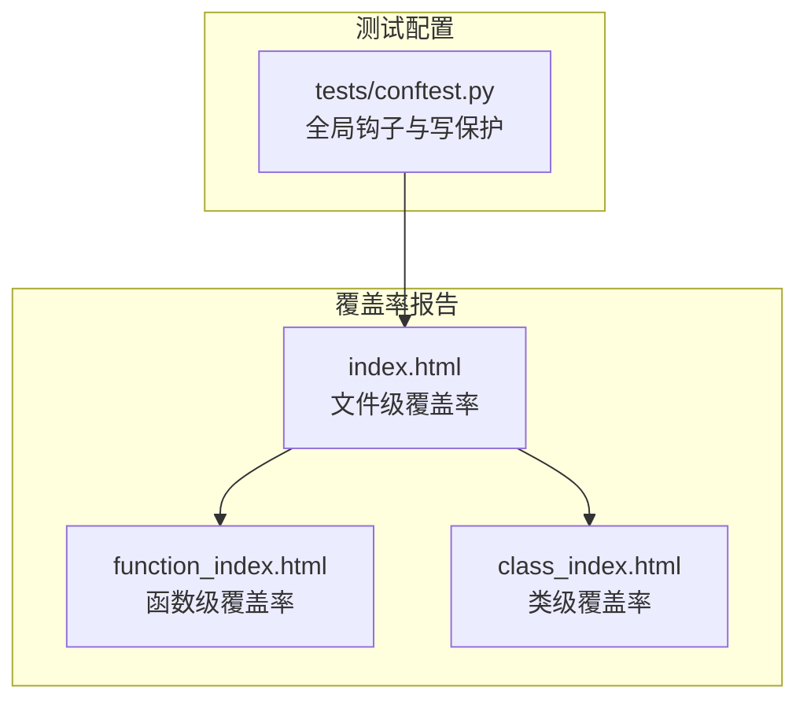
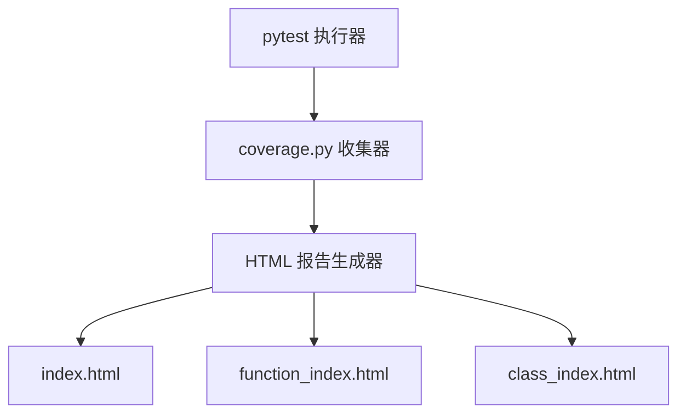
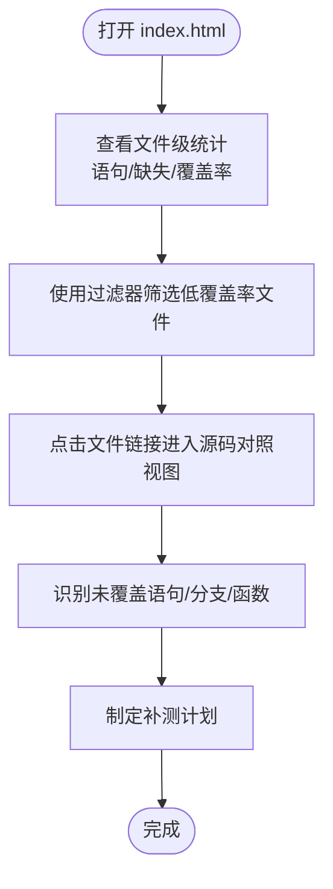
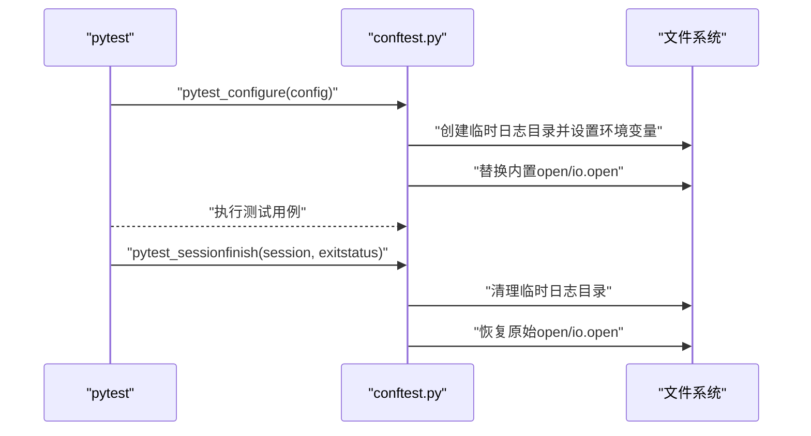
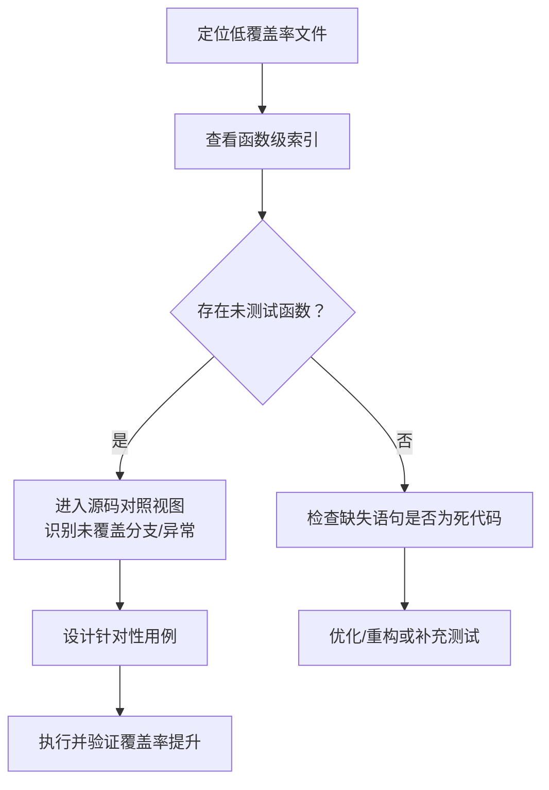
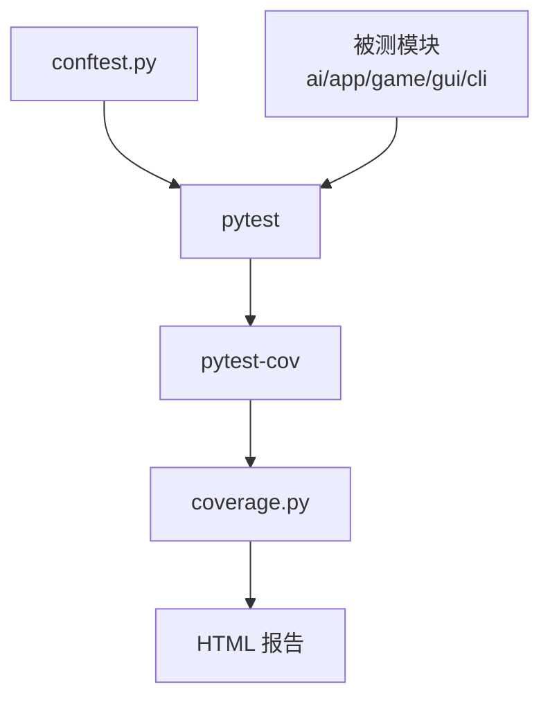

# 测试覆盖率

<cite>
**本文引用的文件**
- [coverage_report/index.html](file://coverage_report/index.html)
- [tests/conftest.py](file://tests/conftest.py)
- [design/test/test_suit_analysis_report.md](file://design/test/test_suit_analysis_report.md)
- [design/test/top10_slowest_tests_analysis.md](file://design/test/top10_slowest_tests_analysis.md)
- [tests/ai/test_base_trainer.py](file://tests/ai/test_base_trainer.py)
- [tests/ai/test_battle.py](file://tests/ai/test_battle.py)
</cite>

## 目录
1. [引言](#引言)
2. [项目结构](#项目结构)
3. [核心组件](#核心组件)
4. [架构总览](#架构总览)
5. [详细组件分析](#详细组件分析)
6. [依赖分析](#依赖分析)
7. [性能考量](#性能考量)
8. [故障排查指南](#故障排查指南)
9. [结论](#结论)
10. [附录](#附录)

## 引言
本文件围绕五子棋AI项目的测试覆盖率进行系统化分析，目标包括：
- 解释代码覆盖率、分支覆盖率与函数覆盖率的概念与计算方法
- 说明覆盖率报告的生成与HTML报告的解读方式
- 提供覆盖率工具配置与使用方法（pytest-cov插件、覆盖率阈值与报告格式）
- 识别覆盖率不足的代码区域（未测试函数、条件分支、异常路径）
- 提出提升覆盖率的实践策略（专项测试、边界条件、重构测试）
- 建立覆盖率监控与持续改进机制（CI/CD集成、趋势分析）

## 项目结构
本项目采用按功能域划分的模块化组织方式，测试覆盖主要集中在 ai、app、game、gui、cli 等包。覆盖率报告以HTML形式呈现，包含文件级、函数级与类级索引页，便于定位低覆盖率区域。

**图表来源**
- [coverage_report/index.html:1-334](file://coverage_report/index.html#L1-L334)
- [tests/conftest.py:1-119](file://tests/conftest.py#L1-L119)

**章节来源**
- [coverage_report/index.html:1-334](file://coverage_report/index.html#L1-L334)
- [tests/conftest.py:1-119](file://tests/conftest.py#L1-L119)

## 核心组件
- 覆盖率报告系统：基于 coverage.py 生成HTML报告，提供文件、函数、类三个维度的索引与排序能力，支持过滤与键盘快捷键导航。
- 测试框架：pytest 驱动，配合 conftest.py 注入全局钩子（写保护、路径修正、临时目录管理）。
- 测试用例：分布在 tests 目录，按功能域与测试层次（unit/integration/primary/edge）组织，部分用例存在耗时较长的问题，已通过优化策略降低执行时间。

**章节来源**
- [coverage_report/index.html:1-334](file://coverage_report/index.html#L1-L334)
- [tests/conftest.py:1-119](file://tests/conftest.py#L1-L119)

## 架构总览
下图展示覆盖率报告与测试执行的整体关系：pytest 执行测试，coverage.py 收集覆盖率数据，生成 HTML 报告页面。

**图表来源**
- [coverage_report/index.html:1-334](file://coverage_report/index.html#L1-L334)

## 详细组件分析

### 覆盖率报告解读与统计
- 报告首页 index.html 展示文件级覆盖率，包含“文件名、语句总数、缺失语句、排除语句、覆盖率”等列，支持按列排序与过滤。
- 全局覆盖率：报告中包含整体覆盖率统计，便于快速评估测试覆盖面。
- 文件级定位：点击文件名可进入源码对照视图，未覆盖的语句以高亮标注，便于定位待补测区域。

**图表来源**
- [coverage_report/index.html:60-316](file://coverage_report/index.html#L60-L316)

**章节来源**
- [coverage_report/index.html:1-334](file://coverage_report/index.html#L1-L334)

### 测试配置与写保护机制
- conftest.py 在 pytest 会话开始前设置测试专用的日志目录，避免污染真实数据；并在会话结束时清理临时目录。
- 注册写保护钩子，拦截对受保护目录的写入操作，防止测试误写生产数据。
- 通过 sys.path 插入项目根目录，确保模块导入稳定。

**图表来源**
- [tests/conftest.py:22-119](file://tests/conftest.py#L22-L119)

**章节来源**
- [tests/conftest.py:1-119](file://tests/conftest.py#L1-L119)

### 覆盖率不足的识别与定位
- 低覆盖率文件：index.html 中“覆盖率”列显示低于预期的文件，结合“缺失语句”列可快速定位待补测区域。
- 未测试函数：函数级索引页（function_index.html）可发现未被调用的函数或方法。
- 条件分支与异常路径：源码对照视图中标注的未覆盖语句，通常对应 if/else、try/except、for/while 等分支与异常处理路径。
- 示例：GUI 主入口 main.py 的覆盖率显示为 0%，表明该模块尚未纳入测试覆盖。

**图表来源**
- [coverage_report/index.html:74-309](file://coverage_report/index.html#L74-L309)

**章节来源**
- [coverage_report/index.html:1-334](file://coverage_report/index.html#L1-L334)

### 提升覆盖率的实践指南
- 针对低覆盖率代码的专项测试：根据源码对照视图，补充未覆盖的分支与异常路径测试。
- 边界条件测试：围绕输入边界、数组索引边界、空值/None、极端数值等场景设计用例。
- 重构代码的测试策略：对重构后的模块，先保证原有测试通过，再补充新增逻辑的测试。
- 重复用例清理：参考测试套件分析报告，合并重复用例，减少维护成本与执行时间。
- 慢测试优化：降低 epoch 数、减少对局数、合并并行测试断言，以缩短CI时间。

**章节来源**
- [design/test/test_suit_analysis_report.md:119-189](file://design/test/test_suit_analysis_report.md#L119-L189)
- [design/test/top10_slowest_tests_analysis.md:371-436](file://design/test/top10_slowest_tests_analysis.md#L371-L436)

### 覆盖率工具配置与使用
- pytest-cov 插件：在本地或CI中启用 coverage.py，收集覆盖率数据并生成HTML报告。
- 覆盖率阈值：可在CI中设置最低覆盖率阈值，若未达标则阻断合并请求。
- 报告格式：HTML报告便于人工审阅，亦可导出XML/JSON用于CI仪表盘或第三方分析工具。
- 运行建议：在本地开发阶段使用短时用例快速反馈，CI阶段使用完整报告与阈值校验。

（本节为通用实践说明，不直接分析具体文件）

## 依赖分析
- 测试执行依赖 pytest 与 pytest-cov 插件，覆盖率数据由 coverage.py 收集并生成 HTML 报告。
- conftest.py 为测试执行提供全局钩子，确保环境隔离与数据安全。
- 测试用例依赖被测模块（ai、app、game、gui、cli），覆盖率统计反映这些模块的测试覆盖程度。

**图表来源**
- [coverage_report/index.html:1-334](file://coverage_report/index.html#L1-L334)
- [tests/conftest.py:1-119](file://tests/conftest.py#L1-L119)

**章节来源**
- [coverage_report/index.html:1-334](file://coverage_report/index.html#L1-L334)
- [tests/conftest.py:1-119](file://tests/conftest.py#L1-L119)

## 性能考量
- 覆盖率报告生成与浏览：HTML报告体积较大时，建议在CI中仅上传摘要与关键指标，源码对照视图在本地开发时使用。
- 测试执行时间：参考测试套件分析报告，通过降低epoch数、减少对局数、合并断言等方式显著缩短CI时间。
- 并行与缓存：合理利用并行执行与缓存策略，避免重复创建进程池与重复fixture开销。

（本节为通用指导，不直接分析具体文件）

## 故障排查指南
- 写保护错误：当测试试图写入受保护目录时，会触发写保护断言。应使用临时目录或tmp_path fixture替代硬编码路径。
- 路径导入问题：确保项目根目录在 sys.path 中，避免模块导入失败导致覆盖率统计缺失。
- 覆盖率异常：若覆盖率报告为空或异常，检查 pytest-cov 插件版本与配置，确认测试执行路径正确。

**章节来源**
- [tests/conftest.py:44-119](file://tests/conftest.py#L44-L119)

## 结论
本项目已建立较为完善的覆盖率报告体系，能够从文件、函数、类三个维度评估测试覆盖情况。结合测试套件分析与慢测试优化策略，可在保证质量的同时显著提升CI效率。建议持续完善低覆盖率区域的测试，设定合理的覆盖率阈值，并在CI中集成覆盖率监控与趋势分析，推动测试质量的持续改进。

## 附录
- 覆盖率报告入口：[coverage_report/index.html](file://coverage_report/index.html)
- 测试套件分析报告：[design/test/test_suit_analysis_report.md](file://design/test/test_suit_analysis_report.md)
- Top 10 慢测试分析报告：[design/test/top10_slowest_tests_analysis.md](file://design/test/top10_slowest_tests_analysis.md)