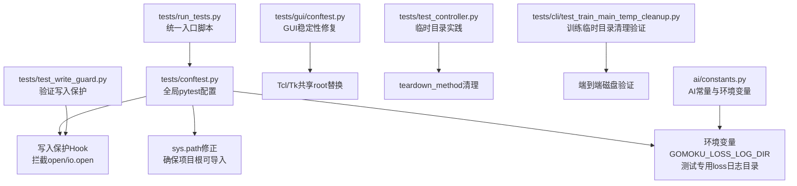
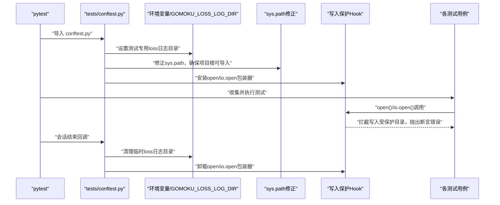
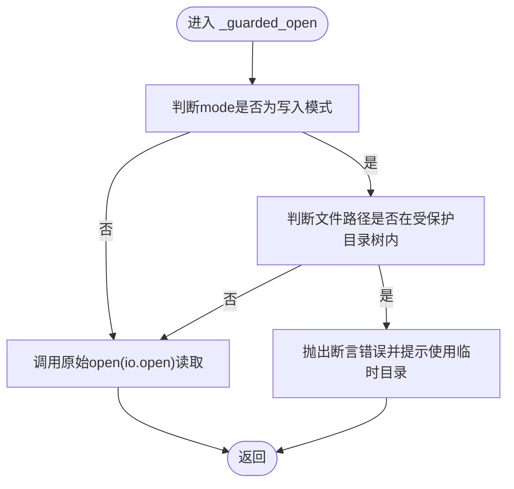
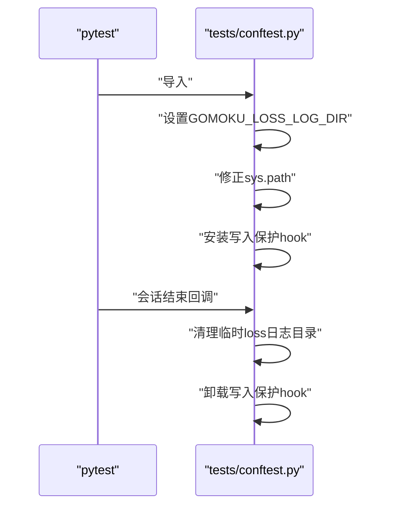
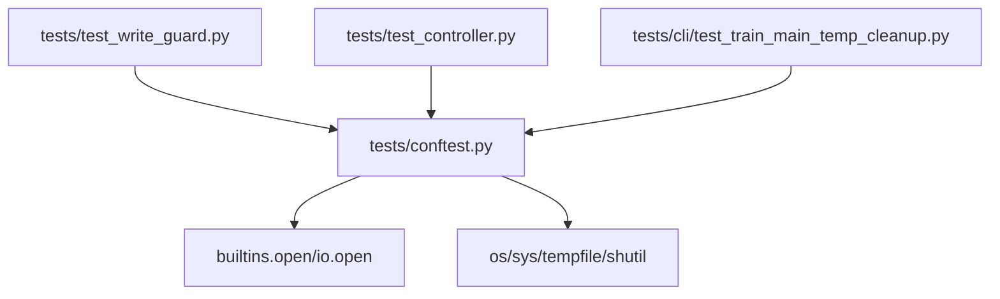

# 测试配置

<cite>
**本文引用的文件**
- [tests/conftest.py](file://tests/conftest.py)
- [tests/test_write_guard.py](file://tests/test_write_guard.py)
- [tests/run_tests.py](file://tests/run_tests.py)
- [tests/gui/conftest.py](file://tests/gui/conftest.py)
- [tests/test_controller.py](file://tests/test_controller.py)
- [tests/cli/test_train_main_temp_cleanup.py](file://tests/cli/test_train_main_temp_cleanup.py)
- [ai/constants.py](file://ai/constants.py)
</cite>

## 目录
1. [简介](#简介)
2. [项目结构](#项目结构)
3. [核心组件](#核心组件)
4. [架构总览](#架构总览)
5. [详细组件分析](#详细组件分析)
6. [依赖分析](#依赖分析)
7. [性能考虑](#性能考虑)
8. [故障排查指南](#故障排查指南)
9. [结论](#结论)
10. [附录](#附录)

## 简介
本文件面向五子棋AI项目的测试配置，系统性梳理pytest配置与测试基础设施，重点解释以下方面：
- pytest配置文件的作用与全局初始化流程
- 测试专用目录配置与写入保护机制
- 测试会话生命周期管理（临时目录创建与清理、sys.path配置）
- 写入保护hook的实现原理（受保护目录、文件打开模式判断、异常处理）
- 测试环境变量配置（损失日志目录、AI常量测试模式）
- 测试配置最佳实践（组织结构、环境隔离、测试数据安全）

## 项目结构
测试相关的核心文件与职责如下：
- tests/conftest.py：全局pytest配置，负责环境初始化、写入保护hook安装/卸载、sys.path修正
- tests/test_write_guard.py：验证写入保护hook的行为
- tests/run_tests.py：统一入口脚本，兼容直接运行pytest或python -m pytest
- tests/gui/conftest.py：GUI测试专用conftest，解决Windows+Python 3.13下Tcl/Tk初始化不稳定问题
- tests/test_controller.py：控制器测试，展示临时目录创建与清理的实践
- tests/cli/test_train_main_temp_cleanup.py：训练CLI临时目录清理的端到端验证
- ai/constants.py：AI常量定义，支持通过环境变量覆盖损失日志目录

图表来源
- [tests/conftest.py:1-119](file://tests/conftest.py#L1-L119)
- [tests/test_write_guard.py:1-177](file://tests/test_write_guard.py#L1-L177)
- [tests/run_tests.py:1-60](file://tests/run_tests.py#L1-L60)
- [tests/gui/conftest.py:1-53](file://tests/gui/conftest.py#L1-L53)
- [tests/test_controller.py:60-82](file://tests/test_controller.py#L60-L82)
- [tests/cli/test_train_main_temp_cleanup.py:124-175](file://tests/cli/test_train_main_temp_cleanup.py#L124-L175)
- [ai/constants.py:19-22](file://ai/constants.py#L19-L22)

章节来源
- [tests/conftest.py:1-119](file://tests/conftest.py#L1-L119)
- [tests/test_write_guard.py:1-177](file://tests/test_write_guard.py#L1-L177)
- [tests/run_tests.py:1-60](file://tests/run_tests.py#L1-L60)
- [tests/gui/conftest.py:1-53](file://tests/gui/conftest.py#L1-L53)
- [tests/test_controller.py:60-82](file://tests/test_controller.py#L60-L82)
- [tests/cli/test_train_main_temp_cleanup.py:124-175](file://tests/cli/test_train_main_temp_cleanup.py#L124-L175)
- [ai/constants.py:19-22](file://ai/constants.py#L19-L22)

## 核心组件
- 全局pytest配置（tests/conftest.py）
  - 设置测试专用的损失日志目录（通过环境变量GOMOKU_LOSS_LOG_DIR），避免污染真实数据
  - 安装写入保护hook，拦截对受保护目录的写入
  - 配置sys.path，确保项目根目录优先导入
  - 提供会话结束后的清理逻辑
- 写入保护hook（tests/conftest.py）
  - 通过替换builtins.open与io.open实现
  - 判断文件打开模式是否涉及写入（w/a/x/+等）
  - 判断目标路径是否位于受保护目录树内
  - 对违规写入抛出断言错误，提示使用tempfile或tmp_path
- 测试运行器（tests/run_tests.py）
  - 兼容直接运行python tests/run_tests.py
  - 设置相同环境变量与sys.path修正
  - 默认禁用输出捕获，避免Windows上Tcl/Tk初始化问题
- GUI稳定性修复（tests/gui/conftest.py）
  - 在模块导入阶段替换tk.Tk为共享root工厂，减少Tcl解释器退化风险
- 临时目录与清理实践
  - 控制器测试：每个测试方法前后创建/删除临时目录
  - 训练CLI测试：端到端验证临时目录在磁盘上的创建与清理

章节来源
- [tests/conftest.py:16-26](file://tests/conftest.py#L16-L26)
- [tests/conftest.py:109-118](file://tests/conftest.py#L109-L118)
- [tests/conftest.py:44-107](file://tests/conftest.py#L44-L107)
- [tests/run_tests.py:19-31](file://tests/run_tests.py#L19-L31)
- [tests/run_tests.py:49-55](file://tests/run_tests.py#L49-L55)
- [tests/gui/conftest.py:26-52](file://tests/gui/conftest.py#L26-L52)
- [tests/test_controller.py:62-81](file://tests/test_controller.py#L62-L81)
- [tests/cli/test_train_main_temp_cleanup.py:124-175](file://tests/cli/test_train_main_temp_cleanup.py#L124-L175)

## 架构总览
下图展示了测试配置在pytest生命周期内的作用点与交互：

图表来源
- [tests/conftest.py:16-26](file://tests/conftest.py#L16-L26)
- [tests/conftest.py:109-118](file://tests/conftest.py#L109-L118)
- [tests/conftest.py:44-107](file://tests/conftest.py#L44-L107)
- [ai/constants.py:19-22](file://ai/constants.py#L19-L22)

## 详细组件分析

### 写入保护Hook实现原理
- 受保护目录集合
  - 定义在配置文件中，覆盖AI数据、模型、训练样本、游戏存档、设计文档与需求等关键目录
  - 使用绝对路径与分隔符前缀匹配，避免“ai_data”误匹配“ai_data_backup”
- 文件打开模式判断
  - 识别w/a/x/+等写入模式，确保拦截截断写入、追加、排他创建与读写组合模式
- 异常处理机制
  - 对写入受保护目录的行为抛出断言错误，错误信息包含被拦截路径与受保护目录列表
  - 提示改用tempfile或pytest的tmp_path fixture进行临时写入

图表来源
- [tests/conftest.py:64-107](file://tests/conftest.py#L64-L107)

章节来源
- [tests/conftest.py:49-58](file://tests/conftest.py#L49-L58)
- [tests/conftest.py:64-73](file://tests/conftest.py#L64-L73)
- [tests/conftest.py:75-89](file://tests/conftest.py#L75-L89)
- [tests/conftest.py:92-106](file://tests/conftest.py#L92-L106)
- [tests/test_write_guard.py:27-97](file://tests/test_write_guard.py#L27-L97)
- [tests/test_write_guard.py:99-143](file://tests/test_write_guard.py#L99-L143)
- [tests/test_write_guard.py:145-177](file://tests/test_write_guard.py#L145-L177)

### 测试会话生命周期管理
- 会话开始
  - 设置测试专用loss日志目录（环境变量）
  - 修正sys.path，确保项目根目录优先导入
  - 安装写入保护hook
- 会话结束
  - 清理临时loss日志目录
  - 卸载写入保护hook

图表来源
- [tests/conftest.py:16-26](file://tests/conftest.py#L16-L26)
- [tests/conftest.py:109-118](file://tests/conftest.py#L109-L118)

章节来源
- [tests/conftest.py:16-26](file://tests/conftest.py#L16-L26)
- [tests/conftest.py:109-118](file://tests/conftest.py#L109-L118)

### 测试环境变量配置
- 损失日志目录
  - 通过环境变量GOMOKU_LOSS_LOG_DIR指定，AI常量模块在导入时读取该变量
  - 测试期间由conftest.py在会话开始时设置为临时目录，并在会话结束时清理
- AI常量测试模式
  - 通过上述环境变量实现“测试模式”的隔离，避免真实数据污染

章节来源
- [ai/constants.py:19-22](file://ai/constants.py#L19-L22)
- [tests/conftest.py:16-26](file://tests/conftest.py#L16-L26)

### 测试运行器与GUI稳定性
- 统一入口脚本
  - 兼容直接运行tests/run_tests.py，设置相同环境变量与sys.path修正
  - 默认禁用输出捕获，避免Windows上Tcl/Tk初始化问题
- GUI稳定性修复
  - 在模块导入时替换tk.Tk为共享root工厂，减少Tcl解释器退化导致的非确定性失败

章节来源
- [tests/run_tests.py:19-31](file://tests/run_tests.py#L19-L31)
- [tests/run_tests.py:49-55](file://tests/run_tests.py#L49-L55)
- [tests/gui/conftest.py:26-52](file://tests/gui/conftest.py#L26-L52)

### 临时目录与清理实践
- 控制器测试
  - 每个测试方法前创建临时根目录，测试结束后删除
  - 通过teardown_method确保资源释放与目录清理
- 训练CLI测试
  - 端到端验证临时目录在磁盘上的创建与最终清理
  - 通过spy方式确认训练过程中临时目录的存在性

章节来源
- [tests/test_controller.py:62-81](file://tests/test_controller.py#L62-L81)
- [tests/cli/test_train_main_temp_cleanup.py:124-175](file://tests/cli/test_train_main_temp_cleanup.py#L124-L175)

## 依赖分析
- conftest.py对以下模块/函数存在直接依赖：
  - builtins.open与io.open：用于安装/卸载写入保护hook
  - os、sys：用于环境变量设置、路径修正
  - tempfile、shutil：用于临时目录创建与清理
- 测试用例对conftest.py的依赖体现在：
  - 写入保护行为的验证
  - 临时目录清理的端到端验证

图表来源
- [tests/conftest.py:9-14](file://tests/conftest.py#L9-L14)
- [tests/conftest.py:109-118](file://tests/conftest.py#L109-L118)
- [tests/test_write_guard.py:1-10](file://tests/test_write_guard.py#L1-L10)
- [tests/test_controller.py:1-15](file://tests/test_controller.py#L1-L15)
- [tests/cli/test_train_main_temp_cleanup.py:1-18](file://tests/cli/test_train_main_temp_cleanup.py#L1-L18)

章节来源
- [tests/conftest.py:9-14](file://tests/conftest.py#L9-L14)
- [tests/conftest.py:109-118](file://tests/conftest.py#L109-L118)
- [tests/test_write_guard.py:1-10](file://tests/test_write_guard.py#L1-L10)
- [tests/test_controller.py:1-15](file://tests/test_controller.py#L1-L15)
- [tests/cli/test_train_main_temp_cleanup.py:1-18](file://tests/cli/test_train_main_temp_cleanup.py#L1-L18)

## 性能考虑
- 写入保护hook采用轻量级字符串模式判断与路径前缀匹配，开销极低
- 临时目录清理在会话结束时进行，避免频繁IO
- GUI稳定性修复通过一次性共享root降低Tcl初始化成本

## 故障排查指南
- 写入受保护目录被拦截
  - 现象：断言错误，提示“测试试图写入受保护目录”
  - 处理：改用tempfile或pytest的tmp_path fixture；或在测试中显式mock相关路径
  - 参考：写入保护hook的错误消息与提示
- Windows GUI测试不稳定
  - 现象：Tcl初始化失败或非确定性失败
  - 处理：使用tests/gui/conftest.py提供的共享root替换策略
- 临时目录未清理
  - 现象：磁盘空间占用增加
  - 处理：检查teardown_method或pytest会话结束回调是否执行；必要时手动清理

章节来源
- [tests/conftest.py:99-106](file://tests/conftest.py#L99-L106)
- [tests/gui/conftest.py:26-52](file://tests/gui/conftest.py#L26-L52)
- [tests/test_controller.py:71-81](file://tests/test_controller.py#L71-L81)

## 结论
本测试配置通过环境变量隔离、sys.path修正与写入保护hook三重保障，实现了安全、稳定、可维护的测试环境。配合临时目录清理与GUI稳定性修复，确保测试在不同平台与场景下可靠运行。

## 附录
- 最佳实践清单
  - 使用环境变量隔离真实数据（如GOMOKU_LOSS_LOG_DIR）
  - 在conftest.py中集中安装/卸载hook，避免分散配置
  - 优先使用pytest内置fixture（如tmp_path）进行临时文件写入
  - 严格区分受保护目录与测试数据目录，避免误判
  - 在GUI测试中应用共享root替换策略，提升稳定性
  - 在会话结束时清理临时目录，避免资源泄漏