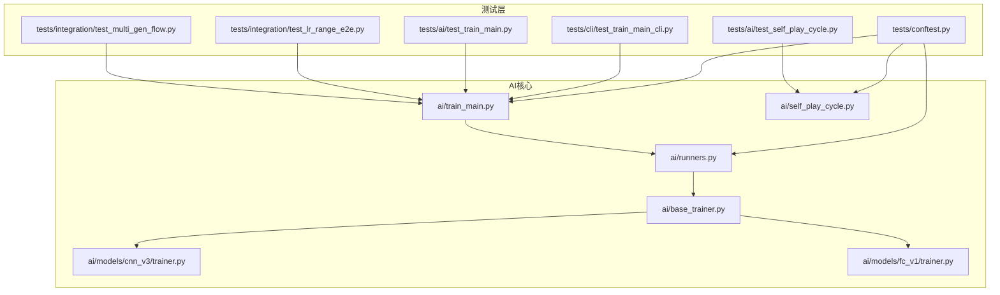
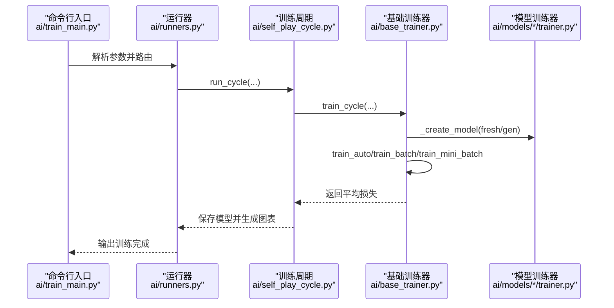
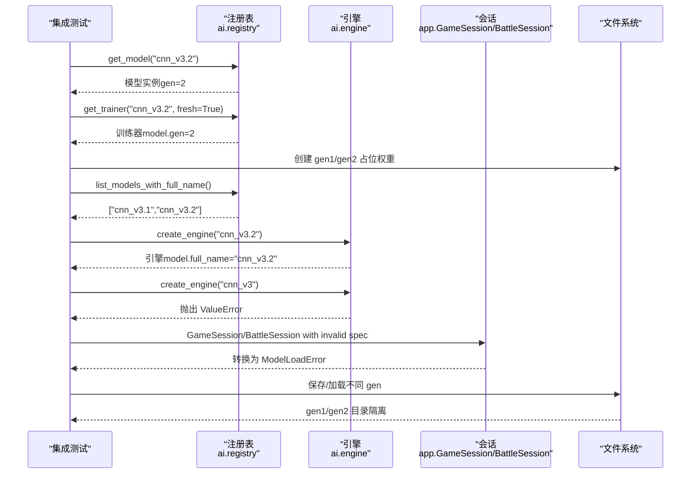
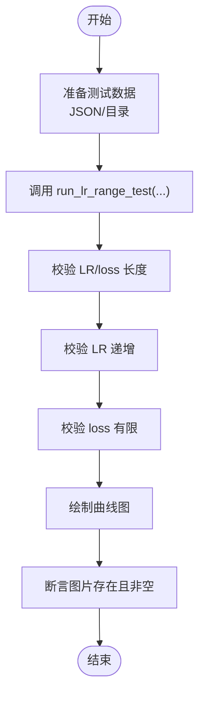
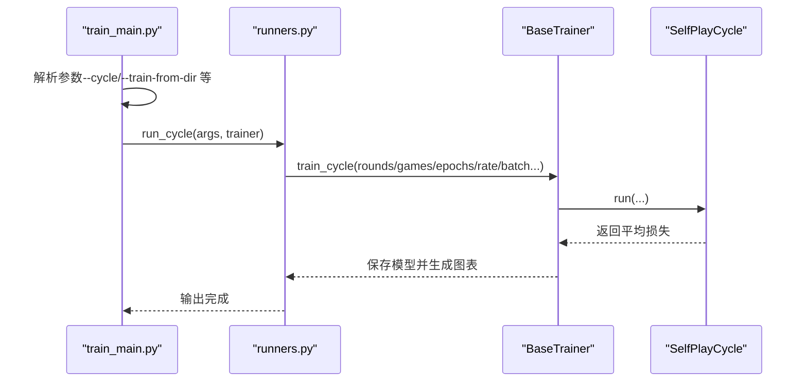
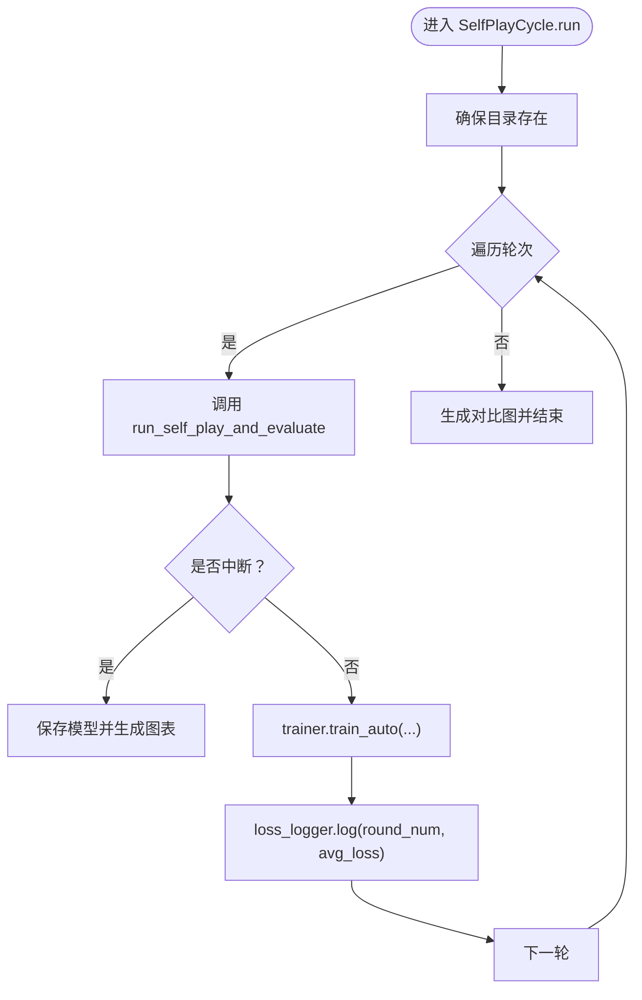
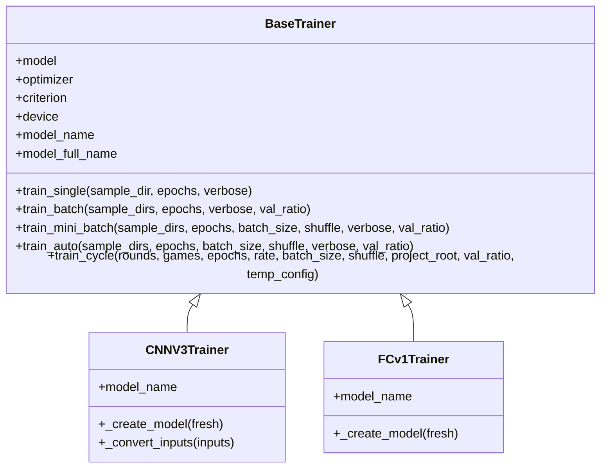
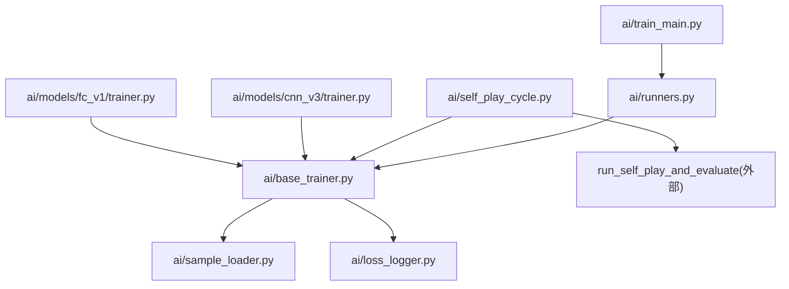

# 集成测试

<cite>
**本文引用的文件**
- [tests/integration/test_multi_gen_flow.py](file://tests/integration/test_multi_gen_flow.py)
- [tests/integration/test_lr_range_e2e.py](file://tests/integration/test_lr_range_e2e.py)
- [ai/train_main.py](file://ai/train_main.py)
- [ai/self_play_cycle.py](file://ai/self_play_cycle.py)
- [ai/base_trainer.py](file://ai/base_trainer.py)
- [ai/runners.py](file://ai/runners.py)
- [tests/ai/test_self_play_cycle.py](file://tests/ai/test_self_play_cycle.py)
- [tests/ai/test_train_main.py](file://tests/ai/test_train_main.py)
- [tests/cli/test_train_main_cli.py](file://tests/cli/test_train_main_cli.py)
- [tests/conftest.py](file://tests/conftest.py)
- [ai/models/cnn_v3/trainer.py](file://ai/models/cnn_v3/trainer.py)
- [ai/models/fc_v1/trainer.py](file://ai/models/fc_v1/trainer.py)
- [tests/ai/helpers.py](file://tests/ai/helpers.py)
</cite>

## 目录
1. [简介](#简介)
2. [项目结构](#项目结构)
3. [核心组件](#核心组件)
4. [架构总览](#架构总览)
5. [详细组件分析](#详细组件分析)
6. [依赖分析](#依赖分析)
7. [性能考虑](#性能考虑)
8. [故障排查指南](#故障排查指南)
9. [结论](#结论)
10. [附录](#附录)

## 简介
本文件面向五子棋AI项目的集成测试设计与实现，聚焦于模块间交互、端到端功能与系统级测试。内容涵盖：
- 多代模型训练的端到端集成测试：从模型规范字符串到模型实例、训练器、引擎、应用层异常转换，以及保存/加载的代数隔离。
- LR Range Test 的端到端集成测试：覆盖数据准备、流程执行、绘图输出与异常处理。
- AI训练流程的集成测试策略：多代模型、自我对弈、数据生成与合并、训练器路由与参数透传。
- 性能与压力测试：训练速度测量、内存监控、并发处理验证。
- 测试环境搭建：测试数据准备、临时文件管理、测试状态恢复与写入保护。

## 项目结构
本项目采用“模块化+分层”的组织方式：
- ai：AI核心模块，包含训练器抽象、具体模型与训练器、数据生成与记录、运行器与入口脚本等。
- tests：测试目录，按层次划分 unit、primary、edge、integration 等，配合 conftest 实现全局环境初始化与写入保护。
- cli：命令行入口，train_main.py 负责参数解析与模式路由。
- gui/app：图形界面与会话层，负责将底层引擎与UI连接。
- design/temp：设计文档与优化方案，支撑测试策略制定。

**图表来源**
- [tests/integration/test_multi_gen_flow.py:1-357](file://tests/integration/test_multi_gen_flow.py#L1-L357)
- [tests/integration/test_lr_range_e2e.py:1-133](file://tests/integration/test_lr_range_e2e.py#L1-L133)
- [tests/ai/test_self_play_cycle.py:1-266](file://tests/ai/test_self_play_cycle.py#L1-L266)
- [tests/ai/test_train_main.py:1-352](file://tests/ai/test_train_main.py#L1-L352)
- [tests/cli/test_train_main_cli.py:1-111](file://tests/cli/test_train_main_cli.py#L1-L111)
- [ai/train_main.py:1-234](file://ai/train_main.py#L1-L234)
- [ai/runners.py:1-255](file://ai/runners.py#L1-L255)
- [ai/self_play_cycle.py:1-195](file://ai/self_play_cycle.py#L1-L195)
- [ai/base_trainer.py:1-699](file://ai/base_trainer.py#L1-L699)
- [ai/models/cnn_v3/trainer.py:1-73](file://ai/models/cnn_v3/trainer.py#L1-L73)
- [ai/models/fc_v1/trainer.py:1-44](file://ai/models/fc_v1/trainer.py#L1-L44)
- [tests/conftest.py:1-119](file://tests/conftest.py#L1-L119)

**章节来源**
- [tests/integration/test_multi_gen_flow.py:1-357](file://tests/integration/test_multi_gen_flow.py#L1-L357)
- [tests/integration/test_lr_range_e2e.py:1-133](file://tests/integration/test_lr_range_e2e.py#L1-L133)
- [ai/train_main.py:1-234](file://ai/train_main.py#L1-L234)
- [ai/runners.py:1-255](file://ai/runners.py#L1-L255)
- [ai/self_play_cycle.py:1-195](file://ai/self_play_cycle.py#L1-L195)
- [ai/base_trainer.py:1-699](file://ai/base_trainer.py#L1-L699)
- [tests/conftest.py:1-119](file://tests/conftest.py#L1-L119)

## 核心组件
- 多代模型端到端集成测试：覆盖从模型规范字符串到模型实例、训练器、引擎、应用层异常转换，以及保存/加载的代数隔离。
- LR Range Test 集成测试：验证数据准备、流程执行、绘图输出与异常处理。
- 训练入口与运行器：train_main.py 负责参数解析与模式路由，runners.py 提供 run_cycle 与 run_train_from_dir 的实现。
- 自我对弈训练周期：SelfPlayCycle 将 BaseTrainer.train_cycle 抽离为独立编排类，负责轮次、对弈、评价与训练的协调。
- 基础训练器：BaseTrainer 提供通用训练流程、损失计算、学习率调度、设备选择与日志记录。
- CLI 参数互斥与发现：CLI 测试验证 train_main 的参数互斥关系与数据目录发现逻辑。

**章节来源**
- [tests/integration/test_multi_gen_flow.py:1-357](file://tests/integration/test_multi_gen_flow.py#L1-L357)
- [tests/integration/test_lr_range_e2e.py:1-133](file://tests/integration/test_lr_range_e2e.py#L1-L133)
- [ai/train_main.py:1-234](file://ai/train_main.py#L1-L234)
- [ai/runners.py:1-255](file://ai/runners.py#L1-L255)
- [ai/self_play_cycle.py:1-195](file://ai/self_play_cycle.py#L1-L195)
- [ai/base_trainer.py:1-699](file://ai/base_trainer.py#L1-L699)
- [tests/ai/test_train_main.py:1-352](file://tests/ai/test_train_main.py#L1-L352)
- [tests/cli/test_train_main_cli.py:1-111](file://tests/cli/test_train_main_cli.py#L1-L111)

## 架构总览
下图展示了集成测试关注的关键流程：从命令行入口到训练器、再到数据生成与合并、训练与日志输出的端到端路径。

**图表来源**
- [ai/train_main.py:27-230](file://ai/train_main.py#L27-L230)
- [ai/runners.py:173-255](file://ai/runners.py#L173-L255)
- [ai/self_play_cycle.py:38-195](file://ai/self_play_cycle.py#L38-L195)
- [ai/base_trainer.py:575-661](file://ai/base_trainer.py#L575-L661)
- [ai/models/cnn_v3/trainer.py:25-35](file://ai/models/cnn_v3/trainer.py#L25-L35)
- [ai/models/fc_v1/trainer.py:23-32](file://ai/models/fc_v1/trainer.py#L23-L32)

## 详细组件分析

### 多代模型端到端集成测试
本测试覆盖：
- 规范字符串到模型实例：验证 gen 属性、full_name、默认模型路径包含 gen 子目录。
- 规范字符串到训练器：验证训练器模型的 gen/full_name 属性与训练器自身 gen。
- 文件系统扫描：验证 list_models_with_full_name 对 gen 目录的真实扫描逻辑。
- 引擎创建：验证 create_engine 对多代模型的正确解析与错误场景（未指定代数）。
- 异常转换：验证 app 层将 ValueError 转换为 ModelLoadError。
- 保存/加载隔离：验证不同代数的保存/加载相互隔离，不交叉污染。

**图表来源**
- [tests/integration/test_multi_gen_flow.py:74-353](file://tests/integration/test_multi_gen_flow.py#L74-L353)

**章节来源**
- [tests/integration/test_multi_gen_flow.py:1-357](file://tests/integration/test_multi_gen_flow.py#L1-L357)

### LR Range Test 集成测试
本测试覆盖：
- 使用 CNNV2Model + 模拟数据运行完整流程，验证返回的 LR 序列与损失序列长度、单调性与有限性。
- 支持目录数据与 JSON 文件两种输入形式。
- 异常处理：无效模型名与不存在的数据路径。

**图表来源**
- [tests/integration/test_lr_range_e2e.py:44-102](file://tests/integration/test_lr_range_e2e.py#L44-L102)

**章节来源**
- [tests/integration/test_lr_range_e2e.py:1-133](file://tests/integration/test_lr_range_e2e.py#L1-L133)

### 训练入口与运行器集成测试
本测试覆盖：
- 参数解析：--cycle 模式解析 --rounds/--games、--batch-size/--shuffle、--fresh、学习率调度参数。
- 模式路由：--train-from-dir 支持 .json 文件与目录，目录下 merge 与 sample 的加载。
- 温度采样参数：cycle 模式下温度采样 CLI 参数解析与透传，非 cycle 模式忽略温度参数。

**图表来源**
- [ai/train_main.py:27-230](file://ai/train_main.py#L27-L230)
- [ai/runners.py:173-255](file://ai/runners.py#L173-L255)
- [ai/self_play_cycle.py:38-195](file://ai/self_play_cycle.py#L38-L195)
- [ai/base_trainer.py:621-661](file://ai/base_trainer.py#L621-L661)

**章节来源**
- [tests/ai/test_train_main.py:20-352](file://tests/ai/test_train_main.py#L20-L352)
- [tests/cli/test_train_main_cli.py:35-107](file://tests/cli/test_train_main_cli.py#L35-L107)
- [ai/train_main.py:27-230](file://ai/train_main.py#L27-L230)
- [ai/runners.py:173-255](file://ai/runners.py#L173-L255)

### 自我对弈训练周期编排测试
本测试验证 SelfPlayCycle 的编排逻辑：
- 参数透传：games、rate、max_workers、name_prefix、project_root 等正确传递。
- 多轮迭代：每轮调用 run_self_play_and_evaluate 与 train_auto。
- 中断处理：对弈阶段中断时跳出循环。
- 损失记录：每轮训练后记录 avg_loss 并在结束时生成对比图。

**图表来源**
- [ai/self_play_cycle.py:38-195](file://ai/self_play_cycle.py#L38-L195)
- [tests/ai/test_self_play_cycle.py:46-266](file://tests/ai/test_self_play_cycle.py#L46-L266)

**章节来源**
- [tests/ai/test_self_play_cycle.py:1-266](file://tests/ai/test_self_play_cycle.py#L1-L266)
- [ai/self_play_cycle.py:1-195](file://ai/self_play_cycle.py#L1-L195)

### 基础训练器与模型训练器
- BaseTrainer：提供通用训练流程、设备选择、损失计算、学习率调度、日志记录与保存。
- CNNV3Trainer/FCv1Trainer：继承 BaseTrainer，实现模型创建与输入转换（CNNV3Trainer 负责将向量转换为 4D 张量）。

**图表来源**
- [ai/base_trainer.py:32-699](file://ai/base_trainer.py#L32-L699)
- [ai/models/cnn_v3/trainer.py:13-73](file://ai/models/cnn_v3/trainer.py#L13-L73)
- [ai/models/fc_v1/trainer.py:11-44](file://ai/models/fc_v1/trainer.py#L11-L44)

**章节来源**
- [ai/base_trainer.py:1-699](file://ai/base_trainer.py#L1-L699)
- [ai/models/cnn_v3/trainer.py:1-73](file://ai/models/cnn_v3/trainer.py#L1-L73)
- [ai/models/fc_v1/trainer.py:1-44](file://ai/models/fc_v1/trainer.py#L1-L44)

## 依赖分析
- 模块耦合与职责分离：
  - train_main.py 仅负责参数解析与路由，具体逻辑下沉至 runners.py。
  - runners.py 依赖 SampleLoader 与 discover_sample_dirs，负责数据发现与训练执行。
  - SelfPlayCycle 依赖 run_self_play_and_evaluate（外部函数）与 BaseTrainer 的 train_auto。
  - BaseTrainer 依赖 BaseModel、SampleLoader、LossLogger，提供通用训练能力。
- 外部依赖与集成点：
  - PyTorch 作为深度学习框架，贯穿训练器与模型。
  - 文件系统用于数据与模型的保存/加载，测试通过临时目录与写入保护避免污染。
- 潜在循环依赖：
  - SelfPlayCycle 与 run_self_play_and_evaluate 之间为调用关系，无直接循环依赖。

**图表来源**
- [ai/train_main.py:23-24](file://ai/train_main.py#L23-L24)
- [ai/runners.py:18-19](file://ai/runners.py#L18-L19)
- [ai/self_play_cycle.py:14-14](file://ai/self_play_cycle.py#L14-L14)
- [ai/base_trainer.py:14-18](file://ai/base_trainer.py#L14-L18)
- [ai/models/cnn_v3/trainer.py:8-10](file://ai/models/cnn_v3/trainer.py#L8-L10)
- [ai/models/fc_v1/trainer.py:7-8](file://ai/models/fc_v1/trainer.py#L7-L8)

**章节来源**
- [ai/train_main.py:1-234](file://ai/train_main.py#L1-L234)
- [ai/runners.py:1-255](file://ai/runners.py#L1-L255)
- [ai/self_play_cycle.py:1-195](file://ai/self_play_cycle.py#L1-L195)
- [ai/base_trainer.py:1-699](file://ai/base_trainer.py#L1-L699)

## 性能考虑
- 训练速度测量：
  - 在 SelfPlayCycle.run 中，每轮训练后记录平均损失，结合 LossLogger 的时间戳与日志，可用于估算每轮耗时。
  - 建议在测试中统计每轮训练的起止时间与平均损失，形成性能曲线。
- 内存使用监控：
  - 使用 PyTorch 的设备选择与 no_grad 评估逻辑减少显存占用（验证集评估时使用 torch.no_grad）。
  - 在 mini-batch 训练中，合理设置 batch_size 与 shuffle，避免 OOM。
- 并发处理验证：
  - SelfPlayCycle 支持 max_workers 控制评价阶段的并行进程数，测试中可通过参数透传验证其行为。
  - 在 LR Range Test 中，验证多轮次与多学习率的组合不会导致资源泄漏。

[本节为通用指导，无需列出具体文件来源]

## 故障排查指南
- 写入保护与数据污染：
  - conftest.py 在测试会话开始前设置 GOMOKU_LOSS_LOG_DIR 为临时目录，并在结束时清理；同时拦截对受保护目录的写入，防止测试污染生产数据。
- 常见错误定位：
  - 多代模型未指定代数：create_engine("cnn_v3") 将抛出 ValueError，应用层转换为 ModelLoadError。
  - 训练入口参数互斥：--cycle 与 --train-from-dir 二选一，CLI 测试验证了互斥关系。
  - 数据路径不存在：runners.run_train_from_dir 对不存在路径与空数据进行错误处理并退出。
- 恢复与清理：
  - 临时目录在测试结束后自动清理，确保测试状态可恢复。
  - Loss 日志目录在会话结束后统一删除，避免残留。

**章节来源**
- [tests/conftest.py:16-26](file://tests/conftest.py#L16-L26)
- [tests/conftest.py:92-106](file://tests/conftest.py#L92-L106)
- [tests/cli/test_train_main_cli.py:35-43](file://tests/cli/test_train_main_cli.py#L35-L43)
- [ai/runners.py:94-123](file://ai/runners.py#L94-L123)
- [tests/integration/test_multi_gen_flow.py:207-215](file://tests/integration/test_multi_gen_flow.py#L207-L215)

## 结论
本集成测试文档系统性地梳理了五子棋AI项目的模块间交互与端到端流程，覆盖多代模型、LR Range Test、训练入口与运行器、自我对弈训练周期等关键路径。通过临时目录、写入保护与严格的断言，确保测试的稳定性与可重复性。建议在持续集成中引入性能监控与压力测试，进一步提升训练流程的可靠性与效率。

[本节为总结性内容，无需列出具体文件来源]

## 附录
- 测试数据准备：
  - 使用 tests/ai/helpers.py 的 create_sample_dir 等辅助方法快速生成标准格式的 sample.json。
- 示例：完整训练周期
  - 使用 tests/ai/test_train_main.py 的参数透传与 run_cycle 路由，验证多代模型与温度采样的端到端行为。
- 示例：模型评估与性能指标
  - 使用 tests/integration/test_lr_range_e2e.py 的流程，验证 LR Range Test 的输出与绘图生成。

**章节来源**
- [tests/ai/helpers.py:12-56](file://tests/ai/helpers.py#L12-L56)
- [tests/ai/test_train_main.py:20-352](file://tests/ai/test_train_main.py#L20-L352)
- [tests/integration/test_lr_range_e2e.py:44-102](file://tests/integration/test_lr_range_e2e.py#L44-L102)