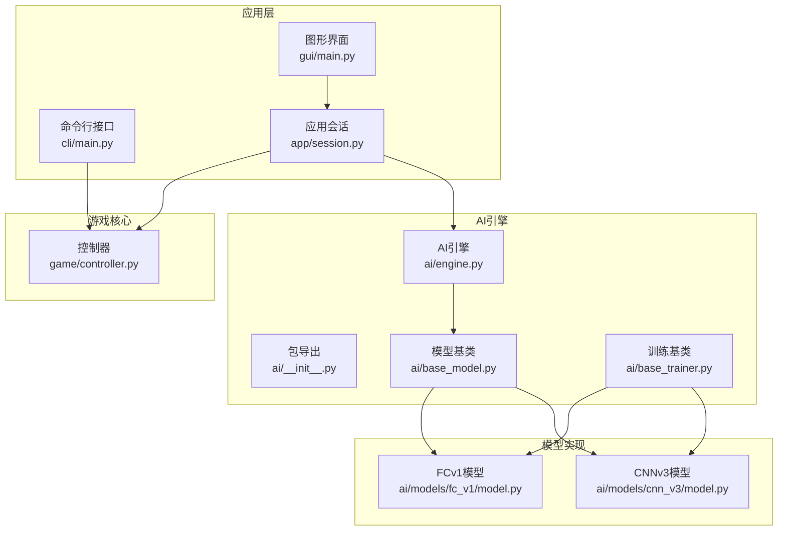
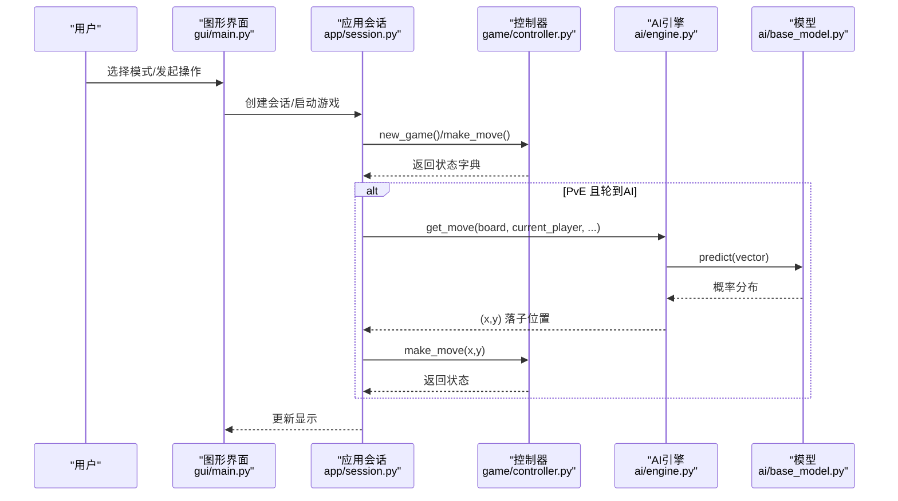
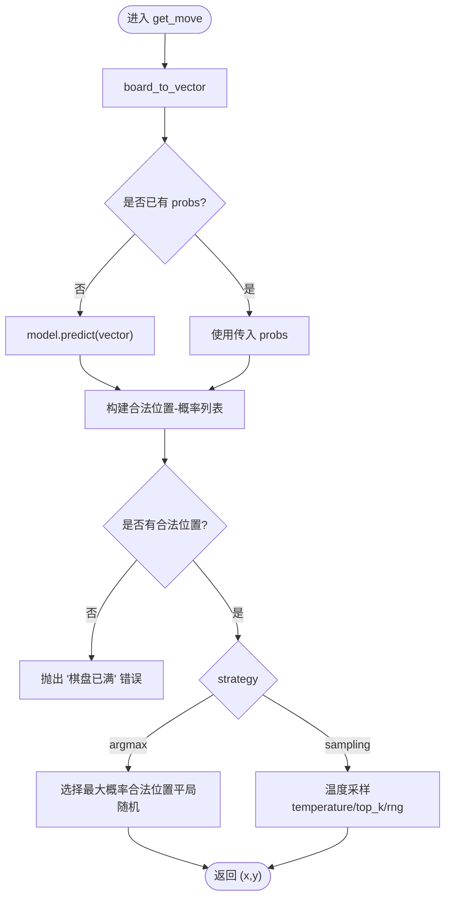
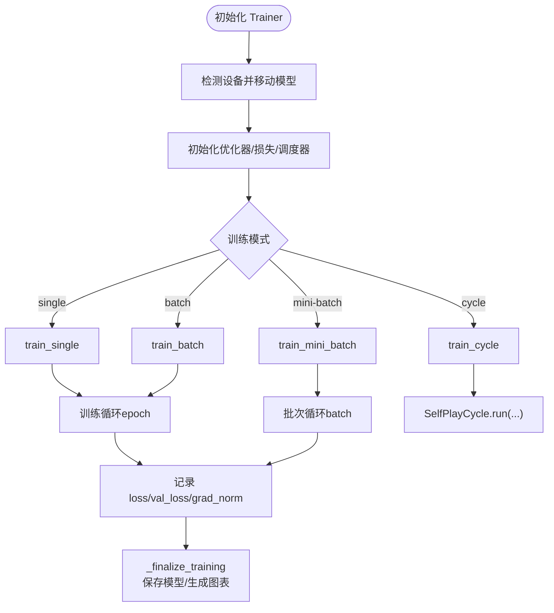
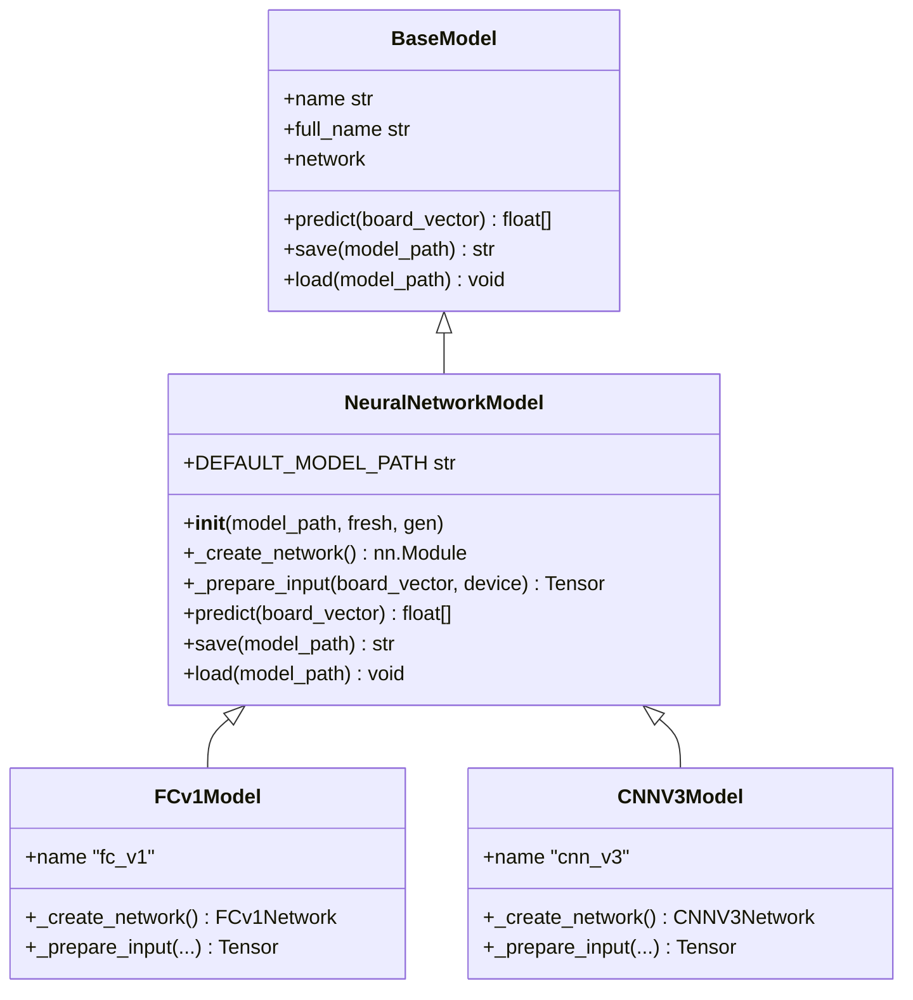
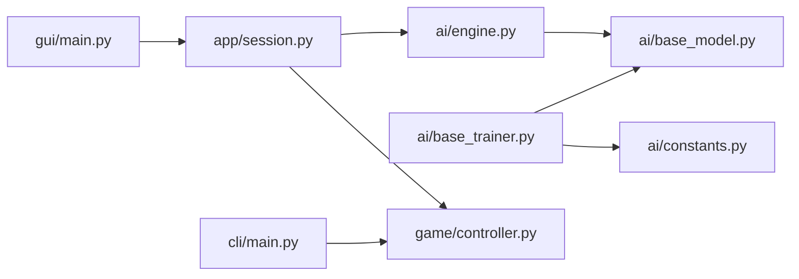

# 编码规范

<cite>
**本文引用的文件**
- [README.md](file://README.md)
- [design/design_specification.md](file://design/design_specification.md)
- [ai/__init__.py](file://ai/__init__.py)
- [ai/base_model.py](file://ai/base_model.py)
- [ai/base_trainer.py](file://ai/base_trainer.py)
- [ai/engine.py](file://ai/engine.py)
- [ai/models/fc_v1/model.py](file://ai/models/fc_v1/model.py)
- [ai/models/cnn_v3/model.py](file://ai/models/cnn_v3/model.py)
- [game/controller.py](file://game/controller.py)
- [gui/main.py](file://gui/main.py)
- [app/session.py](file://app/session.py)
- [cli/main.py](file://cli/main.py)
- [tests/conftest.py](file://tests/conftest.py)
- [ai/constants.py](file://ai/constants.py)
</cite>

## 目录
1. [简介](#简介)
2. [项目结构](#项目结构)
3. [核心组件](#核心组件)
4. [架构总览](#架构总览)
5. [详细组件分析](#详细组件分析)
6. [依赖分析](#依赖分析)
7. [性能考虑](#性能考虑)
8. [故障排查指南](#故障排查指南)
9. [结论](#结论)
10. [附录](#附录)

## 简介
本编码规范面向五子棋AI项目，旨在统一代码风格、模块组织、函数与类设计、文档编写、版本控制与质量保障流程，提升可维护性与协作效率。规范以现有代码为依据，结合项目设计文档与测试实践，提出可落地的工程化标准。

## 项目结构
项目采用分层与功能域结合的组织方式：
- 顶层模块：cli（命令行）、gui（图形界面）、game（核心逻辑）、app（应用层会话与辅助）、ai（AI引擎、模型、训练与数据）
- ai 包内进一步细分子模块：models（多代模型）、train_data/merge_samples/ai_data（数据与产物）
- tests 与 design 作为配套支撑

**图示来源**
- [gui/main.py:1-462](file://gui/main.py#L1-L462)
- [app/session.py:1-179](file://app/session.py#L1-L179)
- [game/controller.py:1-194](file://game/controller.py#L1-L194)
- [ai/engine.py:1-194](file://ai/engine.py#L1-L194)
- [ai/base_model.py:1-323](file://ai/base_model.py#L1-L323)
- [ai/base_trainer.py:1-699](file://ai/base_trainer.py#L1-L699)
- [ai/models/fc_v1/model.py:1-132](file://ai/models/fc_v1/model.py#L1-L132)
- [ai/models/cnn_v3/model.py:1-139](file://ai/models/cnn_v3/model.py#L1-L139)
- [ai/__init__.py:1-21](file://ai/__init__.py#L1-L21)

**章节来源**
- [README.md:5-20](file://README.md#L5-L20)
- [design/design_specification.md:75-111](file://design/design_specification.md#L75-L111)

## 核心组件
- 模型基类与模型族：统一接口、神经网络抽象、多代模型支持
- 训练基类：统一训练流程、设备选择、学习率调度、日志与保存
- AI引擎：输入向量转换、模型预测、落子策略（argmax/sampling）
- 控制器：唯一对外接口，统一返回字典结果
- 应用会话：封装PvP/PvE流程，协调控制器与AI引擎
- 命令行与图形界面：用户交互入口，调用控制器与会话

**章节来源**
- [ai/base_model.py:24-105](file://ai/base_model.py#L24-L105)
- [ai/base_trainer.py:32-144](file://ai/base_trainer.py#L32-L144)
- [ai/engine.py:44-194](file://ai/engine.py#L44-L194)
- [game/controller.py:11-194](file://game/controller.py#L11-L194)
- [app/session.py:12-179](file://app/session.py#L12-L179)

## 架构总览
系统遵循“薄应用层、厚核心层”的设计：app/gui/cli 仅负责流程编排与用户交互，业务逻辑集中在 game 与 ai 包。AI引擎通过注册表与工厂函数解耦模型选择，训练器通过抽象基类统一训练生命周期。

**图示来源**
- [gui/main.py:398-462](file://gui/main.py#L398-L462)
- [app/session.py:63-179](file://app/session.py#L63-L179)
- [game/controller.py:32-121](file://game/controller.py#L32-L121)
- [ai/engine.py:67-142](file://ai/engine.py#L67-L142)
- [ai/base_model.py:38-91](file://ai/base_model.py#L38-L91)

## 详细组件分析

### AI引擎与落子策略
- 输入向量：棋盘展平+当前玩家，输出225维概率分布
- 策略：
  - argmax：概率最大合法位置，平局时随机打破
  - sampling：温度采样，支持top-k与自定义随机源
- 错误处理：非法策略、温度参数、棋盘已满等场景抛出异常

**图示来源**
- [ai/engine.py:106-142](file://ai/engine.py#L106-L142)
- [ai/engine.py:144-171](file://ai/engine.py#L144-L171)
- [ai/engine.py:173-194](file://ai/engine.py#L173-L194)

**章节来源**
- [ai/engine.py:18-194](file://ai/engine.py#L18-L194)

### 训练器抽象与训练流程
- 设备检测：优先CUDA，否则CPU
- 优化器：AdamW（解耦权重衰减）
- 损失：L1Loss（masked）
- 训练模式：单样本、批量、mini-batch、训练周期
- 日志：支持密集/稀疏日志、val_loss、曲线图生成
- 保存：异常中断时自动保存模型与图表

**图示来源**
- [ai/base_trainer.py:21-120](file://ai/base_trainer.py#L21-L120)
- [ai/base_trainer.py:257-322](file://ai/base_trainer.py#L257-L322)
- [ai/base_trainer.py:360-407](file://ai/base_trainer.py#L360-L407)
- [ai/base_trainer.py:409-573](file://ai/base_trainer.py#L409-L573)
- [ai/base_trainer.py:621-660](file://ai/base_trainer.py#L621-L660)

**章节来源**
- [ai/base_trainer.py:32-699](file://ai/base_trainer.py#L32-L699)

### 模型基类与多代模型
- BaseModel：统一接口（predict/name/save/load/network）
- NeuralNetworkModel：统一神经网络初始化、加载、预测流程
- 多代模型：通过gen参数覆盖默认模型路径，强制命中权重文件

**图示来源**
- [ai/base_model.py:24-105](file://ai/base_model.py#L24-L105)
- [ai/base_model.py:107-200](file://ai/base_model.py#L107-L200)
- [ai/models/fc_v1/model.py:91-132](file://ai/models/fc_v1/model.py#L91-L132)
- [ai/models/cnn_v3/model.py:96-139](file://ai/models/cnn_v3/model.py#L96-L139)

**章节来源**
- [ai/base_model.py:1-323](file://ai/base_model.py#L1-L323)
- [ai/models/fc_v1/model.py:1-132](file://ai/models/fc_v1/model.py#L1-L132)
- [ai/models/cnn_v3/model.py:1-139](file://ai/models/cnn_v3/model.py#L1-L139)

### 控制器与统一返回格式
- 唯一对外接口，集中处理异常并返回统一字典结构
- 支持新游戏、落子、列表、加载、状态查询等

**章节来源**
- [game/controller.py:11-194](file://game/controller.py#L11-L194)

### 应用会话与GUI集成
- 会话封装 PvE/PvP 流程，协调控制器与AI引擎
- GUI 通过会话与控制器交互，必要时触发AI落子

**章节来源**
- [app/session.py:12-179](file://app/session.py#L12-L179)
- [gui/main.py:31-90](file://gui/main.py#L31-L90)

## 依赖分析
- 模块导入：遵循“从高内聚包导入，避免循环依赖”，如 engine 本地导入 move_sampler
- 包导出：ai/__init__.py 明确公开接口，避免直接依赖内部实现
- 外部依赖：PyTorch、matplotlib（可选）、numpy（通过README提及）

**图示来源**
- [ai/engine.py:9-15](file://ai/engine.py#L9-L15)
- [ai/base_trainer.py:14-18](file://ai/base_trainer.py#L14-L18)
- [ai/constants.py:1-26](file://ai/constants.py#L1-L26)
- [app/session.py:7-9](file://app/session.py#L7-L9)
- [gui/main.py:18-28](file://gui/main.py#L18-L28)
- [cli/main.py:9-11](file://cli/main.py#L9-L11)

**章节来源**
- [ai/__init__.py:7-20](file://ai/__init__.py#L7-L20)

## 性能考虑
- 训练阶段
  - 优先使用GPU（自动检测），减少CPU瓶颈
  - mini-batch 训练提高收敛速度，适合大规模数据
  - masked L1Loss 仅对合法位置计算，避免无效梯度
- 推理阶段
  - AI引擎支持传入预计算probs，避免重复model.predict
  - argmax策略在平局时随机打破，避免确定性路径退化
- 可观测性
  - 支持密集/稀疏日志，双Y轴曲线叠加（loss与grad_norm）

**章节来源**
- [ai/base_trainer.py:21-120](file://ai/base_trainer.py#L21-L120)
- [ai/base_trainer.py:678-699](file://ai/base_trainer.py#L678-L699)
- [ai/engine.py:106-125](file://ai/engine.py#L106-L125)

## 故障排查指南
- 模型加载失败
  - 现象：PvE模式下抛出 ModelLoadError
  - 处理：GUI捕获后弹窗提示，回退到模式选择
- 训练中断
  - 现象：Ctrl+C保存模型与图表
  - 处理：继续运行可安全退出，下次可恢复进度
- 写入保护
  - 测试期间禁止写入受保护目录，防止污染生产数据
- 日志目录
  - 通过环境变量覆盖日志目录，测试时使用临时目录隔离

**章节来源**
- [app/session.py:44-51](file://app/session.py#L44-L51)
- [gui/main.py:418-420](file://gui/main.py#L418-L420)
- [tests/conftest.py:44-119](file://tests/conftest.py#L44-L119)
- [ai/constants.py:19-22](file://ai/constants.py#L19-L22)

## 结论
本规范以现有代码为依据，总结了命名、模块组织、函数与类设计、文档与版本控制、质量保障等方面的最佳实践。建议团队在开发中严格遵循，持续改进，确保项目长期可维护与高质量交付。

## 附录

### 代码风格与命名规范
- 文件与模块
  - 模块名使用小写与下划线，避免混合大小写
  - 包导出通过 __all__ 明确公共接口
- 类与方法
  - 类名使用 PascalCase；方法/函数使用 snake_case
  - 属性与局部变量使用 snake_case
- 常量
  - 常量使用 UPPER_CASE，放置于模块顶部
- 注释与文档
  - 模块顶部添加简要说明与用途
  - 公开函数/类添加docstring，描述参数、返回值与异常
  - 复杂逻辑添加行内注释说明设计动机

**章节来源**
- [ai/__init__.py:1-21](file://ai/__init__.py#L1-L21)
- [ai/base_model.py:24-105](file://ai/base_model.py#L24-L105)
- [ai/base_trainer.py:32-144](file://ai/base_trainer.py#L32-L144)
- [ai/engine.py:18-56](file://ai/engine.py#L18-L56)

### 模块组织与导入顺序
- 导入顺序
  - 标准库 → 第三方库 → 项目内相对导入
  - 高内聚模块优先，避免循环依赖
- 包管理
  - 使用 __init__.py 暴露公共接口，避免深层路径依赖
  - 多代模型通过 gen 参数覆盖默认路径

**章节来源**
- [ai/__init__.py:7-20](file://ai/__init__.py#L7-L20)
- [ai/base_model.py:139-143](file://ai/base_model.py#L139-L143)

### 函数与类设计规范
- 函数签名
  - 明确参数类型与默认值，必要时提供注释说明
  - 返回值统一格式（如字典），便于上层处理
- 参数验证
  - 对非法输入抛出明确异常，提供错误信息
- 错误处理
  - 使用异常链（from e）保留原始错误上下文
  - GUI/应用层捕获并转换为用户可理解的信息
- 返回值
  - 统一返回字典结构，包含 status/error/数据字段

**章节来源**
- [game/controller.py:65-97](file://game/controller.py#L65-L97)
- [app/session.py:44-51](file://app/session.py#L44-L51)

### 文档编写标准
- docstring格式
  - 使用中文docstring，包含：简述、参数、返回值、异常
  - 复杂逻辑补充设计要点与边界条件
- API文档生成
  - 项目使用pytest与内置测试，建议配合工具生成API文档（如基于注释的自动化工具）
- 代码注释
  - 关键决策与权衡添加注释，解释设计动机与替代方案

**章节来源**
- [ai/engine.py:18-56](file://ai/engine.py#L18-L56)
- [ai/base_trainer.py:127-144](file://ai/base_trainer.py#L127-L144)

### 版本控制最佳实践
- 分支策略
  - 主干保护，功能开发在特性分支，合并前审查
- 提交消息
  - 格式：类型(范围): 概述；正文说明动机与影响
- 代码审查
  - 关注可读性、健壮性、性能与一致性
- 合并规则
  - 通过CI与测试，避免破坏性变更

### 代码质量检查与工具使用
- 静态分析
  - 使用类型注解与mypy（建议）
- 重构与性能优化
  - 合理拆分函数，消除重复；利用mini-batch与GPU加速
- 测试
  - pytest为主，conftest集中配置；写入保护避免污染生产数据

**章节来源**
- [tests/conftest.py:1-119](file://tests/conftest.py#L1-L119)

### 常见编码陷阱与安全实践
- 循环依赖
  - 通过本地导入或延迟导入规避
- 异常处理
  - 明确异常类型与信息，避免吞掉异常
- 资源管理
  - 训练中断自动保存模型与图表，避免丢失进度
- 写入保护
  - 测试期间拦截写入受保护目录，防止污染

**章节来源**
- [ai/engine.py:132-139](file://ai/engine.py#L132-L139)
- [gui/main.py:418-420](file://gui/main.py#L418-L420)
- [tests/conftest.py:44-119](file://tests/conftest.py#L44-L119)