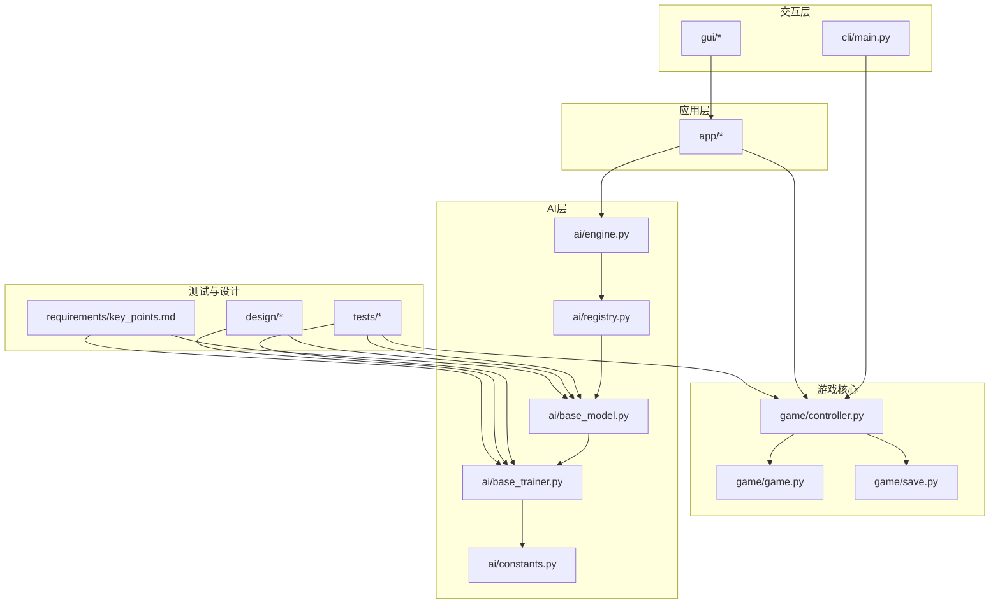
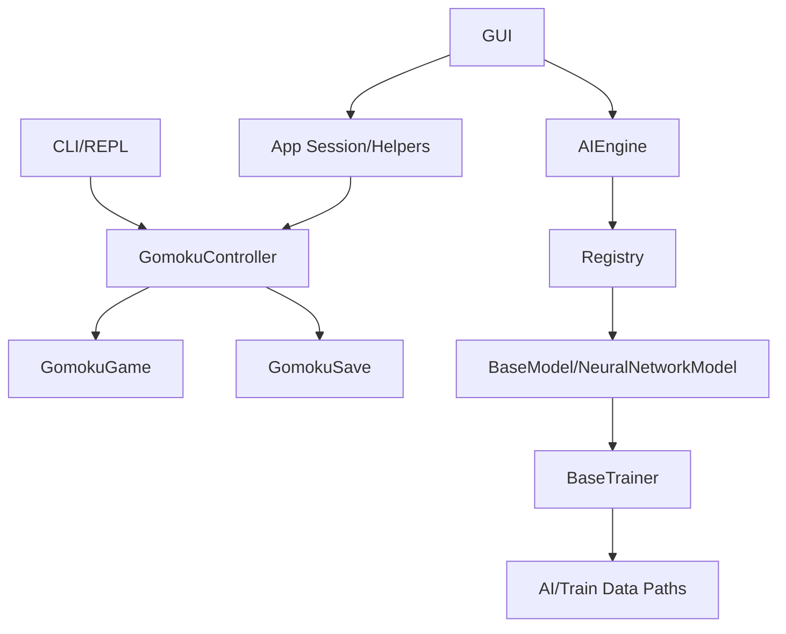
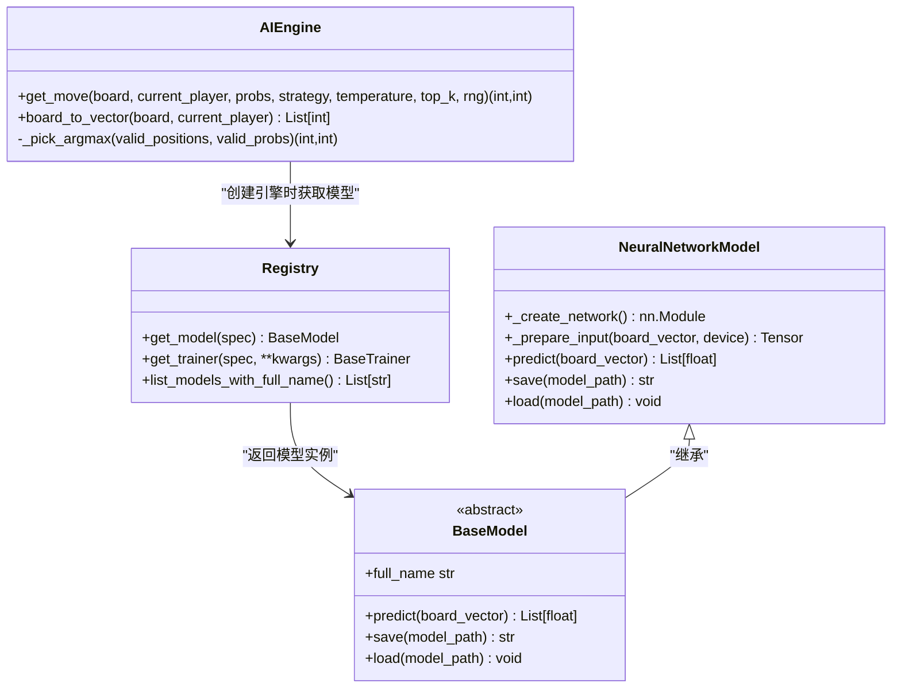
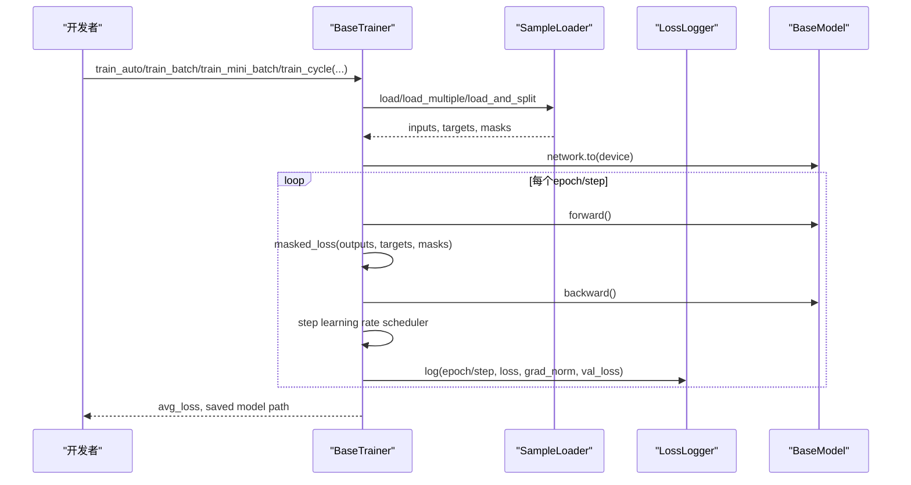
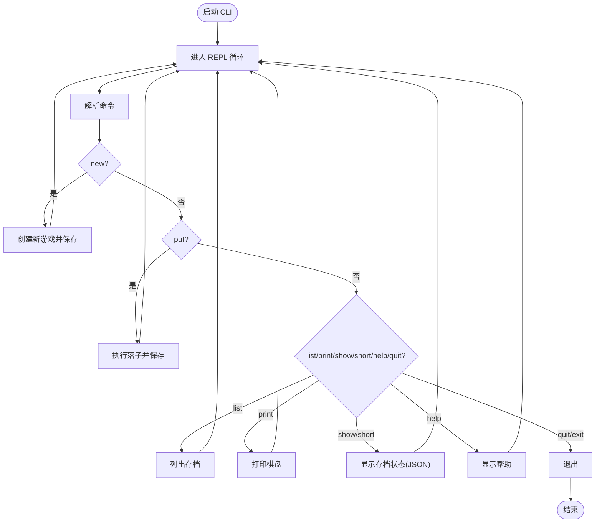
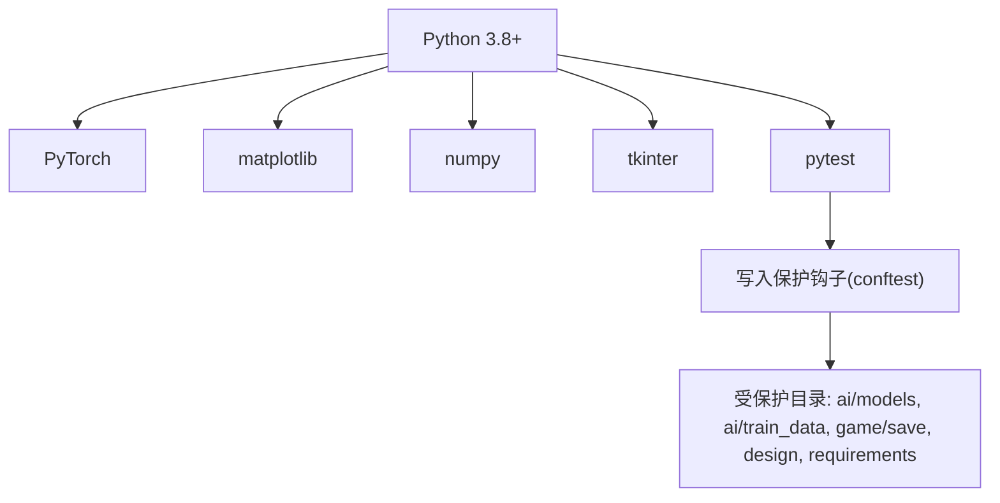

# 贡献指南

<cite>
**本文引用的文件**
- [README.md](file://README.md)
- [requirements/key_points.md](file://requirements/key_points.md)
- [cli/main.py](file://cli/main.py)
- [game/controller.py](file://game/controller.py)
- [ai/base_model.py](file://ai/base_model.py)
- [ai/base_trainer.py](file://ai/base_trainer.py)
- [ai/engine.py](file://ai/engine.py)
- [ai/constants.py](file://ai/constants.py)
- [ai/registry.py](file://ai/registry.py)
- [tests/conftest.py](file://tests/conftest.py)
- [design/design_specification.md](file://design/design_specification.md)
</cite>

## 目录
1. [简介](#简介)
2. [项目结构](#项目结构)
3. [核心组件](#核心组件)
4. [架构总览](#架构总览)
5. [详细组件分析](#详细组件分析)
6. [依赖分析](#依赖分析)
7. [性能考虑](#性能考虑)
8. [故障排查指南](#故障排查指南)
9. [结论](#结论)
10. [附录](#附录)

## 简介
本指南面向希望为五子棋AI项目做出贡献的开发者，涵盖开发环境搭建、代码贡献流程、问题报告规范、文档贡献、社区行为准则、项目路线图理解与参与方式，以及新贡献者入门与导师建议。项目采用Python生态，结合PyTorch构建AI模型，支持命令行与图形界面两种交互方式，并提供完善的训练与评估流水线。

## 项目结构
项目采用模块化分层组织，核心模块包括：
- 游戏核心：game（控制器、游戏逻辑、存档）
- 交互界面：cli（命令行）、gui（图形界面）
- AI模块：ai（引擎、模型、训练器、数据记录、评估器、注册表等）
- 测试：tests（pytest驱动，含写入保护）
- 设计文档：design（架构与设计说明）
- 临时分析：temp（临时脚本）
- 要点说明：requirements/key_points.md（项目目标、接口规范、训练流程等）

**图示来源**
- [cli/main.py:1-258](file://cli/main.py#L1-L258)
- [game/controller.py:1-194](file://game/controller.py#L1-L194)
- [ai/engine.py:1-194](file://ai/engine.py#L1-L194)
- [ai/registry.py:1-316](file://ai/registry.py#L1-L316)
- [ai/base_model.py:1-323](file://ai/base_model.py#L1-L323)
- [ai/base_trainer.py:1-699](file://ai/base_trainer.py#L1-L699)
- [ai/constants.py:1-26](file://ai/constants.py#L1-L26)
- [tests/conftest.py:1-119](file://tests/conftest.py#L1-L119)
- [requirements/key_points.md:1-653](file://requirements/key_points.md#L1-L653)

**章节来源**
- [README.md:5-20](file://README.md#L5-L20)
- [requirements/key_points.md:1-653](file://requirements/key_points.md#L1-L653)

## 核心组件
- 游戏控制器：统一对外接口，协调游戏逻辑与存档管理，提供状态查询与JSON导出能力。
- AI引擎：桥接UI与模型，将棋盘状态转换为模型输入，按策略选择落子位置。
- 模型基类与神经网络模型：定义统一接口与通用逻辑，支持多代模型与多设备训练。
- 训练器基类：提供单轮次、批量、mini-batch与训练周期等训练模式，内置学习率调度与损失日志。
- 注册表：集中管理模型与训练器映射，支持多代模型懒加载与校验。
- 常量与路径：统一AI数据与训练数据目录，支持环境变量覆盖（测试隔离）。

**章节来源**
- [game/controller.py:11-194](file://game/controller.py#L11-L194)
- [ai/engine.py:44-194](file://ai/engine.py#L44-L194)
- [ai/base_model.py:24-323](file://ai/base_model.py#L24-L323)
- [ai/base_trainer.py:32-699](file://ai/base_trainer.py#L32-L699)
- [ai/registry.py:58-316](file://ai/registry.py#L58-L316)
- [ai/constants.py:11-26](file://ai/constants.py#L11-L26)

## 架构总览
系统采用清晰的分层架构：交互层（CLI/GUI）→ 应用层（会话、GUI辅助）→ 控制层（GomokuController）→ 游戏层（GomokuGame、GomokuSave）→ AI层（Registry、Engine、Models、Trainers）。AI层通过注册表实现模型与训练器的统一管理与懒加载，支持多代模型与多设备训练。

**图示来源**
- [cli/main.py:19-258](file://cli/main.py#L19-L258)
- [game/controller.py:11-194](file://game/controller.py#L11-L194)
- [ai/engine.py:18-42](file://ai/engine.py#L18-L42)
- [ai/registry.py:150-184](file://ai/registry.py#L150-L184)
- [ai/base_model.py:107-276](file://ai/base_model.py#L107-L276)
- [ai/base_trainer.py:21-120](file://ai/base_trainer.py#L21-L120)
- [ai/constants.py:11-26](file://ai/constants.py#L11-L26)

## 详细组件分析

### 组件A：AI引擎与模型加载（AIEngine + Registry）
AI引擎负责将棋盘状态转换为模型输入并按策略选择落子；注册表集中管理模型与训练器映射，支持多代模型懒加载与校验。引擎与注册表协同，确保外部调用无需关心具体模型类。

**图示来源**
- [ai/engine.py:44-194](file://ai/engine.py#L44-L194)
- [ai/registry.py:150-224](file://ai/registry.py#L150-L224)
- [ai/base_model.py:24-276](file://ai/base_model.py#L24-L276)

**章节来源**
- [ai/engine.py:67-143](file://ai/engine.py#L67-L143)
- [ai/registry.py:103-184](file://ai/registry.py#L103-L184)
- [ai/base_model.py:107-231](file://ai/base_model.py#L107-L231)

### 组件B：训练器基类（BaseTrainer）工作流
训练器基类提供统一的训练流程：单轮次训练、批量训练、mini-batch训练与训练周期。支持GPU加速、学习率调度、验证集评估与损失日志记录。

**图示来源**
- [ai/base_trainer.py:324-604](file://ai/base_trainer.py#L324-L604)
- [ai/base_trainer.py:621-660](file://ai/base_trainer.py#L621-L660)
- [ai/base_model.py:195-231](file://ai/base_model.py#L195-L231)

**章节来源**
- [ai/base_trainer.py:257-323](file://ai/base_trainer.py#L257-L323)
- [ai/base_trainer.py:409-573](file://ai/base_trainer.py#L409-L573)
- [ai/base_trainer.py:621-660](file://ai/base_trainer.py#L621-L660)

### 组件C：命令行交互与游戏控制
命令行主程序提供REPL循环，解析用户命令并调用控制器执行；控制器封装游戏逻辑与存档管理，统一返回结果。

**图示来源**
- [cli/main.py:19-258](file://cli/main.py#L19-L258)
- [game/controller.py:32-175](file://game/controller.py#L32-L175)

**章节来源**
- [cli/main.py:45-258](file://cli/main.py#L45-L258)
- [game/controller.py:11-194](file://game/controller.py#L11-L194)

## 依赖分析
- Python版本：项目要求Python 3.8+（参考README）。
- 核心依赖：PyTorch（AI训练与推理）、matplotlib（训练曲线）、numpy（数值计算）。
- GUI依赖：tkinter（图形界面）。
- 测试框架：pytest，配合写入保护钩子防止测试污染生产数据目录。

**图示来源**
- [README.md:24-34](file://README.md#L24-L34)
- [tests/conftest.py:44-119](file://tests/conftest.py#L44-L119)

**章节来源**
- [README.md:24-34](file://README.md#L24-L34)
- [tests/conftest.py:44-119](file://tests/conftest.py#L44-L119)

## 性能考虑
- GPU加速：训练器自动检测CUDA并优先使用GPU；模型网络移动至对应设备。
- 学习率调度：支持StepLR与ReduceLROnPlateau，降低训练停滞风险。
- mini-batch训练：显著提升收敛速度与内存效率，适合大规模数据。
- 损失日志与曲线：支持密集日志与验证集评估，便于训练可观测性。
- 多代模型：通过gen{i}目录隔离权重，避免命名冲突与加载错误。

**章节来源**
- [ai/base_trainer.py:21-120](file://ai/base_trainer.py#L21-L120)
- [ai/base_trainer.py:127-144](file://ai/base_trainer.py#L127-L144)
- [ai/base_trainer.py:409-573](file://ai/base_trainer.py#L409-L573)
- [ai/base_model.py:126-164](file://ai/base_model.py#L126-L164)

## 故障排查指南
- 测试写入保护：pytest运行期间拦截对受保护目录的写入，避免污染生产数据；如遇AssertionError，请使用临时目录或fixture。
- 模型加载错误：多代模型未指定代数或权重文件缺失会抛出异常；请使用“模型名.代数”格式或确保权重文件存在。
- 训练中断：支持Ctrl+C优雅退出，自动保存模型与图表；重新运行可继续训练。
- 存档冲突：CLI/GUI均通过控制器访问游戏状态，避免直接文件操作；如遇并发问题，遵循单进程操作建议。

**章节来源**
- [tests/conftest.py:92-106](file://tests/conftest.py#L92-L106)
- [ai/registry.py:150-184](file://ai/registry.py#L150-L184)
- [ai/base_trainer.py:314-322](file://ai/base_trainer.py#L314-L322)

## 结论
本指南提供了从环境搭建到代码贡献、从问题报告到文档贡献的完整路径。建议贡献者在提交前阅读相关设计文档与测试规范，确保变更与项目演进方向一致，并通过pytest全面验证。

## 附录

### 开发环境搭建
- Python版本：3.8+
- 依赖安装：PyTorch、matplotlib、numpy
- GUI依赖：tkinter
- 安装命令：pip install torch matplotlib numpy

**章节来源**
- [README.md:24-34](file://README.md#L24-L34)

### 代码贡献流程
- Fork项目至个人仓库
- 创建功能分支（建议使用“feature/”或“fix/”前缀）
- 提交代码并附上清晰的提交信息
- 发起Pull Request，描述变更动机、影响范围与测试结果
- 代码审查通过后合并

[本节为通用流程说明，不直接分析具体文件]

### 问题报告规范
- Bug报告模板：包含环境信息、复现步骤、期望结果与实际结果
- 功能请求格式：描述背景、预期行为、影响范围与验收标准
- 标签使用：按类型（bug/feature/enhancement）、严重程度（low/medium/high）与模块（ai/gui/cli）分类
- 优先级评估：结合影响范围、紧急程度与资源投入进行排序

[本节为通用规范说明，不直接分析具体文件]

### 文档贡献指南
- 文档编写规范：使用Markdown，保持术语一致与结构清晰
- 翻译要求：中文为主，必要时提供英文摘要
- 示例代码更新：随功能变更同步更新示例与截图
- 版本说明：记录重大变更、破坏性更新与迁移指引

[本节为通用规范说明，不直接分析具体文件]

### 社区行为准则
- 沟通礼仪：尊重他人意见，提供建设性反馈
- 协作原则：鼓励开放讨论与知识分享
- 冲突解决：优先协商，必要时由维护者仲裁
- 知识产权：遵循项目许可证（MIT）

[本节为通用准则说明，不直接分析具体文件]

### 项目路线图与参与
- 路线图理解：关注design目录中的设计文档与task_reports中的任务报告
- 功能特性讨论：通过issue与PR讨论设计与实现细节
- 决策流程：维护者主导，贡献者广泛参与，达成共识后实施

**章节来源**
- [design/design_specification.md:1-800](file://design/design_specification.md#L1-L800)

### 新贡献者入门与导师制度
- 入门指导：从README与requirements/key_points.md开始，熟悉项目目标与接口规范
- 导师制度：建议认领简单任务（如测试补充、文档润色），逐步深入核心模块
- 技能提升：结合设计文档与训练器/模型实现，掌握AI训练与评估流程

**章节来源**
- [README.md:1-422](file://README.md#L1-L422)
- [requirements/key_points.md:1-653](file://requirements/key_points.md#L1-L653)