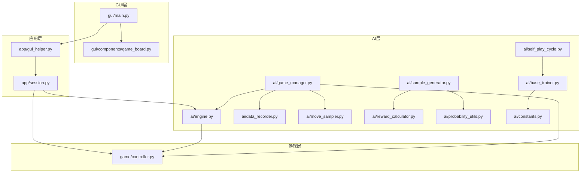
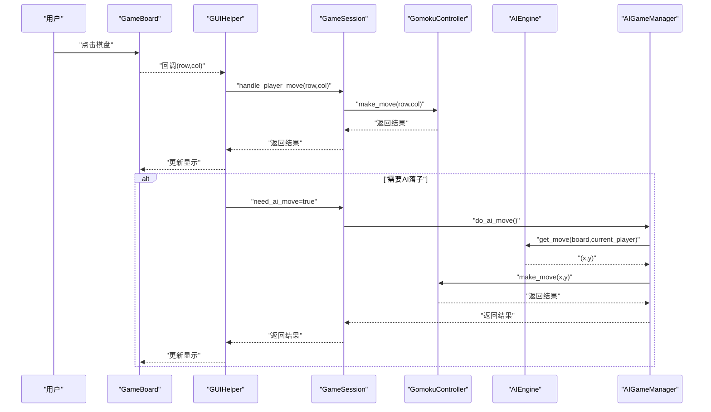
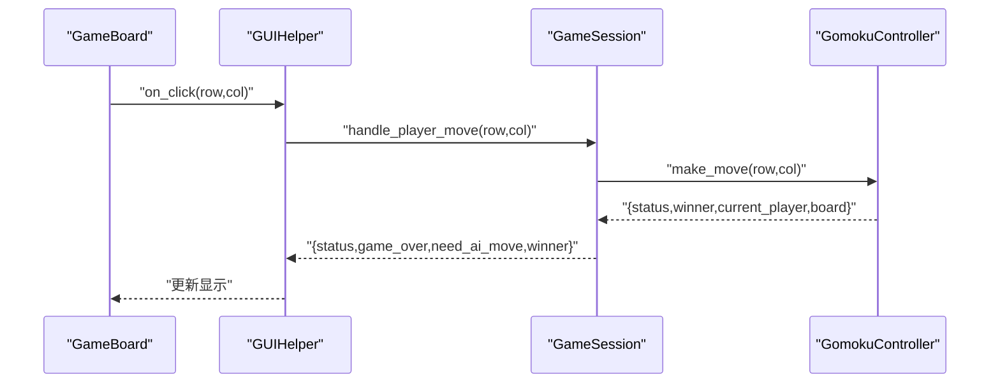
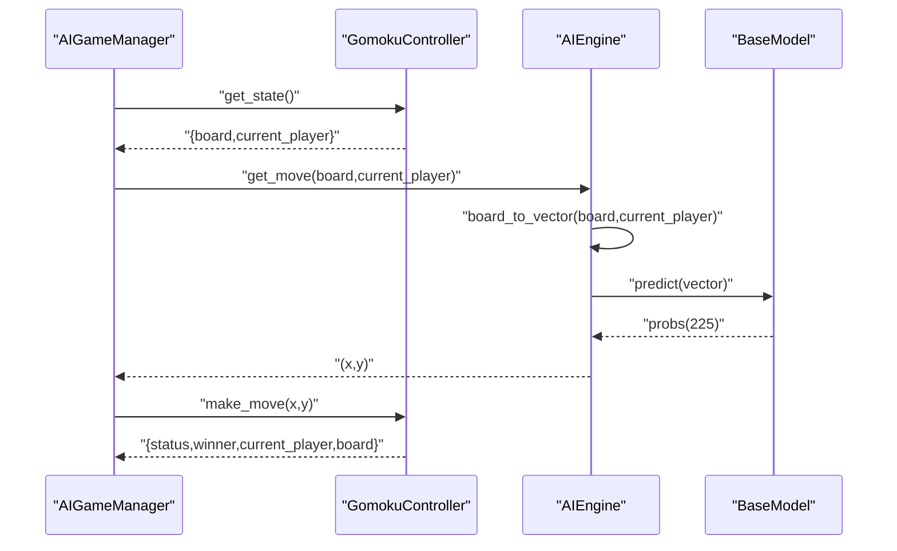
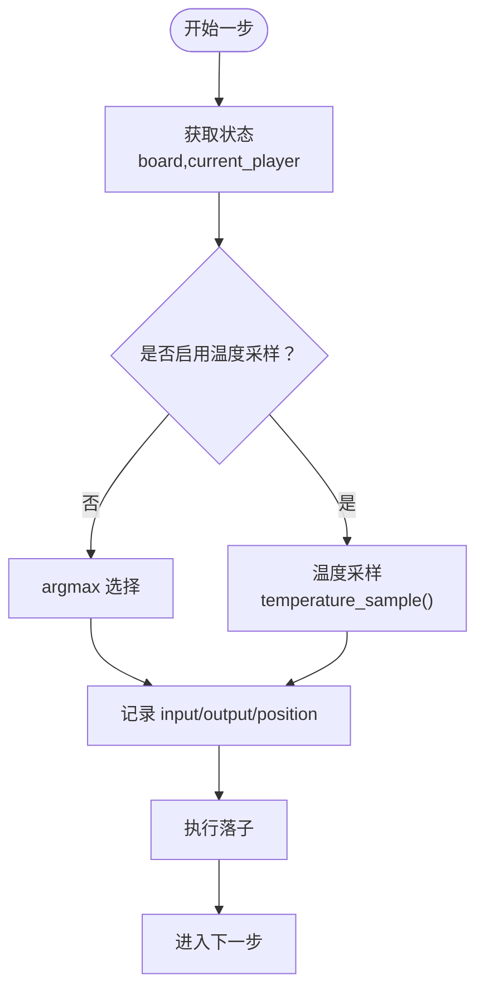
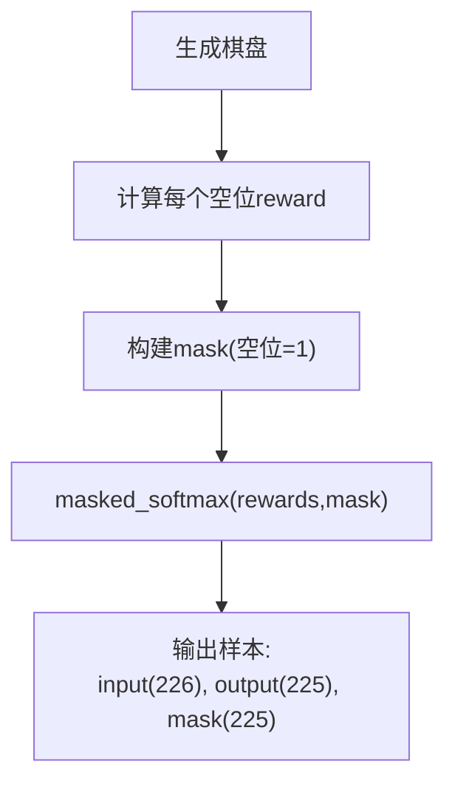
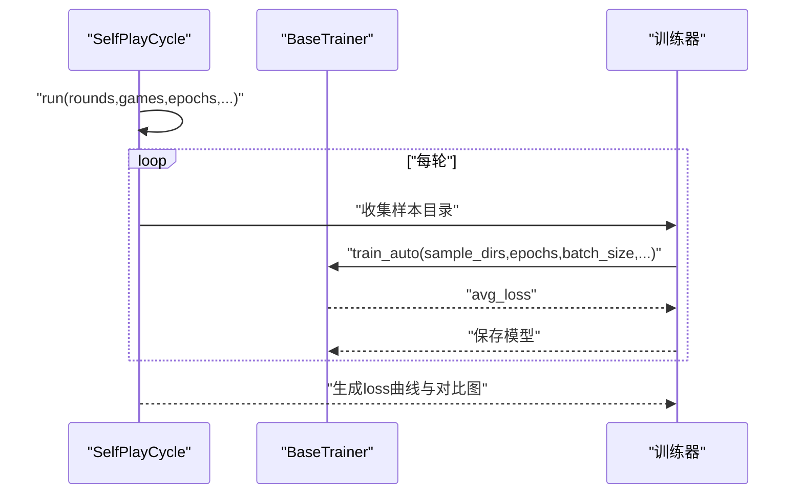
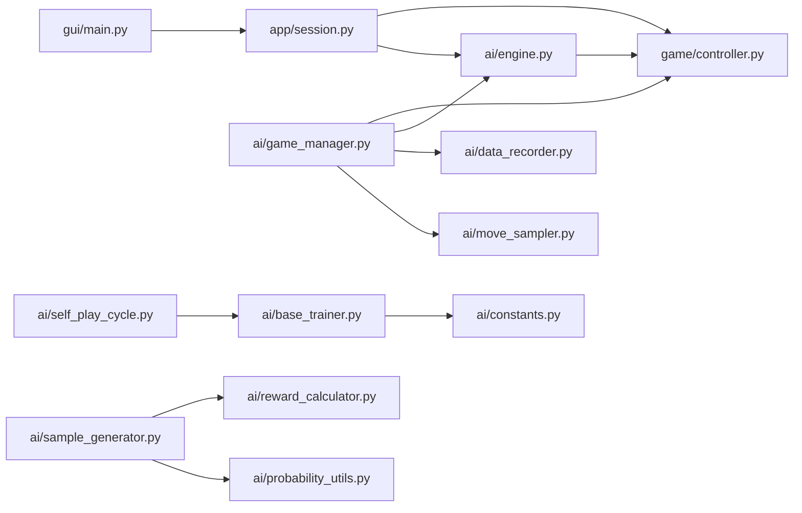

# 数据流设计

<cite>
**本文引用的文件**
- [ai/engine.py](file://ai/engine.py)
- [ai/game_manager.py](file://ai/game_manager.py)
- [ai/data_recorder.py](file://ai/data_recorder.py)
- [ai/move_sampler.py](file://ai/move_sampler.py)
- [ai/constants.py](file://ai/constants.py)
- [ai/base_trainer.py](file://ai/base_trainer.py)
- [ai/self_play_cycle.py](file://ai/self_play_cycle.py)
- [ai/sample_generator.py](file://ai/sample_generator.py)
- [ai/reward_calculator.py](file://ai/reward_calculator.py)
- [ai/probability_utils.py](file://ai/probability_utils.py)
- [game/controller.py](file://game/controller.py)
- [app/session.py](file://app/session.py)
- [app/gui_helper.py](file://app/gui_helper.py)
- [gui/main.py](file://gui/main.py)
- [gui/components/game_board.py](file://gui/components/game_board.py)
</cite>

## 目录
1. [简介](#简介)
2. [项目结构](#项目结构)
3. [核心组件](#核心组件)
4. [架构总览](#架构总览)
5. [详细组件分析](#详细组件分析)
6. [依赖关系分析](#依赖关系分析)
7. [性能考量](#性能考量)
8. [故障排查指南](#故障排查指南)
9. [结论](#结论)
10. [附录](#附录)

## 简介
本文件面向五子棋AI项目，系统化梳理“数据流”设计，覆盖以下方面：
- 用户输入数据：鼠标点击坐标经GUI组件转换为行列索引，再进入会话层与控制器层。
- 游戏状态数据：控制器统一管理棋盘、当前玩家、胜负状态、历史记录等。
- AI决策数据：AI引擎将棋盘状态转换为模型输入向量，调用模型得到概率分布，按策略选择落子。
- 训练数据：样本生成器基于棋型规则生成带掩码的输入/输出样本，训练器进行批处理与损失计算。
- 数据一致性与错误处理：通过严格的参数校验、日志记录、异常上抛与GUI提示，保障流程稳健。

## 项目结构
项目采用分层架构：
- GUI层：负责用户交互与显示更新（tkinter组件）
- 应用层：会话与辅助逻辑，协调控制器与AI
- 游戏层：统一的游戏规则与状态管理
- AI层：引擎、管理器、采样器、记录器、训练器、样本生成器等

**图示来源**
- [gui/main.py:1-462](file://gui/main.py#L1-L462)
- [gui/components/game_board.py:1-170](file://gui/components/game_board.py#L1-L170)
- [app/session.py:1-179](file://app/session.py#L1-L179)
- [app/gui_helper.py:1-199](file://app/gui_helper.py#L1-L199)
- [game/controller.py:1-194](file://game/controller.py#L1-L194)
- [ai/engine.py:1-194](file://ai/engine.py#L1-L194)
- [ai/game_manager.py:1-339](file://ai/game_manager.py#L1-L339)
- [ai/data_recorder.py:1-145](file://ai/data_recorder.py#L1-L145)
- [ai/move_sampler.py:1-258](file://ai/move_sampler.py#L1-L258)
- [ai/base_trainer.py:1-699](file://ai/base_trainer.py#L1-L699)
- [ai/self_play_cycle.py:1-195](file://ai/self_play_cycle.py#L1-L195)
- [ai/sample_generator.py:1-511](file://ai/sample_generator.py#L1-L511)
- [ai/reward_calculator.py:1-239](file://ai/reward_calculator.py#L1-L239)
- [ai/probability_utils.py:1-59](file://ai/probability_utils.py#L1-L59)
- [ai/constants.py:1-26](file://ai/constants.py#L1-L26)

**章节来源**
- [gui/main.py:1-462](file://gui/main.py#L1-L462)
- [app/session.py:1-179](file://app/session.py#L1-L179)
- [game/controller.py:1-194](file://game/controller.py#L1-L194)
- [ai/engine.py:1-194](file://ai/engine.py#L1-L194)

## 核心组件
- AI引擎（AIEngine）：将棋盘状态转换为输入向量，调用模型预测得到225维概率分布，按策略选择合法位置。
- 游戏管理器（AIGameManager）：协调人机对战流程，封装AI内战循环，统一记录每步输入/输出/落子与结果。
- 数据记录器（DataRecorder）：按轮次与对局组织训练数据，记录输入向量、输出概率、落子位置与终局结果。
- 采样器（move_sampler）：提供温度采样策略与按步/按方判定逻辑，支撑自对弈多样性。
- 训练器（BaseTrainer）：统一训练流程，支持全量与mini-batch训练，自动设备选择与学习率调度。
- 样本生成器（sample_generator）：按棋型合成棋盘，计算reward并生成带掩码的概率标签。
- 控制器（GomokuController）：唯一对外接口，封装落子、状态查询、存档读写。
- 会话（GameSession）：应用层薄代理，协调模式与AI管理器，向GUI暴露统一落子接口。
- GUI组件：GameBoard负责绘制与点击事件，主程序负责菜单与按钮，显示更新器负责刷新界面。

**章节来源**
- [ai/engine.py:44-194](file://ai/engine.py#L44-L194)
- [ai/game_manager.py:16-339](file://ai/game_manager.py#L16-L339)
- [ai/data_recorder.py:17-145](file://ai/data_recorder.py#L17-L145)
- [ai/move_sampler.py:1-258](file://ai/move_sampler.py#L1-L258)
- [ai/base_trainer.py:32-699](file://ai/base_trainer.py#L32-L699)
- [ai/sample_generator.py:1-511](file://ai/sample_generator.py#L1-L511)
- [game/controller.py:11-194](file://game/controller.py#L11-L194)
- [app/session.py:12-179](file://app/session.py#L12-L179)
- [gui/components/game_board.py:1-170](file://gui/components/game_board.py#L1-L170)

## 架构总览
系统采用“事件驱动 + 同步调用”的混合模式：
- GUI层通过组件回调触发用户输入事件，应用层会话与辅助类进行业务编排。
- 控制器作为唯一对外接口，所有外部调用均通过其公开方法。
- AI层通过引擎与管理器完成落子决策与数据记录，训练器在后台进行模型迭代。

**图示来源**
- [gui/components/game_board.py:151-170](file://gui/components/game_board.py#L151-L170)
- [app/gui_helper.py:53-106](file://app/gui_helper.py#L53-L106)
- [app/session.py:63-179](file://app/session.py#L63-L179)
- [game/controller.py:65-98](file://game/controller.py#L65-L98)
- [ai/engine.py:67-143](file://ai/engine.py#L67-L143)
- [ai/game_manager.py:100-122](file://ai/game_manager.py#L100-L122)

## 详细组件分析

### 用户输入数据流（GUI → 控制器）
- GUI组件接收点击事件，转换为行列索引，回调至GUIHelper。
- GUIHelper将请求委派给GameSession，后者调用GomokuController.make_move。
- 控制器执行落子逻辑，返回状态、赢家、当前玩家与棋盘。

**图示来源**
- [gui/components/game_board.py:151-170](file://gui/components/game_board.py#L151-L170)
- [app/gui_helper.py:53-82](file://app/gui_helper.py#L53-L82)
- [app/session.py:63-102](file://app/session.py#L63-L102)
- [game/controller.py:65-98](file://game/controller.py#L65-L98)

**章节来源**
- [gui/components/game_board.py:151-170](file://gui/components/game_board.py#L151-L170)
- [app/gui_helper.py:53-82](file://app/gui_helper.py#L53-L82)
- [app/session.py:63-102](file://app/session.py#L63-L102)
- [game/controller.py:65-98](file://game/controller.py#L65-L98)

### AI决策数据流（引擎 → 控制器）
- AI引擎将15×15棋盘与当前玩家拼接为226维向量，调用模型predict得到225维概率分布。
- 引擎过滤已落子位置，按策略（argmax或温度采样）选择合法位置。
- AIGameManager获取状态后调用引擎决策，再调用控制器执行落子。

**图示来源**
- [ai/game_manager.py:112-122](file://ai/game_manager.py#L112-L122)
- [ai/engine.py:106-143](file://ai/engine.py#L106-L143)
- [ai/engine.py:173-194](file://ai/engine.py#L173-L194)

**章节来源**
- [ai/game_manager.py:112-122](file://ai/game_manager.py#L112-L122)
- [ai/engine.py:67-143](file://ai/engine.py#L67-L143)
- [ai/engine.py:173-194](file://ai/engine.py#L173-L194)

### 温度采样与自对弈编排
- move_sampler提供温度采样、按步/按方判定与按局抽签解析。
- AIGameManager在每步决策前判定是否启用温度采样，并复用模型预测结果，避免重复计算。

**图示来源**
- [ai/game_manager.py:192-211](file://ai/game_manager.py#L192-L211)
- [ai/move_sampler.py:117-186](file://ai/move_sampler.py#L117-L186)
- [ai/move_sampler.py:192-227](file://ai/move_sampler.py#L192-L227)
- [ai/move_sampler.py:229-258](file://ai/move_sampler.py#L229-L258)

**章节来源**
- [ai/game_manager.py:192-211](file://ai/game_manager.py#L192-L211)
- [ai/move_sampler.py:117-186](file://ai/move_sampler.py#L117-L186)
- [ai/move_sampler.py:192-227](file://ai/move_sampler.py#L192-L227)
- [ai/move_sampler.py:229-258](file://ai/move_sampler.py#L229-L258)

### 训练数据生成与格式化
- 样本生成器按棋型合成棋盘，使用奖励计算器计算每个空位的reward，再通过带掩码的softmax生成概率标签。
- 掩码仅对空位生效，已落子位置概率为0，保证训练目标与规则一致。

**图示来源**
- [ai/sample_generator.py:287-328](file://ai/sample_generator.py#L287-L328)
- [ai/reward_calculator.py:46-75](file://ai/reward_calculator.py#L46-L75)
- [ai/probability_utils.py:15-59](file://ai/probability_utils.py#L15-L59)

**章节来源**
- [ai/sample_generator.py:287-328](file://ai/sample_generator.py#L287-L328)
- [ai/reward_calculator.py:46-75](file://ai/reward_calculator.py#L46-L75)
- [ai/probability_utils.py:15-59](file://ai/probability_utils.py#L15-L59)

### 自我对弈训练周期
- SelfPlayCycle编排每轮自对弈与评估，收集样本目录，调用训练器进行批量训练。
- 训练器支持全量与mini-batch两种训练方式，自动记录损失曲线与模型保存。

**图示来源**
- [ai/self_play_cycle.py:38-195](file://ai/self_play_cycle.py#L38-L195)
- [ai/base_trainer.py:575-604](file://ai/base_trainer.py#L575-L604)
- [ai/base_trainer.py:621-660](file://ai/base_trainer.py#L621-L660)

**章节来源**
- [ai/self_play_cycle.py:38-195](file://ai/self_play_cycle.py#L38-L195)
- [ai/base_trainer.py:575-604](file://ai/base_trainer.py#L575-L604)
- [ai/base_trainer.py:621-660](file://ai/base_trainer.py#L621-L660)

## 依赖关系分析
- 组件耦合与内聚
  - GUI层与应用层通过会话与辅助类松耦合；应用层与游戏层通过控制器强耦合，保证唯一入口。
  - AI层内部通过引擎、管理器、采样器、记录器形成清晰职责划分，训练器与样本生成器相对独立。
- 外部依赖
  - 训练器依赖PyTorch与CUDA（自动检测），样本生成器依赖奖励计算器与概率工具。
- 潜在循环依赖
  - SelfPlayCycle与BaseTrainer相互协作，通过函数式接口避免循环导入。

**图示来源**
- [gui/main.py:1-462](file://gui/main.py#L1-L462)
- [app/session.py:1-179](file://app/session.py#L1-L179)
- [game/controller.py:1-194](file://game/controller.py#L1-L194)
- [ai/engine.py:1-194](file://ai/engine.py#L1-L194)
- [ai/game_manager.py:1-339](file://ai/game_manager.py#L1-L339)
- [ai/data_recorder.py:1-145](file://ai/data_recorder.py#L1-L145)
- [ai/move_sampler.py:1-258](file://ai/move_sampler.py#L1-L258)
- [ai/base_trainer.py:1-699](file://ai/base_trainer.py#L1-L699)
- [ai/self_play_cycle.py:1-195](file://ai/self_play_cycle.py#L1-L195)
- [ai/sample_generator.py:1-511](file://ai/sample_generator.py#L1-L511)
- [ai/reward_calculator.py:1-239](file://ai/reward_calculator.py#L1-L239)
- [ai/probability_utils.py:1-59](file://ai/probability_utils.py#L1-L59)
- [ai/constants.py:1-26](file://ai/constants.py#L1-L26)

**章节来源**
- [gui/main.py:1-462](file://gui/main.py#L1-L462)
- [app/session.py:1-179](file://app/session.py#L1-L179)
- [game/controller.py:1-194](file://game/controller.py#L1-L194)
- [ai/engine.py:1-194](file://ai/engine.py#L1-L194)
- [ai/game_manager.py:1-339](file://ai/game_manager.py#L1-L339)
- [ai/data_recorder.py:1-145](file://ai/data_recorder.py#L1-L145)
- [ai/move_sampler.py:1-258](file://ai/move_sampler.py#L1-L258)
- [ai/base_trainer.py:1-699](file://ai/base_trainer.py#L1-L699)
- [ai/self_play_cycle.py:1-195](file://ai/self_play_cycle.py#L1-L195)
- [ai/sample_generator.py:1-511](file://ai/sample_generator.py#L1-L511)
- [ai/reward_calculator.py:1-239](file://ai/reward_calculator.py#L1-L239)
- [ai/probability_utils.py:1-59](file://ai/probability_utils.py#L1-L59)
- [ai/constants.py:1-26](file://ai/constants.py#L1-L26)

## 性能考量
- 数据转换与向量化
  - 引擎将棋盘按行优先展开为225维，拼接当前玩家为226维向量，避免额外拷贝。
  - 训练器对输入进行张量化与设备迁移，支持GPU加速。
- 计算效率
  - AIGameManager在自对弈中复用模型预测结果，避免重复调用。
  - 样本生成器使用带掩码的softmax，仅对合法位置计算概率，提升数值稳定性。
- 内存与IO
  - DataRecorder按对局写入紧凑JSON，减少文件体积；轮次目录按AI名称递增命名，便于管理。

[本节为通用指导，不直接分析具体文件]

## 故障排查指南
- 模型加载失败
  - app层捕获AI引擎创建异常并转换为ModelLoadError，GUI层弹窗提示并回退。
- 落子异常
  - 控制器在游戏结束或未创建时返回错误；AI引擎在棋盘已满时抛出异常。
- 数据一致性
  - DataRecorder在记录前校验游戏编号，不一致时自动纠正并记录警告日志。
- 温度采样参数
  - move_sampler对温度、top_k、temp_side等参数进行严格校验，非法值立即抛错。

**章节来源**
- [app/session.py:44-51](file://app/session.py#L44-L51)
- [game/controller.py:67-98](file://game/controller.py#L67-L98)
- [ai/engine.py:124-126](file://ai/engine.py#L124-L126)
- [ai/data_recorder.py:81-95](file://ai/data_recorder.py#L81-L95)
- [ai/move_sampler.py:77-111](file://ai/move_sampler.py#L77-L111)

## 结论
本项目通过清晰的分层与职责划分，实现了从用户输入到AI决策再到训练数据生成的完整数据流闭环。数据在各层间以结构化格式传递，配合严格的参数校验与错误处理，确保了系统的稳定性与可维护性。建议在后续迭代中持续关注数据格式标准化与日志可观测性，进一步提升训练与推理的透明度。

[本节为总结性内容，不直接分析具体文件]

## 附录
- 数据格式与转换要点
  - 棋盘状态：15×15整数矩阵，0=空，1=黑，2=白
  - 输入向量：225维棋盘展开 + 1维当前玩家（226维）
  - 输出向量：225维概率分布，经softmax归一化
  - 掩码：225维，1=空位，0=已落子
- 关键流程路径
  - 用户落子：GUI组件 → GUIHelper → GameSession → GomokuController
  - AI思考：AIGameManager → AIEngine → BaseModel.predict → 选择落子
  - 训练样本：样本生成器 → 奖励计算器 → 带掩码softmax → 训练器

[本节为概览性内容，不直接分析具体文件]