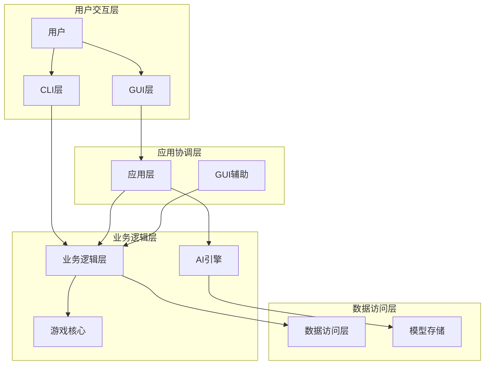
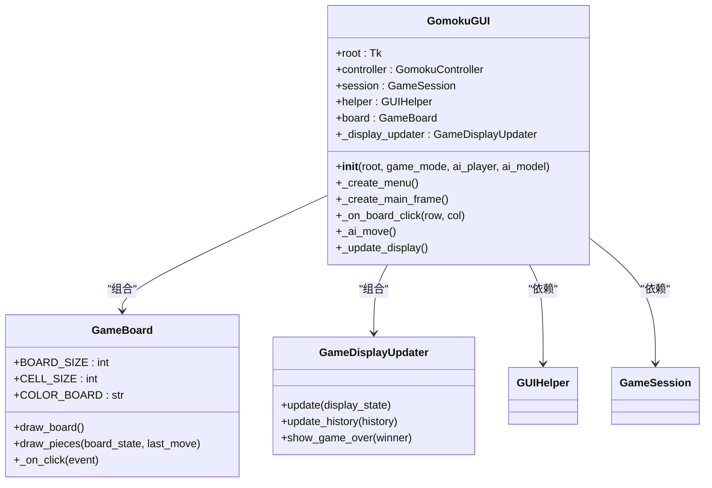
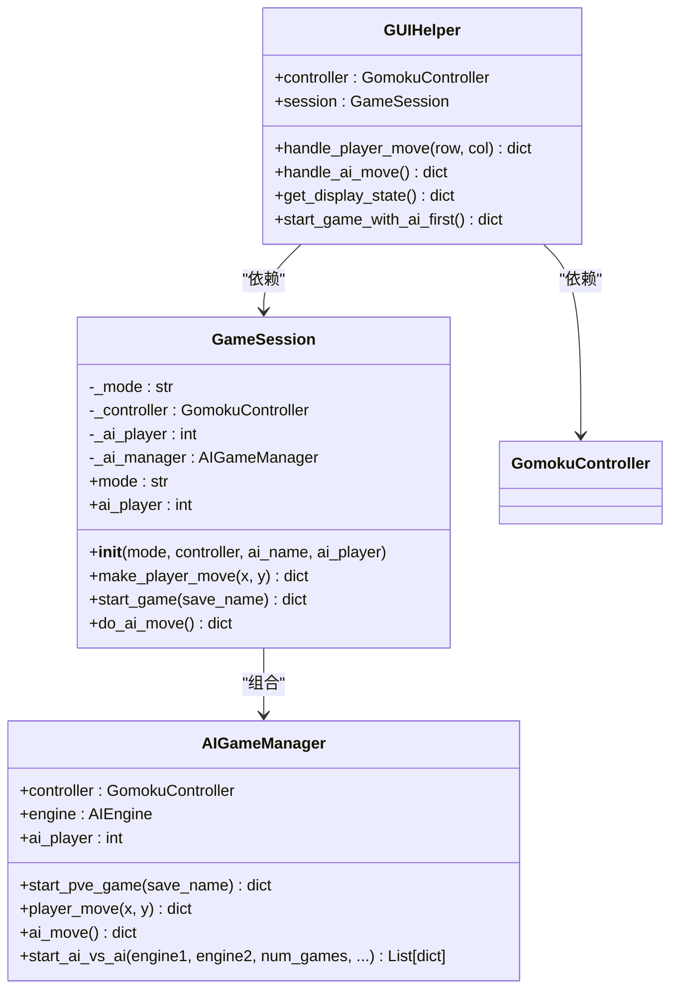
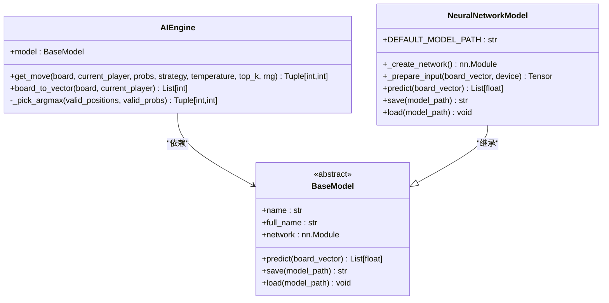
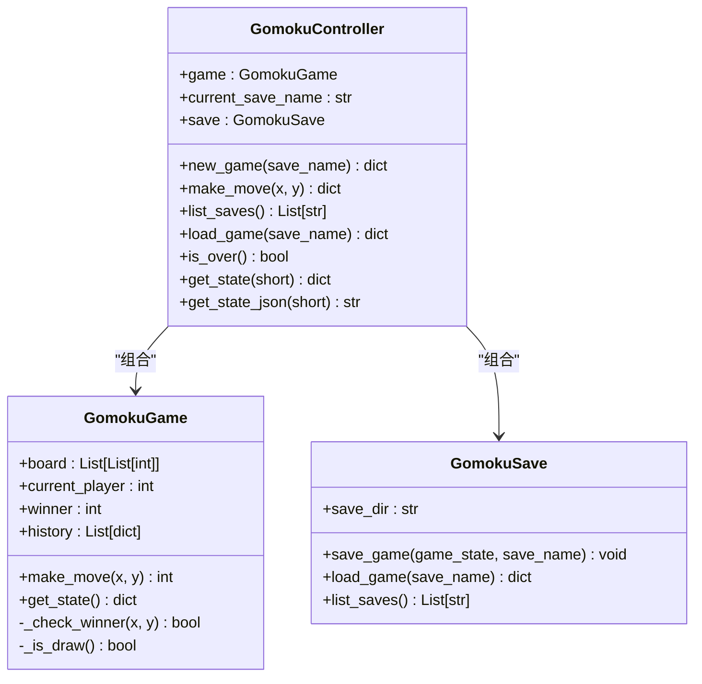
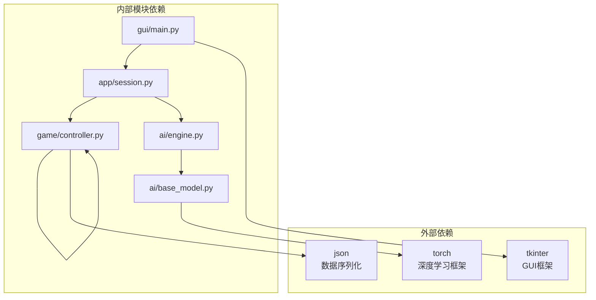
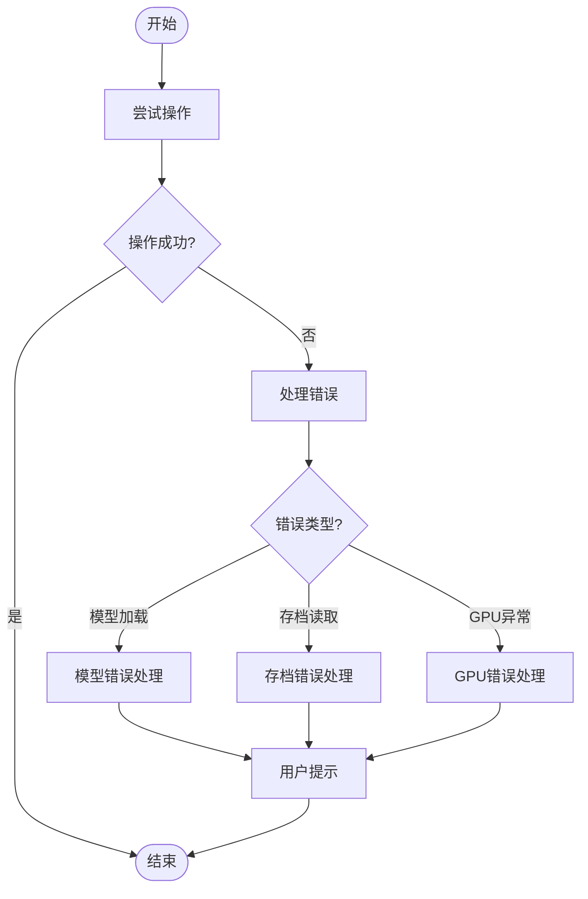
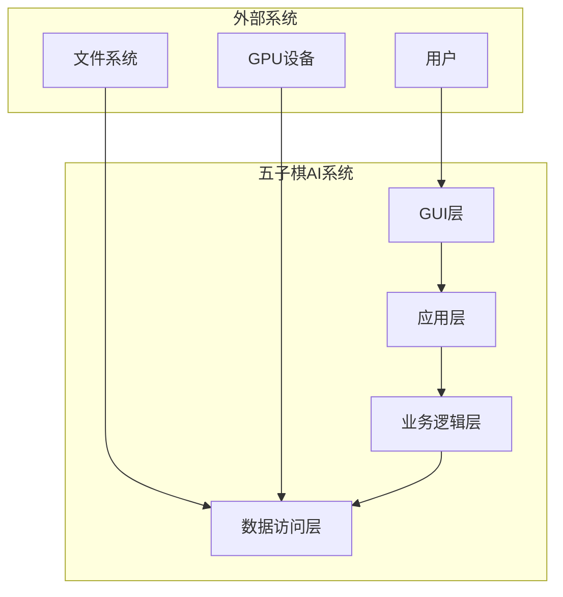
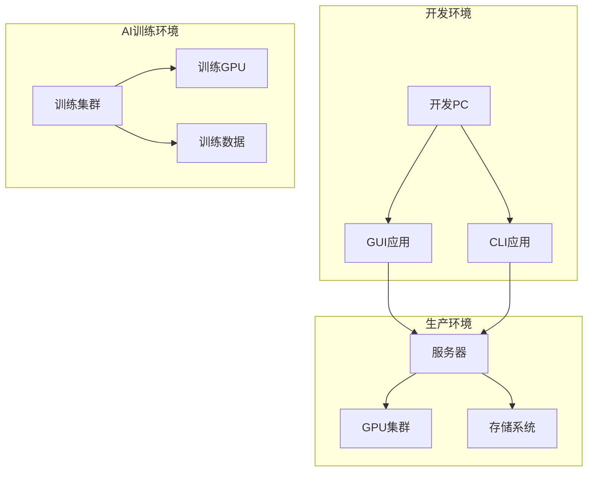

# 整体架构设计

<cite>
**本文档引用的文件**
- [gui/main.py](file://gui/main.py)
- [app/session.py](file://app/session.py)
- [app/gui_helper.py](file://app/gui_helper.py)
- [game/controller.py](file://game/controller.py)
- [game/game.py](file://game/game.py)
- [game/save.py](file://game/save.py)
- [ai/engine.py](file://ai/engine.py)
- [ai/game_manager.py](file://ai/game_manager.py)
- [ai/base_model.py](file://ai/base_model.py)
- [ai/base_trainer.py](file://ai/base_trainer.py)
- [cli/main.py](file://cli/main.py)
- [gui/components/game_board.py](file://gui/components/game_board.py)
- [requirements/key_points.md](file://requirements/key_points.md)
</cite>

## 目录
1. [简介](#简介)
2. [项目结构](#项目结构)
3. [核心组件](#核心组件)
4. [架构概览](#架构概览)
5. [详细组件分析](#详细组件分析)
6. [依赖分析](#依赖分析)
7. [性能考虑](#性能考虑)
8. [故障排查指南](#故障排查指南)
9. [结论](#结论)
10. [附录](#附录)

## 简介
本项目是一个基于Python的五子棋AI系统，采用分层架构设计，包含GUI层、应用层、业务逻辑层和数据访问层。系统支持三种游戏模式：人人对战（PvP）、人机对战（PvE）和AI内战（AI vs AI）。架构遵循关注点分离、依赖倒置和接口隔离等设计原则，通过清晰的层次边界实现模块化开发和可维护性。

## 项目结构
项目采用按功能域划分的目录结构，每个包负责特定领域的职责：

```mermaid
graph TB
subgraph "GUI层"
GUI_MAIN["gui/main.py<br/>主界面控制器"]
GUI_COMP["gui/components/<br/>界面组件"]
GUI_HELPER["gui/display_updater.py<br/>显示更新器"]
end
subgraph "应用层"
APP_SESSION["app/session.py<br/>游戏会话管理"]
APP_GUI_HELPER["app/gui_helper.py<br/>GUI辅助逻辑"]
APP_EXCEPTIONS["app/exceptions.py<br/>异常处理"]
end
subgraph "业务逻辑层"
GAME_CONTROLLER["game/controller.py<br/>游戏控制器"]
GAME_GAME["game/game.py<br/>核心游戏逻辑"]
GAME_SAVE["game/save.py<br/>存档管理"]
AI_ENGINE["ai/engine.py<br/>AI引擎"]
AI_MANAGER["ai/game_manager.py<br/>AI游戏管理"]
AI_BASE_MODEL["ai/base_model.py<br/>模型基类"]
AI_TRAINER["ai/base_trainer.py<br/>训练器基类"]
end
subgraph "CLI层"
CLI_MAIN["cli/main.py<br/>命令行接口"]
end
GUI_MAIN --> APP_SESSION
GUI_MAIN --> APP_GUI_HELPER
APP_SESSION --> GAME_CONTROLLER
APP_SESSION --> AI_ENGINE
APP_GUI_HELPER --> GAME_CONTROLLER
GAME_CONTROLLER --> GAME_GAME
GAME_CONTROLLER --> GAME_SAVE
AI_ENGINE --> AI_BASE_MODEL
AI_MANAGER --> GAME_CONTROLLER
AI_MANAGER --> AI_ENGINE
```

**图表来源**
- [gui/main.py:1-462](file://gui/main.py#L1-L462)
- [app/session.py:1-179](file://app/session.py#L1-L179)
- [game/controller.py:1-194](file://game/controller.py#L1-L194)
- [ai/engine.py:1-194](file://ai/engine.py#L1-L194)

**章节来源**
- [gui/main.py:1-462](file://gui/main.py#L1-L462)
- [app/session.py:1-179](file://app/session.py#L1-L179)
- [game/controller.py:1-194](file://game/controller.py#L1-L194)

## 核心组件
系统采用四层架构设计，每层都有明确的职责边界：

### GUI层（表现层）
- **职责**：负责用户界面交互和可视化展示
- **关键组件**：
  - 主界面控制器：处理用户交互事件和界面更新
  - 界面组件：棋盘、按钮、对话框等UI元素
  - 显示更新器：管理界面状态同步和动画效果

### 应用层（协调层）
- **职责**：协调各层之间的交互，管理游戏会话流程
- **关键组件**：
  - 游戏会话：封装一局游戏的完整流程
  - GUI辅助：处理与界面无关的业务逻辑
  - 异常处理：统一的错误管理和用户提示

### 业务逻辑层（领域层）
- **职责**：实现核心游戏规则和AI算法
- **关键组件**：
  - 游戏控制器：对外唯一接口，封装所有游戏操作
  - 核心游戏逻辑：实现五子棋规则和胜负判定
  - AI引擎：连接UI和AI模型，处理落子决策
  - AI管理器：管理人机对战和AI内战流程

### 数据访问层（基础设施层）
- **职责**：负责数据持久化和模型加载
- **关键组件**：
  - 存档管理：JSON格式的存档读写
  - 模型基类：定义AI模型统一接口
  - 训练器基类：提供通用训练框架

**章节来源**
- [gui/main.py:31-90](file://gui/main.py#L31-L90)
- [app/session.py:12-21](file://app/session.py#L12-L21)
- [game/controller.py:11-31](file://game/controller.py#L11-L31)
- [ai/engine.py:44-66](file://ai/engine.py#L44-L66)

## 架构概览
系统采用分层架构，通过清晰的依赖关系实现关注点分离：

**图表来源**
- [gui/main.py:15-28](file://gui/main.py#L15-L28)
- [app/session.py:7-9](file://app/session.py#L7-L9)
- [game/controller.py:6-8](file://game/controller.py#L6-L8)
- [ai/engine.py:9](file://ai/engine.py#L9)

### 架构设计原则
系统严格遵循以下设计原则：

1. **关注点分离**：每层职责明确，界面逻辑与业务逻辑分离
2. **依赖倒置**：高层模块不依赖低层模块，都依赖抽象
3. **接口隔离**：通过清晰的接口定义实现模块间解耦
4. **开闭原则**：对扩展开放，对修改封闭

**章节来源**
- [requirements/key_points.md:104-136](file://requirements/key_points.md#L104-L136)

## 详细组件分析

### GUI主界面组件分析
GUI主界面采用组件化设计，实现了良好的可维护性和扩展性：

**图表来源**
- [gui/main.py:31-90](file://gui/main.py#L31-L90)
- [gui/components/game_board.py:7-52](file://gui/components/game_board.py#L7-L52)

**章节来源**
- [gui/main.py:224-285](file://gui/main.py#L224-L285)
- [gui/components/game_board.py:97-170](file://gui/components/game_board.py#L97-L170)

### 游戏会话管理组件分析
游戏会话层实现了PvP和PvE模式的统一管理：

**图表来源**
- [app/session.py:12-179](file://app/session.py#L12-L179)
- [ai/game_manager.py:16-339](file://ai/game_manager.py#L16-L339)
- [app/gui_helper.py:12-199](file://app/gui_helper.py#L12-L199)

**章节来源**
- [app/session.py:63-102](file://app/session.py#L63-L102)
- [ai/game_manager.py:100-122](file://ai/game_manager.py#L100-L122)

### AI引擎组件分析
AI引擎实现了模型抽象和落子决策逻辑：

**图表来源**
- [ai/engine.py:44-194](file://ai/engine.py#L44-L194)
- [ai/base_model.py:24-323](file://ai/base_model.py#L24-L323)

**章节来源**
- [ai/engine.py:67-143](file://ai/engine.py#L67-L143)
- [ai/base_model.py:195-231](file://ai/base_model.py#L195-L231)

### 游戏控制器组件分析
游戏控制器提供了统一的对外接口：

**图表来源**
- [game/controller.py:11-194](file://game/controller.py#L11-L194)
- [game/game.py:4-118](file://game/game.py#L4-L118)
- [game/save.py:9-93](file://game/save.py#L9-L93)

**章节来源**
- [game/controller.py:32-63](file://game/controller.py#L32-L63)
- [game/game.py:22-56](file://game/game.py#L22-L56)

## 依赖分析
系统采用依赖倒置原则，通过抽象接口实现模块解耦：

**图表来源**
- [gui/main.py:15-28](file://gui/main.py#L15-L28)
- [ai/base_model.py:20-22](file://ai/base_model.py#L20-L22)
- [game/controller.py:3-5](file://game/controller.py#L3-L5)

### 关键依赖关系
1. **GUI层依赖应用层**：GUI通过会话管理器协调游戏流程
2. **应用层依赖业务逻辑层**：会话管理器委托控制器和AI引擎
3. **业务逻辑层依赖数据访问层**：控制器管理游戏状态和存档
4. **AI层依赖深度学习框架**：模型使用PyTorch进行训练和推理

**章节来源**
- [app/session.py:7-9](file://app/session.py#L7-L9)
- [ai/engine.py:9](file://ai/engine.py#L9)

## 性能考虑
系统在设计时充分考虑了性能优化：

### 训练性能优化
- **GPU加速**：自动检测CUDA设备，优先使用GPU训练
- **批处理训练**：支持mini-batch训练提升收敛速度
- **学习率调度**：支持StepLR和ReduceLROnPlateau两种策略
- **梯度范数监控**：实时监控训练过程稳定性

### 推理性能优化
- **模型缓存**：AI引擎支持预计算概率分布避免重复计算
- **策略选择**：提供argmax和sampling两种落子策略
- **温度采样**：支持温度参数调节探索性

### 存储性能优化
- **增量存档**：每次落子后自动保存，避免数据丢失
- **压缩存档**：使用JSON格式，便于版本控制和备份
- **并行处理**：AI内战支持多进程并行对战

## 故障排查指南
系统提供了完善的错误处理机制：

### 常见问题及解决方案
1. **模型加载失败**
   - 检查模型文件路径和权限
   - 确认模型版本兼容性
   - 验证PyTorch版本要求

2. **存档读取错误**
   - 检查JSON文件格式完整性
   - 验证存档文件权限
   - 确认存档目录存在性

3. **GPU训练异常**
   - 检查CUDA驱动版本
   - 验证显存容量
   - 调整batch size参数

### 错误处理流程

**章节来源**
- [app/session.py:44-51](file://app/session.py#L44-L51)
- [ai/engine.py:24-28](file://ai/engine.py#L24-L28)

## 结论
本五子棋AI项目采用清晰的分层架构设计，通过关注点分离、依赖倒置和接口隔离等设计原则，实现了高度模块化的系统结构。GUI层专注于用户交互，应用层协调各层交互，业务逻辑层实现核心算法，数据访问层负责持久化。系统支持多种游戏模式，具备良好的扩展性和可维护性，为后续AI模型的迭代和功能扩展奠定了坚实基础。

## 附录

### 系统上下文图

### 部署拓扑图
