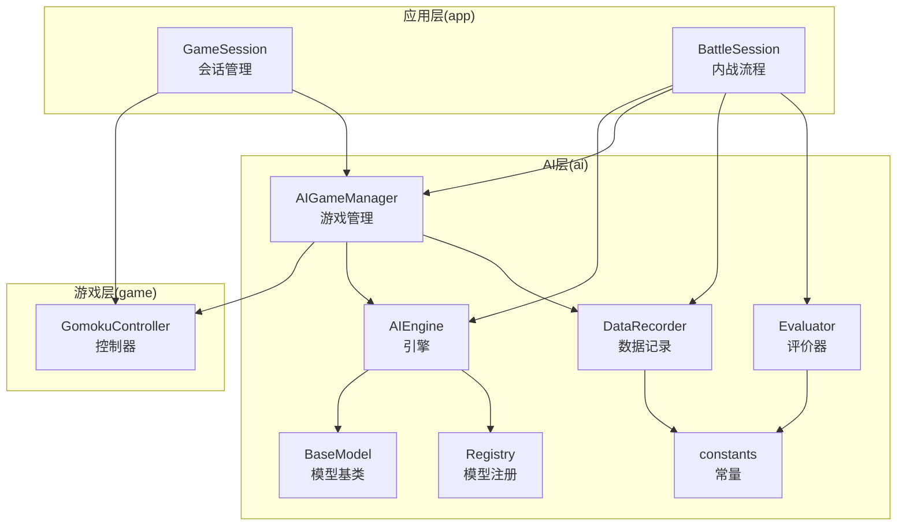
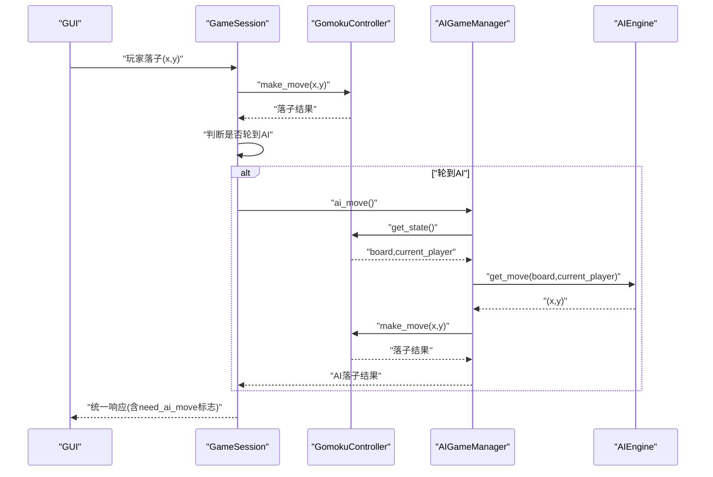
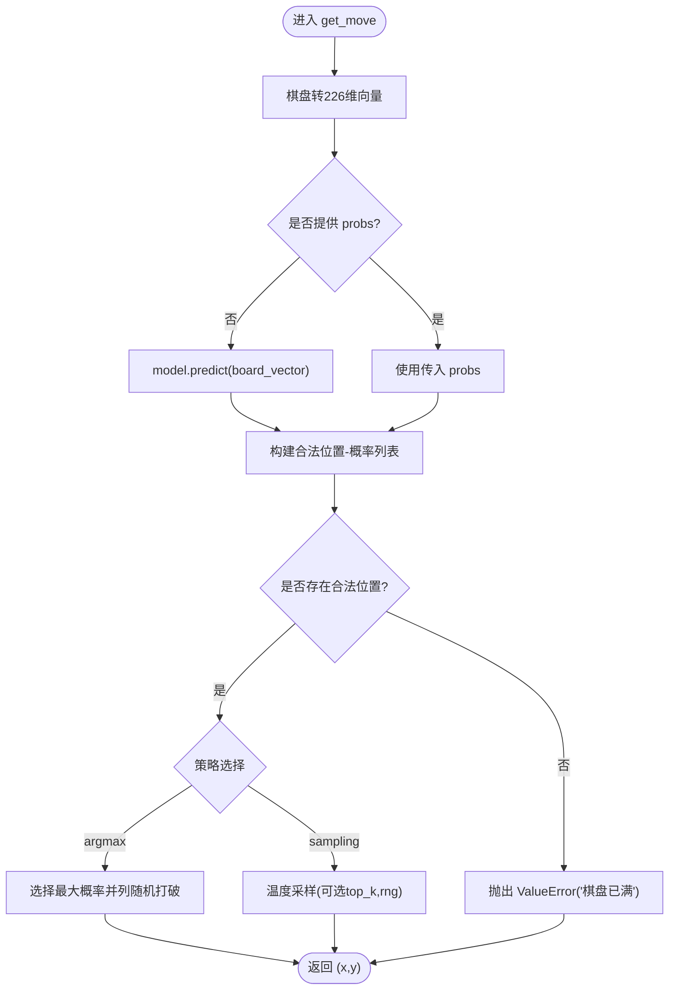
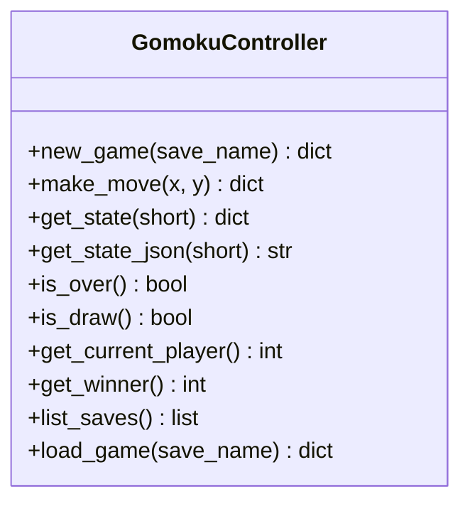
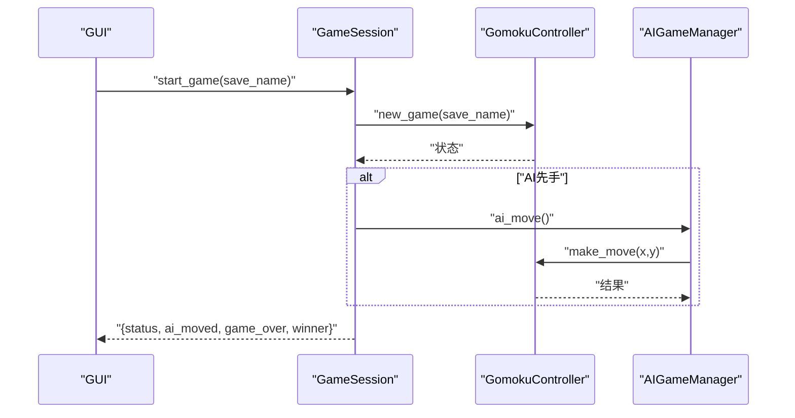
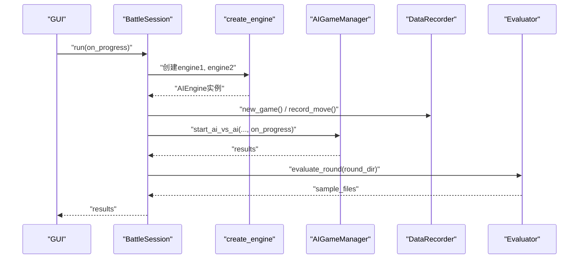
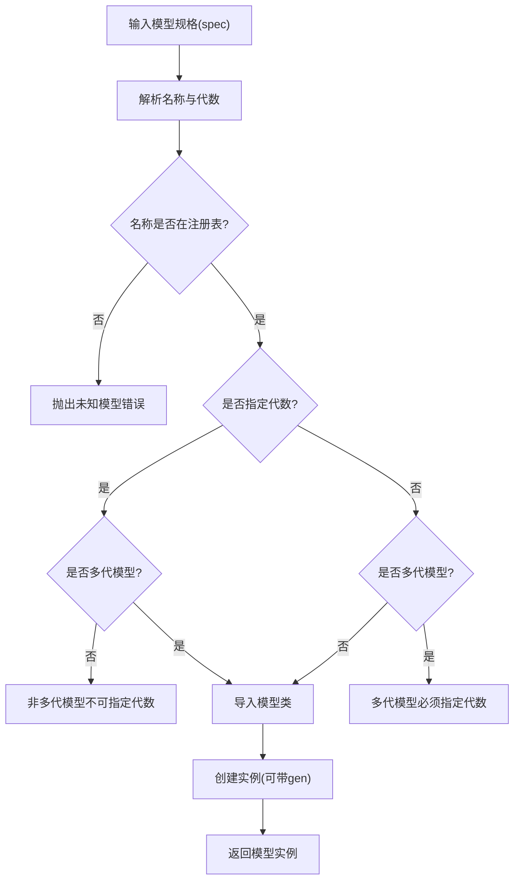
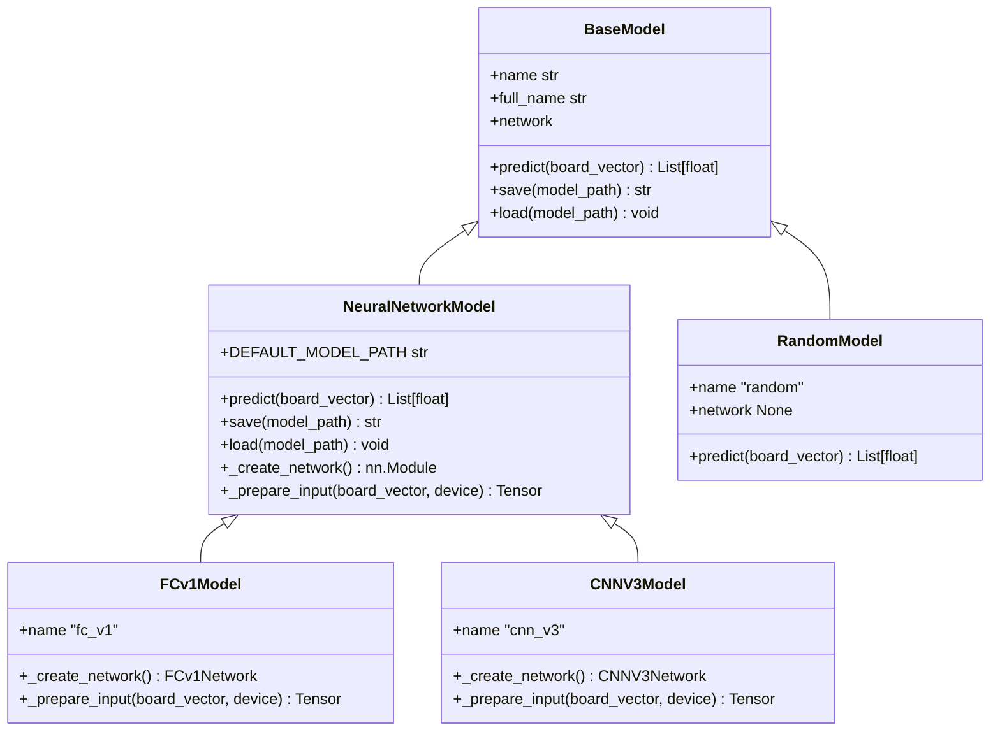
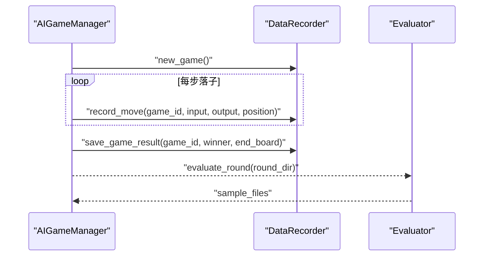
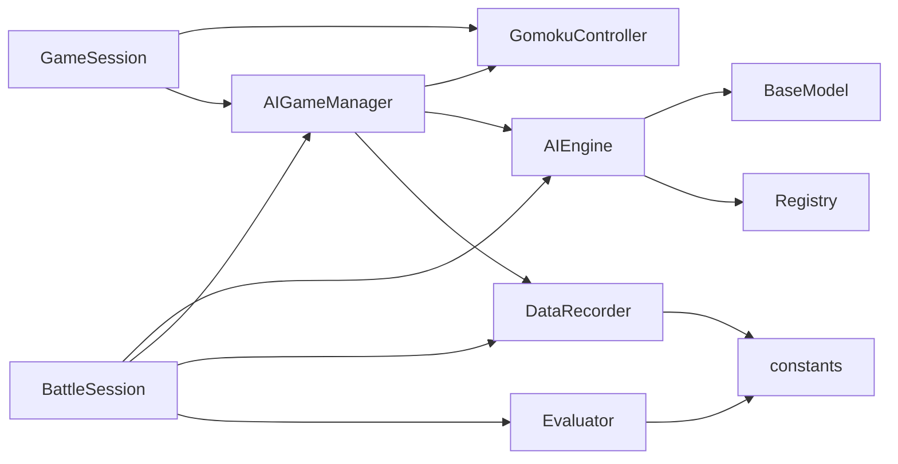

# 模块设计

<cite>
**本文引用的文件**
- [ai/__init__.py](file://ai/__init__.py)
- [ai/engine.py](file://ai/engine.py)
- [ai/game_manager.py](file://ai/game_manager.py)
- [ai/registry.py](file://ai/registry.py)
- [ai/base_model.py](file://ai/base_model.py)
- [ai/data_recorder.py](file://ai/data_recorder.py)
- [ai/evaluator.py](file://ai/evaluator.py)
- [ai/constants.py](file://ai/constants.py)
- [ai/models/random/model.py](file://ai/models/random/model.py)
- [ai/models/fc_v1/model.py](file://ai/models/fc_v1/model.py)
- [ai/models/cnn_v3/model.py](file://ai/models/cnn_v3/model.py)
- [app/__init__.py](file://app/__init__.py)
- [app/session.py](file://app/session.py)
- [app/battle.py](file://app/battle.py)
- [game/__init__.py](file://game/__init__.py)
- [game/controller.py](file://game/controller.py)
</cite>

## 目录
1. [简介](#简介)
2. [项目结构](#项目结构)
3. [核心组件](#核心组件)
4. [架构总览](#架构总览)
5. [详细组件分析](#详细组件分析)
6. [依赖分析](#依赖分析)
7. [性能考量](#性能考量)
8. [故障排查指南](#故障排查指南)
9. [结论](#结论)
10. [附录](#附录)

## 简介
本设计文档聚焦五子棋AI项目的模块设计，围绕AI引擎模块、游戏控制器模块、应用会话模块、模型注册模块等核心模块，系统阐述职责边界、设计原则、对外接口、内部实现细节以及模块间的交互关系。文档强调通过接口设计实现松耦合，遵循单一职责与开闭原则，并提供模块关系图与交互序列图，帮助开发者快速理解与扩展系统。

## 项目结构
项目采用分层清晰的包结构：
- ai 包：AI引擎、模型基类、具体模型实现、数据记录、评价器、注册表等
- app 包：应用层薄代理，封装会话与内战流程
- game 包：游戏核心逻辑与控制器
- gui 包：图形界面层（本设计聚焦后端模块）

图表来源
- [app/session.py:12-179](file://app/session.py#L12-L179)
- [app/battle.py:15-104](file://app/battle.py#L15-L104)
- [ai/engine.py:44-194](file://ai/engine.py#L44-L194)
- [ai/game_manager.py:16-339](file://ai/game_manager.py#L16-L339)
- [ai/registry.py:150-185](file://ai/registry.py#L150-L185)
- [ai/base_model.py:24-323](file://ai/base_model.py#L24-L323)
- [ai/data_recorder.py:17-145](file://ai/data_recorder.py#L17-L145)
- [ai/evaluator.py:51-350](file://ai/evaluator.py#L51-L350)
- [ai/constants.py:1-26](file://ai/constants.py#L1-L26)
- [game/controller.py:11-194](file://game/controller.py#L11-L194)

章节来源
- [ai/__init__.py:1-21](file://ai/__init__.py#L1-L21)
- [app/__init__.py:1-20](file://app/__init__.py#L1-L20)
- [game/__init__.py:1-55](file://game/__init__.py#L1-L55)

## 核心组件
- AI引擎模块（AIEngine）
  - 职责：将棋盘状态转换为模型输入，调用模型获取概率分布，按策略选择落子位置
  - 接口：get_move(board, current_player, probs, strategy, temperature, top_k, rng)
  - 关键特性：支持“argmax”和“sampling”两种策略；可接受预计算的概率向量以提升性能
- 游戏控制器模块（GomokuController）
  - 职责：唯一对外接口，负责游戏状态管理、落子执行、存档读写、状态查询
  - 接口：new_game(save_name)、make_move(x, y)、get_state()、is_over()、load_game(save_name) 等
- 应用会话模块（GameSession、BattleSession）
  - GameSession：封装PvE/PvP流程，协调控制器与AI管理器，向GUI提供统一落子接口
  - BattleSession：封装AI内战全流程，创建引擎、执行对局、记录数据、生成训练样本
- 模型注册模块（Registry）
  - 职责：统一维护模型与训练器映射，支持多代模型指定，按需懒加载
  - 接口：get_model(spec)、get_trainer(spec, **kwargs)、list_models_with_full_name()

章节来源
- [ai/engine.py:44-194](file://ai/engine.py#L44-L194)
- [game/controller.py:11-194](file://game/controller.py#L11-L194)
- [app/session.py:12-179](file://app/session.py#L12-L179)
- [app/battle.py:15-104](file://app/battle.py#L15-L104)
- [ai/registry.py:150-185](file://ai/registry.py#L150-L185)

## 架构总览
系统采用“应用层薄代理 + AI层 + 游戏层”的分层架构。应用层（app）不包含业务逻辑，仅做流程编排；AI层（ai）提供引擎、模型、数据记录与评价能力；游戏层（game）提供唯一对外接口的控制器。模块间通过明确的接口解耦，注册表实现模型加载的延迟绑定，降低耦合度。

图表来源
- [app/session.py:63-102](file://app/session.py#L63-L102)
- [ai/game_manager.py:100-122](file://ai/game_manager.py#L100-L122)
- [ai/engine.py:67-143](file://ai/engine.py#L67-L143)
- [game/controller.py:65-98](file://game/controller.py#L65-L98)

## 详细组件分析

### AI引擎模块（AIEngine）
- 设计要点
  - 输入向量：将15×15棋盘按行展开为225维，附加当前落子方为226维
  - 落子策略：
    - argmax：选择合法位置中概率最大者，平局时随机打破
    - sampling：温度加权采样，支持top-k截断与自定义随机源
  - 性能优化：支持传入预计算的概率向量，避免重复model.predict
- 错误处理：当棋盘已满或策略非法时抛出异常，由上层捕获并转换为用户可感知的错误信息

图表来源
- [ai/engine.py:67-143](file://ai/engine.py#L67-L143)

章节来源
- [ai/engine.py:44-194](file://ai/engine.py#L44-L194)

### 游戏控制器模块（GomokuController）
- 设计要点
  - 唯一对外接口，封装游戏状态、落子执行、存档读写
  - 状态查询：short/long两种格式；支持获取当前玩家、获胜方、完整状态
  - 存档管理：自动生成存档名、检查重复、保存/加载
- 错误处理：未创建游戏、游戏已结束、异常落子均返回错误信息

图表来源
- [game/controller.py:11-194](file://game/controller.py#L11-L194)

章节来源
- [game/controller.py:11-194](file://game/controller.py#L11-L194)

### 应用会话模块（GameSession）
- 设计要点
  - PvE模式：持有AI引擎，自动在AI先行时执行首步
  - 统一落子接口：返回包含need_ai_move标志的响应，便于GUI调度
  - 错误处理：捕获模型加载异常并转换为ModelLoadError
- 与AI层协作：委托AIGameManager执行AI落子；与游戏层协作：通过GomokuController执行落子

图表来源
- [app/session.py:104-143](file://app/session.py#L104-L143)
- [ai/game_manager.py:100-122](file://ai/game_manager.py#L100-L122)

章节来源
- [app/session.py:12-179](file://app/session.py#L12-L179)

### 应用会话模块（BattleSession）
- 设计要点
  - 创建两个AI引擎，执行多局对战，逐局回调进度
  - 对战结束后生成训练样本，支持并行评价
- 与AI层协作：委托create_engine创建引擎；委托AIGameManager执行对局；委托DataRecorder记录；委托Evaluator生成样本

图表来源
- [app/battle.py:52-92](file://app/battle.py#L52-L92)
- [ai/game_manager.py:233-274](file://ai/game_manager.py#L233-L274)
- [ai/data_recorder.py:66-141](file://ai/data_recorder.py#L66-L141)
- [ai/evaluator.py:224-350](file://ai/evaluator.py#L224-L350)

章节来源
- [app/battle.py:15-104](file://app/battle.py#L15-L104)

### 模型注册模块（Registry）
- 设计要点
  - 统一维护模型与训练器映射，支持多代模型指定（如cnn_v3.1）
  - 懒加载：首次使用时按需导入类，避免启动时的模块级依赖
  - 校验：非多代模型不可指定代数；多代模型必须指定代数；多代模型显式指定代数时必须存在权重文件
- 接口：get_model(spec)、get_trainer(spec, **kwargs)、list_models_with_full_name()

图表来源
- [ai/registry.py:150-185](file://ai/registry.py#L150-L185)

章节来源
- [ai/registry.py:1-316](file://ai/registry.py#L1-L316)

### 模型基类与具体模型
- 模型基类（BaseModel）
  - 抽象接口：predict、name、save、load、network
  - 神经网络模型抽象（NeuralNetworkModel）：统一提供__init__、predict、save、load实现，子类仅需实现网络创建与输入准备
  - 多代模型支持：通过DEFAULT_MODEL_PATH动态定位gen{i}子目录
- 具体模型
  - RandomModel：均匀分布随机模型
  - FCv1Model：全连接网络，5层隐藏层，每层1000神经元
  - CNNV3Model：纯卷积网络，三层3×3卷积+一层1×1卷积，参数量小、推理快

图表来源
- [ai/base_model.py:24-323](file://ai/base_model.py#L24-L323)
- [ai/models/random/model.py:10-64](file://ai/models/random/model.py#L10-L64)
- [ai/models/fc_v1/model.py:91-132](file://ai/models/fc_v1/model.py#L91-L132)
- [ai/models/cnn_v3/model.py:96-139](file://ai/models/cnn_v3/model.py#L96-L139)

章节来源
- [ai/base_model.py:1-323](file://ai/base_model.py#L1-L323)
- [ai/models/random/model.py:1-64](file://ai/models/random/model.py#L1-L64)
- [ai/models/fc_v1/model.py:1-132](file://ai/models/fc_v1/model.py#L1-L132)
- [ai/models/cnn_v3/model.py:1-139](file://ai/models/cnn_v3/model.py#L1-L139)

### 数据记录与评价模块
- DataRecorder
  - 职责：为每轮对战创建轮次目录，为每局游戏创建子目录，记录每步输入、输出、落子位置，保存游戏结果
  - 特性：紧凑JSON格式减少文件体积；自动纠正游戏编号不一致
- Evaluator
  - 职责：从record.json生成训练样本sample.json，采用双向棋型检测法与五连追溯奖励融合，通过Softmax转换为概率分布
  - 特性：支持多进程并行评价；进程崩溃时回退到串行模式

图表来源
- [ai/game_manager.py:123-231](file://ai/game_manager.py#L123-L231)
- [ai/data_recorder.py:66-141](file://ai/data_recorder.py#L66-L141)
- [ai/evaluator.py:224-350](file://ai/evaluator.py#L224-L350)

章节来源
- [ai/data_recorder.py:1-145](file://ai/data_recorder.py#L1-L145)
- [ai/evaluator.py:1-350](file://ai/evaluator.py#L1-L350)

## 依赖分析
- 模块内聚与耦合
  - AIEngine依赖BaseModel接口，通过注册表间接依赖具体模型类，实现运行时解耦
  - AIGameManager依赖GomokuController与AIEngine，通过控制器公开接口操作游戏，避免对game包内部逻辑的耦合
  - GameSession与BattleSession均为薄代理层，依赖上层模块接口，不包含业务逻辑
- 外部依赖
  - AI层依赖PyTorch进行神经网络推理与训练
  - 评价器依赖多进程并行框架，Windows下使用顶层worker函数规避pickle限制

图表来源
- [ai/engine.py:8-10](file://ai/engine.py#L8-L10)
- [ai/game_manager.py:10-13](file://ai/game_manager.py#L10-L13)
- [app/session.py:7-9](file://app/session.py#L7-L9)
- [app/battle.py:10-12](file://app/battle.py#L10-L12)
- [ai/data_recorder.py:12-12](file://ai/data_recorder.py#L12-L12)
- [ai/evaluator.py:20-23](file://ai/evaluator.py#L20-L23)
- [ai/constants.py:11-22](file://ai/constants.py#L11-L22)

章节来源
- [ai/engine.py:1-194](file://ai/engine.py#L1-L194)
- [ai/game_manager.py:1-339](file://ai/game_manager.py#L1-L339)
- [app/session.py:1-179](file://app/session.py#L1-L179)
- [app/battle.py:1-104](file://app/battle.py#L1-L104)

## 性能考量
- 推理性能
  - AIEngine支持传入预计算的概率向量，避免重复model.predict，显著降低重复计算
  - DataRecorder使用紧凑JSON格式，减少文件体积与IO开销
- 训练数据生成
  - Evaluator支持多进程并行评价，CPU核数受限时默认限制并发数，避免资源争抢
  - 进程崩溃时自动回退到串行模式，保证任务完成
- 模型设计
  - CNNV3模型参数量小，推理速度快，适合在线推理与快速迭代

## 故障排查指南
- 模型加载失败
  - 现象：创建AI引擎时报错，GUI提示模型加载失败
  - 原因：未知模型、非多代模型指定代数、多代模型未指定代数、多代模型显式指定代数但权重文件不存在
  - 处理：检查模型名称与代数；确认权重文件存在；使用list_models_with_full_name()验证可用模型
- 落子异常
  - 现象：棋盘已满或策略非法导致异常
  - 处理：检查棋盘状态与策略参数；确保传入的probs与board维度一致
- 进程池崩溃
  - 现象：并行评价时进程池崩溃
  - 处理：系统自动回退到串行模式；检查内存占用与文件权限

章节来源
- [ai/registry.py:168-184](file://ai/registry.py#L168-L184)
- [ai/engine.py:102-142](file://ai/engine.py#L102-L142)
- [ai/evaluator.py:325-347](file://ai/evaluator.py#L325-L347)

## 结论
本项目通过清晰的分层与接口设计实现了高内聚、低耦合的模块体系。AI引擎与模型注册表解耦，应用层仅做流程编排，游戏层提供唯一对外接口，确保了系统的可扩展性与可维护性。遵循单一职责与开闭原则，新增模型与策略仅需实现相应接口，即可无缝接入现有流程。

## 附录
- 最佳实践
  - 单一职责：每个模块专注于自身职责，避免跨层调用
  - 开闭原则：通过接口与抽象类扩展新模型与策略，不修改既有实现
  - 松耦合：通过注册表与接口实现延迟绑定与运行时替换
  - 明确异常：在边界处捕获并转换异常，向上层提供可理解的错误信息